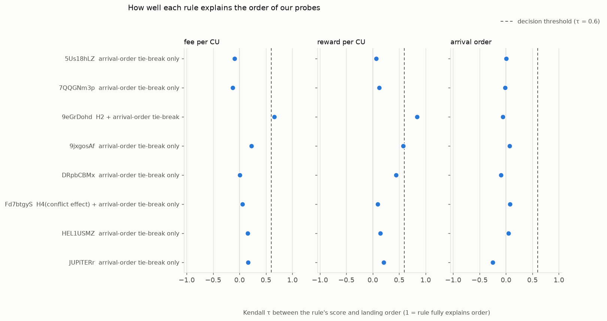
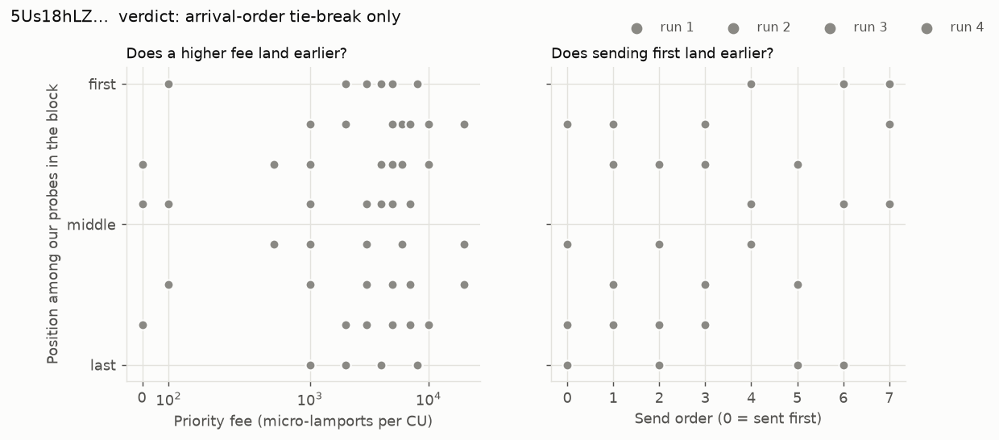
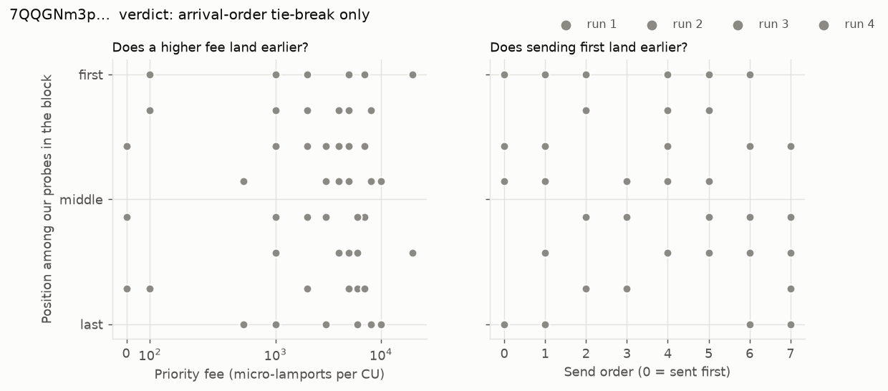
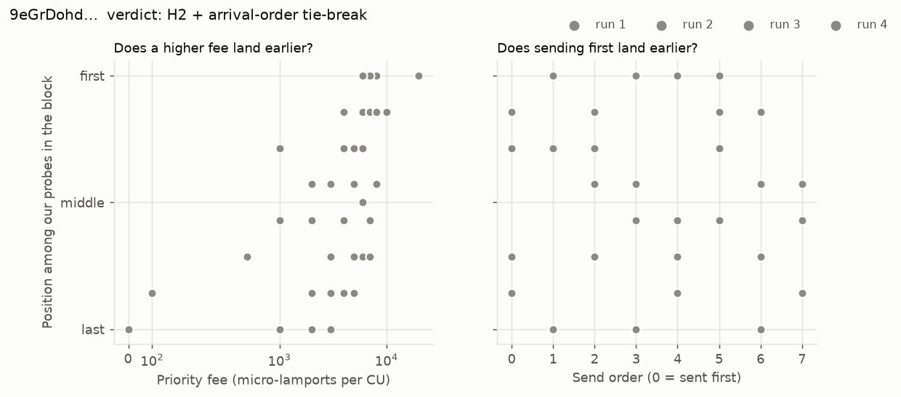
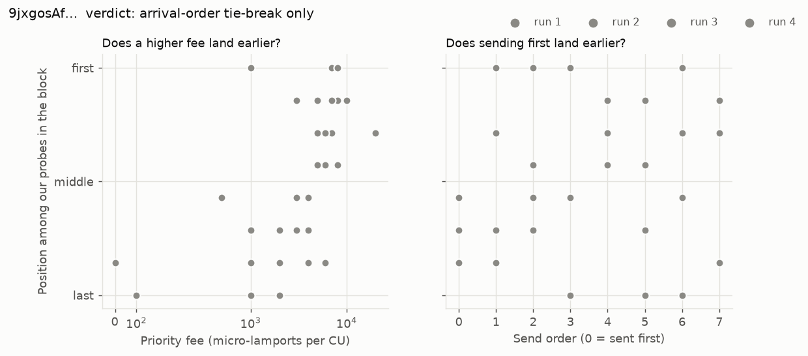
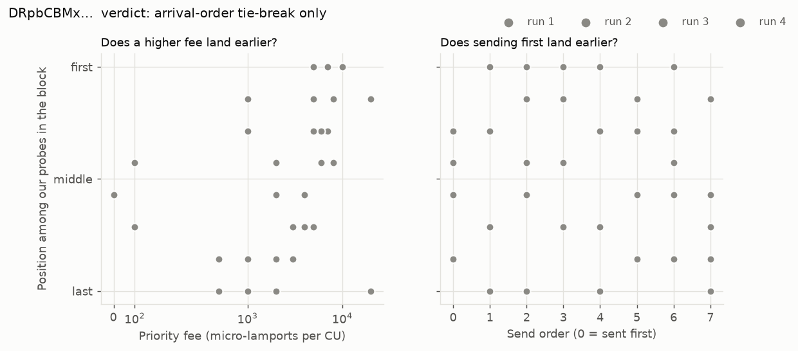
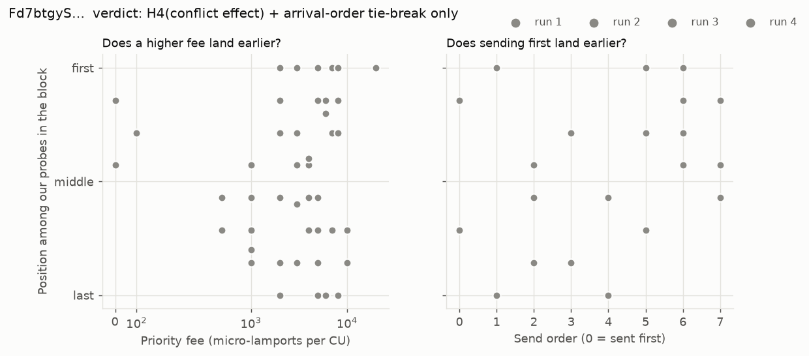
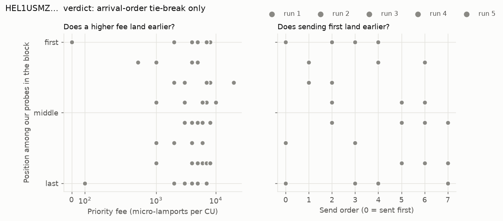
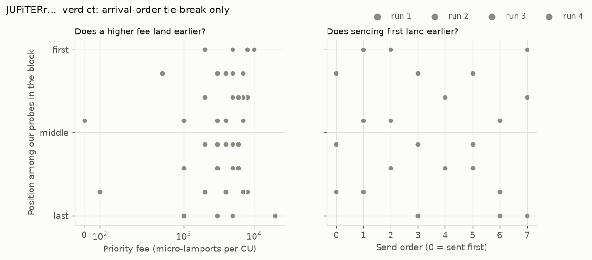

# Inside the Block: report

Measurements: 2026-10-28 to 2026-10-29 (all after Alpenglow activation, 2026-10-21).

Regenerate with `itb analyze && itb report`. Every claim below is followed by the signatures and slots it rests on; `docker compose run verify` re-checks them against the chain.

## Summary

| Validator | Client (at measurement) | Runs | Probes | Landed in window | Verdict | Confidence |
|---|---|---|---|---|---|---|
| `5Us18hLZ…` | agave 4.3.2 | 4 | 216 | 107 (49%) | **arrival-order tie-break only** | 1.00 |
| `7QQGNm3p…` | agave 4.3.2 | 5 | 230 | 147 (63%) | **arrival-order tie-break only** | 1.00 |
| `9eGrDohd…` | firedancer 26.10.4 | 4 | 216 | 129 (59%) | **H2 + arrival-order tie-break** | 1.00 |
| `9jxgosAf…` | firedancer-bam 26.10.5 | 4 | 216 | 135 (62%) | **arrival-order tie-break only** | 1.00 |
| `DRpbCBMx…` | agave-bam 4.4.0-rc.1 | 4 | 216 | 131 (60%) | **arrival-order tie-break only** | 1.00 |
| `Fd7btgyS…` | harmonic-agave 4.3.2 | 4 | 216 | 142 (65%) | **H4(conflict effect) + arrival-order tie-break only** | 0.75 |
| `HEL1USMZ…` | jito-agave 4.3.2 | 5 | 238 | 144 (60%) | **arrival-order tie-break only** | 0.67 |
| `JUPiTERr…` | harmonic-firedancer 26.10.4 | 4 | 216 | 130 (60%) | **arrival-order tie-break only** | 1.00 |

## Measurement log

| Run | Date (UTC) | Provider | Clock offset (s) | Live | Probes |
|---|---|---|---|---|---|
| `20261028T190704Z` | 2026-10-28T19:07:04Z | solana-mainnet.g.alchemy.com | -0.092 | True | 14 |
| `20261029T080501Z` | 2026-10-29T08:05:01Z | solana-mainnet.g.alchemy.com | n/a | True | 22 |
| `20261029T084255Z` | 2026-10-29T08:42:59Z | solana-mainnet.g.alchemy.com | -0.031 | True | 1704 |
| `20261029T123727Z` | 2026-10-29T12:37:30Z | solana-mainnet.g.alchemy.com | -0.091 | True | 1304 |

## Findings per validator

### `5Us18hLZPXJTS4QVuGSsUw137Dyd2tgBaem24Xsf5nBS`

Client at measurement: **agave** 4.3.2. Verdict: **arrival-order tie-break only** (confidence 1.00; 107 probes used).

| Hypothesis | Effect | p | p (Holm) | Runs agreeing | Passed |
|---|---|---|---|---|---|
| H1 | -0.10 | 0.8333 | 1.0000 | 0.00 | no |
| H2 | 0.06 | 0.2640 | 1.0000 | 0.00 | no |
| H3 | 0.01 | 0.4695 | 1.0000 | 0.00 | no |
| H4 | -0.25 | 0.7978 | 1.0000 | 0.00 | no |
| H5 | 0.86 | 0.0004 | 0.0020 | 1.00 | yes |

Noise vs rule:

- H1: effect -0.10 = -1.0x the shuffle-noise SD (0.097); between-run SD 0.134 over 4 runs
- H2: effect 0.06 = 0.6x the shuffle-noise SD (0.100); between-run SD 0.268 over 4 runs
- H3: effect 0.01 = 0.1x the shuffle-noise SD (0.099); between-run SD 0.318 over 4 runs

Competing traffic (20 blocks): context tau 0.01 (sd 0.07). Supplementary only.

Evidence: every probe (signature, slot, position)

| Probe | Signature | Slot | Tx index | Rank in batch | Outcome |
|---|---|---|---|---|---|
| `probe:20261029T084255Z-5Us18h-r1:b1:0` | [`5EpjEtNEVMRJ…`](https://solscan.io/tx/5EpjEtNEVMRJFeB1VhFQfzAYmeSYFaAyWCF79w3LqTzScw9qNgEsLL5wQJcSHeMuQwvGCypXKtGMcizr7siguuv7) | 462820873 | 190 | 6 | landed |
| `probe:20261029T084255Z-5Us18h-r1:b1:1` | [`WTW8hYxXXpfv…`](https://solscan.io/tx/WTW8hYxXXpfvDMCR7Uv3LjqSPqEUdH46z5H72WW2tzhxFKA2PCNBhUM89Bo6hdiKgfRRLcKfdujqRWobfxKhy9L) | 462820873 | 172 | 3 | landed |
| `probe:20261029T084255Z-5Us18h-r1:b1:2` | [`49D9dfay7vXP…`](https://solscan.io/tx/49D9dfay7vXP4s1XsXkGt8kZARBx6np8LgcGY5mG8cgorxDSz8dkpn7TziRGELF8z6xc7r3MMqKkCiXsrJ1KXDWv) | 462820873 | 178 | 4 | landed |
| `probe:20261029T084255Z-5Us18h-r1:b1:3` | [`3Jwu3suopASo…`](https://solscan.io/tx/3Jwu3suopASoxs5Xgekk3TBEDbrUsyEEh42RzfpbWTNqeWLUrDjPDdXTMfXfpCsz8sdZn1rcNW1bgFaxoZsCMG4g) | 462820873 | 169 | 1 | landed |
| `probe:20261029T084255Z-5Us18h-r1:b1:4` | [`Fd4x8sB2JjCW…`](https://solscan.io/tx/Fd4x8sB2JjCWPXvg8z5NWyGeYZq7cRuT55E2j7da6msdmaxoPfcFwEewJaJhUZgr9V8bX7swQYfvK6pH2HGieAu) | 462820873 | 255 | 7 | landed |
| `probe:20261029T084255Z-5Us18h-r1:b1:5` | [`2NZjfiUxFRCk…`](https://solscan.io/tx/2NZjfiUxFRCkBoQrhtSmTQCPvxvL5kDZGogV539aWX3pu994bGzZqvSX1E2FT3iHhWRJQPFTpuT2t6MtnikxFLK1) | 462820873 | 166 | 0 | landed |
| `probe:20261029T084255Z-5Us18h-r1:b1:6` | [`3BWr4iGS693z…`](https://solscan.io/tx/3BWr4iGS693zqcwQwTVmtd2oTsXJiNLfCnUz8Kf29WGFNuvi4bgZ9uVm4HVmhySrEJiLnE4P9oRYX2ZFyaJ2tRWt) | 462820873 | 171 | 2 | landed |
| `probe:20261029T084255Z-5Us18h-r1:b1:7` | [`2nyCoq8YGcBc…`](https://solscan.io/tx/2nyCoq8YGcBcrCBCPDcr67CCZeYmd4HscSHS6f9bgiC2tmqZzJzwdYwRrfFPQfxMSAknYc4Zc6oU93P97BcV9ex) | 462820873 | 180 | 5 | landed |
| `probe:20261029T084255Z-5Us18h-r1:b2:0` | [`4QGReAE8zJkV…`](https://solscan.io/tx/4QGReAE8zJkVWM3fqdgxyj47i4Ui2bSsQ8JAgSHFBPnSa5joDY4zEMnox7Jro7jQxxMfSnWxbVcVG7ew5LJySgSU) | 462821026 | 206 |  | landed_other_leader |
| `probe:20261029T084255Z-5Us18h-r1:b2:1` | [`5DCDGNdWeM98…`](https://solscan.io/tx/5DCDGNdWeM98eeKAWtMV4kcsVNV6T5nRjE2nhNLS8EJaP5bN5ta2KqQnWkG14fi1WGWALnqgdNuveZRrqepDzZnD) | 462821026 | 207 |  | landed_other_leader |
| `probe:20261029T084255Z-5Us18h-r1:b2:2` | [`Kf9122ru8X8z…`](https://solscan.io/tx/Kf9122ru8X8zJGk3jyVKLj77h715YcvFZFw2vsZx6G2XBo5dJcQqJKsx1FdFCS5KUt8c7352TnA6wXBUeaTiyMq) | 462821026 | 209 |  | landed_other_leader |
| `probe:20261029T084255Z-5Us18h-r1:b2:3` | [`2Hy5T1TKzquD…`](https://solscan.io/tx/2Hy5T1TKzquD3ECQaC1kYQhqmeuzRyBQC86S6CBCHGVCzMszvxcNWTmnQ8KZJCLn3NDbRb3XDiBQozPGSmF6vLRE) | 462821026 | 208 |  | landed_other_leader |
| `probe:20261029T084255Z-5Us18h-r1:b2:4` | [`2qyFSPuCLWMr…`](https://solscan.io/tx/2qyFSPuCLWMrm1HGSCFU5Q9JtyJP4GGCqy7auCAKMZEgsBRrDnPfRfuxv3ynhiHpqtXM1q94X474NNEhnUYtMVPh) | 462821026 | 210 |  | landed_other_leader |
| `probe:20261029T084255Z-5Us18h-r1:b2:5` | [`48eAiXXzEF7b…`](https://solscan.io/tx/48eAiXXzEF7bnMHWpoE8fHG2jH3EQkkAquGm4WM65NTC8XGrdp1mN6junspB1LiYrzMegy4JHLHaMNP5NQmcHeZW) | 462821026 | 211 |  | landed_other_leader |
| `probe:20261029T084255Z-5Us18h-r1:b3a:0` | [`4ngsAMz3bdJS…`](https://solscan.io/tx/4ngsAMz3bdJS1bkZt3JXQqQJNoVCNJbeJ8MZU4zwvNc1k19Qwj1wT77bZtuBMjXga6uBZcbsJJhyyYQVYStnqvMY) | 462824379 | 178 |  | landed_other_leader |
| `probe:20261029T084255Z-5Us18h-r1:b3a:1` | [`5qZCkPy2GgTF…`](https://solscan.io/tx/5qZCkPy2GgTFQmMd2nq3njM8wtB9FBqPRqx8zmhJL8XFoNszdkfzns1bBsojps8yEUx8HMb4euvniHCK8rhJQgKF) | 462824379 | 209 |  | landed_other_leader |
| `probe:20261029T084255Z-5Us18h-r1:b3a:2` | [`4RcMzWdq3zsr…`](https://solscan.io/tx/4RcMzWdq3zsrFBaLqvTMyMn9AqSChBNxrcfp1YWWwyihXvCoKyZG3N2NSmJ5FnLpZw4MX8AgkGKVghATZpp7HJao) | 462824379 | 175 |  | landed_other_leader |
| `probe:20261029T084255Z-5Us18h-r1:b3a:3` | [`26hkUsGZBHid…`](https://solscan.io/tx/26hkUsGZBHidk7yiq87RGxbFQaASDSah65nN2AM9fR9WVZvXWAiMNM8S4UvRpE6XiLNhQRM2p1sqLeQZVhm3RoF1) | 462824379 | 173 |  | landed_other_leader |
| `probe:20261029T084255Z-5Us18h-r1:b3a:4` | [`2bVhx6UyncuH…`](https://solscan.io/tx/2bVhx6UyncuHyKSPMSuHhjPnggZm68wybjXW62jh1pppkFxTELUWQ5wjcSNa81caNextXE1RVSNsrXpeTzQ5QkeX) | 462824379 | 177 |  | landed_other_leader |
| `probe:20261029T084255Z-5Us18h-r1:b3a:5` | [`gSfsfxfFaGME…`](https://solscan.io/tx/gSfsfxfFaGMEUKC16MCu8K9MimFTmuFQti2MbrtNcQrnqYXncKQeq2pZ6QefHLbbSBLJq11pdpfvk4ru9dk9WLt) | 462824379 | 176 |  | landed_other_leader |
| `probe:20261029T084255Z-5Us18h-r1:b3a:6` | [`2uBWcN7i6D7R…`](https://solscan.io/tx/2uBWcN7i6D7RM4ZmMYAyJZV8Uj21nZGNKYYWox4ZCntvHvAnXfkgYCnRFhg4by1AoAFfDPR8dfhXhSGukmcMmvvB) | 462824379 | 169 |  | landed_other_leader |
| `probe:20261029T084255Z-5Us18h-r1:b3a:7` | [`5N6N9zbKykv2…`](https://solscan.io/tx/5N6N9zbKykv2vyKVRMcxhudYy193SHUC4aJCkawC264WGkt2BAfewUrwiQPPdoN6uexKgAPPny4W2XJcFbX7tXAo) | 462824379 | 168 |  | landed_other_leader |
| `probe:20261029T084255Z-5Us18h-r1:b3b:0` | [`5UaszH2uwxnx…`](https://solscan.io/tx/5UaszH2uwxnxHmTURAFeZKMJxu7LaBYEDwbi9BY1iJ9PSdredYbKNZz7k6uFxjx6Cawa2Ajmes5GGK1ioZnuDTAR) | 462825091 | 49 |  | landed_other_leader |
| `probe:20261029T084255Z-5Us18h-r1:b3b:1` | [`2781C971ryPP…`](https://solscan.io/tx/2781C971ryPPqRoMhv6s1aSXYrY8wWgD9PgLsGXhWZaKXAn7vN3s3rygdXLbWxFZpYLQn8GZvc3W1Jbo54u4AVFK) | 462825091 | 45 |  | landed_other_leader |
| `probe:20261029T084255Z-5Us18h-r1:b3b:2` | [`44SiKZT1N2Hh…`](https://solscan.io/tx/44SiKZT1N2HhszS1JsFeEjDU8hE1zVfbBt8R6CtE9EcAr28o6kYfVo1gZEV9WE2BMmY989Cv3yVY5Tw1Z6YSfeHL) | 462825091 | 44 |  | landed_other_leader |
| `probe:20261029T084255Z-5Us18h-r1:b3b:3` | [`vtgLs9dnLCfV…`](https://solscan.io/tx/vtgLs9dnLCfVFKxkf6vmbXPJKQCxcmT4LJGiEgiaGXuzfTgBVvm4GR3ToHZpXLaeuEkJkbx8XCmJcC8pV9khgmb) | 462825091 | 52 |  | landed_other_leader |
| `probe:20261029T084255Z-5Us18h-r1:b3b:4` | [`59VvKXfVGp3f…`](https://solscan.io/tx/59VvKXfVGp3ffMECpErGQaUJmYeirqmitpD8byLGFWuGsaBcdHNrrtC4GZzwtjfnyu4NWqHBTw3N1t1NAVxwRMFL) | 462825091 | 34 |  | landed_other_leader |
| `probe:20261029T084255Z-5Us18h-r1:b3b:5` | [`2F7YCePhpqP8…`](https://solscan.io/tx/2F7YCePhpqP868FAqN1koZe2ZJZVDd5V1oEBhHMTBABZqwhb8YJwnD2uGc27pb3PA749cuETUUWQeACMDHR1Hfhd) | 462825091 | 48 |  | landed_other_leader |
| `probe:20261029T084255Z-5Us18h-r1:b3b:6` | [`7K1net3wATqb…`](https://solscan.io/tx/7K1net3wATqbTQCNPzMNkpV2yzaGNEWPRaYZgUgx7Dp6qSkSpZdfpzkeBAJzeMoo9RoV4PTYjcaWzu4hsuFxakp) | 462825091 | 46 |  | landed_other_leader |
| `probe:20261029T084255Z-5Us18h-r1:b3b:7` | [`3TK6ys6eYzc3…`](https://solscan.io/tx/3TK6ys6eYzc3uEfPENsdt2Vnb4mbHZUXkdVaCSBWBPGJsbxd9rHGYpCaJqxUWrj6BEfJ7wQtv5zCttBZ54dzNpL3) | 462825091 | 57 |  | landed_other_leader |
| `probe:20261029T084255Z-5Us18h-r1:b4:0` | [`5YnG1CGF1vzM…`](https://solscan.io/tx/5YnG1CGF1vzM4uptAGUE8J8rVofa4FXBV5PZZqkXCjGCvoFd3oZYYEtSbUfgDXHY9tNiDaoygZTQaJUMTT1prMAM) | 462825641 | 226 | 3 | landed |
| `probe:20261029T084255Z-5Us18h-r1:b4:1` | [`3biHWeAXkFM6…`](https://solscan.io/tx/3biHWeAXkFM6GxsAYv4RRdLBLegjCJBTrDADYokr6oTcfbP5W6VXBLH8QmWpHbDNoJFtyJZCaD8UqQQYMr7Fzev7) | 462825641 | 224 | 1 | landed |
| `probe:20261029T084255Z-5Us18h-r1:b4:2` | [`67EM6e4SiTk8…`](https://solscan.io/tx/67EM6e4SiTk8mmuMVtV2bstMoA5z9AWgWMgM5UztFikHjbn3gVu1xuWeTcBHXMVroMpEgDH37XNdEHPggVbxenfV) | 462825642 | 15 | 7 | landed |
| `probe:20261029T084255Z-5Us18h-r1:b4:3` | [`2axSLtV6R8JL…`](https://solscan.io/tx/2axSLtV6R8JLkH1ZCQuQUCus3brrVDndoAAuJHz2mfNHuwiqKxdg9k5TcTdABQDw7FAYFFZLyLFAzY197mxw1MLo) | 462825642 | 0 | 6 | landed |
| `probe:20261029T084255Z-5Us18h-r1:b4:4` | [`5ZSQqiEwcCBB…`](https://solscan.io/tx/5ZSQqiEwcCBBW7WihGayqGrLHAFi1W5c3hj1avrB127sazyC8RkWRbMwGPBYJLGtWKMpRFk3ofZbdvYhpHEQWPFs) | 462825641 | 225 | 2 | landed |
| `probe:20261029T084255Z-5Us18h-r1:b4:5` | [`2TDef8phCfT5…`](https://solscan.io/tx/2TDef8phCfT57LDoPm3fLCZB3Wp2SR1hKnge2PAzGVqUAbGDG27n9FetEjuXUENKcp9FV2LRFq29oBGajUv2Z7nF) | 462825641 | 223 | 0 | landed |
| `probe:20261029T084255Z-5Us18h-r1:b4:6` | [`4K2sE83WM4E3…`](https://solscan.io/tx/4K2sE83WM4E3Zfbqp2cF8jXyfSfuZPoitq84hPoR5Ni19aQDE78UaeE9megMibmysxYL8UgutFYPXVFoEY9TTJji) | 462825641 | 228 | 4 | landed |
| `probe:20261029T084255Z-5Us18h-r1:b4:7` | [`5Hx4idqNeX6m…`](https://solscan.io/tx/5Hx4idqNeX6mGSRzSCSoroEPFwtKWSUpLwh6ULegovtfdXtxSBx98Z7KEMqaEHBcDejbRGDwzpeqEsymCvRWBnRZ) | 462825641 | 232 | 5 | landed |
| `probe:20261029T084255Z-5Us18h-r1:b5:0` | [`Jb6Uv6kQxgT1…`](https://solscan.io/tx/Jb6Uv6kQxgT1aHB4iwNytXSF3fxtK7LXCENGRxFLZ7bBMpfYUR3ceZhj1ExLihSQH2GL69mkcpVqxx5gbmYeDvW) | 462828585 | 233 |  | landed_other_leader |
| `probe:20261029T084255Z-5Us18h-r1:b5:1` | [`4WG251i2oErL…`](https://solscan.io/tx/4WG251i2oErLRdJaiaDfZtZ9Kn9DmdALQQJcE5byWvkRHhjM2u7de2g1zcZznY5ao2mGKor2UuKWftp9BfTWCM9X) | 462828586 | 9 |  | landed_other_leader |
| `probe:20261029T084255Z-5Us18h-r1:b5:2` | [`5WPvvXxK9oVU…`](https://solscan.io/tx/5WPvvXxK9oVU6kqJHxYPhdmtrxcYrojLiNx713wdm2r8dZzMZ347RXYktpsP4WZmqwGzqxu2ComZghJ316mPPAvq) | 462828586 | 65 |  | landed_other_leader |
| `probe:20261029T084255Z-5Us18h-r1:b5:3` | [`61VdFbjmGqzB…`](https://solscan.io/tx/61VdFbjmGqzBWHmPEQaRzTjVeW7Ba252u97BNq9CqwHAzwg61o391WzP3Qa8kZ3AwdFZB7eGtHtbJvogz9tbVcnF) | 462828586 | 136 |  | landed_other_leader |
| `probe:20261029T084255Z-5Us18h-r1:b5:4` | [`43DtHjCBVqTM…`](https://solscan.io/tx/43DtHjCBVqTMgEZeQmpruKydWbmKskjz8MRJK71NYhPrAX7nnhXfaEdZAvxQYd7z7d7htuqJeymyD6EDnevSQj5p) | 462828586 | 85 |  | landed_other_leader |
| `probe:20261029T084255Z-5Us18h-r1:b5:5` | [`55pX8fMQB2Lm…`](https://solscan.io/tx/55pX8fMQB2LmnDWu58U74fdHcXp9XPqG3xwwawfQjmFDQYFJJwdeHTz8yPmsiyTT2Ax4qU6ujqGwJXgXP4xiHpQ8) | 462828586 | 197 |  | landed_other_leader |
| `probe:20261029T084255Z-5Us18h-r1:b5:6` | [`2sLAvNaPyxK3…`](https://solscan.io/tx/2sLAvNaPyxK3RU4gcqphcXJ2VWvHcSJrmzKuMnkyAe1cMTCtWPMfi2U3KwvtD7at9VSGhTAfuykRkuiMje7zDK1B) | 462828586 | 273 |  | landed_other_leader |
| `probe:20261029T084255Z-5Us18h-r1:b5:7` | [`2CeJUmgskTqb…`](https://solscan.io/tx/2CeJUmgskTqbcDSPvPggi3V82bNpu2SKnXZf1LFL2ujf6KLKQZbVigaaP2aRSmL3E8xnUfH2LQYyTbbATU4AixWg) | 462828587 | 45 |  | landed_other_leader |
| `probe:20261029T084255Z-5Us18h-r1:b6:0` | [`31853yvwjFQ2…`](https://solscan.io/tx/31853yvwjFQ2GGp1VVBA4evoS7SetRjJUdniPb1JwKB5uc54PXq6GQhF7gffkHxKWNTfbk8ew3kwRdvy71rixiC1) | 462829508 | 121 | 0 | landed (excluded: our payer underfunding) |
| `probe:20261029T084255Z-5Us18h-r1:b6:1` | [`2Lv5Dv3zFoqC…`](https://solscan.io/tx/2Lv5Dv3zFoqCrVfCLUH26Ano2kqWLznqhGymiKkqd6vRMC1HhoQhow8BJD6irJHbA9xe5BKo7nw3xY23ebjqQPh3) | 462829508 | 122 | 1 | landed (excluded: our payer underfunding) |
| `probe:20261029T084255Z-5Us18h-r1:b6:2` | [`25zndo95Qhiw…`](https://solscan.io/tx/25zndo95QhiwY4m5xbM2mMC6B9Hie9Dr4i5x1WxcJ9CskHmhoDzvjGxp2ktkR9bs63ATKvcNpexbMeGLv4XeMtLQ) | 462829508 | 140 | 6 | landed (excluded: our payer underfunding) |
| `probe:20261029T084255Z-5Us18h-r1:b6:3` | [`3FZVzT2nJdy6…`](https://solscan.io/tx/3FZVzT2nJdy68AR113HLzNRBUEVCC4JgEWLQaE1vnaPBveeki97YqpXiQnDhW7kyCaWR3biD7F5AQHtyzDGZeaCz) | 462829508 | 131 | 3 | landed (excluded: our payer underfunding) |
| `probe:20261029T084255Z-5Us18h-r1:b6:4` | [`5rUUPW7aGH2a…`](https://solscan.io/tx/5rUUPW7aGH2agGUDdUTaJFjcGtbtcLzfhkGGGHwr8CPyDmcVfbEvtFiaz6PPhYQ7Josm6ryjjubipzXBXrxijFB5) | 462829508 | 138 | 4 | landed (excluded: our payer underfunding) |
| `probe:20261029T084255Z-5Us18h-r1:b6:5` | [`3LF8qVtkLMqL…`](https://solscan.io/tx/3LF8qVtkLMqLmg38YdyngRKApdtjti3ax6baYuy4ZjWBwWpPTmUzGbYmJw4KiBcWEB6oUCbatMYMptvXYAnmLFo5) |  |  |  | dropped (excluded: our payer underfunding) |
| `probe:20261029T084255Z-5Us18h-r1:b6:6` | [`2Co7rJjKwaPm…`](https://solscan.io/tx/2Co7rJjKwaPmtkuKJtDQXAWhAUTM6UY8uFq2x2jmBrD6JxX54E3XVPYAuiAGvsahYXq8psEdRoau1gDUZCZeMjzA) | 462829508 | 139 | 5 | landed (excluded: our payer underfunding) |
| `probe:20261029T084255Z-5Us18h-r1:b6:7` | [`3pDFjk2AokQN…`](https://solscan.io/tx/3pDFjk2AokQNL5zkb13sG3EgMboTNFZvm4YGp2tHYMy6MjocwoJXGdgHuuYff5R1HFugmW9CMKFAhHSZHftWVQnE) | 462829508 | 126 | 2 | landed (excluded: our payer underfunding) |
| `probe:20261029T084255Z-5Us18h-r2:b1:0` | [`42urg3fnC9y5…`](https://solscan.io/tx/42urg3fnC9y5J6y1Rqs3xSBLVQNymPsQ3Xt7h5JtqsiHvEmb13F5NfY2tqi4YPPCCTJSzuFT6cfRY3F7GQm4NpF6) |  |  |  | dropped (excluded: our payer underfunding) |
| `probe:20261029T084255Z-5Us18h-r2:b1:1` | [`58tuZJuoxouc…`](https://solscan.io/tx/58tuZJuoxouc1WXz4Mw9yuWoSJXB9UszBuaJ4Gdu1ADiNNpkD6Ze11tz9o3KZfEChQ5njhHpNtmAGLzH5GYTNr1c) |  |  |  | dropped (excluded: our payer underfunding) |
| `probe:20261029T084255Z-5Us18h-r2:b1:2` | [`3d1waSKudxo4…`](https://solscan.io/tx/3d1waSKudxo4Z1i8g1PMEDmzxMSsRgj1vu1BauM6ggrZjpQf9d8waUS9tDDB86ScXZWcjbCZQcxgyMjphBx1wpcq) |  |  |  | dropped (excluded: our payer underfunding) |
| `probe:20261029T084255Z-5Us18h-r2:b1:3` | [`4J2NZFGxRT1s…`](https://solscan.io/tx/4J2NZFGxRT1sTveEHNvichwC7jXXqDBC8Q2vP8nqUq245N6ZUwoyEKsuEJ1Qixu1eBdFtUtjMNZHjCGmoyFff2Sk) |  |  |  | dropped (excluded: our payer underfunding) |
| `probe:20261029T084255Z-5Us18h-r2:b1:4` | [`2qR4v92d6enD…`](https://solscan.io/tx/2qR4v92d6enD1ExwMtbKnEB2VE7V29FfiMUkYgDGsT44aufoJaYPMGJrTXwXV1uaz4z322TwRK5cSSqTqecwVidw) |  |  |  | dropped (excluded: our payer underfunding) |
| `probe:20261029T084255Z-5Us18h-r2:b1:5` | [`2YxXJbDL88YN…`](https://solscan.io/tx/2YxXJbDL88YN5ntTN1v5jiUvxtdbhfc6rKo3KTEbcimt3MakC9px4d8dS74cutkr8kNe6GPXcqG7CJ19AoBh1tzw) |  |  |  | dropped (excluded: our payer underfunding) |
| `probe:20261029T084255Z-5Us18h-r2:b1:6` | [`XEccVF6aawt8…`](https://solscan.io/tx/XEccVF6aawt8QzNC2Uy7rmfgDVh16atfNa1g8bZyqR915gp7NE9KBBQwXKXBUndWicH4J4jnXDwyLg4m3JG1346) | 462831197 | 16 |  | landed_other_leader (excluded: our payer underfunding) |
| `probe:20261029T084255Z-5Us18h-r2:b1:7` | [`2dPCCD4AEcvJ…`](https://solscan.io/tx/2dPCCD4AEcvJiYeqZhbZwvaWgS6bG1K9U26XP91mmyQMJ524Kemdx3EA8LnAVURfS2bXbEpAdydQXTeJMF5u4fgU) | 462831197 | 15 |  | landed_other_leader (excluded: our payer underfunding) |
| `probe:20261029T084255Z-5Us18h-r2:b2:0` | [`2JMVxh5v6XRs…`](https://solscan.io/tx/2JMVxh5v6XRs9oPTaH3VGFLfa5v9XFb8gkVzn9kjRcm2YUykycoYfow7KYZAKmdeCeQzzVPAjxupbDMw9aaiCg7F) |  |  |  | dropped (excluded: our payer underfunding) |
| `probe:20261029T084255Z-5Us18h-r2:b2:1` | [`5birjXk8tmb2…`](https://solscan.io/tx/5birjXk8tmb2RzMFRJ97tYMMEM74MUGN8Pt53WvJrTpjSGStvzvNZfF5igz3gZMAJ8u6VA5mCjBKBeehfTA3MKcs) |  |  |  | dropped (excluded: our payer underfunding) |
| `probe:20261029T084255Z-5Us18h-r2:b2:2` | [`M7xEXoV4NsVe…`](https://solscan.io/tx/M7xEXoV4NsVePvEYMvfCS2pDm1J33iKw2p5Kenbqhd6UDu5TL3gB1UPvCqv1ZtmUcqjN7ZRgHiWM51fTcS38FR1) |  |  |  | dropped (excluded: our payer underfunding) |
| `probe:20261029T084255Z-5Us18h-r2:b2:3` | [`BY6WnnU4NkMm…`](https://solscan.io/tx/BY6WnnU4NkMmXiis9F7DobmWfLVkECECdTfBerHzUxNWd3VTshpzgMWcbjHZFyHHtXcBBTxtHeGxv8nzgLhYkoJ) |  |  |  | dropped (excluded: our payer underfunding) |
| `probe:20261029T084255Z-5Us18h-r2:b2:4` | [`3FbHnKq8YxVC…`](https://solscan.io/tx/3FbHnKq8YxVCnJLMLfq9w1n9SQYHhNMjyTADcKXqLezwZ7CDNdjs36dgw2GmstYHRGPxwdVf7ZSd4bHr7vsG4d1B) |  |  |  | dropped (excluded: our payer underfunding) |
| `probe:20261029T084255Z-5Us18h-r2:b2:5` | [`2eCfnGCk3yU9…`](https://solscan.io/tx/2eCfnGCk3yU92N9McXXbRSNLvM4H2ZNpSVPH3hgGqaVLZgxW1PtPdfj1P3BVsDzToVmPv4CUqrH7KmqsAUogEksx) |  |  |  | dropped (excluded: our payer underfunding) |
| `probe:20261029T084255Z-5Us18h-r2:b3a:0` | [`45H6wifbrL2X…`](https://solscan.io/tx/45H6wifbrL2XYLitkHz6zWrtDzoTsV3Tn1bLQZti2tHKf5x2JpEx1RLb8j1vCygiyRuYgCHDKtUupwaNMsZanJPB) |  |  |  | dropped (excluded: our payer underfunding) |
| `probe:20261029T084255Z-5Us18h-r2:b3a:1` | [`3RgGPQRV2Kwf…`](https://solscan.io/tx/3RgGPQRV2KwfaWMGAVx2V3aXgN2oQVaoAVZRqkEsmri8x3F9wX8hUs6ATJ48dcK5QrmRmbZ8xEDq9pSY1eBaaeTv) |  |  |  | dropped (excluded: our payer underfunding) |
| `probe:20261029T084255Z-5Us18h-r2:b3a:2` | [`3oqefJeCe1Ae…`](https://solscan.io/tx/3oqefJeCe1AedCxTpTKu9aoEEHeeG5k4AQp9CuBSUXmuT5NCdEF1zn6CXsk7BaiQTj9fTmTkAdhKH71SjUB4Ck5h) |  |  |  | dropped (excluded: our payer underfunding) |
| `probe:20261029T084255Z-5Us18h-r2:b3a:3` | [`3yPUG3bfYMYF…`](https://solscan.io/tx/3yPUG3bfYMYFmR21osPnNp3DctNr1AEhjFyAeP9HHKBdeX6hPG3fA7A6nnKZosD9zQAzTfrMwbQKHL4wwMwTnk7t) |  |  |  | dropped (excluded: our payer underfunding) |
| `probe:20261029T084255Z-5Us18h-r2:b3a:4` | [`thekhEpx3yHF…`](https://solscan.io/tx/thekhEpx3yHFh6qjuKYsKiH1hUchsPpNScD6byy1u1HVM429Zpr7Xt6mvNFZQ9pja4dK6hgPGsQufDaWiQfi3Sp) |  |  |  | dropped (excluded: our payer underfunding) |
| `probe:20261029T084255Z-5Us18h-r2:b3a:5` | [`43JMkFRVyXSH…`](https://solscan.io/tx/43JMkFRVyXSHgqeyLQr6uXoXhaRtWpjruYC5fu43vks1BUdKEnb5LaJbmTZaRM1yceMi6BTKvSBR7u7QeaiiBNjK) |  |  |  | dropped (excluded: our payer underfunding) |
| `probe:20261029T084255Z-5Us18h-r2:b3a:6` | [`4T2TBnvc7bfS…`](https://solscan.io/tx/4T2TBnvc7bfSFB3a1M2L19vumMtLMFmSduZUQJFPfqu6hdAMtzq1aKxQyTWGLLpPzoLeaEpX23K9nZNu8iJyMTe6) |  |  |  | dropped (excluded: our payer underfunding) |
| `probe:20261029T084255Z-5Us18h-r2:b3a:7` | [`3iacgpQeKBbC…`](https://solscan.io/tx/3iacgpQeKBbC48czSoR7jZLiSLLjt9MCtvoS9uwN5ZXvwfD78U26o1pHFLGhR8X3HAhEB4eYVbsvo16Hi4MqknrT) |  |  |  | dropped (excluded: our payer underfunding) |
| `probe:20261029T084255Z-5Us18h-r2:b3b:0` | [`hx32kWsbBnjq…`](https://solscan.io/tx/hx32kWsbBnjq8ivFaD36QDMh2rYbGPCAhLtfoMcYo3tfDc7r7v8MeqG76iYioPthkMCAxpCfbnhVZfxuhjTmhfL) |  |  |  | dropped (excluded: our payer underfunding) |
| `probe:20261029T084255Z-5Us18h-r2:b3b:1` | [`356TpymKLmET…`](https://solscan.io/tx/356TpymKLmET3yySGpH16RgKhQDCZPyhsFG89h5KpeLnRAJTyurFNr2iVxPjcCTEpE8hFMnFNxREp9FvMYxJVhu9) |  |  |  | dropped (excluded: our payer underfunding) |
| `probe:20261029T084255Z-5Us18h-r2:b3b:2` | [`3rLHcnD9qhjK…`](https://solscan.io/tx/3rLHcnD9qhjKzyYWgUaQz7Tqz7ZGygYEjpm73zuf81qiTwciezpMkf2bDmi9zct16WWZgwKkcvrdVh4CprPYMBmJ) |  |  |  | dropped (excluded: our payer underfunding) |
| `probe:20261029T084255Z-5Us18h-r2:b3b:3` | [`2ito6gsC8qBE…`](https://solscan.io/tx/2ito6gsC8qBEHbPQiQvMVd2nsAq4WW9L2Ea5g1LBZN7Er5SPkYoPxDEevJ9hdt9vmrUvsgqaLp3iTgWPjb8CaZkL) |  |  |  | dropped (excluded: our payer underfunding) |
| `probe:20261029T084255Z-5Us18h-r2:b3b:4` | [`5kFy5f834ti2…`](https://solscan.io/tx/5kFy5f834ti2hGS8j4JU2j27KTDTjHTqzRsFqcfS9beYpUDDadiWFec74Gkp8wstwfSW3c7cEAFvrJbN5xqz1v6c) |  |  |  | dropped (excluded: our payer underfunding) |
| `probe:20261029T084255Z-5Us18h-r2:b3b:5` | [`DKcGpceZ5ebg…`](https://solscan.io/tx/DKcGpceZ5ebgE6VhVromp7hY1PTNwadmyie4KEeFsQpbTCgAJyZ5j6LWrR3qKi6kpy6e7UxrSYHcoSPmmxVKYb4) |  |  |  | dropped (excluded: our payer underfunding) |
| `probe:20261029T084255Z-5Us18h-r2:b3b:6` | [`56b2ybrwYZED…`](https://solscan.io/tx/56b2ybrwYZEDSCu2U6h2pQt59PCJNt7qoX7RNopdBTwapvg1Zi4j8EKVD4DQ8kAxbQcdG6gwWabUs1uj3w9Vob4c) |  |  |  | dropped (excluded: our payer underfunding) |
| `probe:20261029T084255Z-5Us18h-r2:b3b:7` | [`4KdfXrHzyGtx…`](https://solscan.io/tx/4KdfXrHzyGtx9o8NKTjDG1DZdbJQgho5eJKCvY6vyHC1U1iwERxGqHmijtSWtDJoCbgx8EPsQyKC3swyRuf5fzzp) |  |  |  | dropped (excluded: our payer underfunding) |
| `probe:20261029T084255Z-5Us18h-r2:b4:0` | [`4cKnvFoKg1Zo…`](https://solscan.io/tx/4cKnvFoKg1ZovnJ3B3VfFHpF9mPcH3v6s3sjf4KtJpcHrmJR2CRx7MjnqabCa56fD12N1uqESK5oXaXh5py8A2QP) |  |  |  | dropped (excluded: our payer underfunding) |
| `probe:20261029T084255Z-5Us18h-r2:b4:1` | [`3SzVGZJgkcpo…`](https://solscan.io/tx/3SzVGZJgkcpo8KmGPsGphcbtkooUcsL3gCe1HBn2A21j4Jtn8fDzrF242Ym22VDc1im6vPFtSP1kPW3pk6iukyDT) |  |  |  | dropped (excluded: our payer underfunding) |
| `probe:20261029T084255Z-5Us18h-r2:b4:2` | [`3NHWprPPE8px…`](https://solscan.io/tx/3NHWprPPE8pxdzLxRe327qUgbGHLBxwAcokAJY9B9edF3My9UEEBkAKxFH7WGZPzVGpoJYrW4vLkQJBKRWQgbpJu) |  |  |  | dropped (excluded: our payer underfunding) |
| `probe:20261029T084255Z-5Us18h-r2:b4:3` | [`4PLs7jzqvAZj…`](https://solscan.io/tx/4PLs7jzqvAZje1ajXZoaYTPswCxkuQrN1r1JZPF8LdbyBrkiTjbDywLLQxAooeZYXPMm2CcQ7hjzxLrPoPdiqUrC) |  |  |  | dropped (excluded: our payer underfunding) |
| `probe:20261029T084255Z-5Us18h-r2:b4:4` | [`9z5kGk5fRDf8…`](https://solscan.io/tx/9z5kGk5fRDf8Rk4Rbr3WgG7uXGCBGbpfUZCDCDmVWi8smqg2UiiwVZrj9P2SXV1tDKkDcWMqz2uXq268pPuxPmX) |  |  |  | dropped (excluded: our payer underfunding) |
| `probe:20261029T084255Z-5Us18h-r2:b4:5` | [`63btzweDvjF7…`](https://solscan.io/tx/63btzweDvjF7fJvPqrA9nP6kqvsPKnaXUz4ZKnk7nGyP1Ri9cem9RPXsAauAFBDJqZg4swzLDdPsK6Y4UiTbBd6g) |  |  |  | dropped (excluded: our payer underfunding) |
| `probe:20261029T084255Z-5Us18h-r2:b4:6` | [`4znC4ZQBvoLP…`](https://solscan.io/tx/4znC4ZQBvoLPmG85HnooRqvJ1GUU68nvSSy4ufRxgE5CxrT43t3JMqijqnE36et9GjLyzcdgoKZPCGAG3mbFjsL9) |  |  |  | dropped (excluded: our payer underfunding) |
| `probe:20261029T084255Z-5Us18h-r2:b4:7` | [`nse1feaA7Nm9…`](https://solscan.io/tx/nse1feaA7Nm91hPgppbVd3XWbC73GTgLo223Lh2xWfkwdKTuRrJoZBwPfNp1enURSctyvTf89ErQMqGdCk1YX6z) |  |  |  | dropped (excluded: our payer underfunding) |
| `probe:20261029T084255Z-5Us18h-r2:b5:0` | [`3vVVZMSATM1w…`](https://solscan.io/tx/3vVVZMSATM1wdUsogvKEm7QNnULR7JcEw8M6wC9F5yBVH5aDSdMAJgxBp2Ta6zdAPB1rbPVjdoBdtvN8yNZGv8sz) |  |  |  | dropped (excluded: our payer underfunding) |
| `probe:20261029T084255Z-5Us18h-r2:b5:1` | [`S9zJ5pvMgUfA…`](https://solscan.io/tx/S9zJ5pvMgUfA3BDntGfRq21fNmv6GKK1J4dhq7MhzQBcUUweFvMiPQE9gQpqsPnxKfNNfkydNnMYdJvFU1WyTA1) |  |  |  | dropped (excluded: our payer underfunding) |
| `probe:20261029T084255Z-5Us18h-r2:b5:2` | [`qzriqXb8sAa6…`](https://solscan.io/tx/qzriqXb8sAa6XVM8jZTXK8kn1PvB8cXk9fuwpxKyWX77XSeFgp3qWvfkPDWCiyvKpH4knkZuXC2HESYqtURMush) |  |  |  | dropped (excluded: our payer underfunding) |
| `probe:20261029T084255Z-5Us18h-r2:b5:3` | [`3evKfNJXs4gv…`](https://solscan.io/tx/3evKfNJXs4gv4jkR8gvjqvGWCXjeVuFKtVCFDitYm1WroZK4u3yBPViwSGE1yGrDkB1JyxkpxD2TrCgZDqzZDDuP) |  |  |  | dropped (excluded: our payer underfunding) |
| `probe:20261029T084255Z-5Us18h-r2:b5:4` | [`46EyKSae52QU…`](https://solscan.io/tx/46EyKSae52QUKaBFcwk6qss34SceL8AdrzS5uazfn4piuRXgn1jqYuZuHTTJL8UHgqETgRH1nMZWit66oeLBwt8W) |  |  |  | dropped (excluded: our payer underfunding) |
| `probe:20261029T084255Z-5Us18h-r2:b5:5` | [`3Fxk1qDR4yF4…`](https://solscan.io/tx/3Fxk1qDR4yF4gpPVxBQYSXrWgo7feX4i8nKLyPti8nv31YCq33FiXeVGt9T5CFYxtyT9AcZRfKz8tbMRSVqJkCF2) |  |  |  | dropped (excluded: our payer underfunding) |
| `probe:20261029T084255Z-5Us18h-r2:b5:6` | [`5QfT5VyGxfvg…`](https://solscan.io/tx/5QfT5VyGxfvgGakfi2h96tHt1RN2svNh5fLf7mPJuFJaY8DWxuQH79MGNYwpWRKQdKU4iuV7VZVmRvsnWmUjESC3) |  |  |  | dropped (excluded: our payer underfunding) |
| `probe:20261029T084255Z-5Us18h-r2:b5:7` | [`2SSkksaArRjo…`](https://solscan.io/tx/2SSkksaArRjoHL1DZRwLtr8UBgLiqNDQTWYK2Qj73JAi8j5Bjd1GaCBvyk8PN7WEfxnEn629WdvoMXKHKeYC72H1) |  |  |  | dropped (excluded: our payer underfunding) |
| `probe:20261029T084255Z-5Us18h-r2:b6:0` | [`2ciaVBxLzgyy…`](https://solscan.io/tx/2ciaVBxLzgyyYpg9s8KXYJeWf1beeDfr43M4kZyCncRMCcjoWgk4BcZUB9MhvRV9aemir9nrRQFCyJurmiuupoUa) |  |  |  | dropped (excluded: our payer underfunding) |
| `probe:20261029T084255Z-5Us18h-r2:b6:1` | [`3ugWUiBUU8sB…`](https://solscan.io/tx/3ugWUiBUU8sBm5BnSKPS3iBDGrdJ44uroTiN7E5RcyTTTSQiBVKehJfGDhJ4UEoTwNKPv3XWW427rxzTPZCsjeQ8) |  |  |  | dropped (excluded: our payer underfunding) |
| `probe:20261029T084255Z-5Us18h-r2:b6:2` | [`3btupbryFM12…`](https://solscan.io/tx/3btupbryFM12vjyaUzKCqkpHKmjGF9mZFULSAGmvoF2qMzENHRetZLxHPpFTiotKgzWCj7e1Jse7othr1shggeyQ) |  |  |  | dropped (excluded: our payer underfunding) |
| `probe:20261029T084255Z-5Us18h-r2:b6:3` | [`3JhtxgPvVdQW…`](https://solscan.io/tx/3JhtxgPvVdQW29tCzScDaVdKHtxpZJs1aSHYMUsScHVfKTMHV97Qzp2H5CgxRkRcCYUKbp12y2sW9rhdB7J5oTHu) |  |  |  | dropped (excluded: our payer underfunding) |
| `probe:20261029T084255Z-5Us18h-r2:b6:4` | [`3FJuBe5hWWxx…`](https://solscan.io/tx/3FJuBe5hWWxxtYiRuHwSYi4iEnS2NgLLh356d1CT6o9JtQ8atrLzRFu62JwsAtjw8pu3NB2ipYVoetGp8qWwT7mZ) |  |  |  | dropped (excluded: our payer underfunding) |
| `probe:20261029T084255Z-5Us18h-r2:b6:5` | [`53VKruzTDhYV…`](https://solscan.io/tx/53VKruzTDhYVTJVLw9tPcVeSCEYbNpDLbdnsujh54VZeJxAzsawPne8dXfjhCGn8qhQ4Vv4NKRy7q3WT3jQawvvz) |  |  |  | dropped (excluded: our payer underfunding) |
| `probe:20261029T084255Z-5Us18h-r2:b6:6` | [`2yTLuQy6yiP3…`](https://solscan.io/tx/2yTLuQy6yiP3ovxhynbuUSZ9EYvbN2neqrmgMa48vFaFTaNQrNkSmWeMtLjjxpX6pib4LW57frKV9gpUZJk51Ydg) |  |  |  | dropped (excluded: our payer underfunding) |
| `probe:20261029T084255Z-5Us18h-r2:b6:7` | [`5L8RqtV2xHeG…`](https://solscan.io/tx/5L8RqtV2xHeG9sQeypTYtVuWhMopgz1PV9SEXPL46GpHNiYJa1jESMWQE1tuUYo3bhDAWGAApJpdfXq2R5s1waMm) |  |  |  | dropped (excluded: our payer underfunding) |
| `probe:20261029T084255Z-5Us18h-r3:b1:0` | [`3WQvDBc8dmVN…`](https://solscan.io/tx/3WQvDBc8dmVNYEVt6zvU4owqYcLDcHoYxhKS2fT3o2BFD677frodoLRxojXpu36MSvxwEUcdN98HdRDSu8tqrwmq) |  |  |  | dropped (excluded: our payer underfunding) |
| `probe:20261029T084255Z-5Us18h-r3:b1:1` | [`4g7BRTwb5c32…`](https://solscan.io/tx/4g7BRTwb5c32Su7PJX3FrVVYZx6uMq5KgtfhYCSRNgSnaGLY8VV2XgDK868hxror4Wot4z4xBEtuei5FUVzVjmLU) |  |  |  | dropped (excluded: our payer underfunding) |
| `probe:20261029T084255Z-5Us18h-r3:b1:2` | [`3QHwexqAu91w…`](https://solscan.io/tx/3QHwexqAu91w4q43Yx9VkV98JqZt5ZanvaCNAEoFRXU1Fur82zCtXBshFLv1gd1rzBsLzFS9bUFeABuh2RuKQq7n) |  |  |  | dropped (excluded: our payer underfunding) |
| `probe:20261029T084255Z-5Us18h-r3:b1:3` | [`3Yeuttroe6Ez…`](https://solscan.io/tx/3Yeuttroe6Ezq24fnG5BWkJUuL3DFCeFdKs22yzYu1gnWxcwRAX1io54FW4HdtD5ZukG5qjuzYEdmYWc5skWagra) |  |  |  | dropped (excluded: our payer underfunding) |
| `probe:20261029T084255Z-5Us18h-r3:b1:4` | [`QAjGB1txU9QJ…`](https://solscan.io/tx/QAjGB1txU9QJ6aPHbKaAXiUMKFthSQNXEcYkCxRzZWrY1xpuevhNVGfW6tEw3NYeQKrx64Cf95uB8YCAXR63xHJ) |  |  |  | dropped (excluded: our payer underfunding) |
| `probe:20261029T084255Z-5Us18h-r3:b1:5` | [`4oK8VGyEDuLG…`](https://solscan.io/tx/4oK8VGyEDuLGEQypUB9bKrN66ehzUtKDiNMQbr8B3cLzJ3hgRFXZ2u7NCPGwBhCYgouDyA63HkyE7cYaXiKZbCCo) |  |  |  | dropped (excluded: our payer underfunding) |
| `probe:20261029T084255Z-5Us18h-r3:b1:6` | [`4h9ReZVjTd7L…`](https://solscan.io/tx/4h9ReZVjTd7Lu7Tb3S8DVXKcA8oasV8bRStJpivdNvuEcT4mAyp33i36WBLhU4sLjxjEobFYjVHkik5mjcGc8TcA) |  |  |  | dropped (excluded: our payer underfunding) |
| `probe:20261029T084255Z-5Us18h-r3:b1:7` | [`5CutpyBUYi2z…`](https://solscan.io/tx/5CutpyBUYi2zLbF7tZk2FYXapvH7kwxjGMg2az5s71y1SDfhBQBEnt9mnxjiuwQqiagcPc3k7wb2o2YXTs6cairo) |  |  |  | dropped (excluded: our payer underfunding) |
| `probe:20261029T084255Z-5Us18h-r3:b2:0` | [`3MKmzVsbfGbz…`](https://solscan.io/tx/3MKmzVsbfGbzSTqa41dTSqn41vFHtG82ZzerG1CKZNCLG8Ghb3JnozdcmpehJr2PXr9mEDzSTeP449hADEyuipis) |  |  |  | dropped (excluded: our payer underfunding) |
| `probe:20261029T084255Z-5Us18h-r3:b2:1` | [`26pyrCLE6Jkq…`](https://solscan.io/tx/26pyrCLE6JkqYpyQPhZShGcuYnYZVYDqSqQrdW9khzALyvNhyCwNKX2LoK9JRVbyRvVXTovgfCoDSrnWypcNpqzM) |  |  |  | dropped (excluded: our payer underfunding) |
| `probe:20261029T084255Z-5Us18h-r3:b2:2` | [`3kVxV38ZBUMY…`](https://solscan.io/tx/3kVxV38ZBUMY4t13fzq5vVT54VWGuagbVCozvvPoLAJLyTwJpcCejpYKtmCZ15V6noa8nVVgfEvhBrByfw24Myb7) |  |  |  | dropped (excluded: our payer underfunding) |
| `probe:20261029T084255Z-5Us18h-r3:b2:3` | [`48HMpPnWvh2q…`](https://solscan.io/tx/48HMpPnWvh2q2gzeppSFVGdgcXmXkyHYwpTPg68WAD3c3q2dbdUcPjTX4v2bPVDX8mpmn9sbcuH7jQQE1EmNMnGS) |  |  |  | dropped (excluded: our payer underfunding) |
| `probe:20261029T084255Z-5Us18h-r3:b2:4` | [`NqArL5Zqxr7p…`](https://solscan.io/tx/NqArL5Zqxr7pNzWJiRCd8PE9iqDLQvzp98YCo7VrTsCi1dL6bfat5y56dVozSSZwikjgFvzYtWUVspVbQ5dg4uw) |  |  |  | dropped (excluded: our payer underfunding) |
| `probe:20261029T084255Z-5Us18h-r3:b2:5` | [`2WVe4yh8izyo…`](https://solscan.io/tx/2WVe4yh8izyo9Sq6jbgofYpKSkmMvTZNk2N7REtihhnqSXScKdXXX3d38theKgSuo1zQfD5q4mkTQ7S7BbzmZiFx) |  |  |  | dropped (excluded: our payer underfunding) |
| `probe:20261029T084255Z-5Us18h-r3:b3a:0` | [`2te1jqetyQ9d…`](https://solscan.io/tx/2te1jqetyQ9dJNWD6ZLm2wPZWyjg16A7G9BncT2z5KZozGkFy5RLoVexV6rsGW3WW2aTQfBfBqMK7E3r3VuHFhk2) |  |  |  | dropped (excluded: our payer underfunding) |
| `probe:20261029T084255Z-5Us18h-r3:b3a:1` | [`3FPynnh7h9ZM…`](https://solscan.io/tx/3FPynnh7h9ZM7bCZ4puh1SvF8mWHtL8x8iYvG3dNRi5tMuVedcCAcvLJPyZzHmbZzsGYv9Qfk4jJRPsYbuUfKx6N) |  |  |  | dropped (excluded: our payer underfunding) |
| `probe:20261029T084255Z-5Us18h-r3:b3a:2` | [`ZijH27dkXKuH…`](https://solscan.io/tx/ZijH27dkXKuH4uFWRQRGkfzKPwEbAHA74RCLDCCZ2GGGEU1uudedq7p3tDR4RAjommp4oSmiRBns8ymBzH3Ck4x) |  |  |  | dropped (excluded: our payer underfunding) |
| `probe:20261029T084255Z-5Us18h-r3:b3a:3` | [`5Ni4UKbvBvie…`](https://solscan.io/tx/5Ni4UKbvBvieWpSwMqYPch8UBJaKr2WzwojSmCt8XdokhPv4JYL8XbMK81VXLCSqWZRxAp92h1cNGz5F7VjAmR9d) |  |  |  | dropped (excluded: our payer underfunding) |
| `probe:20261029T084255Z-5Us18h-r3:b3a:4` | [`4MqtVo9Ubect…`](https://solscan.io/tx/4MqtVo9UbectfbNWTcf1VmG2KKSTrnE17wDUYDy6sdysrnpAft9shSVTULLZ694wV3UNvBtndoZ4sKuuXC7YroZq) |  |  |  | dropped (excluded: our payer underfunding) |
| `probe:20261029T084255Z-5Us18h-r3:b3a:5` | [`37hsLizt3V4m…`](https://solscan.io/tx/37hsLizt3V4mo6iVtdtq2JhfFinebZRsjLLD5RyQ52ieoXCYJieKdZMhAqN74669XNrutvDAtXhm2qk4E3geXYZ6) |  |  |  | dropped (excluded: our payer underfunding) |
| `probe:20261029T084255Z-5Us18h-r3:b3a:6` | [`2DV1QMwqUiPH…`](https://solscan.io/tx/2DV1QMwqUiPHHcm8TLr6HYBuRx5asGym8PFKxson7pR1SB3EAwGoMD2DNQM4qX5j78SSBLCVfAzhSChhFkpw8SNn) |  |  |  | dropped (excluded: our payer underfunding) |
| `probe:20261029T084255Z-5Us18h-r3:b3a:7` | [`5uLQU5LG2vYT…`](https://solscan.io/tx/5uLQU5LG2vYTS6nPABPfoYydsEPphYRsu8NDbT2dFFzi4YJVugQsCzwLM6ykoQ645cYZ6tXZkqbcRUjVgUVdYw7v) |  |  |  | dropped (excluded: our payer underfunding) |
| `probe:20261029T084255Z-5Us18h-r3:b3b:0` | [`FJotUiBajzTE…`](https://solscan.io/tx/FJotUiBajzTEaDDVPoFoAMHXeHDscxXd5x1avM5zq7qZFh4rcAoiJv5fcKM6fSvfw9gW7gjdmwjjtxg7Vmntybp) |  |  |  | dropped (excluded: our payer underfunding) |
| `probe:20261029T084255Z-5Us18h-r3:b3b:1` | [`2ioWrBoJqg5p…`](https://solscan.io/tx/2ioWrBoJqg5pKbtweBLir7hWia9wNjn32g5TsJbNMD78x3HvStSwWfL95trhT7TwwW9uT6DjRQhATHWTE9tw9SRE) |  |  |  | dropped (excluded: our payer underfunding) |
| `probe:20261029T084255Z-5Us18h-r3:b3b:2` | [`5YsFUMLBNqfa…`](https://solscan.io/tx/5YsFUMLBNqfaSKcRhaYvFvsWVYTGCVz5re9H1nqDsAfvaMVPt1uS5LhXdSYLof1G3VWK8GmTmgMKfLtzijed8uFU) |  |  |  | dropped (excluded: our payer underfunding) |
| `probe:20261029T084255Z-5Us18h-r3:b3b:3` | [`4NSuLSoN96nZ…`](https://solscan.io/tx/4NSuLSoN96nZJ15rVkDjKLQLYtzubNBA5eVtA72p2sLM6AowmSUXM2RE64UELxPkaSRB6sA8GamfT726srgTMQsP) |  |  |  | dropped (excluded: our payer underfunding) |
| `probe:20261029T084255Z-5Us18h-r3:b3b:4` | [`62vwReJeHXhc…`](https://solscan.io/tx/62vwReJeHXhcgSRFwuSDstKRhRAcx6WuKYWoTYtHNWV8AELBdQ4UBES7AEuZLyH662cRFR5H28mXjnBztJKh2aMx) |  |  |  | dropped (excluded: our payer underfunding) |
| `probe:20261029T084255Z-5Us18h-r3:b3b:5` | [`Qx3b1BudN792…`](https://solscan.io/tx/Qx3b1BudN792t4L4DQiuj5R49BtUA7pLjGdpxMLhoTvKcSB7YJovnYWPN3e4iWRcGY2keX9z9jPUQ5LGDsxhF3s) |  |  |  | dropped (excluded: our payer underfunding) |
| `probe:20261029T084255Z-5Us18h-r3:b3b:6` | [`3HTt1C8LSh2M…`](https://solscan.io/tx/3HTt1C8LSh2Mgebctiv42Z4oWiHZ8dSYMf7gx4HtHkKwihZxHgFH1W4WBaRiL688WmEqp5cwCUr4FGEqx7DA8CQU) |  |  |  | dropped (excluded: our payer underfunding) |
| `probe:20261029T084255Z-5Us18h-r3:b3b:7` | [`MZica6WNBtE9…`](https://solscan.io/tx/MZica6WNBtE9vxgP52jNMNSoSxT2gubssd1DDZyYRjnwz6xeQT26jm6arrnsvKWZuWxHhgtSX1NNRj4vimwTgSt) |  |  |  | dropped (excluded: our payer underfunding) |
| `probe:20261029T084255Z-5Us18h-r3:b4:0` | [`67ecSiorYnwe…`](https://solscan.io/tx/67ecSiorYnweH7EkSUogJ5RyRbvLWe7uibuZEpC8qZV72kVUVY7Yv7wf3p8bD5ze6wj7g4tvLpaERPFqqf5mDPFd) |  |  |  | dropped (excluded: our payer underfunding) |
| `probe:20261029T084255Z-5Us18h-r3:b4:1` | [`sRL4RCumKt37…`](https://solscan.io/tx/sRL4RCumKt37DoYkoMBTpxS9TY6C6xjLpN3qZfnzJkjSPtMoLvQfMQbLGezFCE5huMfvfjf1RyrTnnYYnJHF7xd) |  |  |  | dropped (excluded: our payer underfunding) |
| `probe:20261029T084255Z-5Us18h-r3:b4:2` | [`2eqDjh6W6aku…`](https://solscan.io/tx/2eqDjh6W6akuUc3UW19YQefj8z1tZveoWuEMigzkpAxUo7ngSuGZwRUAbU4npzcgpoRKwZg4EQygXNwqR1QvGebU) |  |  |  | dropped (excluded: our payer underfunding) |
| `probe:20261029T084255Z-5Us18h-r3:b4:3` | [`26C5dpwNtsYk…`](https://solscan.io/tx/26C5dpwNtsYk8YtUBi2DU83sx1XbCFPB4JCmU4YkbmRsDudUHd7HURgYccAREUgTqXGP2YwBbZqH1WGCXhKoKbro) |  |  |  | dropped (excluded: our payer underfunding) |
| `probe:20261029T084255Z-5Us18h-r3:b4:4` | [`7mZUzoLBEAJ3…`](https://solscan.io/tx/7mZUzoLBEAJ3Hibb4gXqXC6UttSDxMTNgc7izrNy9vKygsXRxKBb1gbiyy3RdBMc3116xe64qwqQxT9j5frkd7U) |  |  |  | dropped (excluded: our payer underfunding) |
| `probe:20261029T084255Z-5Us18h-r3:b4:5` | [`3a6eDkYTrCyC…`](https://solscan.io/tx/3a6eDkYTrCyC9efF9JvmZafBxMB2hbSkxxrQNwjxaF76DucQLHTmyLay9rJT8AxfhYvP7j6nRTALapkgC9QeHf9i) |  |  |  | dropped (excluded: our payer underfunding) |
| `probe:20261029T084255Z-5Us18h-r3:b4:6` | [`3PeFLoyQsdGg…`](https://solscan.io/tx/3PeFLoyQsdGgPcHfPqcWonEiwhq5ov5AAqk8DwsyVPdzqB5SonrrCGUkyRvtQJHG51tFLDU6PMBx4Zr9iRLuUWYU) |  |  |  | dropped (excluded: our payer underfunding) |
| `probe:20261029T084255Z-5Us18h-r3:b4:7` | [`2tDpkUbKJPL8…`](https://solscan.io/tx/2tDpkUbKJPL8Z5bSByp8N9xExQFxm7umwuoyMRn1GcBUwXnzsh7ztLyM2hZMU2Q349aVtgBDoYupD4kKTDokUf9q) |  |  |  | dropped (excluded: our payer underfunding) |
| `probe:20261029T084255Z-5Us18h-r3:b5:0` | [`49nQ2WGJfRBq…`](https://solscan.io/tx/49nQ2WGJfRBqsq1tj18ZDKdNbAf5JP5FqLsc9jhmNjpk6R2vmnpG9QZW9C8wk1b8VbPPXCBDAoh2k9rYohLgYFJ9) |  |  |  | dropped (excluded: our payer underfunding) |
| `probe:20261029T084255Z-5Us18h-r3:b5:1` | [`3z11SoJrGJY9…`](https://solscan.io/tx/3z11SoJrGJY9JMdZeViFWG3VXisTFzA3YKj1Z8RiU12qZ5qSqHYvddoKWj43ii1qS5WHkxA4pUEH2nCxEQoMbnhJ) |  |  |  | dropped (excluded: our payer underfunding) |
| `probe:20261029T084255Z-5Us18h-r3:b5:2` | [`3kBmVgJ8ftMk…`](https://solscan.io/tx/3kBmVgJ8ftMk5QEuEvSiKGNgVTyswsiCQ7fEvWdnyHa9AbWGuYovW8XNi3PcAJR4e8fvTRrGUxS2S7i1DP9Z8jVo) |  |  |  | dropped (excluded: our payer underfunding) |
| `probe:20261029T084255Z-5Us18h-r3:b5:3` | [`5s4V6SV1qpmU…`](https://solscan.io/tx/5s4V6SV1qpmUQNWhHDGZKDAQkWEiDLjn6ZUsAwhpfDzYomePGZCntMTz7rzvprWniDmA5MNs6ahwLF1gHToZejzt) |  |  |  | dropped (excluded: our payer underfunding) |
| `probe:20261029T084255Z-5Us18h-r3:b5:4` | [`2wGTX8haLRPb…`](https://solscan.io/tx/2wGTX8haLRPbt5nUkDrQnPTisbizP9aPsqT5A2jS59SDsBTXw6YpdM2jzzwwoBRVqbdzKuWuuF5WHjKtpTUW46F8) |  |  |  | dropped (excluded: our payer underfunding) |
| `probe:20261029T084255Z-5Us18h-r3:b5:5` | [`2fPPuEtxvWoo…`](https://solscan.io/tx/2fPPuEtxvWoopYTqpwFF9k8ep58cCW1iCUS9MgRYTiYRQJsyUKkUYV9UewD9X9Fh6a7hpuDdUwXoozU9XKzxWLwF) |  |  |  | dropped (excluded: our payer underfunding) |
| `probe:20261029T084255Z-5Us18h-r3:b5:6` | [`3k86zfiteZXw…`](https://solscan.io/tx/3k86zfiteZXwVUsXHHX2tHWXnNUWpb5qLQ9mzMgTXSt2k2U5mXav9VqGZPn9z6B757KBb4RHwHF9ZUwphVwtaPgA) |  |  |  | dropped (excluded: our payer underfunding) |
| `probe:20261029T084255Z-5Us18h-r3:b5:7` | [`35EHK792Ayxr…`](https://solscan.io/tx/35EHK792Ayxr6Hos8ht7E4KLxC9vG2KrkMbiXa427nxw3wiVvBNL1FabN3vwcH5XpyJvss7rov3ejvab3i5bEGEQ) |  |  |  | dropped (excluded: our payer underfunding) |
| `probe:20261029T084255Z-5Us18h-r3:b6:0` | [`3CN4VKVLcAiD…`](https://solscan.io/tx/3CN4VKVLcAiDS4KLj54RnthSqHPocQbdhGkeoA61XDAgJ3QY5bXsvek5jiDNMFQgM6BgxkiWezkjgnkNswnWb1dT) |  |  |  | dropped (excluded: our payer underfunding) |
| `probe:20261029T084255Z-5Us18h-r3:b6:1` | [`yaNEGNgdDyUQ…`](https://solscan.io/tx/yaNEGNgdDyUQHDMB9UhxvPtbJzU6WqbErf3pYy2eRbCHvpScyvEw7H3LbiHdhCMkGQLJ8T4Mh8PAYwXpA1yS8Sy) |  |  |  | dropped (excluded: our payer underfunding) |
| `probe:20261029T084255Z-5Us18h-r3:b6:2` | [`2u1mKYxFeGnw…`](https://solscan.io/tx/2u1mKYxFeGnwNvuSoR7qqKJMuG6Su3XEC1XTGT1sTFAqwg9KeWgeAHtKV2uZbN8dzXKMDW9tjYwihVnMAU3nwQ18) |  |  |  | dropped (excluded: our payer underfunding) |
| `probe:20261029T084255Z-5Us18h-r3:b6:3` | [`5zi77aVC87mb…`](https://solscan.io/tx/5zi77aVC87mbq2X5uuRN5Az5BG1Yf3Wg9dSGwXGrbwqoRdhNRsZijBc7dTBcB84gJGtq1WJuX7na9JUDfG1wdJq5) |  |  |  | dropped (excluded: our payer underfunding) |
| `probe:20261029T084255Z-5Us18h-r3:b6:4` | [`2cia3rdqmTY1…`](https://solscan.io/tx/2cia3rdqmTY1bL6pSwWkCehvA4qWywm1MB553CdRqL2xittGCEZNxGYBU2azXRDb8Wo88SybfbbtpPz9zztGBdbh) |  |  |  | dropped (excluded: our payer underfunding) |
| `probe:20261029T084255Z-5Us18h-r3:b6:5` | [`495Mzkm5LjFV…`](https://solscan.io/tx/495Mzkm5LjFVmmAbQwoQ4Eqdj4ZPXtm179bUknfUKqTwVPgqXmmuo3aUChNzAot4MDPiD6RCH3kvwwjPHR3bKZV3) |  |  |  | dropped (excluded: our payer underfunding) |
| `probe:20261029T084255Z-5Us18h-r3:b6:6` | [`4vK8td7pi4hu…`](https://solscan.io/tx/4vK8td7pi4huTen1mALmM6pkscVDiSd32knMx5gBkbb5TRY6emYPTPTac4oXcUP6MRUxoNvsXnd6aP6VBkTdm8kf) |  |  |  | dropped (excluded: our payer underfunding) |
| `probe:20261029T084255Z-5Us18h-r3:b6:7` | [`5B5kyZMnb8tB…`](https://solscan.io/tx/5B5kyZMnb8tBuoeqDt4uBEFfdW9QsBBYtLm1RK3opvFZ6ZaYjUDrmA7R8iU9GkT41YFikaEckFeKHom9gYPQGecW) |  |  |  | dropped (excluded: our payer underfunding) |
| `probe:20261029T084255Z-5Us18h-r4:b1:0` | [`2ScQ5iyDid91…`](https://solscan.io/tx/2ScQ5iyDid91HwTFrYE6EC3o1yNAh7ty6ZEJwDR3BG5xx78EBdKRsywJ2bG6z3dcP4PZmS3gsp851FECUL69tDVe) |  |  |  | dropped (excluded: our payer underfunding) |
| `probe:20261029T084255Z-5Us18h-r4:b1:1` | [`35pa5CxVc3qG…`](https://solscan.io/tx/35pa5CxVc3qGGzVWqnvWSnEYkhuEFpXih2LjrQzC4ihZxrAH6aJZL1nV6iY6Go9SNZywBb8ZxMn5nYvgREoQSgYm) |  |  |  | dropped (excluded: our payer underfunding) |
| `probe:20261029T084255Z-5Us18h-r4:b1:2` | [`6y2v6bhoy1xU…`](https://solscan.io/tx/6y2v6bhoy1xUi22pR5MciqDetxmxNtm7Bg1WxNUWHWo9jCLF3omws34JguvVbKWURwfFhCdLHcwy18YrC7tzox9) |  |  |  | dropped (excluded: our payer underfunding) |
| `probe:20261029T084255Z-5Us18h-r4:b1:3` | [`5N4g9tWKGEVp…`](https://solscan.io/tx/5N4g9tWKGEVpvMyWSB7Wav44SBs13Yi9anCgJqePNSuj1sGSoVn9nCkUZyVQguFfnUQfajSTCHqdnjAbXWGxwi4) |  |  |  | dropped (excluded: our payer underfunding) |
| `probe:20261029T084255Z-5Us18h-r4:b1:4` | [`51Y9UVCozEUU…`](https://solscan.io/tx/51Y9UVCozEUUc3ynsTY3WGAe4X4pX4tuhDr7d3fLT5bWTLpFzRSRfWQx4iAh41isBRaYAzoyYpbBEeJ9je66FPgw) |  |  |  | dropped (excluded: our payer underfunding) |
| `probe:20261029T084255Z-5Us18h-r4:b1:5` | [`4EiKz9HYLF1y…`](https://solscan.io/tx/4EiKz9HYLF1yKLgkDs6gUdQ3MprwnTwzDGmazhF6EARkv53jvUpuzhyAaXGqhR9eQ37LvdrP8Cerz6pXgrBmeYvh) |  |  |  | dropped (excluded: our payer underfunding) |
| `probe:20261029T084255Z-5Us18h-r4:b1:6` | [`4MV3gig6tNAs…`](https://solscan.io/tx/4MV3gig6tNAsEyE8t6VjqsKRCfda8hmiNubTaxCGmQXhDKHZgw8ucS2NjRJkTP4jjw7241iHYC48LToya9ksvajW) |  |  |  | dropped (excluded: our payer underfunding) |
| `probe:20261029T084255Z-5Us18h-r4:b1:7` | [`4b1oMs9wqUT6…`](https://solscan.io/tx/4b1oMs9wqUT6Cd3PobePmqBHDHektLBRLhaLztDzcntuphrF7eRKLALsVZWP9DY2BifdRQyjBuGFyCywqT3MEWuj) |  |  |  | dropped (excluded: our payer underfunding) |
| `probe:20261029T084255Z-5Us18h-r4:b2:0` | [`46UpsddD5ySS…`](https://solscan.io/tx/46UpsddD5ySSVsmPRqG43YtBkZQ9RBSB2kxAfXfz1oXi9wtGzD6RTwRLoymLjGArZXus6Df5xaGGRjxdQ3Tsijdw) |  |  |  | dropped (excluded: our payer underfunding) |
| `probe:20261029T084255Z-5Us18h-r4:b2:1` | [`3uigDJj4avNA…`](https://solscan.io/tx/3uigDJj4avNAGikPrqVvLyXTb7cUafzrMrsSLKWUt2Cc64qasXD642frc4xoqZqcTaaA3wbRVk9mTDkBLCjVpv5P) |  |  |  | dropped (excluded: our payer underfunding) |
| `probe:20261029T084255Z-5Us18h-r4:b2:2` | [`3oBhkgoSjcJ5…`](https://solscan.io/tx/3oBhkgoSjcJ5bp6bJxJ6sVyBpbmhJH2NGJ2rXkoX8dYAADJAutTTaSFW6afLGKtC55etMP4yXetV2B7N3L7nVjZj) |  |  |  | dropped (excluded: our payer underfunding) |
| `probe:20261029T084255Z-5Us18h-r4:b2:3` | [`2saqaCCJSYsy…`](https://solscan.io/tx/2saqaCCJSYsyLPKdousBMsrbMMKSSjrW8vYsJZ8b8B2gL41hK4JwKPmUYg4RkJRScZDeuBad5BooMdWpw7FFmoW5) |  |  |  | dropped (excluded: our payer underfunding) |
| `probe:20261029T084255Z-5Us18h-r4:b2:4` | [`3psmbrMGxL6y…`](https://solscan.io/tx/3psmbrMGxL6yaejjABwtbvtWssNbVVFoueAfkr3C2RL6CyyDYp4FyPZosBRvtXoufpUej79LVcqCQ1sSNFzzvVxk) |  |  |  | dropped (excluded: our payer underfunding) |
| `probe:20261029T084255Z-5Us18h-r4:b2:5` | [`3bwv5nK3Mx7q…`](https://solscan.io/tx/3bwv5nK3Mx7qBA2ctHeET8EGLbFf1NfkfknYswpJuNDhDzdyp1CrhDR5UKEtUvNNZjzeqqmGWDE5h8ABaxFYb3Lx) |  |  |  | dropped (excluded: our payer underfunding) |
| `probe:20261029T084255Z-5Us18h-r4:b3a:0` | [`7Ldug4FZ3Kaz…`](https://solscan.io/tx/7Ldug4FZ3Kaz4tHhfQ1P4tfqHjYk73SkJxuoxX2WUV3jtqi3xxFGVD8CzfV4NvUPZ58stYprDrH7tnbdx2m8Jwn) |  |  |  | dropped (excluded: our payer underfunding) |
| `probe:20261029T084255Z-5Us18h-r4:b3a:1` | [`5oPVvEVJv8xx…`](https://solscan.io/tx/5oPVvEVJv8xxM1xYfLDvuygdenDJtLC3sxHdExCKtqRE9KNQwqK7EQQH9TFHf29iwoPchYCkFMERn772JbbsFLHr) |  |  |  | dropped (excluded: our payer underfunding) |
| `probe:20261029T084255Z-5Us18h-r4:b3a:2` | [`4rTVSGnSEnWK…`](https://solscan.io/tx/4rTVSGnSEnWKta1dbSHAYVCA9KZppKZidPqeAs9egJ4Y9BFv3ZmfZLhiTwCVkVssp12kTpQH3RKzDjTqXTsBfoKn) |  |  |  | dropped (excluded: our payer underfunding) |
| `probe:20261029T084255Z-5Us18h-r4:b3a:3` | [`39QLkYogBSF2…`](https://solscan.io/tx/39QLkYogBSF29xSFJ6mVYmhTagbsdf7iBUCg5E65gW7xNY7rSW2fG2MBB3B4NdsB53WqQ3nsbjPSykKX6ZdNDQCX) |  |  |  | dropped (excluded: our payer underfunding) |
| `probe:20261029T084255Z-5Us18h-r4:b3a:4` | [`ea7DcpusNJ4t…`](https://solscan.io/tx/ea7DcpusNJ4tp1A47WyxB3znxwPD2iTQUW7TCJCVW1TsR239b1PwaC9FcD18Rj1wnABSCj93C4pswCcLFjYdtmH) |  |  |  | dropped (excluded: our payer underfunding) |
| `probe:20261029T084255Z-5Us18h-r4:b3a:5` | [`3oRk2PsLB6cz…`](https://solscan.io/tx/3oRk2PsLB6cz692b3gRLa9dAG8o8dN6Fu59iRnvL26fYTDeZScpJArQE7yvCGrygzJ5fVVwTTLDbfMwbittGqde4) |  |  |  | dropped (excluded: our payer underfunding) |
| `probe:20261029T084255Z-5Us18h-r4:b3a:6` | [`J5KgE6YvNHrt…`](https://solscan.io/tx/J5KgE6YvNHrtXmLXY2Mmc6q3xSfFWRmUTvv8kyTY7kgFhaBeZqE6Y3kTdZe6ixD6p84LkRnCpJzmcRVAhQYBpA2) |  |  |  | dropped (excluded: our payer underfunding) |
| `probe:20261029T084255Z-5Us18h-r4:b3a:7` | [`NSjdq4Ch2Swv…`](https://solscan.io/tx/NSjdq4Ch2SwvHR9PYMxEduBjvNqPheNLXgoKFoaH6gCahbaZMne6tGy4kKbUV4hBym4xByUYeyihHQiiomiwo5k) |  |  |  | dropped (excluded: our payer underfunding) |
| `probe:20261029T084255Z-5Us18h-r4:b3b:0` | [`3j3C4vqgHYUc…`](https://solscan.io/tx/3j3C4vqgHYUcsUnbAemx61xckT2rMNfyU4hX2fLNBvPAjsgzEjbhojhzHxVDLDdeeKyfUv7fJkZpgQZHwKuACD1G) |  |  |  | dropped (excluded: our payer underfunding) |
| `probe:20261029T084255Z-5Us18h-r4:b3b:1` | [`3bMNRo7L5Nyw…`](https://solscan.io/tx/3bMNRo7L5Nywiso3RYWDx3yCqWhS2z758zApuGeqvWQacMBUGLTePE2BRGA19Rms6xPWsh2aZmH9M9avn2qqFLiU) |  |  |  | dropped (excluded: our payer underfunding) |
| `probe:20261029T084255Z-5Us18h-r4:b3b:2` | [`4Nx6WfqofTZp…`](https://solscan.io/tx/4Nx6WfqofTZpfB77QGr28KoKe9GizerEwchC8rij5NYqsiGiyKbDEcJP5V3kmT5tFdcQdKi2aWkqZtDbCQdDG6sh) |  |  |  | dropped (excluded: our payer underfunding) |
| `probe:20261029T084255Z-5Us18h-r4:b3b:3` | [`34Abg8aTmWUR…`](https://solscan.io/tx/34Abg8aTmWURjJn2beVgcNGQkdZTGn34oFAkZrLrUJC3qVAQzbEouZVKu6DCHp7si8zMCPXZXm4a4xRBLb4GEw3c) |  |  |  | dropped (excluded: our payer underfunding) |
| `probe:20261029T084255Z-5Us18h-r4:b3b:4` | [`3YAWSZFMDnnd…`](https://solscan.io/tx/3YAWSZFMDnndzQH5DPJD7mPU7g2Ht5LVqJYEW5V4xWZUFrwvEPjXSy4fYCUziZkDesWJ37Si19wPpDC4q6E1tH2p) |  |  |  | dropped (excluded: our payer underfunding) |
| `probe:20261029T084255Z-5Us18h-r4:b3b:5` | [`3mpYfVygr7WU…`](https://solscan.io/tx/3mpYfVygr7WULCBuFQ1KYnZS4yrhzzPghkSzTKLWkkJEs2ksXNmUVnJAJrYVNxbsbiwaCNMCVRi4FR9Ccs2fjeB1) |  |  |  | dropped (excluded: our payer underfunding) |
| `probe:20261029T084255Z-5Us18h-r4:b3b:6` | [`54BJRm7iEGQL…`](https://solscan.io/tx/54BJRm7iEGQLFoNKgbroXNVoK6vrkfQSZ2dWqiBhzfdtZkC3bCxvdS3obkasXDQXhvQcv7cZPrhB85kuKASSMFVd) |  |  |  | dropped (excluded: our payer underfunding) |
| `probe:20261029T084255Z-5Us18h-r4:b3b:7` | [`HgyABpB7VXpo…`](https://solscan.io/tx/HgyABpB7VXpofeWuVMdxn9Qm2wPZawv9QMQCq8zgow3t76Qpve76z82AsEVjUveNKRTriHbdwL3fqHRZ7LNmDHh) |  |  |  | dropped (excluded: our payer underfunding) |
| `probe:20261029T084255Z-5Us18h-r4:b4:0` | [`2YZLyRHRUhXP…`](https://solscan.io/tx/2YZLyRHRUhXP3f5hFbpFTmwSD1sgMAS23PfkGcAFpcZ175MUFrcJQM5uQXYzgXnfkrG3n2AzGhhZFHVUkmz5s7Xt) |  |  |  | dropped (excluded: our payer underfunding) |
| `probe:20261029T084255Z-5Us18h-r4:b4:1` | [`443cbtfuuRNG…`](https://solscan.io/tx/443cbtfuuRNGV7pXPQNmxT6MJNSj9SC8chaRKAP3rnNvDibzknr9L7w8WPuwgaoqJo21XWf7bYUD9NUsy9uhDn4c) |  |  |  | dropped (excluded: our payer underfunding) |
| `probe:20261029T084255Z-5Us18h-r4:b4:2` | [`42e5LpX8xtYH…`](https://solscan.io/tx/42e5LpX8xtYHtzwB8jsE8Cx1pdHb1mqiiRNcS8p7h5kAJ2mL8vQNmEGk7UyVnQMVHkm5WqKFsYFU1HNUqYbCxPWJ) |  |  |  | dropped (excluded: our payer underfunding) |
| `probe:20261029T084255Z-5Us18h-r4:b4:3` | [`2rjCR6xzLeXo…`](https://solscan.io/tx/2rjCR6xzLeXoH48RNunZKmbpnneZiiRNEJ8p5syHgZuMKMCsanaT3jcXqDaDEQCG9pqkZubMATvqwe7RBZyA18Lg) |  |  |  | dropped (excluded: our payer underfunding) |
| `probe:20261029T084255Z-5Us18h-r4:b4:4` | [`2Ps7GmRU4ktJ…`](https://solscan.io/tx/2Ps7GmRU4ktJyuYC5ukZJz8tEUkeSf3pMSjF7tTEVnhKQevQ3KbpeAyLtcw1Xa5ppzaZ8sFuowgPazvXsBLDtVJY) |  |  |  | dropped (excluded: our payer underfunding) |
| `probe:20261029T084255Z-5Us18h-r4:b4:5` | [`4oP7d7RHtqpv…`](https://solscan.io/tx/4oP7d7RHtqpvkWFPSTBapT3b6pw2Pcf1ua5E8bJ7dFAU6Wx9sDHGAzrPAeGeMyVvva3cN69r9Ds1mffhztuGo6x3) |  |  |  | dropped (excluded: our payer underfunding) |
| `probe:20261029T084255Z-5Us18h-r4:b4:6` | [`4mn5sUQ5Qaqx…`](https://solscan.io/tx/4mn5sUQ5Qaqxby4zwF6EWQMcEfFV3qhRSk2PgaKyEz6wL2VgNPN79jFHihGmGD8jGBeJdJ5iq499ZJ1LAtS12nam) |  |  |  | dropped (excluded: our payer underfunding) |
| `probe:20261029T084255Z-5Us18h-r4:b4:7` | [`4pjWUwbMMj1Y…`](https://solscan.io/tx/4pjWUwbMMj1Y7PhBdWvF9C7okyhiNdnih3v6GSLrQnaH75FJTehkYp63mKmHDPDLsc69wkectAeWbzCUqmdS9qc7) |  |  |  | dropped (excluded: our payer underfunding) |
| `probe:20261029T084255Z-5Us18h-r1:b6:0` | [`3Fzv3zNMDxN6…`](https://solscan.io/tx/3Fzv3zNMDxN6NqHTDiu4ALGHTNpx37pGLmAHdcHqwXayUhHinvwuWgy7T9Vvag87AWdHKRveE5px4fq25fGpiYx4) |  |  |  | dropped |
| `probe:20261029T084255Z-5Us18h-r1:b6:1` | [`26i3nnujbjbz…`](https://solscan.io/tx/26i3nnujbjbzuBNJetyhe58RrfeDTpevtjT3AHfEXngo1pPgtUXLSqM14NygUjwnWjsD3zfk2qtDg5ybHXdRfac2) |  |  |  | dropped |
| `probe:20261029T084255Z-5Us18h-r1:b6:2` | [`2gW24BxXLAjy…`](https://solscan.io/tx/2gW24BxXLAjykznhsTVoo25tzdGZHgfnwoMttNum4KpVryCh33sW7R4CZKDWAckudktEMd6v2X1fntAvBGp5chCR) |  |  |  | dropped |
| `probe:20261029T084255Z-5Us18h-r1:b6:3` | [`39DFxMkBdFKq…`](https://solscan.io/tx/39DFxMkBdFKqjpgue8gYSo4uRn1GMhjwPbHhXxrLMgisjA7JGmETuxcgSHxzVhaDoPCPFrQBkWL66fJutjgAfp3X) |  |  |  | dropped |
| `probe:20261029T084255Z-5Us18h-r1:b6:4` | [`3Mird7Ersnvz…`](https://solscan.io/tx/3Mird7ErsnvzWtB63XWScEGwwXQfuRASqws3fdskgjwQkoSLY19dWK1GKFVcfKsXprvsZkCJH1zuxurWAJorBVzH) |  |  |  | dropped |
| `probe:20261029T084255Z-5Us18h-r1:b6:5` | [`z7XVDbs8yw7z…`](https://solscan.io/tx/z7XVDbs8yw7zD6LQoGHDyApUBTsUqyHyGL1t6XmaLzj8At4r7fyf9shwCx4QRppWhrtoY9LPLRqDGbaH5icmsKx) |  |  |  | dropped |
| `probe:20261029T084255Z-5Us18h-r1:b6:6` | [`ziABR5CZkjV8…`](https://solscan.io/tx/ziABR5CZkjV8ej7T7PtvRBJEGzZbZGEN4B8dUunmzZVrA1M9R14TkaA8pUXkrixeeettdSSd2jdauxYcVUo2gvT) |  |  |  | dropped |
| `probe:20261029T084255Z-5Us18h-r1:b6:7` | [`363AXxnsBfUE…`](https://solscan.io/tx/363AXxnsBfUEuh3Ti7CfGFN5zMUn4HDnebpwRjiMtmyRvGj1YxkEiEy11rDYHLG8mURKQ76NPPRcD9QE9bQTgjRX) |  |  |  | dropped |
| `probe:20261029T084255Z-5Us18h-r2:b1:0` | [`5LUyWSAC4Bhj…`](https://solscan.io/tx/5LUyWSAC4BhjHPxkAyeABnaXebsKqtN19BcdR59szx9qkmoyPVKYn7tLZKc1pyrpVoH45Gde7MCYFbnRPhC16zBX) | 462898006 | 171 | 3 | landed |
| `probe:20261029T084255Z-5Us18h-r2:b1:1` | [`3QbnJBzEckCA…`](https://solscan.io/tx/3QbnJBzEckCAdBCGt8ymaLaAifhnzK8RppGKfhCYZX23suHhamoX5xALtzRmhQpjoqtpqexvZbxxshD9eHnxc3Ka) | 462898006 | 152 | 0 | landed |
| `probe:20261029T084255Z-5Us18h-r2:b1:2` | [`5FaSKpbw4PuX…`](https://solscan.io/tx/5FaSKpbw4PuXDA9TDbpH8UdRALfKdnn4gsGvacVor7q7N5BdtyiG7MdSwmkuLz3Ra5F8YW4Zqfe7e8Anmk5vdpQ5) | 462898006 | 170 | 2 | landed |
| `probe:20261029T084255Z-5Us18h-r2:b1:3` | [`3Hnqq6zeMZf4…`](https://solscan.io/tx/3Hnqq6zeMZf4hxDAvwrFdMFt2JtGzDbFRX4kH7kBokKDdsBydB1s4rMKM83ds4TZd28spYZcLk1VYj9NPukJAktM) | 462898006 | 184 | 7 | landed |
| `probe:20261029T084255Z-5Us18h-r2:b1:4` | [`gsdsue61jM4k…`](https://solscan.io/tx/gsdsue61jM4kNkhVcb1wBPyLBjh347Guy1mMG8ALj4eiRJLcSasRxkPsyNquWnEvQMjJ6jbBhAGaPU9Z5YsipM3) | 462898006 | 176 | 6 | landed |
| `probe:20261029T084255Z-5Us18h-r2:b1:5` | [`2yToNrLMq2CL…`](https://solscan.io/tx/2yToNrLMq2CL8oiAJVtTKwHYsdnaYimE7jUVyNxXfdkJiioEeLc3D55si9ScHf7x8vSnR4bYXQ4zA8vs6njK6fkE) | 462898006 | 174 | 5 | landed |
| `probe:20261029T084255Z-5Us18h-r2:b1:6` | [`fAEx2EoiMDe1…`](https://solscan.io/tx/fAEx2EoiMDe1Q6JTX7ApAtPe8PWE1ncgjn9waoiAaFndvxy1LmnCTN7snrHUDmCNz59wPXFnyp1eTM6KjDNti5L) | 462898006 | 169 | 1 | landed |
| `probe:20261029T084255Z-5Us18h-r2:b1:7` | [`3b69X4yh5Xuk…`](https://solscan.io/tx/3b69X4yh5XuktKFWyiNchEjQ7atuU7zC1Z6ZDX9xyp1AXQLGgsjxSsRUMLLGx4cp4hg943RcXgUzEwfcY5SM8xkJ) | 462898006 | 173 | 4 | landed |
| `probe:20261029T084255Z-5Us18h-r2:b2:0` | [`3ShrUD8RSAbT…`](https://solscan.io/tx/3ShrUD8RSAbTCmkLLWG8EaU2o7cjpVfUzk8QM38ERMKwrPfTqbe3jmq1JFdYpqL5Pk6X64yEabBRFJzgusbVnGsL) | 462898900 | 662 | 0 | landed |
| `probe:20261029T084255Z-5Us18h-r2:b2:1` | [`32XSYjztHyqd…`](https://solscan.io/tx/32XSYjztHyqdvrYJPTVWqzxaJoeSERjkaqHuhP4vHW5WHw5F2onYmtnsyUgmJ9sWG4Z1WV4MQseuj95UL8gZcaFd) | 462898900 | 687 | 4 | landed |
| `probe:20261029T084255Z-5Us18h-r2:b2:2` | [`4TDgLVvzcArF…`](https://solscan.io/tx/4TDgLVvzcArFPxTMyJTofDX4WVcB1YjHuZArRs3kQLj3NwpkrRN8rAxHN9n5Lt8kLTTsaZqi9u2TAJ7cs9qJ1XDD) | 462898900 | 663 | 1 | landed |
| `probe:20261029T084255Z-5Us18h-r2:b2:3` | [`5SBkbemczC5E…`](https://solscan.io/tx/5SBkbemczC5ERc6ehNs9euFe8zbuEhtcW9fKTDUJbhiussbhRHfxheG22e5mpqCxJGzMkjE6iHEJspWjji2eHfJh) | 462898900 | 707 | 5 | landed |
| `probe:20261029T084255Z-5Us18h-r2:b2:4` | [`48WnxMxXruB8…`](https://solscan.io/tx/48WnxMxXruB8UoA7R88361UpNqDSGb3xpDP1uLJNrFHevgRuUmHoKvQ9cBWNsgMw9eXg31abRfhAc5EJ3kKXtNQA) | 462898900 | 677 | 3 | landed |
| `probe:20261029T084255Z-5Us18h-r2:b2:5` | [`3Cut8GQiGr1y…`](https://solscan.io/tx/3Cut8GQiGr1yr2zfftWCC9LMKYJJW1kNwfemNuvYSKgKF3KJVb7kcTT5z1i6gLUsH2ey9XyfRjM5gbsSzqkwDSbr) | 462898900 | 668 | 2 | landed |
| `probe:20261029T084255Z-5Us18h-r2:b3a:0` | [`5GY9xkSsQLY4…`](https://solscan.io/tx/5GY9xkSsQLY4ushiugrbC7QJdgoTnpKYwuyjYYn35CE9uzDHmaQFPJn1uovH8TmqzqmaETmMzmYk9vSkmnM3uw7J) | 462902289 | 490 | 2 | landed |
| `probe:20261029T084255Z-5Us18h-r2:b3a:1` | [`3eqChdMH1YrG…`](https://solscan.io/tx/3eqChdMH1YrGw8w44Xxuo3nWFL5pG3uJSPntPv9amM17SmrComTsM4te2s7zbdtpykKEjQayxcN31dVXtzgUrXdw) | 462902290 | 2 | 7 | landed |
| `probe:20261029T084255Z-5Us18h-r2:b3a:2` | [`eu2TkPNuAzQN…`](https://solscan.io/tx/eu2TkPNuAzQNZFNZPuwv1vKsoAppmKLYuQ3e8AYRUcoBjfWXGbddjG7hDFekSQBGsZUaD2PznS1ohRrXHwskj3E) | 462902289 | 505 | 4 | landed |
| `probe:20261029T084255Z-5Us18h-r2:b3a:3` | [`2YroT1SvarYs…`](https://solscan.io/tx/2YroT1SvarYsPcMVp4wmY62QgJ6wQuK4HCyatxKT17cB2kyJx8Rqu6GVxFHzbyr1TxuFNDxR6gFK1inXiBtmdNNJ) | 462902289 | 491 | 3 | landed |
| `probe:20261029T084255Z-5Us18h-r2:b3a:4` | [`4vejFJGh9ZPu…`](https://solscan.io/tx/4vejFJGh9ZPuPWcfr7VjjVmgjn6DZuBZ4tMM4jm8N5dNV8o3Upao2FMrFSb6kHfCZiNNzKcaUG6CE5wSbnWxnpRe) | 462902289 | 509 | 5 | landed |
| `probe:20261029T084255Z-5Us18h-r2:b3a:5` | [`2ypYVfm76TvB…`](https://solscan.io/tx/2ypYVfm76TvBGyfuMQpfXp57mcvxneXorkue5VUDnRERSRxB3fZcnmJaeSViT8GgwMvsD6hyADDnCziwKqaSgZUe) | 462902289 | 452 | 1 | landed |
| `probe:20261029T084255Z-5Us18h-r2:b3a:6` | [`47DL2cwMyC1b…`](https://solscan.io/tx/47DL2cwMyC1bfgGHcyTfbEBmyHpQ1oTgjZA9hyeFetAM5Y5Fmaokcd7Z5kdnU74zJjuBAddxQapzeac3Xwo84pFN) | 462902289 | 511 | 6 | landed |
| `probe:20261029T084255Z-5Us18h-r2:b3a:7` | [`4HUUmWbXxD4S…`](https://solscan.io/tx/4HUUmWbXxD4SzsSdx393h1LJJs9SS15X5dj95KwH56BXat8r6Rw5EnuSS4EFiLeNYHUEKUXuJ41csKBYjFdFNJxD) | 462902289 | 444 | 0 | landed |
| `probe:20261029T084255Z-5Us18h-r2:b3b:0` | [`2qgKNWK2a4Yv…`](https://solscan.io/tx/2qgKNWK2a4Yv6CfWZrTDbiATsecesbK1cLLF15XVSQWdVt7kwKAL9VpAiECCnCwFj9BVmXs6wxaiUXUTe46wgY4f) | 462902842 | 229 | 7 | landed |
| `probe:20261029T084255Z-5Us18h-r2:b3b:1` | [`3NDNWaHJWsbR…`](https://solscan.io/tx/3NDNWaHJWsbRDSJVGQa7sB3VY2HvCfMjpuC1sRBk2zMcxoBtparMBRScSubhEmgauEsgxHRNB2hMQKpV82A1973V) | 462902842 | 206 | 3 | landed |
| `probe:20261029T084255Z-5Us18h-r2:b3b:2` | [`4RUgzhQuC2CZ…`](https://solscan.io/tx/4RUgzhQuC2CZrbxBucKgzSWWGDtDucbnDqroZfbJyj9pEMLJ8N4zV9y8mXnezxjL9ynVThc93VvZq3epMF1JGSot) | 462902842 | 208 | 4 | landed |
| `probe:20261029T084255Z-5Us18h-r2:b3b:3` | [`36T294jnG4CJ…`](https://solscan.io/tx/36T294jnG4CJ2x2cAnAQnk5q8AkLWQT1JzWwD9LH3muhuaa9F6voupc7ei5TPTYSof4fpVRdpyHFWsZEQLnFJr21) | 462902842 | 204 | 2 | landed |
| `probe:20261029T084255Z-5Us18h-r2:b3b:4` | [`4Q7hbpGCPXts…`](https://solscan.io/tx/4Q7hbpGCPXtscAniPa9qomDbcVFhtdDvXbhUYmQ96uMFBK5j3M3HKRzNejF8m2gjfHSV5CW5Tzv32aQfh6JxC7U8) | 462902842 | 199 | 0 | landed |
| `probe:20261029T084255Z-5Us18h-r2:b3b:5` | [`fQeNRmPSt2TW…`](https://solscan.io/tx/fQeNRmPSt2TWfaYE8ASsK4No8s8vqT7Wr5SkH37RYS6FTUZLDEkX9UVofBLQbDLhhvyuBcE1zhwAhpVNFTgu5WG) | 462902842 | 212 | 6 | landed |
| `probe:20261029T084255Z-5Us18h-r2:b3b:6` | [`2QaV2CVcQFMg…`](https://solscan.io/tx/2QaV2CVcQFMgruMgxW17XB9shUtRmrDDVu9zZcR5hcH6DpsK1hNWRFWY2QmsZbRJGfKVbWqMPzGa9sDT88c2tKsB) | 462902842 | 203 | 1 | landed |
| `probe:20261029T084255Z-5Us18h-r2:b3b:7` | [`3DszcWUC3b87…`](https://solscan.io/tx/3DszcWUC3b87QfNVJjBmPEBRe8uRwc85HVbCzzD3pyRyHv2QovpTAhZu6GqyHSo4HiNpd59y3rSVsf7j7nCs2L9a) | 462902842 | 209 | 5 | landed |
| `probe:20261029T084255Z-5Us18h-r2:b4:0` | [`2gLQ4733zHp4…`](https://solscan.io/tx/2gLQ4733zHp4MiJf1cxPBTKbwH7J1WcmmbWW5A6vHpWDcvJhEeevzFignbKo2XQKJGqc5yZ8hkdnRDAK7MANwB6V) | 462904457 | 155 |  | landed_other_leader |
| `probe:20261029T084255Z-5Us18h-r2:b4:1` | [`45dVSTST8Fuq…`](https://solscan.io/tx/45dVSTST8FuqGBEHx6xxmiJNTpij7pPQfK3T9dXirJygFmbtACABB5VaEBExPcLKmcdUyAvaDhpcdVifH92MWYQH) | 462904457 | 132 |  | landed_other_leader |
| `probe:20261029T084255Z-5Us18h-r2:b4:2` | [`4CKPeZhpNLsZ…`](https://solscan.io/tx/4CKPeZhpNLsZvSVnevkvc69mj3pJZRxZkeuQKp9JNo2Ve2SXwuHivgmu82sui4hZHLbB7teVBe1niDQdiGx5PRV3) | 462904457 | 140 |  | landed_other_leader |
| `probe:20261029T084255Z-5Us18h-r2:b4:3` | [`4cEEyNy6HMU6…`](https://solscan.io/tx/4cEEyNy6HMU6aJysF7byBZXAGsHVHmrMo7i8ChC5BwJ8sZyXDcYGbm8cGB8oouRdYKN31U9X8VC2DkfJWjDWz8u8) | 462904457 | 156 |  | landed_other_leader |
| `probe:20261029T084255Z-5Us18h-r2:b4:4` | [`Wih3uUZJe9Bk…`](https://solscan.io/tx/Wih3uUZJe9BkF5hw1N3GW5xuFgFH2hT9nRfwg2BURfAUkVGNhcvHFt9moJywF3c8SvyniYLFWyaYKPvAwZE215a) | 462904457 | 127 |  | landed_other_leader |
| `probe:20261029T084255Z-5Us18h-r2:b4:5` | [`4vmS4RuJ8vrB…`](https://solscan.io/tx/4vmS4RuJ8vrBLPfLG1md6rnWM9oJh3CWQ42EALfXPS18344hxkJNS6sNcX8XWGZGGJQkMCqdv7YmNquQVgJSQP2j) | 462904457 | 126 |  | landed_other_leader |
| `probe:20261029T084255Z-5Us18h-r2:b4:6` | [`5PHHAVqnsFZu…`](https://solscan.io/tx/5PHHAVqnsFZuDh5hnB948j44xB63ASFoZ1Qif9NcHBRTh7gGdXu2fwM8Xngza2SCFnNMWpiDTaCFYgvZce8dNSbj) | 462904457 | 136 |  | landed_other_leader |
| `probe:20261029T084255Z-5Us18h-r2:b4:7` | [`3TPBdacdQKRf…`](https://solscan.io/tx/3TPBdacdQKRfaGhaxuEauJS69oNkM61B4eJEryuy11S72Ei3aaTnn2sdLeZtDCNc5cwg2PDpxcL5pCmtBKzgdLPo) | 462904457 | 137 |  | landed_other_leader |
| `probe:20261029T084255Z-5Us18h-r2:b5:0` | [`mCJr8D1ssVmu…`](https://solscan.io/tx/mCJr8D1ssVmuV5WmYwva3fvqYTtTjmUEj98uuRVJ11iSjPaX6TM9HMTP9hS2c8avCARLHQTk2knNqw5V5MruJm2) | 462905584 | 111 |  | landed_other_leader |
| `probe:20261029T084255Z-5Us18h-r2:b5:1` | [`2jDN3Dtwjxx5…`](https://solscan.io/tx/2jDN3Dtwjxx5F6JNpwq5WG5RUwMhogsUfBreQicanDJz7AANekgBfU8hXm139LXJ5oA57eMMaVc55fASVdyQvA5a) | 462905584 | 235 |  | landed_other_leader |
| `probe:20261029T084255Z-5Us18h-r2:b5:2` | [`3wGUW9bSPmQh…`](https://solscan.io/tx/3wGUW9bSPmQhUFvn1FDKGZDXoiswe2MQAFaZKBjyHgdKCCjJBiG6PCgVZCJd5GCKwBr47RAk9ebkPeQckSMgJic3) | 462905584 | 430 |  | landed_other_leader |
| `probe:20261029T084255Z-5Us18h-r2:b5:3` | [`4BCSF71bEguJ…`](https://solscan.io/tx/4BCSF71bEguJfRr25r7w6uVKWBR41eAoKeGxVm5nEP3UrENa8BQQyymHo545z7ygqoqqaSan9ew561EMkqftgdwq) | 462905584 | 316 |  | landed_other_leader |
| `probe:20261029T084255Z-5Us18h-r2:b5:4` | [`4JpzaEsBU6vg…`](https://solscan.io/tx/4JpzaEsBU6vgicvTpjDPsJb1so4tAt7iVSpXuE6hHDvkTjCE6erL4zDAshhYXsSJiyWH66wKFd9jTnuQXhzXABD3) | 462905584 | 503 |  | landed_other_leader |
| `probe:20261029T084255Z-5Us18h-r2:b5:5` | [`5kykggUsdfYV…`](https://solscan.io/tx/5kykggUsdfYV4U1j8vtGa1WnYXAc8zozng5CoX6BmG7vFikEVNhHMzntEWDEturZroaAknVMWPZDBCNufvxDWCxe) | 462905585 | 124 |  | landed_other_leader |
| `probe:20261029T084255Z-5Us18h-r2:b5:6` | [`5XGKa9rRj6dt…`](https://solscan.io/tx/5XGKa9rRj6dtxC1yTuYTfooXu7frTg6uDmH5cJT1jrF2PFoWHudTErHeG7fhounXsu2Z5zTkFdC6EBtCVuWo8CQf) | 462905585 | 237 |  | landed_other_leader |
| `probe:20261029T084255Z-5Us18h-r2:b5:7` | [`5U1RR8TJ8AxD…`](https://solscan.io/tx/5U1RR8TJ8AxD9wvFAtN5r3eyTxp5SrLmbhKgbCvVxZDHL8CkwSqxyB81Q5iKRbqGHB8X8z2vkpwacmnEq9oaymFc) | 462905585 | 338 |  | landed_other_leader |
| `probe:20261029T084255Z-5Us18h-r2:b6:0` | [`4oqfnhX2VM4B…`](https://solscan.io/tx/4oqfnhX2VM4BVMEmJaGC2UJpJwTD37ffpxsZBCUvJD6AMK6XHoH2n9s7sb45FrJ2wB4D1Jkw3Dq4wUDKXGnfFcau) | 462908143 | 272 |  | landed_other_leader |
| `probe:20261029T084255Z-5Us18h-r2:b6:1` | [`3Yd4HHoknekk…`](https://solscan.io/tx/3Yd4HHoknekkVWMb326mJJk8GeHRz6cnBDn5MaZtQBDdppqBqr4KVdWE3VHsS5SzVDDZEUdZCVwTKKKJYJmBqaTY) | 462908143 | 271 |  | landed_other_leader |
| `probe:20261029T084255Z-5Us18h-r2:b6:2` | [`4VUN5tYgNgd8…`](https://solscan.io/tx/4VUN5tYgNgd89arg8N9hsktqs45bEH6BTDswsz1dpFfGpXzK8uQCXn9PoHp4nuD2VhgxeDJAcQbbaahAwxHQ2YFe) | 462908143 | 254 |  | landed_other_leader |
| `probe:20261029T084255Z-5Us18h-r2:b6:3` | [`2jmCZ8Q7gfXV…`](https://solscan.io/tx/2jmCZ8Q7gfXVrBHHcZ73itWjHqk8yoRyBcH4hWE4xRhxWPbrXxcXf834qtj8Rfdjyedf6GzwMdgAwaCRmVykJR6o) | 462908144 | 27 | 0 | landed |
| `probe:20261029T084255Z-5Us18h-r2:b6:4` | [`5tM6wDWAj75y…`](https://solscan.io/tx/5tM6wDWAj75y37REC8g1LxNyeRMDKy9B1L3Y36qQd48zZXmKg6sGjWMevA8YdZzjd2c9siUXsgsXJALzHPi3Wdmw) | 462908143 | 261 |  | landed_other_leader |
| `probe:20261029T084255Z-5Us18h-r2:b6:5` | [`pr6Ky962sqig…`](https://solscan.io/tx/pr6Ky962sqigxLGcKvZv8DsQ4gDNp1W3gXuBrmghx1yhg1hVMpsNaXx2tURUANFK1qMbSYX6aV4qcubioVgcJUT) | 462908143 | 270 |  | landed_other_leader |
| `probe:20261029T084255Z-5Us18h-r2:b6:6` | [`3WNr1NAgZ3f7…`](https://solscan.io/tx/3WNr1NAgZ3f7PSH5A8Ujfy1oVJPQpiCnLWaju6tzMLrUof85KnpjnW7QoZRSKn6HidqrQGx7vYog7HsRnUyDZ9uX) | 462908144 | 35 | 1 | landed |
| `probe:20261029T084255Z-5Us18h-r2:b6:7` | [`4a5ryEjBE2BQ…`](https://solscan.io/tx/4a5ryEjBE2BQtAGzVpXNHMvDFQ3GBacLUrXXQ9FbuFBu6e5pbKYdHrnVJLSan6PmoWpd1BGEEtoWrFn5tVFfEVVV) | 462908143 | 274 |  | landed_other_leader |
| `probe:20261029T084255Z-5Us18h-r3:b1:0` | [`4itsJ8tYAQXj…`](https://solscan.io/tx/4itsJ8tYAQXjVWi569VuRPjHHycTuWSJQr4e7hBYgpQWp9Ck84yB9sp1B36sUtQCvJa98b1QLgppSNsZZFzLtmer) | 462910775 | 183 |  | landed_other_leader |
| `probe:20261029T084255Z-5Us18h-r3:b1:1` | [`2PWQWnEnKST8…`](https://solscan.io/tx/2PWQWnEnKST8mCzH7AY2g4ifHDBWTCF1fJR7XTKhRkWc6jnxk3Dw12DE7ghe4FTtGEMMMNCJq6tPAfjtXCPj1vsg) | 462910775 | 240 |  | landed_other_leader |
| `probe:20261029T084255Z-5Us18h-r3:b1:2` | [`3xav5ErEyKU7…`](https://solscan.io/tx/3xav5ErEyKU7fnqTnHiFriDSNA6Yf1yXRUsLU3YobfRNucHfzFhZFgtvayZQrEHgqw1i74x8MGZ7rvEirVFJ7pvk) | 462910775 | 241 |  | landed_other_leader |
| `probe:20261029T084255Z-5Us18h-r3:b1:3` | [`621RarHjDCmF…`](https://solscan.io/tx/621RarHjDCmFrZ6uYDsSuacUgn8JwLXcfdiaKTgd99N357dXfBbTEmWQQrbZoiBo61Uvc4R7s7uZ5AEyBKPw6U98) | 462910775 | 236 |  | landed_other_leader |
| `probe:20261029T084255Z-5Us18h-r3:b1:4` | [`f4tvA12jpTiR…`](https://solscan.io/tx/f4tvA12jpTiRtDJAx2wGmPX4UrKqf9JTMXFPjVa7Vytzr2tYULN8SBmtwGTSViUsNqykKY8BsBZCTM382TyrNc4) | 462910775 | 238 |  | landed_other_leader |
| `probe:20261029T084255Z-5Us18h-r3:b1:5` | [`56bMBUDwThNN…`](https://solscan.io/tx/56bMBUDwThNNKELTv5sM7rqGGcMDawWmtnKVVWQR8bVZwwFUBYwWFDRU2YreTZvNPDdUoykVKVgKBZwSpEEfhxNJ) | 462910775 | 235 |  | landed_other_leader |
| `probe:20261029T084255Z-5Us18h-r3:b1:6` | [`3vGjkVrv5cMo…`](https://solscan.io/tx/3vGjkVrv5cMoiA1mSr9vAxTtsTN5sZ8YNHhM3jEM2sfh3Gqtvn5mxLPZN9VgfwtoJoDgDvKfcYGm5mowrdjTfqTK) | 462910775 | 237 |  | landed_other_leader |
| `probe:20261029T084255Z-5Us18h-r3:b1:7` | [`yTxDVY25Nk27…`](https://solscan.io/tx/yTxDVY25Nk274B1DZKXytBHMZU6AmZqUs7WABJJciHjwrXRNwBFHm1PvC9XQKByawtcuYWDrznvMS6zu6ftSjES) | 462910775 | 234 |  | landed_other_leader |
| `probe:20261029T084255Z-5Us18h-r3:b2:0` | [`3KrGwNu9uz7o…`](https://solscan.io/tx/3KrGwNu9uz7oNZDy3aTHb8dT6pc8nkg66AKfXpNGzuNoURMEFKkgs2jnZGAsrz8fzwpbyjeq4daUgFjSjQgso9oJ) | 462912068 | 610 | 2 | landed |
| `probe:20261029T084255Z-5Us18h-r3:b2:1` | [`fB3mx7sMqaoH…`](https://solscan.io/tx/fB3mx7sMqaoHDx9r5iPryStHXV97iLGzTzySifNxjNxMUT4dLCmbQxUiGpVvzkrwdbek6a9htFhM8s3bqftezQR) | 462912068 | 521 | 0 | landed |
| `probe:20261029T084255Z-5Us18h-r3:b2:2` | [`4AdNrFpErPZn…`](https://solscan.io/tx/4AdNrFpErPZno2yncFxrPipLMTkayi2MdZ1D8xuzG3A5k7cgDQQQpQgkRA8JwxD4Mfgoubn8CrQStd4v76W9REMK) | 462912068 | 557 | 1 | landed |
| `probe:20261029T084255Z-5Us18h-r3:b2:3` | [`4AXwRH9JDPTi…`](https://solscan.io/tx/4AXwRH9JDPTiHFmFDqfzxmro3V9HH2tRw29oVp7jHhpes6nYM4Jq63RPmfeWbmBJkBiPUYVywHnBoy6tZT7bgWZv) | 462912068 | 615 | 3 | landed |
| `probe:20261029T084255Z-5Us18h-r3:b2:4` | [`5fxrgFwaXiWj…`](https://solscan.io/tx/5fxrgFwaXiWjdTEPesD2ukAFuqoTtp7agabkpjaZynRxNa3QmzGY9pSaChK4fqEcgVbgnekaBrSmUjNCwAiLcFRJ) | 462912068 | 623 | 4 | landed |
| `probe:20261029T084255Z-5Us18h-r3:b2:5` | [`2pvna3rTBJHt…`](https://solscan.io/tx/2pvna3rTBJHt4MZqzQaDyBPNQF1obUf9uMjcu1uJMEnpF3gnvyVrRrHrArc3XFGejZ9BQdB1rjHgZe9X7pAJ9URa) | 462912069 | 14 | 5 | landed |
| `probe:20261029T084255Z-5Us18h-r3:b3a:0` | [`5kMsGPQsJSHS…`](https://solscan.io/tx/5kMsGPQsJSHSTW5dy2tdVLkqSLkKHqFfvS6jFyMT2mL7w8dKR3oqJgNkWHN6HitJeA4V5RpozA2wjvFcgfBkuHb9) | 462913368 | 61 | 2 | landed |
| `probe:20261029T084255Z-5Us18h-r3:b3a:1` | [`4K2rtMkTjixT…`](https://solscan.io/tx/4K2rtMkTjixT1tjZPdA5BZHiRVobUpvoMzogKDcDvn2cqofvetP3SQX6PS1QgY7wSkbgbyBq58iaXpiq1GH5NJdw) | 462913368 | 66 | 6 | landed |
| `probe:20261029T084255Z-5Us18h-r3:b3a:2` | [`5RYC9RTfkqAB…`](https://solscan.io/tx/5RYC9RTfkqABNN8VK8v2ActQ6dicyYLfTjttyTAA1n6PiRKLouEmWxDM2kd1enqqS5mxehsTrB6T6Z51xvC26fw4) | 462913368 | 62 | 3 | landed |
| `probe:20261029T084255Z-5Us18h-r3:b3a:3` | [`22SrzQjsovBE…`](https://solscan.io/tx/22SrzQjsovBEtE3Lc7jzyFHPnEMMpP7znmmdfRmRWmsMfNy6rtkHinK7os7hMZ8Zhzi86udyGLunvXjrqB45yGVv) | 462913368 | 67 | 7 | landed |
| `probe:20261029T084255Z-5Us18h-r3:b3a:4` | [`28D4fB36DaH9…`](https://solscan.io/tx/28D4fB36DaH9aSUiN5S9e33BGzpqw8EQaAJPFYD9XGaB4jPfwt1Trz5XJzPXXiJbvqzTFmtDqhYHsWAPDZfevzWY) | 462913368 | 65 | 5 | landed |
| `probe:20261029T084255Z-5Us18h-r3:b3a:5` | [`5E9UHC1Fkg3V…`](https://solscan.io/tx/5E9UHC1Fkg3V6ycsY9mbQrxhmuGKoxmqdcqR6UhLcRNTnWnWp41Brp28XFTnBcC2ZhqzRT2ecWcrPComXDALj2Vk) | 462913368 | 64 | 4 | landed |
| `probe:20261029T084255Z-5Us18h-r3:b3a:6` | [`5JRksSyCeqJs…`](https://solscan.io/tx/5JRksSyCeqJsKMVz7XAKGJSxSTkedhgW7XAodv72QACfD6q6bk3HJkaosSN5jVsNshs9MXbmD382LrqVAEdGsP9) | 462913368 | 58 | 1 | landed |
| `probe:20261029T084255Z-5Us18h-r3:b3a:7` | [`4kYMPQbChK4t…`](https://solscan.io/tx/4kYMPQbChK4tysSvTPTYoQDjiyT31rC79MzY3mAX9EHwyeReMXRRvy2HFnEfJrA4aewQK5zHBz4y7PdK6q4PUgCJ) | 462913368 | 57 | 0 | landed |
| `probe:20261029T084255Z-5Us18h-r3:b3b:0` | [`4ofCSX9pptZB…`](https://solscan.io/tx/4ofCSX9pptZB4SaLVjVVxiEdtWNjsszvnEU669eRxnSGzbXJHwaZQSote9rHdQCRuLxuzfzfpHQQBDDJg5dGhEJg) | 462914080 | 314 |  | landed_other_leader |
| `probe:20261029T084255Z-5Us18h-r3:b3b:1` | [`4xSfieHHViwV…`](https://solscan.io/tx/4xSfieHHViwVhcGfF2BSnyboSB6NgmY7BZHdtccR6qp1QhKRFaB9mq5BuRb2WBvMA4SkpJ2RiDdvwbM77KovXqTV) | 462914080 | 315 |  | landed_other_leader |
| `probe:20261029T084255Z-5Us18h-r3:b3b:2` | [`5jqkhkW7x1sG…`](https://solscan.io/tx/5jqkhkW7x1sGw3Poynt9avJUuMTkVhu6hXhN9pTsaujFPHwA9bB3zHNStMF9g3S9ntmAkoBpF9yR96AsBG9tPf2W) | 462914080 | 316 |  | landed_other_leader |
| `probe:20261029T084255Z-5Us18h-r3:b3b:3` | [`26GRmTX4vbdv…`](https://solscan.io/tx/26GRmTX4vbdvj2ZaMaUJ4pN98ShmLx1K6VXfkBnKA3as4XkcC9cQ1SsT8EkB2YwqyWFsnj9U1RkS1Vi1ahHYa2na) | 462914080 | 317 |  | landed_other_leader |
| `probe:20261029T084255Z-5Us18h-r3:b3b:4` | [`3ha1uXc94Bqg…`](https://solscan.io/tx/3ha1uXc94BqgoN3maY183VzVSssB8yMmG3x9YjLtn2nZAxS3LYoaYgK3d1mPa4V83p2SotzDmwrFw2q3X5enT5a3) | 462914080 | 319 |  | landed_other_leader |
| `probe:20261029T084255Z-5Us18h-r3:b3b:5` | [`QWF1pS1Co541…`](https://solscan.io/tx/QWF1pS1Co541Ew5EiRWhdtgr54JQeSUUzqUhbEs4oiGefQbvakQ6h5yqAkoa2GuhdzSidwiJnQsnmMERcTGT4f7) | 462914080 | 353 |  | landed_other_leader |
| `probe:20261029T084255Z-5Us18h-r3:b3b:6` | [`4ALnCFMRuPk9…`](https://solscan.io/tx/4ALnCFMRuPk9AHCq6iDA6icnEpF5fv2iDbLVKdLHhcLzGq9ZV27MscK4Um9oF9DJZ5fEM61jsLZYSKeE4HEEWg8) | 462914080 | 321 |  | landed_other_leader |
| `probe:20261029T084255Z-5Us18h-r3:b3b:7` | [`5e1MTudb2HW6…`](https://solscan.io/tx/5e1MTudb2HW6gbCx2HKrDoQGBmsYChJons2gcYCH2VtKp2DyoFgih1V6dTgastJYULDb3n9Ti6TogZEoJ2bb48GL) | 462914080 | 425 |  | landed_other_leader |
| `probe:20261029T084255Z-5Us18h-r3:b4:0` | [`F6u6bdp48fbs…`](https://solscan.io/tx/F6u6bdp48fbs8jPQTq6p6DaAWjj5uHMudLuRcn7hkkwyzMPJQHZjau7CtysoajPjp2WTgf1fCXjfKsXoFjACJt9) | 462914243 | 231 |  | landed_other_leader |
| `probe:20261029T084255Z-5Us18h-r3:b4:1` | [`2ijd2Q9FbH3H…`](https://solscan.io/tx/2ijd2Q9FbH3HjB7MMiBunhZBvxqJNywiYvLHp1Bcrot5kPfkWo2DN1NiqmP38BpzTeKPCtmELP1Mbff2LXBfhEi4) | 462914243 | 227 |  | landed_other_leader |
| `probe:20261029T084255Z-5Us18h-r3:b4:2` | [`A8Chy2A3RyqK…`](https://solscan.io/tx/A8Chy2A3RyqKminQZWNt3cqcQrT1p2nHuMeWSR8JLABy1WFDqjKEfgyWGnXX2gHeHXLuNrNd1k4uAxDvBWNjLV4) | 462914243 | 215 |  | landed_other_leader |
| `probe:20261029T084255Z-5Us18h-r3:b4:3` | [`2TYAvA2QJVZJ…`](https://solscan.io/tx/2TYAvA2QJVZJzTofQBqSx5LNiiTBn1SBWHF9ba4MdM8Ef9VCw54ESHnGK9TV8yFX5ihP2Qpur9xfJ9CgH21XZzuX) | 462914243 | 197 |  | landed_other_leader |
| `probe:20261029T084255Z-5Us18h-r3:b4:4` | [`5rm38H9t4fxm…`](https://solscan.io/tx/5rm38H9t4fxmocPgKMjhKKTFuYAJE5wTd3fh215V7dFNa6BcWaGtYyJwLX2Gon8MsnJqqK9dHJmm5gLQUKzjixxs) | 462914243 | 217 |  | landed_other_leader |
| `probe:20261029T084255Z-5Us18h-r3:b4:5` | [`4WDaJkSdBt2d…`](https://solscan.io/tx/4WDaJkSdBt2d5WWuzZzHsCEsibTW8CVBUqPHpnoSHLbyk1qt5KkoLKBHKn3hAKqAUWMEEjDDhPVsqPpSPhcSrgBr) | 462914243 | 180 |  | landed_other_leader |
| `probe:20261029T084255Z-5Us18h-r3:b4:6` | [`5vUFqKsbgSnH…`](https://solscan.io/tx/5vUFqKsbgSnHfDWdtt5RRqaXzJbT7oXdLx2UtUGea6ApafUMPkK4G1ZijHyABHFQyB751RuH6XUW5FYToRn7BvGR) | 462914243 | 189 |  | landed_other_leader |
| `probe:20261029T084255Z-5Us18h-r3:b4:7` | [`M9fYXnPNwNDm…`](https://solscan.io/tx/M9fYXnPNwNDmCpkSipUghuKKVAbXeKYdL35DiMczhYnTCBHbY3AEprJS3XriFkTimPwYZRyibZySPRQVtuGGv5b) | 462914243 | 183 |  | landed_other_leader |
| `probe:20261029T084255Z-5Us18h-r3:b5:0` | [`3ThGeFwDYXCx…`](https://solscan.io/tx/3ThGeFwDYXCxT98YZfATVM4CXUSGZAECwueS8WjuDUY8ZV767mgDeM6psXp63WLJBRRjfnvErixCbmQu4Bfwf1gX) | 462917999 | 231 |  | landed_other_leader |
| `probe:20261029T084255Z-5Us18h-r3:b5:1` | [`4Nvp9XF2VJKC…`](https://solscan.io/tx/4Nvp9XF2VJKC5GA2A1178gXX9xJJ6D53nFdTCANAuUJGQExkcCRYptFo3XJWLzjVnkhQYfLqQEksvXPKDvDLsPvj) | 462917999 | 221 |  | landed_other_leader |
| `probe:20261029T084255Z-5Us18h-r3:b5:2` | [`3AH5EMzTc9hW…`](https://solscan.io/tx/3AH5EMzTc9hWRoEZi8fd3qrZuehGZ3dSt9zWoNDMRQLGzFQ5K9SsTXJn2KLuS5U4RfZJhqN5SyY7wi2U1Vn6AA9N) | 462917999 | 358 |  | landed_other_leader |
| `probe:20261029T084255Z-5Us18h-r3:b5:3` | [`4CDrghigxtBt…`](https://solscan.io/tx/4CDrghigxtBtEWvGegxkrdrYaDsxgKpJNiq2b9kyf9ieLRpqxsaLLpfXd8sXfsQvznS3Gp3TWoY9kvEB81oQcNNr) | 462918000 | 96 | 0 | landed |
| `probe:20261029T084255Z-5Us18h-r3:b5:4` | [`2quYpWyYVDuE…`](https://solscan.io/tx/2quYpWyYVDuExuFbddimkEneJjGVBms8aRbT1RQv5tjHgNB934W7qFDhfxZ74aL18mWZn2dG98BKWwD14fUTzui8) | 462918000 | 99 | 1 | landed |
| `probe:20261029T084255Z-5Us18h-r3:b5:5` | [`2JQFtvyx9z7n…`](https://solscan.io/tx/2JQFtvyx9z7nbBfzdmamVKKMwpUcQM7NZYUQEtP6xbGiaSgifzg4JD4yExMA5ytqgvonrecEc1ZDzCqrPJxBtoZN) | 462918000 | 188 | 2 | landed |
| `probe:20261029T084255Z-5Us18h-r3:b5:6` | [`4oqZFVLZ7j5z…`](https://solscan.io/tx/4oqZFVLZ7j5zmpCzRhs9TjTkhGJkzcgv1HspvUyuDVJppgCiukqj2J9dapjgSqtr54v3tkfuS9jaDmyGnU8SMLzg) | 462918000 | 443 | 3 | landed |
| `probe:20261029T084255Z-5Us18h-r3:b5:7` | [`rg971zJpTP5Z…`](https://solscan.io/tx/rg971zJpTP5ZhvHrTJS9Jah4aFb7E4CJShQCzMDA5YxiamKHz6f14tc1ShWYN2eVn3yXvjjpYAueNG3wjuexHDn) | 462918001 | 6 | 4 | landed |
| `probe:20261029T084255Z-5Us18h-r3:b6:0` | [`5FzUD43Taj8U…`](https://solscan.io/tx/5FzUD43Taj8USqybkoWhgRhXiemVBg6HNm1WBZV2cnqxKX42ZQrzYHTgfq36PbMoW7ZCDMZp2kL2kVwYNJjkrcbP) | 462919083 | 150 | 1 | landed |
| `probe:20261029T084255Z-5Us18h-r3:b6:1` | [`5MTBV9g92Qsw…`](https://solscan.io/tx/5MTBV9g92Qsw6yF91ZFTaMWRUeEU9j2vCSmc3zqSC2tjUYwANhNYWXkdz7QqXhrhrL9tM6Pdg5shZUWVykABpFb4) | 462919083 | 183 | 7 | landed |
| `probe:20261029T084255Z-5Us18h-r3:b6:2` | [`2d7KM9e95uYd…`](https://solscan.io/tx/2d7KM9e95uYdgjaqZfBUKhaMswj3sHu3qjYTKXqD7CWzrSqTF1UVKVN2RKQ4HV6uGufwyQ5wQr94gkGELuANxbdP) | 462919083 | 166 | 6 | landed |
| `probe:20261029T084255Z-5Us18h-r3:b6:3` | [`61Z2EV6zvSfz…`](https://solscan.io/tx/61Z2EV6zvSfza7p3UxbHH4o9dqiWBzn1CW3AnFCufiEkFTx2ter4GHyiTie7PZcbyx97ScNj4QmKpZFZYKBGZQCP) | 462919083 | 154 | 3 | landed |
| `probe:20261029T084255Z-5Us18h-r3:b6:4` | [`36B2b1MMG8rr…`](https://solscan.io/tx/36B2b1MMG8rrCZuDMP771NQJTiJg7MgvXBYgrmN6MjKjJATLBsYn3AhrvaWZvcTQCaKMrpsmj1MbyGkCFV4Ws8r) | 462919083 | 151 | 2 | landed |
| `probe:20261029T084255Z-5Us18h-r3:b6:5` | [`Wxgxz67Kc3sm…`](https://solscan.io/tx/Wxgxz67Kc3smYKLN7RK2HtBX6nrKUQkgVvXS7W65tvAsJJ2bJwgGF3hwrfXwMsE2m8GUdmhmeMiwy2CCZa25BkQ) | 462919083 | 143 | 0 | landed |
| `probe:20261029T084255Z-5Us18h-r3:b6:6` | [`5QomiL7fe3aS…`](https://solscan.io/tx/5QomiL7fe3aSeuUvBCemHmzHpTP11mCmc4C4GQYo7fdBfE2RNxf5qDdtFNh9G2DRMBsdj9m4JADeqwM1m7nZa8FJ) | 462919083 | 164 | 4 | landed |
| `probe:20261029T084255Z-5Us18h-r3:b6:7` | [`4RSCd9Vh3b1h…`](https://solscan.io/tx/4RSCd9Vh3b1heCwRsmgVgd4CXRJA5jJsRajYudg4TuYu5dt1WpXkRbeeqpRCbQrakZrPcSBRaescx9bfuBcBBtZ7) | 462919083 | 165 | 5 | landed |
| `probe:20261029T084255Z-5Us18h-r4:b1:0` | [`3xNYvRf5sLk3…`](https://solscan.io/tx/3xNYvRf5sLk34aeYRCujB9d8KqxVA92YbNgHA3aWENwXn617XVbN79TVHT3gMqdeMZ2bxeDApzdaMVBdh7qMM7nY) | 462920057 | 227 | 2 | landed |
| `probe:20261029T084255Z-5Us18h-r4:b1:1` | [`5MsfiE4FVfVq…`](https://solscan.io/tx/5MsfiE4FVfVqbDGJcYpyVjivyf3LkBmHUSohZjikhD3GPsEk3HfwU5fHnf93sCffShZbJgE3jLLwgw7TNF84zwqL) | 462920057 | 246 | 5 | landed |
| `probe:20261029T084255Z-5Us18h-r4:b1:2` | [`38KmZ15jejVr…`](https://solscan.io/tx/38KmZ15jejVrcZ6k7965UkuXY1eDHoxUviumfWRWVWCXvNec7qUaUEQeGJi5euvmk4xzQsbtJibVrU8rCYPwMbSW) | 462920057 | 243 | 4 | landed |
| `probe:20261029T084255Z-5Us18h-r4:b1:3` | [`2oJYGSsKTxp6…`](https://solscan.io/tx/2oJYGSsKTxp6go35bi6aXGv3eHSiGWkQWnhmDDhjrDim8NeSo5MXr7wSCE1LNG8JHaniwQjwaeyJkNaiZqc18Sst) | 462920057 | 261 | 7 | landed |
| `probe:20261029T084255Z-5Us18h-r4:b1:4` | [`3kjnyjHcuLQ4…`](https://solscan.io/tx/3kjnyjHcuLQ4G4JnD91s5S8qUKqsdnvqcwjr34sA2uXEXfE86PJdu3qPiwBpLP2XpGJF1WvhQQQ5KETbMSH5zNS4) | 462920057 | 225 | 0 | landed |
| `probe:20261029T084255Z-5Us18h-r4:b1:5` | [`3PiWkRG2Wn1u…`](https://solscan.io/tx/3PiWkRG2Wn1uHUicWHB7uXjBVfMcJHYyP2ThkD8NTjrjYQMJoiSK7wFjov56DUqajMBuP7nf27XVzGZzAvBitf6D) | 462920057 | 229 | 3 | landed |
| `probe:20261029T084255Z-5Us18h-r4:b1:6` | [`4uTMT8n4HaNS…`](https://solscan.io/tx/4uTMT8n4HaNSebBjBu96BwvqF7CMKkxEGXo5Jnt8z3hRcsY4YJ2gsQWJKHSyp7e8q5a7wQyNGE51u9M2nTnvr3oz) | 462920057 | 250 | 6 | landed |
| `probe:20261029T084255Z-5Us18h-r4:b1:7` | [`4wA93VH5uxZQ…`](https://solscan.io/tx/4wA93VH5uxZQrjJGd56CpVf53F6wrx36ejamzBVXMKHAZ7id1Sc4BSQB2E2UGbRUkpXbNBdw6Gh4Jed8PnJ3zWgo) | 462920057 | 226 | 1 | landed |
| `probe:20261029T084255Z-5Us18h-r4:b2:0` | [`3vYKrTX1KGsD…`](https://solscan.io/tx/3vYKrTX1KGsD2NtCLAke4sStdFFx232qNBcYmsUMeZg49Eck2qhQbsXjWujY1tug13JWfCub72HamUQMWhnqmauR) | 462920634 | 52 |  | landed_other_leader |
| `probe:20261029T084255Z-5Us18h-r4:b2:1` | [`62BZ8KNC6A4j…`](https://solscan.io/tx/62BZ8KNC6A4jFtvNfMvUriiooZegfnBpjnXCZwtV3EiHsYopVF9ER6uS2cyt1VZXnVLcgsr8yE2EChUM1BPxnAqs) | 462920634 | 58 |  | landed_other_leader |
| `probe:20261029T084255Z-5Us18h-r4:b2:2` | [`4Hwi6fkT6vuQ…`](https://solscan.io/tx/4Hwi6fkT6vuQWAxNPDFKXiBMUUtS4e6FFxnqASV5Eu69uRxqADtkPnFshcG5r6FZTKeq4n7HKoTGAwkLNazP54UT) | 462920634 | 69 |  | landed_other_leader |
| `probe:20261029T084255Z-5Us18h-r4:b2:3` | [`4DeSoNHfmtS2…`](https://solscan.io/tx/4DeSoNHfmtS2aMHer8TsCepGvkN96CV4FViqdkReiepFEydDLgYgHaEtSjeQpjGH6kZCuA7jgs3k8toMoVd5mnmS) | 462920634 | 151 |  | landed_other_leader |
| `probe:20261029T084255Z-5Us18h-r4:b2:4` | [`2iakGCmu7PQg…`](https://solscan.io/tx/2iakGCmu7PQgMtHVghD617V5VzU6qXgwEzookfphoTwhZSpXkHs3vvKnBAhjKeBwe9riNgWYxbpbVtz8fDr2GTV3) | 462920634 | 116 |  | landed_other_leader |
| `probe:20261029T084255Z-5Us18h-r4:b2:5` | [`3cL1XcvTrNx9…`](https://solscan.io/tx/3cL1XcvTrNx9sHpGFyufXNNm82B1dTdBEXMPJK46nVz78CUE9cKfqjo9kibbGkfCy97RcxWYHhhBZiHYFS1rFKcQ) | 462920634 | 118 |  | landed_other_leader |
| `probe:20261029T084255Z-5Us18h-r4:b3a:0` | [`3qAWaKzWWmvh…`](https://solscan.io/tx/3qAWaKzWWmvhMX6dqRkmdP5zs2Ws3ZbinWXBmMFeUQhNurY2nHgkZty7muZAdoBdq4dHB3mtttACJCU8Gqu2vZKS) | 462922339 | 131 | 4 | landed |
| `probe:20261029T084255Z-5Us18h-r4:b3a:1` | [`4CxRmYTuG8za…`](https://solscan.io/tx/4CxRmYTuG8zaGfhnUVc2qkt77KXxs7FoBTUYd5f5zZKppYNGYSHqrxEcAE6BjixPdvSnLfaVPdVrDZo1PthZaUdj) | 462922339 | 76 | 0 | landed |
| `probe:20261029T084255Z-5Us18h-r4:b3a:2` | [`k4yiea2HjT3d…`](https://solscan.io/tx/k4yiea2HjT3dc6DuBTBvuP4EpfQ2bX25N8n5unfwAtnCRLZbhZ6KF3c865CF3P339xE63S3PioP8yyRyWwtD5ie) | 462922339 | 132 | 5 | landed |
| `probe:20261029T084255Z-5Us18h-r4:b3a:3` | [`4BUUKAFb6Muw…`](https://solscan.io/tx/4BUUKAFb6MuwSvrnJ5VtAmsuHpMEcujf8JmwSJtuGAdFwUExbpZjAWXs1LD5LVKCJj1eCCVZS7fxfyQ1DaJZQ59m) | 462922339 | 126 | 3 | landed |
| `probe:20261029T084255Z-5Us18h-r4:b3a:4` | [`rqjTMUjhJSsK…`](https://solscan.io/tx/rqjTMUjhJSsKNiTRNfz794A7sm5cTxyZuJekFcqnLdbRkc6Jo1GgANjNZNESCsVshEafNEG1wxGM8BiYESJvTCf) | 462922339 | 149 | 6 | landed |
| `probe:20261029T084255Z-5Us18h-r4:b3a:5` | [`SKomeijXFCZb…`](https://solscan.io/tx/SKomeijXFCZbaDEwbF73tE4oEuqjLeJuxLGeQrFsjA5WcCBtRig1qsR1xuFPDGai2SznQfTauft57fGjrPwcBu5) | 462922339 | 125 | 2 | landed |
| `probe:20261029T084255Z-5Us18h-r4:b3a:6` | [`2WpB7zEBGpJg…`](https://solscan.io/tx/2WpB7zEBGpJgP2UczwHKBmfVG7NkamxGH89XRwm5VZKfWcZnTUjvWekTmjDX3Q9pLGD5GHQL92UoxGfwcZCPvnau) | 462922339 | 123 | 1 | landed |
| `probe:20261029T084255Z-5Us18h-r4:b3a:7` | [`5ixmxSYMXFt5…`](https://solscan.io/tx/5ixmxSYMXFt5o2uAKEJKkQmemqJT8hDUGrvurNLxLcymTfra3H2xxvjzFJpbUTArU16357FBW6BZX1xVhDpHoQvs) | 462922339 | 153 | 7 | landed |
| `probe:20261029T084255Z-5Us18h-r4:b3b:0` | [`wnADAgGy7Skf…`](https://solscan.io/tx/wnADAgGy7SkfXKepqc4x8daZpBzbUTTBRmGjBtyqHmeSpWp8zvgKMjCtpH1JZezAKdxASiYpnUdeHZKywBPXFw1) | 462923137 | 43 | 7 | landed |
| `probe:20261029T084255Z-5Us18h-r4:b3b:1` | [`3D8Fc8BjM6Ty…`](https://solscan.io/tx/3D8Fc8BjM6TyTicDxkfnEAWtDkELKUgqusMa6ywK5kd3auvFQkZSMjmYgnkyQYotiuanate4MCuNS45uspzy69FJ) | 462923137 | 31 | 5 | landed |
| `probe:20261029T084255Z-5Us18h-r4:b3b:2` | [`3zGcvrRz5nvU…`](https://solscan.io/tx/3zGcvrRz5nvUUBawCGFx5oTtcKV5ixWc7isC4ven9QDFjWFZRXKcbu6V78AEnrrCxjaNwfnfSF3KAqNwueY6TJam) | 462923137 | 30 | 4 | landed |
| `probe:20261029T084255Z-5Us18h-r4:b3b:3` | [`pvT69tU49QkM…`](https://solscan.io/tx/pvT69tU49QkMSynyCRyDZRcCWKxWkg7dtUpnG4L9Ri2ZKN8wTo3ZC6XdmmngB5SVFTXDrp9CyXBWnEpQF3CQPe7) | 462923137 | 17 | 1 | landed |
| `probe:20261029T084255Z-5Us18h-r4:b3b:4` | [`32Bfm5YFXgDm…`](https://solscan.io/tx/32Bfm5YFXgDmcSTVEUS72Wp3RGdd6vcP51uPFVxgDDLUsnvPCMKm3FPpVE5bPP1QK58xN4Fs3LVSdAHAjFAEL5Vt) | 462923137 | 21 | 2 | landed |
| `probe:20261029T084255Z-5Us18h-r4:b3b:5` | [`3A2KDeb3Kzet…`](https://solscan.io/tx/3A2KDeb3KzetRRu5UNyju5Z8d6oyRpXRi4ZkGxRpYzPsMCMJLAA9M6KhmsTQfzUaEQRTYcDhnWU9kU71ZVFV5ZiR) | 462923137 | 16 | 0 | landed |
| `probe:20261029T084255Z-5Us18h-r4:b3b:6` | [`3CEt6tyR4r37…`](https://solscan.io/tx/3CEt6tyR4r37eMrFY8RWkVDkjppBVkQmF5ZLHzVApL7wJQkFK9dxRxyz69zjv8m94RkKuQJEP8aAf7C8Ckswq6Du) | 462923137 | 34 | 6 | landed |
| `probe:20261029T084255Z-5Us18h-r4:b3b:7` | [`oNV74JDG16q6…`](https://solscan.io/tx/oNV74JDG16q69cRMU9HGd3ECwj4x8CiK6Y5xd166vqZXyR1N8uAZ3xqJPJapLZVgj4rLTApLzG42HNYQMRphjwq) | 462923137 | 29 | 3 | landed |
| `probe:20261029T084255Z-5Us18h-r4:b4:0` | [`3p3K3BfjQyTZ…`](https://solscan.io/tx/3p3K3BfjQyTZUvwP6PjYnPN1Qoq7chvKnLNe1KymPDDC8KyNc2bpMGAeac5LkUtkfBX3bH6bBMvkANHsgSjNWV6P) | 462923479 | 7 |  | landed_other_leader |
| `probe:20261029T084255Z-5Us18h-r4:b4:1` | [`4ynZrtnBpmTV…`](https://solscan.io/tx/4ynZrtnBpmTVFpHT5X1gdRn8F76wvwTKyHBXyBJfqSTgSqiiGzeKMzvqcwTfXDnxNDq6mBEfWtTD8Q15kCb7tfSr) | 462923479 | 25 |  | landed_other_leader |
| `probe:20261029T084255Z-5Us18h-r4:b4:2` | [`3TfTj1MDsVga…`](https://solscan.io/tx/3TfTj1MDsVga1nJKZpohgzrUkeaJ12Ce2nQA5nmhGNpMzwbEadKA9g5kNax2oHHZkS6iUzEXSzhwCuqmsP7wADQM) | 462923479 | 14 |  | landed_other_leader |
| `probe:20261029T084255Z-5Us18h-r4:b4:3` | [`4mjYgFQwP9wG…`](https://solscan.io/tx/4mjYgFQwP9wG9goJUw5wBe26mE98FpuzrB1xusujkRsNhQWMyYtoe6Rk9PNk3xYQ2qKY1hmcVv3vrRR3Jxzo1riR) | 462923479 | 15 |  | landed_other_leader |
| `probe:20261029T084255Z-5Us18h-r4:b4:4` | [`LuLcRByqaVKR…`](https://solscan.io/tx/LuLcRByqaVKRneDJC8uNKirPg3TdmrZu3RVmnBvUJWfKCHTh5djtjhhCEt9kuh53Nu8X1EBnEZQPrwUmA8FShEL) | 462923479 | 8 |  | landed_other_leader |
| `probe:20261029T084255Z-5Us18h-r4:b4:5` | [`66DLjjtyRv5o…`](https://solscan.io/tx/66DLjjtyRv5oxZ64vhqJYd5fHNakdA2TL6vTeXDEFkJ4fGqkAuusBQFFpfVEsZit8Xsj5L5VrYVigTRQv4eVFW3x) | 462923479 | 79 |  | landed_other_leader |
| `probe:20261029T084255Z-5Us18h-r4:b4:6` | [`33JbVVuzkbpu…`](https://solscan.io/tx/33JbVVuzkbpuJvjHYvhV6mVbWQpJzWrg51miKv9BYMS3W6hWzBVHC2KidvRXjc5c1urkSb7husuKP5yj6FWvB1ze) | 462923479 | 40 |  | landed_other_leader |
| `probe:20261029T084255Z-5Us18h-r4:b4:7` | [`3i3zv7zxQY2W…`](https://solscan.io/tx/3i3zv7zxQY2Wb4P9przUGXxnNshji4ywQzRrF1Sfh6d93ziWsnsVAudNLB6Sax65DxRJxvd5BWrBdN7u2qWeHWa3) | 462923479 | 168 |  | landed_other_leader |
| `probe:20261029T084255Z-5Us18h-r4:b5:0` | [`2omiCBvd3xt6…`](https://solscan.io/tx/2omiCBvd3xt6tuP8xs8XbK2FiyHaZmZhU2Zz2HoNAa6nU3ktdTSZgsHSR8MLyvL8RA1L2qAiCJin4otPK9q83d2) | 462924012 | 215 | 1 | landed |
| `probe:20261029T084255Z-5Us18h-r4:b5:1` | [`4PZRBnJgXtqj…`](https://solscan.io/tx/4PZRBnJgXtqjC8Dfw6DQRgf5qrt5Qrwp4UCeXwq3MNHnVmXwsTZQWJVySB4M8nU3S4PfwNn2H8H2UknDrQ7QV9ma) | 462924012 | 213 | 0 | landed |
| `probe:20261029T084255Z-5Us18h-r4:b5:2` | [`3J4jctfnmvK6…`](https://solscan.io/tx/3J4jctfnmvK6g31aggQMoo4uytJVQqVG74x1od63EMkyo4Ase7x1f3eLN5SEaPn1v5QA1bTdoWdnFjprEPE32zew) | 462924012 | 218 | 3 | landed |
| `probe:20261029T084255Z-5Us18h-r4:b5:3` | [`4r7wjZC7f7ge…`](https://solscan.io/tx/4r7wjZC7f7geBaidF7DSSy2KZg7skcSgvi6AMTdH1Pd5vpyDZY1napSyJbiVnDzNoTR7fXKNVY4Q8xR8MvDKB4vp) | 462924012 | 216 | 2 | landed |
| `probe:20261029T084255Z-5Us18h-r4:b5:4` | [`2ydtkui3sgkw…`](https://solscan.io/tx/2ydtkui3sgkwGRf7bDEwW4NgNDDCAXMo2Ndt3Wmx9w2Nvo1qYh5F446NGD11rCz8qrH6Kqwp9Rqnm4JdVmuQ9kHo) | 462924012 | 221 | 6 | landed |
| `probe:20261029T084255Z-5Us18h-r4:b5:5` | [`yMPxqxuXhV7n…`](https://solscan.io/tx/yMPxqxuXhV7nRSNpRUx9cne1ecr9DNA5VEzxQQauHCYxXdWhwF2DsphAhSzsmjNSHNDFKZEEbYoRhD3QNW6vhJR) | 462924012 | 219 | 4 | landed |
| `probe:20261029T084255Z-5Us18h-r4:b5:6` | [`4pjFLcXEUjqQ…`](https://solscan.io/tx/4pjFLcXEUjqQzcothwkwsjmPGfPortVMZjjCYcXHFfqjtoupm5yLXp9BMHeyB1kHgoqV4grfNXMM7ShpNBNSdLvD) | 462924012 | 220 | 5 | landed |
| `probe:20261029T084255Z-5Us18h-r4:b5:7` | [`3R91odkn3oBD…`](https://solscan.io/tx/3R91odkn3oBDTcKGFTL5Mex8JJmmi2aoRSekmnsbd5Z2a1CRF395cuoP16VzD5vgsniS578HTz7BMSpwteWZcP82) | 462924012 | 425 | 7 | landed |
| `probe:20261029T084255Z-5Us18h-r4:b6:0` | [`HwZKwSwnwrY3…`](https://solscan.io/tx/HwZKwSwnwrY37Sg1yLpQJcST4yFwDKCRNqcSHmuj9xRgcZQp9We4gLGmUuSeRDjAiCqeSDJYGYAjs1yAN3BzMWP) | 462924453 | 408 |  | landed_other_leader |
| `probe:20261029T084255Z-5Us18h-r4:b6:1` | [`65RPk2VLm4NS…`](https://solscan.io/tx/65RPk2VLm4NSKwGAXUcuEViZKWzUSFEUp3tpLoYJTmGPBQULDT7rhJcEG4kxedaQtHRGrqKGj9rhrVJJNJGtQbdp) | 462924453 | 412 |  | landed_other_leader |
| `probe:20261029T084255Z-5Us18h-r4:b6:2` | [`5ppFQKKj74zk…`](https://solscan.io/tx/5ppFQKKj74zko66zu9P3vVgGxT7Fp2WvXcd6VQvqodsJRuzzMVT2XKC4brJ66DNrdCmJPxZ8LmWVnS1LDSi4XzKk) | 462924453 | 407 |  | landed_other_leader |
| `probe:20261029T084255Z-5Us18h-r4:b6:3` | [`4x2s69rmCaSY…`](https://solscan.io/tx/4x2s69rmCaSYo1FJdvWrBu2YYfmCiucoqsVL4PcyqtEd9z8589gobMtVePSkw5ZF9xewimuaqs5fg2BHRKE5Xg9r) | 462924453 | 411 |  | landed_other_leader |
| `probe:20261029T084255Z-5Us18h-r4:b6:4` | [`4VPezPAbx5mG…`](https://solscan.io/tx/4VPezPAbx5mGqZU7ajx69d4h3m6JtwYhyi9oUC4fxJBqarHZwwsjSgLSLPPgwvZ9PEw51HUtxR2Ae4Mzg9GDqF9W) | 462924453 | 410 |  | landed_other_leader |
| `probe:20261029T084255Z-5Us18h-r4:b6:5` | [`53ovqN9bCuws…`](https://solscan.io/tx/53ovqN9bCuws842ZP9nwYi8Dd5Lso6xJaRyVbBvYcs1hsMTYnqQifE1mrL35F7pW3mgB9T7hPpDywjtYkVuhLFRm) | 462924453 | 409 |  | landed_other_leader |
| `probe:20261029T084255Z-5Us18h-r4:b6:6` | [`gEbZRRPe3WBY…`](https://solscan.io/tx/gEbZRRPe3WBYe3mJH9vxYGkMnNnS9ZRzXi1HPby24cNRoaeY4umjs9CyLrE52dEVyLutuDSK9zW6nQrLTmD4GAe) | 462924453 | 406 |  | landed_other_leader |
| `probe:20261029T084255Z-5Us18h-r4:b6:7` | [`2Lzgyxm7wx8J…`](https://solscan.io/tx/2Lzgyxm7wx8JYW7Cw4UdBVBT3X5wnomcKY1J4TxyEG1nLK8ECojWbGE1zronLpc2Nh1htGsX9dfByPoPHd4dMEXe) | 462924453 | 413 |  | landed_other_leader |

### `7QQGNm3ptwinipDCyaCF7jY5katgmFUu1ieP2f7nwLpE`

Client at measurement: **agave** 4.3.2. Verdict: **arrival-order tie-break only** (confidence 1.00; 147 probes used).

| Hypothesis | Effect | p | p (Holm) | Runs agreeing | Passed |
|---|---|---|---|---|---|
| H1 | -0.13 | 0.9139 | 1.0000 | 0.00 | no |
| H2 | 0.12 | 0.0961 | 0.3844 | 0.00 | no |
| H3 | -0.02 | 0.5832 | 1.0000 | 0.00 | no |
| H4 | 0.25 | 0.3634 | 1.0000 | 0.33 | no |
| H5 | 0.86 | 0.0002 | 0.0010 | 1.00 | yes |

Noise vs rule:

- H1: effect -0.13 = -1.4x the shuffle-noise SD (0.093); between-run SD 0.355 over 4 runs
- H2: effect 0.12 = 1.3x the shuffle-noise SD (0.090); between-run SD 0.171 over 4 runs
- H3: effect -0.02 = -0.2x the shuffle-noise SD (0.090); between-run SD 0.207 over 4 runs

Competing traffic (25 blocks): context tau 0.01 (sd 0.05). Supplementary only.

Evidence: every probe (signature, slot, position)

| Probe | Signature | Slot | Tx index | Rank in batch | Outcome |
|---|---|---|---|---|---|
| `probe:20261028T190704Z-7QQGNm-r1:b1:0` | [`3SPdeUabXtc1…`](https://solscan.io/tx/3SPdeUabXtc1GXKoxTSzxF68D3cnMXiwCu5JTNZ7gPqHv99DKyUU8Pazt1qoEzq1jXJVr4J7dBtMHw5fnMbfXv8k) | 462589029 | 352 |  | landed_other_leader |
| `probe:20261028T190704Z-7QQGNm-r1:b1:1` | [`3BrjusSq3wn1…`](https://solscan.io/tx/3BrjusSq3wn1LiHjLe4PwGauoxudsfvbzZkBcNojmqzQQN4PiLEiiazmmYAghyQqpRudtas5DSQTXLThAsNTdhqn) | 462589029 | 356 |  | landed_other_leader |
| `probe:20261028T190704Z-7QQGNm-r1:b1:2` | [`zpaVs36FwD4j…`](https://solscan.io/tx/zpaVs36FwD4jRi6sBRFvN1CoP2Qx9hfnWx4ZschbhZttAn1fidCH2MWp1MYHT2UEnSJM72TsWvkY5oKgyRnXm9A) | 462589029 | 378 |  | landed_other_leader |
| `probe:20261028T190704Z-7QQGNm-r1:b1:3` | [`5kRM2WphqYXu…`](https://solscan.io/tx/5kRM2WphqYXuTU1WFfPqhGtJUYFiUJSAeC2wS9bjgEHZtDRyFGY2gFKdBQkARW5YFTVeRM4En6R5ZM1igdGHMk12) | 462589029 | 350 |  | landed_other_leader |
| `probe:20261028T190704Z-7QQGNm-r1:b1:4` | [`m5JMhPvFWsob…`](https://solscan.io/tx/m5JMhPvFWsob6XT13afSPtAqtZxjYBGM6n4Lhe8k9XknvNpkSK9FwGp6WEpXVW2bCNS2RNVVLCVSgmmt7S6EXyc) | 462589029 | 442 |  | landed_other_leader |
| `probe:20261028T190704Z-7QQGNm-r1:b1:5` | [`5oFjJ4YFT5mc…`](https://solscan.io/tx/5oFjJ4YFT5mc87h8Psqw89MG6ocQKuaTqd2LdzpFeqgiwW9ihW3gGcHUGZuzKs12WG3Frad85viXxvdABmi3zznh) | 462589029 | 348 |  | landed_other_leader |
| `probe:20261028T190704Z-7QQGNm-r1:b1:6` | [`W6A2PqM8yrnu…`](https://solscan.io/tx/W6A2PqM8yrnuo62Z6ejZz1NWqZ5pAZyehLAGHcGiLGenzNeYE1yqNp6mwetftHFkxYReBS9az2Ntngz8FUrdREi) | 462589029 | 354 |  | landed_other_leader |
| `probe:20261028T190704Z-7QQGNm-r1:b1:7` | [`5ukqG4xncbY4…`](https://solscan.io/tx/5ukqG4xncbY4zMQaqzknsSFT3FtuXyNJe5ZWBTt9228ZmmPe2gF5yvcm6F3NATfxunjC9DF11pn3CaJC738DmmL5) | 462589029 | 349 |  | landed_other_leader |
| `probe:20261028T190704Z-7QQGNm-r1:b2:0` | [`3nVYqYWEmcn7…`](https://solscan.io/tx/3nVYqYWEmcn75uMgfVajbEcaLwzoaouTUWMfHFXS1WEaqWXpZjY4XcYb4jdk4xjTLqvhpmEbk8ZQSYuXk9NB9enU) |  |  |  | dropped |
| `probe:20261028T190704Z-7QQGNm-r1:b2:1` | [`4FLU1cghLZ61…`](https://solscan.io/tx/4FLU1cghLZ61sEsJwrFoDf2Whs9To2rZ3jYc2N35Rahhe9Cgx5GzAJudcH4BWQEytgjtoXpjP7UUWNAkozqFdfNv) |  |  |  | dropped |
| `probe:20261028T190704Z-7QQGNm-r1:b2:2` | [`243gkKVdXE3V…`](https://solscan.io/tx/243gkKVdXE3VZVcMZyXfwZHy6VSbnKQSZEUhfXA8ST47VfGLJe2ayoXMZge5rKurUyhdvW5twWwK114WQea3M8sL) |  |  |  | dropped |
| `probe:20261028T190704Z-7QQGNm-r1:b2:3` | [`66CiuZwzR46r…`](https://solscan.io/tx/66CiuZwzR46rMz6rDxoNARdBtTbKUX99Xh9xaCkAzYM3XYS771W1emC3FLNKGhXdWRZmz6LetGy3fS8CnFrUVwK) |  |  |  | dropped |
| `probe:20261028T190704Z-7QQGNm-r1:b2:4` | [`3zLW3oZvdiJg…`](https://solscan.io/tx/3zLW3oZvdiJge2xMGYAcc5dspFSY3sD4dcFmpAu33ZWDLNP2Dcz6WUCwYzSJnvcrx7CqRNChsffwzzWs3BZ5bQy7) |  |  |  | dropped |
| `probe:20261028T190704Z-7QQGNm-r1:b2:5` | [`35rY1nVohRuF…`](https://solscan.io/tx/35rY1nVohRuFSaaTWKF4nw4KayiPNDn7dNxErvhWwinu9ARyUwKcLh91UdJurEpBtgR9QBxobLxYNhC8azLRhKvQ) |  |  |  | dropped |
| `probe:20261029T084255Z-7QQGNm-r1:b1:0` | [`5co5eYFLhvAU…`](https://solscan.io/tx/5co5eYFLhvAUjTrTBrCRJrCiN7v5zQQSZSpRKrAYXTBQpfDKtzW16CFZY8gLMorb8TbYtwFBNphLPskc8jGwvas2) | 462819318 | 67 | 6 | landed |
| `probe:20261029T084255Z-7QQGNm-r1:b1:1` | [`25oXEeQhHpyF…`](https://solscan.io/tx/25oXEeQhHpyFJvqvQtFSxnQh1ni71MaUYFkWkgdRoSvGUub2UQ96wwPqx1WcgHB4th6uLwjsB7fqJ3ja67CgcXm9) | 462819318 | 43 | 0 | landed |
| `probe:20261029T084255Z-7QQGNm-r1:b1:2` | [`4Du7VhqcD2EF…`](https://solscan.io/tx/4Du7VhqcD2EFnghrzpZMKQz3CwK2mTBxJGNKtLAqAs3pLYCC1JQVGeDQuFo2bff7EMRKsw29ZT7aM4q7rmhnbhbN) | 462819318 | 58 | 3 | landed |
| `probe:20261029T084255Z-7QQGNm-r1:b1:3` | [`2ahJEew8rdXd…`](https://solscan.io/tx/2ahJEew8rdXdx3PLTJS364cvE3nGwvFqZNrtbiPfmF5kiS25T4dnm42bNgkUP3sH76aFWB7RAwQLjR2wR3ZkHuPG) | 462819318 | 54 | 2 | landed |
| `probe:20261029T084255Z-7QQGNm-r1:b1:4` | [`2x6u6myxZX9v…`](https://solscan.io/tx/2x6u6myxZX9vHFeWvxrhcW4g2Adwj5iM7YBnC7KQMS8iJtgSa32rNFedJSzN3HQzcQeLRd2yj1RaZC8XdTH8aPbg) | 462819318 | 60 | 4 | landed |
| `probe:20261029T084255Z-7QQGNm-r1:b1:5` | [`2Tm3GoExrDmk…`](https://solscan.io/tx/2Tm3GoExrDmkk11bUqywCZeHXnSwg1tZ7PusSy41WEsQpQaHf6uayCKR7r4BfkNZd7Gv5sRntEM5h6vgCYk2Fd86) | 462819318 | 45 | 1 | landed |
| `probe:20261029T084255Z-7QQGNm-r1:b1:6` | [`2ESNEq7nj5ab…`](https://solscan.io/tx/2ESNEq7nj5ab4cWzJtvjTboYojN4E715ZYpkHU7eyDRmJaAgRRHWpZzGTnL4y99herBymHvgBpAEwdqGqwZ9RMZs) | 462819318 | 71 | 7 | landed |
| `probe:20261029T084255Z-7QQGNm-r1:b1:7` | [`3ahntYydWQno…`](https://solscan.io/tx/3ahntYydWQnoqjzFtnDzXkVnFiasuCSXDgJni6AdEijndpGckWNdufeLpCEUyc4wvKze9GVP3p2siTRU8LwjuDoq) | 462819318 | 61 | 5 | landed |
| `probe:20261029T084255Z-7QQGNm-r1:b2:0` | [`26xzf7c3qCTN…`](https://solscan.io/tx/26xzf7c3qCTNKmATjbg1LKFoFyZvs6qdkfw4m5sP1UnKMmwccbP2phFskmzYmJuggtn8z7hA8AQrJrSHRzpjFbSb) | 462820202 | 148 | 5 | landed |
| `probe:20261029T084255Z-7QQGNm-r1:b2:1` | [`2aKSeLdweKfS…`](https://solscan.io/tx/2aKSeLdweKfSzJJCyTds9WZJZ7GuBaeSKtvG48YS5Bx5Tn6div43FnJVso8njKXqtt1UX6eGTiZKWKjkrxDaAwn3) | 462820202 | 145 | 3 | landed |
| `probe:20261029T084255Z-7QQGNm-r1:b2:2` | [`5HQQAoE53j9r…`](https://solscan.io/tx/5HQQAoE53j9rsdFXfCRdsZcoHHkjixaFjqf2bHpkP4R8Q1unXh4FQBrJUW5QsnANKWhAJVNHK5h9DLXwz1Cd588v) | 462820202 | 147 | 4 | landed |
| `probe:20261029T084255Z-7QQGNm-r1:b2:3` | [`66hqxGKZfKda…`](https://solscan.io/tx/66hqxGKZfKdaobWvQ3ie8KEeNFhasLtYStcCyuNBejr5N9kQYpKxnnW1fdGuGyn4Zr5r9EnR4MmyRdgBSctcc39e) | 462820202 | 143 | 1 | landed |
| `probe:20261029T084255Z-7QQGNm-r1:b2:4` | [`45YZ8NK7BB38…`](https://solscan.io/tx/45YZ8NK7BB38657u6kyuR4ES28KyXJwY1JHssUKaniJYh681BFzU5jVd6EjRwcBcvmFCFaxCuXFbsQ49nKfqq5UW) | 462820202 | 144 | 2 | landed |
| `probe:20261029T084255Z-7QQGNm-r1:b2:5` | [`62yHFrUJcAqE…`](https://solscan.io/tx/62yHFrUJcAqEJ5VQYpfbGSmQGDGDkiUJqdjKA9aMGUWCph7tHmaAJVTJPtJmbH2S9uEzYyYY2RycCinBmjJZjEeg) | 462820202 | 139 | 0 | landed |
| `probe:20261029T084255Z-7QQGNm-r1:b3a:0` | [`wuY1v72PsBSz…`](https://solscan.io/tx/wuY1v72PsBSzn1Dpc7sQdG6mLPi9BhqD5DZo5a29R3SmY4CcfbmBH9Y9UpTpJgL3mQdmiqdGhgbBKsrVPKxXheh) | 462821784 | 240 | 7 | landed |
| `probe:20261029T084255Z-7QQGNm-r1:b3a:1` | [`vyaDTLWtVKqZ…`](https://solscan.io/tx/vyaDTLWtVKqZLniU5mbff4Q8uu52NY5bo9ZnBjnBidZmDQ9zWApqdypKv6X1sPgBMoHL1bagXvhJrqzX7wRHneJ) | 462821784 | 236 | 6 | landed |
| `probe:20261029T084255Z-7QQGNm-r1:b3a:2` | [`2dnp5mKJmnnA…`](https://solscan.io/tx/2dnp5mKJmnnAPLRZiBasUkbXqvKkxAPcxEwKZTEuYxu6xnji6LSTdyYDDcfzqUTJT7aZj3BiWT2iegiPnSLTT9Go) | 462821784 | 223 | 2 | landed |
| `probe:20261029T084255Z-7QQGNm-r1:b3a:3` | [`69N7q2FztLLb…`](https://solscan.io/tx/69N7q2FztLLb5TQRxJByYSAeQQa2Qtxjd1QVb6umwKpNm9T938Hfx5dw3zukQtg7ni2w1CxfX7vW41AyLtrjqmN) | 462821784 | 228 | 3 | landed |
| `probe:20261029T084255Z-7QQGNm-r1:b3a:4` | [`XSX77PW9Sh3U…`](https://solscan.io/tx/XSX77PW9Sh3UKppJGXcmh4LjPcAj8mJyjMBzjJ7kUctxbYuo8ofKYvvxcYD1t69JaB9SSL4PPtqN7PjJUm4Rhtm) | 462821784 | 233 | 5 | landed |
| `probe:20261029T084255Z-7QQGNm-r1:b3a:5` | [`4MLJDf6uqWZw…`](https://solscan.io/tx/4MLJDf6uqWZwFVksMJvKVLPK8E8xBN2fcF33xt1yPdafvZWcRuvYai2y4sHkQKjmnGgbXmWWsbcUjMY1GuJ6Ue1h) | 462821784 | 232 | 4 | landed |
| `probe:20261029T084255Z-7QQGNm-r1:b3a:6` | [`3MGnnELexNeZ…`](https://solscan.io/tx/3MGnnELexNeZM86f3CS9xSLHdG4JuVYrU2KXgftUYHGRk5D8zCwzvH5fogrzfGxHEPqDfbnpRy69NrGnTSNXXeSy) | 462821784 | 212 | 0 | landed |
| `probe:20261029T084255Z-7QQGNm-r1:b3a:7` | [`4KMA6jtHTpon…`](https://solscan.io/tx/4KMA6jtHTponiLRUpvVRnAEABi8nqrwHsCRcuAJjfcGRDTemvtQr6hB1VmW8PaKdPMvBejD4JnHoqnhAD9jywDUC) | 462821784 | 217 | 1 | landed |
| `probe:20261029T084255Z-7QQGNm-r1:b3b:0` | [`4YSiRXxEQDVM…`](https://solscan.io/tx/4YSiRXxEQDVMUiVRQFEXWXTCPKCzmwM7Yf1pVJiavQPMk4D3PAF8ZQBgwxNg8cJ7412Nmp5AtWEd153DpMNgnXWj) | 462822263 | 12 | 3 | landed |
| `probe:20261029T084255Z-7QQGNm-r1:b3b:1` | [`3Sm1qexL7dCh…`](https://solscan.io/tx/3Sm1qexL7dChxCwQ57FZ9vj5TY39UnDpDy7efh7wg771MqjN6GGuvdgz1YjvWbdZBmAAtwfzGQBZa5HWPSjpNfJT) | 462822263 | 11 | 2 | landed |
| `probe:20261029T084255Z-7QQGNm-r1:b3b:2` | [`4ct1daeUhSkS…`](https://solscan.io/tx/4ct1daeUhSkS4JByApL5xXzuF29y2MpXPJY7PfZdHeTWno5BEgCJWyHhwzwLfsnxgNGs91srTiTQtt8HvkTEdRjq) | 462822263 | 16 | 6 | landed |
| `probe:20261029T084255Z-7QQGNm-r1:b3b:3` | [`xtfhYUX47EqW…`](https://solscan.io/tx/xtfhYUX47EqWQUmGa1xHaf36g7TZCvSJdxYJ6nHKEpRAvNCS5dwEwZmxiHMj8SDTmJXxFnqTbmjaoPzxTSxroyg) | 462822263 | 5 | 0 | landed |
| `probe:20261029T084255Z-7QQGNm-r1:b3b:4` | [`46W2sKCswgxG…`](https://solscan.io/tx/46W2sKCswgxGeSB1BYPUppWMhHWpewA7epZvaH8zMphU65RurtsLZKRS9CvqTpp3gecxYL2ahkj8gQBkRQnU8zQe) | 462822263 | 14 | 5 | landed |
| `probe:20261029T084255Z-7QQGNm-r1:b3b:5` | [`53XAHkj23myo…`](https://solscan.io/tx/53XAHkj23myoE541N22usFNooMTwX9xUVmnZZbKwm8NPScYRGbPHHHLq7JmtjcKTMwbzGQgACVJWJqhudicJ5Akp) | 462822263 | 18 | 7 | landed |
| `probe:20261029T084255Z-7QQGNm-r1:b3b:6` | [`5jComESkyJGG…`](https://solscan.io/tx/5jComESkyJGGGFBWgNX9T6bMZoStBTzSTYNK37WJUHWma6rZb5peb4LbuNoXFxCa7FX3dgq6eswoUmRzeWqjARSs) | 462822263 | 10 | 1 | landed |
| `probe:20261029T084255Z-7QQGNm-r1:b3b:7` | [`55SGfKSkm9SE…`](https://solscan.io/tx/55SGfKSkm9SEeQeqniZ2NhH5dSxvaNnSR2CsXHKT3wg9nWGosF2tbooGeeCvBzewxnsRrSpmtwt4uxseKR6Cun4J) | 462822263 | 13 | 4 | landed |
| `probe:20261029T084255Z-7QQGNm-r1:b4:0` | [`rgfiD6tnXxjN…`](https://solscan.io/tx/rgfiD6tnXxjNx1dKjwyHfUajVA7Gnb4gdaJ2SQM3CaXVVZi5LpcmRizbs4roXJuRnGEXrgsxPM6cUwi7tXTEMmJ) | 462822321 | 17 | 6 | landed |
| `probe:20261029T084255Z-7QQGNm-r1:b4:1` | [`57Rjz7xFK4uK…`](https://solscan.io/tx/57Rjz7xFK4uK8KpzK9bKfFc3CWgdpsU4pR9nR8691oTp16jksVSrGKt6xYYRVj7TDSxHd5wAhuqTfP2GtiemfFec) | 462822321 | 12 | 5 | landed |
| `probe:20261029T084255Z-7QQGNm-r1:b4:2` | [`5CruCtN9bmKH…`](https://solscan.io/tx/5CruCtN9bmKHP6mvMMigWnFZodESSbbNEkKyZDuaoWS7RmnmjtVvvEX355KsV4SqUZkWWcpwrt5J1pXt6UrH8VTw) | 462822321 | 9 | 4 | landed |
| `probe:20261029T084255Z-7QQGNm-r1:b4:3` | [`2yEWyTW68Nja…`](https://solscan.io/tx/2yEWyTW68Njaf3gEpZXyd6dwitDQ3m4bqNpWwDe37ssF8Vbexv9posP9zWcxBayaPW1xPjG7ZayfRBZbspct9CBh) | 462822321 | 21 | 7 | landed |
| `probe:20261029T084255Z-7QQGNm-r1:b4:4` | [`5uWsVA9Ruq86…`](https://solscan.io/tx/5uWsVA9Ruq86SgLwpzAsXas4fQCwo5BJAFcLjeTAWitrDS3j9pyoVqEpk4CaCS1hYjA6cgfgMBkAkHhotQAKMBZy) | 462822321 | 6 | 1 | landed |
| `probe:20261029T084255Z-7QQGNm-r1:b4:5` | [`5BXFhHxkYxSH…`](https://solscan.io/tx/5BXFhHxkYxSHu3igVnFNEZn27T1N3JkU3DBrgKELcAcUSiKpDcZ2YnBvdiABZ6bh5gaoRifepNmCySKqp9ZtzpSg) | 462822321 | 7 | 2 | landed |
| `probe:20261029T084255Z-7QQGNm-r1:b4:6` | [`eHev9ADMGduy…`](https://solscan.io/tx/eHev9ADMGduyRziFXkWiK63NbRiDW9SXD7Ay6WQpRv8ihVEiHfLBs9mcbTZf48oU2bMidCj3S93FE36RyJfJTpL) | 462822321 | 8 | 3 | landed |
| `probe:20261029T084255Z-7QQGNm-r1:b4:7` | [`4rGExF5pszfZ…`](https://solscan.io/tx/4rGExF5pszfZYaqNBzuExtVZ2jaFZebBWMm2r4jVotF3mWRjcrW9MwHQTUSp47LuhVYZ6xSUBUuJwmSVQu59sNts) | 462822321 | 4 | 0 | landed |
| `probe:20261029T084255Z-7QQGNm-r1:b5:0` | [`3HQeQYMtCKn2…`](https://solscan.io/tx/3HQeQYMtCKn2vfjAkPs3ju9w4oitDYxVHCtBM5EDy6xrN4rDSi3aXg3o3ABsFWyNGCXz9YYysnD4LhrRG1ky9cP6) | 462824219 | 245 |  | landed_other_leader |
| `probe:20261029T084255Z-7QQGNm-r1:b5:1` | [`4JuEmKQtJomq…`](https://solscan.io/tx/4JuEmKQtJomqZ9vUR8n629Dbse9Mgag3JYG3ddumeokc38MFPyaZd3bSzUEqRTi6aVhhUZAXDDa1TUfa5zJcBZJ8) | 462824220 | 77 | 1 | landed |
| `probe:20261029T084255Z-7QQGNm-r1:b5:2` | [`38pk4bvECe3b…`](https://solscan.io/tx/38pk4bvECe3bidkEJfidsywRjWtQhBaKsgGDHJaDaQMBTSTd4UobsNdSsRktHWFWW7sUwWGcPzzAMqeU2jQyP6cW) | 462824220 | 76 | 0 | landed |
| `probe:20261029T084255Z-7QQGNm-r1:b5:3` | [`36Gj6Fb9KzA6…`](https://solscan.io/tx/36Gj6Fb9KzA6s3QPotRpacPiqG1YioRntUVvTZ8J7wTLZPGz5fLMq4iUKVc7Q5yh4kAY416GonxLyGVYqGc97rce) | 462824220 | 170 | 3 | landed |
| `probe:20261029T084255Z-7QQGNm-r1:b5:4` | [`dZ45VZxfpHXA…`](https://solscan.io/tx/dZ45VZxfpHXAEDgbDinsJwUKEcEkYHYDFL3pyRdTjsKJXjt5enDf617WM8QH3yzJ3HTjru3retc1XAmV9MNPfG4) | 462824220 | 78 | 2 | landed |
| `probe:20261029T084255Z-7QQGNm-r1:b5:5` | [`46Yixkdu4CoT…`](https://solscan.io/tx/46Yixkdu4CoTYQFxj7VL9t5u4MrEjFWBKNUG9rQaiaGsKqrLZqugi5jSqA8h8onJfgGqWX2mGJQ7Th8YHJRHmWHn) | 462824220 | 242 | 4 | landed |
| `probe:20261029T084255Z-7QQGNm-r1:b5:6` | [`4dW7DUt67Vjv…`](https://solscan.io/tx/4dW7DUt67VjvKstzRUM2Hd6AFbxGfyjrcinxi9CDPaLrVqtiudaFZYQTCi3bUbiDdcbZPKF3uq6Q2jHQDWg98Xof) | 462824220 | 358 | 5 | landed |
| `probe:20261029T084255Z-7QQGNm-r1:b5:7` | [`45dTZ3Wob23N…`](https://solscan.io/tx/45dTZ3Wob23Nauf1f2XTFJTWCSS635jAWCfwZvh5Ygac42VPWkQTyfRRGfwa4J1npVCXxS6L5sCXqstiWiXbeqNQ) | 462824221 | 37 | 6 | landed |
| `probe:20261029T084255Z-7QQGNm-r1:b6:0` | [`2cvaqceq6j1v…`](https://solscan.io/tx/2cvaqceq6j1vBuV1sFqUUPJFNHAYc44TvJjb9v7cNCj43Zg3hG2FVassERqdsgBbAEinT8KNZyEEn8GzZCJjkePe) | 462826100 | 40 | 3 | landed |
| `probe:20261029T084255Z-7QQGNm-r1:b6:1` | [`3euNaRHWHHwP…`](https://solscan.io/tx/3euNaRHWHHwPdGCCYCtQ8TeJ7E838TzeUkLcFGYsoGcGWifpwMLgL6DS43Sf3gjc3gN3LVonowCcyimfhKwLnkC5) | 462826100 | 37 | 0 | landed |
| `probe:20261029T084255Z-7QQGNm-r1:b6:2` | [`3wuJ1RpnqBG4…`](https://solscan.io/tx/3wuJ1RpnqBG4pk7P3Z5q9ptVPohzk8F3m2C2mYkiRjAanyTYacyeyQkbwsssPxPfowRXgFZXXvWcUpDpJm9gy1Uw) | 462826100 | 42 | 5 | landed |
| `probe:20261029T084255Z-7QQGNm-r1:b6:3` | [`2awRFD6pPaMz…`](https://solscan.io/tx/2awRFD6pPaMzPeKfwkr6qxVTTpn2acXDmiEZ9B5NxDFrbJ5zWVFVARLDgmTzcvHzWMNGZ9giqVDib7huMTSum8kJ) | 462826100 | 41 | 4 | landed |
| `probe:20261029T084255Z-7QQGNm-r1:b6:4` | [`5F5sWddWfnRf…`](https://solscan.io/tx/5F5sWddWfnRfaf95HZe1LPGA5ED5xDZEUgSJAQyEyvUWWWYWs8N4BxvxVd3xs7gjVjmJJwCodFkRQFEbiqaQGXuY) | 462826100 | 45 | 7 | landed |
| `probe:20261029T084255Z-7QQGNm-r1:b6:5` | [`2nBKmhubAbGQ…`](https://solscan.io/tx/2nBKmhubAbGQ5mtrWzDNKurkLZhxREvgJA4NDJZQBF8rUjhRWfFALmebquFVueY1h5CZY7QhT2YD9zoToLf77DVq) | 462826100 | 44 | 6 | landed |
| `probe:20261029T084255Z-7QQGNm-r1:b6:6` | [`yC9FRpEnB8UU…`](https://solscan.io/tx/yC9FRpEnB8UUduTfhm7TrkjAct18pJ66s7a98boNU9XXzPjQijrf3cr7f2nt2HDwk6f1RhBPFo6TtjsLt9eXQj5) | 462826100 | 39 | 2 | landed |
| `probe:20261029T084255Z-7QQGNm-r1:b6:7` | [`5FLquDJnTKYm…`](https://solscan.io/tx/5FLquDJnTKYmewBHqb7BJyBhSPTTkyBSnAxYBdjF8BPXrMyxAcw9PHb2L5hTuzDMfNZqEa7EfJzt4MGimMoqiAjY) | 462826100 | 38 | 1 | landed |
| `probe:20261029T084255Z-7QQGNm-r2:b1:0` | [`35NxjsZv2x8C…`](https://solscan.io/tx/35NxjsZv2x8CnDXnfRNpKMYEW64SZLfrVhLg7U5qhXK3F1ABGttqoAmSRN3X6X4M9eKMNzx8K1fgv71ECyhnEAo2) |  |  |  | dropped (excluded: our payer underfunding) |
| `probe:20261029T084255Z-7QQGNm-r2:b1:1` | [`5LVb8iCf9rNP…`](https://solscan.io/tx/5LVb8iCf9rNP3St5kYidatG6baESj4DbyAP2iJfN7unHvminHwzNYbwQVDy3nqDcSe53CBwEmDuRszY4q8rpWzEt) |  |  |  | dropped (excluded: our payer underfunding) |
| `probe:20261029T084255Z-7QQGNm-r2:b1:2` | [`2VRm9EibnuVQ…`](https://solscan.io/tx/2VRm9EibnuVQeBXhnUyvphmB2rLzhKnLEerFWmXLTUPZAnbJqHC3EjKjnyWDUDfWcqXycfZXYxnPFLx3RpKnuMB3) |  |  |  | dropped (excluded: our payer underfunding) |
| `probe:20261029T084255Z-7QQGNm-r2:b1:3` | [`4Tff2hsZq6dr…`](https://solscan.io/tx/4Tff2hsZq6drqdysiZ2B787QrZZC6Xcjgc3NQw8AptfmLhDfTyAtZWiiB6WHcgg7ikoASsaEdtQA8NGdf4mVYvSF) |  |  |  | dropped (excluded: our payer underfunding) |
| `probe:20261029T084255Z-7QQGNm-r2:b1:4` | [`2e526To9JQm9…`](https://solscan.io/tx/2e526To9JQm9PSGtxxu3LU8SgTFgJAM6wwxmCUiduwdQiDr5fQSbLHPhFRRUvsWS1U7a22XpnNtuiKdHsix3b2DS) |  |  |  | dropped (excluded: our payer underfunding) |
| `probe:20261029T084255Z-7QQGNm-r2:b1:5` | [`89afN7VQPFEk…`](https://solscan.io/tx/89afN7VQPFEk5zFeAaLf6UAUmNcfkUcmfTd8Hb268Kwkf4sdnJnfZ49iw7oxQtwtCyH9oSL774SZZrQkE9uiy8m) |  |  |  | dropped (excluded: our payer underfunding) |
| `probe:20261029T084255Z-7QQGNm-r2:b1:6` | [`3CmftqEuPvqd…`](https://solscan.io/tx/3CmftqEuPvqd52ADtZt6EJEZSWSvxUPd83YbnTRBNFWk18wkqg2qEfxaFn1xKBitkQxCVSntFiD9DsYWkmu1G613) |  |  |  | dropped (excluded: our payer underfunding) |
| `probe:20261029T084255Z-7QQGNm-r2:b1:7` | [`P47Q5Cxr92Ps…`](https://solscan.io/tx/P47Q5Cxr92PsVLwY5dwjAd5n9X9iZFTyBLUiX2zzBc8uiUc7xstVJYK6T6itBfaeXSHa5tva7wWZZkgPq5xTzTV) |  |  |  | dropped (excluded: our payer underfunding) |
| `probe:20261029T084255Z-7QQGNm-r2:b2:0` | [`35CtWfiZpmyk…`](https://solscan.io/tx/35CtWfiZpmykCWAFZFSwdeF296cwGtDFVKfAdNxvBNh54JXoSYajb6YZYXNXuCQQ7FiteWHr6NG7HDGjuCFRPW3G) |  |  |  | dropped (excluded: our payer underfunding) |
| `probe:20261029T084255Z-7QQGNm-r2:b2:1` | [`3BCRz2qghr72…`](https://solscan.io/tx/3BCRz2qghr72mCkaeM6MBQmZv2TnFcgCJmrKHKCRbP2hzVwXbxdkhB1wga1nsCTY9eFNe258dwZdnWq5nQnKkt8N) |  |  |  | dropped (excluded: our payer underfunding) |
| `probe:20261029T084255Z-7QQGNm-r2:b2:2` | [`5RH2gtCrGU39…`](https://solscan.io/tx/5RH2gtCrGU39zjdunceAjgq5M8PqvGoyESomJa75tnCDGfsQL9pBkqLwqXSFa1KvR5ymsUGnAurBr4RjPQJioZe2) |  |  |  | dropped (excluded: our payer underfunding) |
| `probe:20261029T084255Z-7QQGNm-r2:b2:3` | [`5Z3uwXRdokoG…`](https://solscan.io/tx/5Z3uwXRdokoG8BCHvMNmywaeqDB8E9RQobuFDxfcWcDyxRH2t76jSc1U8pfSRHoPmbgoXtrVpK4y66wsJyqhKnJD) |  |  |  | dropped (excluded: our payer underfunding) |
| `probe:20261029T084255Z-7QQGNm-r2:b2:4` | [`2DmKfR95MVtK…`](https://solscan.io/tx/2DmKfR95MVtKshkKkfMamhfBr3vb86YXvTkwTuBELAXZVJBb4DpJyzFCsR1pNihvEKAFxqFrqiGhLR9A3iJcPkGJ) |  |  |  | dropped (excluded: our payer underfunding) |
| `probe:20261029T084255Z-7QQGNm-r2:b2:5` | [`3xg3yFETuxKc…`](https://solscan.io/tx/3xg3yFETuxKcgHofjcweyYSyekVwARXq5XKJBkagDTMSm2NB6ymqomTiNK73L68dLJBxGyfipgBi9vBLxwh6RrmX) |  |  |  | dropped (excluded: our payer underfunding) |
| `probe:20261029T084255Z-7QQGNm-r2:b3a:0` | [`3ZFRhrNaR8Mo…`](https://solscan.io/tx/3ZFRhrNaR8MoTF8x8FDUaeGBmj3YuGc5CoBgmZa2HoteCebuWobgQVUzrRYdYMXH6FQp4h4gdDxJUshUjSXAd8gD) |  |  |  | dropped (excluded: our payer underfunding) |
| `probe:20261029T084255Z-7QQGNm-r2:b3a:1` | [`q5r6J4DiPP2S…`](https://solscan.io/tx/q5r6J4DiPP2SDzf36nXcT3gVfnr3TZNgkiXcLP5qGQSc7S4KPNEfZqvbE6Ew99X7gu69c14KSjdssiWHKAmUjA2) |  |  |  | dropped (excluded: our payer underfunding) |
| `probe:20261029T084255Z-7QQGNm-r2:b3a:2` | [`39F4akpPuH4p…`](https://solscan.io/tx/39F4akpPuH4pYLBxE4PD7zeYXM2ryvDLYRQHZP8Yny1Z9jeoQEv8YiiURDyXABGjFuyvXf4msCQYF8UXekCN5pnr) |  |  |  | dropped (excluded: our payer underfunding) |
| `probe:20261029T084255Z-7QQGNm-r2:b3a:3` | [`5PcKExur6mxK…`](https://solscan.io/tx/5PcKExur6mxKLn8znT3jhoS3U9zENgTY3eV3xZFF8LpQZR2XB7GX9wQf99SrbWgnkCTz9oiG2s5yibV93dtfzUmV) |  |  |  | dropped (excluded: our payer underfunding) |
| `probe:20261029T084255Z-7QQGNm-r2:b3a:4` | [`j2i1eF3HhxgC…`](https://solscan.io/tx/j2i1eF3HhxgCmw3boPnzSeEWEW1WnE5GTqxaKPNYdsxompDqSVUU6LcMYrUdD1obpzCTeeXk55biZLk7TwpPr3E) |  |  |  | dropped (excluded: our payer underfunding) |
| `probe:20261029T084255Z-7QQGNm-r2:b3a:5` | [`4CHVGcKUKB3w…`](https://solscan.io/tx/4CHVGcKUKB3w6Gd9rFB8Fd4dM7mCdcQdTDVPY6AF8WyFZVgoE2nuau4cJRVDvNSAW2hHqyJAb335r17eUpXZ8rEV) |  |  |  | dropped (excluded: our payer underfunding) |
| `probe:20261029T084255Z-7QQGNm-r2:b3a:6` | [`2miJeBmzDbMU…`](https://solscan.io/tx/2miJeBmzDbMUfhv9bQqNkfyMcJrjdrZijspRv4VY7tS8To3K9nPdMtgQrQ3vxpxtLagiQBRezV7FpqTASyeqZYEY) |  |  |  | dropped (excluded: our payer underfunding) |
| `probe:20261029T084255Z-7QQGNm-r2:b3a:7` | [`3MhKeCMB7Vuo…`](https://solscan.io/tx/3MhKeCMB7VuorTDdc8f9q9HVYuHj2UsJ7qP32ztHXBkoeSq4BUwV9u2rghh5JzcmsdTbVnZaY1EwdCfo1mx3dqmo) |  |  |  | dropped (excluded: our payer underfunding) |
| `probe:20261029T084255Z-7QQGNm-r2:b3b:0` | [`4eHEvTKD6fgi…`](https://solscan.io/tx/4eHEvTKD6fgir4VJH9rhjPPrk5KiLi7SXLcm8h9hjYJ39MYcsoG3LYowJwTd9GyLumdjbLnqEE7ri8YwueDVohy5) |  |  |  | dropped (excluded: our payer underfunding) |
| `probe:20261029T084255Z-7QQGNm-r2:b3b:1` | [`2C4PGzbS2sdq…`](https://solscan.io/tx/2C4PGzbS2sdqdPTBVNVFTSzvgrjGLHPtxhVyiu2R55tQC3TJ5NcBR3xgD8UXFXGpu6AwZoJwiSrsdexjdNxcYZ4o) |  |  |  | dropped (excluded: our payer underfunding) |
| `probe:20261029T084255Z-7QQGNm-r2:b3b:2` | [`5XuMEriqVC2K…`](https://solscan.io/tx/5XuMEriqVC2KBf7veFF2UrDZN5rLgYBcDivMHJJUmFA1unRTf81tDDfdKXBKCznVrcaJKdVubGv8ZZkeJBG2uhkV) |  |  |  | dropped (excluded: our payer underfunding) |
| `probe:20261029T084255Z-7QQGNm-r2:b3b:3` | [`67VbybpC3ZJ1…`](https://solscan.io/tx/67VbybpC3ZJ12dXzQkupjRPMn8E7a99MZ1zqmzpGwQZFHutCYYj4DqPkcD2b2mR7qGpAwvrsC81jY6Ad1GrTkjwj) |  |  |  | dropped (excluded: our payer underfunding) |
| `probe:20261029T084255Z-7QQGNm-r2:b3b:4` | [`5EqtoQHw4sRV…`](https://solscan.io/tx/5EqtoQHw4sRVm1Y55p9ZCx1Arfc5vkWXsRPfwBXW9SMbmDUioJWQ27Sttz5Bq7mU396ksZnD6BxdUu36dBCYQ4D1) |  |  |  | dropped (excluded: our payer underfunding) |
| `probe:20261029T084255Z-7QQGNm-r2:b3b:5` | [`zZVoTnGENuBe…`](https://solscan.io/tx/zZVoTnGENuBeVUHHZgV2y61HZX4yt6TShnentwKyK8H31FspEiVHYiABRyf7i3kQ1VysJaxxJLBsQxaoBgzcdTi) |  |  |  | dropped (excluded: our payer underfunding) |
| `probe:20261029T084255Z-7QQGNm-r2:b3b:6` | [`52VSovGSUFSy…`](https://solscan.io/tx/52VSovGSUFSyjVR3iN9AeDC8aZf3Sxz9Q9s5d6gh3DsMNf17h9GEVywaaWcJXsa4ocZQKGkwaAobJWKhi8X41bcf) |  |  |  | dropped (excluded: our payer underfunding) |
| `probe:20261029T084255Z-7QQGNm-r2:b3b:7` | [`5whLm8L3YL3D…`](https://solscan.io/tx/5whLm8L3YL3D7ihZP1nPPGTvfSmCqkqRXNQdWa9ZUweQP5xcYoYHHu1qRK4nd7TH6di4c7xfN8Ty72JnWhXimuEL) |  |  |  | dropped (excluded: our payer underfunding) |
| `probe:20261029T084255Z-7QQGNm-r2:b4:0` | [`3vo46b6Fm7J1…`](https://solscan.io/tx/3vo46b6Fm7J1oXwHJYH2LomvKfskQovYDj2Ki7ApaBLsT7vWtJpTkZRmnagYm5MKKNC3h8nutNhzGnbHXYzstsoX) |  |  |  | dropped (excluded: our payer underfunding) |
| `probe:20261029T084255Z-7QQGNm-r2:b4:1` | [`4xgkqJ5BdSHB…`](https://solscan.io/tx/4xgkqJ5BdSHBGt8f29SBHCCEyDXfB1z8bBJU4cWeJEL2Md3VMho7pD8N79LutvFmoLPE5L7mmBs3ZuEW1RP3a7rC) |  |  |  | dropped (excluded: our payer underfunding) |
| `probe:20261029T084255Z-7QQGNm-r2:b4:2` | [`5jZpA7Zt6MC6…`](https://solscan.io/tx/5jZpA7Zt6MC6ainXqEFbJDXvtEJwoT4hHZoJvQkX6Fk15orpYvoHrph4nxy4BtC7LRwgwJ1eqQZrwvaLTSct9DpW) |  |  |  | dropped (excluded: our payer underfunding) |
| `probe:20261029T084255Z-7QQGNm-r2:b4:3` | [`JGgbxg7PFBbb…`](https://solscan.io/tx/JGgbxg7PFBbbu4bzoKvk3J1GW5Sped7kMycJ5QodqeK7BAVwc9gaCjKT3DvvLqMVXirzQioB74b1Lw4vCaB9q7s) |  |  |  | dropped (excluded: our payer underfunding) |
| `probe:20261029T084255Z-7QQGNm-r2:b4:4` | [`24vnY2Mc33vX…`](https://solscan.io/tx/24vnY2Mc33vX4QU9dveui7TDXrB8B13CN3iADubuBjp5yZCoXjkknWBnvytiauv17KynRL4Ch4qSRkvNE3qjCM4j) |  |  |  | dropped (excluded: our payer underfunding) |
| `probe:20261029T084255Z-7QQGNm-r2:b4:5` | [`43Ke6ne8vFeh…`](https://solscan.io/tx/43Ke6ne8vFehv4cAfDoV5bwCHG6AZ2vtv8dKhZVkiRXb2AyFgAy9ZNZctNN9x6HTRMfJEw8NDuejyvEaqGRjQ3DN) |  |  |  | dropped (excluded: our payer underfunding) |
| `probe:20261029T084255Z-7QQGNm-r2:b4:6` | [`47bFSwo3B67h…`](https://solscan.io/tx/47bFSwo3B67hahQ8SjWtjCT6aaZV41ENxU81FeWh8PGUhqNyZL6EQiCNUNRRdbqbMyGC5kw4iPY3WUv3gR9nksgX) |  |  |  | dropped (excluded: our payer underfunding) |
| `probe:20261029T084255Z-7QQGNm-r2:b4:7` | [`56ndobukaL91…`](https://solscan.io/tx/56ndobukaL912uL5ooS8n4e1896vypzCVvornKy3pvseNH3J6uyyy75fwVf19nGHksves1KBGDqC3HMh327mndEw) |  |  |  | dropped (excluded: our payer underfunding) |
| `probe:20261029T084255Z-7QQGNm-r2:b5:0` | [`4HkLLXNrt9W4…`](https://solscan.io/tx/4HkLLXNrt9W4mDcxUhEHBWfDFD7HcdJTPjNarRrWzxMz4YjjsA5WEHPftw7wtytvRRebL21RoWnYWy4B1MGeRYvx) |  |  |  | dropped (excluded: our payer underfunding) |
| `probe:20261029T084255Z-7QQGNm-r2:b5:1` | [`2HLJ4EbttNH6…`](https://solscan.io/tx/2HLJ4EbttNH6X6RHxf9KQRgyB5JT7bNLD69EJjYiue2qPEectksT5s36KY6rKyHnquifnAyPqmmvRTuC8BseRTAC) |  |  |  | dropped (excluded: our payer underfunding) |
| `probe:20261029T084255Z-7QQGNm-r2:b5:2` | [`52FQ3ygkUFQL…`](https://solscan.io/tx/52FQ3ygkUFQLY562puUQZS9tm1kfYddoVNbTHrie9zHKjZGnoAq9B29SAojKqYBBNt2JhpC4uxaKVnj1Pkb6yhFt) |  |  |  | dropped (excluded: our payer underfunding) |
| `probe:20261029T084255Z-7QQGNm-r2:b5:3` | [`4feiQgCktaEQ…`](https://solscan.io/tx/4feiQgCktaEQYcEjvXLSDLkjrDJWQHUDRvJgnYTjLJP3jfN2LqdaKNrVYfXBHi3tUVnimpcKevcdUPww3vH1zS6w) |  |  |  | dropped (excluded: our payer underfunding) |
| `probe:20261029T084255Z-7QQGNm-r2:b5:4` | [`5VYEpv7o9jmM…`](https://solscan.io/tx/5VYEpv7o9jmM8dQi5YxRyA3oXngbPLa9fyx7DJ7ZMbuSjHkzwYhssPtWF8Hgvo7LGJu21EnE8yfrb4sRVVGwkcf) |  |  |  | dropped (excluded: our payer underfunding) |
| `probe:20261029T084255Z-7QQGNm-r2:b5:5` | [`dXbskEPnx7v9…`](https://solscan.io/tx/dXbskEPnx7v9bQy7LxqtJWS86AsS1JZRNah8jkbDU4iu4c6xjrmRAWGjcWetWKpD1Cj4LFBp5EagH4QmVApX758) |  |  |  | dropped (excluded: our payer underfunding) |
| `probe:20261029T084255Z-7QQGNm-r2:b5:6` | [`3BU2mecG5F19…`](https://solscan.io/tx/3BU2mecG5F19K4NpDJQX7Rpz4zkMLVtHmXaHZEWgsq4M8aff3bmJvutoPUNQuvUqgXPG5MhhRFyBFUaGrJ8AXorR) |  |  |  | dropped (excluded: our payer underfunding) |
| `probe:20261029T084255Z-7QQGNm-r2:b5:7` | [`vmsK87wb3kpA…`](https://solscan.io/tx/vmsK87wb3kpAtCe7CJEQAofiefBTspP4BH1PQfUHfJ2zFAHTmEJ6JFPCMySDCeC5shukiPrnjrGECRmvcVfGFt8) |  |  |  | dropped (excluded: our payer underfunding) |
| `probe:20261029T084255Z-7QQGNm-r2:b6:0` | [`4GhKtx7jZRbJ…`](https://solscan.io/tx/4GhKtx7jZRbJH6uxGLcjS2rzXnN1u1kh1fCeu8ySzRCUkfxknESzreQt83YEKE5HrCp9KMZpSYJWzHcC4qKA4bim) |  |  |  | dropped (excluded: our payer underfunding) |
| `probe:20261029T084255Z-7QQGNm-r2:b6:1` | [`5SfAJkuRaCbZ…`](https://solscan.io/tx/5SfAJkuRaCbZKNT4iUb7zzcrfba5H99KAubEaMkU7eTr2HtijNXDVWZVLCXfCr3pSXMgkBQi9Q5pLSxHAwEFdCSv) |  |  |  | dropped (excluded: our payer underfunding) |
| `probe:20261029T084255Z-7QQGNm-r2:b6:2` | [`2R9BkVGJMipg…`](https://solscan.io/tx/2R9BkVGJMipgxz5mX9Q4BCCXdjJ8fJtq2Rwf4qFpRyXif3T4Q2MJoY3Yp1oxqvpZPfQThvVEPHJdr8K4w9VSWwkW) |  |  |  | dropped (excluded: our payer underfunding) |
| `probe:20261029T084255Z-7QQGNm-r2:b6:3` | [`2xg8HdLeckdX…`](https://solscan.io/tx/2xg8HdLeckdXk85GbeqB9S5ubLa7jq3TZ8Mn6MH7kiyjxh3WkN3ophsKHmJKSFxfefk3UaVqKU4YVMBZNoJYhhey) |  |  |  | dropped (excluded: our payer underfunding) |
| `probe:20261029T084255Z-7QQGNm-r2:b6:4` | [`2YVhYCXQtiHd…`](https://solscan.io/tx/2YVhYCXQtiHdCG82FGu6bzwJJUoHkdT254qbwaebkp7ZM3J8g6Du22Gwrtt4A5tzfcvm1xN8RJ3Z4F6rznhrcspM) |  |  |  | dropped (excluded: our payer underfunding) |
| `probe:20261029T084255Z-7QQGNm-r2:b6:5` | [`3WTWvVgjZotR…`](https://solscan.io/tx/3WTWvVgjZotR3aoZavueyG9WBQtwbMC9ycjD6GVNkcw22oMg167Y1dqybyKah6VKhXUqT1BqzLUJaNqi2RzTy8sz) |  |  |  | dropped (excluded: our payer underfunding) |
| `probe:20261029T084255Z-7QQGNm-r2:b6:6` | [`2e2amVyUKXmV…`](https://solscan.io/tx/2e2amVyUKXmVPWBvKPV9go1sN11zAX4oAUYJoX4mAhU4nso5TN9YFPVF8Khny42KRE6mVNb7b5kFiAZo4TxUu4VT) |  |  |  | dropped (excluded: our payer underfunding) |
| `probe:20261029T084255Z-7QQGNm-r2:b6:7` | [`3RM1yDdrecab…`](https://solscan.io/tx/3RM1yDdrecabod3W8D6PGUhrdiQiN9t41gUTYCMY7JuJTQdQKnBwa5qy3tt42VZ5a2z4biyNskfHZbnP6iHU2xxz) |  |  |  | dropped (excluded: our payer underfunding) |
| `probe:20261029T084255Z-7QQGNm-r3:b1:0` | [`4t4c3ostYxTw…`](https://solscan.io/tx/4t4c3ostYxTwq6WLdFQscfWmbKrVPruCfwzBPF9juNq18Cfw22k14AnYH1tazoefXxKKSjUqGTbjJhoV9c4PhF8t) |  |  |  | dropped (excluded: our payer underfunding) |
| `probe:20261029T084255Z-7QQGNm-r3:b1:1` | [`6mVkz74PBwcN…`](https://solscan.io/tx/6mVkz74PBwcNJhEkeDW3ZPbRWabRkScgyeViomKGWLHEYBnQtvrNqSHhue2jvuZ5U8NhZEca2obE6dYWMgBNSD6) |  |  |  | dropped (excluded: our payer underfunding) |
| `probe:20261029T084255Z-7QQGNm-r3:b1:2` | [`4hbw4FoiTnzg…`](https://solscan.io/tx/4hbw4FoiTnzgsMnkmJPF9t5PYUmHFGSPusqhkf1bmEEyp1mJwvYZxhHNRnNDfSHEM3eK76fcUSJWTShMGN6uAG76) |  |  |  | dropped (excluded: our payer underfunding) |
| `probe:20261029T084255Z-7QQGNm-r3:b1:3` | [`2hcN15xqezuv…`](https://solscan.io/tx/2hcN15xqezuvKx3BoiqW8PK37kFsUpyp2DNtcMkdMmD77Naofp9f9xu4eKY3JDPhPnkBfdf7xbunvPDyFNWgenPY) |  |  |  | dropped (excluded: our payer underfunding) |
| `probe:20261029T084255Z-7QQGNm-r3:b1:4` | [`5qZewR6p5Xku…`](https://solscan.io/tx/5qZewR6p5XkuBMSioqHihZC45SFux8kx4syd6B3agjeXQngkcd4XXFzeiDNjWeoLrSH5SA41jQervbT7WcYGEau9) |  |  |  | dropped (excluded: our payer underfunding) |
| `probe:20261029T084255Z-7QQGNm-r3:b1:5` | [`LmFxXJ4CkxDB…`](https://solscan.io/tx/LmFxXJ4CkxDBZuekLwTtM62tizUeErS4hWe1WGu91SMMqamFk6roKZwbJPFrpd5VKkvxVDMbW3K5NiSLfYyaT2X) |  |  |  | dropped (excluded: our payer underfunding) |
| `probe:20261029T084255Z-7QQGNm-r3:b1:6` | [`3MJ4rGE52v6L…`](https://solscan.io/tx/3MJ4rGE52v6LdDhbcPjEJ6UjTKp3HWkT6tLTV4ELr74nPR5piVXYBMQnyUDhwZg9Zp6D74BJamUQYUtw3QeFo4H7) |  |  |  | dropped (excluded: our payer underfunding) |
| `probe:20261029T084255Z-7QQGNm-r3:b1:7` | [`3iiHk3LUegA8…`](https://solscan.io/tx/3iiHk3LUegA831NNUAZpB4sNoqZ1RnMEmEBSvB7CGJWmqWWckxtfqHphfDKSMDvPGE13uyQgSEdA2SdzyfjxEHaP) |  |  |  | dropped (excluded: our payer underfunding) |
| `probe:20261029T084255Z-7QQGNm-r3:b2:0` | [`4SuVHc23PGFp…`](https://solscan.io/tx/4SuVHc23PGFprUsF1q8pqG7eVFU6Lja6qGMJ69RkCkWDwYtKPNStLhGgnesqUoh8SSjRFWreiLe4LnpQUectCSus) |  |  |  | dropped (excluded: our payer underfunding) |
| `probe:20261029T084255Z-7QQGNm-r3:b2:1` | [`2oxa6J1t676A…`](https://solscan.io/tx/2oxa6J1t676ATgJaMkR9xEow4252iZH7dYGmGDym1hHSrYrFEcnMF4YoDdLAGNh9pPetXs96WqAtuWyDUKhz9Sjj) |  |  |  | dropped (excluded: our payer underfunding) |
| `probe:20261029T084255Z-7QQGNm-r3:b2:2` | [`BGgzLBFgT3mC…`](https://solscan.io/tx/BGgzLBFgT3mCAWfnkZzrAuzKy5uRKCqSJcEZTTLML5jiEH895NxqqGqrbnNzVX9Hdrg15ziEWLNpHzXcHnqAvoT) |  |  |  | dropped (excluded: our payer underfunding) |
| `probe:20261029T084255Z-7QQGNm-r3:b2:3` | [`KUi62rMkjqNf…`](https://solscan.io/tx/KUi62rMkjqNfZaSqK93E7SgvCiE7vmbPLpoFKqhRKYiYaubMNmxpNLWc1A9cuVfJFEE9napVJJJ8Y3H6kftxFFU) |  |  |  | dropped (excluded: our payer underfunding) |
| `probe:20261029T084255Z-7QQGNm-r3:b2:4` | [`2rDDtqvoiEca…`](https://solscan.io/tx/2rDDtqvoiEcaJ1WfWEnjRowKsTnqFXpcnHCzYc8cosbqNkM3wfBd26pzrusoTMfKnqtLes3JnTpxQMsryRyBQdSR) |  |  |  | dropped (excluded: our payer underfunding) |
| `probe:20261029T084255Z-7QQGNm-r3:b2:5` | [`43wnukWqsKyK…`](https://solscan.io/tx/43wnukWqsKyKEskuCoDBf4r42pX6TKgBSDEugsWTjnUryN2y7Ums2CdM7BjgzWJsDirSCP1SntFWXwCp1SMPHc7c) |  |  |  | dropped (excluded: our payer underfunding) |
| `probe:20261029T084255Z-7QQGNm-r3:b3a:0` | [`2qWnq7oeWNiP…`](https://solscan.io/tx/2qWnq7oeWNiPpcgyMoGtZTqTfUDR9aj6dtpqegPAjnirsfYHhGdBKZ9T38Rqki9wm7ahdwPhVgQsRL8YRnUmwxzF) |  |  |  | dropped (excluded: our payer underfunding) |
| `probe:20261029T084255Z-7QQGNm-r3:b3a:1` | [`5rHiH7E8tsBT…`](https://solscan.io/tx/5rHiH7E8tsBTXL8kF5atpcvs6exX4FH3H2MoUkjR2gSufMzL5iYqfsz1mQMSGuHLfVKKd4PDMWPRZzYMJ9Ga8mDW) |  |  |  | dropped (excluded: our payer underfunding) |
| `probe:20261029T084255Z-7QQGNm-r3:b3a:2` | [`46tBGHtzhUjw…`](https://solscan.io/tx/46tBGHtzhUjwrfJpFDMQF9DRv2wSJyhwCFz6jafFm5teooPuQnbZmk3pfetT9LAkNZTVaK231WbGHWuC4FM7nQNf) |  |  |  | dropped (excluded: our payer underfunding) |
| `probe:20261029T084255Z-7QQGNm-r3:b3a:3` | [`3DgeeJHS6juU…`](https://solscan.io/tx/3DgeeJHS6juUT366UwfScgDH3Tx3s4YHc7y31eDiu7BhbzkYTKEnMVeZkeT63okJzTnkuhcP2MfznDS7Jr2rbZk6) |  |  |  | dropped (excluded: our payer underfunding) |
| `probe:20261029T084255Z-7QQGNm-r3:b3a:4` | [`4VDsJdpsMfxZ…`](https://solscan.io/tx/4VDsJdpsMfxZSy2nDAx3LGgdK8BJqJgypAtkMwHAgG2ywVUt4aX19EHSxe9J8sp9qkbqvDD7UzC9aXaD44DqXwus) |  |  |  | dropped (excluded: our payer underfunding) |
| `probe:20261029T084255Z-7QQGNm-r3:b3a:5` | [`4AMr1gUw2hJ3…`](https://solscan.io/tx/4AMr1gUw2hJ3eP6D9KuEtNRDdHsgCk1o5AuTWtoGSxjePFUAK6XbpQyjxh46N3xf96UWAZ3uTrpWSkE8ZVU7RWDw) |  |  |  | dropped (excluded: our payer underfunding) |
| `probe:20261029T084255Z-7QQGNm-r3:b3a:6` | [`56SD4AQwkqWf…`](https://solscan.io/tx/56SD4AQwkqWfiLtT3bpmKmLqRpZeBnbZpZyibfLKmUtBhVx9hq1YWtz5aE5hVZaRBjHDzW1CkJtz7XVxftb8Cttc) |  |  |  | dropped (excluded: our payer underfunding) |
| `probe:20261029T084255Z-7QQGNm-r3:b3a:7` | [`5ksezqny9BmP…`](https://solscan.io/tx/5ksezqny9BmPZ7Pth3Numa9hRWWfR4S9TqJNwPNaC93qqAfkfuQHRHBig5fcRF5UzB11h7b2iqPQ8VkuJWzTXwSV) |  |  |  | dropped (excluded: our payer underfunding) |
| `probe:20261029T084255Z-7QQGNm-r3:b3b:0` | [`73CrD2LURZ3X…`](https://solscan.io/tx/73CrD2LURZ3XwT2AzfUbPh5TUtjsMmheajxmBzkxZqyZ8W1TbW7z1T4sypgerXWuAYsWYA7wDFfK9QnSfrqGAHt) |  |  |  | dropped (excluded: our payer underfunding) |
| `probe:20261029T084255Z-7QQGNm-r3:b3b:1` | [`b7xTwQCRzeSy…`](https://solscan.io/tx/b7xTwQCRzeSyn5ca9TVGKUaiKi41rUNaF9wVJdbWnbZnzqiKLiN8dQuVKQbo7gasGKak5qu8zKqnNH5YrXadowd) |  |  |  | dropped (excluded: our payer underfunding) |
| `probe:20261029T084255Z-7QQGNm-r3:b3b:2` | [`J4y6821EBrBA…`](https://solscan.io/tx/J4y6821EBrBAHXKNiEaZVDAgkkm35hkkMZqUeBbDrPBrSf2UdGkGo9tbZTDQxxbm6owvLEot5xRAqYNFRedrZLx) |  |  |  | dropped (excluded: our payer underfunding) |
| `probe:20261029T084255Z-7QQGNm-r3:b3b:3` | [`4kUERB6ibTWM…`](https://solscan.io/tx/4kUERB6ibTWM9UWHqjUPShCZchFJ4szupzqee53MCxrZ4vyRddxj6iM6TpaPX8ZWA3ML4jwtXSfMa39qZb4WNCgr) |  |  |  | dropped (excluded: our payer underfunding) |
| `probe:20261029T084255Z-7QQGNm-r3:b3b:4` | [`4ASPmgpm2eXo…`](https://solscan.io/tx/4ASPmgpm2eXo1mwZnai3BS3UvGqkbiSVLv6QPULPFnFRH3Hv145xRtm1xrTP91bp9ka7MhRNomfNAwTysfRsqhFc) |  |  |  | dropped (excluded: our payer underfunding) |
| `probe:20261029T084255Z-7QQGNm-r3:b3b:5` | [`ZzVa7Ggaf2Zr…`](https://solscan.io/tx/ZzVa7Ggaf2Zr7GyMM9b2MXFsfhBV1D8EQmx3K2EhqU1jHCkfao37XagUFT7Rz7hVDaf6TU1jf5kzScpzYzjMH6E) |  |  |  | dropped (excluded: our payer underfunding) |
| `probe:20261029T084255Z-7QQGNm-r3:b3b:6` | [`5H6UcE6B25UK…`](https://solscan.io/tx/5H6UcE6B25UK4ufsSHViRFAGp2ckc9BPh5c6kW4hAycLNk354n6MwKFtEWZdRenv9KtHQENEZ9YJd8U33BoS966Y) |  |  |  | dropped (excluded: our payer underfunding) |
| `probe:20261029T084255Z-7QQGNm-r3:b3b:7` | [`5ghorp7HHxjV…`](https://solscan.io/tx/5ghorp7HHxjVfUvLVJfZXvNfsPZxA9n7buWYpMNULmRN1JdcbJ1srXH694bptQgUFpAV11bTBfxzAM17DMXuuE1N) |  |  |  | dropped (excluded: our payer underfunding) |
| `probe:20261029T084255Z-7QQGNm-r3:b4:0` | [`5nEtPkENyiCB…`](https://solscan.io/tx/5nEtPkENyiCBWcSFT6B2NwgT5qVQGgP3756y7AcZFWHNLbS98QQ2KYhdQ5diVrQhBinV8FWLkfAnS2LaprAvsLbn) |  |  |  | dropped (excluded: our payer underfunding) |
| `probe:20261029T084255Z-7QQGNm-r3:b4:1` | [`5yJtfTeMWuPq…`](https://solscan.io/tx/5yJtfTeMWuPqJYZ7cRdYpaHe6bumk9inMijUduvor3Z89htZKxH6HhvwNhyxPj3Sc9AK2aCdCVNSuLYE7SmD4jvj) |  |  |  | dropped (excluded: our payer underfunding) |
| `probe:20261029T084255Z-7QQGNm-r3:b4:2` | [`3kxA5RU2gsrN…`](https://solscan.io/tx/3kxA5RU2gsrNc1x2hP6xuYmwpy5PbsBTvwAXJQpNhZ4eKv7YmhEKgbnVgL1A535DuXzqfoEogJSaYvu9u7bDwAuC) |  |  |  | dropped (excluded: our payer underfunding) |
| `probe:20261029T084255Z-7QQGNm-r3:b4:3` | [`2ebYmMsdHWHx…`](https://solscan.io/tx/2ebYmMsdHWHx51JviqVuxRA8WeuoysDngSxDMYEHWQiUT1vU9SUY2LNay1uZm92tFqJrPNS93nv2AWawe9KvqAUK) |  |  |  | dropped (excluded: our payer underfunding) |
| `probe:20261029T084255Z-7QQGNm-r3:b4:4` | [`2PN2WDUuCorg…`](https://solscan.io/tx/2PN2WDUuCorgSS4KnaVgmdd4eFd3wv9cb1tDrEcdSZXHMVQ4tFgmKxvVKV5eDmh3XHFYhf9vtNG71qMuVNCr8iJd) |  |  |  | dropped (excluded: our payer underfunding) |
| `probe:20261029T084255Z-7QQGNm-r3:b4:5` | [`Jov3bgHYbKGk…`](https://solscan.io/tx/Jov3bgHYbKGkAsQ3b3mFzDAv1SEBgoQuMnH3kiq4QasynPpg3wLJ23WJG7HcpWoGW2Cig8t8TRMZb3RKSEp6Bso) |  |  |  | dropped (excluded: our payer underfunding) |
| `probe:20261029T084255Z-7QQGNm-r3:b4:6` | [`3YmBufCcQoA9…`](https://solscan.io/tx/3YmBufCcQoA9sTjycFrLY1ueFkCXbf2BvLCgBcuvAykEQYk4bEuU1HJSymgQUuqSnpy9kGope5yK9gix3NyLZFfC) |  |  |  | dropped (excluded: our payer underfunding) |
| `probe:20261029T084255Z-7QQGNm-r3:b4:7` | [`3VY5YcjVibSu…`](https://solscan.io/tx/3VY5YcjVibSu8SZEyoPyR8KuD6UtVTJ2wk8QhdZGpt7W53FYLEnigqYKYWZtRXb5azL2JrzH7mWZk149HSFRDmX) |  |  |  | dropped (excluded: our payer underfunding) |
| `probe:20261029T084255Z-7QQGNm-r3:b5:0` | [`3tzu7HhtdGKz…`](https://solscan.io/tx/3tzu7HhtdGKzvps4EKNHeRcQG1MgrCWgX98aZr8L1gZxSDhhQmnCLxudvvKTbG2SpuKHMvXsM9rbtUS29NrX6WGE) |  |  |  | dropped (excluded: our payer underfunding) |
| `probe:20261029T084255Z-7QQGNm-r3:b5:1` | [`5inS2QTYosfw…`](https://solscan.io/tx/5inS2QTYosfwhk9spyhrzwrNGocrAEPcUx18RN8YVuyGHXdfjkQzUsMgagW69kngoPE8yYfwjhrUgdEQQsDPAr9K) |  |  |  | dropped (excluded: our payer underfunding) |
| `probe:20261029T084255Z-7QQGNm-r3:b5:2` | [`5zBUZ1q1xSXJ…`](https://solscan.io/tx/5zBUZ1q1xSXJoDKTCBYDHLqYhwJq18q7BPzEg9tRaQ9pyAdbeX8kKos8Q73uKwZNKpo9DRoMj1dATVnXeZC8K1ws) |  |  |  | dropped (excluded: our payer underfunding) |
| `probe:20261029T084255Z-7QQGNm-r3:b5:3` | [`4bB4qjENPaS2…`](https://solscan.io/tx/4bB4qjENPaS2kC2wW2EyWNrt4w43iBEx5xi83LF14ukPk44xMoKoiRdv8mNWZK4fCG9naKeDuSxyEb2ACPE3oYvy) |  |  |  | dropped (excluded: our payer underfunding) |
| `probe:20261029T084255Z-7QQGNm-r3:b5:4` | [`WuZj8hLqY8mg…`](https://solscan.io/tx/WuZj8hLqY8mg5mxyFBcvK33wecev9gCDE422nxWsgSkkXyQLbWd9L7bSKDXhc3iM3Ej9B28bkKPPB2gMunAecou) |  |  |  | dropped (excluded: our payer underfunding) |
| `probe:20261029T084255Z-7QQGNm-r3:b5:5` | [`3zNXRG16SEom…`](https://solscan.io/tx/3zNXRG16SEomLVyqjn2TX5JckZy3nDDMXEx77MPYpQvrHvCcHc5jw4UeBkfTLWHNEMM75YYZEsX3jwM6SRottuKx) |  |  |  | dropped (excluded: our payer underfunding) |
| `probe:20261029T084255Z-7QQGNm-r3:b5:6` | [`54ueeMQVi1Bb…`](https://solscan.io/tx/54ueeMQVi1BbUBySAjh93Z4pke7M4CYzNz2oVuShEWtxiptsJMzx6U2XbyUDvxpXHf7Qo4YCqHx5Td4CzFbTgwig) |  |  |  | dropped (excluded: our payer underfunding) |
| `probe:20261029T084255Z-7QQGNm-r3:b5:7` | [`5R8QWK6AKYPG…`](https://solscan.io/tx/5R8QWK6AKYPGdihWo6RCwq8BC1PHNmUx89EkpqqgWWw7vq7oamikngPY3y852RMddV8b5Pcpv9VqbYkv6dH1R4s5) |  |  |  | dropped (excluded: our payer underfunding) |
| `probe:20261029T084255Z-7QQGNm-r3:b6:0` | [`4nPRfasfCqDD…`](https://solscan.io/tx/4nPRfasfCqDD5x8iJ2WdLBBDpUjK7WwPG544Ui87K1RyWCcmmX89AgEn1GC36MmMxcXkemQdvAwb3Uam6qpmkEkU) |  |  |  | dropped (excluded: our payer underfunding) |
| `probe:20261029T084255Z-7QQGNm-r3:b6:1` | [`32t86oFLrb78…`](https://solscan.io/tx/32t86oFLrb78SyHGrqmd4cX4FveHxXAHewfVjoQsiYYQCKa3KJ6onTQjuZKR4b2GaTBjKWkPEX6rBX2rakkH5u9e) |  |  |  | dropped (excluded: our payer underfunding) |
| `probe:20261029T084255Z-7QQGNm-r3:b6:2` | [`1BsFhDnRLxZx…`](https://solscan.io/tx/1BsFhDnRLxZx1ZBZF5nkKftGGp8QeoREo63svyQgAjSPL6bCgLiqyVx73oo8EoNWh5FmXdf7AAaZmy2qcG6LHBX) |  |  |  | dropped (excluded: our payer underfunding) |
| `probe:20261029T084255Z-7QQGNm-r3:b6:3` | [`4LNUzzf3QeoN…`](https://solscan.io/tx/4LNUzzf3QeoN8XC68kdkEC7zwA6ko3J3m47NyhH5q24CgW5sjnL1VD323CwmhNKJRag1dtjisvGD2PRuALaizuwb) |  |  |  | dropped (excluded: our payer underfunding) |
| `probe:20261029T084255Z-7QQGNm-r3:b6:4` | [`2FbkqVScCUVa…`](https://solscan.io/tx/2FbkqVScCUVaGwziRTMpSNLANkfDxZgp3RCgGt77HkhChexAtggkBPMdf4GxUzUgpNPndRWasnGCRZ5o4PknV346) |  |  |  | dropped (excluded: our payer underfunding) |
| `probe:20261029T084255Z-7QQGNm-r3:b6:5` | [`2MgH2znUpM3f…`](https://solscan.io/tx/2MgH2znUpM3fbbFzc3kKtXGd68Xs2XJTrfv3BCjbWo7YwxrbiKsSoRqszzfuhx3LCfZoG89QCYfrSg3EpwrnfsH2) |  |  |  | dropped (excluded: our payer underfunding) |
| `probe:20261029T084255Z-7QQGNm-r3:b6:6` | [`5DYz6niUrM5t…`](https://solscan.io/tx/5DYz6niUrM5ttYDktkcFA5S11VHdmpUiTmyu6JTByj8VfW3BG6DSDWoFMJqiHdb93PH3Tztf9WchYTAqXrKkAGBF) |  |  |  | dropped (excluded: our payer underfunding) |
| `probe:20261029T084255Z-7QQGNm-r3:b6:7` | [`ATrQuJSs7MSp…`](https://solscan.io/tx/ATrQuJSs7MSpxieiv1hZHuJtoxfFZFYZrU8eji5u47aqpzMGPiuXgNgVytYkMeq47u3XNiRXmX4hkWTxMxQRsqF) |  |  |  | dropped (excluded: our payer underfunding) |
| `probe:20261029T084255Z-7QQGNm-r4:b1:0` | [`4uAm9Kvb1tPd…`](https://solscan.io/tx/4uAm9Kvb1tPdxArV99pm2WmnTQo5creTjgdbSuAGbmYx24BNdKvJNjciHXhLS23Tehc6uZG6bwbhVenEficK19WL) |  |  |  | dropped (excluded: our payer underfunding) |
| `probe:20261029T084255Z-7QQGNm-r4:b1:1` | [`2qFeX965yjyY…`](https://solscan.io/tx/2qFeX965yjyYbENeDiCkeb8H8R5RDGDLkckayR71p8LM1Tx2b2oqigxa6CWVSZdtsLMwPfuvkSkAfTkp7ESoGfjT) |  |  |  | dropped (excluded: our payer underfunding) |
| `probe:20261029T084255Z-7QQGNm-r4:b1:2` | [`4D93AQZbzc2k…`](https://solscan.io/tx/4D93AQZbzc2kqUk8JLtWQdZPLm6tJfxzKhi97V2LT39guUPXpt7JEd88UHNVHdksSac5iQinfjGj8fUoawyNe71M) |  |  |  | dropped (excluded: our payer underfunding) |
| `probe:20261029T084255Z-7QQGNm-r4:b1:3` | [`2cBRWE9MYNBD…`](https://solscan.io/tx/2cBRWE9MYNBDnZp83a3u2vehkJbWqG3VJBnjftMze4euUmLtBjDxwsf5W6Zem88X5MkYLkSDxsHr1M3TxdPiKCXE) |  |  |  | dropped (excluded: our payer underfunding) |
| `probe:20261029T084255Z-7QQGNm-r4:b1:4` | [`2qnGW1t2xBHD…`](https://solscan.io/tx/2qnGW1t2xBHDkKq3i2bRjEFgXDrjyqHxJUcJC5nF3mEyS8UbK3zS7DCVKLxSdtihyR8SEgMUBrua8NFPPsnyoiTL) |  |  |  | dropped (excluded: our payer underfunding) |
| `probe:20261029T084255Z-7QQGNm-r4:b1:5` | [`3NYy6UGfQewy…`](https://solscan.io/tx/3NYy6UGfQewyP7vZMCP2BU6a6UMkoXW6awtaZnR5e67jk5WrVzVgATCdZewuHELAkoZfcsYyfBaieHkMT4zCiUSK) |  |  |  | dropped (excluded: our payer underfunding) |
| `probe:20261029T084255Z-7QQGNm-r4:b1:6` | [`3G3HhrTf5AkN…`](https://solscan.io/tx/3G3HhrTf5AkNPGVxhCeJYrxYgXnFKjgmE9qCftcKtgVPFjPbm3YyFP5NGojpJHpSUZ7QHDBQwKZDh7mzaRUGeSnt) |  |  |  | dropped (excluded: our payer underfunding) |
| `probe:20261029T084255Z-7QQGNm-r4:b1:7` | [`8VxysASeZ5jB…`](https://solscan.io/tx/8VxysASeZ5jBaT1aDiznZP1UQRJghhJ8wtsuvGAdWxktSo2NorZ5rDeZbgni97QgfG3ZGot1bsPC6MdoZzKi8Dn) |  |  |  | dropped (excluded: our payer underfunding) |
| `probe:20261029T084255Z-7QQGNm-r4:b2:0` | [`4fn1axFQBeWx…`](https://solscan.io/tx/4fn1axFQBeWxAz3rXHQWtfdvhBNa3AQYyGykFJRuEJ2hXVNVCCXY4x6JxHt9cNtJZYVLLK4EWCprTvvhZ2JYBwA6) |  |  |  | dropped (excluded: our payer underfunding) |
| `probe:20261029T084255Z-7QQGNm-r4:b2:1` | [`5JgRQvm4t8Hh…`](https://solscan.io/tx/5JgRQvm4t8HhWyFLS3z8xeMfMmziYNnobeSznLfcxzUY5F9MBzhtk5Zm5UXv2vZTWYKB5ARt36u1gMxT7e3QXaDG) |  |  |  | dropped (excluded: our payer underfunding) |
| `probe:20261029T084255Z-7QQGNm-r4:b2:2` | [`Y436fV9aAnFr…`](https://solscan.io/tx/Y436fV9aAnFrv2yc42Sp78xqRyvjigLGPMJcT8AZLnuoE3h4rnU887VVzystJhMts8waxzBp9DYtMuyRVvb36ff) |  |  |  | dropped (excluded: our payer underfunding) |
| `probe:20261029T084255Z-7QQGNm-r4:b2:3` | [`4WqmvGRC1b9V…`](https://solscan.io/tx/4WqmvGRC1b9VNKW9rUJCExbot8GFetaEa2368qdYtAUw54N9VpJjvNDSAdHTpeef8VTBbR5kLdY6uSRMR3GowVT5) |  |  |  | dropped (excluded: our payer underfunding) |
| `probe:20261029T084255Z-7QQGNm-r4:b2:4` | [`5CTeumYQ6ssS…`](https://solscan.io/tx/5CTeumYQ6ssS7uhEtTnnV2Z3Uu1AKE8zZkzvrpV5fNtwFKMZ8hhk6991zSARhjsUpwWYww4F6fecfJkkdSP1ee5k) |  |  |  | dropped (excluded: our payer underfunding) |
| `probe:20261029T084255Z-7QQGNm-r4:b2:5` | [`3rtYDegbjwUU…`](https://solscan.io/tx/3rtYDegbjwUU4tUxtMLB8nc7Sxqi58K8DtdJnbJBrbkPsLkQua7nLx1MEL1EjyF5TbxL4KN55n1m8yJ9wj1digZb) |  |  |  | dropped (excluded: our payer underfunding) |
| `probe:20261029T084255Z-7QQGNm-r4:b3a:0` | [`3u6G75WEwW5a…`](https://solscan.io/tx/3u6G75WEwW5aTq57NSA2JE3bdMrNLoF184tm2U6AvVxo4btgB6HH8dAYpBDwHzKg1iN8bvfk4rfFtJLKtMPrYwUh) |  |  |  | dropped (excluded: our payer underfunding) |
| `probe:20261029T084255Z-7QQGNm-r4:b3a:1` | [`xSg6iQm93Zgj…`](https://solscan.io/tx/xSg6iQm93ZgjhXzWyPrHfTpwfsytoRUafnqtDVQADQVkKjNUasEDHNvEcksc26dRabydMerBKjuViqQkdKMJ6Mf) |  |  |  | dropped (excluded: our payer underfunding) |
| `probe:20261029T084255Z-7QQGNm-r4:b3a:2` | [`29EBTEYbxMRz…`](https://solscan.io/tx/29EBTEYbxMRzzBw98s3GRUHfDhsx9nVFhS9gEveba1tVGw8ZstdRGSndPqiKf7rQtjezHjYiELKjqNqn4n3Nq21D) |  |  |  | dropped (excluded: our payer underfunding) |
| `probe:20261029T084255Z-7QQGNm-r4:b3a:3` | [`3bmZ8mbqcSam…`](https://solscan.io/tx/3bmZ8mbqcSamtDJWsH9FsEg8MWdML3LhXwNQn6vRZSf5xESE3z9t2BcWCYuMDK4neLMeykseKaciM4MiEwaHP8gZ) |  |  |  | dropped (excluded: our payer underfunding) |
| `probe:20261029T084255Z-7QQGNm-r4:b3a:4` | [`4XrUi7NT1NjF…`](https://solscan.io/tx/4XrUi7NT1NjFXzgVwVU1bS4DhSHK32nEaD8CHX2uaaMt2gpcrwg9M5TNitNtwBTMF1N3US4gJEd8hEQqv2HVhvfz) |  |  |  | dropped (excluded: our payer underfunding) |
| `probe:20261029T084255Z-7QQGNm-r4:b3a:5` | [`52t6bXH4Ddt7…`](https://solscan.io/tx/52t6bXH4Ddt7DvKP8GmarYvqxHBtJjgS9z9T3qCTedmxMgaUaWGVGEDSenyw5tMVjziAWeyMH43SXmus1BqJcWgM) |  |  |  | dropped (excluded: our payer underfunding) |
| `probe:20261029T084255Z-7QQGNm-r4:b3a:6` | [`mVPPLeW8LHkN…`](https://solscan.io/tx/mVPPLeW8LHkNVeMvABwDg1pqMrt9JBY6Di5YEBdNavXwde1Y3usHkeurgT9K6SppKmSE2zVBeaGsaxHR5RdpFLf) |  |  |  | dropped (excluded: our payer underfunding) |
| `probe:20261029T084255Z-7QQGNm-r4:b3a:7` | [`44SqJVsURNjq…`](https://solscan.io/tx/44SqJVsURNjq978tmm1aXr1xtiTPf2GyeU4c2LYieSq6Lb48m7tLhbw7zHXdny8Ldbsds7Ej2jfhENpboyawu5s6) |  |  |  | dropped (excluded: our payer underfunding) |
| `probe:20261029T084255Z-7QQGNm-r4:b3b:0` | [`5kF25fKmWFAJ…`](https://solscan.io/tx/5kF25fKmWFAJfYuE4LmKf56Tr3tnkCD7j9hvwdisQKpUAq9f31kT45hrSw7oBxcts1QfL58vTKPRpokxbNFDiiqy) |  |  |  | dropped (excluded: our payer underfunding) |
| `probe:20261029T084255Z-7QQGNm-r4:b3b:1` | [`FaFbRAxAPFAK…`](https://solscan.io/tx/FaFbRAxAPFAK5wWNi6NzkSqz8R9q6BW2GrjHb8phNi4Xw5N5TrAZuTwKE69utK6RweFpL5agU2kS3pHLjMDB4Hp) |  |  |  | dropped (excluded: our payer underfunding) |
| `probe:20261029T084255Z-7QQGNm-r4:b3b:2` | [`4NSQ9L5Z92Nn…`](https://solscan.io/tx/4NSQ9L5Z92NnUk5Sxt8G9x82CD8VtooayrRY64kNXy3h49GZQoqhPvxgxm92P9BjUWGnVWj4nkjo8aBWBBcBc3FN) |  |  |  | dropped (excluded: our payer underfunding) |
| `probe:20261029T084255Z-7QQGNm-r4:b3b:3` | [`4aU8fntWA45t…`](https://solscan.io/tx/4aU8fntWA45tRq8hjvZkHxDkXCafoH92Xy8vc3hMPkz71bVCQ5PXmPixNPgRaV4DPoFTireTpbr4uS6XnAyKEw7g) |  |  |  | dropped (excluded: our payer underfunding) |
| `probe:20261029T084255Z-7QQGNm-r4:b3b:4` | [`YUofjERDP1Nh…`](https://solscan.io/tx/YUofjERDP1NhJJxCKKX5tAYR15aR7NMqPeGgnNtyYLtozmTVZPn52rUfm3MAF7ymZCiLcG3vJ9gJxjkzzTGPENG) |  |  |  | dropped (excluded: our payer underfunding) |
| `probe:20261029T084255Z-7QQGNm-r4:b3b:5` | [`No3KVgYfB9yE…`](https://solscan.io/tx/No3KVgYfB9yEEFJqRY4rQpvzNkvYZ8zXra92YBBmPKaHdE7oqp8uqxoh9HPbtZ1rEFqXP584uJVR7VCcueHv3Sv) |  |  |  | dropped (excluded: our payer underfunding) |
| `probe:20261029T084255Z-7QQGNm-r4:b3b:6` | [`2oBCw8CEmgr3…`](https://solscan.io/tx/2oBCw8CEmgr38gW2iNx3eCQ5oTmyDx1toVGS228P4CzhGcH6GUAtXqgSw2aKr5PfuLtR6L1yn4nNfg7WbAX4F5mW) |  |  |  | dropped (excluded: our payer underfunding) |
| `probe:20261029T084255Z-7QQGNm-r4:b3b:7` | [`22FFA3Q7vmst…`](https://solscan.io/tx/22FFA3Q7vmstDJu59PhaHwsoHvwvVDwWKm8dBdCvTPsDYXdSHHQQiXoHXMt54cLZJwUwM9jz7zC7nhehQx5ehEDh) |  |  |  | dropped (excluded: our payer underfunding) |
| `probe:20261029T084255Z-7QQGNm-r4:b4:0` | [`4jgJUrcKrgqa…`](https://solscan.io/tx/4jgJUrcKrgqaW3NpTwzEBtUmPZXa4AFXJia7uYV58qd2g2Ww7xNJzJqdEdibMnfdrjp6Nuku7ipjjyvqdHNLYGHh) |  |  |  | dropped (excluded: our payer underfunding) |
| `probe:20261029T084255Z-7QQGNm-r4:b4:1` | [`4g5axVSo6AVd…`](https://solscan.io/tx/4g5axVSo6AVdJC9qRXg7v8wbEomAvJBSRxuM8uGrBeHXq6RYEF2SWZ3xfJtPh9VVB3L5szp8f62XUq72kdbnf4YT) |  |  |  | dropped (excluded: our payer underfunding) |
| `probe:20261029T084255Z-7QQGNm-r4:b4:2` | [`2zmL2LF4t6oM…`](https://solscan.io/tx/2zmL2LF4t6oM8mWrWtfParWpnJAiFGsdUpFJrMmAnccnmgH7qLgM4wHgCJ65EwbiB1MxdbNcipXY8ixEs4G6Yxqh) |  |  |  | dropped (excluded: our payer underfunding) |
| `probe:20261029T084255Z-7QQGNm-r4:b4:3` | [`3MqhKwcojMqC…`](https://solscan.io/tx/3MqhKwcojMqCFYb1BW7HoAKyYw1dhnNyEnM6sudNJ6DyNMwk3tHEwyGkp6zkgPZdgTzk8LXWTFXGtCCBSxbqix75) |  |  |  | dropped (excluded: our payer underfunding) |
| `probe:20261029T084255Z-7QQGNm-r4:b4:4` | [`562a58CgPgpm…`](https://solscan.io/tx/562a58CgPgpmhWmAPkhBEpQTAD45ZZqPU9hAMoYL73Ga89qHAjnzhxBCYmsCSbXTu3NRRFVFUuU9PpUGqTHvPxqt) |  |  |  | dropped (excluded: our payer underfunding) |
| `probe:20261029T084255Z-7QQGNm-r4:b4:5` | [`5MtKBhzg5XRC…`](https://solscan.io/tx/5MtKBhzg5XRCCuZUKEQemxz6hyKSt4XQtwXx7xvZSQdQ3nag9KWZTkYrXXet3EjuDvEn4F89eHNAxWC2bkDQjPxz) |  |  |  | dropped (excluded: our payer underfunding) |
| `probe:20261029T084255Z-7QQGNm-r4:b4:6` | [`2H3ShtJekbx2…`](https://solscan.io/tx/2H3ShtJekbx2j33QMk2JLYkH4mNDfpoz5FxMvbFe7SHCAxzD32m74jTvgaDj8SrifGyLsQGNYdnJYEwFYBe8kMuf) |  |  |  | dropped (excluded: our payer underfunding) |
| `probe:20261029T084255Z-7QQGNm-r4:b4:7` | [`23QYbfbx9b9d…`](https://solscan.io/tx/23QYbfbx9b9dXsCneJhZJiMhCd4Y8VAMB6cVXSfu9jv31nLJHougbQ3S1cxSMvopkumbXJ4a18Psa2pkFgHWUAzL) |  |  |  | dropped (excluded: our payer underfunding) |
| `probe:20261029T084255Z-7QQGNm-r4:b5:0` | [`5xqdUkozD2VP…`](https://solscan.io/tx/5xqdUkozD2VPNsMuLZYVhkMkuMMftrFK294gci3pykBvRGLmB3BTRvvRWgF1YgF6sJ1ToXVLrNcg5WnpmdiDZvrX) |  |  |  | dropped (excluded: our payer underfunding) |
| `probe:20261029T084255Z-7QQGNm-r4:b5:1` | [`YBptnLAMkmjr…`](https://solscan.io/tx/YBptnLAMkmjrAvghpk4FRmaggDqgAdhF4aEDf6ihuGNR2DKZUAksfUHdBQxiEa6qckmnSdgcy5znEMYrTjk4VtT) |  |  |  | dropped (excluded: our payer underfunding) |
| `probe:20261029T084255Z-7QQGNm-r4:b5:2` | [`ToNTjLWhKn8s…`](https://solscan.io/tx/ToNTjLWhKn8s9BitDq7sagQvDaTKPCRLmeYXN9HoWSD4qMnXipvDsWtgaEu8uU1YXHCmUbhYyDZFZkCHZHXSuug) |  |  |  | dropped (excluded: our payer underfunding) |
| `probe:20261029T084255Z-7QQGNm-r4:b5:3` | [`2B7PumznRXHp…`](https://solscan.io/tx/2B7PumznRXHpcfSZnR26EuaBFCZ5xrEgUzCdXdMcHEKskvKKBtSA19QDyhKXg4fBTWMU2S2V9pSgyvWifnvXKGuQ) |  |  |  | dropped (excluded: our payer underfunding) |
| `probe:20261029T084255Z-7QQGNm-r4:b5:4` | [`5ZYQCJj9HY5b…`](https://solscan.io/tx/5ZYQCJj9HY5bB8jBDZEaG6BXg7hKgLCVjqndW7yBvxmKEhU1w6FPzkRfN2KagPB1cjDBou7j6KNPBHQ1YMogLuci) |  |  |  | dropped (excluded: our payer underfunding) |
| `probe:20261029T084255Z-7QQGNm-r4:b5:5` | [`3fDzSxQPypg2…`](https://solscan.io/tx/3fDzSxQPypg26rqqK9DKmwPawWgLv9NTjdUbEGiEspn1AHnrByegErqv74h4N97vWycha5QHMxUi6uEneucim8w5) |  |  |  | dropped (excluded: our payer underfunding) |
| `probe:20261029T084255Z-7QQGNm-r4:b5:6` | [`2ZKkyuPUnmE8…`](https://solscan.io/tx/2ZKkyuPUnmE85PBvzux6vpXBWB33dPhGQSmTyqAh2ry7hiaeMhkX95rB4PmUcySSKV1yQVGA2HoZrGf7vq9TFAR2) |  |  |  | dropped (excluded: our payer underfunding) |
| `probe:20261029T084255Z-7QQGNm-r4:b5:7` | [`kzF6aUtFvp7A…`](https://solscan.io/tx/kzF6aUtFvp7AMbvk3X23A2Rh4gzv8wUAWNR9anxfrCeqwjSxGbUmkeusVsAy51UAaM2zAsspZHVBsb2LgoRxRRd) |  |  |  | dropped (excluded: our payer underfunding) |
| `probe:20261029T084255Z-7QQGNm-r4:b6:0` | [`3F595Kuo3667…`](https://solscan.io/tx/3F595Kuo36678UrhrTspYSkVSHg6Af3WZbbGXNbEyBn19C4g2tyHapUGqTdB4wgkt9VMCnrd1uRy9aGSZGnpZCpC) |  |  |  | dropped (excluded: our payer underfunding) |
| `probe:20261029T084255Z-7QQGNm-r4:b6:1` | [`XD6u9bkvpwf4…`](https://solscan.io/tx/XD6u9bkvpwf4M7znkyyBAmwZgzirpMGFEoo6Cqk7LVLW2BT5ynXTPZ6GswFRw6eEPdQckuUJYif1jeMUTKxtysf) |  |  |  | dropped (excluded: our payer underfunding) |
| `probe:20261029T084255Z-7QQGNm-r4:b6:2` | [`4M42WHMxLVN5…`](https://solscan.io/tx/4M42WHMxLVN5eFD154SHPmmtcPURo6mnYuzfAd7StjNvmzwQDxbjuaDRZp7CFv4w5F5gpeweWivCubeEFTkixTyn) |  |  |  | dropped (excluded: our payer underfunding) |
| `probe:20261029T084255Z-7QQGNm-r4:b6:3` | [`65786MW98QjQ…`](https://solscan.io/tx/65786MW98QjQ9VNTR2BhevPTYL7gFaQSdrQDzXuXoNbQECoqitAQ72uvjN91Cp4fRHCa91HReeG6foZHfcPs7ssa) |  |  |  | dropped (excluded: our payer underfunding) |
| `probe:20261029T084255Z-7QQGNm-r4:b6:4` | [`27dFwhFTmVGZ…`](https://solscan.io/tx/27dFwhFTmVGZSYmQp81i6riaUXDUsfK2eBfYtx4VR1vachSYeY4D5oZcUCtk6rdkfGPesLFPP5vADKZip5U3tiDE) |  |  |  | dropped (excluded: our payer underfunding) |
| `probe:20261029T084255Z-7QQGNm-r4:b6:5` | [`4YBMYf3DJnfN…`](https://solscan.io/tx/4YBMYf3DJnfNvvBLZvR9wTeAGWCnNHsue8Dbz27pweUPMiiaGTpSJopuvcxSNZ1n43K3SihGcFtxcDU7ZFp5H3zq) |  |  |  | dropped (excluded: our payer underfunding) |
| `probe:20261029T084255Z-7QQGNm-r4:b6:6` | [`5DhjN3bfuDWB…`](https://solscan.io/tx/5DhjN3bfuDWBn2enL22DK5hY5kTtCjxsMPz3qHgypv9hsMevpnpWVKRY59yK7d3nqb9MtFS2hv24njwn4N5s9p8q) |  |  |  | dropped (excluded: our payer underfunding) |
| `probe:20261029T084255Z-7QQGNm-r4:b6:7` | [`eeNo1RgoYQFp…`](https://solscan.io/tx/eeNo1RgoYQFpDrjCNo1pE4BiYyu3Q1RTyHyAy74gRHZqmvLxbTKDAY152PiVemMzAJskqLQr8sd6M3iE7mCuA2t) |  |  |  | dropped (excluded: our payer underfunding) |
| `probe:20261029T084255Z-7QQGNm-r2:b1:0` | [`5P91misDdAVV…`](https://solscan.io/tx/5P91misDdAVVwcjDrzXfiq2VwdiTiBoXwHdbcEJG5wdq7ozh4WUHVP2L8sRrgg5XEH1rPgi1WgBMvCfzdt3syvxz) | 462895466 | 295 | 2 | landed |
| `probe:20261029T084255Z-7QQGNm-r2:b1:1` | [`2QfaNZ6cq6va…`](https://solscan.io/tx/2QfaNZ6cq6vaWRwojZMKTYXtgUr2m7Pn2DzzusSf6MkYCuQXrfvYMKUmzzSBN3pGDtD2thQW8NMB3JVxhEKvqjbW) | 462895466 | 293 | 1 | landed |
| `probe:20261029T084255Z-7QQGNm-r2:b1:2` | [`7sEvGAJhHoFF…`](https://solscan.io/tx/7sEvGAJhHoFFkwhncVNfcp4TQQ7WpjiswSAGChZaBrMz92ThBY8HJp1M5KHBtaB3YTW3bRti8HB6YSPNxH6gVLU) | 462895466 | 303 | 7 | landed |
| `probe:20261029T084255Z-7QQGNm-r2:b1:3` | [`5evMRBZNVnsr…`](https://solscan.io/tx/5evMRBZNVnsrtrA9Msu1YwJfapS9mPPvDnPwdDfLLBcvYfFGRVaiMZ47yJCFeATqh7wQu1T5N358KPR6QvGfHeuB) | 462895466 | 297 | 4 | landed |
| `probe:20261029T084255Z-7QQGNm-r2:b1:4` | [`2yh5YKLRCjco…`](https://solscan.io/tx/2yh5YKLRCjcoL66y5Z1df8P6AG4DH5ofjt42nYhEzFHpR9KZL4e445S5q93bKiB7HUdHNrMhUxnEtwPUFnqFLutP) | 462895466 | 280 | 0 | landed |
| `probe:20261029T084255Z-7QQGNm-r2:b1:5` | [`2HS4Mp2Cr926…`](https://solscan.io/tx/2HS4Mp2Cr926KfhbkrfCEZV9CoTnu89FUrMUjAvCVuWWzRt9DchgviKji8LEN6aqJfo1zGziD8eVrMYLxuDYoymF) | 462895466 | 301 | 6 | landed |
| `probe:20261029T084255Z-7QQGNm-r2:b1:6` | [`67Grw1LJ6M4P…`](https://solscan.io/tx/67Grw1LJ6M4PWs8HBswZbzFY9YQfNAsN7BF1QqD6ryMe9NWbw5wSEAqUa1qnFyKR9a8sDjzyMTWNLgsAYdPgXcMw) | 462895466 | 296 | 3 | landed |
| `probe:20261029T084255Z-7QQGNm-r2:b1:7` | [`7vVe95JZwGJD…`](https://solscan.io/tx/7vVe95JZwGJDGHQGuBHJmiNjvUvzM3u9dEbTU19VXb8VqUTeqQYCwZ1S8pE9UhCjSvHFtU3KSfkCNpNLdNUfyz2) | 462895466 | 298 | 5 | landed |
| `probe:20261029T084255Z-7QQGNm-r2:b2:0` | [`2Gp6jBQiAa1F…`](https://solscan.io/tx/2Gp6jBQiAa1FShETDi8c7Xc4K7BpGhSE1wTqBv8CAPRqoLLU8PfoPAydsXBBMjvbFDdbaTBqGKM1PPDMeFS7k1Uy) | 462896264 | 28 | 0 | landed |
| `probe:20261029T084255Z-7QQGNm-r2:b2:1` | [`BzkPTAi8dSoQ…`](https://solscan.io/tx/BzkPTAi8dSoQauXejWVzzuhUiLKgXgSWvz1BXAhMYC85r8WK4wxVovEhHZbmxPjsLBt9d8HTvnXtRmGjnyoPyae) | 462896264 | 32 | 1 | landed |
| `probe:20261029T084255Z-7QQGNm-r2:b2:2` | [`24x3Vzcp4rEZ…`](https://solscan.io/tx/24x3Vzcp4rEZpKRKGCa5eySPXQcnBjmMJPsYCtU7qYeXqtfrKpxAfkKhxXuccKQHSyxQaYf75HJA8YeUreo5XNMN) | 462896264 | 35 | 2 | landed |
| `probe:20261029T084255Z-7QQGNm-r2:b2:3` | [`3p7Qh6hVRxFH…`](https://solscan.io/tx/3p7Qh6hVRxFH3ZKikdnGsDsTsw3GfS1xUWjRDZn3cg4Jx6fAUHEhcGYNmBxBpwW2d1meW4QA9ehVKtwZvoSSFghZ) | 462896264 | 39 | 3 | landed |
| `probe:20261029T084255Z-7QQGNm-r2:b2:4` | [`3PqBrq1q6WYc…`](https://solscan.io/tx/3PqBrq1q6WYcCpEiv2PrhjzKe1pwXATUrWXVYP3RK8WWAnrkrHzxu3Puznp3RRKSamsbwGHJgstjxBcNcrNjfv65) | 462896264 | 40 | 4 | landed |
| `probe:20261029T084255Z-7QQGNm-r2:b2:5` | [`31A3NEvXDDtw…`](https://solscan.io/tx/31A3NEvXDDtwy58X5fsfZ6zJAYfqpr4HQa7dBux2yUKBPCrhxxcZR9MYRQM6Zap1uSswfMeF4CTkymGsitVdyGYh) | 462896264 | 42 | 5 | landed |
| `probe:20261029T084255Z-7QQGNm-r2:b3a:0` | [`rgz1upAnd7rU…`](https://solscan.io/tx/rgz1upAnd7rUNQsqz5huSmRz7UJGKqAUziN6sdkaKLwBBnfTsoAXd4DB1re1cSBDi4LH4uB3qGkAraePnSQNd2f) | 462896956 | 353 | 1 | landed |
| `probe:20261029T084255Z-7QQGNm-r2:b3a:1` | [`5UBHQeVLRTim…`](https://solscan.io/tx/5UBHQeVLRTim3NPj94AoNPw4ZScx9tnJFBfA7K93xewPaCvMf7YgfqHkcR3U18ZThL7bAogEPy4vRajEFGGdmigq) | 462896956 | 347 | 0 | landed |
| `probe:20261029T084255Z-7QQGNm-r2:b3a:2` | [`3x1u8kRJnteU…`](https://solscan.io/tx/3x1u8kRJnteUsQuunLECxNbySMwV5YSpDQsCCFvnEoZWvybDapcbqunXsUs3RHRS1Yq58r2CNdPZsWWvrvPwsWhp) | 462896956 | 358 | 4 | landed |
| `probe:20261029T084255Z-7QQGNm-r2:b3a:3` | [`4Yq3ARsMUHQA…`](https://solscan.io/tx/4Yq3ARsMUHQAguqbTi4MGkp48Ubt7ub4kg4sQCTxBEaa4VRdqdaWRsSiqev1iw4ymk4ju134t6WrXx4DBCTJsqib) | 462896956 | 355 | 2 | landed |
| `probe:20261029T084255Z-7QQGNm-r2:b3a:4` | [`5gr2m73VcT84…`](https://solscan.io/tx/5gr2m73VcT84zgRyVoM8kiJsG2iJijiLssLGSeAR62DgRiqdpjxV6UdbXUYSJQFvWbfytA8JLXGKmQbDwLtnAdhQ) | 462896956 | 357 | 3 | landed |
| `probe:20261029T084255Z-7QQGNm-r2:b3a:5` | [`2d5p745hHN9S…`](https://solscan.io/tx/2d5p745hHN9SxdFYigqWsa4fV62dsUAw2j6CdTkzzVH35hpuvw8bSGwbEBU5jdrYu3GmTPYV5XwH2qDKVN9NwPTK) | 462896957 | 1 | 5 | landed |
| `probe:20261029T084255Z-7QQGNm-r2:b3a:6` | [`4PoNX3RB7Kyu…`](https://solscan.io/tx/4PoNX3RB7KyuGxL8kz6D3pwYALTVfnHvLgNMKTyL6m9ycJf7eCNg3gn3SDy9nCki37tGFTZVAf9iRYZ16uMktWUg) | 462896957 | 3 | 6 | landed |
| `probe:20261029T084255Z-7QQGNm-r2:b3a:7` | [`2H7bby3QBZ3J…`](https://solscan.io/tx/2H7bby3QBZ3JabmWoQQugPwWS695AFkqKBziW41HczRsT62cjpK77WwGfWMHbsUW31fmUZPcQ5EyFJZey3Uz1oxc) | 462896957 | 5 | 7 | landed |
| `probe:20261029T084255Z-7QQGNm-r2:b3b:0` | [`YFAX2fsEQr3v…`](https://solscan.io/tx/YFAX2fsEQr3vzFNj2WaGZhN56tvUovcVh1bk4q9WmXdbnzW3vdGgLe8DRTjKFoaT5Nz4LwnqCPYs3H1SVtoYKZj) | 462897307 | 268 |  | landed_other_leader |
| `probe:20261029T084255Z-7QQGNm-r2:b3b:1` | [`3zPw5SxmghTN…`](https://solscan.io/tx/3zPw5SxmghTNfTVG95WKkpNtdBsHz9dsyeM6nW3Rms8pEm9wgjKcToU555wZehoZxDEQoGRvUJtNabbyPf5vBRWu) | 462897307 | 270 |  | landed_other_leader |
| `probe:20261029T084255Z-7QQGNm-r2:b3b:2` | [`3VHrrTKaAiSw…`](https://solscan.io/tx/3VHrrTKaAiSw7JRsArB6xr98ev6yxaNWgRfs9hp3n9KvcnsfSPTNk7V8K1pZmdNq63Z4BLrDsk6LtWbdH4uQ8GvY) | 462897307 | 296 |  | landed_other_leader |
| `probe:20261029T084255Z-7QQGNm-r2:b3b:3` | [`4LjfWWdgSkuz…`](https://solscan.io/tx/4LjfWWdgSkuzTgaoL5EKH95zyUSXPjVqFhu79DmeJwz4DTwhHj2BvLq3h81eXSCW2CdgEPQmKtMvYSSu2eF4iYob) | 462897307 | 274 |  | landed_other_leader |
| `probe:20261029T084255Z-7QQGNm-r2:b3b:4` | [`2MghtvHSb17M…`](https://solscan.io/tx/2MghtvHSb17MZwvZz3zepqQkQKnAzAtTjAhmHjGEyPHgWZEo7FfXfFTmnDNPB8wAAGVNEU2XoqLt2KocFGdGSsNb) | 462897307 | 273 |  | landed_other_leader |
| `probe:20261029T084255Z-7QQGNm-r2:b3b:5` | [`4Dj7CGPsN2u5…`](https://solscan.io/tx/4Dj7CGPsN2u5UasVNBD4zf2RwU3iwx4Ehsw6atQdVkoxQfYhNfm2Ca6794FSbsvJH37iDrjAjGg7yNEQ3fweus2T) | 462897307 | 278 |  | landed_other_leader |
| `probe:20261029T084255Z-7QQGNm-r2:b3b:6` | [`5Aqv4qSjTJWt…`](https://solscan.io/tx/5Aqv4qSjTJWttWpyjpBcU3JFWT45pWFHHCA9ZZA76jEmhHfxNr7sJScm3cQPYkhgEynjE6ei921n7fLjB6fP4qQw) | 462897307 | 276 |  | landed_other_leader |
| `probe:20261029T084255Z-7QQGNm-r2:b3b:7` | [`4x4Ynh5cPmSm…`](https://solscan.io/tx/4x4Ynh5cPmSmTgeQ9ikh48vcpho9B4PwDjTysnFutxAUmpSbfXqJ8W4np8aumYC7MgawVct3aAYY5JjpFVZ29Gxd) | 462897307 | 277 |  | landed_other_leader |
| `probe:20261029T084255Z-7QQGNm-r2:b4:0` | [`2Bn9wdxKb7ke…`](https://solscan.io/tx/2Bn9wdxKb7keKSqd5jVHpT3ChC1pgwEEpQoGWXCHyBXNSDN7eWeAsr1BnDdpozJrJEWPmpmEmyzM2qKF6nS7nJ4p) | 462898452 | 84 | 3 | landed |
| `probe:20261029T084255Z-7QQGNm-r2:b4:1` | [`54tAsZFAwpUV…`](https://solscan.io/tx/54tAsZFAwpUV7QxfaytWmNDVRFyuoRGNkSJgHmRoVBbQH2AAouDz6J7rd65eoSdJUGtqgxfGnLFSkftogojgJRB8) | 462898452 | 89 | 6 | landed |
| `probe:20261029T084255Z-7QQGNm-r2:b4:2` | [`37YrsULPsXb2…`](https://solscan.io/tx/37YrsULPsXb2QpkxMyKZ17XKSauzwdQ6GnzxsYKF7hFHeMV5Vr3yvnL1UHtoghqHMFBE5rsMvWgVtubNVbA5kVcK) | 462898452 | 86 | 4 | landed |
| `probe:20261029T084255Z-7QQGNm-r2:b4:3` | [`sqSwRDc9jgMA…`](https://solscan.io/tx/sqSwRDc9jgMAkydPryD4igjYKEXXwenxF9m87uqBspm6c11CEdtSifaz2LitjSjPLZKJzZ1RijYWnbQFokeHSrw) | 462898452 | 66 | 0 | landed |
| `probe:20261029T084255Z-7QQGNm-r2:b4:4` | [`3bhPXJqnUeLm…`](https://solscan.io/tx/3bhPXJqnUeLmSsgBShSgmXpypN3aZoWzYp5U1kznXALz3KymVuUvs1Wmew6SWt7dzUV5KkbNWdsgL1sjB27nH283) | 462898452 | 81 | 1 | landed |
| `probe:20261029T084255Z-7QQGNm-r2:b4:5` | [`2WVosGZmyiKi…`](https://solscan.io/tx/2WVosGZmyiKijkQqf8FoKtVFoe8Lh8JLizWPtb9wyap992Q9E7BAMEjBFzuJqeR275Ri4ojgfbk2XDyGSxPRs3Li) | 462898452 | 83 | 2 | landed |
| `probe:20261029T084255Z-7QQGNm-r2:b4:6` | [`ijp8XuBPpgPR…`](https://solscan.io/tx/ijp8XuBPpgPRwkxSi48MhZnhYrfbs6fHtaR2caoGjLQ2HnGz2XtBkWdeLozZ2U6HKn5iqbfVjXN1BfU6BUnoZxj) | 462898452 | 91 | 7 | landed |
| `probe:20261029T084255Z-7QQGNm-r2:b4:7` | [`4zQ75USft98o…`](https://solscan.io/tx/4zQ75USft98oHhk4gRzbktqEvCDiYf7so9DaF3SAAJLjYG6jVgrwa9hYM69JhGb8iFK4sL5WFAgR9DKVXHyyeE9S) | 462898452 | 87 | 5 | landed |
| `probe:20261029T084255Z-7QQGNm-r2:b5:0` | [`Ezb8zpuLpGvY…`](https://solscan.io/tx/Ezb8zpuLpGvY2LrSMMgzBP1S4bK9E2Wxjz27s7WCJVYVkVKxdur4bjqnbZZJieVwGTJjzKCzGLdiZ3DoWkqo2jH) | 462899807 | 280 | 0 | landed |
| `probe:20261029T084255Z-7QQGNm-r2:b5:1` | [`587ETwV2BSG4…`](https://solscan.io/tx/587ETwV2BSG4QgsuZndyRXkvUbJ51ttB7yJfwzrbxzEVn7UxL7vToCqaXmoaB8btewCX3B3Wk5gcUAgh6S1Gybfz) | 462899807 | 298 | 1 | landed |
| `probe:20261029T084255Z-7QQGNm-r2:b5:2` | [`2kM4PdnTSt6i…`](https://solscan.io/tx/2kM4PdnTSt6ipHrdHDew855M1ceqxhz3o1ckyzD4K47LwSW33P9yPVY6sRm6C9qjPrcS5fe2kSW1q9Pb6fz81aZE) | 462899807 | 497 | 2 | landed |
| `probe:20261029T084255Z-7QQGNm-r2:b5:3` | [`35hVcDbo2ve8…`](https://solscan.io/tx/35hVcDbo2ve82zgCtHmeNxgQKS8j1P7ZtYQijkqA6nsxL84ChJyYbtBy5YN2ugeWddyp3Zs7sdoYEhnp9XVAvkEj) | 462899808 | 228 |  | landed_other_leader |
| `probe:20261029T084255Z-7QQGNm-r2:b5:4` | [`3accb3KJ3eNE…`](https://solscan.io/tx/3accb3KJ3eNEY6qnqeyVjbxipDwocC8ZYyq83fptLk68GtHzzUVvtmiwQka3MLUnuLPfbjtsMwmLoTMDw4i5JFpc) | 462899808 | 50 |  | landed_other_leader |
| `probe:20261029T084255Z-7QQGNm-r2:b5:5` | [`3NkVLC6xYEgC…`](https://solscan.io/tx/3NkVLC6xYEgCNbNe4zhKgTPebTkfZwHstGk6P6bTi3AdG2AnrRwpzayhJQi6NGHESt9D3uEFRFAkE3KNSL2N7Z2m) | 462899808 | 400 |  | landed_other_leader |
| `probe:20261029T084255Z-7QQGNm-r2:b5:6` | [`uXDcaXtqHn8m…`](https://solscan.io/tx/uXDcaXtqHn8mtzLyv4GErPZqWe5bSriLBpixYtHkmHKZJ7dvtz1SvpskwvEvUC98Uw7qwNyYtxbVhsAW4GWzaTa) | 462899808 | 594 |  | landed_other_leader |
| `probe:20261029T084255Z-7QQGNm-r2:b5:7` | [`3gyXLu32cxC9…`](https://solscan.io/tx/3gyXLu32cxC9wFZGuR6yq6p5ZhpscmiP4QH6pHeka4qJUL8YyohSVe89wojbkM6YgeFJySh2fDXMUMzJU2SZkfCZ) | 462899809 | 85 |  | landed_other_leader |
| `probe:20261029T084255Z-7QQGNm-r2:b6:0` | [`4MEaNPpGGLJh…`](https://solscan.io/tx/4MEaNPpGGLJhb6Am8kjo9amEpSmpVQ6Ld4YKdodFeZ1yDv1KUZPPHydxoqGp2q59DdHDrPTgbso3QLxjA8xJQBZX) | 462899958 | 60 |  | landed_other_leader |
| `probe:20261029T084255Z-7QQGNm-r2:b6:1` | [`85jHr5uWfytx…`](https://solscan.io/tx/85jHr5uWfytxEhdbS5NDRohuwXFnH6zqbW8GdYnEYSuef5aUdvK29Z1k5iYG5wtjy21hwSpePKofhr2jiuhUWit) | 462899958 | 63 |  | landed_other_leader |
| `probe:20261029T084255Z-7QQGNm-r2:b6:2` | [`3swYaNbBy6r4…`](https://solscan.io/tx/3swYaNbBy6r4fr2i9nMzXcZYmBzTo9SLHv6HnixyPgzc2VsDVhJJm3QYciwmmuTSgxcw8MSKMJkwCBVhKVV8FxPv) | 462899958 | 54 |  | landed_other_leader |
| `probe:20261029T084255Z-7QQGNm-r2:b6:3` | [`fMvBdFYw2N1q…`](https://solscan.io/tx/fMvBdFYw2N1qYu3gqT2iRWNzhDKDMRskP5NfQ9BmjFBmPthzP3xAZJe87XhYy4oRz1PVa3jiMsDFuFxDJcuhYYA) | 462899958 | 55 |  | landed_other_leader |
| `probe:20261029T084255Z-7QQGNm-r2:b6:4` | [`27jv3FBajNtF…`](https://solscan.io/tx/27jv3FBajNtF8DF6bWffbXo2FkvPJqrc9E3SYo4xkniyHy74dWK9mFNjSpCHgx59BRGEd7ms4PF9RT4aqZhU3ZaN) | 462899958 | 59 |  | landed_other_leader |
| `probe:20261029T084255Z-7QQGNm-r2:b6:5` | [`JE8Fq2V1CnKu…`](https://solscan.io/tx/JE8Fq2V1CnKuUBJkjWzwATLdAVN7cd8no3ZcJhEgjBTD3bTATKr6oCZDjZNGjqY2TNyXCE6XhkhdXCF3t4rc7Xu) | 462899958 | 57 |  | landed_other_leader |
| `probe:20261029T084255Z-7QQGNm-r2:b6:6` | [`4JmGAmeDJts3…`](https://solscan.io/tx/4JmGAmeDJts3vGkhJvzEw6rUVKyjBCZXey3FpWBd9iqCnsM4cJN9jDay92wG2PPHcwWzAqWTrVAmnguMnAFQeEeS) | 462899958 | 76 |  | landed_other_leader |
| `probe:20261029T084255Z-7QQGNm-r2:b6:7` | [`66QZXdoyMQhQ…`](https://solscan.io/tx/66QZXdoyMQhQJkdXhkdGQnjokK81ewAQnLEiMGe1xaPjifVSb7hiPC9x1JgKb1GpUW4PwprNGDiYMPpQwnJoCGZs) | 462899958 | 73 |  | landed_other_leader |
| `probe:20261029T084255Z-7QQGNm-r3:b1:0` | [`w3t24uhEnwgF…`](https://solscan.io/tx/w3t24uhEnwgF25mBiWdxNKwzv9qhDrAQD6gMzDgrP5v435oiN32EGGrLJC23p8U5GYrdh4W5D6dxz4qiirwUHyb) | 462904216 | 255 | 4 | landed |
| `probe:20261029T084255Z-7QQGNm-r3:b1:1` | [`4UVhZgNcCmag…`](https://solscan.io/tx/4UVhZgNcCmagjAJGodj5Vas2TtsXz6zBE9Q8pK2J2CJGBBrPjdEQxGkUoyMc7DEFvwemkJeFbHn3AfjmWvX4NN5q) | 462904216 | 260 | 6 | landed |
| `probe:20261029T084255Z-7QQGNm-r3:b1:2` | [`3q244fdFcYwE…`](https://solscan.io/tx/3q244fdFcYwETnbMkdz3n3LwjwtfMrVWz8weUcrT1NEyhSBZt3TgdHzZG17MamMzQwmCDHhStVeLMEoMTyCXzAPW) | 462904216 | 254 | 3 | landed |
| `probe:20261029T084255Z-7QQGNm-r3:b1:3` | [`48kyDuBfV3hq…`](https://solscan.io/tx/48kyDuBfV3hqcSgimQDARS7z3snuoQKJGCMNrPfjCUyzFsRM3p5oWnkG6LpcHwpYSZQDyxbk6vx97iLwgSpFoj9Y) | 462904216 | 259 | 5 | landed |
| `probe:20261029T084255Z-7QQGNm-r3:b1:4` | [`5WpvP9oGFPQf…`](https://solscan.io/tx/5WpvP9oGFPQf1diKQbPWSvjTna1PAqVFfsbZFdjakxR2zSYrEH3z6sXGPoEMJExfVFEQqZa2DiXZgZHfpohi6Mkh) | 462904216 | 253 | 2 | landed |
| `probe:20261029T084255Z-7QQGNm-r3:b1:5` | [`33QRpNnTLCbA…`](https://solscan.io/tx/33QRpNnTLCbA9TiLz9rRNAczLeCf7vwEw5vCHGg3y1Tza3qLRJq76gnaE2zqoTFyCErDpVupbMzpTvwgNMFWDyKf) | 462904216 | 252 | 1 | landed |
| `probe:20261029T084255Z-7QQGNm-r3:b1:6` | [`q27Di8btEECt…`](https://solscan.io/tx/q27Di8btEECtL6ZYjG7awmSu5HaUrV2AQkWiYBASvYCQvBTdaGd3LgmeupLDiCgk8Q3Be7GCnWXzhhoAKMm79HN) | 462904216 | 262 | 7 | landed |
| `probe:20261029T084255Z-7QQGNm-r3:b1:7` | [`Azx2WK9xFT9v…`](https://solscan.io/tx/Azx2WK9xFT9v1YxbxeagRQVuYtHqaXeBL5JxqaFiWvyCia7uivC4oF2Ng5dgaCkVNte5nTTLpndhptqgsZmWmM6) | 462904216 | 233 | 0 | landed |
| `probe:20261029T084255Z-7QQGNm-r3:b2:0` | [`57JtBKGhvSez…`](https://solscan.io/tx/57JtBKGhvSezXN9ttkeiwAWYSXuGSospdFnWiWqTjzQhYWDVcweViziprqEwF7Gvjvd4PWMxctia9fDuhiWJLytz) | 462906749 | 52 | 0 | landed |
| `probe:20261029T084255Z-7QQGNm-r3:b2:1` | [`2wHvrrDV5HFq…`](https://solscan.io/tx/2wHvrrDV5HFq4vMXvr86uHcCQTd9BfUVrBwuCaAjAADBynDbfs6FPvS8sR778F3sx8k7DJ2D9YeYLTDWwUDFGuQD) | 462906749 | 57 | 2 | landed |
| `probe:20261029T084255Z-7QQGNm-r3:b2:2` | [`5Ryb6knWgF9q…`](https://solscan.io/tx/5Ryb6knWgF9qJajnJijU3UCZtAYwaJuGr6aWPDVqdNceW1ig8DEJuQYa7G1fyGXi25k76gZV2YpmUqurwT37179y) | 462906749 | 55 | 1 | landed |
| `probe:20261029T084255Z-7QQGNm-r3:b2:3` | [`4M8ytj5NkxYP…`](https://solscan.io/tx/4M8ytj5NkxYPfkVp3UWNLFYPL1m9LmVwMY8yMtt4Hb9QZGoNnfwwDncFHsrKn6AumRWZ5ykuSeT45rWifkWSqKoj) | 462906749 | 71 | 3 | landed |
| `probe:20261029T084255Z-7QQGNm-r3:b2:4` | [`n79rHdnk315d…`](https://solscan.io/tx/n79rHdnk315ddT4r68Y46nDtiVFefQef2NE7etGTmSU34LUP3xJqbavNkC7fkggfwF6yk5GG6YJyA3mVYnEL9Q8) | 462906749 | 147 | 4 | landed |
| `probe:20261029T084255Z-7QQGNm-r3:b2:5` | [`5DknmS2TMycC…`](https://solscan.io/tx/5DknmS2TMycCMAvE8YiFjJzNNGdxpcJ5ELxvV985zWw91iNJPzQUuYBtqiit9zzy1unVdxPnjb6t9z7wsrd6mjPp) | 462906749 | 226 | 5 | landed |
| `probe:20261029T084255Z-7QQGNm-r3:b3a:0` | [`21YiAcFhcwMj…`](https://solscan.io/tx/21YiAcFhcwMj6EWCE51oRDjqUsNUVA4sXMfqMfcqBMupTxAp6WzZJvU4r5tsdhxF9VZEftiPGpmpcjtfL52D9XCr) | 462907435 | 455 |  | landed_other_leader |
| `probe:20261029T084255Z-7QQGNm-r3:b3a:1` | [`414PAg7Lcu82…`](https://solscan.io/tx/414PAg7Lcu82Y3C3qXkmuZpKnqGH1vnsPCK5wCJVPtUsoWkVXVixkuKdJm3FKT79bh4Vuc2b4SKWoiP55m9xpSSB) | 462907435 | 399 |  | landed_other_leader |
| `probe:20261029T084255Z-7QQGNm-r3:b3a:2` | [`65snu66h3ShZ…`](https://solscan.io/tx/65snu66h3ShZeDLLke4S7amesMr6JD8bBQQakzKXyAzu9Ls11f7v9GJQEwvsn968E5b4M9niQS14zUPrvPAQ5Pn8) | 462907435 | 454 |  | landed_other_leader |
| `probe:20261029T084255Z-7QQGNm-r3:b3a:3` | [`3orCWoKMLDPf…`](https://solscan.io/tx/3orCWoKMLDPfVjzDCS2fe4eNY27okMbEAWbiasHzXLZZ3saWuiauj5q61ByBkkChwtrWR8XsXyHY6Q36BNeLS8Gi) | 462907435 | 452 |  | landed_other_leader |
| `probe:20261029T084255Z-7QQGNm-r3:b3a:4` | [`4KfHBFZvcP5V…`](https://solscan.io/tx/4KfHBFZvcP5VkrrXDYp6PShr2ECPjF63kysT9nM3xPafN6LEGueXufWbZ5JHKBjj7ZbNyeMhzEmcjHY3SWECV4jm) | 462907435 | 450 |  | landed_other_leader |
| `probe:20261029T084255Z-7QQGNm-r3:b3a:5` | [`WZfDzaYPjmML…`](https://solscan.io/tx/WZfDzaYPjmMLS5JY1jEJTrzRxcRbfvm5323BxNJJYd4pnCw1ncPozoBW85uMb7py418KyXTdyDd57kWP7RCx9Pf) | 462907435 | 449 |  | landed_other_leader |
| `probe:20261029T084255Z-7QQGNm-r3:b3a:6` | [`4Yf1hoCBWNUW…`](https://solscan.io/tx/4Yf1hoCBWNUWRZQ19iKaNH9QmRDqUXkke3xfzehAMYcqrjJfFPrFhBACWpQJTvwTP7rNtb8Bt7jwQdv8qXzKtCFJ) | 462907435 | 400 |  | landed_other_leader |
| `probe:20261029T084255Z-7QQGNm-r3:b3a:7` | [`5urJ5uJXRd5s…`](https://solscan.io/tx/5urJ5uJXRd5sBTvYF7XWtFheFRKXBQhQpAJN3KBGosaLMsS7mLSjngmkMRFHJkdbsKh8TAU8pACPvgaHjEHZn7q1) | 462907435 | 398 |  | landed_other_leader |
| `probe:20261029T084255Z-7QQGNm-r3:b3b:0` | [`649ygUUe1Gv2…`](https://solscan.io/tx/649ygUUe1Gv267idApH9HotfnEEddfza8MSEH8EtbGdpNYj2eQyuFGkqaX3Zt2uptoNdincsiEnQZawq3XGTg7Rm) | 462908432 | 204 | 1 | landed |
| `probe:20261029T084255Z-7QQGNm-r3:b3b:1` | [`4WrrkSzZ2Wiz…`](https://solscan.io/tx/4WrrkSzZ2WizRUpRQ7PmozU8BG47ncB1MT1fN31vzvxCbCj5QwpCqmRyKPtSyDjdDzAqLiv3QME7ywa7aPvCS3qZ) | 462908432 | 210 | 4 | landed |
| `probe:20261029T084255Z-7QQGNm-r3:b3b:2` | [`5vA68VfYy3GZ…`](https://solscan.io/tx/5vA68VfYy3GZGaMKdpgi6shgvL6SdGbyd8qDK3Krdkc5sPkoxFVfmk4p4UJ9P7S1bQnwHorkApreALytAEVovTcC) | 462908432 | 261 | 7 | landed |
| `probe:20261029T084255Z-7QQGNm-r3:b3b:3` | [`jQrpr4jeKGGf…`](https://solscan.io/tx/jQrpr4jeKGGfy1Jfv8bBxWGgzkZT41K8fypkL45zaoBJ5kjPrPL8KZQEiWEvykd2ECkSPaFZHHHeKmZAvMEpNRy) | 462908432 | 252 | 6 | landed |
| `probe:20261029T084255Z-7QQGNm-r3:b3b:4` | [`4ddZyHrfntZY…`](https://solscan.io/tx/4ddZyHrfntZYKhrjTuaXZgtgs9HxDHU7yodorrktzyEogH81Dd2jLa7z49s7Rgg33E2fPzAEv3i2zD8yNQkvebA2) | 462908432 | 212 | 5 | landed |
| `probe:20261029T084255Z-7QQGNm-r3:b3b:5` | [`5bM8BMNUUePC…`](https://solscan.io/tx/5bM8BMNUUePCWgZgno3rRrLgS2VVxMSTtiAMYRaWwdYoe4drNmMBHjBD979Sb4LLGp4GcaqStL5Uhnb8waeuSLkP) | 462908432 | 206 | 3 | landed |
| `probe:20261029T084255Z-7QQGNm-r3:b3b:6` | [`2P8QBADYfzJi…`](https://solscan.io/tx/2P8QBADYfzJistcUKEYadZNx4Sp9fJnLhwp1zpUed8JnpBgB5SjY59AeCDMKBAe9Um1NSQnQ595MXaTJ2jA4yKby) | 462908432 | 200 | 0 | landed |
| `probe:20261029T084255Z-7QQGNm-r3:b3b:7` | [`3RKBiXu9G6HY…`](https://solscan.io/tx/3RKBiXu9G6HYdvLpBvNFQKyR3gMyFfKHJqrqnajwaX2XMc3bWXGGe2ik9Y7z7pbt2usj19sGM7LNbJz1SGk2J6Bz) | 462908432 | 205 | 2 | landed |
| `probe:20261029T084255Z-7QQGNm-r3:b4:0` | [`25HcwYYRvhFx…`](https://solscan.io/tx/25HcwYYRvhFx5AN6QH5EK92gPMPDA1aMJnojC9S8k4G1RcPPTe9qoYzbNcBrdtFbzw1qjj7uY6U5w9eGsmZ3Mdtj) | 462908563 | 409 |  | landed_other_leader |
| `probe:20261029T084255Z-7QQGNm-r3:b4:1` | [`2cumojCkixkJ…`](https://solscan.io/tx/2cumojCkixkJctacrkuFxk41aX4PHN3zGmfNqF5surLZZMH4Rs3CqGobsXpz9fWZYwLdFprZC3cghLuL6MimNDF1) | 462908563 | 407 |  | landed_other_leader |
| `probe:20261029T084255Z-7QQGNm-r3:b4:2` | [`5nft7CkmoEyN…`](https://solscan.io/tx/5nft7CkmoEyN7eFG8RL6o8abbkPYxt468wMRhBFrDkCmMgEcREGxkasCRP7WUbq11zaU5XDQj4cKUaUQLgxXKARC) | 462908563 | 399 |  | landed_other_leader |
| `probe:20261029T084255Z-7QQGNm-r3:b4:3` | [`3q26n4c6Hmhs…`](https://solscan.io/tx/3q26n4c6HmhsZet9V2Sd88GATP6qhi4CN84thXv79ThtQ1bEpG7DCGaf93zsRhTDetTrLqVQGra2i9WeYJQKL8u8) | 462908563 | 416 |  | landed_other_leader |
| `probe:20261029T084255Z-7QQGNm-r3:b4:4` | [`4ajnsz39sodC…`](https://solscan.io/tx/4ajnsz39sodCM1nNzDkWutc5XFqYnFGKSSrnjMTCbiHghMoLbTcHt9CHZ6SPiR3A1UTKXqByZugbepkSLXbPbFmi) | 462908563 | 401 |  | landed_other_leader |
| `probe:20261029T084255Z-7QQGNm-r3:b4:5` | [`3Exy6yogYGL6…`](https://solscan.io/tx/3Exy6yogYGL61V92X6S7FQWiDH4eRXuw7gcHPQgoXXG4u7eW9xpGw8kxAEnKz7HA1yJfhLQEtGDzew8sBdVffiZu) | 462908563 | 410 |  | landed_other_leader |
| `probe:20261029T084255Z-7QQGNm-r3:b4:6` | [`4yYAY42TAKpB…`](https://solscan.io/tx/4yYAY42TAKpBACSfVgXvWhY9hB8f5v521mSroquYEd5e7hbRHHq9xS43bZnRs58xrJhNtuZXSa43LrESvxGizz9W) | 462908563 | 404 |  | landed_other_leader |
| `probe:20261029T084255Z-7QQGNm-r3:b4:7` | [`61iQ6vvpPTJZ…`](https://solscan.io/tx/61iQ6vvpPTJZ6q2em2ec7REitaPboTr7F9QV5r39nLnoWDS3kfMVxRNYVHEkoDSVfnACVvELNh6u9Guvq2YYatco) | 462908563 | 405 |  | landed_other_leader |
| `probe:20261029T084255Z-7QQGNm-r3:b5:0` | [`36bi6c1r7qMy…`](https://solscan.io/tx/36bi6c1r7qMyk6U6bdi3UScDQud7trvaGviYAewwUhD5btptJjNEXkSxhDnAmD5w7xaR7QigjjFhSGEQcrDZ3hkN) | 462909985 | 29 | 0 | landed |
| `probe:20261029T084255Z-7QQGNm-r3:b5:1` | [`p9X73oakxnV5…`](https://solscan.io/tx/p9X73oakxnV5CPCGq2UkPedXoZ9pCcTVreqm6fz7qUUZHNDS1fNXAGNrnSAQgPYAYrh5ZVUp6SRAftCjHqJAAnV) | 462909985 | 115 | 1 | landed |
| `probe:20261029T084255Z-7QQGNm-r3:b5:2` | [`3Tpxcuiasmer…`](https://solscan.io/tx/3Tpxcuiasmeras2s6W4E5MGvZzwXfGJqawDqdUAieDLQb7barwG3Uqbesn6cPKyqv1nVXD4H87AtpQMDpcgStXf5) | 462909985 | 196 | 3 | landed |
| `probe:20261029T084255Z-7QQGNm-r3:b5:3` | [`5v2NRUrEuiFz…`](https://solscan.io/tx/5v2NRUrEuiFzG2ahLLVogXuxoQ44Yb5j6WCYCbmam9HKvLkRY3t2wLmjeDtsb1xQeJpBxWTP5A1Gzhdist9qo81W) | 462909985 | 133 | 2 | landed |
| `probe:20261029T084255Z-7QQGNm-r3:b5:4` | [`5f9PgKBHJWzM…`](https://solscan.io/tx/5f9PgKBHJWzMCabEvz3eVBqfnYxwRp6mH94FNqNHg4aFaNZ8BA27q79L3vKSgyZd8iJmQ2iqnPmJ2gbApHGo86Lg) | 462909985 | 227 | 4 | landed |
| `probe:20261029T084255Z-7QQGNm-r3:b5:5` | [`4CyCSSGbbbQL…`](https://solscan.io/tx/4CyCSSGbbbQLfaqmKV43ToVAM7Dq1KuhCprXF3mYHZCiXNidr2Go2CadMgChzJFru72qeRjpuiF7Sos5BFjaALU7) | 462909986 | 76 | 5 | landed |
| `probe:20261029T084255Z-7QQGNm-r3:b5:6` | [`3Dh2oPhwKVL4…`](https://solscan.io/tx/3Dh2oPhwKVL4nRG8qCZV7YAKRxy3EUt3u5euKrvB9HE7DW4pEhSZMUomBusFMebAgMgr2bnqTcteHR6zGtd1EKjo) | 462909986 | 153 | 6 | landed |
| `probe:20261029T084255Z-7QQGNm-r3:b5:7` | [`4cpuXSZcR2eS…`](https://solscan.io/tx/4cpuXSZcR2eSFaZAQJA49HG7pWV5gitXgP7dSrzbpjN4QweUNiyDo6mwei3rincbHByiJzmoRA7E6JQzwJKSxNZe) | 462909986 | 197 | 7 | landed |
| `probe:20261029T084255Z-7QQGNm-r3:b6:0` | [`52emBcYdXvLb…`](https://solscan.io/tx/52emBcYdXvLbueej7AzPm4psdwSkVAtn6hGKMcb8s9VN8w1jVaUU81EKNQhiGN8asudYEsry4RxBhkRSk18AR1NJ) | 462911014 | 5 | 3 | landed |
| `probe:20261029T084255Z-7QQGNm-r3:b6:1` | [`2d3xJX4JAuC3…`](https://solscan.io/tx/2d3xJX4JAuC32PM95jDUhEqcDkkgvmkyhv5HgrCJfACzqSQyAaAWtCvqKbsQaE9MLDaGzjiQPh2PfP6h5GTZCeYK) | 462911013 | 397 | 0 | landed |
| `probe:20261029T084255Z-7QQGNm-r3:b6:2` | [`5m17D9b8eJ73…`](https://solscan.io/tx/5m17D9b8eJ733mbJrAWvYm2dHUsdrMrZc1KyKGLGJEFLkKxAAGMWPDHdmRvMoWdPPyrZukuFZaAKHEJ94giUYmsa) | 462911014 | 4 | 2 | landed |
| `probe:20261029T084255Z-7QQGNm-r3:b6:3` | [`5bsBLWg4dJvR…`](https://solscan.io/tx/5bsBLWg4dJvRHRE8DHZNWefuoGRUaMyvK6x6qguZgMdATCSiLsnikJ8STuh83qnbCqMzSixKPbPYTjnWLcqf1p8y) | 462911014 | 23 | 7 | landed |
| `probe:20261029T084255Z-7QQGNm-r3:b6:4` | [`3L53no794f86…`](https://solscan.io/tx/3L53no794f86yg7fvUSkAwE52HsH8cJzBKz2h6pv1eP6eECV3pcetHcww6xELm5j8TeYqARgFZsDch7YZQ2L7xX1) | 462911014 | 20 | 6 | landed |
| `probe:20261029T084255Z-7QQGNm-r3:b6:5` | [`3eSEpNjaXPJe…`](https://solscan.io/tx/3eSEpNjaXPJeb1Rb6sWHbfBJGt6nA3L5U9VMDUSyo5Eo2hYvhbqAUjLR9WrRuRJ8ej1MHkWp8uFutBYJXN3nD9b8) | 462911014 | 6 | 4 | landed |
| `probe:20261029T084255Z-7QQGNm-r3:b6:6` | [`3Ryj9jJwsT3h…`](https://solscan.io/tx/3Ryj9jJwsT3h1ZWzjPboZA8o5nHtuvKr78fzFsjcrMNaQ7VcyiQb7FEY3SaeAoMM7DyvsMkV7L1v1tApmT7pzhFi) | 462911014 | 7 | 5 | landed |
| `probe:20261029T084255Z-7QQGNm-r3:b6:7` | [`i5S8tzeB9hNX…`](https://solscan.io/tx/i5S8tzeB9hNXyTWNchj1apcSZJTQSimUfB3fyibsyWZe8QKrt7UAgFrhZSNSE1gpgNiGfTGY4N35P7udTAktKy1) | 462911014 | 1 | 1 | landed |
| `probe:20261029T084255Z-7QQGNm-r4:b1:0` | [`5DiY8jMnpmQh…`](https://solscan.io/tx/5DiY8jMnpmQhvnyBnCmzBmpsexYqavWNxKyy27AtWdaZqNiJsfG5FFtMeVytQT4bF2FoNgWKWLzx1PJ876aKZ3Q) | 462915795 | 429 |  | landed_other_leader |
| `probe:20261029T084255Z-7QQGNm-r4:b1:1` | [`qBjh7A5N5v1d…`](https://solscan.io/tx/qBjh7A5N5v1dodMxdbXTd4iQxVB72r8TjTYhFKbHWdYkSowo2DGg4AzCMozZ2wWFKsw3rCHDDfhb6A7vTDrySYq) | 462915795 | 432 |  | landed_other_leader |
| `probe:20261029T084255Z-7QQGNm-r4:b1:2` | [`4wogZbSiMpe8…`](https://solscan.io/tx/4wogZbSiMpe87Sfvnkxh5eb8ZE8KaVLSQfWT8yvDDGqNn75BmGqaf14Rn67oU1LbW8qJpVFH5JpzdKY8jyNKDRaE) | 462915795 | 430 |  | landed_other_leader |
| `probe:20261029T084255Z-7QQGNm-r4:b1:3` | [`3GXonPt4VwRz…`](https://solscan.io/tx/3GXonPt4VwRzyie392TAwaXFNDDTo7tM7LcLfXmsgfwewnJxsXYb5iMUZR1W4TtbmvRaqJv596uWqUUmcMo1xukb) | 462915796 | 94 | 0 | landed |
| `probe:20261029T084255Z-7QQGNm-r4:b1:4` | [`4N1TZMmkciLM…`](https://solscan.io/tx/4N1TZMmkciLMMrHfvFBRWYf7UcWEzZvjCQqw2F4cS2APMQQDuLuJhGjhnj8XxmXVpymYd9wvkg3ZcckKx7iyTuCA) | 462915795 | 428 |  | landed_other_leader |
| `probe:20261029T084255Z-7QQGNm-r4:b1:5` | [`4RKLVEqjUSKT…`](https://solscan.io/tx/4RKLVEqjUSKTfRiKWij5C2iafjmAszpUZKtkyHPv42JKzyjTsySjXVKNshR15UihCaumSujxWPBxiaAPy4EZTbFY) | 462915795 | 427 |  | landed_other_leader |
| `probe:20261029T084255Z-7QQGNm-r4:b1:6` | [`66ShSwPoQ27g…`](https://solscan.io/tx/66ShSwPoQ27gAgS4mokSmoUzXBxDBGYFRhuZLYzPWonKHCvEfmEp7ti74FoHDKCFZ1tM9EgRZ1pggrL2G1Z6TXz6) | 462915795 | 431 |  | landed_other_leader |
| `probe:20261029T084255Z-7QQGNm-r4:b1:7` | [`csejXV4aC5iK…`](https://solscan.io/tx/csejXV4aC5iKHh4jUq63vydyUgce2kE9rbFMTNbxrQ6s2Bh4xgbnwjPuirGAFCPgjsa33J5Axh32TvZWhWj3RAM) | 462915795 | 715 |  | landed_other_leader |
| `probe:20261029T084255Z-7QQGNm-r4:b2:0` | [`5dz7qSDzhvMe…`](https://solscan.io/tx/5dz7qSDzhvMeEFpp6hbys6dsMwYXN1QYPXDuQ9513N24codDBGjVoeCrc9kt73w14MCzTCxxDwPHFj66wgWoc4ZZ) | 462915978 | 252 | 2 | landed |
| `probe:20261029T084255Z-7QQGNm-r4:b2:1` | [`5h4CSAeyJhAJ…`](https://solscan.io/tx/5h4CSAeyJhAJB6rUFvydrcbMzMBsieVgQzKeMu9rMwMyTNMy25rMjFmbjmWTQtHG2UXU9HUfe9wSgsjGTMkfJKoo) | 462915978 | 280 | 3 | landed |
| `probe:20261029T084255Z-7QQGNm-r4:b2:2` | [`5uZGdchUFmsP…`](https://solscan.io/tx/5uZGdchUFmsP2Wyj4KZyFfA4Cw8HYJYwnYBePobo8vgvbbd8ibB8Bhd65VEMWNan2rMDChjUEtEr5C5cYg4jZcnf) | 462915978 | 250 | 0 | landed |
| `probe:20261029T084255Z-7QQGNm-r4:b2:3` | [`k2XbTD6Bx7x9…`](https://solscan.io/tx/k2XbTD6Bx7x9nvakT3DjsPgozgrb9f38Qd2BXs2zbP6M9jZ4jH8oJXRWkrRtWnwDNzDnWZtYc4KnRkHxmhcZ3EV) | 462915978 | 282 | 4 | landed |
| `probe:20261029T084255Z-7QQGNm-r4:b2:4` | [`5RFSS92PHUdP…`](https://solscan.io/tx/5RFSS92PHUdP2pkD3KADxUNEGAiPxRWGrdc9bRvq3CSBgHYLNGbgr2a1q4BQkHmjc1ydhTCm2EUhWBD8UPSonCNj) | 462915978 | 251 | 1 | landed |
| `probe:20261029T084255Z-7QQGNm-r4:b2:5` | [`4VpZGE2eJcx6…`](https://solscan.io/tx/4VpZGE2eJcx6MRWDcu7WT1UoRWsE2T8U8Z4e1rB4iB49GbFcWj88nRXiBJRC5wQ5oP8EqvAZPfmccw1ay4jwCYjK) | 462915978 | 283 | 5 | landed |
| `probe:20261029T084255Z-7QQGNm-r4:b3a:0` | [`N2B5dTZyz1yE…`](https://solscan.io/tx/N2B5dTZyz1yEH2akExM2x5EfC7SVozU9kyJ2im1bjEVssSfuFSM8ZphnhJE3cyYBt59RDKH7zYTcbKee2rEfrzP) | 462916175 | 532 |  | landed_other_leader |
| `probe:20261029T084255Z-7QQGNm-r4:b3a:1` | [`4dQhuwg1fmhB…`](https://solscan.io/tx/4dQhuwg1fmhBBNBTdqQRJCNVQ5pR54e5AUkMv5i6ed5cfXH319kmcrq6oTTr765XQqpyMgW2k6Kk14k1ksP5KUQw) | 462916175 | 504 |  | landed_other_leader |
| `probe:20261029T084255Z-7QQGNm-r4:b3a:2` | [`4Qep8ChXgVYB…`](https://solscan.io/tx/4Qep8ChXgVYBL52tdDw8zhHTSW7cu8MmK7BKnPiK7wex7xdueMHT9br84Bpq397SNXzrE2ox5M8MpqLdvNr7VxUE) | 462916175 | 528 |  | landed_other_leader |
| `probe:20261029T084255Z-7QQGNm-r4:b3a:3` | [`5izNVUfSGRRP…`](https://solscan.io/tx/5izNVUfSGRRPPX2pyzhig42E9Fnybd7GvDVhffS6hJVBfcbR3ECwvALd7eSbieDPDqYKFydYAVZCKnb4dRqZJY9z) | 462916175 | 527 |  | landed_other_leader |
| `probe:20261029T084255Z-7QQGNm-r4:b3a:4` | [`64y6AKNQRuHr…`](https://solscan.io/tx/64y6AKNQRuHrb5ZTK5LtrHcCzRyretCfZugSgf8D6GDSswtwKZK4XuZPmX6rJnfTyGvv5APYozun1oFsGovn3zWr) | 462916175 | 526 |  | landed_other_leader |
| `probe:20261029T084255Z-7QQGNm-r4:b3a:5` | [`3YYZZm6Vponx…`](https://solscan.io/tx/3YYZZm6VponxGhe3MGyZxF1NKBGDi2YcUbSWYLFSnQpPVvD8VpYfVboFb5KkbvaDmMZt8K67vZHqrVmsu6pAtuj6) | 462916175 | 509 |  | landed_other_leader |
| `probe:20261029T084255Z-7QQGNm-r4:b3a:6` | [`NQMr6Fq5d694…`](https://solscan.io/tx/NQMr6Fq5d694qVYiibUfMiCZiJv2FJfmeVaU8PsNLHCtWrp2B1hgKTBiFbHasRBWydTxFP9aWqibcdSX1mRWe2K) | 462916175 | 529 |  | landed_other_leader |
| `probe:20261029T084255Z-7QQGNm-r4:b3a:7` | [`3cKxmYtZDZ6f…`](https://solscan.io/tx/3cKxmYtZDZ6fyWJnghFhsYR6wMeHkB9eGu6xDLWTwAzaCBEhc9J1JyiEG36aBUJJJPYwXPCFJjimQiYe3eowKxvL) | 462916175 | 523 |  | landed_other_leader |
| `probe:20261029T084255Z-7QQGNm-r4:b3b:0` | [`555HPPVVt2Gz…`](https://solscan.io/tx/555HPPVVt2GzbkXM9J2fr9f2WHa8MaeRWGUVoe6Gvu9EGMd5R2VCU8QFHKSUhVG2ETdDgyDd5Qr8YKifhyqVEH5Q) | 462916959 | 445 | 7 | landed |
| `probe:20261029T084255Z-7QQGNm-r4:b3b:1` | [`57LXAbXQo1vf…`](https://solscan.io/tx/57LXAbXQo1vfCUwacBccdDKin9cmd1wsE3yoxBZKLGCX5KfAtoWJ7W8svsfhLnuQ65DdqMNhNgWtBDy1eGVsjgK9) | 462916959 | 408 | 0 | landed |
| `probe:20261029T084255Z-7QQGNm-r4:b3b:2` | [`2ztYCMAVniSu…`](https://solscan.io/tx/2ztYCMAVniSugR1NM58zpw3rMWFZpt4Hz2cKTVdGaHH6rr1tHvqX2J3BXpsJx3dUz2M1JdgV8Rf32ErvQGsMwrzJ) | 462916959 | 418 | 4 | landed |
| `probe:20261029T084255Z-7QQGNm-r4:b3b:3` | [`5UDkcZc8hneG…`](https://solscan.io/tx/5UDkcZc8hneGYwGfFfcZ8fTErHfWoXXknR7Bwk3uR8LCszFydxBwbWmECQDdeSkdsQmstkbZAhC3qMVbg6BGThZZ) | 462916959 | 416 | 2 | landed |
| `probe:20261029T084255Z-7QQGNm-r4:b3b:4` | [`361iYvG23YAj…`](https://solscan.io/tx/361iYvG23YAjeR4PQX7CSF24nWAWrLQpY4Uja5KUo99W8kC2b3sTL7FhYEi32iow8t9hXe11n5NFoC1cqDeK42KS) | 462916959 | 411 | 1 | landed |
| `probe:20261029T084255Z-7QQGNm-r4:b3b:5` | [`49gkrHi6kgGn…`](https://solscan.io/tx/49gkrHi6kgGnDkp5jxbjuGfsV6UHpq1J4VHJj9Co5XCcukkRGhVw3bxVdHJdeW13qzH5fXrxuErp2ZmfczqNezPp) | 462916959 | 417 | 3 | landed |
| `probe:20261029T084255Z-7QQGNm-r4:b3b:6` | [`rpJvPZB8hprb…`](https://solscan.io/tx/rpJvPZB8hprbbqjrSe7y3g5uaFhDCsDeL1Y5BJJC9T9Fz2boj1HkVwu5NCgkUxcRWjCFXiNWbM6mh6FFLYibscE) | 462916959 | 428 | 6 | landed |
| `probe:20261029T084255Z-7QQGNm-r4:b3b:7` | [`L6MoeaEGXezq…`](https://solscan.io/tx/L6MoeaEGXezqYw1jWcwLFnDoqa4GodvptC5MPH4xXHrESFNfmSDGy5qkEGav54iViHyfTCybhNdYnozuh78hRnE) | 462916959 | 424 | 5 | landed |
| `probe:20261029T084255Z-7QQGNm-r4:b4:0` | [`cHsnX8xJPvwA…`](https://solscan.io/tx/cHsnX8xJPvwA8MRDGR61wsgKqJ3sTUPk6spB3mh4qE4tTMhk7p7tzNiLRjxsN22ELtao8EbZeEhAqjXg7NsHBXP) | 462918154 | 57 | 3 | landed |
| `probe:20261029T084255Z-7QQGNm-r4:b4:1` | [`2CL1o8VVVn8k…`](https://solscan.io/tx/2CL1o8VVVn8kbj1zhcy2QT66xbMsuuvxZwJmXtZgnczptTReW6WaYRbgbDDpPQUtMvLQNN9zb4quwdGDTLZ4Pzaq) | 462918154 | 52 | 1 | landed |
| `probe:20261029T084255Z-7QQGNm-r4:b4:2` | [`5RSuCoeDvC4q…`](https://solscan.io/tx/5RSuCoeDvC4qTsFHBuqALTk2EVBumggHtvWShWs3ikeowuvXSF5u39eWqiyK3mHygnXxGyBFP7TGJw5Hg2f9wYZ3) | 462918154 | 77 | 7 | landed |
| `probe:20261029T084255Z-7QQGNm-r4:b4:3` | [`5KpYt9cpp4GG…`](https://solscan.io/tx/5KpYt9cpp4GGGP8FgiGv9sxXjHA9PQLEjW8Grggjhw4YjZN4ZEkoveqyoZyhmrZF1a17HwqJy8sX8WrJi2cWNYXj) | 462918154 | 53 | 2 | landed |
| `probe:20261029T084255Z-7QQGNm-r4:b4:4` | [`51zDcHrdQ6zD…`](https://solscan.io/tx/51zDcHrdQ6zDeu6ZQxj2MqSNsrrnZiQiEmvffqu6iFGSzipmwtaYmTpp2JJ4tVRJvenPrGiQJrMJinWJSodM6A6T) | 462918154 | 62 | 5 | landed |
| `probe:20261029T084255Z-7QQGNm-r4:b4:5` | [`4joeyQxXAevt…`](https://solscan.io/tx/4joeyQxXAevtTQJFd37odSFmLr1fWDG3uq4R7uFVzz55P34v97qjdzGbQsC4V4hahnYvCzTAab3pJXgzYYfVD3rD) | 462918154 | 59 | 4 | landed |
| `probe:20261029T084255Z-7QQGNm-r4:b4:6` | [`5NCvhX2zSJk3…`](https://solscan.io/tx/5NCvhX2zSJk36v3BLHif7sPeWKZ1qXGQQjFSWmTiWogP7g2MsTQ549Q94wANYCRESB3DdJsxjwjhVQmkfUPFx5xG) | 462918154 | 63 | 6 | landed |
| `probe:20261029T084255Z-7QQGNm-r4:b4:7` | [`24FjnfeYQmAu…`](https://solscan.io/tx/24FjnfeYQmAuXvDB5kWqmQPnxFZgzmfkWLBPQjqdkaoQewmqb4x2W5cjftntotvFV84nuxJhch6o7gtk1e9iQNS9) | 462918154 | 44 | 0 | landed |
| `probe:20261029T084255Z-7QQGNm-r4:b5:0` | [`bkPqDPvosPyr…`](https://solscan.io/tx/bkPqDPvosPyr6vgeaaHRBgZXWN4TTm6xocxZEMkmbUQ3hSy5awDdQCQ2rmYkJgnZtfJJsF1XbWeH8hypcfNkh2k) | 462918888 | 255 |  | landed_other_leader |
| `probe:20261029T084255Z-7QQGNm-r4:b5:1` | [`2JaXk6ZuzfVq…`](https://solscan.io/tx/2JaXk6ZuzfVq1SZnHbHTZ1vYscK4Ho4jNangr7opZCThGJxWAjtxCyDnSHvFaB4HaAXgGo5zxjJpdZCYzCpJ7PFW) | 462918888 | 256 |  | landed_other_leader |
| `probe:20261029T084255Z-7QQGNm-r4:b5:2` | [`31qkhxonSrps…`](https://solscan.io/tx/31qkhxonSrps9vAC5NFq5SUgMTxFcoz4TAZfx1hkq6jsYotdS7eXiLup9qyQc72thVMtcTUKPjahuUrRNL38ssKq) | 462918888 | 337 |  | landed_other_leader |
| `probe:20261029T084255Z-7QQGNm-r4:b5:3` | [`5EY9zsrWmcSN…`](https://solscan.io/tx/5EY9zsrWmcSNvFeP87aV9VCDau9yRHgBhJaw3z2HCseeYEc2Fq6JCsJbez9jqWQALLAjAZAqV2UHqVNmqT5Yz11o) | 462918889 | 82 |  | landed_other_leader |
| `probe:20261029T084255Z-7QQGNm-r4:b5:4` | [`3Y7WPENdGcH4…`](https://solscan.io/tx/3Y7WPENdGcH4P3JwJxXXRwU1dop9kUobRcBU6FMua4FsQx2mamMcRx4LD1qFS9RdYy6BvUHPuSFDudjsyhxwNp2n) | 462918889 | 20 |  | landed_other_leader |
| `probe:20261029T084255Z-7QQGNm-r4:b5:5` | [`4aRN6PXksgLi…`](https://solscan.io/tx/4aRN6PXksgLiVwmPTdpG8GM5M3wmXvcTzevEEhD3MTRiFrBHTNmw69UcXLmkCKt9MDyB18HVAQUUwTBCdENqUKXc) | 462918889 | 169 |  | landed_other_leader |
| `probe:20261029T084255Z-7QQGNm-r4:b5:6` | [`29KuCamRDzda…`](https://solscan.io/tx/29KuCamRDzdaNzti2zAXxENhmEUMeUqoJvkntCHFUH2BCnWLRj3YnR4u4BwbnEupYamJE2N847uPq6WJdLPGLFWQ) | 462918889 | 322 |  | landed_other_leader |
| `probe:20261029T084255Z-7QQGNm-r4:b5:7` | [`5kwnLfix6XpQ…`](https://solscan.io/tx/5kwnLfix6XpQLg1xAYsRdN1Li2onMU91DMcAWpnyQH8WNw1kxhnvbPsEDk1ERK9KP6FedwCfT6HXVvRHi7WratLt) | 462918890 | 25 |  | landed_other_leader |
| `probe:20261029T084255Z-7QQGNm-r4:b6:0` | [`whVXZMVZX5wG…`](https://solscan.io/tx/whVXZMVZX5wGprLuk2LF883yo6oTxEvcVYSuiZKzJY552gpMUNU1fjtMUraBLZ86ZQchmtFHydbNzCu6NF67KWf) | 462920378 | 199 |  | landed_other_leader |
| `probe:20261029T084255Z-7QQGNm-r4:b6:1` | [`4qbABLA4SEue…`](https://solscan.io/tx/4qbABLA4SEueJTfP5MKc17Ud8ETBY6aP9oHjqyjMBf7RH22ASGCXsSGih1d8DoBmMwWHnZbYkKRaiH95xGYPxbfE) | 462920378 | 192 |  | landed_other_leader |
| `probe:20261029T084255Z-7QQGNm-r4:b6:2` | [`61oFnqjR8XBA…`](https://solscan.io/tx/61oFnqjR8XBACYJpSK24Xp8NgnYfTKtetSzco7tqdLeyNNqWFQpnWXHCpzkMYxt2UD7BfAXTwyqvpqEmf7Tqzjwx) | 462920378 | 196 |  | landed_other_leader |
| `probe:20261029T084255Z-7QQGNm-r4:b6:3` | [`5RGbQV3rAzsi…`](https://solscan.io/tx/5RGbQV3rAzsiy8rrAf89D8jwukbQtbWX8umepiJDxECjVKWsYG3dXmQSGWQEXDAAsB8k5s36Qi5QFNQyjeY3EQXt) | 462920378 | 207 |  | landed_other_leader |
| `probe:20261029T084255Z-7QQGNm-r4:b6:4` | [`tQEbXcH8HRPC…`](https://solscan.io/tx/tQEbXcH8HRPCtmfWqNXXoKks9y3VVbZkTMakedkpeGVQkZqdJsU119N1DV4nv6nakBBsaiunygqveq4CkAsidjG) | 462920378 | 203 |  | landed_other_leader |
| `probe:20261029T084255Z-7QQGNm-r4:b6:5` | [`53FHYo7LDoHL…`](https://solscan.io/tx/53FHYo7LDoHLAd7wu7Hji7HYDRCxtuVoLWCZpS5tmQxD3bVkn63JQsjoKcjRrVh885mvz1k28eiD3tAvKj7t9ATv) | 462920378 | 217 |  | landed_other_leader |
| `probe:20261029T084255Z-7QQGNm-r4:b6:6` | [`NsEXc67e8r7Q…`](https://solscan.io/tx/NsEXc67e8r7QoEB3EsGoG9xAQhGgsGWSY1Z9qwwjnNwfgn3Br77VhGZmZJfsYmrEijxZzkSJvAMiPNSg4gkn5r1) | 462920378 | 227 |  | landed_other_leader |
| `probe:20261029T084255Z-7QQGNm-r4:b6:7` | [`5B5AhBpP39Na…`](https://solscan.io/tx/5B5AhBpP39NahwBr1Q96JRhEWM795FbKQJ1pcMuMf9b5DHtbywrccmbcWyok3CJjA131oU1ii6LwR5gB7tTuSphs) | 462920378 | 228 |  | landed_other_leader |

### `9eGrDohdNTAo61DRHyfMuqKWXqYnA3i254Wiszxe8FoY`

Client at measurement: **firedancer** 26.10.4. Verdict: **H2 + arrival-order tie-break** (confidence 1.00; 129 probes used).

| Hypothesis | Effect | p | p (Holm) | Runs agreeing | Passed |
|---|---|---|---|---|---|
| H1 | 0.66 | 0.0001 | 0.0005 | 0.75 | no |
| H2 | 0.84 | 0.0001 | 0.0005 | 1.00 | yes |
| H3 | -0.06 | 0.7070 | 1.0000 | 0.00 | no |
| H4 | 0.25 | 0.7986 | 1.0000 | 0.00 | no |
| H5 | 0.75 | 0.0002 | 0.0006 | 1.00 | yes |

Noise vs rule:

- H1: effect 0.66 = 6.2x the shuffle-noise SD (0.106); between-run SD 0.153 over 4 runs
- H2: effect 0.84 = 8.1x the shuffle-noise SD (0.103); between-run SD 0.171 over 4 runs
- H3: effect -0.06 = -0.6x the shuffle-noise SD (0.105); between-run SD 0.251 over 4 runs

Competing traffic (24 blocks): context tau 0.00 (sd 0.08). Supplementary only.

Evidence: every probe (signature, slot, position)

| Probe | Signature | Slot | Tx index | Rank in batch | Outcome |
|---|---|---|---|---|---|
| `probe:20261029T084255Z-9eGrDo-r1:b1:0` | [`3PVfBW5HrGNB…`](https://solscan.io/tx/3PVfBW5HrGNBUauyCYPp2BWojXMaB1VcoP3goo73EzETE964JYeuBxRbTUL5Nj9fE2gEYQ4VJ9c2ytduNkVbCk76) | 462819998 | 27 | 7 | landed |
| `probe:20261029T084255Z-9eGrDo-r1:b1:1` | [`5dc2iuzCuqK7…`](https://solscan.io/tx/5dc2iuzCuqK7ZHbgpXc2wB4tF7kLGWXC1BpaCydLujuhJxz6nqoNCjLJNr4aSjW82s4gXpeZmedKeGgAL2yZKHdP) | 462819998 | 26 | 6 | landed |
| `probe:20261029T084255Z-9eGrDo-r1:b1:2` | [`4pPj7LNGSqoh…`](https://solscan.io/tx/4pPj7LNGSqohrCicW2W1B7kigJcwenvBr7oHwqpfoAkzNZAaHEXkjNzW9RQWwrhodV1trGfDHTP7ihkjRuME3cRJ) | 462819998 | 25 | 5 | landed |
| `probe:20261029T084255Z-9eGrDo-r1:b1:3` | [`4jxYye6UkjT3…`](https://solscan.io/tx/4jxYye6UkjT3HUTQvFtbeAYX7DhQUCyh3caGUp1qFCWeM51wrevpFNuaLEMatiY9pwhQswiuJrz3zgP9NbixwBzp) | 462819998 | 24 | 4 | landed |
| `probe:20261029T084255Z-9eGrDo-r1:b1:4` | [`451DjvWtP8sq…`](https://solscan.io/tx/451DjvWtP8sqUjBVtAchor62jguWRC8zo3JLihYAZztLFKABQmcncZMoAwti3vjzii9cgaF1JxfvhskPoWtMasRC) | 462819998 | 23 | 3 | landed |
| `probe:20261029T084255Z-9eGrDo-r1:b1:5` | [`3M4hcVkFspXa…`](https://solscan.io/tx/3M4hcVkFspXaurPjBbEbtTJD7ZCj9GT5KdB4aissCCuKN3fiqEFg4v9NoEmoiac5BBPZp6NGPXu5eTDaw4Mor2ct) | 462819998 | 22 | 2 | landed |
| `probe:20261029T084255Z-9eGrDo-r1:b1:6` | [`124yJJw9Ybnt…`](https://solscan.io/tx/124yJJw9Ybntsx9h2TCGJD83BPjNQoWo19RrLziirm6gvB2J4AMMEFsePERtvxaJPQ7Tb3rMnNVwFkWjs1bK6xEt) | 462819998 | 21 | 1 | landed |
| `probe:20261029T084255Z-9eGrDo-r1:b1:7` | [`CM2mXNyVtPQi…`](https://solscan.io/tx/CM2mXNyVtPQiQJuKiH5Lx3ScgTbjkzryQwQyX7wnt9oSYuurG91XM9So9Nicc1mVMtqq93qg8KzCYATPN9PDhki) | 462819998 | 18 | 0 | landed |
| `probe:20261029T084255Z-9eGrDo-r1:b2:0` | [`5yuKTeTKFKQ6…`](https://solscan.io/tx/5yuKTeTKFKQ6tRAFKEhcgzQBrjZt217qhJ33XeLorN189pyTVRHCmhDxmnqrZTeZLzqiX4xujeSvD9mmCHnE4tcB) | 462820239 | 167 |  | landed_other_leader |
| `probe:20261029T084255Z-9eGrDo-r1:b2:1` | [`5oBQW87oA7CR…`](https://solscan.io/tx/5oBQW87oA7CRBZbY87ki1KY6Mh6eMd24gBW4PwN212qSGtfPokE5kaLY9i1q6Js4YQCouTZ1cSxgnXT6V5dggPDi) | 462820239 | 173 |  | landed_other_leader |
| `probe:20261029T084255Z-9eGrDo-r1:b2:2` | [`dvjQADNstQEZ…`](https://solscan.io/tx/dvjQADNstQEZ78CAH9ZKoAqQ2JB8iXFakNf743jkkerJGhnNTLWSHCpmFkzuQ8FyjxTrQvw7FyETomUXZzuLDLr) | 462820239 | 168 |  | landed_other_leader |
| `probe:20261029T084255Z-9eGrDo-r1:b2:3` | [`4qHoAp12ZLvG…`](https://solscan.io/tx/4qHoAp12ZLvGF48rsu9n2kMVeZUGJzNiPnE9xRZqW8zPwgaKpP4uqjC2N13HwM6y4HgLvsrDK2i2HbEd2AH7Aj88) | 462820239 | 172 |  | landed_other_leader |
| `probe:20261029T084255Z-9eGrDo-r1:b2:4` | [`24aU78z5U8SR…`](https://solscan.io/tx/24aU78z5U8SR4FHfWiRBW13xFbfwrUQ2auJv7ZmdimfgwR6jfLrNDQHTWv3Su6d8eu6sJG9va9tYygVJTpUsGYop) | 462820239 | 176 |  | landed_other_leader |
| `probe:20261029T084255Z-9eGrDo-r1:b2:5` | [`2Zmhikrs2pSL…`](https://solscan.io/tx/2Zmhikrs2pSLVteHUhGhRC83WPQtEngZuZh6fkJw8yupaSAonyvLzAFigDJxxXwPN1j6jG96LqVzXmYGS315AdQZ) | 462820239 | 177 |  | landed_other_leader |
| `probe:20261029T084255Z-9eGrDo-r1:b3a:0` | [`yE8tcdXGm9JR…`](https://solscan.io/tx/yE8tcdXGm9JREFMfV7Mi6Kycz344d4FoEdhBWuVYvoYVFZcxnzjghnseG8XGWDyebJjGBFzUSqHrN6acFujUSmx) | 462821370 | 122 | 7 | landed |
| `probe:20261029T084255Z-9eGrDo-r1:b3a:1` | [`5grLwBoP9Kda…`](https://solscan.io/tx/5grLwBoP9KdaTS8bMoFPh1GUpHgTkjMQeFCm5tVLrAAbwkqvfmw1vD94KxWLCAjzwE89kc4WCmBUmjtAHybpTF4c) | 462821370 | 121 | 6 | landed |
| `probe:20261029T084255Z-9eGrDo-r1:b3a:2` | [`5YwsspW2nDzG…`](https://solscan.io/tx/5YwsspW2nDzG5SmJVLTqGymKQmvpiSGiAtyiX56vi4rr9tyJFKWeTg3hGkeg8h4TQ8RYq82dN6QvWS39HZUBvYJJ) | 462821370 | 120 | 5 | landed |
| `probe:20261029T084255Z-9eGrDo-r1:b3a:3` | [`31RAEcg6u1Y2…`](https://solscan.io/tx/31RAEcg6u1Y277RmP1EujZJfYaajnkkzQ8DNjV1ZQtQfBvLVf8eRkZP7thCF4DDzXQTnCFiq5mRfP6QE3mWvsMTJ) | 462821370 | 119 | 4 | landed |
| `probe:20261029T084255Z-9eGrDo-r1:b3a:4` | [`244S9E9DpdYK…`](https://solscan.io/tx/244S9E9DpdYKBEhTk4wFS82cpgkhBMhqKk91dHJy4P9sACiaq1Z71X5EqKWVs42nz7mmJXBjRo5SDd9BWqrttueE) | 462821370 | 118 | 3 | landed |
| `probe:20261029T084255Z-9eGrDo-r1:b3a:5` | [`xDk2zWCKVbbU…`](https://solscan.io/tx/xDk2zWCKVbbUPbPGoJLjJdyt5nTNysxauaUfg5nv344YuEmFLQRRwyZr199W7uHQLiSxvgk1Aca7vu7xLPZj36J) | 462821370 | 117 | 2 | landed |
| `probe:20261029T084255Z-9eGrDo-r1:b3a:6` | [`4HqAQ7Wt3qn7…`](https://solscan.io/tx/4HqAQ7Wt3qn7A6AiSPb9WkeUi2814xBmfoyDppj1Kcn7PULkMxjD8WJTi4mkFXtkjJ1xEdyuKrTLqtorjK9SA7pE) | 462821370 | 116 | 1 | landed |
| `probe:20261029T084255Z-9eGrDo-r1:b3a:7` | [`251u8KDAEEmK…`](https://solscan.io/tx/251u8KDAEEmKaQRbhHyM2eExgTdLYcZ4DN7M9bMtNGw6Z6op5DF4bzAxLbe2nQviJfhgJcfX8eXfNAafdLVZyBRw) | 462821370 | 115 | 0 | landed |
| `probe:20261029T084255Z-9eGrDo-r1:b3b:0` | [`44WTEk4AgKT8…`](https://solscan.io/tx/44WTEk4AgKT8K8BSN8wmTiGcEU7rPVuAyV8BWFPfY41RaSmBF1acawJCwn4qSASvgzqWCVVRSsa3G554H4iAE7dH) | 462821491 | 100 | 0 | landed |
| `probe:20261029T084255Z-9eGrDo-r1:b3b:1` | [`2CoRfpuRXQGr…`](https://solscan.io/tx/2CoRfpuRXQGrn61XVBhbAYvrZJ2NLWHG715S3BYu3GwzwqAoUz2CRR6ExYKJDR83ZmWYDeSPaHsqc6WoPt7KzCTB) | 462821491 | 102 | 1 | landed |
| `probe:20261029T084255Z-9eGrDo-r1:b3b:2` | [`hEsHW42gXVtX…`](https://solscan.io/tx/hEsHW42gXVtXdGHRwWast5r8u8okRLChWKoTREJfPfeLXWT9FcZtkGZw2o9G3sEWGnwaiLKU6D3hpbTwHj3q6wq) | 462821491 | 142 | 5 | landed |
| `probe:20261029T084255Z-9eGrDo-r1:b3b:3` | [`52ZKq862hDud…`](https://solscan.io/tx/52ZKq862hDudNdyHQAubaDDN4PKRxctjGXk5qorTw3CA9pcPpVC62V29acDwK2sia95GaPs3oETpe2EYtZwuMbxb) | 462821491 | 184 | 6 | landed |
| `probe:20261029T084255Z-9eGrDo-r1:b3b:4` | [`4AtXfb1uCmw5…`](https://solscan.io/tx/4AtXfb1uCmw5QJSUqoCHNCYxyAFkGPcgX7bb9QHqDQRrkpQXt7xkXC1WyRCxyMUokeDPi8DgcsXsazzEcaYUJBAU) | 462821491 | 103 | 2 | landed |
| `probe:20261029T084255Z-9eGrDo-r1:b3b:5` | [`5LokC9fXi2LZ…`](https://solscan.io/tx/5LokC9fXi2LZBwaMWM3JhhfNRg6qpyXHC3VkKVjWiCmo7hDRqgSJ5Y71AJZsEy2QnbuNWCQTtw2cAKBfWVqdF4MV) | 462821491 | 104 | 3 | landed |
| `probe:20261029T084255Z-9eGrDo-r1:b3b:6` | [`2HV63jk9L13e…`](https://solscan.io/tx/2HV63jk9L13eYyVQZ8tULr6AiA483F1pNRiSLyUN9bmtumWh6RMJeVj2o1Lb2Vo5AcbTGS3YvabBwp6QcpLKzGpY) | 462821491 | 105 | 4 | landed |
| `probe:20261029T084255Z-9eGrDo-r1:b3b:7` | [`58GJWX8hJweb…`](https://solscan.io/tx/58GJWX8hJwebJsS22MgqP3BKEZKUTLiYaLyj2v9HRuQwaWJcmUWcz37SQSq2E3bL1J57KsPk5n7p1Rad6N2xHKhS) | 462821491 | 185 | 7 | landed |
| `probe:20261029T084255Z-9eGrDo-r1:b4:0` | [`5KcTszz3Kq2z…`](https://solscan.io/tx/5KcTszz3Kq2z3hk5QFahc12L5zZKhU1MNsTjBnSczSyLFz3gRvnJEkNFiX1PxVdMYag4sCZZ9Yk68VyVh7uXuKVj) | 462821583 | 93 |  | landed_other_leader |
| `probe:20261029T084255Z-9eGrDo-r1:b4:1` | [`5Lc6AgM95kxS…`](https://solscan.io/tx/5Lc6AgM95kxSawLvQRsMuCTp2Y8hywEH8unEZ28Zyx5v4daC3QdXE3ZsPxjgsS66CV5ftAzNDGzCz19JMjYb4V8B) | 462821583 | 94 |  | landed_other_leader |
| `probe:20261029T084255Z-9eGrDo-r1:b4:2` | [`3Er9vZearZ5H…`](https://solscan.io/tx/3Er9vZearZ5HXEaHoUMD5QGW9FrAFx2rRPPnuMFBiUb213vk9uHE1z5XZLAZQ3Er4u4zNsVGAdjL5XP2WjWvbVwR) | 462821583 | 100 |  | landed_other_leader |
| `probe:20261029T084255Z-9eGrDo-r1:b4:3` | [`2us87pS41LgU…`](https://solscan.io/tx/2us87pS41LgUk9kU1RuEFnwyStZ7cUbHXjnxojiecfuowv5bEjw28m16LBkyPjzVcQrbafhu7M4AfTjPJ6mUDEsD) | 462821583 | 98 |  | landed_other_leader |
| `probe:20261029T084255Z-9eGrDo-r1:b4:4` | [`5qpYW86AWxd9…`](https://solscan.io/tx/5qpYW86AWxd9ymLRJLD9nE4et6aU7nB3r7toqCvkYKmTPpp8jzpn7ZPE35zVRJQYomJ4fUsz1j9eTydzA9weo5b4) | 462821583 | 95 |  | landed_other_leader |
| `probe:20261029T084255Z-9eGrDo-r1:b4:5` | [`67GWnUMfkJud…`](https://solscan.io/tx/67GWnUMfkJudqCdhaDA4WVnpMXAeT5DRsJ9GK2J7FKkGQR1CQzGSY2d9sd2umHe86DcEDquYgY6Rt2HeRHFPGbSR) | 462821583 | 96 |  | landed_other_leader |
| `probe:20261029T084255Z-9eGrDo-r1:b4:6` | [`Wxxg2sian5ka…`](https://solscan.io/tx/Wxxg2sian5kavB4RX8fkJyssVmNd5Kz39YFprYbyeaLpfT5hFqugLU6JBKb2YwyyWWu8dW5aaJUbc4jeKtbeCSD) | 462821583 | 92 |  | landed_other_leader |
| `probe:20261029T084255Z-9eGrDo-r1:b4:7` | [`5aBJ2ZeeAVCn…`](https://solscan.io/tx/5aBJ2ZeeAVCn2EXb2N8yaNMLJmwhw7p2n64fEwmR6ThGiNZQJbTaxPnYztqSp5ccEocaiczPN2yXe3hPTPVkdruJ) | 462821583 | 166 |  | landed_other_leader |
| `probe:20261029T084255Z-9eGrDo-r1:b5:0` | [`67pR1c2EnsRo…`](https://solscan.io/tx/67pR1c2EnsRon8BibFDnnri38ZKRYBDvGVKucr2gxVJ5sGX7ncgfqqoYU79bEQCtgi8u99N48x5x2LxFGjBGaAwk) | 462821824 | 11 | 0 | landed |
| `probe:20261029T084255Z-9eGrDo-r1:b5:1` | [`U6te6GeiH8xS…`](https://solscan.io/tx/U6te6GeiH8xSeXNVL6pgZBuYf4jxcsRenAKa8uKFp3GhAs74DZ7DTUrcUQpiqJjVchhq9C5hG6wjG91BV3vkjSq) | 462821824 | 68 | 1 | landed |
| `probe:20261029T084255Z-9eGrDo-r1:b5:2` | [`49EAN8H7i2JK…`](https://solscan.io/tx/49EAN8H7i2JK2rbbZzrzALMxQVP1gugJGck9MQRZMSotUUqfkCB81aZrRpaEqhyZ7wGKktcSQMPCft9KUDFfM3cF) | 462821824 | 151 | 3 | landed |
| `probe:20261029T084255Z-9eGrDo-r1:b5:3` | [`5wJkVAYUFx29…`](https://solscan.io/tx/5wJkVAYUFx29M6NZJ7eWdA8e9mzZZ33Gg4r7Qdzkoui479ScPgW1zVjccvMBvV3ohbjc6hLvQaKxrodhn7ff5LRp) | 462821824 | 128 | 2 | landed |
| `probe:20261029T084255Z-9eGrDo-r1:b5:4` | [`rakcRFCeNJWG…`](https://solscan.io/tx/rakcRFCeNJWGkEAvXMfjRwXQ1qoGZ72fEGTzTPZGe38P51bkXDAisBEqbEMe3DyHAuqUpzA7DuaB623B8sVoLVT) | 462821824 | 199 | 4 | landed |
| `probe:20261029T084255Z-9eGrDo-r1:b5:5` | [`3Z8ukNN65YqA…`](https://solscan.io/tx/3Z8ukNN65YqAp4v8T9FqfiubysqcwDSBm1QgPjmCrZ1V9of1Vcz4SVQzByUoxHzVQbktmfYcsDo9Ex8inJFxKyQm) | 462821824 | 369 | 5 | landed |
| `probe:20261029T084255Z-9eGrDo-r1:b5:6` | [`2ThuNW4ooh3D…`](https://solscan.io/tx/2ThuNW4ooh3DungFxvbDAtGNcAEZmND4hHSFkZ8aymmgzqFwNosfNqQc4sRXsgq9pjoSsTXub3rrDsY1ASJBdbGy) | 462821824 | 505 | 6 | landed |
| `probe:20261029T084255Z-9eGrDo-r1:b5:7` | [`2pAR6W9nA3JR…`](https://solscan.io/tx/2pAR6W9nA3JRxMYqv7VNfGEidgmwfb9x43xs3w3Y5FdRhsbKXos9tt3jJdav7R7qifyQJQzxti5B6gUGQAT3MGtX) | 462821825 | 136 | 7 | landed |
| `probe:20261029T084255Z-9eGrDo-r1:b6:0` | [`PYR8rSvkeZWT…`](https://solscan.io/tx/PYR8rSvkeZWT8JufSx4CXrD2MJ3Jys1v1zUr4y2grvTaVqCrmTGLbHiB9dRXoF4LnUmuuZG731PGVo3xxvtKuFn) | 462822139 | 131 |  | landed_other_leader |
| `probe:20261029T084255Z-9eGrDo-r1:b6:1` | [`QvoFADHxJYr9…`](https://solscan.io/tx/QvoFADHxJYr9gbH1N4WdQJvoP6KCKSuiP82RU9p2BPpeRRnUyB5ZGQxypQhLqu936aJy5tUaCPeNjCYtwBJEjpf) | 462822139 | 128 |  | landed_other_leader |
| `probe:20261029T084255Z-9eGrDo-r1:b6:2` | [`4Hv7GKNgdTCP…`](https://solscan.io/tx/4Hv7GKNgdTCPMBzW4v36wXHC5KkpTobhNCxCQtdwkCSXTBrVXX7kpEwwvtYQyGY5MY1VHe4QF77jQiNKRqS9J4fv) | 462822139 | 125 |  | landed_other_leader |
| `probe:20261029T084255Z-9eGrDo-r1:b6:3` | [`673U8B4Tvm1U…`](https://solscan.io/tx/673U8B4Tvm1UrYNCi4dXuBnQLXBXScuaeVRX4YT2Q2dL4DTrXtx4ZvdqCDGvniEXyUUEB9tPiC8UkpaajG3zYrk1) | 462822139 | 120 |  | landed_other_leader |
| `probe:20261029T084255Z-9eGrDo-r1:b6:4` | [`4f5wEgyPzdnZ…`](https://solscan.io/tx/4f5wEgyPzdnZFUuAFgXbCk7Mwy3UkEViciJWz6K6rz1fEYBecVUa8yTgAHySFEVSu4xeTXsZtwYRmP916L2doNpQ) | 462822139 | 121 |  | landed_other_leader |
| `probe:20261029T084255Z-9eGrDo-r1:b6:5` | [`4qa2ggWxVwhh…`](https://solscan.io/tx/4qa2ggWxVwhhYgTMgLFqqw1zjeut4nX6VCUcPUVGrMMUCigyTijBA1VcWVxF1ywt74H1ZDvGear2mGfXS2GsMiNX) | 462822139 | 136 |  | landed_other_leader |
| `probe:20261029T084255Z-9eGrDo-r1:b6:6` | [`3Y3rM2G6MNHn…`](https://solscan.io/tx/3Y3rM2G6MNHnxPbG6KJ3okQP3YYZmspKqxMESQaYc5P8seguR5nZHyJfhDk1eHBZCvL57CCuN6ae9jaCK3EvtYN5) | 462822139 | 144 |  | landed_other_leader |
| `probe:20261029T084255Z-9eGrDo-r1:b6:7` | [`44autBJU9dp5…`](https://solscan.io/tx/44autBJU9dp5GFqnZWpPukmZeniekLyqZ4tLV4NBiSHREkREfcECYtgHLaKZZwYBRj9Whcmr58eZCRfuMiNNCSr8) | 462822139 | 140 |  | landed_other_leader |
| `probe:20261029T084255Z-9eGrDo-r2:b1:0` | [`znkhmT2YtYuN…`](https://solscan.io/tx/znkhmT2YtYuN97rsJBgsAjD26FtzApe6ghPYxAmd55QcWouWTq1fSpQ9ryvHYZVfz9SKUz2hyY8vmcFWkJc8NJM) |  |  |  | dropped (excluded: our payer underfunding) |
| `probe:20261029T084255Z-9eGrDo-r2:b1:1` | [`Wf4N4dPuaz7T…`](https://solscan.io/tx/Wf4N4dPuaz7TDmxuk4aMcQbUrytYQdGV2A7yyCeEDeRZRC9WteWxMfJThVqBvujKR2WiXQPcDvXcT2F4AL9RCet) |  |  |  | dropped (excluded: our payer underfunding) |
| `probe:20261029T084255Z-9eGrDo-r2:b1:2` | [`28e3p7GxAnvj…`](https://solscan.io/tx/28e3p7GxAnvjx5uh12Ahmou7cS2fFVEffk3BRF4XvSSHPDjT8osgdBqmKHCNLeKi9mdQwPKYBWbeKdKbVjBDuy7r) |  |  |  | dropped (excluded: our payer underfunding) |
| `probe:20261029T084255Z-9eGrDo-r2:b1:3` | [`5vq96kVbTMWR…`](https://solscan.io/tx/5vq96kVbTMWRNG9BFVu27tn83ekkKPYnCXnBmtqrzb5EB8zh42WTaNRhSmUQ1S36hJLYNFSFfNW9L3q7GVanDQNs) |  |  |  | dropped (excluded: our payer underfunding) |
| `probe:20261029T084255Z-9eGrDo-r2:b1:4` | [`5tY7Dj19VRtS…`](https://solscan.io/tx/5tY7Dj19VRtSfbmELvSKYF2XnmM87v34AQLfJ5Qgwab8qmM2vipkcd78dytQYpL1mNcTxCUf3buUFvVcYmb5bEJ8) |  |  |  | dropped (excluded: our payer underfunding) |
| `probe:20261029T084255Z-9eGrDo-r2:b1:5` | [`3X73U9g1CLEJ…`](https://solscan.io/tx/3X73U9g1CLEJgtVC5iG2jRfBA6GtqvT2hfd9aDn6NNV6PGM72jesjnYqcHktsJiHAtSDZGezGREtUh5kNorhArW5) |  |  |  | dropped (excluded: our payer underfunding) |
| `probe:20261029T084255Z-9eGrDo-r2:b1:6` | [`4Rn29uWrpT1w…`](https://solscan.io/tx/4Rn29uWrpT1wRNQnWgQc8gstfef7XmBiEatNeeYXuhisETzXCoFuYwohbS8fNCEmnQw5QRN13mzUBmLYpuGmb1vW) |  |  |  | dropped (excluded: our payer underfunding) |
| `probe:20261029T084255Z-9eGrDo-r2:b1:7` | [`BSLVhgiXgHDR…`](https://solscan.io/tx/BSLVhgiXgHDRwFxAaeVLv8uVLfw33puuEhg92WNZUu1J4jpS8C3Rj2oKkUx9cyyJzuwvd3dhT7dGpamjGnDgSSX) |  |  |  | dropped (excluded: our payer underfunding) |
| `probe:20261029T084255Z-9eGrDo-r2:b2:0` | [`49cCRuFBLuGk…`](https://solscan.io/tx/49cCRuFBLuGkMXTG9jYYwErsyccYCE7yqyZSGpnxwNUBceqzXT3xSW4qNsMTquRWiEb1koRFr4Jx29qnC7GcjVc6) |  |  |  | dropped (excluded: our payer underfunding) |
| `probe:20261029T084255Z-9eGrDo-r2:b2:1` | [`9dHR6nby7vEX…`](https://solscan.io/tx/9dHR6nby7vEXLsKmD3mSyrQTEbHHWSFvbpvLx7HguBpLWwmfGTbMML6ZvCBUgrzEGZN7hoh3MNAtuRxfWfqFRLp) |  |  |  | dropped (excluded: our payer underfunding) |
| `probe:20261029T084255Z-9eGrDo-r2:b2:2` | [`2JZwPXaMRLVo…`](https://solscan.io/tx/2JZwPXaMRLVo9zaT6TqQ2YYdySRode8Uy7ytB824YpzozJd2WfiPJSVfpYZX7stVKo9YFMfcMjuVeRPoLkccxCCV) |  |  |  | dropped (excluded: our payer underfunding) |
| `probe:20261029T084255Z-9eGrDo-r2:b2:3` | [`2QcTiMeCQM62…`](https://solscan.io/tx/2QcTiMeCQM628d3pv2xMEXsxnzkZw8f8xheHMtKXLLfHKxkj3FvCLcjN4kMMD4Re8xp4ou9knuZWqRULktWBusq3) |  |  |  | dropped (excluded: our payer underfunding) |
| `probe:20261029T084255Z-9eGrDo-r2:b2:4` | [`5V4ZdHU98JNk…`](https://solscan.io/tx/5V4ZdHU98JNkGx5Li4A6FQU9YHN2rKEEcyem49g5HpCmehPdKAH6f7syCZss4ZCN1HraBY3nCu7H9P8tM98WNRhV) |  |  |  | dropped (excluded: our payer underfunding) |
| `probe:20261029T084255Z-9eGrDo-r2:b2:5` | [`5qaDgQ9iieqA…`](https://solscan.io/tx/5qaDgQ9iieqAtAQGJ4WHht3qspC8mhyqEL5c3ULbrzQdGRvzwy9EUUnpYNSuFLT5w2yefxLr3DVVKBCK5KBPYgeq) |  |  |  | dropped (excluded: our payer underfunding) |
| `probe:20261029T084255Z-9eGrDo-r2:b3a:0` | [`TMae8DthvePk…`](https://solscan.io/tx/TMae8DthvePkP6NqUv2Vx4sS4Pq5sShKhqJj58wyuvt81TREQ5sCqc2JTASaMANRZwxypcceU1jQ3WJZjt4qyvT) |  |  |  | dropped (excluded: our payer underfunding) |
| `probe:20261029T084255Z-9eGrDo-r2:b3a:1` | [`2ffXaMtm8wYX…`](https://solscan.io/tx/2ffXaMtm8wYXNGZhZZbuHoXPcZwSyj9RBSpVgzyM8v419KEWMFn2JMrXVXNgcPoexdCsnCCRhWbTzzg8wRXSDad9) |  |  |  | dropped (excluded: our payer underfunding) |
| `probe:20261029T084255Z-9eGrDo-r2:b3a:2` | [`2gmhBPRiqwK1…`](https://solscan.io/tx/2gmhBPRiqwK1Vk8sqmWBHW1WQPxGcpo2EmVWfLeqpoTrds48QdX1yabN1SZVuDYF31Hnss46XqqRS7FQDKPdaLb3) |  |  |  | dropped (excluded: our payer underfunding) |
| `probe:20261029T084255Z-9eGrDo-r2:b3a:3` | [`5QF6qnpfgJac…`](https://solscan.io/tx/5QF6qnpfgJacbjqHKVPWrFWeuHHxrgqWC8BpUciR6K5zvF8riLCoR8LyChFco2e7tDd2Gti5wQjdG2vEGiC23PT7) |  |  |  | dropped (excluded: our payer underfunding) |
| `probe:20261029T084255Z-9eGrDo-r2:b3a:4` | [`2bRXT4rsqmpD…`](https://solscan.io/tx/2bRXT4rsqmpDBtiLqftfBfdZWmucknt7sCpSMvMdMmyfaepL88eW8rz4wFqhFt6mMWMvh4drMubxxPwnjDeaac8f) |  |  |  | dropped (excluded: our payer underfunding) |
| `probe:20261029T084255Z-9eGrDo-r2:b3a:5` | [`4pXvUADYQkh7…`](https://solscan.io/tx/4pXvUADYQkh7yAXrwej1JA9ze2K65s3iCsiTUSDQJYxCaJJZo1MSgTz1GVS3FUPTY2E7FMEKc1X4b3jND4AyqpmD) |  |  |  | dropped (excluded: our payer underfunding) |
| `probe:20261029T084255Z-9eGrDo-r2:b3a:6` | [`5HEGe8K4hEhy…`](https://solscan.io/tx/5HEGe8K4hEhy24ZefbixPiR3vSarjxB1rNRxEpMMu4fzSNG17YnJmDfPFWt72MSaK3DvdiYFv4nzrKepjRaqP1qT) |  |  |  | dropped (excluded: our payer underfunding) |
| `probe:20261029T084255Z-9eGrDo-r2:b3a:7` | [`3qA9FdiXJimu…`](https://solscan.io/tx/3qA9FdiXJimuYWypLbJfF5CjHU3F4Gu5S1CQaGVGypFncYPazjd1PpDooXaKYXYkMi7VeriM7xZqaCZLSAFjRDc) |  |  |  | dropped (excluded: our payer underfunding) |
| `probe:20261029T084255Z-9eGrDo-r2:b3b:0` | [`2v8saaD5Fqsx…`](https://solscan.io/tx/2v8saaD5FqsxeQLponfmaNF11Qd74sW5CrXtuBaxQtt5hDdSuacbuYSTSfD8KF6m2mfhbNCRJM7RFCTZ86uw81dk) |  |  |  | dropped (excluded: our payer underfunding) |
| `probe:20261029T084255Z-9eGrDo-r2:b3b:1` | [`5HmDzYrEZyzR…`](https://solscan.io/tx/5HmDzYrEZyzRTjmZbM7NdZqtySpJzwQaHkcsn9dhxwyAcn7XcAkxKarBDEK36YTe4Hb4k9qGTb9wFDcL9nsHxWSq) |  |  |  | dropped (excluded: our payer underfunding) |
| `probe:20261029T084255Z-9eGrDo-r2:b3b:2` | [`XGcwcGVbrrCT…`](https://solscan.io/tx/XGcwcGVbrrCTQAu1gjc4WHSNoqwToPZAdbNzUqETiMzcxQfU3eWwN4BfsvxdCNskwydjLkF99zLCwz3WX6mVdCv) |  |  |  | dropped (excluded: our payer underfunding) |
| `probe:20261029T084255Z-9eGrDo-r2:b3b:3` | [`2euT2m6Tyycv…`](https://solscan.io/tx/2euT2m6Tyycvx59NERpCLKzyKNagyWmqdKtX4D8ph4LKBj3yYEmxUSpnfPm1xhwibtGKynXXPrGonpWSbZGqLa9z) |  |  |  | dropped (excluded: our payer underfunding) |
| `probe:20261029T084255Z-9eGrDo-r2:b3b:4` | [`2nPLMMcZGfnw…`](https://solscan.io/tx/2nPLMMcZGfnwRVw1S1U9MsFvw2ePfCHAQPDdCHVziNBM7eG45hqiWssEEY1g6rWNcZVe64stA4ZpnXPhC69ejCq4) |  |  |  | dropped (excluded: our payer underfunding) |
| `probe:20261029T084255Z-9eGrDo-r2:b3b:5` | [`KVWL7aJ3ngBA…`](https://solscan.io/tx/KVWL7aJ3ngBAwbjMSePFLUPg1HeB5omrQ3SQ5iNAcTu1TBDPGPbNwLHFwAnLJeCdM6VEh4hC5qsFpxCx2mkYQzX) |  |  |  | dropped (excluded: our payer underfunding) |
| `probe:20261029T084255Z-9eGrDo-r2:b3b:6` | [`3r2C6XpNAW5i…`](https://solscan.io/tx/3r2C6XpNAW5iTuGgLc8eNdgwoFfDXDVytGcWLGYvdNcgri1aTiuZcJwYevN5GQ6c5AP6wuUrCyjbojQLzP3UBctJ) |  |  |  | dropped (excluded: our payer underfunding) |
| `probe:20261029T084255Z-9eGrDo-r2:b3b:7` | [`5ZmTBKu3V29s…`](https://solscan.io/tx/5ZmTBKu3V29saWRigcs3ZunokpF3PoTHhsEsv9zeDyv4rvaStNkSFvUKS4LT68QP8qyf61c7ZVamS6ZXZn4AoXXd) |  |  |  | dropped (excluded: our payer underfunding) |
| `probe:20261029T084255Z-9eGrDo-r2:b4:0` | [`gCC2bCxAepYK…`](https://solscan.io/tx/gCC2bCxAepYKagrveBvqHUDvZqP5ezQDMDuCYyhmtVimtZ15oKXdsstsYS9Y9nXXWAmQVqhHcW5XnKRhwbcpYLJ) |  |  |  | dropped (excluded: our payer underfunding) |
| `probe:20261029T084255Z-9eGrDo-r2:b4:1` | [`3ueMCJAhezMH…`](https://solscan.io/tx/3ueMCJAhezMHmyqfwkPbVfLjEnYsZXgX5wy2P3v9527d6GU3NWvhYBiG2VzHPG1Q5YwDsBX4w3SxPVFQE4knFneu) |  |  |  | dropped (excluded: our payer underfunding) |
| `probe:20261029T084255Z-9eGrDo-r2:b4:2` | [`3Fh62oBn374r…`](https://solscan.io/tx/3Fh62oBn374rMEgdU7FDDhYNRDPSEGQ985GjgnQzARssCoNfGiaKeRZNFNiYyitZVSJvbfNtPNTa77b6xyP1Cyhc) |  |  |  | dropped (excluded: our payer underfunding) |
| `probe:20261029T084255Z-9eGrDo-r2:b4:3` | [`3f55CHMvx3vo…`](https://solscan.io/tx/3f55CHMvx3voBnveQhGWK6snGSgC51pw3ZMaMqeABwijRdF4LLH2qfxLkQ337nSYZFqXYVodSdQPaMofSrn8fexd) |  |  |  | dropped (excluded: our payer underfunding) |
| `probe:20261029T084255Z-9eGrDo-r2:b4:4` | [`4FhCph43UtwU…`](https://solscan.io/tx/4FhCph43UtwUmHctdzgd6zeKdfYVmPP3sbg7DX2rTiGFWEZJ7SpQCaJ6EZYt11BUWxL87SR68zBJ98Aj39kg9Exr) |  |  |  | dropped (excluded: our payer underfunding) |
| `probe:20261029T084255Z-9eGrDo-r2:b4:5` | [`3g4JRhKtu6g7…`](https://solscan.io/tx/3g4JRhKtu6g72HdwAwmbRykgAhayEzVF4UburS3VePZykZ52YskfVVYW2DjcBJbTWD7z1KiD38SQ6aGuH52d3usu) |  |  |  | dropped (excluded: our payer underfunding) |
| `probe:20261029T084255Z-9eGrDo-r2:b4:6` | [`5G58LPASk8GJ…`](https://solscan.io/tx/5G58LPASk8GJfdSACH99nut6s4htzc8peo4X88hLspMEzGToMisV2WoZ7ckrohrBbpREvrxg3vT6ZbhSSRtn2azf) |  |  |  | dropped (excluded: our payer underfunding) |
| `probe:20261029T084255Z-9eGrDo-r2:b4:7` | [`3M2bHuDKTbUr…`](https://solscan.io/tx/3M2bHuDKTbUrMoSTjgKfET3WXhrHpr4w7qdv28hyWiUpJUvkz5SqZA9BRqXQFUJe9r2ruLoZGpjcLHdu5jFgaVFF) |  |  |  | dropped (excluded: our payer underfunding) |
| `probe:20261029T084255Z-9eGrDo-r2:b5:0` | [`58Fvhg1wbCWy…`](https://solscan.io/tx/58Fvhg1wbCWye1wzKUwacLAKc9fRhB86YmGLzo8DC9qpoYzPDgnsPXySF4nCSoJx1DcRKTvkwUH5HqWMbx9mKdtQ) |  |  |  | dropped (excluded: our payer underfunding) |
| `probe:20261029T084255Z-9eGrDo-r2:b5:1` | [`dYCRwm6PYM4j…`](https://solscan.io/tx/dYCRwm6PYM4j3H5cFkx7nCUE9C5mwrJ8VPE2cwM6LAyHwoSoUH6cdr7zTzwygLik1ztdpitkn9BtTH7VzmG6fhe) |  |  |  | dropped (excluded: our payer underfunding) |
| `probe:20261029T084255Z-9eGrDo-r2:b5:2` | [`3GmrFZBLy9sg…`](https://solscan.io/tx/3GmrFZBLy9sgctmbFF2yvVsuc5aitRwZo4LXYqoDxgpER8JcL8fyFnWSbzkrEjrwC5jRCLrh4fZ1GTCBUaQWWRKP) |  |  |  | dropped (excluded: our payer underfunding) |
| `probe:20261029T084255Z-9eGrDo-r2:b5:3` | [`bWmifmP8JoUa…`](https://solscan.io/tx/bWmifmP8JoUag2bbaLJ5vFfVuuNpDSJax5YD6ESgUp5jXR3okK1DwYVSGcJEbwZPFyRWWQjK3Wzf7p5T7jxSy19) |  |  |  | dropped (excluded: our payer underfunding) |
| `probe:20261029T084255Z-9eGrDo-r2:b5:4` | [`4qmbTS35wfTu…`](https://solscan.io/tx/4qmbTS35wfTu5qmBUVUDGy65p7QJkLS7Rf4W1xAya43XgFESL3uU8XRHZEDRFMGCT5kiCKMMoZenYzouDzqBmx3S) |  |  |  | dropped (excluded: our payer underfunding) |
| `probe:20261029T084255Z-9eGrDo-r2:b5:5` | [`54UJngBsiKUw…`](https://solscan.io/tx/54UJngBsiKUw9Y9tneYk6XTbXCFuyFq9LFzHLbthGC1Wx5iHU6ULdVdDcDUPoQsstKRQMngaspc7Dy7RUYw4Z3W1) |  |  |  | dropped (excluded: our payer underfunding) |
| `probe:20261029T084255Z-9eGrDo-r2:b5:6` | [`2kvmbWNKyPfx…`](https://solscan.io/tx/2kvmbWNKyPfxUxKtH7PTC3pcf3W1DdveNz8z3GLmAGmQVuP9jgSkZx9yi4Ute6495iY54jZcBGm14AdGrWpfEw9X) |  |  |  | dropped (excluded: our payer underfunding) |
| `probe:20261029T084255Z-9eGrDo-r2:b5:7` | [`5ja3ZF4NyRgK…`](https://solscan.io/tx/5ja3ZF4NyRgKP15SQTpPCcmJtxmwJpLDug31v1bKUiu7rgy25MZd2wTaY6ZACbmu3c9GLg4NKph4GRFX5d6j5dMA) |  |  |  | dropped (excluded: our payer underfunding) |
| `probe:20261029T084255Z-9eGrDo-r2:b6:0` | [`5VQjVmm1UER3…`](https://solscan.io/tx/5VQjVmm1UER3Nm4KSypEPMdAyLQDPdcPmDumCvHgrbLdfeJx4zyngboyYAkLveAnVQrZx4yRpPtrcZPD8jCfWajW) |  |  |  | dropped (excluded: our payer underfunding) |
| `probe:20261029T084255Z-9eGrDo-r2:b6:1` | [`4HzJUbWN439q…`](https://solscan.io/tx/4HzJUbWN439qM4fNCSHP8Tyj71S9iVW3czvh8nQQF5n4w8JCSfua6hbRu1nSEH2MavihsNhDeQGMtRn6N4mmnziy) |  |  |  | dropped (excluded: our payer underfunding) |
| `probe:20261029T084255Z-9eGrDo-r2:b6:2` | [`3xPVmUmdfpGD…`](https://solscan.io/tx/3xPVmUmdfpGDp9i9Bthaajeo2NHSPBqK6XPkdqghyBU2zFAcpemxYGrZVArbC9ZbWN3g5RJWC71cJ87M3uhBdDzj) |  |  |  | dropped (excluded: our payer underfunding) |
| `probe:20261029T084255Z-9eGrDo-r2:b6:3` | [`34yJX4HgM2ZH…`](https://solscan.io/tx/34yJX4HgM2ZH3uE9rsosa1bLKBDTyiqbDNTNL68cLWrgbrePSUCL9odCkRXsQckUNewPEKTFHZUMbZMA5NZft1wy) |  |  |  | dropped (excluded: our payer underfunding) |
| `probe:20261029T084255Z-9eGrDo-r2:b6:4` | [`4y6U4be4gzek…`](https://solscan.io/tx/4y6U4be4gzekz2n2NAnNXVNqkV9uaiSZzJBUivn5n96uJMVwzzLVByQ36CGH42C4jQqxzQcuw6Y3HZGk2pqDrf5e) |  |  |  | dropped (excluded: our payer underfunding) |
| `probe:20261029T084255Z-9eGrDo-r2:b6:5` | [`3BZ5BvyzsZNR…`](https://solscan.io/tx/3BZ5BvyzsZNRBwrPU9RFbPNtmRXNVUtHxtH7drXZ8c4MDp7ojJeEro3qZWizotaPKjntEfcT7KJHnBocgenfMRUm) |  |  |  | dropped (excluded: our payer underfunding) |
| `probe:20261029T084255Z-9eGrDo-r2:b6:6` | [`r2TmtaqEs1y3…`](https://solscan.io/tx/r2TmtaqEs1y392arkQEfdDFynUk8QZ7waWrH32tRDwcREFCx96pu9MWFd6hHhm8FQLQ3M2Vae9X5XK317foELdD) |  |  |  | dropped (excluded: our payer underfunding) |
| `probe:20261029T084255Z-9eGrDo-r2:b6:7` | [`owvZmApUhv66…`](https://solscan.io/tx/owvZmApUhv66VHHvndqbuS4y5aREqFqW9udNgw6MD82zMKFejBGrfgxh373jr7yjaXy8WrkaD1udnQedAeRbs8x) |  |  |  | dropped (excluded: our payer underfunding) |
| `probe:20261029T084255Z-9eGrDo-r3:b1:0` | [`5uqHiMpJY6zw…`](https://solscan.io/tx/5uqHiMpJY6zwHCcQ9zMtZhoDLX9TDiVupNZPjgmYahuuY9XmRMmuV4H2fLtDuQTQVMigLYDZhaxGe1P5v8VAjQ51) |  |  |  | dropped (excluded: our payer underfunding) |
| `probe:20261029T084255Z-9eGrDo-r3:b1:1` | [`5Bzc5KkrUFKk…`](https://solscan.io/tx/5Bzc5KkrUFKkXnzSdidQirpVyEoR7MvzRrgbUiSo4AatsPspUquJMusq6jDQ2N8tNaeFdwdbEVchiTGhKJccFKzU) |  |  |  | dropped (excluded: our payer underfunding) |
| `probe:20261029T084255Z-9eGrDo-r3:b1:2` | [`58i2MpRFRTSk…`](https://solscan.io/tx/58i2MpRFRTSkwxLU1rQTZN6y7GxYvBY1kCYhJAVekxg8KMJWzspL6KRs1GZ7ML57jdvXxRxwH1Xe62LK2GbFaHnL) |  |  |  | dropped (excluded: our payer underfunding) |
| `probe:20261029T084255Z-9eGrDo-r3:b1:3` | [`2JLNzWap1dLQ…`](https://solscan.io/tx/2JLNzWap1dLQNbteqjeHDZsxsgxj3FGFjsohPezG3n5UsiyaQGtUQWHEo2cB2u2dFUHQvmujVk94FGKgnbDDicBr) |  |  |  | dropped (excluded: our payer underfunding) |
| `probe:20261029T084255Z-9eGrDo-r3:b1:4` | [`4uYNju4Y5b7E…`](https://solscan.io/tx/4uYNju4Y5b7Ez7S83tvHe4zKuQcu5RGQvENSZbqbsVb1LMjdvsFGtggQMthiaD32iddZR2yBwi6LKVH8Bd6rTLEg) |  |  |  | dropped (excluded: our payer underfunding) |
| `probe:20261029T084255Z-9eGrDo-r3:b1:5` | [`3MTyW1XJ98yN…`](https://solscan.io/tx/3MTyW1XJ98yNdhrCJ8cqaazgPa58a7PgAgtvi4n2pX4mv3Wrjubs4qp3MhjuKB1pdTUCM6doNJczaqzf67hNAmcx) |  |  |  | dropped (excluded: our payer underfunding) |
| `probe:20261029T084255Z-9eGrDo-r3:b1:6` | [`4hJ5Q6Nyoihz…`](https://solscan.io/tx/4hJ5Q6NyoihzqCdZoTazceVKAV2pd5dnX5G4SSQCFssxe4hMeGc8F6eUatcBaJp1F4Y5Fkfk4taiJxyvvJcFCrug) |  |  |  | dropped (excluded: our payer underfunding) |
| `probe:20261029T084255Z-9eGrDo-r3:b1:7` | [`66VpTc6SCK7L…`](https://solscan.io/tx/66VpTc6SCK7LvbygwgjAGoj7NN13ZhCnxyft3tXx6Kg3oY7MSbNYgcRuY1xRfXVTJkEoGXa4sqVvXMHZWqTowQb6) |  |  |  | dropped (excluded: our payer underfunding) |
| `probe:20261029T084255Z-9eGrDo-r3:b2:0` | [`5Ufg5Cwcd87k…`](https://solscan.io/tx/5Ufg5Cwcd87kgnFobV5pff24HNAe3XTBFxDvSYCdPgpReN7BuUNtfq7v973qmhLXDtr5JNhb2QXiS4jQroMmGpg5) |  |  |  | dropped (excluded: our payer underfunding) |
| `probe:20261029T084255Z-9eGrDo-r3:b2:1` | [`M7z51EWevMuU…`](https://solscan.io/tx/M7z51EWevMuUYQvudJ1caS3976Etc62ouMuVjTcM9ApEBrGXSvPxezewxiXS4exTiYNrLopFdaeCEojpEvriYQP) |  |  |  | dropped (excluded: our payer underfunding) |
| `probe:20261029T084255Z-9eGrDo-r3:b2:2` | [`5nqPJqx5CB6o…`](https://solscan.io/tx/5nqPJqx5CB6oLejBpyFhBKDSZpsGwriTnpPfW2amUSmHn9TRnBLNNjNwaoJjykGbtikax7RF1nvTGUcHHraHJjMD) |  |  |  | dropped (excluded: our payer underfunding) |
| `probe:20261029T084255Z-9eGrDo-r3:b2:3` | [`3eDDH1wfmYa6…`](https://solscan.io/tx/3eDDH1wfmYa6AmSB3KMUn25FniPn86MsgEF57QMStj6XJFqXkEYNDedhrVPHY2uuM6cRagv1W42mCyNCgsh6bYEP) |  |  |  | dropped (excluded: our payer underfunding) |
| `probe:20261029T084255Z-9eGrDo-r3:b2:4` | [`2Dx2FasMPUbS…`](https://solscan.io/tx/2Dx2FasMPUbSGCPRyPKJe92cTktZeyrawM8VDgT2JKv4BdJMwyFMneWGBFhPQnBaqDJb7fczGmfPNfUQ1WLb6C2t) |  |  |  | dropped (excluded: our payer underfunding) |
| `probe:20261029T084255Z-9eGrDo-r3:b2:5` | [`64RusQ5igTGD…`](https://solscan.io/tx/64RusQ5igTGDi7GYYX35oEMKAmCbbZz917WyCNfxKqVvQ6FcV1C8Z4NLMmZXreh9LqrEcau8Vi73zm5SpZMaCsYx) |  |  |  | dropped (excluded: our payer underfunding) |
| `probe:20261029T084255Z-9eGrDo-r3:b3a:0` | [`5smFtUCuiC7G…`](https://solscan.io/tx/5smFtUCuiC7GGvBYnE6pTVe6q1xqWZXoSuubuou2GoikXatK6r1rzyuVuaNsz6W7wruJGSG1yz1n9LiyViRBKnXr) |  |  |  | dropped (excluded: our payer underfunding) |
| `probe:20261029T084255Z-9eGrDo-r3:b3a:1` | [`2r436uPhBqBh…`](https://solscan.io/tx/2r436uPhBqBhfpE2ChHXzUEg3dUagpQhWrHRG1FN3jLrdE5cunZoBp6rb34zsgEwEy4UtLjsYmwGSVRMzrMJC4t5) |  |  |  | dropped (excluded: our payer underfunding) |
| `probe:20261029T084255Z-9eGrDo-r3:b3a:2` | [`T6vBiiRd7qvh…`](https://solscan.io/tx/T6vBiiRd7qvh2Vb5aUW1x9s2KzNHCDEaawZmJaAJce4Ru2Qok5St4kak6BCjMqf5wKgLYYnoErRnTzzFKfWeAz1) |  |  |  | dropped (excluded: our payer underfunding) |
| `probe:20261029T084255Z-9eGrDo-r3:b3a:3` | [`5oPeAGMyTGSU…`](https://solscan.io/tx/5oPeAGMyTGSUU6HCVhVDpF3cq4NijVuEARLEAvVuvPj4dFSdbGgUDE9AsBYSXJLiBh8vF9w9VpECBuLX6V3n8kLE) |  |  |  | dropped (excluded: our payer underfunding) |
| `probe:20261029T084255Z-9eGrDo-r3:b3a:4` | [`4qWRRQVw9XH9…`](https://solscan.io/tx/4qWRRQVw9XH9GH4nHCFvCWaH7yJcBbaGZ1JaLvotyH4npwa6qSKRCn2UpFL4gnabnWzUpdURnBZkqFGZzN9Z5XsX) |  |  |  | dropped (excluded: our payer underfunding) |
| `probe:20261029T084255Z-9eGrDo-r3:b3a:5` | [`5v2ZLGvF42zW…`](https://solscan.io/tx/5v2ZLGvF42zWRdD3iYTAkZohAK2YyJdJDmubdikfCn6rLZckNGVwAqe1P2SRBuxRqnDJsYrEx4Yq75P4ZaAu6uDH) |  |  |  | dropped (excluded: our payer underfunding) |
| `probe:20261029T084255Z-9eGrDo-r3:b3a:6` | [`4wZoCtxLyEN5…`](https://solscan.io/tx/4wZoCtxLyEN5Gwh1NAP28G9MV1vqkEox5puejxd6t515oW6eUGDtbqswLDB2TVxQ7FHsJbDHxF6D6AE7V1Jf2EP9) |  |  |  | dropped (excluded: our payer underfunding) |
| `probe:20261029T084255Z-9eGrDo-r3:b3a:7` | [`5ina6hC2dP7w…`](https://solscan.io/tx/5ina6hC2dP7woduVoUvhkcYhmqiKuVeofRCYuUT4ny8tyjExme1Ckae62REXbCcvifN1RTxgPyeFMAxv2Gqs76Ji) |  |  |  | dropped (excluded: our payer underfunding) |
| `probe:20261029T084255Z-9eGrDo-r3:b3b:0` | [`2bkpsrtsMDU3…`](https://solscan.io/tx/2bkpsrtsMDU3CfkDsD43e7eGZzo9EhkKaLCtJDoxe7tkTGwyThnTR7bZLvMbiZz3yAjdrZFMkg8VWW7YT2c8eJwK) |  |  |  | dropped (excluded: our payer underfunding) |
| `probe:20261029T084255Z-9eGrDo-r3:b3b:1` | [`bi1dGcrg6HKn…`](https://solscan.io/tx/bi1dGcrg6HKnNEPJx983jg8KZ7G2iDotQ5BcfEZnnV4n5Y6KPXwS9ZuqswUAL9TKw2YY3HMH3ndvCE5bCqohjhs) |  |  |  | dropped (excluded: our payer underfunding) |
| `probe:20261029T084255Z-9eGrDo-r3:b3b:2` | [`Wvzqzs7uzuJE…`](https://solscan.io/tx/Wvzqzs7uzuJEnbMcbPjEHc3VvjwVBSJCSeyVFnG6chDr8noNiicyKvdJ2xFmP258yNWtPDRKuhEL3ju1YgdCSLV) |  |  |  | dropped (excluded: our payer underfunding) |
| `probe:20261029T084255Z-9eGrDo-r3:b3b:3` | [`brHsgDfwVXeu…`](https://solscan.io/tx/brHsgDfwVXeuEZGjH3bQwaqXGbEMo245S5SkaMxS9ZxsytkKrJ8RybXtJNtzzqEBpucSwH3ZdYfd4meeJAsaTHP) |  |  |  | dropped (excluded: our payer underfunding) |
| `probe:20261029T084255Z-9eGrDo-r3:b3b:4` | [`25AvvSo1c7mo…`](https://solscan.io/tx/25AvvSo1c7mowwjcUn9LdwuFNSD5mTBPGBtgXXn7kUkrkAH7yFw2AAedVUouva9efJyDoGSKXbLRaVFdoAMgnTmn) |  |  |  | dropped (excluded: our payer underfunding) |
| `probe:20261029T084255Z-9eGrDo-r3:b3b:5` | [`932ZdAF7ynTo…`](https://solscan.io/tx/932ZdAF7ynToXzJa2pfvtrSCPwDptpt6pPGdumoZUYDFCjAVtEu3AjUAd8cM7vm4JoKjB6YHj5nihMHYy8ik1gA) |  |  |  | dropped (excluded: our payer underfunding) |
| `probe:20261029T084255Z-9eGrDo-r3:b3b:6` | [`3tGq7mJAAf5C…`](https://solscan.io/tx/3tGq7mJAAf5CtQFBNiYMr1X69KegGDDAzuUgwqGjoWeiyMHSQQzR5A7LVrXhPBX6GBDzqEM4iJZbBVTzXNb3s74G) |  |  |  | dropped (excluded: our payer underfunding) |
| `probe:20261029T084255Z-9eGrDo-r3:b3b:7` | [`65e9YZPfxJAY…`](https://solscan.io/tx/65e9YZPfxJAYNXkFXuK8BeAugLmifUHfkFYUnXGVGhJUuLg8w8cCrsoN3SM4MSNFHeQQ9aYeWypZ1iqfqHF4fYHr) |  |  |  | dropped (excluded: our payer underfunding) |
| `probe:20261029T084255Z-9eGrDo-r3:b4:0` | [`uU47cMYVD82Y…`](https://solscan.io/tx/uU47cMYVD82YNJW6SndHwckwdY2YcZbEJD7PkqAeLqfwDf8YJj6sDxn4QrpLQeDLvcewALCFxSV7PuknCbCvXFg) |  |  |  | dropped (excluded: our payer underfunding) |
| `probe:20261029T084255Z-9eGrDo-r3:b4:1` | [`28EdsGL7amL9…`](https://solscan.io/tx/28EdsGL7amL9G6AmxrUJd5KnkeF6h2nRp9554Y8G4WXT5WbcjSyEMZS93aWUGdXKLicTWYsDrX75SYW6ASbMBioE) |  |  |  | dropped (excluded: our payer underfunding) |
| `probe:20261029T084255Z-9eGrDo-r3:b4:2` | [`454JCT7QMnTk…`](https://solscan.io/tx/454JCT7QMnTkLLgKjYcMMG7bwJdPYE8MHwZDvDhCoRm1snhSfBXX4iHdJYMfm6tDSXgXWvsCyU73NLfqQJ4sKRTw) |  |  |  | dropped (excluded: our payer underfunding) |
| `probe:20261029T084255Z-9eGrDo-r3:b4:3` | [`TyaRNufQwRPy…`](https://solscan.io/tx/TyaRNufQwRPySqszJ6KEZojkoV1epKgioUsLXrDSyYW5fkFsnwJ8ve2Ljm1z5wKGRKVvcr7XcwDAi3DrroYXUh5) |  |  |  | dropped (excluded: our payer underfunding) |
| `probe:20261029T084255Z-9eGrDo-r3:b4:4` | [`Qwkcdk6VMSwp…`](https://solscan.io/tx/Qwkcdk6VMSwpBz5uomNCNqDTVNBUQrXjzL78YMSWin3eodNFdpmCm3qQ9Y385sJrQyS9T1NsuG9hDtLfc1FuKHS) |  |  |  | dropped (excluded: our payer underfunding) |
| `probe:20261029T084255Z-9eGrDo-r3:b4:5` | [`5JXyzVmaAMXU…`](https://solscan.io/tx/5JXyzVmaAMXUCiyk3Q278KehkUMaGvUsDQ3krNW8t1oZAmvyk7SUy9H4xJQgenzrJDgQBWuXMgc9ve5gb9SyWM3S) |  |  |  | dropped (excluded: our payer underfunding) |
| `probe:20261029T084255Z-9eGrDo-r3:b4:6` | [`4uaBYAt523y6…`](https://solscan.io/tx/4uaBYAt523y6WjaAUiCbwPNgbuup9f78A6443df2Jf7RUevpAp4ijnJC3omDX9d5qHpu9mUhJuCVNoaBqRHFfRSk) |  |  |  | dropped (excluded: our payer underfunding) |
| `probe:20261029T084255Z-9eGrDo-r3:b4:7` | [`7SLA4uvzJi81…`](https://solscan.io/tx/7SLA4uvzJi817xbEXjHyoZsjFqG4kJbC4CKQYqoR4sefVwZbCYt1q9ZzF1y4TtE3iKbFUKpo6BYGRTNq6eADNw3) |  |  |  | dropped (excluded: our payer underfunding) |
| `probe:20261029T084255Z-9eGrDo-r3:b5:0` | [`38PLtL2GoGEE…`](https://solscan.io/tx/38PLtL2GoGEEfqMnYNqY9iPot8LnZNf6QWGSb2ykvVdwMCpoqeh6WUHJsrHwpfxGSVnjsCuXmdHH1Ms8961XrQ15) |  |  |  | dropped (excluded: our payer underfunding) |
| `probe:20261029T084255Z-9eGrDo-r3:b5:1` | [`37BZfqJ9RydV…`](https://solscan.io/tx/37BZfqJ9RydVCPW6PdEVvDYhyV8ztwBNAvGsLzhpHMGNHrY5uAspJYu2n36jvw2uE2De3sgeGbef9tm7f3dghCDD) |  |  |  | dropped (excluded: our payer underfunding) |
| `probe:20261029T084255Z-9eGrDo-r3:b5:2` | [`xzQ6vAUhmbyd…`](https://solscan.io/tx/xzQ6vAUhmbydgRLDY1NvwwnDKs99KmwZM7uiDHd6StxkRZfqL5roe4v1SmCwFH7LDTMMg2ptzoQubz1vAfYHSVv) |  |  |  | dropped (excluded: our payer underfunding) |
| `probe:20261029T084255Z-9eGrDo-r3:b5:3` | [`2ZLcDxuAD3pL…`](https://solscan.io/tx/2ZLcDxuAD3pLtJQVharpYwzBsZMLyYiLXQmjNT76XkbjtnkTfu4L9CV9CZg9a6DNTqeJ6e96KRL5NHo5ZWbgTyAX) |  |  |  | dropped (excluded: our payer underfunding) |
| `probe:20261029T084255Z-9eGrDo-r3:b5:4` | [`5zYs8pGfiTiC…`](https://solscan.io/tx/5zYs8pGfiTiCX5ENLFKnHwnx8RaoR7VWu6eLcfPcXx1bUg8DNXnZW2hwm6UCiSatycoBrYJFeYXYHnCPPiCSBuC1) |  |  |  | dropped (excluded: our payer underfunding) |
| `probe:20261029T084255Z-9eGrDo-r3:b5:5` | [`92HufQCjxj7R…`](https://solscan.io/tx/92HufQCjxj7RhdpE8HvPYEBDuz8ye9P2LG6X5M7K87B3NGVBN5hj5cgLmSsraGZ77cJfKBFKB7wRRHTWEeiRSFg) |  |  |  | dropped (excluded: our payer underfunding) |
| `probe:20261029T084255Z-9eGrDo-r3:b5:6` | [`hEveAj6VLZuA…`](https://solscan.io/tx/hEveAj6VLZuAvRhnH4KYNkT5e1DQ8SmVXQmT5HQwECBhekH7BSRwXXPJSeRFDJxMngNyD4SPfdJGXUUREYdCsV9) |  |  |  | dropped (excluded: our payer underfunding) |
| `probe:20261029T084255Z-9eGrDo-r3:b5:7` | [`4ja96SPKA8E6…`](https://solscan.io/tx/4ja96SPKA8E6xXsMBRC9JJJEAdSWVUDxhTwWHuZjKNNgtUcrBETFNSBW9MEKd3ajyNfirSxjNd6xDhxwXT67SUwR) |  |  |  | dropped (excluded: our payer underfunding) |
| `probe:20261029T084255Z-9eGrDo-r3:b6:0` | [`49FNXWndz9fj…`](https://solscan.io/tx/49FNXWndz9fjJurZr1YbRVmuFCtQerCAo3CeEeKNCoPq9xByQorvKYvhBzEybmF5Zd9JngPAR91iu4XhudGdFJg4) |  |  |  | dropped (excluded: our payer underfunding) |
| `probe:20261029T084255Z-9eGrDo-r3:b6:1` | [`4af2wiekFY9z…`](https://solscan.io/tx/4af2wiekFY9zY2ygnZ5RqVnC6RNRkjcSKGdGcwCaA1tRmScVsaAJxZUn2kkQ9S32nMkBpuQ9CYRjVCwFbrUiCRQ7) |  |  |  | dropped (excluded: our payer underfunding) |
| `probe:20261029T084255Z-9eGrDo-r3:b6:2` | [`3F5PcpGgmt9s…`](https://solscan.io/tx/3F5PcpGgmt9sfNXXeNDBU9m9AiTM2d5WFVvQgRhWnvxoJoc8fJdHKQqRCdJQvTgjPs8VMoNCFbrWSLicChuqiYw9) |  |  |  | dropped (excluded: our payer underfunding) |
| `probe:20261029T084255Z-9eGrDo-r3:b6:3` | [`4YWFGUnCg9dm…`](https://solscan.io/tx/4YWFGUnCg9dmpjBYoXGRJeff5ApwD2JKyf8a84TtitMdWVztko8PHhFz6srZQ4kaeqBAPdywGB9F8GGpxNcngjRp) |  |  |  | dropped (excluded: our payer underfunding) |
| `probe:20261029T084255Z-9eGrDo-r3:b6:4` | [`4d5zbhwhmGfb…`](https://solscan.io/tx/4d5zbhwhmGfbFbgzzjeFffLsJpnadb8c1D55NmtVEZqZyW4XDEh4vzzikPduQVi2xUhTxkGpSuAqMocsL9JMRCZc) |  |  |  | dropped (excluded: our payer underfunding) |
| `probe:20261029T084255Z-9eGrDo-r3:b6:5` | [`5TYSCypwKG7g…`](https://solscan.io/tx/5TYSCypwKG7g8eVTZbDCnBb8eQxrpy86cUuxwDTvodKjERHdoaLkjVwJZ6HFdLL9bk7ng6A1DHXM39hDS7awVorG) |  |  |  | dropped (excluded: our payer underfunding) |
| `probe:20261029T084255Z-9eGrDo-r3:b6:6` | [`2w9jcsZTSeF4…`](https://solscan.io/tx/2w9jcsZTSeF4fVZtcSAkQT2skXqRXVLhkNf46xzTaYMaPiEb1P2GaXqkLvv1r7xzi9fwsfnrRjhDzV3j6gZy27db) |  |  |  | dropped (excluded: our payer underfunding) |
| `probe:20261029T084255Z-9eGrDo-r3:b6:7` | [`4q5FjYdEKNsj…`](https://solscan.io/tx/4q5FjYdEKNsjU8UdLs6oTsH1vMjvBwyci1qy94Uj9e3W7HdNeE1CDxzZyDwW1TjcUdXV6YgpMnPZTxgAjKEqBnxJ) |  |  |  | dropped (excluded: our payer underfunding) |
| `probe:20261029T084255Z-9eGrDo-r4:b1:0` | [`61s4P6SGyPQL…`](https://solscan.io/tx/61s4P6SGyPQL4egtsxXZzzY9XLSR4pqS8B5yC27MFQgSKbMAwZpCbSWGvKTGCuqYZ8TzDa5Q13cYCLkRMN2QHugC) |  |  |  | dropped (excluded: our payer underfunding) |
| `probe:20261029T084255Z-9eGrDo-r4:b1:1` | [`4zk5S4zKZRVi…`](https://solscan.io/tx/4zk5S4zKZRVieixFmzXA1t3gi9pJdFZnppBEC1nFF95NREHjpjdMhscAFs2tF7GGFH6Rbs21zQPWpKJWz4AR6qhD) |  |  |  | dropped (excluded: our payer underfunding) |
| `probe:20261029T084255Z-9eGrDo-r4:b1:2` | [`2LY2NkvsJX3W…`](https://solscan.io/tx/2LY2NkvsJX3WrenNwGKKRTNRpS1vt4dEkUhkBRCsLwZ5C7qJywEaTdx7bnh9M9xZw3X5wd7xuANErGvnhCkkfeaP) |  |  |  | dropped (excluded: our payer underfunding) |
| `probe:20261029T084255Z-9eGrDo-r4:b1:3` | [`4a963n3PxGRB…`](https://solscan.io/tx/4a963n3PxGRBxfxTQxyBriQ9UiTxrhsQ5RCGcpixPvVncaDxRQ6qMzEGdfc93fWqTPpmjRz6wFCen7aNW5CG9VM2) |  |  |  | dropped (excluded: our payer underfunding) |
| `probe:20261029T084255Z-9eGrDo-r4:b1:4` | [`Ez9HMAsnAeYN…`](https://solscan.io/tx/Ez9HMAsnAeYNgHxWU8xBo9bDTQXKiZYP7ui4L2ad5C3YhSX7tLBmtidzXLwVYrRargE9ZFXaL5vERyHVk2VmKx4) |  |  |  | dropped (excluded: our payer underfunding) |
| `probe:20261029T084255Z-9eGrDo-r4:b1:5` | [`QBZAvfyP8ihS…`](https://solscan.io/tx/QBZAvfyP8ihSqcsFeY7v7QiwN7xopjZq1Nm4djYcoiATmLfRb68cMg6RB7gdN3z2xGRDA13iD5VjKZEYN2FhYYZ) |  |  |  | dropped (excluded: our payer underfunding) |
| `probe:20261029T084255Z-9eGrDo-r4:b1:6` | [`2TEGdimgvSAU…`](https://solscan.io/tx/2TEGdimgvSAU8kJRfMV6B3i2d4VsfBHaHnE2RMZuLNiQvyazRLEGeYWqREGhT3erFymFEQpF6RNBK6XjL1ZyCmcz) |  |  |  | dropped (excluded: our payer underfunding) |
| `probe:20261029T084255Z-9eGrDo-r4:b1:7` | [`cWdKAoo8wdea…`](https://solscan.io/tx/cWdKAoo8wdeaXQt4WFLeWu8XNTefpFiVL6h64mhXdWib8PzSLijEn2V3qBojwm47sN8qouU3CfwvJAthupNYhke) |  |  |  | dropped (excluded: our payer underfunding) |
| `probe:20261029T084255Z-9eGrDo-r4:b2:0` | [`2Py7Tvym8HXM…`](https://solscan.io/tx/2Py7Tvym8HXMG12AH6HQXejwn8vmp7MNwagejYHhrGSigMoeR1wvyHrSF648p2y4yJdkTEyciLSLvrFeTAhYi4mF) |  |  |  | dropped (excluded: our payer underfunding) |
| `probe:20261029T084255Z-9eGrDo-r4:b2:1` | [`3MjKAkvNvn5g…`](https://solscan.io/tx/3MjKAkvNvn5gGBZb4aLMPon58GnFVN5C5Kaojr4RkVvg3Fw26zfS8f1GxkENvBBaXV45TqGfvAf1e7FHB8Drnw5h) |  |  |  | dropped (excluded: our payer underfunding) |
| `probe:20261029T084255Z-9eGrDo-r4:b2:2` | [`2CQaGG4UjTAn…`](https://solscan.io/tx/2CQaGG4UjTAnmuDmvWBsBsun3zi6CJyWu5c6ZNLWzosK36oTd1791qGw8755n8MFV2DgSuinGk47WWKTvZ1R5hSd) |  |  |  | dropped (excluded: our payer underfunding) |
| `probe:20261029T084255Z-9eGrDo-r4:b2:3` | [`2FyZQQKCM3PR…`](https://solscan.io/tx/2FyZQQKCM3PRqUQCPMQ4kjZw6cpju7itns5aRggFzUFmXanSUfu7gCUmCttYWmQoyKBrovFXu2wfwuNLbpGGMd4L) |  |  |  | dropped (excluded: our payer underfunding) |
| `probe:20261029T084255Z-9eGrDo-r4:b2:4` | [`4QukLPGcFgPk…`](https://solscan.io/tx/4QukLPGcFgPkrutoyi5SswU9AqUk7TCcKRpv24uoUX4LqxAN2p4q2LBk2n9m36P5bh76FcHVQizfuWhtyCQfak6y) |  |  |  | dropped (excluded: our payer underfunding) |
| `probe:20261029T084255Z-9eGrDo-r4:b2:5` | [`2rNRpptLZxrB…`](https://solscan.io/tx/2rNRpptLZxrBXRFfDxDXFvFtahWLXmECM9pzcgdrFNKG7E6QpDjzfvnBt8uq9GwSoXqZ7VR4RmFbCjAFNJsY35vo) |  |  |  | dropped (excluded: our payer underfunding) |
| `probe:20261029T084255Z-9eGrDo-r4:b3a:0` | [`3hykwcBYQxJc…`](https://solscan.io/tx/3hykwcBYQxJcRRu6hVBqAc3Cyjqa1W2yaDuuUE7y3yZhu5n4t2TeJKSNRM9JfjRQC8eePz3CdFkY1EH8sfvGait5) |  |  |  | dropped (excluded: our payer underfunding) |
| `probe:20261029T084255Z-9eGrDo-r4:b3a:1` | [`4vcVeNqBsyNa…`](https://solscan.io/tx/4vcVeNqBsyNaD8zwejQe2xTwvDGtNeYkYPztbtcbkAioZ2AFyuZxPV8dBC5pVtvLjRjX5dhXHV678aq2Dxsz4JaV) |  |  |  | dropped (excluded: our payer underfunding) |
| `probe:20261029T084255Z-9eGrDo-r4:b3a:2` | [`4UqWkTKWmP8B…`](https://solscan.io/tx/4UqWkTKWmP8BwW6ms1skVzXT4GAgcjLitUsNrERDgwRNQEBKQo7AfhJgfUhQaS7kXdyGsRzN6xUxu62tcnE7gUNh) |  |  |  | dropped (excluded: our payer underfunding) |
| `probe:20261029T084255Z-9eGrDo-r4:b3a:3` | [`47xcHhp7oBpy…`](https://solscan.io/tx/47xcHhp7oBpyab9Ha9cusLFjGkNA8t2MG75rUU2hp1Xrgt3mrdXZ6pHz7yfjsrVYQ74yHCKin29QtYiSJfWgRAZv) |  |  |  | dropped (excluded: our payer underfunding) |
| `probe:20261029T084255Z-9eGrDo-r4:b3a:4` | [`4VGhRZJuNqTs…`](https://solscan.io/tx/4VGhRZJuNqTs9AJrH9ikThr3EQH8V2hyjhpFdC23XzpdhsnYbTzVroykCZw6Zte7VC8NpRYy74eUDcm46aRtxk7L) |  |  |  | dropped (excluded: our payer underfunding) |
| `probe:20261029T084255Z-9eGrDo-r4:b3a:5` | [`4fxgWp87kUAq…`](https://solscan.io/tx/4fxgWp87kUAqh9xw7w8TgcJzdXEwMfGqgPCibL6DdVA1k7dtvmUKro2yZmyU67zTeHSNUBaskvbm5nuu67tNuavQ) |  |  |  | dropped (excluded: our payer underfunding) |
| `probe:20261029T084255Z-9eGrDo-r4:b3a:6` | [`3ZLdEsbg7yeb…`](https://solscan.io/tx/3ZLdEsbg7yeb6GUXwx956Gmy9rFXh8JxNirMspQG2Jf35PLPQViqtD3gngbKN7TMBPA4a6yjrZFzt5yUhHMGKN4e) |  |  |  | dropped (excluded: our payer underfunding) |
| `probe:20261029T084255Z-9eGrDo-r4:b3a:7` | [`3wMf13ME7VtA…`](https://solscan.io/tx/3wMf13ME7VtAKM7XE8Vv7uUwvs5LtGuv8W4nEoj8i1iRq1s68G3gY7FHDvpLfuczHs369tX7mxwQ3v5cU9os9URr) |  |  |  | dropped (excluded: our payer underfunding) |
| `probe:20261029T084255Z-9eGrDo-r4:b3b:0` | [`zJKLLJ4WZZPT…`](https://solscan.io/tx/zJKLLJ4WZZPTXMWBCe66QnYSMhTTtFLRayogrkcoThfAknm3vzew7UQ5LaoqfYfvyjEHryFkHHxqFuv58EX26nv) |  |  |  | dropped (excluded: our payer underfunding) |
| `probe:20261029T084255Z-9eGrDo-r4:b3b:1` | [`5i2iiNnqmGam…`](https://solscan.io/tx/5i2iiNnqmGammMS22fb7mz7U5RfLqaRg3MA3bwcyif286a7FxjWBpmQiS6hp2VJtEdrr6CLRSXeo2qQpuEuukuqc) |  |  |  | dropped (excluded: our payer underfunding) |
| `probe:20261029T084255Z-9eGrDo-r4:b3b:2` | [`UbiM7Dj4Npz4…`](https://solscan.io/tx/UbiM7Dj4Npz4nxhstR6Na93pBSKpQJU1Lb5b36xxQbbWgm5MwXaXuQJUQqbd3gvJtZF1fvnQ8CkXzAkj8N5ENTB) |  |  |  | dropped (excluded: our payer underfunding) |
| `probe:20261029T084255Z-9eGrDo-r4:b3b:3` | [`62sGnpUd9CPu…`](https://solscan.io/tx/62sGnpUd9CPuL7ZTFpqUTELHbEpwXawxg44bevNHdYoSocbsTDruTNwyGCuJ6yPEwhzEJimhf7dLAXAJErgdVzrg) |  |  |  | dropped (excluded: our payer underfunding) |
| `probe:20261029T084255Z-9eGrDo-r4:b3b:4` | [`3vM6C6WixP9W…`](https://solscan.io/tx/3vM6C6WixP9Wp2m7VXCEem8LbnvK68C6PYvDtjzAKJWkmcsQAFESzu1KXFYDLhrMpASevtZ5LRPWfwhYaboWjkSz) |  |  |  | dropped (excluded: our payer underfunding) |
| `probe:20261029T084255Z-9eGrDo-r4:b3b:5` | [`5Yf5jAWQoHks…`](https://solscan.io/tx/5Yf5jAWQoHks6j8MRdbvrMWdtXBsRbdbsvzvP1XB5gLYtA3qcC2GVAVF2jv2fq8rf7c7tsVd6MoVSVRy5SWpYN9T) |  |  |  | dropped (excluded: our payer underfunding) |
| `probe:20261029T084255Z-9eGrDo-r4:b3b:6` | [`2mAdboKWzdkH…`](https://solscan.io/tx/2mAdboKWzdkHym7HL7hxkbpbewpY4SeXLPNwCeDMuXknkCXUQ55546XPZoAeoRETB3MTAwSAAtkLU2Cpd7Arofs1) |  |  |  | dropped (excluded: our payer underfunding) |
| `probe:20261029T084255Z-9eGrDo-r4:b3b:7` | [`2nExZkMrXRpX…`](https://solscan.io/tx/2nExZkMrXRpXx9sUgv89rG2VDt2yYdbUa5DBYJwrrfo6w3RnNesHxTYsbFKEQPnN9joHuqqVzHfZfb5Z4GWaqxs3) |  |  |  | dropped (excluded: our payer underfunding) |
| `probe:20261029T084255Z-9eGrDo-r4:b4:0` | [`5xZxxYsLMaE8…`](https://solscan.io/tx/5xZxxYsLMaE8XpRnkYtNrnH7ynoVDs4xnx9FJboAgXFMeiP6WZwX7u6BndhzfQrSYvSUPGn2ZbyauU7Fnu8daYiP) |  |  |  | dropped (excluded: our payer underfunding) |
| `probe:20261029T084255Z-9eGrDo-r4:b4:1` | [`44EJmezzosLD…`](https://solscan.io/tx/44EJmezzosLDoHod95MNNQbximWhtUTzZuKVMofAfbjpJZH7eR9eEvyn9omuyG68sz1VwX83wqMppWU7q6zWknde) |  |  |  | dropped (excluded: our payer underfunding) |
| `probe:20261029T084255Z-9eGrDo-r4:b4:2` | [`3F7TNuHeHt5v…`](https://solscan.io/tx/3F7TNuHeHt5vzTFFxPTFx1733usS9PCyDs6bVRcQ9NYMJYsuwYpspG1at6DrNQsMmDGyvj3gYhooEzofDMdbtUtJ) |  |  |  | dropped (excluded: our payer underfunding) |
| `probe:20261029T084255Z-9eGrDo-r4:b4:3` | [`2qwii2J63qnZ…`](https://solscan.io/tx/2qwii2J63qnZDEkiDmAZzSzhqA9iST6DBq5mH6WLvcKN3p4NHC5CQtN8MEu8gQCUsYzJgmiD6FAfAW9fEFiHqJ3Q) |  |  |  | dropped (excluded: our payer underfunding) |
| `probe:20261029T084255Z-9eGrDo-r4:b4:4` | [`36LE3q6raQ9P…`](https://solscan.io/tx/36LE3q6raQ9PWvXDg1RAfEi8qD2sZRZqHb2MUzW5axXSgXBY3HAdRxQdE1UC5qYHSqsJ6f46gBZxsxHoFDBw76ts) |  |  |  | dropped (excluded: our payer underfunding) |
| `probe:20261029T084255Z-9eGrDo-r4:b4:5` | [`5zV7UcLbAfK6…`](https://solscan.io/tx/5zV7UcLbAfK6GLF7yypoA1j4Fiq6c4CpaXcuhqTnS5HUL4NqS9Vwc9RTYFxoUZRjg1dsDJ7yDveg7RicA891z1kT) |  |  |  | dropped (excluded: our payer underfunding) |
| `probe:20261029T084255Z-9eGrDo-r4:b4:6` | [`29gGJeYfFfK8…`](https://solscan.io/tx/29gGJeYfFfK8UFXnoE8Ygi4Npib4g4p6bt2TPn1HJwsZfzAku2sRw3tScFp98zGSbeED1EDRjYAMDiHaXpUVUPBH) |  |  |  | dropped (excluded: our payer underfunding) |
| `probe:20261029T084255Z-9eGrDo-r4:b4:7` | [`4DCzLQqm94Mq…`](https://solscan.io/tx/4DCzLQqm94MqEYFLHiwh8YkywZEWrfTYxV7b46rqRiqUakj2hYT9aNCvarwUo9ZtuYjQW3JG5A2iNC697Qy8hLkp) |  |  |  | dropped (excluded: our payer underfunding) |
| `probe:20261029T084255Z-9eGrDo-r4:b5:0` | [`4HfjucronbkR…`](https://solscan.io/tx/4HfjucronbkRvutnbjdP4gYwaC8r3dfr3Y3jCWJCsb6Yj3ywEqYPGJXhAETPL5rRXwXaBjkgnsy19KiMYNo6zRT5) |  |  |  | dropped (excluded: our payer underfunding) |
| `probe:20261029T084255Z-9eGrDo-r4:b5:1` | [`o6YHxJ8XMUbi…`](https://solscan.io/tx/o6YHxJ8XMUbiYELUD1YQthquYtVjfVJLquawD21uEbyLCc6G3swkCtSTR5NJmqfsuxypTy7Mn18yJD1MzDvgwFb) |  |  |  | dropped (excluded: our payer underfunding) |
| `probe:20261029T084255Z-9eGrDo-r4:b5:2` | [`4RYSCrk14Vhi…`](https://solscan.io/tx/4RYSCrk14VhivTHBrQfxvM9bcTk8aPrFVhAev2N8Ark6xcWhirx9cuNSXyf89cNcAme631fgdn8Ha3Txq12bKzx1) |  |  |  | dropped (excluded: our payer underfunding) |
| `probe:20261029T084255Z-9eGrDo-r4:b5:3` | [`2Lu48b4B1CPj…`](https://solscan.io/tx/2Lu48b4B1CPjzhQkDb8icd5o4SVCVSqBS8NDc17mu8LbGyasLC8K5s7MVkwdAdFsskg47TYYwbpS2GCHvBR4TvUv) |  |  |  | dropped (excluded: our payer underfunding) |
| `probe:20261029T084255Z-9eGrDo-r4:b5:4` | [`XjaRAMnAZwqe…`](https://solscan.io/tx/XjaRAMnAZwqerpsVX6aXVEXMCESFcAVRk8X2wx7jZ6JAX479AvYED5Gav8MMbSDQdWuN6tpvp8ryftAtYhfSayr) |  |  |  | dropped (excluded: our payer underfunding) |
| `probe:20261029T084255Z-9eGrDo-r4:b5:5` | [`2VpFw3gdvQc5…`](https://solscan.io/tx/2VpFw3gdvQc5KzSBfjFKHZdqf4ZTttA6q1sC3kZavEWEHv6X419PgLH9ptUWeQ7vnUM1qU2Gvgau7sAyGxjmoCzY) |  |  |  | dropped (excluded: our payer underfunding) |
| `probe:20261029T084255Z-9eGrDo-r4:b5:6` | [`4zWzkp5KdnYH…`](https://solscan.io/tx/4zWzkp5KdnYHneEAaQAeraD8XPBAVdzbcLiwzyaebZWfmZKf2gtoDiFsio2Mmfhgvmm3Gj4jxk65ouT6ATzkcNR) |  |  |  | dropped (excluded: our payer underfunding) |
| `probe:20261029T084255Z-9eGrDo-r4:b5:7` | [`3vf4uSTMvDg3…`](https://solscan.io/tx/3vf4uSTMvDg38YeNxni934MV6cMa3VYqJ78Ac6bhLyDQE6EY97YiLdW3NEjTN16nicJ1tEzxmURkzhRd8NapkEvp) |  |  |  | dropped (excluded: our payer underfunding) |
| `probe:20261029T084255Z-9eGrDo-r4:b6:0` | [`YTha7uSDPiga…`](https://solscan.io/tx/YTha7uSDPigazQUojDpkkG8s5K8iqNKmkyQtBgV9t82ZUdYkURchjMPFWW5HXtdxFrsKxaHdNbLPQQYzmsosYw8) |  |  |  | dropped (excluded: our payer underfunding) |
| `probe:20261029T084255Z-9eGrDo-r4:b6:1` | [`46hwbfVdYRaa…`](https://solscan.io/tx/46hwbfVdYRaaWMcdUJf1NkoCo5cehiz9zHvwjy7g4pbzWZo6z2mzKPQRd4v4yhLMURhPosKqNca691sKHErLHggd) |  |  |  | dropped (excluded: our payer underfunding) |
| `probe:20261029T084255Z-9eGrDo-r4:b6:2` | [`5fsM86oDgEXF…`](https://solscan.io/tx/5fsM86oDgEXFFeaRmE2WjDPhPArKBco9Pca8gudYS1edSL69nbz4TRop2PVpkptcYd58bsuPTZ6s4JpVKhzpJ14a) |  |  |  | dropped (excluded: our payer underfunding) |
| `probe:20261029T084255Z-9eGrDo-r4:b6:3` | [`bR6P6QpsBG7F…`](https://solscan.io/tx/bR6P6QpsBG7F4BfTLjUdLmu8hJqeMzJGZSiHb8gRes9Ud7xj8P9cPCx7cPjUwUiBzE53y76xykGQ49F8BnnaZ2o) |  |  |  | dropped (excluded: our payer underfunding) |
| `probe:20261029T084255Z-9eGrDo-r4:b6:4` | [`4S9z1AY5qTRz…`](https://solscan.io/tx/4S9z1AY5qTRzCPTzXbbiSC2c7ZXV7EKJbumDDyXzBr3MDQHa4r6Kv7kdoiYcFctKd33Yg8A82WBk7q8mFfJdZ1WV) |  |  |  | dropped (excluded: our payer underfunding) |
| `probe:20261029T084255Z-9eGrDo-r4:b6:5` | [`31rLXbJXc1np…`](https://solscan.io/tx/31rLXbJXc1npGXQzHWtda4bap8eHU1QSkgqVnD5kjoRyjXXJwkcuA7VgruZTPSSVmxBYKtKSY5cX4rowKSPrXzw8) |  |  |  | dropped (excluded: our payer underfunding) |
| `probe:20261029T084255Z-9eGrDo-r4:b6:6` | [`4YX7Cv6vx7ZQ…`](https://solscan.io/tx/4YX7Cv6vx7ZQQoMptJpKWQV842VJdYmJm2uJJsh3m2PQFCr4qrJ9K6JQX8iVzdVLDDTStcdsQGpU4aNRLWADvQ2h) |  |  |  | dropped (excluded: our payer underfunding) |
| `probe:20261029T084255Z-9eGrDo-r4:b6:7` | [`2aNQHbs6Lj3S…`](https://solscan.io/tx/2aNQHbs6Lj3SwbkLbkowCHv1FA7B16bnf6gu9fGDJUxPJX8hz5dRGe8BX8vkZUYoyCRFuDuoAYkAqtSDQbTkqgAH) |  |  |  | dropped (excluded: our payer underfunding) |
| `probe:20261029T084255Z-9eGrDo-r2:b1:0` | [`5LpxNc8zk7Wd…`](https://solscan.io/tx/5LpxNc8zk7Wdg4BBL81utWhxAkaKkeApZACAp7HgSXirditnpG7d7GHkFYdju1azJ9dVVGZsboN9Ca11NYdBkiKH) | 462895896 | 356 |  | landed_other_leader |
| `probe:20261029T084255Z-9eGrDo-r2:b1:1` | [`xvUj9UJQXpxt…`](https://solscan.io/tx/xvUj9UJQXpxtZ3Cwkgab4bgekm6LqxGD5yxH1CEwULSj5yimsQJ6Rh4VE9itKoQF64TPs9xSZRqSwrK5EgQsKWN) | 462895896 | 354 |  | landed_other_leader |
| `probe:20261029T084255Z-9eGrDo-r2:b1:2` | [`3UkTFpftHwNL…`](https://solscan.io/tx/3UkTFpftHwNLdfsn78LjfKpV17Hjgv3dzaXVnBnf1GRePShbSHXR2ccpF71mwAVfXmFscuYKd76kCD8SCuRTN9Ls) | 462895896 | 355 |  | landed_other_leader |
| `probe:20261029T084255Z-9eGrDo-r2:b1:3` | [`Xx3h6tRRT9SP…`](https://solscan.io/tx/Xx3h6tRRT9SPpo8eQ9htidQp6A1RaNaPWU4bgy4VVPdani7SKpWzxF2ybLbcrpPNxMeN4YFaeNNdQSxSh8UiH98) | 462895896 | 352 |  | landed_other_leader |
| `probe:20261029T084255Z-9eGrDo-r2:b1:4` | [`59xVZNhHZm5C…`](https://solscan.io/tx/59xVZNhHZm5C1PFnbkrJcybkdeRT7mfx7gaKxW1K3Z6RxQTcM8bXWf2BfBQ19wnaGKQUn8deyj4AroGcsLentYv4) | 462895896 | 353 |  | landed_other_leader |
| `probe:20261029T084255Z-9eGrDo-r2:b1:5` | [`4ehhmEezzbXH…`](https://solscan.io/tx/4ehhmEezzbXH7o3d8BVpr4UZFCujpJTyaDVoEcqhqzpofpNSF84MheHaWTsUwTyNYEmjWs9AYvWeUBoqHs35DQgJ) | 462895896 | 351 |  | landed_other_leader |
| `probe:20261029T084255Z-9eGrDo-r2:b1:6` | [`55UkYCSRtJJH…`](https://solscan.io/tx/55UkYCSRtJJHQrMScKThmYdrzkEM58dFc8BDQ9dQR6DCECbTLytP7kJR5AoMZYJSm7bmHytZZL5abdxbMfAM836Z) | 462895896 | 349 |  | landed_other_leader |
| `probe:20261029T084255Z-9eGrDo-r2:b1:7` | [`2ePUQMt7e4WF…`](https://solscan.io/tx/2ePUQMt7e4WFrK1qTZP5AHyjxrjfmWRoTG3enaJwEEr7xiTcG9sKd9DnUraYNGLJAhEowm3XK8mx5VFeKeQRp1aW) | 462895896 | 350 |  | landed_other_leader |
| `probe:20261029T084255Z-9eGrDo-r2:b2:0` | [`2vEVp6HYqR8a…`](https://solscan.io/tx/2vEVp6HYqR8aJfVWTK2gvjva4vDkFHF1thtb9HcBGdBQtX2JrvJGVmS446zWkr7Xp6j4dWCrMwSGovG6AXwbSYXV) | 462896334 | 126 |  | landed_other_leader |
| `probe:20261029T084255Z-9eGrDo-r2:b2:1` | [`4m45nNtAm8SJ…`](https://solscan.io/tx/4m45nNtAm8SJNDRG1Le1MyCme2U2G3eB8whUN7ZSrCG7sr3Mun46h54JJxgVn79q5x7UBGD6B5vCxUrKbFCmtHje) | 462896334 | 131 |  | landed_other_leader |
| `probe:20261029T084255Z-9eGrDo-r2:b2:2` | [`5MWCJiQNCUU5…`](https://solscan.io/tx/5MWCJiQNCUU5StxLJpzyfvhms3Sob42nZ7VS2yHud7UbJ7xt5bPcqp2tucopQMh8RJrrbA2rAx7HDxaXKqA3wTn3) | 462896334 | 169 |  | landed_other_leader |
| `probe:20261029T084255Z-9eGrDo-r2:b2:3` | [`3DqrS37K3q5s…`](https://solscan.io/tx/3DqrS37K3q5s1n76U6ncPEFBso8Aj85DMxbCRiqFmCuwv1jfcC3gHd5sKqCKq9UMSxy92G17SWKJxPqnVzvEpsLn) | 462896334 | 82 |  | landed_other_leader |
| `probe:20261029T084255Z-9eGrDo-r2:b2:4` | [`31aggMkXqtbf…`](https://solscan.io/tx/31aggMkXqtbfKhyYgjuEJ2PBenTFnwr5RVXNXb8g2KTUixkEdE7P226VF2YJUs9YyruAVw4BdMurRBoUgLCNbX1G) | 462896334 | 125 |  | landed_other_leader |
| `probe:20261029T084255Z-9eGrDo-r2:b2:5` | [`2iNGqEoAWXqW…`](https://solscan.io/tx/2iNGqEoAWXqW7eGgFDAFp4FUTrCjbHSo4JSQfBJ1VdVEFJjmxQWFGyC1R8gDEXb7gA8Rr56wNF1VhwzhunPLYAWm) | 462896334 | 115 |  | landed_other_leader |
| `probe:20261029T084255Z-9eGrDo-r2:b3a:0` | [`2EYJ4MrymMKu…`](https://solscan.io/tx/2EYJ4MrymMKuj3UKYr3kbtiAVS88ySstWjngg7D54XuUUC8cqTyG1Y8h3AXUV4mSGLrh5FNWUd6FgoWQVnE2DiqQ) | 462897014 | 253 | 4 | landed |
| `probe:20261029T084255Z-9eGrDo-r2:b3a:1` | [`4PTzND1tCweD…`](https://solscan.io/tx/4PTzND1tCweDMMjNZp5KozEBx1fwxjAoF5Ep4oP6xaN8g6d2XRtiRLikAQAD3ULzcGnXeviJSTWtLeSgmVJMwazp) | 462897014 | 252 | 3 | landed |
| `probe:20261029T084255Z-9eGrDo-r2:b3a:2` | [`Wbzm5K2X7umk…`](https://solscan.io/tx/Wbzm5K2X7umk4ohsshqyLmrUpJPiPZxv3LnJovcso3irh171XMbR3pJxkzthdVnacWQDx4gsMCts7BvkcfZ8pL6) | 462897014 | 300 | 7 | landed |
| `probe:20261029T084255Z-9eGrDo-r2:b3a:3` | [`4T4ugr7k1FvD…`](https://solscan.io/tx/4T4ugr7k1FvDLXgWazosBuJBfVqB6Sup6m4Hcw8PpriDbLMZ2tnMm6Yi7YSNVQwv4fppKMWQqzKuGd4u9TJthpNU) | 462897014 | 299 | 6 | landed |
| `probe:20261029T084255Z-9eGrDo-r2:b3a:4` | [`WZikdqfxHXst…`](https://solscan.io/tx/WZikdqfxHXstiHY3gy1LQfyYPyoS3c46yeMdhg22MNQeEPz88pZ6nFJTVFUiPXdYtPNHbGaufCicMLMeDtJyTF4) | 462897014 | 251 | 2 | landed |
| `probe:20261029T084255Z-9eGrDo-r2:b3a:5` | [`3Q8aBrbtLqF8…`](https://solscan.io/tx/3Q8aBrbtLqF8KhWSuxX6zEw8w1xEMXmXgkw2cpZzTuskPtniEj3SmpCYZwo1HNmUjL7tQWV9c8iRkVDwTUdC3Ywq) | 462897014 | 250 | 1 | landed |
| `probe:20261029T084255Z-9eGrDo-r2:b3a:6` | [`2QWC1k3RzRB3…`](https://solscan.io/tx/2QWC1k3RzRB3wRQHsF53d79Q8EKZ9tFuTEP657Un6WvwL9gWvAxTQ2pL8s3TujJTCzxfkVjPWrjfQKzi6mzW4us2) | 462897014 | 298 | 5 | landed |
| `probe:20261029T084255Z-9eGrDo-r2:b3a:7` | [`2qm3dQ5RkAfm…`](https://solscan.io/tx/2qm3dQ5RkAfmCjUx7zYaXo3bkukKVmCGjCf9XQPzNcwCD9jLRgPGnTKBk5LThoBXvLrx45Sn4fGNzPN9UcxbY5NX) | 462897014 | 248 | 0 | landed |
| `probe:20261029T084255Z-9eGrDo-r2:b3b:0` | [`4MVUe4PzWMoG…`](https://solscan.io/tx/4MVUe4PzWMoGdN54HbNJtWhA5FWJ1dwgZDALLKxYknir733RisQGbAFEt9Rz3SyzWvW5SSN6zybhL8APb2Q6zLiz) | 462897416 | 54 | 0 | landed |
| `probe:20261029T084255Z-9eGrDo-r2:b3b:1` | [`s7GCJz547nhV…`](https://solscan.io/tx/s7GCJz547nhVXKVg7J4ERhnbKc7AzDsUNEY5WZGhWCNsntjJFHfFXWM1mAs4Z1LRjx2PbZZZzPZt3F3HV1PimEV) | 462897416 | 59 | 1 | landed |
| `probe:20261029T084255Z-9eGrDo-r2:b3b:2` | [`474dsz1v7mX9…`](https://solscan.io/tx/474dsz1v7mX9wkgLGQaRzeEnEfpYmzgKmirfvAvxnGeqQY2XhDWu73TcsK6UCogKPV2EHdAdZh4PZbVnAC9G8aKG) | 462897416 | 61 | 2 | landed |
| `probe:20261029T084255Z-9eGrDo-r2:b3b:3` | [`5nAb7tkdpdbc…`](https://solscan.io/tx/5nAb7tkdpdbcQwaZJdEn3eVN8EYgPcyedAEeggKLmMXp4ReBVcxM6cPCtiHrBrE8LeTWGw8yMpv3pm5pQCc9gGdC) | 462897416 | 64 | 3 | landed |
| `probe:20261029T084255Z-9eGrDo-r2:b3b:4` | [`2bg63NaT7gnE…`](https://solscan.io/tx/2bg63NaT7gnEhtbspUxYTGoGMTinCgZ3H9FxnhFwT9p6rd91ihB7nwkpDh5fs6ZAZwrPBcVico7rjaLr4wTZoeVK) | 462897416 | 65 | 4 | landed |
| `probe:20261029T084255Z-9eGrDo-r2:b3b:5` | [`2THo4pZABM7z…`](https://solscan.io/tx/2THo4pZABM7zJAjFQkkjyPD9tfJpyLdF9KGyeQ6iRdk36JUXHcUPz53RYnL1DbHMfospmaWTwg5DubX1JZGKa9pS) | 462897416 | 66 | 5 | landed |
| `probe:20261029T084255Z-9eGrDo-r2:b3b:6` | [`37q3pagw5BbF…`](https://solscan.io/tx/37q3pagw5BbF13uNe1zyQJkfDUFffLvxFTLmdTNg4hbvuxQttcJVV4qteCW2uJxE9aMED23jRJyNYujJ2e5g28n3) | 462897416 | 68 | 6 | landed |
| `probe:20261029T084255Z-9eGrDo-r2:b3b:7` | [`5Y9tcZtxuTtA…`](https://solscan.io/tx/5Y9tcZtxuTtAWY9GdGTtTZSHEe1ftmmVr5RbQNZA4Hfnid31HNSX5vtkFVYrkn8Nd2CAZb5VZxNm4uLZ7pb5kpwy) | 462897416 | 69 | 7 | landed |
| `probe:20261029T084255Z-9eGrDo-r2:b4:0` | [`5XaHsgixvfad…`](https://solscan.io/tx/5XaHsgixvfadvcLCBTa98g7FoG5TRaED2mFmN6jL7Eeh4A6sWTcRHXsGbmk5qS3sXcbVzcHV1Ra6jgGuPapdxhyy) | 462897467 | 267 |  | landed_other_leader |
| `probe:20261029T084255Z-9eGrDo-r2:b4:1` | [`35CK9kwKDA8v…`](https://solscan.io/tx/35CK9kwKDA8vMYpKKS4nYb322pykgAEKSYtx9MBXVGodq1eWCM959vN6MxHFXxRQohJF5zsPgBu5gxobcQQ1TmYY) | 462897467 | 228 |  | landed_other_leader |
| `probe:20261029T084255Z-9eGrDo-r2:b4:2` | [`5mneATfqMTMw…`](https://solscan.io/tx/5mneATfqMTMwmSA781wJayjCtRabXekReZVvPGAMDzNYoeKRvipPdThHsgsd8noJzDazDzpMxT8VP6v2SwDdyNxZ) | 462897467 | 259 |  | landed_other_leader |
| `probe:20261029T084255Z-9eGrDo-r2:b4:3` | [`4ofXYR4uuUac…`](https://solscan.io/tx/4ofXYR4uuUacmoLBo5SpftKpgTQLoBhDVWUFUGXqN5yWe5pyfS6Xe53Hj2iLPmN6sFAP9LdVDC7zTZGkKs4bJJ7f) | 462897467 | 264 |  | landed_other_leader |
| `probe:20261029T084255Z-9eGrDo-r2:b4:4` | [`5WQyWsjzAqA1…`](https://solscan.io/tx/5WQyWsjzAqA1Q6otDMawiKWca1TcjfDK3tTuwV6G7pBugikNUedQpEs7QGabTRz3NSimgktj7rwKpfMgPUdgH663) | 462897467 | 262 |  | landed_other_leader |
| `probe:20261029T084255Z-9eGrDo-r2:b4:5` | [`2RYkNcehUzPQ…`](https://solscan.io/tx/2RYkNcehUzPQuLeobYo5uBT4wkVLp88nZkoQjj7GdAToEsCoEMTMU7PNxKUVfg3GVB2oaLZuNeQwSPewkx6JQKwz) | 462897467 | 260 |  | landed_other_leader |
| `probe:20261029T084255Z-9eGrDo-r2:b4:6` | [`zGi4DLqWKiC8…`](https://solscan.io/tx/zGi4DLqWKiC8C73uEenkaULxNm13qBEFeCQVJXCz2furT4CHkhXe8CuXoqy1AgNRfNgpAXrkMoHa9Ext5fRutNw) | 462897467 | 263 |  | landed_other_leader |
| `probe:20261029T084255Z-9eGrDo-r2:b4:7` | [`4jQgVdc5CS7L…`](https://solscan.io/tx/4jQgVdc5CS7LuVYnYDfhkTnMSdRvn432uXGwaH7Nnsi76CLLeHCk2p6KUAUaHU41h4r2qHYcGiKeuGZJzHvd4fFf) | 462897467 | 261 |  | landed_other_leader |
| `probe:20261029T084255Z-9eGrDo-r2:b5:0` | [`4ATRpNC8iWon…`](https://solscan.io/tx/4ATRpNC8iWon6QXTevTLza94eMBw7hAXPsQfiHM5mco1EfpUbRzYoYRkHt3JrMMeuyXM3u27sJaLyFwsodQCDBy7) | 462897604 | 27 | 2 | landed |
| `probe:20261029T084255Z-9eGrDo-r2:b5:1` | [`4x7ZmkAn86pL…`](https://solscan.io/tx/4x7ZmkAn86pLCAj5U1RBEAE2EZjvdvrChPhg1NhBgAGPjowErit6W3DBnqGHctqSEbkzz2zXisi4TsKt6gNosPuS) | 462897604 | 25 | 1 | landed |
| `probe:20261029T084255Z-9eGrDo-r2:b5:2` | [`3NwhqeYcuAYG…`](https://solscan.io/tx/3NwhqeYcuAYGmGjSbVJsvtPzUnwHcFjz64ftNzi5WLAwQTAEGAdb94oGzk88yZFzWhtHUPiytBbiVS4kCKngeeVX) | 462897604 | 24 | 0 | landed |
| `probe:20261029T084255Z-9eGrDo-r2:b5:3` | [`518Q5ZmgJJLK…`](https://solscan.io/tx/518Q5ZmgJJLKHLV3GhjU6JHrbhhkUTNdBz1gmQxttG727g2xoBJNQzTq5zomi2hQus24qbNfMXY9uujAkBoAWSMc) | 462897604 | 211 | 4 | landed |
| `probe:20261029T084255Z-9eGrDo-r2:b5:4` | [`rHWgEbumUuWv…`](https://solscan.io/tx/rHWgEbumUuWv7q6qBsZXDbGAUgcu219ESuHzcQRSytoSqsFpbg8AYdhajoBX2Lio38o5YyybpoXv3pkQYLVH9CA) | 462897604 | 127 | 3 | landed |
| `probe:20261029T084255Z-9eGrDo-r2:b5:5` | [`56uT2VkPub3M…`](https://solscan.io/tx/56uT2VkPub3MJRoAaMTAiFwNbRyY5tiGQgDuHzwwySGReHYMtWxWiWAHyLCTHR6mrJXtxS1jBeg5G5hXEo1NNroc) | 462897604 | 271 | 5 | landed |
| `probe:20261029T084255Z-9eGrDo-r2:b5:6` | [`55bh4LPPDS84…`](https://solscan.io/tx/55bh4LPPDS84jP7ukM1ztL9hvP1FgdQNCPRfZXrouq89S8gyM1eHr6n4S9CKzAFFoh41Y3rXKkstDQjQJE9V6KKg) | 462897604 | 431 | 6 | landed |
| `probe:20261029T084255Z-9eGrDo-r2:b5:7` | [`EHyZvQwh6r5J…`](https://solscan.io/tx/EHyZvQwh6r5JYcfbZxjoMv7UVkNTkfCF2KhrxUWYMjiJvDps3FgWizc3TDZMPBQS2Lm65qKPSbEh6kvZF3v1vxK) | 462897604 | 520 | 7 | landed |
| `probe:20261029T084255Z-9eGrDo-r2:b6:0` | [`3sXjbptxXyXA…`](https://solscan.io/tx/3sXjbptxXyXA6edwyTFcMKVzFa5vqb3WtMHKfBpattLzTqESisa4xXBheFCAwyKBxF2A8KjSuDAkmaFw9Uymmohe) | 462897937 | 412 | 6 | landed |
| `probe:20261029T084255Z-9eGrDo-r2:b6:1` | [`39HZ2YWwv6SV…`](https://solscan.io/tx/39HZ2YWwv6SVW4XrUdNnmy7S1As3DSEhcYGyoqVkE75ZAP6MBDyh9Ja6VfHGVb4RUvsSybE5D94sXHvmnPaqt8ib) | 462897937 | 409 | 3 | landed |
| `probe:20261029T084255Z-9eGrDo-r2:b6:2` | [`5RQupUNdP66k…`](https://solscan.io/tx/5RQupUNdP66ks4pX1LExsjxbMjn58AVtPR2HNHRAiKgij38RbhUPXkQJU8C4Htz4MYoESy2MyAX7aaXXNn1cTHbK) | 462897937 | 590 | 7 | landed |
| `probe:20261029T084255Z-9eGrDo-r2:b6:3` | [`2VimQiDzCGTg…`](https://solscan.io/tx/2VimQiDzCGTgRhDWnkSjzYaTiKYJp9EB62kHx8dh2bPdFaY46ySRqD3AoDkbEDruNxwWo4ASby4m3iGdsDvUnNFD) | 462897937 | 407 | 1 | landed |
| `probe:20261029T084255Z-9eGrDo-r2:b6:4` | [`2izMmLJYn8hd…`](https://solscan.io/tx/2izMmLJYn8hdkmUe4GsSKYgbrGAv9XEsnyVw1ZAArNisWRsaS6bK6dsnbreTusn4oJQwNncsyPQ58Cmp5V67gNoC) | 462897937 | 410 | 4 | landed |
| `probe:20261029T084255Z-9eGrDo-r2:b6:5` | [`2bHnxQhmr8Pg…`](https://solscan.io/tx/2bHnxQhmr8Pg36LaSUQex7BedTpHYaPbXpDDWYhAU3j3n6Mv5L3E6UfAWC9wMXCc61aBCwUu31s69zZfqU8pCGmr) | 462897937 | 406 | 0 | landed |
| `probe:20261029T084255Z-9eGrDo-r2:b6:6` | [`2R4Agyy4iTNY…`](https://solscan.io/tx/2R4Agyy4iTNY3R9YEpWkfK5VLZChUq72H42E9TEhNmdb1ZduxzqYcSX3e374AasWnEfQ7JMXTTMqpNBHdNdFfCNn) | 462897937 | 408 | 2 | landed |
| `probe:20261029T084255Z-9eGrDo-r2:b6:7` | [`YLSN38McUve7…`](https://solscan.io/tx/YLSN38McUve7ETT7efdkqgTHH62PMecVQWv1TP9nwZYLzC4D5KDiMvR1qT3Zvz1dTpM4z4DZ3Bg8FNEXDm48uNk) | 462897937 | 411 | 5 | landed |
| `probe:20261029T084255Z-9eGrDo-r3:b1:0` | [`5pPt7bAipLq5…`](https://solscan.io/tx/5pPt7bAipLq5zBKQFjH4QS39JoZejv7PygGD59XekejcG6nRZ7Trgysw5JTGVyN15wzqn9Jy7JNheWZFNtAitn2H) | 462906548 | 415 | 7 | landed |
| `probe:20261029T084255Z-9eGrDo-r3:b1:1` | [`4yVm52BtBm8q…`](https://solscan.io/tx/4yVm52BtBm8qfM7C3rnmKokAAEcVCtpvANQWSahdoNp8mo3Aaoi4gxhdkhJQjSWCrF76MXQnStRYyWdfZTDoRuK7) | 462906548 | 414 | 6 | landed |
| `probe:20261029T084255Z-9eGrDo-r3:b1:2` | [`JpRUBEfyE4es…`](https://solscan.io/tx/JpRUBEfyE4esQ7AqtHUdpagQkiaDTmMVo66x9A9TPGcvzdKNsuGfzYpUVMxFogVENJGYtBWLSr8XWyZbq3MMzdv) | 462906548 | 413 | 5 | landed |
| `probe:20261029T084255Z-9eGrDo-r3:b1:3` | [`5g7eqomqPz4y…`](https://solscan.io/tx/5g7eqomqPz4yviZWTbaHfBVco9isCkGvnqfKLA2CvE594pxWgidbvKUTeRUbBMvNbD1VEnvRt6mNGcAN789ETy3K) | 462906548 | 412 | 4 | landed |
| `probe:20261029T084255Z-9eGrDo-r3:b1:4` | [`388cyhoTM7RG…`](https://solscan.io/tx/388cyhoTM7RGjjBeGzvG9xSxkoqZxiDgn8KYU51S1QWNVa5f2BaNGLQCRucTWLrXyq8eKi9ibY9kw3iyyz5Wpbdw) | 462906548 | 411 | 3 | landed |
| `probe:20261029T084255Z-9eGrDo-r3:b1:5` | [`4WqtfTfHQfjY…`](https://solscan.io/tx/4WqtfTfHQfjYa1gekixNwW5YAW39qcHhofPDtB2uoc9VmaJ1QjnUgMGYJi7tuuTvfXpX5g1M8rGPM3yQ62KmTjZB) | 462906548 | 410 | 2 | landed |
| `probe:20261029T084255Z-9eGrDo-r3:b1:6` | [`2jfvoSxcV51F…`](https://solscan.io/tx/2jfvoSxcV51FnF8FNCyZNBXtjr7gvbuWsqok85eQXJb3KpkGU7DDqguyJqQ23tvJwWsKKXS6XNJ6JePS5DpKdDKg) | 462906548 | 408 | 1 | landed |
| `probe:20261029T084255Z-9eGrDo-r3:b1:7` | [`4Q24iMmm8Ncm…`](https://solscan.io/tx/4Q24iMmm8NcmiAEDD48sjuWgFF6mteJgU8ZveEmAxxa6ik1UiQTcekerfgRDtGPDJv1EpMGwrgQ3e9iagJJ43uSu) | 462906548 | 407 | 0 | landed |
| `probe:20261029T084255Z-9eGrDo-r3:b2:0` | [`3o7ZzrGketcW…`](https://solscan.io/tx/3o7ZzrGketcWKjBFcuQxQPRWzz7HBJJj59WrxriwAHGfmKQ6QgdceCoJuhWPH4b6Pz91ozU5QZJGMXrCXHCcF9WR) | 462906590 | 370 | 0 | landed |
| `probe:20261029T084255Z-9eGrDo-r3:b2:1` | [`31SqscWQABWP…`](https://solscan.io/tx/31SqscWQABWPtSPRij9nomPQQKhMNLn5guALcHwwgjajMrjUJDuuXDsC5nZ3Zr3vuVnhYiMdx4SNqvNn3X537fWK) | 462906591 | 64 | 5 | landed |
| `probe:20261029T084255Z-9eGrDo-r3:b2:2` | [`3UBwpGaDY95w…`](https://solscan.io/tx/3UBwpGaDY95whMVqihaViKsjcdLyWyChF5nRJmWq4HSwSAttGCdj1CKRpQMMBSkjE57XpLmTrvo8kKetyMsb5eyj) | 462906590 | 373 | 1 | landed |
| `probe:20261029T084255Z-9eGrDo-r3:b2:3` | [`33MG3NENQQwx…`](https://solscan.io/tx/33MG3NENQQwxQuSy1dNPHShzuufAb1yQBJDY24z2NgFsyvQkuNPwAMY4NRRSWHrt6bZ2Qi5XcAGAjboPFx32Jg4X) | 462906590 | 375 | 2 | landed |
| `probe:20261029T084255Z-9eGrDo-r3:b2:4` | [`4wNHatxYELip…`](https://solscan.io/tx/4wNHatxYELipWHaU3aUFmiVx5vskYuJeMJwuAW1yhVVTKJtLmHndK7FQ86vzETcqPGD3uwuB6sWZ985cuh52w2Sv) | 462906590 | 377 | 3 | landed |
| `probe:20261029T084255Z-9eGrDo-r3:b2:5` | [`4kGi45uqbgkk…`](https://solscan.io/tx/4kGi45uqbgkkU3jiT8dJHo2avBDVtbCHTKYTd2meRCYEHAoMrcEW1ZzH8ECBVrBEvKmsmTwxcFWRX2bKNrAoFPsr) | 462906590 | 381 | 4 | landed |
| `probe:20261029T084255Z-9eGrDo-r3:b3a:0` | [`4BvfvkhzyY8C…`](https://solscan.io/tx/4BvfvkhzyY8C7ifcX4EUMSpPdijgVbors7VR6WrUDK92BDR9dqvitNiznn2hD8brpUyJwfcZiayH7bLUa6Xh2vnt) | 462906669 | 70 | 7 | landed |
| `probe:20261029T084255Z-9eGrDo-r3:b3a:1` | [`5d2Nj6f5ptDQ…`](https://solscan.io/tx/5d2Nj6f5ptDQuCu313omArhF6yiJTBEaSa45pkTf9krPqu7r8qdSg6aDkWiEQpa2mBV8gkQyhtFmukLatVSAMyQX) | 462906669 | 69 | 6 | landed |
| `probe:20261029T084255Z-9eGrDo-r3:b3a:2` | [`2ZcuQGJ5uU5p…`](https://solscan.io/tx/2ZcuQGJ5uU5pmEeBtNVng2WDUSgFvrKoBFKrz1NkCAcsDpdhypYGLroiGThpLq28cqR7UcmgQQ31f1JNrRSsH8wE) | 462906669 | 68 | 5 | landed |
| `probe:20261029T084255Z-9eGrDo-r3:b3a:3` | [`3izFvQSdFRMu…`](https://solscan.io/tx/3izFvQSdFRMuGftwSE21mCtoAgVMKeTaqKEgWPmJusUD8srTvQmApR7xD2aLYJPj8F77AdMn1CswvpLxLe6bM19P) | 462906669 | 67 | 4 | landed |
| `probe:20261029T084255Z-9eGrDo-r3:b3a:4` | [`51KyEv2RJKdJ…`](https://solscan.io/tx/51KyEv2RJKdJQ39vNLF9baEmawrK8rUN3h2SfiJrfcoQB6rqv1FXND4aQPZ7zSDHxBZKw2RYqJfg8qt5dFvtH74y) | 462906669 | 66 | 3 | landed |
| `probe:20261029T084255Z-9eGrDo-r3:b3a:5` | [`4QVJfQM73pMf…`](https://solscan.io/tx/4QVJfQM73pMfPc7ayA4rKsBdeVxXV1ix72p1v5ZLhcgVQgpV4KraaK3sqAxBpDpodZAMv8uHUAGpNNRkVZJUyVmC) | 462906669 | 65 | 2 | landed |
| `probe:20261029T084255Z-9eGrDo-r3:b3a:6` | [`3sHxz1nrnxHW…`](https://solscan.io/tx/3sHxz1nrnxHWeKvLYSiRBGxTXxs41UZkpMsxeyYLqJZL7CZNKxFRA1aK9z9Fnw2ENmqTkXMLQn6rTXf2kRjpuugP) | 462906669 | 64 | 1 | landed |
| `probe:20261029T084255Z-9eGrDo-r3:b3a:7` | [`5oan6QNWHSzL…`](https://solscan.io/tx/5oan6QNWHSzLPo3w2EoAAiKrW98sWEWZfuZUTdbYC6ne5Spio3xsN51GWwW13dahZufNkNgYufwzTSfTkhxJQ68s) | 462906669 | 63 | 0 | landed |
| `probe:20261029T084255Z-9eGrDo-r3:b3b:0` | [`3nX2qMgg8fV1…`](https://solscan.io/tx/3nX2qMgg8fV1xeHKjx4Q5u1dE9cL2Kabh9fLnDomC1kMofHmYgsdN57fAZUsujVjRdC79gUhbkNb6VDxsf9P9qvn) | 462907195 | 413 | 0 | landed |
| `probe:20261029T084255Z-9eGrDo-r3:b3b:1` | [`274GecRqr4Mp…`](https://solscan.io/tx/274GecRqr4MpedDi8AznPGBp8QsTpUgVE7VGkA2ZpxWqvZURboFmvzTmD6LXKMEwU7ksZen91RJDLmudpP22821X) | 462907196 | 79 |  | landed_other_leader |
| `probe:20261029T084255Z-9eGrDo-r3:b3b:2` | [`t12mVZ4igCBq…`](https://solscan.io/tx/t12mVZ4igCBqbN4Fyct8fBqA6mw6prpS1UapT78Rxpf3kxRdGprzkvRvoLkLr2TfDsfDZDBncSWpqjNzeRkoST5) | 462907195 | 414 | 1 | landed |
| `probe:20261029T084255Z-9eGrDo-r3:b3b:3` | [`2XTnrAdvCstg…`](https://solscan.io/tx/2XTnrAdvCstgwaaUwA7SB2ePMbuASJQnZpqqwuDCfjESkHCGE5jZ1WBqkfcdiG1QkTs33SkYmNdZWVaVpmDwD6EZ) | 462907196 | 81 |  | landed_other_leader |
| `probe:20261029T084255Z-9eGrDo-r3:b3b:4` | [`5BPivH2dWRAc…`](https://solscan.io/tx/5BPivH2dWRAc5v7ci2AKEbZLMvgs28qQcXcvcyEwogJo25H1r7686gMGaMsZTch86LK6ZwuFgSupvjg1n5FrKMcj) | 462907196 | 82 |  | landed_other_leader |
| `probe:20261029T084255Z-9eGrDo-r3:b3b:5` | [`3uNyfGBvJjVL…`](https://solscan.io/tx/3uNyfGBvJjVLSBUv5tUeo39xmA7ihyP8cS17LdbWxvyTBVhkjEC88jpAasGpMRAWofznXGquUfsRkw6Y7NYSN1xS) | 462907196 | 80 |  | landed_other_leader |
| `probe:20261029T084255Z-9eGrDo-r3:b3b:6` | [`5oVm3yEXA54Q…`](https://solscan.io/tx/5oVm3yEXA54QSnxR14SqVnj5ugnuSUVbxj6okNqTRrNUhrf8tELUFiL2m65GsvyEG8raJ2GpBWwAS3tcNc7pZTBe) | 462907196 | 87 |  | landed_other_leader |
| `probe:20261029T084255Z-9eGrDo-r3:b3b:7` | [`2BMeyVhmEroP…`](https://solscan.io/tx/2BMeyVhmEroPUsZtQxVLAdbR2rXBrmTf3Kc4Xkjw6kby9WVHiXCvb4Y5W6ahuTzSpsBofErEwBGynCmfX8yuJo9S) | 462907195 | 415 | 2 | landed |
| `probe:20261029T084255Z-9eGrDo-r3:b4:0` | [`5UXZT9pnotik…`](https://solscan.io/tx/5UXZT9pnotikR7L9fJCd9Uw4oFLpk6SYvGYkYpnA9JqCqoLVDpFqNVehR3ryFpijCwisCt49KhRUwmHFL1YQ4oHm) | 462907270 | 509 | 5 | landed |
| `probe:20261029T084255Z-9eGrDo-r3:b4:1` | [`3T6cCuFmbGJ9…`](https://solscan.io/tx/3T6cCuFmbGJ9E39KJqP2LPFRwFtXi3frzkP1FpKMXRLyGc3i9aHkF3zbWtgfCmGY9gFLbyrH6K5JwqZoDpm2ZYs8) | 462907271 | 11 | 6 | landed |
| `probe:20261029T084255Z-9eGrDo-r3:b4:2` | [`3zgFc7xjP4Np…`](https://solscan.io/tx/3zgFc7xjP4NptKKLJSYYEtdMLwS2TTpGj4tuCHtUFYyYQbizjgJrvK19wLJRANsBCtiFz338VqJHjGmmtPspyFEt) | 462907270 | 486 | 1 | landed |
| `probe:20261029T084255Z-9eGrDo-r3:b4:3` | [`ZbHoGnY7e8sB…`](https://solscan.io/tx/ZbHoGnY7e8sBa44ucgud8pZ73hizjYmCtGJqSCj54Y5EkXL5GCKL7m9dRbh4DwfvxXXTzFQxYBX26tX2PYTW3ra) | 462907271 | 22 | 7 | landed |
| `probe:20261029T084255Z-9eGrDo-r3:b4:4` | [`2qRCd5gedcnD…`](https://solscan.io/tx/2qRCd5gedcnDrN73Q2Ptp4PbvaNHBhZoP9Dq82m9UuZ8phD4ibJHSWpxvi87hzGXizecrowgJdRdyGdcx5dfk3xz) | 462907270 | 485 | 0 | landed |
| `probe:20261029T084255Z-9eGrDo-r3:b4:5` | [`5zvDhG8wMroU…`](https://solscan.io/tx/5zvDhG8wMroUTi32bKcMhiLGCLN9EH98CZs2ejtZXcVXPjoGE1osA9Lj9Qi2FUu3Zu8agzUwnf233qnWGjQrugm6) | 462907270 | 488 | 3 | landed |
| `probe:20261029T084255Z-9eGrDo-r3:b4:6` | [`3tkUihfHNxBg…`](https://solscan.io/tx/3tkUihfHNxBgqoqRkgzJWvzQKKESNeVbv6QvPytWBfLq2WvrQAKYCJPHM6mi2PVshT11HVaEsHULcHV8RL9UqNhS) | 462907270 | 489 | 4 | landed |
| `probe:20261029T084255Z-9eGrDo-r3:b4:7` | [`46pYboCxRMNo…`](https://solscan.io/tx/46pYboCxRMNoLfi6z7sVw9Q8JopVpE2bWv8BG6jQhMCBiNx27sbvSkR9faQFMg8NHhhfQPgzbveem4kezCLrgUge) | 462907270 | 487 | 2 | landed |
| `probe:20261029T084255Z-9eGrDo-r3:b5:0` | [`3d1siVshgKvJ…`](https://solscan.io/tx/3d1siVshgKvJuZv7TA6iwfeXJJFAJioP6SXtvBxCVjgJX7nmvppjfDA4KTbKFKpKFBy6pt7gAPrcgR1ZHZ5E8bDb) | 462907318 | 170 |  | landed_other_leader |
| `probe:20261029T084255Z-9eGrDo-r3:b5:1` | [`3Uwdi3uiB8xu…`](https://solscan.io/tx/3Uwdi3uiB8xux9NYVRZ7G2wqZkANNSzD1pBjCT9i6zvH8ymw3iGEukKBHHCXUapx2St6a2MU33ArCnV3ywW8qCDv) | 462907318 | 340 |  | landed_other_leader |
| `probe:20261029T084255Z-9eGrDo-r3:b5:2` | [`3Kdv2ASrw6io…`](https://solscan.io/tx/3Kdv2ASrw6ioLUduzZ6uvUkveRTx2cFAqcLVxJxEsNtuGZRa3oLbt2W7igBaBdeDF86tLCZo2y5MDebQgtzX4JeF) | 462907319 | 28 |  | landed_other_leader |
| `probe:20261029T084255Z-9eGrDo-r3:b5:3` | [`53KchEHozj2j…`](https://solscan.io/tx/53KchEHozj2jD1ZWzb5ubn3De9UPLCwsnmtrfdDxtH5ppJtPWQ1WWU1WqZ5kMf8Lcw1Gi7C8UkJF4eZRe373Nhhs) | 462907318 | 433 |  | landed_other_leader |
| `probe:20261029T084255Z-9eGrDo-r3:b5:4` | [`tGPsyUjjDRH5…`](https://solscan.io/tx/tGPsyUjjDRH5rLBhz9RJQUj45536dx739zuET8Wc52KdnsFNg8fbW7LrrAonyGZ6icP62Ut5CfmbtUK9LND5A3G) | 462907319 | 13 |  | landed_other_leader |
| `probe:20261029T084255Z-9eGrDo-r3:b5:5` | [`hue8CZRvwYh7…`](https://solscan.io/tx/hue8CZRvwYh7NXee7mqd8XUzkvsDsHC2ZVNx61vk3uqmziN8BeouYnvsHZ3mrfZh9Dx8fujSDGMniLoWpSxC5Zk) | 462907319 | 343 |  | landed_other_leader |
| `probe:20261029T084255Z-9eGrDo-r3:b5:6` | [`3iNEVb7kp87v…`](https://solscan.io/tx/3iNEVb7kp87vnxom8G7ibzgCwgEqZBCUa1667yEdK1MHQ3FhzbbhUxm8PBfNFYR3PnHSkTqPk1AzFza59VhxEGeB) | 462907319 | 468 |  | landed_other_leader |
| `probe:20261029T084255Z-9eGrDo-r3:b5:7` | [`3Z49HqkH6xkb…`](https://solscan.io/tx/3Z49HqkH6xkbqMGXzaWK6iuB6R7ocJ3CPYFiePeZaNjEgEDew1JqpsLbKv7JNWzB8TtzvRbgABgSGDQjgdqs2ELR) | 462907319 | 596 |  | landed_other_leader |
| `probe:20261029T084255Z-9eGrDo-r3:b6:0` | [`5whRLiG8v9Ab…`](https://solscan.io/tx/5whRLiG8v9AbkNjvuNTQGmopA6gxAX2KvzWHhKuv9f4zYXSEdrE6QnARfxJuhCj7XVaQjf6G4Ek7nKQUBYtixHXy) | 462908602 | 267 |  | landed_other_leader |
| `probe:20261029T084255Z-9eGrDo-r3:b6:1` | [`5o4FHVaSBXiw…`](https://solscan.io/tx/5o4FHVaSBXiwfE2cXjWAT3NrKLBQ9Z2LKCetzGGyiApLLVCjubVwQvTSzcyuZrWJVS6rQNBPSbFdhGqsXx3rJUGX) | 462908602 | 274 |  | landed_other_leader |
| `probe:20261029T084255Z-9eGrDo-r3:b6:2` | [`29oo9sxq6tex…`](https://solscan.io/tx/29oo9sxq6texJS5Pp81FLLTzfv8uYWzX49PHhH6qUrQLPu8a1BvyU4dUhPdd6DvrKzmBaFdemwWbs9VvKRVx76Bt) | 462908603 | 18 |  | landed_other_leader |
| `probe:20261029T084255Z-9eGrDo-r3:b6:3` | [`2zTXkjDJbtGi…`](https://solscan.io/tx/2zTXkjDJbtGikZz8kYjSyo8noEdtr1hd5EtQCPMKkyfm2S4iB1QjUyyrt3mGwrHehQwdrjWpzm2qi4zpxx6bxUcu) | 462908602 | 272 |  | landed_other_leader |
| `probe:20261029T084255Z-9eGrDo-r3:b6:4` | [`3S6mMfLff14e…`](https://solscan.io/tx/3S6mMfLff14efTWJaLavAE7Ho3nBi1SB6bt45cq3DD2Yt3m2HR1inS46Pmxj7Gjdkw6oSHoh4yc7MpjNQMVqfBtX) | 462908602 | 275 |  | landed_other_leader |
| `probe:20261029T084255Z-9eGrDo-r3:b6:5` | [`jMDZ4ad4bpvA…`](https://solscan.io/tx/jMDZ4ad4bpvA9bKaRQ3HxfBH13Z7peFVNuVgNz6iZnFhtZFHrhf3UP7R8WSb3VUQB6Rk9pCSQsWAdGy9nzEPRxD) | 462908603 | 20 |  | landed_other_leader |
| `probe:20261029T084255Z-9eGrDo-r3:b6:6` | [`2u8m8VJKod5K…`](https://solscan.io/tx/2u8m8VJKod5KHexcRqJGKNj7wG1Gc3QfS7Ny6feUYZVPJmBo5ZXMQpQzgThAHmq8XsxjVDUEJe8GYcV6uqWSp2ys) | 462908602 | 271 |  | landed_other_leader |
| `probe:20261029T084255Z-9eGrDo-r3:b6:7` | [`5TZxZenwUWDi…`](https://solscan.io/tx/5TZxZenwUWDiaALZu2ibmtmHdCjfEazsPmuKD69htbYmR9GBWGzmkn1KkQ5RSDycA2DSpzwE6KQFTqCyCskRtWow) | 462908603 | 66 |  | landed_other_leader |
| `probe:20261029T084255Z-9eGrDo-r4:b1:0` | [`4hts4PsnnLC6…`](https://solscan.io/tx/4hts4PsnnLC6pdv5JdzPkDJVai9mXfSRu9xmknYyanyB8zK3gAzXhT3c1PraSz9NmPi4PzDxQnR1dg4wBJmUPpoU) | 462916450 | 25 |  | landed_other_leader |
| `probe:20261029T084255Z-9eGrDo-r4:b1:1` | [`3RjarxuHxx36…`](https://solscan.io/tx/3RjarxuHxx36RHLi1ouvEiG84oxXUPUhLjRVq8RztNTxScDMAz78tP7PuLeNCbeFrTvoVnV8XJLxAeL9rCb9zrUd) | 462916450 | 38 |  | landed_other_leader |
| `probe:20261029T084255Z-9eGrDo-r4:b1:2` | [`5PowkNDB9dXA…`](https://solscan.io/tx/5PowkNDB9dXAUTswZ7stwKwFyfVi4iqKumbFbGWnMEg1C5p91hJQ1N1wBiiLjUA37N1dV3WMooXWvViCiSV4viob) | 462916450 | 43 |  | landed_other_leader |
| `probe:20261029T084255Z-9eGrDo-r4:b1:3` | [`3yTNF62Sjdti…`](https://solscan.io/tx/3yTNF62SjdtiN2W9FNEHw6nD43WfHFaD6P6TessZajNibUFMg7gM3B7NAf3YuQgMKcxSBYUSMFpkfMFGiEb1QyCR) | 462916450 | 26 |  | landed_other_leader |
| `probe:20261029T084255Z-9eGrDo-r4:b1:4` | [`2jmswBNNHXoS…`](https://solscan.io/tx/2jmswBNNHXoSvnMXcgYg14eGebXvPqaZANJ9ng6EHe2xoDrjaFRpFSzyTXfKbG6mRfCbFP9EZ9ZMGvFXjkarBnpK) | 462916450 | 33 |  | landed_other_leader |
| `probe:20261029T084255Z-9eGrDo-r4:b1:5` | [`2Dbnuhr5mtUy…`](https://solscan.io/tx/2Dbnuhr5mtUy41tBrGcwE9sTJjt35jVgCJd7eo28tnZ6yA1J6BUypF2dTULibKbAJqNZrvvRQscwfrcf4XBarQkR) | 462916450 | 52 |  | landed_other_leader |
| `probe:20261029T084255Z-9eGrDo-r4:b1:6` | [`5t4SXcm5hCXM…`](https://solscan.io/tx/5t4SXcm5hCXMqiFgNa3TC39Z21wiT69Kyog5E9PbTMTDsXhrBF3gTiqHY1ZqUCBfWsD7HcqKDEbmvFN9hdyg9ATh) | 462916450 | 30 |  | landed_other_leader |
| `probe:20261029T084255Z-9eGrDo-r4:b1:7` | [`Lu6x38rua9Lw…`](https://solscan.io/tx/Lu6x38rua9LwFKpeJT98FZeuHzDkJDZB8a9bwKg9sbLhSzvnXagEKkHfg1PdLEMTo65pzKKwNDtzH6fddgYpAhK) | 462916450 | 39 |  | landed_other_leader |
| `probe:20261029T084255Z-9eGrDo-r4:b2:0` | [`Q4ARVoywUYgR…`](https://solscan.io/tx/Q4ARVoywUYgRTETLHxVmSyGbVo6KVGn2Jbpo5eWKi2R3ppeuoPjLWu7b6S2m5GySFtHP9bSLkdma2W5gRKayBAD) | 462917490 | 132 |  | landed_other_leader |
| `probe:20261029T084255Z-9eGrDo-r4:b2:1` | [`hDRECszB4Aam…`](https://solscan.io/tx/hDRECszB4AamrqkKctiC6aU6TSRgoKipSaUyXFY7JGiFtTsS6JtGAg1UMPDcMWhd1btWMYYvAzKxcBfvEf9MtpU) | 462917490 | 133 |  | landed_other_leader |
| `probe:20261029T084255Z-9eGrDo-r4:b2:2` | [`58UmEirCs8UZ…`](https://solscan.io/tx/58UmEirCs8UZZnRrSKcXoG7mn7cZA6wsCdFJtmWSiSUg2dZM1z5u54kj4ENDFR6jtp1qdak2nEtFGGyM63JewFy4) | 462917490 | 134 |  | landed_other_leader |
| `probe:20261029T084255Z-9eGrDo-r4:b2:3` | [`sy6U9FU1Nx8u…`](https://solscan.io/tx/sy6U9FU1Nx8uSNZUXFkJVQF28e2uLY6LUJWQ6ZBCRg7FxpTSYTwgK2NfFpHs3TZU9CQL9f1yckmR4yAR1qjfGdo) | 462917490 | 135 |  | landed_other_leader |
| `probe:20261029T084255Z-9eGrDo-r4:b2:4` | [`542QyxhEHsbg…`](https://solscan.io/tx/542QyxhEHsbgSVd66yfaUHaPNFYT6v3kmcoZ4TxNZTA9nN8sdWUzyjPPMaxemxjB6NobWp7FGzq4HTAregEJrary) | 462917490 | 136 |  | landed_other_leader |
| `probe:20261029T084255Z-9eGrDo-r4:b2:5` | [`3eFa89CzghEh…`](https://solscan.io/tx/3eFa89CzghEh6aY3D8ZpoiqpWDLNJ3uwKiWKZtmrKuh8LH3yDiVLvbmtYaR4KjpPq2bzMh7CT7EFSyFRpMMW4BsB) | 462917490 | 137 |  | landed_other_leader |
| `probe:20261029T084255Z-9eGrDo-r4:b3a:0` | [`24BdF4G1oVfx…`](https://solscan.io/tx/24BdF4G1oVfxhVfAbBCuauF9GBH3GBp8qVhZdni5fe8KwFwnFnNqbR9kGHwMQjPwq9wf7CB6K2HQickZEuoDLJtV) | 462917814 | 91 | 7 | landed |
| `probe:20261029T084255Z-9eGrDo-r4:b3a:1` | [`3exGTafunShR…`](https://solscan.io/tx/3exGTafunShRWsZktWDXUHZRS5decTxj5S4GYrFkfVMNf36Lnvw6WeKCjUWVaJhEnJtyZdKAkwPpYiDkisbwnHAJ) | 462917814 | 90 | 6 | landed |
| `probe:20261029T084255Z-9eGrDo-r4:b3a:2` | [`gqCpfbPZu6Cb…`](https://solscan.io/tx/gqCpfbPZu6Cb2ZdvuJs7ujvMitbEgNGrW1a6FTBB9RM2FpcDasNNoMBwrG5QKTAenJvHtCgMiKbysiF9z9mDJSS) | 462917814 | 89 | 5 | landed |
| `probe:20261029T084255Z-9eGrDo-r4:b3a:3` | [`4Hgi6aecT2ig…`](https://solscan.io/tx/4Hgi6aecT2igCwAuWXRsmjenKMCTmZzV3U56SarqhySLESuh69sXYJ5qtbeZuuRWY7p9B15nM9UM1gUGYgctmNbu) | 462917814 | 88 | 4 | landed |
| `probe:20261029T084255Z-9eGrDo-r4:b3a:4` | [`3uLGXEqEbYxE…`](https://solscan.io/tx/3uLGXEqEbYxEikJXHgwyybkyaCGirB4CXbkwtpyw6tqH2k7Kax1iaiFcmY4yv82YHreFYYs6SJiK1CJDZDT8qfed) | 462917814 | 87 | 3 | landed |
| `probe:20261029T084255Z-9eGrDo-r4:b3a:5` | [`2iDFtC89SC1Z…`](https://solscan.io/tx/2iDFtC89SC1ZjaqDU5tv9hvXX12L7hHnCzAvfDFxTeWWfxEqPCQpL4AQRTv1mqqheUvvXWcHeWQ6h32xRBfW5wyJ) | 462917814 | 86 | 2 | landed |
| `probe:20261029T084255Z-9eGrDo-r4:b3a:6` | [`665qtDrvGJja…`](https://solscan.io/tx/665qtDrvGJja2bZcUiZgn5vuQaHa6H78wXMYaCMZWV5nZFBB149Cfd5s4XWz6w4pvrQuqCvqaZRdX8KpXp75sSJZ) | 462917814 | 7 | 0 | landed |
| `probe:20261029T084255Z-9eGrDo-r4:b3a:7` | [`2fjNmhzhkk4E…`](https://solscan.io/tx/2fjNmhzhkk4EsfD9aYQs5e6zTbg55UCjvKWXnpXPj8dyAme6HoNUceUmb26tFDqakzq6ybiVBsrgcpyfLKNVKNno) | 462917814 | 85 | 1 | landed |
| `probe:20261029T084255Z-9eGrDo-r4:b3b:0` | [`2GCXrvVQFrgE…`](https://solscan.io/tx/2GCXrvVQFrgE5RDZNQif8CdkrsdxMSc6wdtVkX2jzQNWanhcTiMcqC5diwxJB2pQ2RQbaVzCRUNMNzqCjr1JU87f) | 462918232 | 574 | 3 | landed |
| `probe:20261029T084255Z-9eGrDo-r4:b3b:1` | [`2bsrgtNw5QjD…`](https://solscan.io/tx/2bsrgtNw5QjD8NaEnoVgbeGgKXcG4hBGcvycNaYFo8LkRT1QKKxWYFjNRnEKxb2n4y913JoSehx2T7groYycq8H1) | 462918232 | 575 | 4 | landed |
| `probe:20261029T084255Z-9eGrDo-r4:b3b:2` | [`2FWYwDBFZp11…`](https://solscan.io/tx/2FWYwDBFZp11NBkMyKGFKHVKaHCgJWJZPQfRTg88LSKThdm9HE4k6QnSibt1dNgTQWkmC4LhtLuJMWUcNQrG46qq) | 462918232 | 485 | 0 | landed |
| `probe:20261029T084255Z-9eGrDo-r4:b3b:3` | [`5RiTiXQJjBae…`](https://solscan.io/tx/5RiTiXQJjBaex53k6VsE8pjJeT4KmhVhB5S9t3fnjhXT4A8JtHBq3d49YgRCzCxj8Ym7KbXf7B24DwDG87WZNCTm) | 462918232 | 577 | 5 | landed |
| `probe:20261029T084255Z-9eGrDo-r4:b3b:4` | [`4qz9CaTG4phL…`](https://solscan.io/tx/4qz9CaTG4phLhJ7gHcbPdVRy73d5mCKMUZxYwxzapsMNRv5VwcrmWotS68SFM3DQsc3r7UsN8GQg9jsEUr45a5x1) | 462918232 | 486 | 1 | landed |
| `probe:20261029T084255Z-9eGrDo-r4:b3b:5` | [`4PD3LAk6jQrm…`](https://solscan.io/tx/4PD3LAk6jQrm3igarUpKzL9QfovNYcsv5UxWY1TRLXynTubGLcoR8SdwBJeLexyUqJTsuTPDexA7iwrcz9RPyGnM) | 462918232 | 578 | 6 | landed |
| `probe:20261029T084255Z-9eGrDo-r4:b3b:6` | [`iU7Np3Rtcoc8…`](https://solscan.io/tx/iU7Np3Rtcoc8tKCmcDj92eZhpNLDqRVHhTH4nVZHdBXnMHt9anGnFPDra12rGFzVxKMcRqTea7Sa9Teswrj2HuW) | 462918232 | 579 | 7 | landed |
| `probe:20261029T084255Z-9eGrDo-r4:b3b:7` | [`2Cif6o9Vqj1v…`](https://solscan.io/tx/2Cif6o9Vqj1vWjHkAgve8bkqStTjbe8k3BLcNBMgkVVcAgM8iu8Eom5QsmjRQ6HcxB7BwZDapwysJnCE1g5T42aS) | 462918232 | 487 | 2 | landed |
| `probe:20261029T084255Z-9eGrDo-r4:b4:0` | [`51fy6pEbadAS…`](https://solscan.io/tx/51fy6pEbadASGVTof2iNzFQvKdY5m2MStcQ3hCBi8noratpupnem6P9AgVgwyogXMXbY4fzJpzYiY4vEGCimvwLz) | 462918551 | 226 |  | landed_other_leader |
| `probe:20261029T084255Z-9eGrDo-r4:b4:1` | [`5K32uXSmf1wh…`](https://solscan.io/tx/5K32uXSmf1whqvvxt9fkp6vmdtbxZge8GJihFSbSscgtUArFQicAuw6JUsnyziciCokWA1ECgXv3yMU7sTLYZK1t) | 462918551 | 272 |  | landed_other_leader |
| `probe:20261029T084255Z-9eGrDo-r4:b4:2` | [`3uTt3vN3Xk49…`](https://solscan.io/tx/3uTt3vN3Xk49z8CWyxqdu9466QuqAgaPh92higP39yzL7WZtzkj8STyPBvn1Hjuug8p72G5fwrPtioPgohxMaBkT) | 462918551 | 228 |  | landed_other_leader |
| `probe:20261029T084255Z-9eGrDo-r4:b4:3` | [`4w3rXAaJsb4F…`](https://solscan.io/tx/4w3rXAaJsb4FwURFH5PA16hcLzNP2MrdvXLV2GGvsSbic4BkpavjvWYRRqX8uXDtmSMvBGGMQRKsZyVi6xu5ybse) | 462918551 | 275 |  | landed_other_leader |
| `probe:20261029T084255Z-9eGrDo-r4:b4:4` | [`qNP7eMNajYn1…`](https://solscan.io/tx/qNP7eMNajYn1gqGRYcEWim2tpnvBPYvGCXNks81JnCqmyn2V4yY38y9s1YVVoZWe772TJUwLtFRLVxiWKYVnut6) | 462918551 | 225 |  | landed_other_leader |
| `probe:20261029T084255Z-9eGrDo-r4:b4:5` | [`4ca6meFW6Bwu…`](https://solscan.io/tx/4ca6meFW6Bwus6JhgFGDNZ3W2QvhbaqSqcnFtSY7GNvoadmDupD8pDiEUwRLLp2tKQ3ngP7d79HSeaVvYiLh9oYo) | 462918551 | 271 |  | landed_other_leader |
| `probe:20261029T084255Z-9eGrDo-r4:b4:6` | [`3HdaLgmVvHrn…`](https://solscan.io/tx/3HdaLgmVvHrnxJs47DkXMAK6KTZmkniTqV6TQ39JVP8xqYZBEa2dkod9jzec7ihXw89WSXimGfrpmMEWUUSeXzAW) | 462918551 | 224 |  | landed_other_leader |
| `probe:20261029T084255Z-9eGrDo-r4:b4:7` | [`2xwTKHrHM6hH…`](https://solscan.io/tx/2xwTKHrHM6hH92eYeD4UJLYWnJMzz5KsQWTwVf8xCZgLAFQ5xsHwzKLGQeCCUCwRVE9enNsGDLjNzw6s3TLHdNEf) | 462918551 | 267 |  | landed_other_leader |
| `probe:20261029T084255Z-9eGrDo-r4:b5:0` | [`NuqV5KonzVCB…`](https://solscan.io/tx/NuqV5KonzVCBPS3a6GCdqZJs8QZXzcUGCAHWuibJBd4wbBNc3jn2tbEbt4eFadh8y1gPYRwxv24n8jwnS8texhk) | 462918769 | 429 | 0 | landed |
| `probe:20261029T084255Z-9eGrDo-r4:b5:1` | [`5c4TvYHCYPGH…`](https://solscan.io/tx/5c4TvYHCYPGHWgFatza4zoYayjDh4rVx8eCYDC3Cx6cgfmXZVrYHGqWfz4nubtgcTTqQSy39CzUUMyF8ParNhPRH) | 462918770 | 34 | 1 | landed |
| `probe:20261029T084255Z-9eGrDo-r4:b5:2` | [`MkaJAFhXhYAJ…`](https://solscan.io/tx/MkaJAFhXhYAJZZS1L2T1wFBV6NjckSCk9XNnBwgR5cj5s4Uc2s75CTvfXDrPgvT2zMHRLYbHLuyp15fcwJY6d3h) | 462918770 | 242 | 4 | landed |
| `probe:20261029T084255Z-9eGrDo-r4:b5:3` | [`3mimvWbEqF9U…`](https://solscan.io/tx/3mimvWbEqF9UCVAGDTULatb5uYQ28A26wZKXeKYKqVZDPagczjZS6Ghp7ttaL85sDfPEE5DvMg6BXtBDVaT4wYt3) | 462918770 | 97 | 2 | landed |
| `probe:20261029T084255Z-9eGrDo-r4:b5:4` | [`2hgQwVMxVQxk…`](https://solscan.io/tx/2hgQwVMxVQxk4a8s6HbUcjf4dU95dNWHcBDUSQtbqZAxDCEUMkqp5Qge8PkHCfEHqjeznHmooQfCQgQfE3FjAkvo) | 462918770 | 241 | 3 | landed |
| `probe:20261029T084255Z-9eGrDo-r4:b5:5` | [`2P4y64tBQhVK…`](https://solscan.io/tx/2P4y64tBQhVKkigXwWG9BK7UW7BXUPNk6Z3uBuQcZL1UeqmotNh3EgdEAHayDsYb2LvFLLZRvMKkhCKhtLB1ZMWZ) | 462918770 | 366 | 5 | landed |
| `probe:20261029T084255Z-9eGrDo-r4:b5:6` | [`3Hd8vkwmukvY…`](https://solscan.io/tx/3Hd8vkwmukvYCyJ4URt9sK4GtAc88auvgdPNbcVCM8MfkyX8smiDxeaxQkP17EgXiDZAJr37wxxQNPY8BcahVuwu) | 462918771 | 14 | 6 | landed |
| `probe:20261029T084255Z-9eGrDo-r4:b5:7` | [`2dPhHbXqMWjm…`](https://solscan.io/tx/2dPhHbXqMWjmh4dHBcanCptXBQSHgGXiwLDsLBgnUaQoQuu3qKESxWPjwb5W4mFdzP16zzEv4xH775qXDP9fQudJ) | 462918771 | 175 | 7 | landed |
| `probe:20261029T084255Z-9eGrDo-r4:b6:0` | [`utiokLU2XwH9…`](https://solscan.io/tx/utiokLU2XwH9Tt9rMXzA5PyhaZ4y1AunLwAjeEP9yYSfzZsYtuitVovCs721tRWGSrWzdyw24WdEnLAioq7nsW4) | 462919236 | 348 | 3 | landed |
| `probe:20261029T084255Z-9eGrDo-r4:b6:1` | [`3AM5ZCTHGDVZ…`](https://solscan.io/tx/3AM5ZCTHGDVZZwAKSCd2BefUGNqSAacajnfmXZFGZKhf2XJmxbCMaAqWGYgdnUroA8ccfue29vMNzk8U4p9oxmcj) | 462919236 | 352 | 7 | landed |
| `probe:20261029T084255Z-9eGrDo-r4:b6:2` | [`3fLc6URiK9Go…`](https://solscan.io/tx/3fLc6URiK9GoD8bVwDufaHFfQ9kyWRbudMH5VwbQnZo2mqwxRAihtZMhCmxwB2N9aXVAqXp6CL49RqtDBgxWGWfE) | 462919236 | 345 | 0 | landed |
| `probe:20261029T084255Z-9eGrDo-r4:b6:3` | [`4ama2r9rgxFH…`](https://solscan.io/tx/4ama2r9rgxFHfKjZw4iRuDMzLxdfZbsgVmjkD4oy5ZqVJPrApWSBZrSGtpnLGgnbRzwJTEJq1L5RigZU4pQrz4qj) | 462919236 | 350 | 5 | landed |
| `probe:20261029T084255Z-9eGrDo-r4:b6:4` | [`3i4V248U6R6j…`](https://solscan.io/tx/3i4V248U6R6jMsCWhaNjPBEVyY49PBZXgPTAKGn86kcwehs6MiqPt2L8rxrU4VRtwcdYP87zis6HA6DTzXm9nQDL) | 462919236 | 351 | 6 | landed |
| `probe:20261029T084255Z-9eGrDo-r4:b6:5` | [`5zmkXJnQ6yfr…`](https://solscan.io/tx/5zmkXJnQ6yfr46gi1MprTSRBngzv2EEMCtTyfB8zukH9DUNZEXPzv9EFmbJrxPbBhRMjVDXttB1qAqrjzuYGE21F) | 462919236 | 346 | 1 | landed |
| `probe:20261029T084255Z-9eGrDo-r4:b6:6` | [`51GgywXRsdPE…`](https://solscan.io/tx/51GgywXRsdPE9U9DZua7sJHC7gUfSgYnpwBpjq94mwvUCM95qbDMH7USC5AD16ccuWXiRhdUj9e2RwvN7iWhcZrH) | 462919236 | 347 | 2 | landed |
| `probe:20261029T084255Z-9eGrDo-r4:b6:7` | [`3LGRMHaz6gHu…`](https://solscan.io/tx/3LGRMHaz6gHu5RzHyXFNJWmjc3uMHNNRjJ5YAp6ZSeU9uFxJvEtpaAbNZRkVb2XYCj9eEtxnQJG2U35h1MvuGumG) | 462919236 | 349 | 4 | landed |

### `9jxgosAfHgHzwnxsHw4RAZYaLVokMbnYtmiZBreynGFP`

Client at measurement: **firedancer-bam** 26.10.5. Verdict: **arrival-order tie-break only** (confidence 1.00; 135 probes used).

| Hypothesis | Effect | p | p (Holm) | Runs agreeing | Passed |
|---|---|---|---|---|---|
| H1 | 0.23 | 0.0239 | 0.0717 | 0.25 | no |
| H2 | 0.58 | 0.0001 | 0.0005 | 0.75 | no |
| H3 | 0.07 | 0.2839 | 0.2839 | 0.25 | no |
| H4 | 0.50 | 0.0529 | 0.1058 | 0.67 | no |
| H5 | 0.69 | 0.0002 | 0.0008 | 1.00 | yes |

Noise vs rule:

- H1: effect 0.23 = 2.0x the shuffle-noise SD (0.113); between-run SD 0.639 over 4 runs
- H2: effect 0.58 = 5.1x the shuffle-noise SD (0.113); between-run SD 0.161 over 4 runs
- H3: effect 0.07 = 0.6x the shuffle-noise SD (0.112); between-run SD 0.534 over 4 runs

Competing traffic (26 blocks): context tau 0.05 (sd 0.07). Supplementary only.

Evidence: every probe (signature, slot, position)

| Probe | Signature | Slot | Tx index | Rank in batch | Outcome |
|---|---|---|---|---|---|
| `probe:20261029T084255Z-9jxgos-r1:b1:0` | [`2x3bAc1NJTo5…`](https://solscan.io/tx/2x3bAc1NJTo5dt4eHSA8bKKSxCoeuy6HrvuF2mLhczRvoH3Q9W2qEWyELPueZoin4Vma4YC2YKA43mfp8TM139mU) | 462819441 | 156 |  | landed_other_leader |
| `probe:20261029T084255Z-9jxgos-r1:b1:1` | [`Ku84vYDuwJtK…`](https://solscan.io/tx/Ku84vYDuwJtKZNK14r9hTEQh1iuyHTWDU9Y5ef5FfPrJhnv7pFnexaSTUGew6A6mj4V5PZX69SyYtHR9mfKwRrz) | 462819441 | 158 |  | landed_other_leader |
| `probe:20261029T084255Z-9jxgos-r1:b1:2` | [`52nyVwN6Yy76…`](https://solscan.io/tx/52nyVwN6Yy765A5pEewX54ZVpv1CZeKGuRznPKGiCfgDc5yPKJAy5a6KjnoAC4NS6t2YdWy3YgRu91e8mHk1q5q) | 462819441 | 173 |  | landed_other_leader |
| `probe:20261029T084255Z-9jxgos-r1:b1:3` | [`4NeRERqkGSs6…`](https://solscan.io/tx/4NeRERqkGSs6bE92Y8WnBoN4dcXW3MAyEYEKPwuqcoQRJvFygS8S2gNN9BmkuqwdbwUoFGfWKSwb1raBPvtTzxac) | 462819441 | 155 |  | landed_other_leader |
| `probe:20261029T084255Z-9jxgos-r1:b1:4` | [`4vv28asJawFe…`](https://solscan.io/tx/4vv28asJawFeDfzGCjsu1xwHqmyRdQV4XCKPoytRD3p3JaURGAL7FdaYmGSdUomcQccdZfBjeYz5himkmDRyQgVS) | 462819441 | 165 |  | landed_other_leader |
| `probe:20261029T084255Z-9jxgos-r1:b1:5` | [`66vUwVcqjwak…`](https://solscan.io/tx/66vUwVcqjwak9X3r281hnTPwL6nednuZCrXEvKM66mdbWitHqi3FAPTrnurB8cH5CeNSU3KHtqLLLbHLCSBNYwBC) | 462819441 | 177 |  | landed_other_leader |
| `probe:20261029T084255Z-9jxgos-r1:b1:6` | [`2p4nJ6uHpLaQ…`](https://solscan.io/tx/2p4nJ6uHpLaQ75AX3kq123geWFRDmwh4GURuyw29zFGGedvVrFAnrPknF7JBfqKRgCrAyDPLujYYJ5S78tC4pbCY) | 462819441 | 149 |  | landed_other_leader |
| `probe:20261029T084255Z-9jxgos-r1:b1:7` | [`bcvc1p3Gavfk…`](https://solscan.io/tx/bcvc1p3GavfkUJztbXc4XFKBiX9jRGbqQh9nHcL3bmsmyMbxcZuPckfqBMmdDB9tKAi8PeZrwKRfASqjRPczsve) | 462819441 | 150 |  | landed_other_leader |
| `probe:20261029T084255Z-9jxgos-r1:b2:0` | [`4u6YEaCvS1dJ…`](https://solscan.io/tx/4u6YEaCvS1dJsh9QJrmqRaTbKjtGnHt1AnFiYCgnndmgVJNsh7xrLWzUCzyw4TPCUEcqNxykooE58F5twh6bh4qx) | 462820489 | 172 | 2 | landed |
| `probe:20261029T084255Z-9jxgos-r1:b2:1` | [`5zQjGtsgCr7d…`](https://solscan.io/tx/5zQjGtsgCr7dkuY9LM7NXheuXbEd3jHaKoNPGgZmoMJhgMswYCrYNmbeu399S9KPwF5UDs6jmvAo9FnToQE23VJ1) | 462820489 | 171 | 1 | landed |
| `probe:20261029T084255Z-9jxgos-r1:b2:2` | [`5jCrRSwGjJa6…`](https://solscan.io/tx/5jCrRSwGjJa6z49P9SMfw8fkssgmCqpZxm6DwuGY3kEo4pq4uoEyDEqHCt5e1XcCWVUkkErLUGsnskaz36fzDJhY) | 462820489 | 173 | 3 | landed |
| `probe:20261029T084255Z-9jxgos-r1:b2:3` | [`22j6dvBczgVe…`](https://solscan.io/tx/22j6dvBczgVeMEnzazXUavqFc3RN6xuG5UKqTyizZ7YPMTZBAEd2PFwdtmQarR2CmthFhhpYkveQsa9ay1BUzc6a) | 462820489 | 170 | 0 | landed |
| `probe:20261029T084255Z-9jxgos-r1:b2:4` | [`2ZacrMV1wRFY…`](https://solscan.io/tx/2ZacrMV1wRFYLSJeXBThqGTYfpyvxo4yYUQhraGuu7hRzDKQXVh73MzTG52aaCy4baWxt3VsFJeTWHvi2LUFu98w) | 462820489 | 174 | 4 | landed |
| `probe:20261029T084255Z-9jxgos-r1:b2:5` | [`2VivbKx3FjF3…`](https://solscan.io/tx/2VivbKx3FjF3Gmdg6UD537WWK5R9R6kq5H7xdaps5Gh25ZCB2UcX52gx4LuuuHQRvquF9V5gUfzUaQPYT3NF3cZA) | 462820490 | 21 | 5 | landed |
| `probe:20261029T084255Z-9jxgos-r1:b3a:0` | [`4yYbGy5hPk5o…`](https://solscan.io/tx/4yYbGy5hPk5oD42tHJTFsz9hT5g81pPSrYhmffESkG1VMDJokH7f52k3cH9fhSrCK664nszrcpB22zxWFY2ty9MH) | 462820792 | 134 | 7 | landed |
| `probe:20261029T084255Z-9jxgos-r1:b3a:1` | [`w1tqhqPrnYMy…`](https://solscan.io/tx/w1tqhqPrnYMyVTkWyYSsmZETad1ugVXCR66BqxpFExHbjfbQaK7bV2Bg4e5HjzxnPxiLxFoiksQijASxRA5zMga) | 462820792 | 133 | 6 | landed |
| `probe:20261029T084255Z-9jxgos-r1:b3a:2` | [`47pSWKySzWsa…`](https://solscan.io/tx/47pSWKySzWsazJGQuaFN4hNMWqS1J292vCeXQ9SxETaGBpQ4dSqdXdQQWLxjqSN7xnX7ubs8kxiaZ7xb5dz39Htz) | 462820792 | 131 | 4 | landed |
| `probe:20261029T084255Z-9jxgos-r1:b3a:3` | [`CjWriewHe8EX…`](https://solscan.io/tx/CjWriewHe8EX8wVzY3uhnrypSL9QyjogeYr2j1yvydvxdfH3qdYgMDSz4WfPr5dUu8UhSU68PRDL92iN5ermYYG) | 462820792 | 132 | 5 | landed |
| `probe:20261029T084255Z-9jxgos-r1:b3a:4` | [`GTpdzSJxSNPA…`](https://solscan.io/tx/GTpdzSJxSNPAwf5RigaZvycfSth8m4AGguJwD4XPKRSFt3JpDhwJ4eczLa8KwMabVNrrwce1unLD5DhfHfFXybi) | 462820792 | 128 | 1 | landed |
| `probe:20261029T084255Z-9jxgos-r1:b3a:5` | [`4tV7R8hjETCP…`](https://solscan.io/tx/4tV7R8hjETCPTYHhWsBZAE9xND5pBQZmYqz1aJnFcHFW8vd8u8CbXuGW3kQaUazR9SZs6D1FMvUZNitU1LfqaQhP) | 462820792 | 130 | 3 | landed |
| `probe:20261029T084255Z-9jxgos-r1:b3a:6` | [`47apUMoe6dDM…`](https://solscan.io/tx/47apUMoe6dDMjsRaA6ZiceXbZpt1NCKxV2HiL5bxMtr3DD76yABFKHxDienMQf2139BX55DecADEFJas7q5jnGtx) | 462820792 | 129 | 2 | landed |
| `probe:20261029T084255Z-9jxgos-r1:b3a:7` | [`3JXQK9ALHXUF…`](https://solscan.io/tx/3JXQK9ALHXUFTkXA62V1GkWpeWNsbCF456s4ajaqmCXTAjAor3XG9yAQw9e9hVUKJnSsEaVNKR7d9Z15ZzzTHCLp) | 462820792 | 127 | 0 | landed |
| `probe:20261029T084255Z-9jxgos-r1:b3b:0` | [`3vZfuwuPW9sw…`](https://solscan.io/tx/3vZfuwuPW9sw6a5pYQYFQ55dcvK5Bfu32aRU45NEwAxob5pWEbYRQnDBZwkLav5dFSH7QsDu6mHnBGrTm4cBNuUF) | 462821125 | 118 | 3 | landed |
| `probe:20261029T084255Z-9jxgos-r1:b3b:1` | [`kAvDBUW1wMnJ…`](https://solscan.io/tx/kAvDBUW1wMnJoX25qoi8JXWtgUTs3e51YsYrFitmVEdGx9ZXyCKM3dp5d4BnuKj7xPyrLTLZDGB78az5ZPzQEdi) | 462821125 | 115 | 0 | landed |
| `probe:20261029T084255Z-9jxgos-r1:b3b:2` | [`64VknJQ69Md4…`](https://solscan.io/tx/64VknJQ69Md4PNwiKrB6xEgehFFp6DrLLKzM58ZDujahtsREJGN7NEDGvZ1qh3XfoLRuwFWAQ7mRrKQTFGPR7jEz) | 462821125 | 140 | 6 | landed |
| `probe:20261029T084255Z-9jxgos-r1:b3b:3` | [`UP7yp1KK9uhu…`](https://solscan.io/tx/UP7yp1KK9uhuWjXX93VSzpbMCfP2yqsQW7xc33EvtT2dz7Q3uEmxCRjkWL6c4n4y6P64tWXjraV5eFLR37GyPP4) | 462821125 | 117 | 2 | landed |
| `probe:20261029T084255Z-9jxgos-r1:b3b:4` | [`nxvC8ERXsGrH…`](https://solscan.io/tx/nxvC8ERXsGrHauWVA2MvAxH45Kp2U6gRnCB81y4XJXG3jjaSxN3YFa7CCEktGK5uYsi7sWeknjToxYG55o8A6fU) | 462821125 | 138 | 4 | landed |
| `probe:20261029T084255Z-9jxgos-r1:b3b:5` | [`2yfaxaA6kKSk…`](https://solscan.io/tx/2yfaxaA6kKSkCqEGDuWhFGSp3BFKDMyhyERMEiX58uEqWtpQFbGiN1ARqdVvVPj3FgQkq5uRFh3Ap2yzSAngWLLw) | 462821125 | 116 | 1 | landed |
| `probe:20261029T084255Z-9jxgos-r1:b3b:6` | [`2t6LGDirWkZP…`](https://solscan.io/tx/2t6LGDirWkZPkAXjAphoBWfEuNRc6dPyRLhcV5ffcfTw7UPszyYdpopZeadArqoBcHVhVvzg5CV1KtMBjE2proh9) | 462821125 | 141 | 7 | landed |
| `probe:20261029T084255Z-9jxgos-r1:b3b:7` | [`4zzzfz6HRUma…`](https://solscan.io/tx/4zzzfz6HRUmaLpYpYUxTx86mfgkC5niT7CJdLDHhq4KcKZBvPPGnjbWVWA7ynrKHD38eLZV6fL19z9dawJ8SzhL3) | 462821125 | 139 | 5 | landed |
| `probe:20261029T084255Z-9jxgos-r1:b4:0` | [`5haNjXdEVjez…`](https://solscan.io/tx/5haNjXdEVjezipUJX39KDPaysTv4aamoKA9nHHuXtZhgLcWowCS6vrKjabi1VgHNq6zK5GGD1sAZTX4mxNs2i6NU) | 462822411 | 118 | 4 | landed |
| `probe:20261029T084255Z-9jxgos-r1:b4:1` | [`3zhqHrzHMTtV…`](https://solscan.io/tx/3zhqHrzHMTtVn9PuTWEaSrcUPGqj2aCGmMQv6gd3quSiTWW3Bp8apmNCrHvW1LNDgvGTLNzxpFQU896K8TsoP9LA) | 462822411 | 120 | 6 | landed |
| `probe:20261029T084255Z-9jxgos-r1:b4:2` | [`2JSvY6nh6vDE…`](https://solscan.io/tx/2JSvY6nh6vDEH5cDjuxBgwp18SVLmNhJVfyuTiKKkvNVBeY8sscK2aoYuEAtnUVsadTBFs6PUc887eJtG1Gn6Dkf) | 462822411 | 115 | 1 | landed |
| `probe:20261029T084255Z-9jxgos-r1:b4:3` | [`63e5Wc1sE5mJ…`](https://solscan.io/tx/63e5Wc1sE5mJKTXTwDSiQLy75rRq3D5sDr8sXM2SY4cTsWKeRHyih65KrQvd5Fgm3x4Siud7XKLZXLm2QUMDqEUV) | 462822411 | 121 | 7 | landed |
| `probe:20261029T084255Z-9jxgos-r1:b4:4` | [`5GqGZDPDd2pD…`](https://solscan.io/tx/5GqGZDPDd2pDb9hf3Xmng4arekN9HwkVxub3hktp5M6CiMk3m1QcZWPvFp9XiZHeLvsZuA1F7dYM57jz5TAbqY9X) | 462822411 | 117 | 3 | landed |
| `probe:20261029T084255Z-9jxgos-r1:b4:5` | [`4UBfmrXp8NNQ…`](https://solscan.io/tx/4UBfmrXp8NNQqR1GYig4RkJtLiowWB8PcLE5k8dD5LqipxCDavvihwus75dwvKD69SRqC8GKUXCpvqnoyCY63F6f) | 462822411 | 114 | 0 | landed |
| `probe:20261029T084255Z-9jxgos-r1:b4:6` | [`2RkMijE2eqiZ…`](https://solscan.io/tx/2RkMijE2eqiZjvkpP4Q2ZPdxiEUEF9p7LpVULoEZ3oB7jj2MiBxj4DdPtS2B8XC5C6tiP2cXE6rAdBW8VsZ6ADhJ) | 462822411 | 119 | 5 | landed |
| `probe:20261029T084255Z-9jxgos-r1:b4:7` | [`5Sb75r9YP6BH…`](https://solscan.io/tx/5Sb75r9YP6BHEa4saJdufP2ojQsbsgpwfDSjdFprdn1bGSbdxqWWBsgd68E5psMWuzR8C6vR4TTju7K28jdaDaz8) | 462822411 | 116 | 2 | landed |
| `probe:20261029T084255Z-9jxgos-r1:b5:0` | [`4J1GBeWzn9xA…`](https://solscan.io/tx/4J1GBeWzn9xAaoEVm2cT3Tj4QQEAiDTo6xDXjqkjUk2FuHmsFJbXPHuAWG6mPXyqQeAbcn77ygGHvVmgyTZf3UzX) | 462822556 | 193 | 1 | landed |
| `probe:20261029T084255Z-9jxgos-r1:b5:1` | [`3knLzX8mVT2U…`](https://solscan.io/tx/3knLzX8mVT2USYd5jdFKwvE8UeDbG22Uyy6r5K8t7vXZYKpzKUJ9eBGWyTgxPENuF6Maiq44FshLe2Bjxwq152Kw) | 462822556 | 192 | 0 | landed |
| `probe:20261029T084255Z-9jxgos-r1:b5:2` | [`48EViBHuBdN3…`](https://solscan.io/tx/48EViBHuBdN3e9YGFvMFEbeARiZ3SqUvUG18pxSBG1S8vewbqTBp59KeqaYE7SThxy4qRs7GXec1JMKqLHE3scoa) | 462822557 | 34 | 2 | landed |
| `probe:20261029T084255Z-9jxgos-r1:b5:3` | [`2f2LQubV4maE…`](https://solscan.io/tx/2f2LQubV4maE4Z3EuN7tNTNQ8G4suh9fCrrFYLSstNCYJyb3fj3wgQPj666a2j6VYNhd8YpSTihDi2DojjyNTQJC) | 462822557 | 131 | 4 | landed |
| `probe:20261029T084255Z-9jxgos-r1:b5:4` | [`2p7LiXKjY4Ms…`](https://solscan.io/tx/2p7LiXKjY4MsP2BuMbNBVrx7arFJsuvKJwdeZb8GupiBninxzfuEAa4rZT77rn8UquHc86GkDQG48bHCBdTQPn84) | 462822557 | 83 | 3 | landed |
| `probe:20261029T084255Z-9jxgos-r1:b5:5` | [`4CfJJ6FmmP91…`](https://solscan.io/tx/4CfJJ6FmmP91bnwqEVJUz7M5TA1QXCb4bU9bzEJfD8HAn12aqdiB6fGWemfsFoSQUWZ77nhVMTmz9Ta4yrFjaYDi) | 462822557 | 177 | 5 | landed |
| `probe:20261029T084255Z-9jxgos-r1:b5:6` | [`5jELK4c5xRfW…`](https://solscan.io/tx/5jELK4c5xRfWET5Y1pLCfgnLfuHHapfVkkQ6Af6PA4HSP9XCgAsJLx7ZtfM137Ku93awJ3qEs96PPKVs3bEuMtSs) | 462822557 | 204 | 6 | landed |
| `probe:20261029T084255Z-9jxgos-r1:b5:7` | [`XzLfi3JLp9Qa…`](https://solscan.io/tx/XzLfi3JLp9QadE3wUqaDJqZTii4XXq8ZqHnzboPMWo3JtkZh2NwSRimwtpnCkAXnmc3B7HX1NsTwveRks81mLvU) | 462822558 | 36 | 7 | landed |
| `probe:20261029T084255Z-9jxgos-r1:b6:0` | [`5KFS1wxnFRQq…`](https://solscan.io/tx/5KFS1wxnFRQqxd2eNUVm7Z4jtPApLCotkxvx3RWosvAcQeis5we5v8sMYTFiHUhaCrGC9X9zM4numfdk96CrtR39) | 462822796 | 109 | 6 | landed |
| `probe:20261029T084255Z-9jxgos-r1:b6:1` | [`QuMFLrhaxmmo…`](https://solscan.io/tx/QuMFLrhaxmmo67MKcKbyxTbbMx5vik7kXMjsq5xF7wsrUs56UJgihr4f3j85nxymZU5pN6WXyiNiAN2yaa6VVt2) | 462822796 | 110 | 7 | landed |
| `probe:20261029T084255Z-9jxgos-r1:b6:2` | [`4C7uW4f7da62…`](https://solscan.io/tx/4C7uW4f7da62hZGAEnwwQZPhtDgZ79owCrbSgszGqvAP9f6cfkmXUbn1SukfoS7TtgELNDJMZ1NC71tstC1SpAWD) | 462822796 | 107 | 4 | landed |
| `probe:20261029T084255Z-9jxgos-r1:b6:3` | [`BvcYAoipTzfY…`](https://solscan.io/tx/BvcYAoipTzfYNWEGEfYpdXXtArFshLYwDrzdrZRUPTHy2cSYXefgffUkH7eyVrmjkoWMGndnSNzQDS7owpXUS3S) | 462822796 | 103 | 0 | landed |
| `probe:20261029T084255Z-9jxgos-r1:b6:4` | [`4U2RcAf3fE3Y…`](https://solscan.io/tx/4U2RcAf3fE3YfGnYwa83jh32TS6NR36QfL7ccZRgL8r1Dpq2o5Ld27PgwjdXaMg5X5NS8Sxi56WUFQzcYubvwpgS) | 462822796 | 105 | 2 | landed |
| `probe:20261029T084255Z-9jxgos-r1:b6:5` | [`KSLXuRJRA1wj…`](https://solscan.io/tx/KSLXuRJRA1wjybk8MQfRLEoKsUcjYGCU2KinQ9PUw79aKpAPxQxqCic8dJZSjdvqePo4X8F4PrztKwHKRSrCJhk) | 462822796 | 104 | 1 | landed |
| `probe:20261029T084255Z-9jxgos-r1:b6:6` | [`4Lw342GfsJuL…`](https://solscan.io/tx/4Lw342GfsJuLo9VUnPnhBaVfGUDJ1KUR8KR9UvKSJkaTmhQCuFcnYkFoqZwAMvDJLH5FqE27sKQpVm2QFtub9AvZ) | 462822796 | 108 | 5 | landed |
| `probe:20261029T084255Z-9jxgos-r1:b6:7` | [`2mvNFMScGtZ9…`](https://solscan.io/tx/2mvNFMScGtZ9bpczLQw317FzND6HsAUw3q7NFidg55Su19o55ehcYHxv1V3iFnJD9sbjMbtpnKkEHUDEtBjNnWdx) | 462822796 | 106 | 3 | landed |
| `probe:20261029T084255Z-9jxgos-r2:b1:0` | [`2FtsDpg1i9KM…`](https://solscan.io/tx/2FtsDpg1i9KMMn5qiE3bQics4wqemsSLsJCufxdDSoHesTYerhR1BpPMtLvfuTYifCp4Pg2wqU5Q4vCLAZU6guJG) | 462830467 | 194 | 0 | landed (excluded: our payer underfunding) |
| `probe:20261029T084255Z-9jxgos-r2:b1:1` | [`5UfuSs458NKE…`](https://solscan.io/tx/5UfuSs458NKE8Nsjx7kq5sdSAiNWwvU5MxHvcUWoSF3hWxt6p78HYnv9zmp6BZxVwRTRbaAZY9RwjxUqnNhpLuYJ) | 462830467 | 215 | 3 | landed (excluded: our payer underfunding) |
| `probe:20261029T084255Z-9jxgos-r2:b1:2` | [`51opVMd75BXC…`](https://solscan.io/tx/51opVMd75BXCyXVx2L3dNPKKGjbYKnxnXTG3a6QeoBAG4qEDvF7sekeVGmoAmoEVmWQ5x56PD4bJJzvkoBYqVVya) | 462830467 | 216 | 4 | landed (excluded: our payer underfunding) |
| `probe:20261029T084255Z-9jxgos-r2:b1:3` | [`25WhuXHqgtgf…`](https://solscan.io/tx/25WhuXHqgtgfGgJqc9AS9UnbYpbEDVMLEiezc5hcA81QTwzQWtihqj1XKsxFUYSuX5gK1vUr3vhipFYmP1aYFdrW) |  |  |  | dropped (excluded: our payer underfunding) |
| `probe:20261029T084255Z-9jxgos-r2:b1:4` | [`61P55FePg4Vn…`](https://solscan.io/tx/61P55FePg4VnFpdq5tdxskEcHwsfFQgY933wr2ZUEjt77scHgUujdHN4kqUCR7fZnYjc8EkX6scLBbveJMytTv8w) |  |  |  | dropped (excluded: our payer underfunding) |
| `probe:20261029T084255Z-9jxgos-r2:b1:5` | [`23rLyUTPJyti…`](https://solscan.io/tx/23rLyUTPJytiPrTggLdq74jtLWujMwy8gWyCJJe1t2b9sTeAwxoRXv3YP7V4VcUCjUHTavjSckgdsK64JnCp7Bzr) |  |  |  | dropped (excluded: our payer underfunding) |
| `probe:20261029T084255Z-9jxgos-r2:b1:6` | [`5tsj1DTA6LqA…`](https://solscan.io/tx/5tsj1DTA6LqAjvrdNFTE6P9p2CRw43D9HQNvYSEPjmhLWw6C9yKP3rSd6X7XSUdLVRP3K6Rmq9cTc2ppbwsmSwXy) | 462830467 | 214 | 2 | landed (excluded: our payer underfunding) |
| `probe:20261029T084255Z-9jxgos-r2:b1:7` | [`vNoA3aibwmJf…`](https://solscan.io/tx/vNoA3aibwmJfmg4uc9VCxkA1Tn9jDcDy4PgZXVLMBxH73FXFawjWN2ebJ6TyKZf75RviyoURJTtXrQ8n74oz3YQ) | 462830467 | 195 | 1 | landed (excluded: our payer underfunding) |
| `probe:20261029T084255Z-9jxgos-r2:b2:0` | [`4U6MCLPHHqCb…`](https://solscan.io/tx/4U6MCLPHHqCb6BYiboyJ1RUmN6zd1DQ5g8sgGYGfscEr6yvwvhJHXBQCV12vGYyZVu3PEcStY52MWLM8TnWnrtqV) |  |  |  | dropped (excluded: our payer underfunding) |
| `probe:20261029T084255Z-9jxgos-r2:b2:1` | [`4HTfwZGYRj39…`](https://solscan.io/tx/4HTfwZGYRj39cW47mowTapbeZwYzPXUmanb31ASveioRzgcAXGEhJL6oGAa6bGrUszbwjc3joVW1kFzYViQ6ZSW4) |  |  |  | dropped (excluded: our payer underfunding) |
| `probe:20261029T084255Z-9jxgos-r2:b2:2` | [`2oibtpgtahmH…`](https://solscan.io/tx/2oibtpgtahmHS9PZKTUrr7qxoKE4scaz9HTPmN3R2MEGRyigvmzZfCcB14xfu5e2k7vCPXwLyMhS58oiqZoUmph8) |  |  |  | dropped (excluded: our payer underfunding) |
| `probe:20261029T084255Z-9jxgos-r2:b2:3` | [`4iaetbJ6bVtC…`](https://solscan.io/tx/4iaetbJ6bVtCQHRMEEP9hsuNMJrgCb4s5uxwbAeMPvbYNv4HXThPqsRHLKWc4eNkR5eB6ExuACvqW27xhZ2QN379) |  |  |  | dropped (excluded: our payer underfunding) |
| `probe:20261029T084255Z-9jxgos-r2:b2:4` | [`222ULvsYbkv1…`](https://solscan.io/tx/222ULvsYbkv1mZFnpMpUFXq9cjpPqemQFjpUtcbovjMDWKBjif9u8GVGcDY2o4icqnYLv9Tsq5GWaMnwEdvtaCGU) |  |  |  | dropped (excluded: our payer underfunding) |
| `probe:20261029T084255Z-9jxgos-r2:b2:5` | [`JWjWzT5CpjNn…`](https://solscan.io/tx/JWjWzT5CpjNntVrCqSjwrcDH89QcuqsB7gW3bvHwPbntf4jtkoGBMaTQ6iEFZy87wtJ8SDEYCsWHiFGCUedbKtA) |  |  |  | dropped (excluded: our payer underfunding) |
| `probe:20261029T084255Z-9jxgos-r2:b3a:0` | [`4qX7bQdLgwUX…`](https://solscan.io/tx/4qX7bQdLgwUXY2tJDn1HUzHyX8ccvDV8WhspWkTdcDe4v4g71pDiYo3xaRPk6scw25dTPwGJ9bkSXPxGnKxarQWU) |  |  |  | dropped (excluded: our payer underfunding) |
| `probe:20261029T084255Z-9jxgos-r2:b3a:1` | [`4c6Thmcqd2rB…`](https://solscan.io/tx/4c6Thmcqd2rBxnSHDhiUzPrnyPd8MGoEFDqi2AVAsVpNmdKwkmhBY3xiMNBzzfnzKyvX6F97C9EqeXRHUf6zCRYs) |  |  |  | dropped (excluded: our payer underfunding) |
| `probe:20261029T084255Z-9jxgos-r2:b3a:2` | [`32UxuoQP3kxC…`](https://solscan.io/tx/32UxuoQP3kxCVK3Z5QSHXK7KGT579eG2s3r1FZPnb9xHxKDF7zyPn866fcEkxYftmXmNiPGLSG3sJGgyzyLGVbM4) |  |  |  | dropped (excluded: our payer underfunding) |
| `probe:20261029T084255Z-9jxgos-r2:b3a:3` | [`37gK8oq4C2kw…`](https://solscan.io/tx/37gK8oq4C2kwkG9PVKQUzpQejaeTSnPwG4VbLz6ggSvyYfFej3ev1Hx4txWNLHXKhgVq2LfiXQJSHvesyssK4UNc) |  |  |  | dropped (excluded: our payer underfunding) |
| `probe:20261029T084255Z-9jxgos-r2:b3a:4` | [`4wHMP4NAk9ZK…`](https://solscan.io/tx/4wHMP4NAk9ZKaCzUJ3KFrARrqp8EYwRuWQ9GysxcUPSFN68Vb4xzLpk4eng45BnWQMnSRsYKnYWciKjSnvL1xuaB) |  |  |  | dropped (excluded: our payer underfunding) |
| `probe:20261029T084255Z-9jxgos-r2:b3a:5` | [`63cxmqL7g6tk…`](https://solscan.io/tx/63cxmqL7g6tkjMCmiDzHTGUsMEnob2WEJXsAvuoXAjRQUiLxr9oiVkABDcZgq4Hmj89AvUM6vjcRHaStsouJyqBo) |  |  |  | dropped (excluded: our payer underfunding) |
| `probe:20261029T084255Z-9jxgos-r2:b3a:6` | [`4jE21nXQ4imr…`](https://solscan.io/tx/4jE21nXQ4imrUwm2UkbE5138pXxhuVp24r6oWDXuoEmSG4zZedxj38b1NKwkf1MsFMSXRzkjAYqiVc6JXAdQ6fWY) | 462831441 | 184 |  | landed_other_leader (excluded: our payer underfunding) |
| `probe:20261029T084255Z-9jxgos-r2:b3a:7` | [`3aJUg2RrK1pM…`](https://solscan.io/tx/3aJUg2RrK1pMdEVQhUUS2Fe7DjbLAwuQX5WHN5CCEggpYqPQQit6yHYMSehFsHeBjznBTcZTjNdua316pWTJE7i) | 462831442 | 6 |  | landed_other_leader (excluded: our payer underfunding) |
| `probe:20261029T084255Z-9jxgos-r2:b3b:0` | [`5YJdhegSRfCX…`](https://solscan.io/tx/5YJdhegSRfCXHir7agg2fhQ7Z1BVs2HYLS8cZvLzcqqruV324PQapoptLem8QXZkkB4bFcjAZ5nzuxX1jjKFPqYv) |  |  |  | dropped (excluded: our payer underfunding) |
| `probe:20261029T084255Z-9jxgos-r2:b3b:1` | [`5sxX4MAL6eND…`](https://solscan.io/tx/5sxX4MAL6eNDAY15DVvSzYgfANjEe4nxygNEXhFNUH3mWr3nMWnBXTfEuLtNiKZuazz4vMiE9cYFToeQkFkQCbra) |  |  |  | dropped (excluded: our payer underfunding) |
| `probe:20261029T084255Z-9jxgos-r2:b3b:2` | [`4LNXQZvDgxzQ…`](https://solscan.io/tx/4LNXQZvDgxzQZFmRpUVW6DzvTsPnHwKkFmm23DhfgRjeMdwZihd2H87TbiupBQduxnGKrjQFRnJMdJCKfLdgAACs) |  |  |  | dropped (excluded: our payer underfunding) |
| `probe:20261029T084255Z-9jxgos-r2:b3b:3` | [`Li4mA3CJPnRn…`](https://solscan.io/tx/Li4mA3CJPnRnWM79t4P7siCLkLuiuXsnv1YMkfxsgBpqJ6s8AZXd6edVPsdQXZjxfv1GdWyZVbq9mgsB56tApCt) |  |  |  | dropped (excluded: our payer underfunding) |
| `probe:20261029T084255Z-9jxgos-r2:b3b:4` | [`4AKEF1BdgtoL…`](https://solscan.io/tx/4AKEF1BdgtoLwfbrPBqXc3xyncK9U6XpibVfwVKyQfx8Rnhr7HTAdfgHfVPa9Q95C2nnPVus8BECKUMmrVMYsVnk) |  |  |  | dropped (excluded: our payer underfunding) |
| `probe:20261029T084255Z-9jxgos-r2:b3b:5` | [`8euZMUAxqvK4…`](https://solscan.io/tx/8euZMUAxqvK4dx1mtKqzion5F9Uv8DfuTBqZCDvJEiSkK8VjrMXroGw2vG3TLa79BtcbcRx9VUPNm3UUmXHV5g1) |  |  |  | dropped (excluded: our payer underfunding) |
| `probe:20261029T084255Z-9jxgos-r2:b3b:6` | [`wYKswyJxD9tV…`](https://solscan.io/tx/wYKswyJxD9tVCUVP71QLGGCXk5mTrJ93XAtqN15Jw2h8fAhgdBNMGMFH1aeZS6eaofLJe8WRaPjkHVjdmdngF3t) | 462832349 | 86 | 0 | landed (excluded: our payer underfunding) |
| `probe:20261029T084255Z-9jxgos-r2:b3b:7` | [`BbJfFPGJo3cH…`](https://solscan.io/tx/BbJfFPGJo3cHn3qJbzXXvHuTNyT15n72RLHAZ6qYhLNtEtsHuqUJrvPauM5fDdW2wanFaUH9fDMMfGe5xVu98Kw) | 462832349 | 87 | 1 | landed (excluded: our payer underfunding) |
| `probe:20261029T084255Z-9jxgos-r2:b4:0` | [`4JY41C6NMjXV…`](https://solscan.io/tx/4JY41C6NMjXV6cuBZJJnViFDvqzgSdL543ymScpsm5FWYXNPKPjb7YxAVDPGbz9TV8zjGLjTKGFQj4BrsP8r8Vzc) |  |  |  | dropped (excluded: our payer underfunding) |
| `probe:20261029T084255Z-9jxgos-r2:b4:1` | [`2t9BCg3ebYDN…`](https://solscan.io/tx/2t9BCg3ebYDN1CLUSmWxmsYGgc3TCxKyKEUjnpuQ1dRwT1LkjVuKgAmF6wRLCCum7aNvGnk1zMYT8zYNhuQLcJMH) |  |  |  | dropped (excluded: our payer underfunding) |
| `probe:20261029T084255Z-9jxgos-r2:b4:2` | [`5d4ip12PyL6v…`](https://solscan.io/tx/5d4ip12PyL6vd4Xr6EPasuJzhwaXdFtHfbDKeyQo4MpWBrtR8YbbaLJj8DCNkRbpwAYCqzvn9ey7hPaiBH42q74M) |  |  |  | dropped (excluded: our payer underfunding) |
| `probe:20261029T084255Z-9jxgos-r2:b4:3` | [`4SgJcJptPZQW…`](https://solscan.io/tx/4SgJcJptPZQWdXzEZBezTydrZoUh697ULgdQfbPLS1dWK5DEpssbYHqKMNaD6o55HcGby4AZqBYyCokiJuDoCPFf) |  |  |  | dropped (excluded: our payer underfunding) |
| `probe:20261029T084255Z-9jxgos-r2:b4:4` | [`3aiLj42dwKqB…`](https://solscan.io/tx/3aiLj42dwKqBgmtmvuGPtTrVdzXBCsi21qsMiko1PPmpb8cmt6NLp9ziHSkFzfSCBTbCeTjjQWuyT4BfHKtYKarf) |  |  |  | dropped (excluded: our payer underfunding) |
| `probe:20261029T084255Z-9jxgos-r2:b4:5` | [`454LXJGZEVhu…`](https://solscan.io/tx/454LXJGZEVhudVxysdeb2VyxFb1gUiFZcjqJhbYNzmn8ZQWhK472ec4fAXVHj8ATzXHeDJciMymi82UsZw6S7R3H) |  |  |  | dropped (excluded: our payer underfunding) |
| `probe:20261029T084255Z-9jxgos-r2:b4:6` | [`HEj4YG7QKVvf…`](https://solscan.io/tx/HEj4YG7QKVvfHLQbmrmGo3J9DhBQoCswEb1VgbYBm8JLaTgTpvfiRTT3Rs66bUfzVX3npXb8xVRMtgc5vASqwGP) | 462833011 | 117 |  | landed_other_leader (excluded: our payer underfunding) |
| `probe:20261029T084255Z-9jxgos-r2:b4:7` | [`3uy4w5BHjEDv…`](https://solscan.io/tx/3uy4w5BHjEDvdLD1DzsThaCd8qCYzxBdC88nwhfqEXytQfky8uiyowMr5uFCVzBZn6tYg1KWWkvoxipUn8hzgeuX) | 462833011 | 118 |  | landed_other_leader (excluded: our payer underfunding) |
| `probe:20261029T084255Z-9jxgos-r2:b5:0` | [`2v5G3AnAy1by…`](https://solscan.io/tx/2v5G3AnAy1by5kau11updLphxdEBDyR3ZHQsvzMZXG89kuZgN62uEsaLeyrXPm58J6UW1pWFh4sgzKABc6dyvhsK) |  |  |  | dropped (excluded: our payer underfunding) |
| `probe:20261029T084255Z-9jxgos-r2:b5:1` | [`3arLN8mCiHpA…`](https://solscan.io/tx/3arLN8mCiHpAcCzhgnYb3qzX4cZjkUZRhr7fvaxtHWuAeMBkRpBjdqfvTsdaYvF7fCRG92MFeBAo5LeQ8bAbBX7g) |  |  |  | dropped (excluded: our payer underfunding) |
| `probe:20261029T084255Z-9jxgos-r2:b5:2` | [`3YgQqoeTGegu…`](https://solscan.io/tx/3YgQqoeTGeguQsNTwkEUMvqan8y9fywruhtqBjBpyiZGXDbZYUib48aiVRWoN1LRSe7BwQukyMZnkap2zGs1uSNb) |  |  |  | dropped (excluded: our payer underfunding) |
| `probe:20261029T084255Z-9jxgos-r2:b5:3` | [`3YAEEkA1jXsB…`](https://solscan.io/tx/3YAEEkA1jXsBVjUWaor7BUUxCew6AQ6ifuw2WopDFFKyqiUNsCL2WuEZkQaTsxNwC3GykAFZJaxKqXfRLmjfLEmj) |  |  |  | dropped (excluded: our payer underfunding) |
| `probe:20261029T084255Z-9jxgos-r2:b5:4` | [`3hNVCMQhCbBU…`](https://solscan.io/tx/3hNVCMQhCbBUky5ytS82ZT43a2sT3J39uc4vLENTxUgQiWx16CawDGvQXapLoNQsdCsP8pJWMtUvftRcV7kaenC6) |  |  |  | dropped (excluded: our payer underfunding) |
| `probe:20261029T084255Z-9jxgos-r2:b5:5` | [`4QELYAt1dHdB…`](https://solscan.io/tx/4QELYAt1dHdBAzM6vvVaaiV78KYW4BbSkhcrtm3hwZ2LrUJ1qzUP8GJ2FCcpAwKjJ2K7pnsvNEa7Eqpw8BDAxMGd) |  |  |  | dropped (excluded: our payer underfunding) |
| `probe:20261029T084255Z-9jxgos-r2:b5:6` | [`TjKG7brEYVvS…`](https://solscan.io/tx/TjKG7brEYVvSR27NRUDB2LxDDzh6Sg6EvQkvanHSsPrW2gotcooF7zWJwCUjKKRCGgb1amhZ7rWjAPsMQohAS62) | 462833126 | 13 |  | landed_other_leader (excluded: our payer underfunding) |
| `probe:20261029T084255Z-9jxgos-r2:b5:7` | [`4CuYsQHsUfeR…`](https://solscan.io/tx/4CuYsQHsUfeRDcrSuJ7QCiJdB5TjvMXiYYMzLUmQb4NxHztCfJvnqPYSDYVDmWhuJY2fY3NYEyvfKaHS27SKM16C) | 462833126 | 78 |  | landed_other_leader (excluded: our payer underfunding) |
| `probe:20261029T084255Z-9jxgos-r2:b6:0` | [`Sp6FVzEezNVr…`](https://solscan.io/tx/Sp6FVzEezNVrLFY7c3T9BSkBdRM6vj7kEv3aPt2QRxMXM7Bw6EndUoDcJCwftX7ZDUzqfdydMYQzDJTv6o5L6CQ) |  |  |  | dropped (excluded: our payer underfunding) |
| `probe:20261029T084255Z-9jxgos-r2:b6:1` | [`2hxGj47PKJ6S…`](https://solscan.io/tx/2hxGj47PKJ6SvYRhGDJ6uA785F81wccFKRWfxRpMhbnNLiYg1qPaH1Pph8bhnB6AjX74hwszqjpU22zzzhZ5Zba7) |  |  |  | dropped (excluded: our payer underfunding) |
| `probe:20261029T084255Z-9jxgos-r2:b6:2` | [`QxNBeLh2Pxo4…`](https://solscan.io/tx/QxNBeLh2Pxo4vU535mY1NUvwSrSjodX5WGan7YfBUGeFoYg7L7ABaVtNTjda56Rv6qxt4tLcTvY5HzVRpY7uakD) |  |  |  | dropped (excluded: our payer underfunding) |
| `probe:20261029T084255Z-9jxgos-r2:b6:3` | [`26QzDqFrGumx…`](https://solscan.io/tx/26QzDqFrGumxpg3t4vJpVr4zJwNnGeGKTJaZmVcegEsLiM2Mt4GZWmzXomfhQdxHsSJfYxXBg9AAbamrLmqsnzwV) |  |  |  | dropped (excluded: our payer underfunding) |
| `probe:20261029T084255Z-9jxgos-r2:b6:4` | [`5fKMAuYucs5c…`](https://solscan.io/tx/5fKMAuYucs5c4MAVNPJbbiM2rFNc7CSq2h1cNd4xeVU9HQvpwddqy4LHNrLPdyxJLfQowcb3oTCZuZuh98Qhkhgt) |  |  |  | dropped (excluded: our payer underfunding) |
| `probe:20261029T084255Z-9jxgos-r2:b6:5` | [`3JoLtLko6jQT…`](https://solscan.io/tx/3JoLtLko6jQThmUZCPUFhgV4DvTz9H35VreJfNL5BF75fEC5uQkneNWD3wuJvPE9LdZsFR8tRweKzKVxAtBjxAPA) |  |  |  | dropped (excluded: our payer underfunding) |
| `probe:20261029T084255Z-9jxgos-r2:b6:6` | [`4sA2b9BiTytB…`](https://solscan.io/tx/4sA2b9BiTytBXeSReGkL112NP4vUe755rDyndHASbsssqAK4fEoYUtbNgpb55QwmKmFGLtEwQ68UVjXAnPWXkWnD) |  |  |  | dropped (excluded: our payer underfunding) |
| `probe:20261029T084255Z-9jxgos-r2:b6:7` | [`3Lp5fzoFfEF4…`](https://solscan.io/tx/3Lp5fzoFfEF4zXJEAEsvwX5QJcZ8TVz4SAc3YsZXDPzuezSR4ELGpguvmNzTi79Ty1qS8XH1M38QvqEjm2LSVjmN) |  |  |  | dropped (excluded: our payer underfunding) |
| `probe:20261029T084255Z-9jxgos-r3:b1:0` | [`5EHTkteYbmqD…`](https://solscan.io/tx/5EHTkteYbmqDjh3JHDzZ5pFBW4Nz7t38MuZZqrQ3XyJh4SWVrhYHoGFeERbZE3ZLkQa73DHZ9B5Koo5s6A52wfDw) |  |  |  | dropped (excluded: our payer underfunding) |
| `probe:20261029T084255Z-9jxgos-r3:b1:1` | [`5iZS5vy4U1Rv…`](https://solscan.io/tx/5iZS5vy4U1RvPcJyBqEj6azwyHVRmVvdkBVwBF9YxTQGc2NKHY53wzRa4Ws8fadjEXW9vuQ7oCgougdeoKS1TdHj) |  |  |  | dropped (excluded: our payer underfunding) |
| `probe:20261029T084255Z-9jxgos-r3:b1:2` | [`2rvhnADCDTU2…`](https://solscan.io/tx/2rvhnADCDTU2AYwqGGUD9dbyAL4q1eDMNTRw1dUddufzUVx6wkE7sW9w3bgMnVETqBtVtbjR6reyvDxwqnju16oj) |  |  |  | dropped (excluded: our payer underfunding) |
| `probe:20261029T084255Z-9jxgos-r3:b1:3` | [`QWJtsdor6bMf…`](https://solscan.io/tx/QWJtsdor6bMfoHZ7VGiVusWBssxwnHWg1Vyj3JRX6gbbsy4pT3Sy11HpWFQ2QYLdUZdjoeJTfdEJREbvfvn1eXT) |  |  |  | dropped (excluded: our payer underfunding) |
| `probe:20261029T084255Z-9jxgos-r3:b1:4` | [`4i7KsgY1tsuV…`](https://solscan.io/tx/4i7KsgY1tsuVnhSfAXVfYjnoMBtJNnDyCUEmQGCUASTNg7DvNZMdyN5LtCaYcQWD2BoRs2ggP9a8zzWy3Ft3NFw9) |  |  |  | dropped (excluded: our payer underfunding) |
| `probe:20261029T084255Z-9jxgos-r3:b1:5` | [`23R769qzTZQa…`](https://solscan.io/tx/23R769qzTZQaUJnq5rzFKWZPsdQ4VfQnjJYDz38zgxVrQkXwGkKTtiGBzuH1tWWDYhY7bFNepu5FbNtzDXeY1y3a) |  |  |  | dropped (excluded: our payer underfunding) |
| `probe:20261029T084255Z-9jxgos-r3:b1:6` | [`28ySQZoxYyNs…`](https://solscan.io/tx/28ySQZoxYyNsigU2LAskcLAtNLHEm7veeYdzDsRSpeN8FXJPFq1EHWyr6y6kD9WX9zgdPz196CTVfdpDozJrgVY3) |  |  |  | dropped (excluded: our payer underfunding) |
| `probe:20261029T084255Z-9jxgos-r3:b1:7` | [`2BraUkaKEhdd…`](https://solscan.io/tx/2BraUkaKEhddCwGwYpveLyHnvRubTzLBXHz5wLuL4b126SHzs1zmmwPHHQUtgkUxRadQMQNBTY1mZkWNzypF7X1e) |  |  |  | dropped (excluded: our payer underfunding) |
| `probe:20261029T084255Z-9jxgos-r3:b2:0` | [`5DP4UeeQwuqr…`](https://solscan.io/tx/5DP4UeeQwuqrJts4Q8aPuVxwgoMNzoXeqonBrF8BFWatP39dTAm3v9xVfmEDgSkA7pmtLbieG2LDXF1xAsGSiLgf) |  |  |  | dropped (excluded: our payer underfunding) |
| `probe:20261029T084255Z-9jxgos-r3:b2:1` | [`2por7s3fTySd…`](https://solscan.io/tx/2por7s3fTySdKiEydk13Wa3jD4aavjnRqRumTjShuW1YZksjJDD7pX1EKLdf6Bx7gmPkp8Pz2U7ycJugTP3dWa4r) |  |  |  | dropped (excluded: our payer underfunding) |
| `probe:20261029T084255Z-9jxgos-r3:b2:2` | [`2bhp5PQhtFpG…`](https://solscan.io/tx/2bhp5PQhtFpG278Qaxm9CXC7PGr2gQZuqXUHuBy2jHdtPZG98WETpzakqokrmDtq2EMNaRYq2JAvDeEqzqPAj1tP) |  |  |  | dropped (excluded: our payer underfunding) |
| `probe:20261029T084255Z-9jxgos-r3:b2:3` | [`tZvHvCpHzoZy…`](https://solscan.io/tx/tZvHvCpHzoZy3bVR44PJ5ZmpTmkP2rNQU2birkrzU2MQEAFddjLp68n3TNemdz1k1yAF5MoXKYgT5y5dFRBAipG) |  |  |  | dropped (excluded: our payer underfunding) |
| `probe:20261029T084255Z-9jxgos-r3:b2:4` | [`2kEDxoFCu1Yh…`](https://solscan.io/tx/2kEDxoFCu1YhYDGhxsf5z4QKjGZ9FD21vc14AhZ3uxcBCSPyrJGfrrCj76FnGjMg9LHDqYK2hq5kKvRkmt9MGMSw) |  |  |  | dropped (excluded: our payer underfunding) |
| `probe:20261029T084255Z-9jxgos-r3:b2:5` | [`5AiqEXiYcRJ9…`](https://solscan.io/tx/5AiqEXiYcRJ9LGdMcTg6cSiX1tNmUaL7jZyTDkdQXnrLXmKTvbnupyZfQBQzRFBoKRYBwE8f39wLUpM6mPZxJFBv) |  |  |  | dropped (excluded: our payer underfunding) |
| `probe:20261029T084255Z-9jxgos-r3:b3a:0` | [`2bjdaFDoW9D4…`](https://solscan.io/tx/2bjdaFDoW9D4gpAZVGDoZWfXr1uSHUhdFwRFZUJ1QRLxnhSzXRuQokwVnQGSiNxRferK7Y1djTKw4i2h1wKButZb) |  |  |  | dropped (excluded: our payer underfunding) |
| `probe:20261029T084255Z-9jxgos-r3:b3a:1` | [`3EiUYhK4Rbfq…`](https://solscan.io/tx/3EiUYhK4RbfqAhKD9spz8jTwqfXrxkQCKp2yt5XV9gKNVTSmAVqmdKz3FAvP4mSzNJXMDVMf86qEYe22in1Bjjha) |  |  |  | dropped (excluded: our payer underfunding) |
| `probe:20261029T084255Z-9jxgos-r3:b3a:2` | [`DQq7zxp2DmTk…`](https://solscan.io/tx/DQq7zxp2DmTk3tuQHr6vKtYtdctutn4VtHsRqG4QWrehzgaLhn6iyxndHYAismSY6AZS3QshgwcHF4zA8zRRPHj) |  |  |  | dropped (excluded: our payer underfunding) |
| `probe:20261029T084255Z-9jxgos-r3:b3a:3` | [`5YwFNM6aMq5H…`](https://solscan.io/tx/5YwFNM6aMq5HtC6U92xAGHDsK9poUMgd9ajLPd5ML5A9ssu7CPjyivE2RGLnfULwvoozFhTsMh1GeoJ9KWNwLpWX) |  |  |  | dropped (excluded: our payer underfunding) |
| `probe:20261029T084255Z-9jxgos-r3:b3a:4` | [`5UkE5JkMRS9g…`](https://solscan.io/tx/5UkE5JkMRS9gcoj2mK4kRmMXofCEUHxvPeV57vBDS2mq56KJ3v9daNH1EA4ycTirAvPAwZzezn59AcbbkFxNzpuJ) |  |  |  | dropped (excluded: our payer underfunding) |
| `probe:20261029T084255Z-9jxgos-r3:b3a:5` | [`2nRf2MuzdUMM…`](https://solscan.io/tx/2nRf2MuzdUMMccpsUY9TZLd15orPx6UG3GHM1Km1CjvwBZdhd9XGUcn8Z5JRpaeKADeQahy6ePJnK7wP3VKgYWLb) |  |  |  | dropped (excluded: our payer underfunding) |
| `probe:20261029T084255Z-9jxgos-r3:b3a:6` | [`5kaNN68w5gxQ…`](https://solscan.io/tx/5kaNN68w5gxQ2o2z38jYhKErjyssCyDNdNG9ToRTvKDvfntxM1jVgQpP53Zn1uZJ2ipPmDDiK5FmCDN2ryztqNQK) |  |  |  | dropped (excluded: our payer underfunding) |
| `probe:20261029T084255Z-9jxgos-r3:b3a:7` | [`tZSZbftqbpag…`](https://solscan.io/tx/tZSZbftqbpagEvhxc2tmh11RwUKX7wH9Dmz8xxuHtBb3rnPVsX5GZoJHS6ppgVjmFi63UXLPy9m1r5gsNZVgMcx) |  |  |  | dropped (excluded: our payer underfunding) |
| `probe:20261029T084255Z-9jxgos-r3:b3b:0` | [`5b8n6q3mqwiK…`](https://solscan.io/tx/5b8n6q3mqwiKz4nCJKJMrsRFUmb7SaJUJ6i7VsBDoFXUvDubmoZ8sFyCS5YbV5GjCaqdL3xskMt8o1LvsWTADVKG) |  |  |  | dropped (excluded: our payer underfunding) |
| `probe:20261029T084255Z-9jxgos-r3:b3b:1` | [`27LHM1ud1Ysv…`](https://solscan.io/tx/27LHM1ud1YsvP9T7jDQhABw9atxdbEXhrbhUfPwaSZop5hZHbTcGcPDkFJHDydMmWeyebp6SoqqgaXgdWF3j3wrf) |  |  |  | dropped (excluded: our payer underfunding) |
| `probe:20261029T084255Z-9jxgos-r3:b3b:2` | [`3PLnDHdqSYuN…`](https://solscan.io/tx/3PLnDHdqSYuN46dVnUhwVP2R2uYxbLmnHvbd4fcD55E5CSu5TXj6cHtSSfoj4E5frbAK9GXcuMDXGWwf4KCDuER2) |  |  |  | dropped (excluded: our payer underfunding) |
| `probe:20261029T084255Z-9jxgos-r3:b3b:3` | [`5D3RGJ6tQHvP…`](https://solscan.io/tx/5D3RGJ6tQHvPi4B8dXqC5EaorNy7NwkWG4BJRguDt5ntkt2YaZTTHXZCbykBb6xjruhWfbJNY3p8h7Cm1d8A5WZe) |  |  |  | dropped (excluded: our payer underfunding) |
| `probe:20261029T084255Z-9jxgos-r3:b3b:4` | [`4XEB9bAjC6d5…`](https://solscan.io/tx/4XEB9bAjC6d5XWKaXh7C4TAkDNMmdtBq4EUWnntqmTGBRq36pqYK8K7mP9AMn17sg8N97E53gc2TKRcftEFSK1vX) |  |  |  | dropped (excluded: our payer underfunding) |
| `probe:20261029T084255Z-9jxgos-r3:b3b:5` | [`5RQHFABbLi3C…`](https://solscan.io/tx/5RQHFABbLi3Cjbe4PoPdvE6yAEgPQeCjAXZSmzuaaMSwF5CFBZNw3meydquJF8iCsKySB6ykmG9tZXsrNXPhC5Lp) |  |  |  | dropped (excluded: our payer underfunding) |
| `probe:20261029T084255Z-9jxgos-r3:b3b:6` | [`5H6mNZXDZ9b1…`](https://solscan.io/tx/5H6mNZXDZ9b182SoendntgvqgqWvnHup8AqSXfFkt7mRRNUUFkBnvbbEPdzY978trTE89BAzKcY1FeEyhzTPPZ1t) |  |  |  | dropped (excluded: our payer underfunding) |
| `probe:20261029T084255Z-9jxgos-r3:b3b:7` | [`5uVifuEvqYo2…`](https://solscan.io/tx/5uVifuEvqYo2poB1hs1nW7mKF4pjzJC4cDtgfZ8JaBxGLUFtbgTKbFfB3bu3AT8DvPMBhjJQnBSPbJ2xVEoxL2C6) |  |  |  | dropped (excluded: our payer underfunding) |
| `probe:20261029T084255Z-9jxgos-r3:b4:0` | [`2hvbYoxbz3oQ…`](https://solscan.io/tx/2hvbYoxbz3oQPnsJsMJx7sxtBPFZHqMcQmrWxjVFu5iCbrC5ifeSzwNiHUjy1cGvQqEf64UfnzxDmPWLXwDJT6Am) |  |  |  | dropped (excluded: our payer underfunding) |
| `probe:20261029T084255Z-9jxgos-r3:b4:1` | [`4Yooc9rXJhPt…`](https://solscan.io/tx/4Yooc9rXJhPtBZBC51t4iyuqD8xWfyraBpaVrfzMUGixhE7m8WTywLCMMr5d2poRN87Psrr4D4yQMhsgDPnhxTHG) |  |  |  | dropped (excluded: our payer underfunding) |
| `probe:20261029T084255Z-9jxgos-r3:b4:2` | [`3aCKNLecRo7J…`](https://solscan.io/tx/3aCKNLecRo7JebZeUkjns2KNN8XFh5BgLZW5MtPtuAR5okVBVgfv1DjQzk5XbFuAJff1gSeg14AieEXkd2MsMB3k) |  |  |  | dropped (excluded: our payer underfunding) |
| `probe:20261029T084255Z-9jxgos-r3:b4:3` | [`5cBLPj1EMMfz…`](https://solscan.io/tx/5cBLPj1EMMfzfJqdKrkLVqWKJYdReYLyxw82Xs7oN9WsExuXGAJq2jtMBL8TryFv11uRDbM7pAN2JGSpZd2cTF6B) |  |  |  | dropped (excluded: our payer underfunding) |
| `probe:20261029T084255Z-9jxgos-r3:b4:4` | [`4jvf5dR4WT12…`](https://solscan.io/tx/4jvf5dR4WT12buPMVcnts7GYNv6nmANFzdwBqkxyCxHdLjzU1NivNutyt5wCtWreZNNYN8GEwY5SfjA5yedKmj7B) |  |  |  | dropped (excluded: our payer underfunding) |
| `probe:20261029T084255Z-9jxgos-r3:b4:5` | [`29g9DZonbasu…`](https://solscan.io/tx/29g9DZonbasubsCw415bqn7ePZ6hJ32ifr7QVGQuThkNvz1iLtZ8amw7JXAxzqUs4mG6uFDmPeuoF2KAuXSaRxL7) |  |  |  | dropped (excluded: our payer underfunding) |
| `probe:20261029T084255Z-9jxgos-r3:b4:6` | [`2MTDgn2Ycogb…`](https://solscan.io/tx/2MTDgn2YcogbE4X7p2qMJPDsZexgT7Bbn1LtJCwnij69i6BnarsM9ErEy6iq7fPjAi16CFq4SVxjs3zhvjwDRCAq) |  |  |  | dropped (excluded: our payer underfunding) |
| `probe:20261029T084255Z-9jxgos-r3:b4:7` | [`2bb1yFsDGg4E…`](https://solscan.io/tx/2bb1yFsDGg4EuWJxJ7SH6jEv4d6NH22i8Eg9UsS7JLGW3YEEHDFycNeqbsGY5FxDx7725MUtD892T7ECnNGKTiko) |  |  |  | dropped (excluded: our payer underfunding) |
| `probe:20261029T084255Z-9jxgos-r3:b5:0` | [`5EzqsKue5ZVg…`](https://solscan.io/tx/5EzqsKue5ZVgDx7o3fVLpNhdZSZG1JeSydCJpBaKKz5v1ujCJrR7xFQqTKRXz8GEN6u6zxAATaa9mBNHjNBCu42S) |  |  |  | dropped (excluded: our payer underfunding) |
| `probe:20261029T084255Z-9jxgos-r3:b5:1` | [`3VZdPaNkiZRG…`](https://solscan.io/tx/3VZdPaNkiZRGoSbHDj9Yh2YQLNMBHVpQrxCAPMiSomfo7yKSXoubVTZb6TytoaruaLt8G4k173Gg7XzR8wCVV7d4) |  |  |  | dropped (excluded: our payer underfunding) |
| `probe:20261029T084255Z-9jxgos-r3:b5:2` | [`t3XC1xq9F5ZW…`](https://solscan.io/tx/t3XC1xq9F5ZWxi2b6SYP8pxuJYeUK5BCw4xtNTqdfBrRNhn6ZXZEHcQP16YJpRZufs4nZnvFmxyd4gaZbD32yJ3) |  |  |  | dropped (excluded: our payer underfunding) |
| `probe:20261029T084255Z-9jxgos-r3:b5:3` | [`QsKaczPDWxqt…`](https://solscan.io/tx/QsKaczPDWxqt8fHnYJXTzrDb3FfN7WTViKSVAGMCbVYLUqEQPSZpHcvEomsH7sNRr8ZF3ora7nwn2Q7vMq5DceY) |  |  |  | dropped (excluded: our payer underfunding) |
| `probe:20261029T084255Z-9jxgos-r3:b5:4` | [`4Y4Yx9GY1UHh…`](https://solscan.io/tx/4Y4Yx9GY1UHh1KKBJWafc9wG5mKwthzVuBgv3Q3BDwtUE5fpLGGtru6sYrqXWnKkep4uJciG6BH76Fg968pVp5SL) |  |  |  | dropped (excluded: our payer underfunding) |
| `probe:20261029T084255Z-9jxgos-r3:b5:5` | [`6mBYHemHdqkX…`](https://solscan.io/tx/6mBYHemHdqkXRNBYHWxmhAC5bFg78QunKrsVrHzr3vVJJ6zbeJruxuLP7AbD3ZdQAFce3J3UdaWctnod8wWpCyf) |  |  |  | dropped (excluded: our payer underfunding) |
| `probe:20261029T084255Z-9jxgos-r3:b5:6` | [`4E3F1JDqCtJR…`](https://solscan.io/tx/4E3F1JDqCtJRNoFDE4nCXTZhmJF49nPzzFN9Z6qpxyvgvJZUfirMZ2xqGo3LTfQ8sRM2B8PJYXRYHo8egLopo2D9) |  |  |  | dropped (excluded: our payer underfunding) |
| `probe:20261029T084255Z-9jxgos-r3:b5:7` | [`4exdSTSsoAYD…`](https://solscan.io/tx/4exdSTSsoAYDYkPwbZ8eWvGuwUqjZSMssi9hjXqCWf39hu6G3rEbuvow4ry6nc4sDztHZNrCMfEHHRrmSwypMrPY) |  |  |  | dropped (excluded: our payer underfunding) |
| `probe:20261029T084255Z-9jxgos-r4:b1:0` | [`2xD1x98asC4P…`](https://solscan.io/tx/2xD1x98asC4PRHzjYN8JS7pzmxcb8fshdPbyLH6ZG621sqkrmThRCwyQDVVWLQpqjdpJ8kdPnCxtjDgmoPPQLpSR) |  |  |  | dropped (excluded: our payer underfunding) |
| `probe:20261029T084255Z-9jxgos-r4:b1:1` | [`3wjc5k4Z2V1u…`](https://solscan.io/tx/3wjc5k4Z2V1ur2EDZ2JRwt2iSWDHg538FktLUuu3HrYrg6xzT9vkJ4FyamsWU8gyBdttLPZUYZ4jYtW9BWrrGnVK) |  |  |  | dropped (excluded: our payer underfunding) |
| `probe:20261029T084255Z-9jxgos-r4:b1:2` | [`5fnqEqrptkAQ…`](https://solscan.io/tx/5fnqEqrptkAQrVsAra26WnkTS2mwB4btRZsJwj5cD1Dk8bwmfDLSWJMzWVArH3a59PBxx9tzWEFGHDuFeyVty8Em) |  |  |  | dropped (excluded: our payer underfunding) |
| `probe:20261029T084255Z-9jxgos-r4:b1:3` | [`59NCvXK7aPwD…`](https://solscan.io/tx/59NCvXK7aPwDxX3zbuoded81yPZf3VnNGyErtnDrzEib8d8mgYvYPGEKP6ggbyQuZG8yyfAqyf7fEnVwcx1F9FWX) |  |  |  | dropped (excluded: our payer underfunding) |
| `probe:20261029T084255Z-9jxgos-r4:b1:4` | [`3HqQsTebhGtM…`](https://solscan.io/tx/3HqQsTebhGtMRoNLwq419G1f4EzjWZB3hY47ZcBo5EqxW1ahmQUzN2rqd8eXJjd6J6Nhst9ksVhmL64eiUFyc1qo) |  |  |  | dropped (excluded: our payer underfunding) |
| `probe:20261029T084255Z-9jxgos-r4:b1:5` | [`jjSenLJ13Zq9…`](https://solscan.io/tx/jjSenLJ13Zq9LKGb5rarn3PhN53BrkZxCSJ3DLkLmoDbpzTKghAu5TsMzrBDGaHyKUZ4qn8osHdYStZKxvaMVgj) |  |  |  | dropped (excluded: our payer underfunding) |
| `probe:20261029T084255Z-9jxgos-r4:b1:6` | [`DMQDAqoFnKJo…`](https://solscan.io/tx/DMQDAqoFnKJoZkrRijy6HE9ZT31JDrgnvoP3CKkJFKNKe73Z4YT7jwTaRzqt2VAvvG4w4cR8SHEm9HZ1o49dTbs) |  |  |  | dropped (excluded: our payer underfunding) |
| `probe:20261029T084255Z-9jxgos-r4:b1:7` | [`5QkoMcLA8DvP…`](https://solscan.io/tx/5QkoMcLA8DvPxha6oBRNCNwXt6WpjvVUhSkQjKRXPPJwnxgqaMHEJYGpQTh8WaBz8RhNTY6CkU8e4feYmZYeGCws) |  |  |  | dropped (excluded: our payer underfunding) |
| `probe:20261029T084255Z-9jxgos-r4:b2:0` | [`5pwgGscmFdUc…`](https://solscan.io/tx/5pwgGscmFdUc8kbFvrZkU6AnETbPS6A8vjWZxRyvLFdzkNbW13oMGzbG5st6ndU4KY5v9wVd7EscUFUywLB7sKFd) |  |  |  | dropped (excluded: our payer underfunding) |
| `probe:20261029T084255Z-9jxgos-r4:b2:1` | [`27cCGt9b6CLt…`](https://solscan.io/tx/27cCGt9b6CLtA7Bau5ciACFY1C1yw9YnfTc9jiYopK9yFekrJ4EsbzcGwRbJmtMYGJqN5FPfJBUinPLMbN1e2GQ1) |  |  |  | dropped (excluded: our payer underfunding) |
| `probe:20261029T084255Z-9jxgos-r4:b2:2` | [`UkDnKtKwn7bx…`](https://solscan.io/tx/UkDnKtKwn7bxLQ7oHYGYTqp43W2bzo3a2KXfjFozs7mvZ5pimbwtNKqBwhYJ5kvPqeeMo1iMuxqKrM8AyRJYNy3) |  |  |  | dropped (excluded: our payer underfunding) |
| `probe:20261029T084255Z-9jxgos-r4:b2:3` | [`4TtvuMLj2nQk…`](https://solscan.io/tx/4TtvuMLj2nQkUjYz4XtMhxKAtDyhc7ZP5Mq5rjrAUD8UHKKhyTVZdRyjLLfc6btNx2izYCR9iEYUVc3mthNwCVsD) |  |  |  | dropped (excluded: our payer underfunding) |
| `probe:20261029T084255Z-9jxgos-r4:b2:4` | [`4m9KuT4H4ADY…`](https://solscan.io/tx/4m9KuT4H4ADY26JSXj6WDvEhiTsBTqbqL5zCAFHBG7JdCYwLj14NaL6XfdX9f9JyYbq99sQd98KH6U3hKYLDMwT7) |  |  |  | dropped (excluded: our payer underfunding) |
| `probe:20261029T084255Z-9jxgos-r4:b2:5` | [`4mrsNY6nAMB9…`](https://solscan.io/tx/4mrsNY6nAMB9nfvB2yM2KiPWEMb7SSfq1muaddBs2W3WzMK6kvGc2f6zhLVk3cRXEnhKmawJ2JUALAjJKGTnDZg1) |  |  |  | dropped (excluded: our payer underfunding) |
| `probe:20261029T084255Z-9jxgos-r4:b3a:0` | [`TVMvsyUJXjHx…`](https://solscan.io/tx/TVMvsyUJXjHxHUp5dR4fj7n3GXiyJKMB6Ks8VNBcN8HzSJLho4PPJZyEyKTFHC47vh1sTfmHzkfZNHWDPWAhEHV) |  |  |  | dropped (excluded: our payer underfunding) |
| `probe:20261029T084255Z-9jxgos-r4:b3a:1` | [`jTwCmqpSJn5y…`](https://solscan.io/tx/jTwCmqpSJn5yPYbFCBpRANvBUyhGhTNTtPW45cqRVWXvuiy4AaY2DkbxwSeNuC3kh7tZpioSEQ8XShUBo1KRU9A) |  |  |  | dropped (excluded: our payer underfunding) |
| `probe:20261029T084255Z-9jxgos-r4:b3a:2` | [`QhjRiqnNuF29…`](https://solscan.io/tx/QhjRiqnNuF29nkxEEU7Bte2UvRAKbZbe1s8rJy5F2MYRN8MDxp38v7P24PbB6JvbAkaiZVFLiX9UprdtXjtyFuW) |  |  |  | dropped (excluded: our payer underfunding) |
| `probe:20261029T084255Z-9jxgos-r4:b3a:3` | [`4EkjtZyvRpyJ…`](https://solscan.io/tx/4EkjtZyvRpyJFTrtQUoAL3vMgjxDbJAnK9CU87PNgHVZBptE9fiC3KCHth8vrUSy3riKcYNp4EuubrPoiFdFg1xU) |  |  |  | dropped (excluded: our payer underfunding) |
| `probe:20261029T084255Z-9jxgos-r4:b3a:4` | [`3Km492Xs9SdB…`](https://solscan.io/tx/3Km492Xs9SdBdF9GfCiiAmJPFHpjTbtgNwrzQoWkrpiFq2gYSbhoDvhzTvD1nWZKBeW4kToa3H6CuRe2rAFWWV6e) |  |  |  | dropped (excluded: our payer underfunding) |
| `probe:20261029T084255Z-9jxgos-r4:b3a:5` | [`38W2GJPKLEqg…`](https://solscan.io/tx/38W2GJPKLEqgKinwSJuVunHxSu8K7kwk9WkHgzsgBk8CBPd4gNMba3sx3BytMavg2XXkCVogop1usdP7F4YwiV6B) |  |  |  | dropped (excluded: our payer underfunding) |
| `probe:20261029T084255Z-9jxgos-r4:b3a:6` | [`BNrZx7XkCLfK…`](https://solscan.io/tx/BNrZx7XkCLfKBZhhErvpNJZW7uP6mVN4ceXr7r5NpJDcPBFwN9y3WntKvE7TNbMjXT5JQmgSvA1qLcP5LxexvRT) |  |  |  | dropped (excluded: our payer underfunding) |
| `probe:20261029T084255Z-9jxgos-r4:b3a:7` | [`2DMscKZr9bEA…`](https://solscan.io/tx/2DMscKZr9bEA2FY5dtHozwwAYp2xU4gskUQJLyxrzRKPTbC1raxJhwE2Uu7NYYjicLG7VArSUchmVc3XiANAWRfS) |  |  |  | dropped (excluded: our payer underfunding) |
| `probe:20261029T084255Z-9jxgos-r4:b3b:0` | [`59xRqM4xk2kT…`](https://solscan.io/tx/59xRqM4xk2kT4zoXN9ETB4jo6JPXtv7Dpy1cuFPvKHA3K7TQPYsvAz4jBLQdfnWA1SF9Ho53MpBAvPyipNrbJgZV) |  |  |  | dropped (excluded: our payer underfunding) |
| `probe:20261029T084255Z-9jxgos-r4:b3b:1` | [`5zTCAFUDR51N…`](https://solscan.io/tx/5zTCAFUDR51NvUFahL7J9pgiRQ3PAQQoWsPts5JeCDx4TijWbdaJyj7HeLAJnjDp1HRHEuqyTCTPQqBWxkBn5cF5) |  |  |  | dropped (excluded: our payer underfunding) |
| `probe:20261029T084255Z-9jxgos-r4:b3b:2` | [`4mMTq1UFipnC…`](https://solscan.io/tx/4mMTq1UFipnCxqVV4hzSaKC3PqeXMfiDew2KXXaVaMMhDk9at7vkA4eq18xCn2iBffE8uE4n3BoLfwRbU5tdpZod) |  |  |  | dropped (excluded: our payer underfunding) |
| `probe:20261029T084255Z-9jxgos-r4:b3b:3` | [`5grhYUWUrgjc…`](https://solscan.io/tx/5grhYUWUrgjcvcuQcqCrjCpuzZAgZEURgbApyzArg3amfEmxJg5P3xjBxyBbUo1HtrmodyR3Eps7G4aQZdfsGEup) |  |  |  | dropped (excluded: our payer underfunding) |
| `probe:20261029T084255Z-9jxgos-r4:b3b:4` | [`3s5c7hKsK7ym…`](https://solscan.io/tx/3s5c7hKsK7ymxjw3rgF6Jrij4iiQog56wtS3GBLYgE3ppdUWrxt1Zmw9Cqjk1J21GW8NotLdUkVKQ6n11PFG53Nj) |  |  |  | dropped (excluded: our payer underfunding) |
| `probe:20261029T084255Z-9jxgos-r4:b3b:5` | [`2DfzVcTNBE6z…`](https://solscan.io/tx/2DfzVcTNBE6zTpAYKc82Tinn3gbjijSaQ4ojj46ohCSaFV9c7yGPgewADMVrX1jPGRDzPpbgHMqK17bcKLqY7XKP) |  |  |  | dropped (excluded: our payer underfunding) |
| `probe:20261029T084255Z-9jxgos-r4:b3b:6` | [`2p8G7TGLX681…`](https://solscan.io/tx/2p8G7TGLX681o5kVAthv5NrvozxJ9hK6ykfnS3edmBkWnG4Kq7am2jUuUAN8qBUkCWtAzB4SKfWjywKuwoJWjcCX) |  |  |  | dropped (excluded: our payer underfunding) |
| `probe:20261029T084255Z-9jxgos-r4:b3b:7` | [`1BSMWF9zVoDt…`](https://solscan.io/tx/1BSMWF9zVoDtKaf7rTwzeK2JN2s3s8zKh8U34WvoQDhbSB6bAYx4cfiAqxcb76ZzB2e7XrcH5uJJiLNBkZVabaa) |  |  |  | dropped (excluded: our payer underfunding) |
| `probe:20261029T084255Z-9jxgos-r4:b4:0` | [`3R18gpqDwryz…`](https://solscan.io/tx/3R18gpqDwryzPG4NLQG9fa1wDhtjXeXN43wWwFCZhTakK8AtMpragTMmGHKzmUo5vdD5voowHQoiK15g6tbNHHoE) |  |  |  | dropped (excluded: our payer underfunding) |
| `probe:20261029T084255Z-9jxgos-r4:b4:1` | [`4tqZoTDPmBpv…`](https://solscan.io/tx/4tqZoTDPmBpvrMPAvXLAGm3CBkGv3K7DdG2bA9CnLPDhq5DKfVr178exyz1EAwNEz6CCQ9Wk1Eur53Leb837Zmsf) |  |  |  | dropped (excluded: our payer underfunding) |
| `probe:20261029T084255Z-9jxgos-r4:b4:2` | [`4WkmbymHr8h6…`](https://solscan.io/tx/4WkmbymHr8h6wAYQ5YZrQ9ajmvF4Y4dtLouyju8W6WTUzERYHA1Kp2iBoWRABkz59j9HqzT6Q1Pt8GGBMLjDnfXN) |  |  |  | dropped (excluded: our payer underfunding) |
| `probe:20261029T084255Z-9jxgos-r4:b4:3` | [`5exAbvkwt9ZA…`](https://solscan.io/tx/5exAbvkwt9ZA8iFuNCtLXjx44LqUNDEphiHG6FfaZo9amy9dK1roUTcXiYuvUs5ZsHxvBMY3ookJrg5J5T5LnZdj) |  |  |  | dropped (excluded: our payer underfunding) |
| `probe:20261029T084255Z-9jxgos-r4:b4:4` | [`47QVjhY42GNo…`](https://solscan.io/tx/47QVjhY42GNoGExtGqoKPAjEvevKYN5DhLc1F8kj7xapYAaDoqjg3Ud3gUmhT5vFH1E4Xt2gjzn8xCtymGuH1YeD) |  |  |  | dropped (excluded: our payer underfunding) |
| `probe:20261029T084255Z-9jxgos-r4:b4:5` | [`2uzaXuRMBrQc…`](https://solscan.io/tx/2uzaXuRMBrQc1PubG1kVLAsYsQz15wTDXp7cq9u4rAj2tVGSgLGoJxW7UoZG3u2o8k3PSiY2xcNQfeASWcuJShpH) |  |  |  | dropped (excluded: our payer underfunding) |
| `probe:20261029T084255Z-9jxgos-r4:b4:6` | [`4pjPVp3xxfJa…`](https://solscan.io/tx/4pjPVp3xxfJa8u1eroHvGFV5BsXpjW7osjJ8PPZQ1Yad7Uq5BnoCCia6kQMafoEGqDqRVQqwYRdcYpZnx9Jg1U8G) |  |  |  | dropped (excluded: our payer underfunding) |
| `probe:20261029T084255Z-9jxgos-r4:b4:7` | [`5yc1pBnqRo6E…`](https://solscan.io/tx/5yc1pBnqRo6EnYps2UpbtJexzvuiyFUW3RjTHDN2t3fMdmfVha4cBUWjR2CeMPU4DuPSa1DUkSvFAZYazy3J4meg) |  |  |  | dropped (excluded: our payer underfunding) |
| `probe:20261029T084255Z-9jxgos-r4:b5:0` | [`5e3x7b5pv4GE…`](https://solscan.io/tx/5e3x7b5pv4GEs6qmXpCMnW4GtjuHnCqAtjPoPtmUoEQFUcPCbbkv46RdYsWLknwB6GeM3bphys5jTQ8AsdME7xcb) |  |  |  | dropped (excluded: our payer underfunding) |
| `probe:20261029T084255Z-9jxgos-r4:b5:1` | [`53FpkYE23iVD…`](https://solscan.io/tx/53FpkYE23iVDeemfmtrTbyFqnf4VtTmCprD3SV7rYwWKWSjNS35SQUcVqkrwDD9wD2tAJubqpEoGYCjo24kqguec) |  |  |  | dropped (excluded: our payer underfunding) |
| `probe:20261029T084255Z-9jxgos-r4:b5:2` | [`5bvkGeDZWT4W…`](https://solscan.io/tx/5bvkGeDZWT4WiiouBEb18siJqD3xjpK2gpB9FFXKrhqNZfWzmkjRA1YrnDHZ931GXpWMT5w1mLxkrH9UFa1HuEpn) |  |  |  | dropped (excluded: our payer underfunding) |
| `probe:20261029T084255Z-9jxgos-r4:b5:3` | [`56U3pWNVcHHT…`](https://solscan.io/tx/56U3pWNVcHHTcTnQyKpiT4LDYg6N5XnYUptLVimQjhn7EwAD1kuqan2fvnsQr2RMxtcza9XKpNjLiLYsgaAxsK9H) |  |  |  | dropped (excluded: our payer underfunding) |
| `probe:20261029T084255Z-9jxgos-r4:b5:4` | [`ZUgRAGKFtuWY…`](https://solscan.io/tx/ZUgRAGKFtuWYVnWiPX1GxSv3wwnXWx66dhq5XRUYT4Xpxv7GVNp9YpmZUXuHKj5u7AAMqtG2C11g7kxm9BcQ5GJ) |  |  |  | dropped (excluded: our payer underfunding) |
| `probe:20261029T084255Z-9jxgos-r4:b5:5` | [`3P1VS1Yfuh6Q…`](https://solscan.io/tx/3P1VS1Yfuh6QHtBPfLi9ZNjPYkXyTMLAamibE4W22aaDhptiMMHLHPBYSGYiMT1fqp2sM5kfzzRWTQGmgtEXX3DY) |  |  |  | dropped (excluded: our payer underfunding) |
| `probe:20261029T084255Z-9jxgos-r4:b5:6` | [`4q3EUCDrfWZg…`](https://solscan.io/tx/4q3EUCDrfWZgQc7AsA164zn1FW3dmw6i9VmR6wzhUjdxDzLYUCaamKWw1iP3yuoTSgjU4WKuizrnwx7aXq2rPWDX) |  |  |  | dropped (excluded: our payer underfunding) |
| `probe:20261029T084255Z-9jxgos-r4:b5:7` | [`322k6yykFEhR…`](https://solscan.io/tx/322k6yykFEhRpSipD28c65ucbCErv11yiFX1U4KFcu93nBuEw4ruw1up1qZ8cYq9u8dAkPVcpvbTMZt7wUzVqUom) |  |  |  | dropped (excluded: our payer underfunding) |
| `probe:20261029T084255Z-9jxgos-r4:b6:0` | [`eg2KB3GpSZU9…`](https://solscan.io/tx/eg2KB3GpSZU9kX1LU1K35k6nU3m1MttvtyUDPNCF5ZoVaquv75oJS1vc7C9fuY3vzBufd2PiJYqqdHCvRZrNBbK) |  |  |  | dropped (excluded: our payer underfunding) |
| `probe:20261029T084255Z-9jxgos-r4:b6:1` | [`45hhFaDTpgkt…`](https://solscan.io/tx/45hhFaDTpgktxKW2nJwiUkRY65PiBcYYAG6smDAb9VXYrhvDkPuRH1z33cbztmiPEfRb6qWxc2PbmkFs6wtLx2UV) |  |  |  | dropped (excluded: our payer underfunding) |
| `probe:20261029T084255Z-9jxgos-r4:b6:2` | [`3uxKKHmVGTie…`](https://solscan.io/tx/3uxKKHmVGTieKbBfXwqpxH44EESU1yjSFbYsmhi34KJYMogBuQisGRqXVfMHaiodVBLHogopvfVjLNrzKmgnwh4a) |  |  |  | dropped (excluded: our payer underfunding) |
| `probe:20261029T084255Z-9jxgos-r4:b6:3` | [`53zg4aVazdLF…`](https://solscan.io/tx/53zg4aVazdLFNFcZpKG1D2Sp5tQHBZ31DXwv3kEsMEK5i1THmAX58Ju3YexrvjqRxc3Kq5xyZP7gnw3U4nLUH9YH) |  |  |  | dropped (excluded: our payer underfunding) |
| `probe:20261029T084255Z-9jxgos-r4:b6:4` | [`28DBKna9vfcD…`](https://solscan.io/tx/28DBKna9vfcD9YxnaWxBbBbqrEBn5uCm1Esmnak13ViSpwzBXTQ7MK9xLZq1bekFn9pESdyhhdX3PJKpVC8xWmjx) |  |  |  | dropped (excluded: our payer underfunding) |
| `probe:20261029T084255Z-9jxgos-r4:b6:5` | [`2jmzc83yDv2W…`](https://solscan.io/tx/2jmzc83yDv2WSB41kcwSraQ9s7wDcWia7dnAaPjbjGiEGeXVgSL8twgdjHeUc7Gw8QN6LCwjqaWarykWrV6mKFpy) |  |  |  | dropped (excluded: our payer underfunding) |
| `probe:20261029T084255Z-9jxgos-r4:b6:6` | [`21LX95rNQsJh…`](https://solscan.io/tx/21LX95rNQsJhWu87afqbAmb3pNqhV2KHdLQL33jyjB7NZdCkyGd1hS8vLiBrBJ94XsENx8PHdmjkvDnYDCteSYXC) |  |  |  | dropped (excluded: our payer underfunding) |
| `probe:20261029T084255Z-9jxgos-r4:b6:7` | [`5BjeX9YECAqR…`](https://solscan.io/tx/5BjeX9YECAqRBfTEKoshb3A7p1hvcqXTfJz8fZwJVkwQ3NEo3ZeQyQcVs5SSDJBnZ3ThQLJJpi8wtwLCrVQoBEXH) |  |  |  | dropped (excluded: our payer underfunding) |
| `probe:20261029T084255Z-9jxgos-r2:b1:0` | [`5UL8exBAwvUf…`](https://solscan.io/tx/5UL8exBAwvUftM7pS4qz4cRwMBnhbspHHiBVkKPsYn36tLxqbBv3NPBMXr6PAeeM2P62RbaBSGfgzNYJ2S48NrSZ) | 462897811 | 277 |  | landed_other_leader |
| `probe:20261029T084255Z-9jxgos-r2:b1:1` | [`3oHaQL1kLiwj…`](https://solscan.io/tx/3oHaQL1kLiwj8MKzXkuEDtfBtjUvDzRci7DNE5wNw31gpMBBT91eLYc2pzFdNtXHdNKHFAcYuJ7TsQbmFMQz3k4H) | 462897811 | 278 |  | landed_other_leader |
| `probe:20261029T084255Z-9jxgos-r2:b1:2` | [`vmdczU2zkHVM…`](https://solscan.io/tx/vmdczU2zkHVM8TY819rSP8emCkRHBDcffcccpmHmtsjYU6KCvkxYsHdvnTjbhh45kDP7fvz91V3SZHgVw4W4pHa) | 462897811 | 275 |  | landed_other_leader |
| `probe:20261029T084255Z-9jxgos-r2:b1:3` | [`4jHHomxq9G2q…`](https://solscan.io/tx/4jHHomxq9G2qj64RvY6hY97zRKxo7GZ3Sj9mAeVfX5JegNKbfLLdzhAD4kF5krafTXKt7mczR5nSaw5FJhoFr7Fw) | 462897811 | 325 |  | landed_other_leader |
| `probe:20261029T084255Z-9jxgos-r2:b1:4` | [`5bx1j745vtnZ…`](https://solscan.io/tx/5bx1j745vtnZYZ3V5ce1C6Pq4D16JPuKq87Gi9YGiofnDycZhXsi6RvxcjXkGwSdtfCyjvJfdyD5ffvhvYtxPQk8) | 462897811 | 276 |  | landed_other_leader |
| `probe:20261029T084255Z-9jxgos-r2:b1:5` | [`294aN8bENnXM…`](https://solscan.io/tx/294aN8bENnXMqGCzhH8Hbri5Ea5ixRB4kUXkjGgn5Dbi5fEvsCK7v4gJcR7FkhN9Y1o67jen6xKNDvbBFXodbuki) | 462897811 | 271 |  | landed_other_leader |
| `probe:20261029T084255Z-9jxgos-r2:b1:6` | [`4XakYiJJ5TFL…`](https://solscan.io/tx/4XakYiJJ5TFLjq6s241t6vxDprMwzE7vKmgY5kCJ8ohnLR7wnAywYUsUxhUuk3C5o4WnHqCqLypA8NALQPTJDUAA) | 462897811 | 274 |  | landed_other_leader |
| `probe:20261029T084255Z-9jxgos-r2:b1:7` | [`2iBrNBd31kw3…`](https://solscan.io/tx/2iBrNBd31kw3dzU7BmY1cc4zxv5Tscv21UtC5cv8V8EdjdjBK95ei5fJfvBUdg9H3tj5mZ9qz5RrnxETu39nFBhM) | 462897811 | 272 |  | landed_other_leader |
| `probe:20261029T084255Z-9jxgos-r2:b2:0` | [`5fcQh6JCxR4E…`](https://solscan.io/tx/5fcQh6JCxR4ECzcwmpBfE9PsrxuDkxrUr3RkS54gos1SadtEkUtZRdXpL9PVQJcSzTU4vXNpSfNZf6PJVJqXGMpY) | 462897886 | 117 |  | landed_other_leader |
| `probe:20261029T084255Z-9jxgos-r2:b2:1` | [`2qdrPeAABGgV…`](https://solscan.io/tx/2qdrPeAABGgVQMQnfK3vukqKXNef7NrF6hyHCfB1k8weuspoYjRQXRwePTcwv7FLfofdcdAH9YZXXRj4tkBSVo1V) | 462897886 | 125 |  | landed_other_leader |
| `probe:20261029T084255Z-9jxgos-r2:b2:2` | [`4WhbPmTHNLwc…`](https://solscan.io/tx/4WhbPmTHNLwcFrC1ehaqVyLrL4zZ7zML3Ypehf2xMimh6LK8agNQqSXGoLoBankevNJVbvMCfQYCT3SgjagC6kJJ) | 462897886 | 155 |  | landed_other_leader |
| `probe:20261029T084255Z-9jxgos-r2:b2:3` | [`Bg8mjketvmCs…`](https://solscan.io/tx/Bg8mjketvmCs3peFCHQhPsVhSqugZyUiYzCJixCX72Hd9pDYLHmgt5ihXjyXUZ6twxopBMGtktfCXUxpbgDReXf) | 462897886 | 131 |  | landed_other_leader |
| `probe:20261029T084255Z-9jxgos-r2:b2:4` | [`5GM6EDDpzcBx…`](https://solscan.io/tx/5GM6EDDpzcBxFnfTg37D6WXarz6k8VNfrd6Hx6AEAyttzpp9wwCG5rMqKjMwfkscEe8wbtGfEBQFrStNtfnSCW7i) | 462897886 | 85 |  | landed_other_leader |
| `probe:20261029T084255Z-9jxgos-r2:b2:5` | [`3SMDCP6okHjT…`](https://solscan.io/tx/3SMDCP6okHjToXeHB6xsugHgb16X8MspvCU8odGbfJQywodFdDmKPigBMPQq1PRdDE2C6TE7ZP67WdUHp4EsXWtz) | 462897886 | 84 |  | landed_other_leader |
| `probe:20261029T084255Z-9jxgos-r2:b3a:0` | [`2VeHHB8uYkhG…`](https://solscan.io/tx/2VeHHB8uYkhGzsRaZe3PWK28HLbhLVQbYx24x8fWi1yMc6rfZJLwQCuJqkFXYcimZrBZJN8kfCtWBwHXUHYaoQ3t) | 462898188 | 102 |  | landed_other_leader |
| `probe:20261029T084255Z-9jxgos-r2:b3a:1` | [`4RjJHAYumrZY…`](https://solscan.io/tx/4RjJHAYumrZYJF5vzZeHGeitZPVm1x3T6W6Ebm5ZrCiWVBfjEAKispyPkDS8At3cAeJrYKpNSV7vWUhMdRRp83yE) | 462898189 | 83 |  | landed_other_leader |
| `probe:20261029T084255Z-9jxgos-r2:b3a:2` | [`4v89YkSKzjNd…`](https://solscan.io/tx/4v89YkSKzjNd54q4M6YhQuGDd9syi1Hrx3JmG7Q3x9XeuXYYGHFLk2L9ujawNM2tRFVm1H75o9Xy61h2kKe3M3Fm) | 462898188 | 46 |  | landed_other_leader |
| `probe:20261029T084255Z-9jxgos-r2:b3a:3` | [`tfFGr57Kd6Zx…`](https://solscan.io/tx/tfFGr57Kd6ZxVnx8mXU8Td3EpdCYaQRHWLwTLWZsgMCd21vEc2bZFCFVBqoRUwhjNTnNxpZ3CHSKM6RmSvFEB72) | 462898188 | 92 |  | landed_other_leader |
| `probe:20261029T084255Z-9jxgos-r2:b3a:4` | [`5RgN8xDTqTF9…`](https://solscan.io/tx/5RgN8xDTqTF9vAz8FyYShWZwY5U12bZwpTrCoY4jwyVDeuTQ53pdg1dc5df7dxYXXRL6gjKFs33m3Lj57omAhZyG) | 462898188 | 47 |  | landed_other_leader |
| `probe:20261029T084255Z-9jxgos-r2:b3a:5` | [`2fmqbW1ZaWU2…`](https://solscan.io/tx/2fmqbW1ZaWU2g3xxXCDiD9DDrBGxU9QDmttzjUcHiCD9T1jJiwMcDETnhsAyNpkr5StrKUrmPB7P79gyW45oNUBJ) | 462898188 | 48 |  | landed_other_leader |
| `probe:20261029T084255Z-9jxgos-r2:b3a:6` | [`Cx9PcHiYgJw3…`](https://solscan.io/tx/Cx9PcHiYgJw3QYi32CwrQqcA71nTnfsp5nAqZT4mveZujioDGwLFQgPp4ei9PNCdePvisyUscHkqLPVjWD8vJmz) | 462898188 | 49 |  | landed_other_leader |
| `probe:20261029T084255Z-9jxgos-r2:b3a:7` | [`5N8kgoe7C6bE…`](https://solscan.io/tx/5N8kgoe7C6bEhyYuDKGhgCCRjBZrnuVywN6BJKzGxd2DkkNBWCZYhMwhfun5rZctxzKNjmHUnTqv1j53tUD17M3T) | 462898188 | 50 |  | landed_other_leader |
| `probe:20261029T084255Z-9jxgos-r2:b3b:0` | [`5XWoBuybxvQj…`](https://solscan.io/tx/5XWoBuybxvQjgRGv8SbpUKuj1mPrTkAXZUrbYEGqsiX5D2EE4GGim5fXWi4BdNmbYmmx6S1D7eArBHGzJmbjQ9kv) | 462898346 | 613 | 1 | landed |
| `probe:20261029T084255Z-9jxgos-r2:b3b:1` | [`66vDF3bCSHWq…`](https://solscan.io/tx/66vDF3bCSHWqyY73m1PPzLsiGAS7TypPcbftf8vmoC3A9zqAJAx8fb9X2VESY9KWxRMVbK5Ns8jrTL876i8huzhv) | 462898346 | 612 | 0 | landed |
| `probe:20261029T084255Z-9jxgos-r2:b3b:2` | [`53zGDDFDwBaS…`](https://solscan.io/tx/53zGDDFDwBaSbNCyj5emnDnNt7ekrtzqmLPwbNZzyaovY75iFzHqrUL2h1zcE3EMnQ4fXqpTStFquZsQtpxga6YT) | 462898346 | 616 | 3 | landed |
| `probe:20261029T084255Z-9jxgos-r2:b3b:3` | [`5kUU7raEKTN2…`](https://solscan.io/tx/5kUU7raEKTN2LframMgFJjFHJSRy3ommk2cebPczXshks1NRjRoyj8pTL2xLddgkcpbKTThsg8YW1A4aNu84Nbyz) | 462898346 | 614 | 2 | landed |
| `probe:20261029T084255Z-9jxgos-r2:b3b:4` | [`4MgyzMWNEia7…`](https://solscan.io/tx/4MgyzMWNEia7ZyCy6hnN2eRjoSNgitSb3fWg4qRtMmqBayuGTyqmL91Du1VHRsKUHyeKjcCsy3i9gKbHiPKwo2vQ) | 462898346 | 617 | 4 | landed |
| `probe:20261029T084255Z-9jxgos-r2:b3b:5` | [`48gnF4XMamQR…`](https://solscan.io/tx/48gnF4XMamQRkyrd99kXaeTHj8hG74NnFuyp1gjJewbNPXgQU1wXfWyttFnCSAZMVmTZ5WViZXakv3rUSgUJAf1Y) | 462898346 | 618 | 5 | landed |
| `probe:20261029T084255Z-9jxgos-r2:b3b:6` | [`4fPJxwi2qZzk…`](https://solscan.io/tx/4fPJxwi2qZzkka5euARoNq29Fnnxg58P2K9pbzdxNzxxz8aGYAks12XM9naLv8d4xUf1Wggw1AWVpiBQD6eGY6F3) | 462898346 | 620 | 7 | landed |
| `probe:20261029T084255Z-9jxgos-r2:b3b:7` | [`4KsJJhUoeUx7…`](https://solscan.io/tx/4KsJJhUoeUx7ikWpjgsJfmJbBJMnd1BhP9api5RwSS2V9Y793A4MsZ2hzLoDmP4bnVUqccF9bZgrDCuoVbu7x7Af) | 462898346 | 619 | 6 | landed |
| `probe:20261029T084255Z-9jxgos-r2:b4:0` | [`28aRT8GrJ9ou…`](https://solscan.io/tx/28aRT8GrJ9ou5cTadngWu6UhRcQkptEc3Pncna1HKXmZKq4YiDEBv1yfNKad2SDQkj75VUpTJy7xoSEHpXmoqfbM) | 462899156 | 126 | 3 | landed |
| `probe:20261029T084255Z-9jxgos-r2:b4:1` | [`48S2gBZ4bVok…`](https://solscan.io/tx/48S2gBZ4bVokWafVP1FwcCm5zJbv89dbmsT6X8rKGksQuac76ZgEMVNTqUdTbeqsJDeZLqUE6aj3YwsqPCnEANzD) | 462899156 | 129 | 6 | landed |
| `probe:20261029T084255Z-9jxgos-r2:b4:2` | [`4atvM5zNv6nX…`](https://solscan.io/tx/4atvM5zNv6nXipXvatkJCUbvtUTSHdR7WZzzU23YPoq5Uk7x9VtN8kvUyYq1SHnZ2zXDf6PD77ddxQKDGMbX7XKn) | 462899156 | 124 | 1 | landed |
| `probe:20261029T084255Z-9jxgos-r2:b4:3` | [`Jk3AkkBRdz78…`](https://solscan.io/tx/Jk3AkkBRdz78kurdFhLR1GTaQ7rMkC3jHcgakf2gJF9pXB6dbum9SZMwq2QwLrNhKpctxieWN4WFPkFE1RQnmT1) | 462899156 | 131 | 7 | landed |
| `probe:20261029T084255Z-9jxgos-r2:b4:4` | [`2DkeZdqaa71h…`](https://solscan.io/tx/2DkeZdqaa71hfmnNRanAhCNkKKncnkSb4AbZLVCuHXtt9sCeEGjtHcKhBRZ5F2GwQCAVx2vxr2JPNG3kK4u86JPk) | 462899156 | 128 | 5 | landed |
| `probe:20261029T084255Z-9jxgos-r2:b4:5` | [`3tYh4H9qWNuf…`](https://solscan.io/tx/3tYh4H9qWNufcTzHzucfSwUTj8f4kKA7q6dTQFpJ1Y5vkupcQUyrSk8VLdcDZATt56avpsTGEnYPqsroPXJAk3Uw) | 462899156 | 127 | 4 | landed |
| `probe:20261029T084255Z-9jxgos-r2:b4:6` | [`4Mm1AuMHBtPa…`](https://solscan.io/tx/4Mm1AuMHBtPazaGjL1Zy5omkw422hzbCnkLKr4sSNcAAR7egY8tMdZh6ZASNuKgWma9pXkBSsart1DvDzkJBxEEf) | 462899156 | 125 | 2 | landed |
| `probe:20261029T084255Z-9jxgos-r2:b4:7` | [`3n7ukufXAM8s…`](https://solscan.io/tx/3n7ukufXAM8sCYbBrmG7jW8g4KMKcaiTnJtpbn1fstNHtF9fJDG3HRJDu2r1v5UdPrFZwB3n3sJEdyFWpgisWgJe) | 462899156 | 122 | 0 | landed |
| `probe:20261029T084255Z-9jxgos-r2:b5:0` | [`3Nx8rukJ82yT…`](https://solscan.io/tx/3Nx8rukJ82yT3ubDjtdQotzvQVyzZVj2AWRaJF8XKxcjvz1wmiXJADuJS5WJq4PkLmxDpvGXU9iKHNzAGm56V35m) | 462899408 | 61 | 2 | landed |
| `probe:20261029T084255Z-9jxgos-r2:b5:1` | [`5asD7o4Hpe3Z…`](https://solscan.io/tx/5asD7o4Hpe3Z74T4P5DMJxwbzRczXs6MFMTEtmGjW6dBdiPZP8QhzvaZMoVGRq98nED12nZ9hwDYLEMMVXmQpN2S) | 462899408 | 59 | 0 | landed |
| `probe:20261029T084255Z-9jxgos-r2:b5:2` | [`5R7eNHkppr4X…`](https://solscan.io/tx/5R7eNHkppr4XVvPNntuXLnnsLGPRJ6zPqnzPcgy6HScFkLowcXT8e9jsvfbxx1pUJt4uUi6nXRvaExiJDLdzjW84) | 462899408 | 60 | 1 | landed |
| `probe:20261029T084255Z-9jxgos-r2:b5:3` | [`25c3E4yi87cd…`](https://solscan.io/tx/25c3E4yi87cd5EQjBScdp4CFfPT1a5TpxfJ2qKqmXKQh9ABm2Z57LpTKNziF5QUi7gVBb65NNwEnAx8NxegenoJz) | 462899408 | 209 | 4 | landed |
| `probe:20261029T084255Z-9jxgos-r2:b5:4` | [`2zPyaQaH9kKM…`](https://solscan.io/tx/2zPyaQaH9kKME3kxqZoEW6MnCo5zAEwfucsRxpVCJj4DJmqiAcsnv5a6dkfNFB8Dw5TzaPhqMExfRX4QNebkSoEB) | 462899408 | 169 | 3 | landed |
| `probe:20261029T084255Z-9jxgos-r2:b5:5` | [`323LXYhYEyyM…`](https://solscan.io/tx/323LXYhYEyyMsUuvt88ZLGzX6zEUBehmgXo9RxoaGCCpwpqEJnC1oHewarLDkkHiCV8cyBVAxFnU2HRcrYQ9ri7d) | 462899408 | 258 | 5 | landed |
| `probe:20261029T084255Z-9jxgos-r2:b5:6` | [`5Un6Q6MREbNd…`](https://solscan.io/tx/5Un6Q6MREbNdPSP2KpiQf2EXqCarEPgMEjo1BjxF645vW1v4y7rq7MKftW7MR2oEbCpmoMQbDc3fQUmEnixqdP1p) | 462899409 | 31 | 6 | landed |
| `probe:20261029T084255Z-9jxgos-r2:b5:7` | [`4PCZuSXTs5qU…`](https://solscan.io/tx/4PCZuSXTs5qUpYf3zTTADjHkA6oV28UPmy9LEfyKh38nYM9fgmi29SGGmUA2VThrnuUUh1ugkuagauUh2nGwiG9o) | 462899409 | 156 | 7 | landed |
| `probe:20261029T084255Z-9jxgos-r2:b6:0` | [`VADrkAc2dQF6…`](https://solscan.io/tx/VADrkAc2dQF62Aawvr9jzVhewGBqCr38FMDXjfQLuvpegZJKzypRc4pqbR22YfthRRWSwM75MicuBQsNW3sH3KK) | 462899462 | 43 |  | landed_other_leader |
| `probe:20261029T084255Z-9jxgos-r2:b6:1` | [`3ok51nMfWhs8…`](https://solscan.io/tx/3ok51nMfWhs8MDmZvqTATqye3ZkFpEvrxgpvGsiQw9mEqYoXSLFAyD6g8msQbkvaKXGoqdRVsBGRwoJ3mNHfBTF9) | 462899462 | 42 |  | landed_other_leader |
| `probe:20261029T084255Z-9jxgos-r2:b6:2` | [`2sBQ11zKYDHq…`](https://solscan.io/tx/2sBQ11zKYDHqJZ22xrpVSANxneFxNVFbXyyLgmUMdhU82SmtzK1d1oKM2vQbTKdfZPh8HvDmDZVQ9tLLprVDJ63z) | 462899462 | 50 |  | landed_other_leader |
| `probe:20261029T084255Z-9jxgos-r2:b6:3` | [`2phEfXGQQd21…`](https://solscan.io/tx/2phEfXGQQd21hMghfRdyi1AnMGbt9bG2muifQc7tq1DWfkZKGPoFYfDVXrXR8vVKZPYfH5rNxD7KrCWL5RqKeGTT) | 462899462 | 28 |  | landed_other_leader |
| `probe:20261029T084255Z-9jxgos-r2:b6:4` | [`2ae91iRT3ndB…`](https://solscan.io/tx/2ae91iRT3ndBahRcFvZuXUrxicub6hPidtW3tjcTmGLD6ha3BX3W2ALr19T3bVijXptSVQuspgHemGbjZcu9LXTv) | 462899462 | 40 |  | landed_other_leader |
| `probe:20261029T084255Z-9jxgos-r2:b6:5` | [`5SRoezhkq1Wv…`](https://solscan.io/tx/5SRoezhkq1WvgYDGiQKyxnpyhS2ruHAqw7mAkRAKFp72ManXSN1xZZTnGHTHeyHNhGwRADAbiwiJAHVxkfVjb41j) | 462899462 | 39 |  | landed_other_leader |
| `probe:20261029T084255Z-9jxgos-r2:b6:6` | [`5w5PUdxfyf5n…`](https://solscan.io/tx/5w5PUdxfyf5nJqm3EahBmwU8T53MeUGuKMpHR1C1jvvmRpXGeqF8jeWu76dQ8PHr9ka6QPUEQqyySqWxQoiaUz5z) | 462899462 | 29 |  | landed_other_leader |
| `probe:20261029T084255Z-9jxgos-r2:b6:7` | [`4PCLpaRVgeGN…`](https://solscan.io/tx/4PCLpaRVgeGNaATvANjK4DgFXUceHRFo3WEMaMdbYZNULo37yGkKhDVvkrm7qEnYg7w3MGhpUFHPPnjLiByzC2MD) | 462899462 | 41 |  | landed_other_leader |
| `probe:20261029T084255Z-9jxgos-r3:b1:0` | [`2KqSZUQwrb3o…`](https://solscan.io/tx/2KqSZUQwrb3obedRRXxsLDFQquB1BRC5QqYcj8RWaduywJR3WNyz5L5jTRSkjZh8kNSzDpW8rfdwigx1tC9NCLTh) | 462904600 | 240 |  | landed_other_leader |
| `probe:20261029T084255Z-9jxgos-r3:b1:1` | [`4DrkdprK9K7R…`](https://solscan.io/tx/4DrkdprK9K7RTUQmDQmppdgtvoAQgYQvsn4A97FDckBTB8CrFhNBkk39tWscuQspjx1h8xXtMRxMCQK6bRnybNKC) | 462904600 | 247 |  | landed_other_leader |
| `probe:20261029T084255Z-9jxgos-r3:b1:2` | [`4YefuYtf47ze…`](https://solscan.io/tx/4YefuYtf47zeTBnQpNF5MLKrAJ4fWGvAJHwrD8ysJYjFjVf6yXxQXSoK1et8gibt7etvRp1MQFGgKMnFg6uMzQ7E) | 462904600 | 249 |  | landed_other_leader |
| `probe:20261029T084255Z-9jxgos-r3:b1:3` | [`2NiCZaunHF17…`](https://solscan.io/tx/2NiCZaunHF171B29E2Rc4bM99WjqorUj99wPzWpAp96Vjgf5TbvVUR1FLv3esvCFY7HSDLoXPpQe59yd1U2caD8A) | 462904600 | 359 |  | landed_other_leader |
| `probe:20261029T084255Z-9jxgos-r3:b1:4` | [`3CkztzpMoipx…`](https://solscan.io/tx/3CkztzpMoipxR2CSYaqUqKXDATKUqeDHBPS4kt6uuocWYXJSf3kAR4wy9dSokBhA9smkEsgyJQnaDpcCYwjeuthP) | 462904600 | 227 |  | landed_other_leader |
| `probe:20261029T084255Z-9jxgos-r3:b1:5` | [`wU6jX12mfEAi…`](https://solscan.io/tx/wU6jX12mfEAi5pt2wb2LKnBDAuLGWmqkFpBsLB5WhCKjFN7f5zg9TgLbHmDMUmovekrooAx98YhJNj33DdnnuBa) | 462904600 | 186 |  | landed_other_leader |
| `probe:20261029T084255Z-9jxgos-r3:b1:6` | [`4bKdNyhd2vEN…`](https://solscan.io/tx/4bKdNyhd2vENeqVo8UtkhNVUhDS74TKqu9Ggw6htQ9keKLKcVVGPFDC17P8cLcEfZFShG5D1ARwZSCkpp944kg6i) | 462904600 | 226 |  | landed_other_leader |
| `probe:20261029T084255Z-9jxgos-r3:b1:7` | [`3ai9j7cfxkB3…`](https://solscan.io/tx/3ai9j7cfxkB3Tv7v9ZwFRRcL6Hd5387rKdb3P3sLSGc8ZzyAFKNJPhWz7M9XXn5CcvoeZq1N3movPP68ZFzTXdaC) | 462904600 | 229 |  | landed_other_leader |
| `probe:20261029T084255Z-9jxgos-r3:b2:0` | [`4eLbtzx9FPKj…`](https://solscan.io/tx/4eLbtzx9FPKj4LxpMLycoULBfKf8HDeXFQU6D18aNAF9yvYd921FdZs4kjyXiVehpAtupJJYCE7VUbjErTu1qgCM) | 462905529 | 286 | 0 | landed |
| `probe:20261029T084255Z-9jxgos-r3:b2:1` | [`2GysVp969jWT…`](https://solscan.io/tx/2GysVp969jWTdDaiEy6ASutuXWvvSG4MAqqTLrJinWPUKmvpCVj9S95EacJzj3yvaATtKbeytB5EAK9bEsLMuMXd) | 462905529 | 290 | 1 | landed |
| `probe:20261029T084255Z-9jxgos-r3:b2:2` | [`47XTGCSb1CXg…`](https://solscan.io/tx/47XTGCSb1CXguh1XTqzQTznVAVzkVzt1yMQt67j3mhvrCvf1MBGsEp9snyuUvcjtb5D9tP2rypqGEbcap5FFQog5) | 462905529 | 292 | 2 | landed |
| `probe:20261029T084255Z-9jxgos-r3:b2:3` | [`5nvV3RFs2ngk…`](https://solscan.io/tx/5nvV3RFs2ngkuJnDsGvaoa82jnftAQubThNFHR2gjBJM4HHRa1k5s7uEzWFG8cUYUn2X3JBjFAaycDBn7BxHt6Bs) | 462905529 | 330 | 4 | landed |
| `probe:20261029T084255Z-9jxgos-r3:b2:4` | [`2MRcngJjEm7U…`](https://solscan.io/tx/2MRcngJjEm7U16hHBxji86bKb7JeNYYa2mTs4BwgpdyCbXhMkqW8BGCWFAnmk4qGNDiHdExszqE7oXgvTToQANJb) | 462905529 | 333 | 5 | landed |
| `probe:20261029T084255Z-9jxgos-r3:b2:5` | [`2n9H7kj8wP1Y…`](https://solscan.io/tx/2n9H7kj8wP1YSxjLxXRE7z2pbfujiaRSueQLhyuPa7wvvaa92R2w8fRNhCMgshncwreBEnrRDyxJ5U53Ra1gTwtb) | 462905529 | 299 | 3 | landed |
| `probe:20261029T084255Z-9jxgos-r3:b3a:0` | [`428usVVNZxLx…`](https://solscan.io/tx/428usVVNZxLxW86n4QtoD67BmAUQjPqoLdFMsAQN2XTLCxbz8UoGkuyMjJwmRi3WQDR3wTiHbk9czVeXU2enYvJj) | 462905779 | 250 |  | landed_other_leader |
| `probe:20261029T084255Z-9jxgos-r3:b3a:1` | [`5Q3iT7hkJVmc…`](https://solscan.io/tx/5Q3iT7hkJVmccFvxk6nNRHmxuPyrVFpRRbXEWKKk2hMxUhBz45TZosh746whAcYG68rResmPozAGaLFVD2jmcciN) | 462905779 | 237 |  | landed_other_leader |
| `probe:20261029T084255Z-9jxgos-r3:b3a:2` | [`5hPhKVPTZLCy…`](https://solscan.io/tx/5hPhKVPTZLCyHcPPZ1P48Yar34UfrAmezTXmhVdXpZ7K7qEjt7JjnbwyMV1w2uAjDjxdNxVbncwfo2tchM7aDpHQ) | 462905779 | 235 |  | landed_other_leader |
| `probe:20261029T084255Z-9jxgos-r3:b3a:3` | [`4VG3sqnhdizt…`](https://solscan.io/tx/4VG3sqnhdiztJaBZ2At6FU6qcTmRrwUtKZkaJ6YGjmNaSWfh5gEMFJDqbCHNB8rTFYAzgYjn1kUGZHrFSkqTYPdN) | 462905779 | 240 |  | landed_other_leader |
| `probe:20261029T084255Z-9jxgos-r3:b3a:4` | [`4y4t7tgWWw5N…`](https://solscan.io/tx/4y4t7tgWWw5NmRAjiCFLpfuKfgc6tVUAkGoTHuTtMzz1FizSEGUMrsi5shoHwt5wauxTTEGpQL1gNv2D4HdrBaSS) | 462905779 | 245 |  | landed_other_leader |
| `probe:20261029T084255Z-9jxgos-r3:b3a:5` | [`5YZLTPmYCkK5…`](https://solscan.io/tx/5YZLTPmYCkK5VhoEzVc7Fr4yLeoonpxBfzgB8Eu3Lmzh8HvHjtFYtGxjJ8RNu76UgDc7eTNmsvZfqoVQgXmX8n24) | 462905779 | 229 |  | landed_other_leader |
| `probe:20261029T084255Z-9jxgos-r3:b3a:6` | [`2yPFbV2DfQGv…`](https://solscan.io/tx/2yPFbV2DfQGvRqNaUYagYqNf4L5QgvLf8EoYQ5br2jEssYZGRvdpm1e7smXkEQ9qz9YT59Pfzk7rg7JRmWJ41Xtq) | 462905779 | 241 |  | landed_other_leader |
| `probe:20261029T084255Z-9jxgos-r3:b3a:7` | [`4T1nnarxf2B1…`](https://solscan.io/tx/4T1nnarxf2B1jtetjTMszvxFEtTjB5rsMJh3q51Kx5AjyYhi1nnc6dwpnL2Um1Xep4QGFoSK92Mbnu4t9kRa3rcR) | 462905779 | 266 |  | landed_other_leader |
| `probe:20261029T084255Z-9jxgos-r3:b3b:0` | [`4HYFA5UkbBhH…`](https://solscan.io/tx/4HYFA5UkbBhHeoVeVGYrivupbBXjH6MdLuCAdKDDTXiWC9V55Pi2mb6jqnjc72xz81ZaE3XyrjHQhL1oG7CohJk) | 462907381 | 203 |  | landed_other_leader |
| `probe:20261029T084255Z-9jxgos-r3:b3b:1` | [`4qVAqb6MAFLW…`](https://solscan.io/tx/4qVAqb6MAFLWsC57Hf2GKuU6JutV9QWquQ8z2hTDpACV5uznmgfzaiqWhZKYwj84iCiRXSaPBczxMX3d8Evb78AM) | 462907381 | 206 |  | landed_other_leader |
| `probe:20261029T084255Z-9jxgos-r3:b3b:2` | [`4Fetm8yMcfTe…`](https://solscan.io/tx/4Fetm8yMcfTeQpWQKmgxxHJJ5M3enJxVo2HjnnwyyZfZogZmkKJofpUXcfYtGUQ2KZEgK1mnswzVfMXygKfArsgt) | 462907381 | 205 |  | landed_other_leader |
| `probe:20261029T084255Z-9jxgos-r3:b3b:3` | [`4cRsdqMpkpWy…`](https://solscan.io/tx/4cRsdqMpkpWygwRp543aN3FmTa572PpoxGrxB946ugwyWrD1kVPDNwQas6aCWf3GTVqSrkbz8VEFyEGGJpyqpDpQ) | 462907381 | 211 |  | landed_other_leader |
| `probe:20261029T084255Z-9jxgos-r3:b3b:4` | [`4rc7evVMeQ3Z…`](https://solscan.io/tx/4rc7evVMeQ3ZW9y76bYy36VPh8kWNzyz2DnxFbxBVuD8GpWFusfo9hTD69qC72jrtLYvgcpWpFXMUDn4uRRFegDe) | 462907381 | 209 |  | landed_other_leader |
| `probe:20261029T084255Z-9jxgos-r3:b3b:5` | [`3QthYTRcn2EN…`](https://solscan.io/tx/3QthYTRcn2ENJskPCcNCtnMC6TKYfYjPk3fQQnujfS2dNfPKFcLY889gbDZJmYn794e19nWcmNYjdxATWJRSB91B) | 462907381 | 207 |  | landed_other_leader |
| `probe:20261029T084255Z-9jxgos-r3:b3b:6` | [`3rrJk5vWCkjP…`](https://solscan.io/tx/3rrJk5vWCkjPcGRpY8iJks7BY8vkhWq7jF2PscLrkBvHMdKfY7vWGG6jGkd6BS6iZQA26gpUTUeAzjiH7YdxSdni) | 462907381 | 210 |  | landed_other_leader |
| `probe:20261029T084255Z-9jxgos-r3:b3b:7` | [`g92mDqvVGWMp…`](https://solscan.io/tx/g92mDqvVGWMpYaz26hV3xKGtXrwyvpzL6PzsmdPGUv7z41DXiMzdvAMKzrkNCTu8YpspoKiyxoedXHXtDqCtFbo) | 462907381 | 213 |  | landed_other_leader |
| `probe:20261029T084255Z-9jxgos-r3:b4:0` | [`qr7buAnbjzgA…`](https://solscan.io/tx/qr7buAnbjzgADxZ8wHwPhyuR68JfwDq7ThRQashghu5YyBZRYLu7aECSxPq1DvNamHYXSjDYRTjSNx79PVMmMvN) | 462908258 | 274 |  | landed_other_leader |
| `probe:20261029T084255Z-9jxgos-r3:b4:1` | [`5b26RTSqVKDp…`](https://solscan.io/tx/5b26RTSqVKDpayGx2uXiXmpNkbqH5jLM4G34HxdxckDQG8VPYwPYdy6TADvWHNmEM4mCkU6qim1awe9ULfnbgVK) | 462908258 | 280 |  | landed_other_leader |
| `probe:20261029T084255Z-9jxgos-r3:b4:2` | [`4JWTxBGtv7sq…`](https://solscan.io/tx/4JWTxBGtv7sqmH7E9GQpppyUt3S1tzhXHNbgYVPDfPnvFwkYW8ZoHvjXtuZLG6vvyDPoTHginNTSUXnNSDLwJjWj) | 462908258 | 279 |  | landed_other_leader |
| `probe:20261029T084255Z-9jxgos-r3:b4:3` | [`3hLsLdCs9Gpj…`](https://solscan.io/tx/3hLsLdCs9GpjpHTmYLdYhSitanST75PYN2dFpENWt6rRrDGsBTyPM31vzYT997GYUX9KPoGgXa2tiQi5uTvn7uFj) | 462908258 | 220 |  | landed_other_leader |
| `probe:20261029T084255Z-9jxgos-r3:b4:4` | [`35iyJThtSeNy…`](https://solscan.io/tx/35iyJThtSeNy6EECVGKNRJfpMsxSkqc7DNBih9i1gDZuGy4CALgRKYVwmxifwTTR4knDchcBLDrFaGn17LXUQRDi) | 462908258 | 276 |  | landed_other_leader |
| `probe:20261029T084255Z-9jxgos-r3:b4:5` | [`o6DLws8pjb31…`](https://solscan.io/tx/o6DLws8pjb31p6928RgSk5frzaBQGfPNpR4yFBF73MLqkWFaZDR9Mc6u2wKpdb1SsoYwWeV2TD5b6k9J21VbCxz) | 462908258 | 277 |  | landed_other_leader |
| `probe:20261029T084255Z-9jxgos-r3:b4:6` | [`2yFfYbRZWMvD…`](https://solscan.io/tx/2yFfYbRZWMvD2D9FeDgiKJ7X3XuTx11pwpt5LaxSiUtESVGpfTX4NeHs3gbEzG33foSBp8Cc9u5bXHwKntxUtvi2) | 462908258 | 278 |  | landed_other_leader |
| `probe:20261029T084255Z-9jxgos-r3:b4:7` | [`41waq5oPXSnL…`](https://solscan.io/tx/41waq5oPXSnLHkDR5jdxf8vYi7G6yoiYAYMecx6EtsZqRN1j5gQGJFqZnb9wiEf868XS57F4HCJWnDiEdRX6QCj) | 462908258 | 275 |  | landed_other_leader |
| `probe:20261029T084255Z-9jxgos-r3:b5:0` | [`3wqUVYgd1s8v…`](https://solscan.io/tx/3wqUVYgd1s8vLsu4MQv4hYaY8Mc9CeAcUymJHteafbPkZs5gThVUYeLvdaxsgNp4ERfVypqs2fPTYdGTy3En4wRU) | 462908926 | 261 | 0 | landed |
| `probe:20261029T084255Z-9jxgos-r3:b5:1` | [`38q72nAWmYCn…`](https://solscan.io/tx/38q72nAWmYCnnL9zip1f5nHibJDP7ekfaG88Wxv1H8b8HvcQKnYfi6pmXVPBuuzZunJhMFVAJvuuXGeWYuCGStfF) | 462908926 | 339 | 1 | landed |
| `probe:20261029T084255Z-9jxgos-r3:b5:2` | [`66bVMuc9ob1y…`](https://solscan.io/tx/66bVMuc9ob1yyRYqf7qE7bgsU2D5E4QMSKJKWr5Fs7JDYBiYf863uCn5SmyduQkabqkvStqcg4L78hfQ944aPM5u) | 462908927 | 68 | 2 | landed |
| `probe:20261029T084255Z-9jxgos-r3:b5:3` | [`2JBvCkeeMbV4…`](https://solscan.io/tx/2JBvCkeeMbV4h5no8W6nLpZeH7V9wokBqBp8P23CaWUYVf2JvY2CvV2TuQgUiT66KT2MButZ8EFGh83mBC3Qx75y) | 462908927 | 235 | 4 | landed |
| `probe:20261029T084255Z-9jxgos-r3:b5:4` | [`4hrxsaJ5tkEc…`](https://solscan.io/tx/4hrxsaJ5tkEcrTkwZsSHmtDJBWNSM2s8hnTUG7u6qoNmxEwF7uwaHmoxVssLDkd1ZJuEq83ejaQAmXuuSFVNbxAf) | 462908927 | 141 | 3 | landed |
| `probe:20261029T084255Z-9jxgos-r3:b5:5` | [`5T8FHXGZYUyu…`](https://solscan.io/tx/5T8FHXGZYUyuUEhjopTzhqe6z1KHtsiccUyCihtUvB4AGmzTMaZqv9jcz3tPTwCUYPBgtWvHBtnRQanZFPCXQuDg) | 462908927 | 285 | 5 | landed |
| `probe:20261029T084255Z-9jxgos-r3:b5:6` | [`4eCCXwcd8mpQ…`](https://solscan.io/tx/4eCCXwcd8mpQkbdXwapY5n4HXenoPNzVQvjxkpwfFVUnmxVM74hXaW3m6tv73NhaaVbmnjBWhXx24Y4RYPTmDqBb) | 462908928 | 96 |  | landed_other_leader |
| `probe:20261029T084255Z-9jxgos-r3:b5:7` | [`4HaJwNwWXLyL…`](https://solscan.io/tx/4HaJwNwWXLyLSRrR9dpVfG8UzDdkdQWumHwncxz73KXug1EfFhLoUPzvbYdhctpjVaT75QVrG3uKp6ryvJAyL7iF) | 462908928 | 325 |  | landed_other_leader |
| `probe:20261029T084255Z-9jxgos-r3:b6:0` | [`2cPQ9VTpZcPZ…`](https://solscan.io/tx/2cPQ9VTpZcPZvLPKdgMtMQfSCH5No4fafeywD1atxBC71cEnhHKV6rkki9MBGM4hYqd8Qiz3782c7nKyVuEnTmSh) | 462910102 | 189 | 5 | landed |
| `probe:20261029T084255Z-9jxgos-r3:b6:1` | [`3XjdJoU3FbPv…`](https://solscan.io/tx/3XjdJoU3FbPv2p1gnuEBf43NVPdSPATgGUr1yAvtNcPUvkkZ4t8NqCse4EMEw6vjAPHMgoYh9zeSKX3GEfcFJdoW) | 462910102 | 187 | 3 | landed |
| `probe:20261029T084255Z-9jxgos-r3:b6:2` | [`3Pjd4T9f7nMs…`](https://solscan.io/tx/3Pjd4T9f7nMseqL3xpJAiUggChJMFaaE1Gegtz1GMwxbVE5jkPv7AyfeMg7XNNtFSmKdG8nHYUzkiwxzRyJyHJzM) | 462910102 | 184 | 0 | landed |
| `probe:20261029T084255Z-9jxgos-r3:b6:3` | [`3RUdC8DEpo6h…`](https://solscan.io/tx/3RUdC8DEpo6hFL3YSLrseUSZRMLRJJp4MmcuBzN3sxsm892j43bqdKypbcV8ngFua5QCKd2NEg9Au24EMr3ApcfP) | 462910102 | 218 | 6 | landed |
| `probe:20261029T084255Z-9jxgos-r3:b6:4` | [`2gXMCw1NRpco…`](https://solscan.io/tx/2gXMCw1NRpco4ZWoEzMeJTouYJ51zTo8VXxbxfD213WMfqcViZa5dV2vZ7ZGkzf65Qs6eiJXa8XxVypXGiHeayz1) | 462910102 | 281 | 7 | landed |
| `probe:20261029T084255Z-9jxgos-r3:b6:5` | [`W92phKRf3RoJ…`](https://solscan.io/tx/W92phKRf3RoJEkZx6d9mvWnUTgAR98HgYMqCZuhHhnSbCPHJwLFh8y3exHThMjjwyXZAL3cKGgcPQmARgxd7xcL) | 462910102 | 188 | 4 | landed |
| `probe:20261029T084255Z-9jxgos-r3:b6:6` | [`pYjc71Qmk1Sw…`](https://solscan.io/tx/pYjc71Qmk1Sw3A7WuDnR7ZSmoWXHqAh1ZYaxCmBWjz1Xsx6yUEvRbBXVQbveyLmKHG12GnD1oAa2UrPntJjhw8Q) | 462910102 | 186 | 2 | landed |
| `probe:20261029T084255Z-9jxgos-r3:b6:7` | [`ypsayBdYTDYp…`](https://solscan.io/tx/ypsayBdYTDYpikXLzonRhnSzutTqf5Y2uTtVBwqt1bPEdSpAbbN51MDnMscMaHqJy6NijG5d15pniANEK1Aqado) | 462910102 | 185 | 1 | landed |
| `probe:20261029T084255Z-9jxgos-r4:b1:0` | [`4iRnzifRYZnH…`](https://solscan.io/tx/4iRnzifRYZnHoEApQ497NpMUUm1AXUk2iokGAeXcymVUWDVGfaEU8GtjLoqpjkJBscsaCyK5DRQr7LktPS64FgyM) | 462912815 | 84 | 6 | landed |
| `probe:20261029T084255Z-9jxgos-r4:b1:1` | [`5DQF2c8hSghy…`](https://solscan.io/tx/5DQF2c8hSghy85TPDRZ8ai1qTFYVfZGaK868n1oDYCTSp6vh9YnqcZXhe9tZS1721b6JU3pdzMwiKMxAqQnBvd1r) | 462912815 | 85 | 7 | landed |
| `probe:20261029T084255Z-9jxgos-r4:b1:2` | [`56DpLERmPCoa…`](https://solscan.io/tx/56DpLERmPCoaRPZYp4wzaJsa1L5oGwYuySmAzNK3YzfHQriQkbS4qZGcfk5bKiZjFum3GJu7iAfeCpiRXLY7TPVG) | 462912815 | 82 | 4 | landed |
| `probe:20261029T084255Z-9jxgos-r4:b1:3` | [`yQNGyF7XAAfA…`](https://solscan.io/tx/yQNGyF7XAAfAxnB5VVqtr9PWbM5UWxjmLQwMWAdiw2A2Sq6ZNdwwzqpxH6qYEBKJ4rGZh85aLvUx6LcKyH5aqpz) | 462912815 | 24 | 0 | landed |
| `probe:20261029T084255Z-9jxgos-r4:b1:4` | [`7EDoi6sGqoYc…`](https://solscan.io/tx/7EDoi6sGqoYcaJjSSxTHk9NtpvMLghtfD1YHEXwEUzX5B5YB2o1ehj6kfWJvPb3ddZFEmP2E5tuRo8HSedTM1mJ) | 462912815 | 83 | 5 | landed |
| `probe:20261029T084255Z-9jxgos-r4:b1:5` | [`4TQ7e6Bjw5V7…`](https://solscan.io/tx/4TQ7e6Bjw5V7kkjWLGuQ2tEE2JLDTRQ8rGvihnNbhNV6XSS1G5o6c3hDdFtrUsui7Q7S7MgDnRQXr3Kr9kFjRPPG) | 462912815 | 81 | 3 | landed |
| `probe:20261029T084255Z-9jxgos-r4:b1:6` | [`35pnA9SFZTkg…`](https://solscan.io/tx/35pnA9SFZTkgfHtvje21imPSPkWrTWoT7zpULMU7ggqYxRE6yocSZrJXqVR5fpE3gKQ2WmuDgsC7QVzv8HJJGdo7) | 462912815 | 79 | 1 | landed |
| `probe:20261029T084255Z-9jxgos-r4:b1:7` | [`2VWLVvS3Zcm2…`](https://solscan.io/tx/2VWLVvS3Zcm2pyTnt78PPeDr4CTrYMEwojf6hmRRXjfX5dqNe4ApFKT2Yak3X6sTWF7wiisEbsb8no1FqQ7ApuiE) | 462912815 | 80 | 2 | landed |
| `probe:20261029T084255Z-9jxgos-r4:b2:0` | [`4xu9gTViXdAi…`](https://solscan.io/tx/4xu9gTViXdAiUmWzAthbuNPuFwZGYXRSwDK2WvVF4U2nPw9hxXhYqefiR1SmQrPJ3MjdWUd83S4DkepqMnQpMY5U) | 462912961 | 264 | 0 | landed |
| `probe:20261029T084255Z-9jxgos-r4:b2:1` | [`487CcPu6aAb5…`](https://solscan.io/tx/487CcPu6aAb5NMU3Lt51oSYM9oi8nQJN7n2ub6dKwhWDpE7ZzJ9WhsdjD7mWWKTAkpAoxNFDXGQrhjCowR7QtKQe) | 462912961 | 306 | 4 | landed |
| `probe:20261029T084255Z-9jxgos-r4:b2:2` | [`4bfXicSo6NHe…`](https://solscan.io/tx/4bfXicSo6NHeuVRAq5M9RLxgvgTehEyBoR39oHVAXHd9i8i7CcaXZHsUrU3PAkUgJD2BY8XavoGWdBqkNR6LzYE7) | 462912961 | 265 | 1 | landed |
| `probe:20261029T084255Z-9jxgos-r4:b2:3` | [`67dKw9AJ2yD7…`](https://solscan.io/tx/67dKw9AJ2yD7hGunErjiLjoZE74Mw77bR38ZNYtJTRktoz4LhnoWGcjizsk6AXJK8UeLJy6hnvE7vaCQY3mfAiqV) | 462912961 | 266 | 2 | landed |
| `probe:20261029T084255Z-9jxgos-r4:b2:4` | [`5XxknPVWrqdM…`](https://solscan.io/tx/5XxknPVWrqdMAbhKn9WSYgdohdZra6BJ9AXho8xY7RwKUDKG3CzTvxKkB9ENtfdwT9wGinz4zfycbeFJqpaABY1r) | 462912961 | 383 | 5 | landed |
| `probe:20261029T084255Z-9jxgos-r4:b2:5` | [`VitowK5sXdGj…`](https://solscan.io/tx/VitowK5sXdGj48E9AV8qYRi1dxBctxEyudWfT9DNCYgTvxvtZfU2a9cvj3Np6kcYhBDk2aYbRBF94YGxw6dDHxM) | 462912961 | 267 | 3 | landed |
| `probe:20261029T084255Z-9jxgos-r4:b3a:0` | [`3akHs2AagLJe…`](https://solscan.io/tx/3akHs2AagLJeQpcWDKudbL8tS4bwhZ4vREQdYd1KzrgVQFj7mRNzz3c7JJmHqeXvYcQnQER5QNKXKeb5bPtgwuW) | 462913607 | 282 |  | landed_other_leader |
| `probe:20261029T084255Z-9jxgos-r4:b3a:1` | [`oLEih2ST197R…`](https://solscan.io/tx/oLEih2ST197Rb5D9BvSBG9ZTXxCTTnC77SXLn2i5Xx4idLf8L6PGCEpuATMpk8Ltk6QTZEdSChFwpTZBpXnnbSz) | 462913607 | 281 |  | landed_other_leader |
| `probe:20261029T084255Z-9jxgos-r4:b3a:2` | [`5DM7bwWoFqGQ…`](https://solscan.io/tx/5DM7bwWoFqGQf16r2HyMLJAL697boaHM6RLkfPDRaA3f8gdJB8tBsfBZbNDJ3FTMLtW5weCf5pPutqhkwn1pjokQ) | 462913607 | 278 |  | landed_other_leader |
| `probe:20261029T084255Z-9jxgos-r4:b3a:3` | [`51NyVWqKCJ4T…`](https://solscan.io/tx/51NyVWqKCJ4TtnXxZNo1DFFkGbVLGjXmYGWRYRwBwtekM2Rk2h9asrwevvZ3WhCUBXg6JWWkXdBA5bHYQfbdpnDi) | 462913607 | 279 |  | landed_other_leader |
| `probe:20261029T084255Z-9jxgos-r4:b3a:4` | [`2iByZxCq9AW3…`](https://solscan.io/tx/2iByZxCq9AW3wetUUvwortY4Y8RRsbqUfTBpoAuWeiGXDzgSV4YWP8R5sshasvfvskjxQBHmQtHg7mVBEbXcDNwA) | 462913607 | 276 |  | landed_other_leader |
| `probe:20261029T084255Z-9jxgos-r4:b3a:5` | [`qpR2hLsF6DZX…`](https://solscan.io/tx/qpR2hLsF6DZXGJ6ReuAixcsXWrNnWetV4jiZrFLfUQfwkupdg2YafME4xExgfZ1HsuAEiHDyDChkZYAS5bMs8FD) | 462913607 | 274 |  | landed_other_leader |
| `probe:20261029T084255Z-9jxgos-r4:b3a:6` | [`5ANgzd5KP8Ut…`](https://solscan.io/tx/5ANgzd5KP8UtFGjdH7mV1mStdpCSYLgRGqYbpaYUNhtVjNiWV6oFh4VCMcMZwXa1Mwc226cBo4z92aQZE6wED28T) | 462913607 | 277 |  | landed_other_leader |
| `probe:20261029T084255Z-9jxgos-r4:b3a:7` | [`URvMThieomfG…`](https://solscan.io/tx/URvMThieomfG5Q3HW8kU1qN2rzTEJWBBwgYQoKxEoX6HN1M2r9zLEuV7nSHNNSjBrx8KFEWU4ixH9vqsqHkHpht) | 462913607 | 275 |  | landed_other_leader |
| `probe:20261029T084255Z-9jxgos-r4:b3b:0` | [`7vKNsNMviJdY…`](https://solscan.io/tx/7vKNsNMviJdYBbFXQa4NVGQ9xFHgPjcjroBdRRA7WXWaMr621DNjJYV4DakejP6f8DkzjE1K2mJELEuk8FB29KH) | 462914614 | 289 | 0 | landed |
| `probe:20261029T084255Z-9jxgos-r4:b3b:1` | [`3L5RzMvKdvwP…`](https://solscan.io/tx/3L5RzMvKdvwP8voVqVNUoB7gDbfsXtgvqHK1q5uC5o9GH9gbh3Sv2djG185oyKxByYsh3KK1qkeruc4s3Chbh8TD) | 462914614 | 290 | 1 | landed |
| `probe:20261029T084255Z-9jxgos-r4:b3b:2` | [`4V2esUDAevao…`](https://solscan.io/tx/4V2esUDAevaoSsLYJ4TZbgusdKiUJmXSyamcVaPfVCdMunJsMnABR1F7wkK5H6waCxRc7Tftg7u6iQW9hYrZCAWX) | 462914614 | 291 | 2 | landed |
| `probe:20261029T084255Z-9jxgos-r4:b3b:3` | [`5vmbkMiDm3GK…`](https://solscan.io/tx/5vmbkMiDm3GKErgXGTke5XAP7LTYC6ZZxtbx2zMcAwqa9ywpoDskF2JJHXrx8SFgeFjJBtV5jZk4euuFrN8Taop9) | 462914614 | 292 | 3 | landed |
| `probe:20261029T084255Z-9jxgos-r4:b3b:4` | [`3S1X6LaspcTx…`](https://solscan.io/tx/3S1X6LaspcTx1dsmdVdB23a5hRWNdnPffpTVVqQZAUUT4ZwMgrA1pcjceDDqaDB74dBkGcrtM6pEedUeZ5pRhbhC) | 462914614 | 295 | 6 | landed |
| `probe:20261029T084255Z-9jxgos-r4:b3b:5` | [`2g7DZm77C1Pv…`](https://solscan.io/tx/2g7DZm77C1PvVaNWkMQ6R9Dnm7B881fVyvrGcFRLpGpDGjUYxkqFK8bfxRUfFmaKRqX1gYGVVhcNMQRDY7bVtmSw) | 462914614 | 293 | 4 | landed |
| `probe:20261029T084255Z-9jxgos-r4:b3b:6` | [`tC47viy89Ars…`](https://solscan.io/tx/tC47viy89ArsEDBwaZRterLtL5iNNX4BGzYWBFeSWoxWEBSortGknJYNfZhCGiogmuR6rkhHqJfprgjDh95NYrF) | 462914614 | 294 | 5 | landed |
| `probe:20261029T084255Z-9jxgos-r4:b3b:7` | [`AEfsVrh1G6Uy…`](https://solscan.io/tx/AEfsVrh1G6UyPcNMs32aTUnAJpp5TmLWtBcAmMqagPWqN7c36LskY6HGsVGcDXbRHQgnJwbmMNJBj2g4WK6sarh) | 462914614 | 296 | 7 | landed |
| `probe:20261029T084255Z-9jxgos-r4:b4:0` | [`2n8iKnvfLh35…`](https://solscan.io/tx/2n8iKnvfLh35VoNCrq4U6vKudRaNoeDXi45BEapVdKiKM4kEfemgWMV5aKf7JV6mF4Qid6er6cHbpBim148eEgK7) | 462915595 | 62 | 7 | landed |
| `probe:20261029T084255Z-9jxgos-r4:b4:1` | [`3rFiumBT9CSJ…`](https://solscan.io/tx/3rFiumBT9CSJ3gzhZn6jE2g47JWv7DiMMXehX2HcLEKQqtGy1XJphs5enCVSPsk412shaHLMyFEYgvJ1yRcgYs9) | 462915595 | 58 | 5 | landed |
| `probe:20261029T084255Z-9jxgos-r4:b4:2` | [`223aosAVN4aC…`](https://solscan.io/tx/223aosAVN4aCPAYNZJEXEhbi8TwNTrzRQAMF49vrjcu5KKa6qZUY3E2aGiGMFtG5CuEs4CcaDbMLhRv5eXkLwk7U) | 462915595 | 60 | 6 | landed |
| `probe:20261029T084255Z-9jxgos-r4:b4:3` | [`44QF3aQGmsvk…`](https://solscan.io/tx/44QF3aQGmsvk2Hai9BiLVKJrRoGvxan5qn8o4DjNStbwu1erUWbTmhz4ZsaB9SaFb1f84tBGEaGmPo1FqHZWW9Re) | 462915595 | 53 | 1 | landed |
| `probe:20261029T084255Z-9jxgos-r4:b4:4` | [`22kPetQnTF3k…`](https://solscan.io/tx/22kPetQnTF3kG9utySwn6jjr2uq8hAggguoYB2yCLNLanPLrwBm7XAHa3RNaiURzfg5otHoXqDrThSDxYskWN3yU) | 462915595 | 15 | 0 | landed |
| `probe:20261029T084255Z-9jxgos-r4:b4:5` | [`58n3tS6rq2PC…`](https://solscan.io/tx/58n3tS6rq2PCWQJSAhpVrQrL9VvWm2VeUmGZhhiioGGaJ3eKG9nvCFiuSnk9jrsXq3Go9CJGwrPAA2dUSvcTKoRL) | 462915595 | 55 | 3 | landed |
| `probe:20261029T084255Z-9jxgos-r4:b4:6` | [`P2xKFxFxNRbG…`](https://solscan.io/tx/P2xKFxFxNRbGHxg7Rwj1vkZwzyBvhcrmU15zrWVLmsWtjcEsDERriCNuvs9fmpuhhG5BCnboQU91Qzm63QBFS6x) | 462915595 | 54 | 2 | landed |
| `probe:20261029T084255Z-9jxgos-r4:b4:7` | [`aCtpUhQgLdhL…`](https://solscan.io/tx/aCtpUhQgLdhLUpn4iuv8m4GVweA12fWkAVgLpFH2HWgcMw1roB8HkbW2gzmryQ8vrPvKS2tegzdKg38f9joDnpD) | 462915595 | 56 | 4 | landed |
| `probe:20261029T084255Z-9jxgos-r4:b5:0` | [`LH2KBZAozR2P…`](https://solscan.io/tx/LH2KBZAozR2PfK1EkZjjm7naskStGojcCsX6k6HoeUvknPYeNA5LBPmBqJcJ4N3FLm4eRR9hhEu28T11LEa4Xnv) | 462915870 | 74 | 0 | landed |
| `probe:20261029T084255Z-9jxgos-r4:b5:1` | [`2eujWecwwd7E…`](https://solscan.io/tx/2eujWecwwd7EWCFwsMzNbLWLeDnwduNZD4q99wjMRnrXJpc5GcFuL1usHh4zWmT73Z2DYbaKJhkpPPoeFwK1m1Qp) | 462915870 | 152 | 1 | landed |
| `probe:20261029T084255Z-9jxgos-r4:b5:2` | [`5UgtHQmSNu3K…`](https://solscan.io/tx/5UgtHQmSNu3KcbkzD13jNxd5vFXx6Y8bNYvgS1AAHEAqzv9nFit47dPUVETYcfJu88jNVbBsd8gZoSaUAbUKaNJC) | 462915870 | 306 | 2 | landed |
| `probe:20261029T084255Z-9jxgos-r4:b5:3` | [`5tL6FSGa7ULh…`](https://solscan.io/tx/5tL6FSGa7ULh4UqoVv8UNEv29REqsNS7zefo7SgpT6kGZNKp1tkHa1UmaCw9XKVQZDQtRhM9nd9yr5E4ot3qQPwb) | 462915871 | 192 | 5 | landed |
| `probe:20261029T084255Z-9jxgos-r4:b5:4` | [`2LZqMDwjBvFS…`](https://solscan.io/tx/2LZqMDwjBvFS3rAYakU8eNZZHcCCxNrS8eAW23PaLVxpRCcngTK2sd1rBuqYjnVuEtQtwnkLFr4pfyDSFKTBDNDP) | 462915870 | 307 | 3 | landed |
| `probe:20261029T084255Z-9jxgos-r4:b5:5` | [`4YsF9LxjhBdx…`](https://solscan.io/tx/4YsF9LxjhBdx5mJJVZrDfobrcij9QdjwEcmxEHoyQ94ndqucGSoZKN4U7xjYfjyqusNxKt4uBC7iz8e3QX6CeQ1q) | 462915871 | 119 | 4 | landed |
| `probe:20261029T084255Z-9jxgos-r4:b5:6` | [`4yeiSkwr9G9h…`](https://solscan.io/tx/4yeiSkwr9G9hiX9Bwqy3MoNqdJMuU2sPp8v1zgD22EVPzdbk4p3mZ2s13zUMonMdRdMUGzPqxfDQodre7o2q22MQ) | 462915871 | 231 | 6 | landed |
| `probe:20261029T084255Z-9jxgos-r4:b5:7` | [`ewctrPZv8UQj…`](https://solscan.io/tx/ewctrPZv8UQjyNNR95XnL2anSa2jQM2Jxq9HgiHneCWi5cnsAia3uBnnALmYmV4JPEZxKt4geWPnqeaHzQYmCJn) | 462915872 | 184 |  | landed_other_leader |
| `probe:20261029T084255Z-9jxgos-r4:b6:0` | [`3pJQBoi3zSdw…`](https://solscan.io/tx/3pJQBoi3zSdwFsH4dEWziBbhWWYSd95Nb9qNGSLB48g3e1xjEup4ffHd9xoNPycGCB8yCd75Qkc6BM1de6sce8qv) | 462916268 | 254 | 4 | landed |
| `probe:20261029T084255Z-9jxgos-r4:b6:1` | [`KAnMVxELv5sY…`](https://solscan.io/tx/KAnMVxELv5sYTkUbyEhyVSzGj9N5XBfNMne94aWPQMYfcgSCYYanAykiA1iC3snCvcqpQu7K1CAKGk44ev4JzFf) | 462916268 | 212 | 1 | landed |
| `probe:20261029T084255Z-9jxgos-r4:b6:2` | [`PajRrjvTsSn9…`](https://solscan.io/tx/PajRrjvTsSn96Kz3kNpwwYmpCSv1eosJUR3WcBubM61kyMwDRXYLGmFMhcQuBnpPNEeJVjzQL9kZpiRM4fLWtam) | 462916268 | 258 | 7 | landed |
| `probe:20261029T084255Z-9jxgos-r4:b6:3` | [`4ukA1GR6H93k…`](https://solscan.io/tx/4ukA1GR6H93kHCQsm4QVXu3ftQh5jxBjM59Toxy3LLqvaq2uCXEb13puhRWKRwnLXNFHsS6mv6KxDiNJBUNfWGmo) | 462916268 | 256 | 5 | landed |
| `probe:20261029T084255Z-9jxgos-r4:b6:4` | [`4wR8jeNzTHBS…`](https://solscan.io/tx/4wR8jeNzTHBSzLZWbcbaESZK12CRmKoq8tLUxfzZqWSVnADwAjbhB7tUksYouPBv6me8gsoE7injZK4Wb1rMZdzi) | 462916268 | 257 | 6 | landed |
| `probe:20261029T084255Z-9jxgos-r4:b6:5` | [`RVQuroXDNQqd…`](https://solscan.io/tx/RVQuroXDNQqdHh8EaBQiQoqZpKEFhbyCsXUkXu839iLcxXrDTabsM4MQjE2RXcqoaYgnM4Zd68KDXdYPgEsuG8y) | 462916268 | 211 | 0 | landed |
| `probe:20261029T084255Z-9jxgos-r4:b6:6` | [`gdaeRC7sHw9R…`](https://solscan.io/tx/gdaeRC7sHw9RD9k99ZVtNzegwdfjCe8YWCuh2wjSo8whXdeXNAvtsibGXqn2k2x12ty6tQvTKoRuuJNC1LZ4c24) | 462916268 | 250 | 2 | landed |
| `probe:20261029T084255Z-9jxgos-r4:b6:7` | [`aZos3V8x5wnm…`](https://solscan.io/tx/aZos3V8x5wnmmNyAkBBNiyzyzETd1KtrTkBXj4Z37fTCCm2GDKfHuKg1S3avGmDa6Hb5qsFezyypZU4R6Mpk4he) | 462916268 | 251 | 3 | landed |

### `DRpbCBMxVnDK7maPM5tGv6MvB3v1sRMC86PZ8okm21hy`

Client at measurement: **agave-bam** 4.4.0-rc.1. Verdict: **arrival-order tie-break only** (confidence 1.00; 131 probes used).

| Hypothesis | Effect | p | p (Holm) | Runs agreeing | Passed |
|---|---|---|---|---|---|
| H1 | 0.01 | 0.4836 | 0.9671 | 0.25 | no |
| H2 | 0.44 | 0.0004 | 0.0016 | 0.50 | no |
| H3 | -0.10 | 0.6921 | 0.9671 | 0.00 | no |
| H4 | 0.38 | 0.0960 | 0.2880 | 0.50 | no |
| H5 | 0.81 | 0.0001 | 0.0005 | 1.00 | yes |

Noise vs rule:

- H1: effect 0.01 = 0.0x the shuffle-noise SD (0.163); between-run SD 0.567 over 4 runs
- H2: effect 0.44 = 2.7x the shuffle-noise SD (0.161); between-run SD 0.416 over 4 runs
- H3: effect -0.10 = -0.6x the shuffle-noise SD (0.163); between-run SD 0.195 over 4 runs

Competing traffic (28 blocks): context tau 0.00 (sd 0.05). Supplementary only.

Evidence: every probe (signature, slot, position)

| Probe | Signature | Slot | Tx index | Rank in batch | Outcome |
|---|---|---|---|---|---|
| `probe:20261029T084255Z-DRpbCB-r1:b1:0` | [`3dr8mdjsyCyx…`](https://solscan.io/tx/3dr8mdjsyCyxJZ4THjwHMVQcCUarMN9PMj7peLprhZPwt7BbQPNSvbbqKzcKcAagNrxpJXexndY2GvAYGSV5GhMA) | 462818699 | 13 |  | landed_other_leader |
| `probe:20261029T084255Z-DRpbCB-r1:b1:1` | [`5yGszgc3S9KA…`](https://solscan.io/tx/5yGszgc3S9KAcmR8v1YPerqrseRMunLr7iGLivCNuzTZaQPssnoyvxVfjaLtuJr3XU13dewW1YJQsFVZGsSujMSd) | 462818699 | 16 |  | landed_other_leader |
| `probe:20261029T084255Z-DRpbCB-r1:b1:2` | [`2RDrF1VBsZgT…`](https://solscan.io/tx/2RDrF1VBsZgT5AYnARKCz9xcsm7PFN4eZXEsdU55w9TPm4hjv78pFYu9GtVqF24ZYR9ppEMc8MVzqmeCbJDnADLQ) | 462818699 | 14 |  | landed_other_leader |
| `probe:20261029T084255Z-DRpbCB-r1:b1:3` | [`k21dFfFDU914…`](https://solscan.io/tx/k21dFfFDU914mYzHvJLPuQNANGYNm83jm3SYfNeAh3HHavCWmXkWBNNUuQtGAAShDTR2pGdLzb1iaVHyGjrnXjn) | 462818699 | 12 |  | landed_other_leader |
| `probe:20261029T084255Z-DRpbCB-r1:b1:4` | [`3TreJ7yS4nx5…`](https://solscan.io/tx/3TreJ7yS4nx5p8ET9pgK8ducp6qdqCNfY4R19qGtrxMHaeB6EztJxe4HT66vhEFbjkEVG4zpwhFHpy4ZxNp62rj8) | 462818699 | 18 |  | landed_other_leader |
| `probe:20261029T084255Z-DRpbCB-r1:b1:5` | [`2aH2LHWG4tH1…`](https://solscan.io/tx/2aH2LHWG4tH1if4FffoxbjTcu6RCQHsSy3jmfyhgLgWWg8PcwLkgJRyRM8YMF5PZFyCBVJPgHSiaMPiviMB6FH7f) | 462818699 | 10 |  | landed_other_leader |
| `probe:20261029T084255Z-DRpbCB-r1:b1:6` | [`2zGarm2jdU7g…`](https://solscan.io/tx/2zGarm2jdU7gixY4VX2ryJfhuGCR2yNnUM7cRxEm9haSkPdSXGiZypu5K7ApYqbLPVj2kig7uaYJG8ogQp5URpn4) | 462818699 | 9 |  | landed_other_leader |
| `probe:20261029T084255Z-DRpbCB-r1:b1:7` | [`kMxxxpjZDTy7…`](https://solscan.io/tx/kMxxxpjZDTy7S7PosUaPDzfxctBJRWyGsXVweeNbK6NRrwzZXfo5E1aJCRU7rAwSdd8uv4Zqzv8URFG6WYmGThJ) | 462818699 | 5 |  | landed_other_leader |
| `probe:20261029T084255Z-DRpbCB-r1:b2:0` | [`3JLU5MaJ7T3q…`](https://solscan.io/tx/3JLU5MaJ7T3qSufBWxdz6STt7ihWcYtu4cYtrcd5bp7XNuSZ3kuEkGMpoMtWZuEoF9PkQ1c2XTyN6cNYtE4igfZa) | 462818789 | 52 | 0 | landed |
| `probe:20261029T084255Z-DRpbCB-r1:b2:1` | [`3AjHZzngwGjd…`](https://solscan.io/tx/3AjHZzngwGjdbjfRty4CicmNkKG89QmgtGvYBiebJUd8ou8zKPc7N2Ywk9eupPu3kA474kLzmF3qjrRXs7UwvK32) | 462818789 | 68 | 2 | landed |
| `probe:20261029T084255Z-DRpbCB-r1:b2:2` | [`3gJtniGAgt74…`](https://solscan.io/tx/3gJtniGAgt74qZL2uqUjSdGxDB26c1W9mJvTMbZmgqKgb8GNKno8moHMgZ1reorxRYFdSvgX5AQRF1a6rbbdTzVQ) | 462818789 | 70 | 3 | landed |
| `probe:20261029T084255Z-DRpbCB-r1:b2:3` | [`5y26XCK5cgka…`](https://solscan.io/tx/5y26XCK5cgka512b1NiGz45xeDwCLsYoZczENkexzrWDV4Jw4F9MUHGqUKWPyNAb1V8S8ixG74B3Cu25GhibHC8b) | 462818789 | 53 | 1 | landed |
| `probe:20261029T084255Z-DRpbCB-r1:b2:4` | [`41dxgAJv2Cb3…`](https://solscan.io/tx/41dxgAJv2Cb3XapTHDdePszRhgrtHVrQqtoZ4UF7CgqYL3fLM7yAkk7iLzGzpPHZ4hWoxQnDhsjWzHZLbDSX66qk) | 462818789 | 71 | 4 | landed |
| `probe:20261029T084255Z-DRpbCB-r1:b2:5` | [`49ppe6H5hTvd…`](https://solscan.io/tx/49ppe6H5hTvdteyG2Em3zy54thCLUcfgzKQfZWKW3mEYEdTPhVY3XmRjJdU7yGEJih7RvD6dzQfTn1mzApeFpKXb) | 462818789 | 72 | 5 | landed |
| `probe:20261029T084255Z-DRpbCB-r1:b3a:0` | [`297ZDmdQa8B5…`](https://solscan.io/tx/297ZDmdQa8B5givh6LA6X1CV6NPYt8b8aEfFfMKtkTStfVKJgMbKUS7W3zRMVLEgJDDodfF3khdvuAxiz8HysWwd) | 462818864 | 128 |  | landed_other_leader |
| `probe:20261029T084255Z-DRpbCB-r1:b3a:1` | [`4ZhqwLX7sw6g…`](https://solscan.io/tx/4ZhqwLX7sw6gDJaxsma2rcQyG7Hk1rZBiTvU7Dbh42P9GYmxYn4JQB6Po6CG1sy6hb4mpNs5dPox2Kjo8Yc9ENwt) | 462818864 | 156 |  | landed_other_leader |
| `probe:20261029T084255Z-DRpbCB-r1:b3a:2` | [`5f19orLhe4v1…`](https://solscan.io/tx/5f19orLhe4v1NGB5hvkpTeZwBECYSDveYVPfpa6HkNysGDTNTMhGdEYR11h2eqHPA4Ce5Z9CXc8Gvfio4HwSenzn) | 462818864 | 132 |  | landed_other_leader |
| `probe:20261029T084255Z-DRpbCB-r1:b3a:3` | [`5xw5GQWjWVX2…`](https://solscan.io/tx/5xw5GQWjWVX2F9DbAqx5Mc4TSVtjsMiPCE4BdG8Zyyni6K6b4s9xvMhwNnSP4KriomYvPcRHQQChZjPAi3PVbz1m) | 462818864 | 157 |  | landed_other_leader |
| `probe:20261029T084255Z-DRpbCB-r1:b3a:4` | [`352vEpGkoYqf…`](https://solscan.io/tx/352vEpGkoYqfHm7N4uVvz6bPHzpWsY8XYf5buo5FejdNkoaE6BUgDUtZVoVN8qTq8S2YNDa2dk3DL6UqC18WNnpR) | 462818864 | 160 |  | landed_other_leader |
| `probe:20261029T084255Z-DRpbCB-r1:b3a:5` | [`gq9Rku8Bcz4C…`](https://solscan.io/tx/gq9Rku8Bcz4Cwu7tUBtBWmZb184B9GTNag5nDASZSRDARVeDtXoTiVFnKnjL5dPvLf6zvmYzUwHUr7917SpnWSx) | 462818864 | 153 |  | landed_other_leader |
| `probe:20261029T084255Z-DRpbCB-r1:b3a:6` | [`5uZJno4T1aeS…`](https://solscan.io/tx/5uZJno4T1aeScy6kZFYd7HrVoJydLnQH144bcUYzWPhgKDF3hJ6sECUgYPCvHAe1LgP87oj4wRG6im3bBJBoJCeM) | 462818864 | 159 |  | landed_other_leader |
| `probe:20261029T084255Z-DRpbCB-r1:b3a:7` | [`2sTT6kTfrjgp…`](https://solscan.io/tx/2sTT6kTfrjgpFyu3FcP7f6eorQFCz6WTT7RTanx36b9KtPrF4TLmEJEG9ANncTdb2Z4NpcRtxwQSfyCs2RpqCEGy) | 462818864 | 129 |  | landed_other_leader |
| `probe:20261029T084255Z-DRpbCB-r1:b3b:0` | [`5hG1wMj6xSTS…`](https://solscan.io/tx/5hG1wMj6xSTS4hFgDNpXqNTc3VFaF3gk8ACoqnDzWydBaPcX71cavj178LwnZ5mp9MUNF7f5ubBUzMwYztNuN4b4) | 462819400 | 232 | 1 | landed |
| `probe:20261029T084255Z-DRpbCB-r1:b3b:1` | [`ugZDwTFmqRs4…`](https://solscan.io/tx/ugZDwTFmqRs4ahcs6KyRNcxAT1H5r4EG9c1FMcszvY8rDFfnw5Ma2CBDdikKw5bgSK5PdyCX9CmHKtfjCX1iAuH) | 462819400 | 233 | 2 | landed |
| `probe:20261029T084255Z-DRpbCB-r1:b3b:2` | [`2irNUueHs6ZW…`](https://solscan.io/tx/2irNUueHs6ZWdtTFDMH2U1Nr8Tr5ntCHdAYw7uhb9fHVQb3V6YUZiQH5Szjk2J4wArBshfPAVg33gFo6pmUKN2mW) | 462819400 | 234 | 3 | landed |
| `probe:20261029T084255Z-DRpbCB-r1:b3b:3` | [`5a3S17tUfCHJ…`](https://solscan.io/tx/5a3S17tUfCHJXhttC7VM4HmeGiaPXHrKoCKFyDzRZMvRKBEG86Uk8jaPNArJFKKrEsnpFni77tEfaukWXTCFxAkf) | 462819400 | 203 | 0 | landed |
| `probe:20261029T084255Z-DRpbCB-r1:b3b:4` | [`3wdwNju3SU6h…`](https://solscan.io/tx/3wdwNju3SU6hRExwV9mPrwfPQtQYvBVvRvZjL8Tu5kisY9qLjpbBNAvVM29oGrui9hjHXP9dGZ42QjcZJi5jToGx) | 462819400 | 236 | 5 | landed |
| `probe:20261029T084255Z-DRpbCB-r1:b3b:5` | [`2PSQxRTGkFVA…`](https://solscan.io/tx/2PSQxRTGkFVAy6YiLYnLJfQ4qxcwgutA7AKb9z1ErBzR2zpL3MVoBTBMf3spak3oHHPcjHnFW6wKt4TG3HZnpuaU) | 462819400 | 237 | 6 | landed |
| `probe:20261029T084255Z-DRpbCB-r1:b3b:6` | [`2JboPhNnk8Qs…`](https://solscan.io/tx/2JboPhNnk8QsdJPQJ19WjPeSQgwyHBBJYH8tZphdrXm9HBCnU8uiEoS8QzZUhNUq9qtUWpURTME2dwS9reSb7AwX) | 462819400 | 235 | 4 | landed |
| `probe:20261029T084255Z-DRpbCB-r1:b3b:7` | [`5w1CPJmyDNHs…`](https://solscan.io/tx/5w1CPJmyDNHs64M7cakbH4qsRJ8uk1J3QJUT4SPTygZHKu7yb1qFfCas92FqVGru8etrgDB57G1qCVQb8Gycqgoo) | 462819400 | 263 | 7 | landed |
| `probe:20261029T084255Z-DRpbCB-r1:b4:0` | [`5f6hSVFiTmYw…`](https://solscan.io/tx/5f6hSVFiTmYwtxcg3ZaxicFvZe7itGePJ3LmhaukZ2F9sVUP7vA4MAvGbgUrmbjuymjpEBDSZGG9SgW3xLbFrveg) | 462819496 | 214 | 5 | landed |
| `probe:20261029T084255Z-DRpbCB-r1:b4:1` | [`3wCzzKJjinPd…`](https://solscan.io/tx/3wCzzKJjinPdNupHPdYVStbfwuB4g3TbFckRv7fBgT5ekv5g7c1DdeNb8AQhz8zChDjUtHmMLoU5bguvHQNteUdx) | 462819496 | 196 | 2 | landed |
| `probe:20261029T084255Z-DRpbCB-r1:b4:2` | [`4YpTe5Yh1bw1…`](https://solscan.io/tx/4YpTe5Yh1bw1AkDNyCJthVMfQukxVsMzfnF3XmF4qSxb6eTBHi9tgYwGi2UT5WQ5XmYXcWZqSQFTf51qF38Rx6Qg) | 462819496 | 217 | 7 | landed |
| `probe:20261029T084255Z-DRpbCB-r1:b4:3` | [`2BZsoivFGXrG…`](https://solscan.io/tx/2BZsoivFGXrGNDvtkbm8Sggxe2dUFNz3LLKUh71W5gmpaSMLFrhQDtSsgjtRnRYDhc2LDt5pz32AKHAhWp5AjfNH) | 462819496 | 199 | 4 | landed |
| `probe:20261029T084255Z-DRpbCB-r1:b4:4` | [`23qJRiZUq6AP…`](https://solscan.io/tx/23qJRiZUq6APsoMSMRJ7b1nPWWo5HPgEtEx7Vjg9v9JwWaGyFvNQcnPcMhkdERjHRMC7h7rpRr4gh7netb8M6p5Y) | 462819496 | 195 | 1 | landed |
| `probe:20261029T084255Z-DRpbCB-r1:b4:5` | [`n2Cv9hLpA7Kw…`](https://solscan.io/tx/n2Cv9hLpA7Kw4giUZBW1e2K1ZZ74Hhx7JvNjwfGBN18TMJLzUzwP12uWb7Ss2GKGKpZpS7BgxvD7L3eiPpiv9Mm) | 462819496 | 215 | 6 | landed |
| `probe:20261029T084255Z-DRpbCB-r1:b4:6` | [`25veH4hYHgLY…`](https://solscan.io/tx/25veH4hYHgLYDJ7dU7qEMZva2Sv2k2bLEv2r1sS1bZJjpiGkStnZQMLxAcePrsuB64ASF9VdPb2HzgkVmfuq1x6g) | 462819496 | 197 | 3 | landed |
| `probe:20261029T084255Z-DRpbCB-r1:b4:7` | [`2SDf8mkkBuQK…`](https://solscan.io/tx/2SDf8mkkBuQKdTtLFLDnZpDWWbw1wwViv2qwThVstH3iYjieokmj29AXvu4bbfT8eA7VKQ87hLXJiwiyaTYSh3ok) | 462819496 | 194 | 0 | landed |
| `probe:20261029T084255Z-DRpbCB-r1:b5:0` | [`53ir294BVmq9…`](https://solscan.io/tx/53ir294BVmq9GXMnf2mzRNdHV6oQThMgQcFAqb6D3VbWUHkmsoCrvpwhs1sWntc9dnoiPgqrATHL9A2Z8frmhmKh) | 462819746 | 81 |  | landed_other_leader |
| `probe:20261029T084255Z-DRpbCB-r1:b5:1` | [`47pnmqAHRWva…`](https://solscan.io/tx/47pnmqAHRWvabAEJLrDvvF6wqmr3vPsbnnbaXAYK69AbX1mWtMZPpa9YyiHqneBL1Xixg5kESmQzUCBmwe1ci8mx) | 462819746 | 143 |  | landed_other_leader |
| `probe:20261029T084255Z-DRpbCB-r1:b5:2` | [`3ZH13GCsEkhN…`](https://solscan.io/tx/3ZH13GCsEkhNxm949QiHs3ZY86Jvdxns1vdAcdNs4mZqFdKm4RmR4SW5E3VcJ3H47Jp751qmRBs84Hi822Sc7soS) | 462819747 | 31 |  | landed_other_leader |
| `probe:20261029T084255Z-DRpbCB-r1:b5:3` | [`AAdNP3xJfehg…`](https://solscan.io/tx/AAdNP3xJfehgEe25VkXWPWa2dfJj1uF2ztnfm7xFRYzc3ioVjhxW4xSGSCABsps6TKXyggtcZF44urvTp7oWx75) | 462819746 | 165 |  | landed_other_leader |
| `probe:20261029T084255Z-DRpbCB-r1:b5:4` | [`4qm9kCDBqR8d…`](https://solscan.io/tx/4qm9kCDBqR8dVsTZwUcveftPx1A6BL7YcyL8sDvj65kAC4tL7NfC7zfa8cfa3bNbSovAA3SDeZM1WEwWbickcHVg) | 462819747 | 30 |  | landed_other_leader |
| `probe:20261029T084255Z-DRpbCB-r1:b5:5` | [`2zGpo4DZoB3k…`](https://solscan.io/tx/2zGpo4DZoB3kXBpk1tMdLNRXijnEvNHCMCunBdt3gceVXS2S2z5uJqUowLK7v5tY1kzJ2ELdMhQ8n4XTbRhZDnuB) | 462819747 | 153 |  | landed_other_leader |
| `probe:20261029T084255Z-DRpbCB-r1:b5:6` | [`Q2jNtgbGRYx2…`](https://solscan.io/tx/Q2jNtgbGRYx2myvrRTtFiWsUGyctuCxQMkG9rhYSxFpge5o4aFJxtUPvRhM46xng4MpemU6ScyjmLPpfmBp91ey) | 462819747 | 261 |  | landed_other_leader |
| `probe:20261029T084255Z-DRpbCB-r1:b5:7` | [`5CYdLfL6ZSzE…`](https://solscan.io/tx/5CYdLfL6ZSzEVuSB6NUXXrWdRPAYs3XQ94H1FdNtuU8TC5XMj5zkTjT5PdoN1cAWmwScy9mF3hjf5RQvJ8rtFJBU) | 462819748 | 62 | 0 | landed |
| `probe:20261029T084255Z-DRpbCB-r1:b6:0` | [`2XJzVZM8Nk4c…`](https://solscan.io/tx/2XJzVZM8Nk4cH2KiPn6FuSAcg6npjPgWiYcsFYDtjwh8LBVMnvey46o7W8n9f4ejs7Zqhozq24xUoP99Fj27TG78) | 462819899 | 171 | 2 | landed |
| `probe:20261029T084255Z-DRpbCB-r1:b6:1` | [`4UySmeE9zM91…`](https://solscan.io/tx/4UySmeE9zM91UVPEgAhzv6LJYcGwDjBFSQKdNSoDU7Fm4EW9dM3KuMcDR24jghypPN5PKyuVkDjdfPy9kNGdsZLD) | 462819899 | 178 | 7 | landed |
| `probe:20261029T084255Z-DRpbCB-r1:b6:2` | [`3eacDcsrSU2G…`](https://solscan.io/tx/3eacDcsrSU2GAM6yezkx6twmRSzYTbxcahLBC6Xrjb5Tak2h2dr6aBRGLK5WiJxLjZseKM55A2rXjpos7mgDxXmR) | 462819899 | 169 | 0 | landed |
| `probe:20261029T084255Z-DRpbCB-r1:b6:3` | [`5hYCcz8bcXch…`](https://solscan.io/tx/5hYCcz8bcXchnDftUyGo4XdcsAAZNwGWSKgatrGboxhRCh3Fq4wpqtfHPH13L5fcWTyjTVyztTreJTFQSi8RV3SW) | 462819899 | 177 | 6 | landed |
| `probe:20261029T084255Z-DRpbCB-r1:b6:4` | [`4cubcK6nwfCG…`](https://solscan.io/tx/4cubcK6nwfCG61HpEMPpy8gUGr5hwL4ps8kUKb5BGJzyLfDbbYM9sxTVQZgJTNzGCGauC4maw7xwp5DSdrdEsbDj) | 462819899 | 175 | 5 | landed |
| `probe:20261029T084255Z-DRpbCB-r1:b6:5` | [`3NwqzWU6MS3w…`](https://solscan.io/tx/3NwqzWU6MS3w5R7HBtyW2KvUU6yn7vjWuYwhvj539PC3Uh94fu1g4tqjXv4AkgZi7YadH61uSCnNeYPxJzgHqi3x) | 462819899 | 173 | 4 | landed |
| `probe:20261029T084255Z-DRpbCB-r1:b6:6` | [`FJQGqHDwGwon…`](https://solscan.io/tx/FJQGqHDwGwonr1nA2UZBJciqwno73BAgL5C3ZisB8siZFqEjuoRvkFBw3RZdKkB1wvP4sPkK21YSdthYTZeRy1S) | 462819899 | 172 | 3 | landed |
| `probe:20261029T084255Z-DRpbCB-r1:b6:7` | [`24tPHMLWYNEF…`](https://solscan.io/tx/24tPHMLWYNEFPvUmzxL4ryGQeZUAx1rGMWZ7SbPenE43TzNc6ymt8eYm4v3DuiYTZM5c8iMy4zuaUvAx9R8uHwQU) | 462819899 | 170 | 1 | landed |
| `probe:20261029T084255Z-DRpbCB-r2:b1:0` | [`42obisMY2qPN…`](https://solscan.io/tx/42obisMY2qPNRn2uLUJh7dQETiVwnqZNiHCxX7K328dHYhVNknrtbyqxaQmquPJPLXiKQYDxJmo22aenNWzcQuGi) |  |  |  | dropped (excluded: our payer underfunding) |
| `probe:20261029T084255Z-DRpbCB-r2:b1:1` | [`5aRCKUTJWscM…`](https://solscan.io/tx/5aRCKUTJWscM5EhWCoz8xgi8Scf3aYKpyM4gNhZuWGFRZ5KZNnWj2zWYy45FYXrjFUVAPizaWLj5XAAwWqbJd9eH) |  |  |  | dropped (excluded: our payer underfunding) |
| `probe:20261029T084255Z-DRpbCB-r2:b1:2` | [`5xw2DovuDF3x…`](https://solscan.io/tx/5xw2DovuDF3xEKiLuUPxqeZ29ukbTXFzdZ56h8EUz9s7YW91a83chRWiJcXtomypDsL4Cj8NfVdm51WQTmAMYx3g) |  |  |  | dropped (excluded: our payer underfunding) |
| `probe:20261029T084255Z-DRpbCB-r2:b1:3` | [`4MG9J8CqLgsF…`](https://solscan.io/tx/4MG9J8CqLgsF4Vpj8VatQ99fPpn7Eu14TVx3VKbD4nGJPjeM8wZJpjrN7DuvECUE9FcaQrTzvPNMTSMGCiVCz9mX) |  |  |  | dropped (excluded: our payer underfunding) |
| `probe:20261029T084255Z-DRpbCB-r2:b1:4` | [`4mS6PVfSMPGg…`](https://solscan.io/tx/4mS6PVfSMPGgV8EhxXKQMchT9515gRMCH6TtovkoamP5ETW63RCQFassB9ZZLXFLJg7ot69rpKwCT6JgD9en9r58) |  |  |  | dropped (excluded: our payer underfunding) |
| `probe:20261029T084255Z-DRpbCB-r2:b1:5` | [`2nG6ezKG2eFj…`](https://solscan.io/tx/2nG6ezKG2eFjxmnpPCpG3qHoYhEPm1dSf9GgNuiVs7GBVCkSnniHhTk35A25Dr2YJinMRGxoJff2MkLpiUgbwPHe) |  |  |  | dropped (excluded: our payer underfunding) |
| `probe:20261029T084255Z-DRpbCB-r2:b1:6` | [`3KmUaGYhMTvg…`](https://solscan.io/tx/3KmUaGYhMTvgt3w4vrUp2eR4JemAxRKoTYjR4sB99rpzTmjBgSXoJEcJ9BoJTXhSGHkQwwquTd6xCqnjFFzhkDm7) |  |  |  | dropped (excluded: our payer underfunding) |
| `probe:20261029T084255Z-DRpbCB-r2:b1:7` | [`2fAg2ak9boYZ…`](https://solscan.io/tx/2fAg2ak9boYZGFKv2Rj7beBcEcxsnXqEpvTPgmUkRmtfY5mGvvofuviQLoayg5DskGqMZBQmYBsgWKmDMUxpJyR8) |  |  |  | dropped (excluded: our payer underfunding) |
| `probe:20261029T084255Z-DRpbCB-r2:b2:0` | [`pAg6frDvxNxF…`](https://solscan.io/tx/pAg6frDvxNxFr8TZVew5LMBLFNaPPXzEThF4kGsbJvLZCj4aA93EBxTvHvRSm56w3oHV9RG5j5K3RhPo8qBa83D) |  |  |  | dropped (excluded: our payer underfunding) |
| `probe:20261029T084255Z-DRpbCB-r2:b2:1` | [`32Hx9GMoLHnN…`](https://solscan.io/tx/32Hx9GMoLHnNPgUhpRomhCi2caQdwfFBsCVNDDKS53KHWZSsqE1zVgyfBxa1pXPD4fDv6wr9BaAu8DSVx9U9YsnM) |  |  |  | dropped (excluded: our payer underfunding) |
| `probe:20261029T084255Z-DRpbCB-r2:b2:2` | [`3Mh5ZMqe1Bmf…`](https://solscan.io/tx/3Mh5ZMqe1BmfXKBVWjNm5MpKUXwoTBwtjGpHVsVFXwGhejaToQxCQwhT73HB7iaSzZD4raAqFTLTDPumy1BdBmHp) |  |  |  | dropped (excluded: our payer underfunding) |
| `probe:20261029T084255Z-DRpbCB-r2:b2:3` | [`4M2UX3Y4tSBv…`](https://solscan.io/tx/4M2UX3Y4tSBvHhoEYYf1RduZzrNYMh62yBSyKNXbK1dw53EgsbMa711vYmonDxso1eQ8N31kjESXbCsexhEg3msY) |  |  |  | dropped (excluded: our payer underfunding) |
| `probe:20261029T084255Z-DRpbCB-r2:b2:4` | [`4DkoyrrxUDEY…`](https://solscan.io/tx/4DkoyrrxUDEY6qFKD7jdf4TbHXRuJSwu6EFrh8gizJHvnSfTRZYSjibtBjgyy9ZM1hkkDdM7sF7HnbDoXLNYFJp2) |  |  |  | dropped (excluded: our payer underfunding) |
| `probe:20261029T084255Z-DRpbCB-r2:b2:5` | [`5PsCt8LP1EL9…`](https://solscan.io/tx/5PsCt8LP1EL9je3EuV37Cdwf8Avyf9rAQnoW8JGCGhJHwtzTQzzQnkTkpHVNLgGePjtdhZ6o1js9HExBcd1GDHeT) |  |  |  | dropped (excluded: our payer underfunding) |
| `probe:20261029T084255Z-DRpbCB-r2:b3a:0` | [`52ojJ8gyxcb2…`](https://solscan.io/tx/52ojJ8gyxcb2a6reCbBNu2sm3kHJa6yq7Bp3f6kux2741Hb58n4S5ct5uCoZPRuunjyagQ1fusxfg9dRxWoJTSkf) |  |  |  | dropped (excluded: our payer underfunding) |
| `probe:20261029T084255Z-DRpbCB-r2:b3a:1` | [`W1f49w5CGTMP…`](https://solscan.io/tx/W1f49w5CGTMPfYqFDZZRewaJpg25NLwgUST2AJxKWGARZDshVQdhW7AiDeToVHvUs5HbmaxaP2xwi3Bqrf5WddA) |  |  |  | dropped (excluded: our payer underfunding) |
| `probe:20261029T084255Z-DRpbCB-r2:b3a:2` | [`4ZCNCXW1UgvM…`](https://solscan.io/tx/4ZCNCXW1UgvMeLhSJvcUh7USKDHtHb9BQbVj71PxJhhaMZfDFSJYJMsN7grYCRX5mmhVer3G7DjwoV52pS9mYqqB) |  |  |  | dropped (excluded: our payer underfunding) |
| `probe:20261029T084255Z-DRpbCB-r2:b3a:3` | [`56XLrA7yes3E…`](https://solscan.io/tx/56XLrA7yes3ESuxwkdUzFn1CUMUtS3SNunuP4Vwm4zpfzjfFc8e9PTkjtkMQKSYrffuqff9uCb1jrVHPm3vsXWGT) |  |  |  | dropped (excluded: our payer underfunding) |
| `probe:20261029T084255Z-DRpbCB-r2:b3a:4` | [`34Xv1ag8FA9x…`](https://solscan.io/tx/34Xv1ag8FA9xUj4it9VM9hozDFV1kJ746bgUurinDs6dWBKQ6xVtqSekY5m85sCTKqtPfNkMF8Am1uXyJhUJanTr) |  |  |  | dropped (excluded: our payer underfunding) |
| `probe:20261029T084255Z-DRpbCB-r2:b3a:5` | [`31CtpUNmrX8s…`](https://solscan.io/tx/31CtpUNmrX8s6Sn3kcR6KvUxJ4Ejk2iM4t1DhnPhpTHx2zj9E5FBZ8Wgqz9S1RnKs63GwAFegwhMCKUB6P9dad82) |  |  |  | dropped (excluded: our payer underfunding) |
| `probe:20261029T084255Z-DRpbCB-r2:b3a:6` | [`57oRkvyKPQtK…`](https://solscan.io/tx/57oRkvyKPQtKh9YEBF3YudBiduG4uPRG6xN2VuGQEZKm4a7eWPuZkvM94eAPVBwPGzp4PKwBfAxRnYEDNJJieRqH) |  |  |  | dropped (excluded: our payer underfunding) |
| `probe:20261029T084255Z-DRpbCB-r2:b3a:7` | [`G6fLdzxLaCih…`](https://solscan.io/tx/G6fLdzxLaCihbbMjFrEhx69vcoYcwAqFHXQBR4nEs1qdoEQmxCZpxnzkcdiGxm5KiDXJQGwkKKPTSmV5oUYC6dY) |  |  |  | dropped (excluded: our payer underfunding) |
| `probe:20261029T084255Z-DRpbCB-r2:b3b:0` | [`4km7aNM2VWqd…`](https://solscan.io/tx/4km7aNM2VWqd8m5CAwpHP2DrijYFP1RXHBt9kVeswpmMPWoj5xJQmDJzuboWAcUPCJD6WhYwpfzFrsTeK6ikretB) |  |  |  | dropped (excluded: our payer underfunding) |
| `probe:20261029T084255Z-DRpbCB-r2:b3b:1` | [`2CnMfrrXK82f…`](https://solscan.io/tx/2CnMfrrXK82fbyZ32sH4xGUdwV68gKQbuHDqpbFZeNz4YC2VT3wopdeSpzE2vZ2XX8BEmaJR2djdwFKHaYoDn2U3) |  |  |  | dropped (excluded: our payer underfunding) |
| `probe:20261029T084255Z-DRpbCB-r2:b3b:2` | [`KbTez38sJvsY…`](https://solscan.io/tx/KbTez38sJvsY8WbUrWM17sW1DEqPFHogd6QweqttrNhxHTVeDznb22dWN3QFQqg6eQ2AEQrVmQJyTqj14cMmjFt) |  |  |  | dropped (excluded: our payer underfunding) |
| `probe:20261029T084255Z-DRpbCB-r2:b3b:3` | [`ApQviq21qJNA…`](https://solscan.io/tx/ApQviq21qJNAG74coHYinzHy7KCT8zU998GdMAzhiJD4bzAvDshMzd2oCi4DN8oEdfWDSNkAxoFLMckRBUowjim) |  |  |  | dropped (excluded: our payer underfunding) |
| `probe:20261029T084255Z-DRpbCB-r2:b3b:4` | [`2hbEpZHKZyfd…`](https://solscan.io/tx/2hbEpZHKZyfdL8nQa8V7YtFiuyc6Jviuqu1JXj4mD12sYf8wjNQJ2HuJ6DsUz4RS9XWvdS6p5V3ZLg6f9x5kegyV) |  |  |  | dropped (excluded: our payer underfunding) |
| `probe:20261029T084255Z-DRpbCB-r2:b3b:5` | [`2vhqVRbVAdKK…`](https://solscan.io/tx/2vhqVRbVAdKK5xUF9pCiUeSZGBLTLoCtQDqUCQiwBs6BbcWVa5mWZAYQY7KRQq6A8a4WFWSSk7P13HVfwTKTfhh2) |  |  |  | dropped (excluded: our payer underfunding) |
| `probe:20261029T084255Z-DRpbCB-r2:b3b:6` | [`2wcahsWhW31d…`](https://solscan.io/tx/2wcahsWhW31dETdnsD79LnYRqiNCr5AvVASAHkMpiN9CBwsNsQmNHZe3NhjzQccjGwP8XjCjcdG9Adcn6zed6peU) |  |  |  | dropped (excluded: our payer underfunding) |
| `probe:20261029T084255Z-DRpbCB-r2:b3b:7` | [`5HfTXQJW88ES…`](https://solscan.io/tx/5HfTXQJW88ESYeMToHrTiwdujit3NF198WKbishJFLrKyAu9fCKNGXzH5anGtGWN6qgCScyS3Ywf1rkFocvqGFyo) |  |  |  | dropped (excluded: our payer underfunding) |
| `probe:20261029T084255Z-DRpbCB-r2:b4:0` | [`4fxzTvjhhp2x…`](https://solscan.io/tx/4fxzTvjhhp2xXyr5VryMGy69HEQ7R81cSTxpJqtcsF9LPwXv5JsNEBhXCtZo38Xutv6c1QM5S1ScagjweMvwtdXv) |  |  |  | dropped (excluded: our payer underfunding) |
| `probe:20261029T084255Z-DRpbCB-r2:b4:1` | [`4qbAZRobpPxr…`](https://solscan.io/tx/4qbAZRobpPxrDk57JxnqrS8MtUXRFfix1kdypR6zJRu8RNUXKkpRRU1tXP256NzAvo899PMQTXfUEjYWdvuUguKT) |  |  |  | dropped (excluded: our payer underfunding) |
| `probe:20261029T084255Z-DRpbCB-r2:b4:2` | [`53EZdJTYenbP…`](https://solscan.io/tx/53EZdJTYenbP4Q7TBTCeXa8q26QBci13seBjimG2mGUsCr5Fr883EAfnX3vzcLDxytKNRtyubKm5iKG1NS2svAzE) |  |  |  | dropped (excluded: our payer underfunding) |
| `probe:20261029T084255Z-DRpbCB-r2:b4:3` | [`4qrtLZ7h4FDt…`](https://solscan.io/tx/4qrtLZ7h4FDtcSx5Y9LFTq6XR16SYmtQ4H7KFgNMcBvH7n9ndJCXpFnDbYqYzXRywSLUCZGdnvETddiR1CZsXwNR) |  |  |  | dropped (excluded: our payer underfunding) |
| `probe:20261029T084255Z-DRpbCB-r2:b4:4` | [`4MVMG6pX8Ffr…`](https://solscan.io/tx/4MVMG6pX8Ffr1sdBEMZ7YaEckviigYp77K11K7UEVuSSWXGCwABtp4bZb4TheuimDAsRmBsuw5agsgEwBdJK9Mhn) |  |  |  | dropped (excluded: our payer underfunding) |
| `probe:20261029T084255Z-DRpbCB-r2:b4:5` | [`2EWGXNqvJP5M…`](https://solscan.io/tx/2EWGXNqvJP5MGVPkt1qK1SCThAstrioW5AEuzP4SikqMtejhsB6HvRziZA6EtKXqhGovrBmN1LGzvgifggXKkFw1) |  |  |  | dropped (excluded: our payer underfunding) |
| `probe:20261029T084255Z-DRpbCB-r2:b4:6` | [`23dcnL96JTWp…`](https://solscan.io/tx/23dcnL96JTWp2r5mYoCiXLjSo4f1bv84X17phxun6WJSFrg83mjs2iX4eYyBvgJw62xj514HVGNGR9tB3fQVw47p) |  |  |  | dropped (excluded: our payer underfunding) |
| `probe:20261029T084255Z-DRpbCB-r2:b4:7` | [`4758YXqDY2o9…`](https://solscan.io/tx/4758YXqDY2o9YjJm5PB7LwyfVQ975TPEDQidsN381BBvUzGihoNHtF97GedNiBWmLB1xzqySfjJiC1yEJfnTWYsE) |  |  |  | dropped (excluded: our payer underfunding) |
| `probe:20261029T084255Z-DRpbCB-r2:b5:0` | [`25A87NxKyTfy…`](https://solscan.io/tx/25A87NxKyTfyqThDRNaigBnVWJXxtsWgjcVJieUMKFGF2HJ7scaWs3g2eBKAbnQZQstE8QvtVq5pV16yfWFEHowC) |  |  |  | dropped (excluded: our payer underfunding) |
| `probe:20261029T084255Z-DRpbCB-r2:b5:1` | [`45FswPZC5jQf…`](https://solscan.io/tx/45FswPZC5jQfFg4sJKec3m23Jq76zgeCifSJn5tmsKTXAGQ5WFAqcTws5utk4AeBcH5dAwjphvwcBDRwKEYUHmY1) |  |  |  | dropped (excluded: our payer underfunding) |
| `probe:20261029T084255Z-DRpbCB-r2:b5:2` | [`2KsQWF5NDkW8…`](https://solscan.io/tx/2KsQWF5NDkW8m97unhnfor1u4phMttdZe9DVfJg8bfFEb7U3YjCKmLMD4zM7fgXrJWSQV5vdPPSLGFmkFJ6rnnKd) |  |  |  | dropped (excluded: our payer underfunding) |
| `probe:20261029T084255Z-DRpbCB-r2:b5:3` | [`377B1bamCGzk…`](https://solscan.io/tx/377B1bamCGzkBHHLFUyPXA4qQ2ZasgRiGyEQ5gMHmzrAEvor2oXd6kZWke7tZpPfyF2SxnuJVKmMbRh4Sd6Wp1Kf) |  |  |  | dropped (excluded: our payer underfunding) |
| `probe:20261029T084255Z-DRpbCB-r2:b5:4` | [`xzrRBUW8nNpf…`](https://solscan.io/tx/xzrRBUW8nNpfdNr8b8KfrmWJR2eGZZTSQS43xkJGKSPSXuv1heZ74WJoGCbLghPqP3e6fkvJvrpJv9D3LNgDRVf) |  |  |  | dropped (excluded: our payer underfunding) |
| `probe:20261029T084255Z-DRpbCB-r2:b5:5` | [`2JAC4aq4cuuT…`](https://solscan.io/tx/2JAC4aq4cuuTc9RHcaHgPsvXc4DgADqQUbWXxZWPY8LVndYVoRGKKht9XPMSpjfoef1JZ7jonT5e52jPSaAZabWn) |  |  |  | dropped (excluded: our payer underfunding) |
| `probe:20261029T084255Z-DRpbCB-r2:b5:6` | [`5c7GY9txNP8k…`](https://solscan.io/tx/5c7GY9txNP8krwD6v9Wr1f1dnBPstSiNkB7A9mKmpGLSioHepBddguTSW56cVu8usAvJGqiw9CmUF47ef6bz2oZK) |  |  |  | dropped (excluded: our payer underfunding) |
| `probe:20261029T084255Z-DRpbCB-r2:b5:7` | [`4KvwFeWJpEPj…`](https://solscan.io/tx/4KvwFeWJpEPjFCNWA1Bcpcgs2KfMfCbhj9fHvfwjVJh2eZwKuR2wwni3R2n2PsTAhRwqKN1MiTDnEZoTvJCjrkvM) |  |  |  | dropped (excluded: our payer underfunding) |
| `probe:20261029T084255Z-DRpbCB-r2:b6:0` | [`5fzUkvWasYK8…`](https://solscan.io/tx/5fzUkvWasYK8vBeE7La5oVGWnW2kktFyDzRuZ4Ly9hTFeWNikG1Luygj1cr1LUv8UE1qr1uFF848gvxTtpgEe7gW) |  |  |  | dropped (excluded: our payer underfunding) |
| `probe:20261029T084255Z-DRpbCB-r2:b6:1` | [`4q3W4gxSjuNw…`](https://solscan.io/tx/4q3W4gxSjuNwN8vUoUuwsKmqs7gjQp4QNy7Wx9JEQazoSNJYFTdixn8ojG4U4HuwG944gRDwrW4afNdDacWiGiga) |  |  |  | dropped (excluded: our payer underfunding) |
| `probe:20261029T084255Z-DRpbCB-r2:b6:2` | [`2XLR4jZTwQ3o…`](https://solscan.io/tx/2XLR4jZTwQ3oTYNWTqvFYEHmNfcoykcWbUr9Si47c41KC3bNuMNo7ucwkgQBwFDYVwjv5HsMBSjFs67vKnF3xm65) |  |  |  | dropped (excluded: our payer underfunding) |
| `probe:20261029T084255Z-DRpbCB-r2:b6:3` | [`3GJ3Eya7zWXz…`](https://solscan.io/tx/3GJ3Eya7zWXzitMzo9CDJD4FXd9WP7HjjhtZKr9W4GAgXAKyGxQjw1GxfrT83G8EPNTF8ZK1VX6nDQgJn3wDNgMv) |  |  |  | dropped (excluded: our payer underfunding) |
| `probe:20261029T084255Z-DRpbCB-r2:b6:4` | [`56D36A7U3h4s…`](https://solscan.io/tx/56D36A7U3h4sUDfDjTiqPw3qmmyR87AEp4QBJLuZKEw5d3nUZTrWUS6yAa4s1KiapBRZYm31431SotUPJQc3UBvg) |  |  |  | dropped (excluded: our payer underfunding) |
| `probe:20261029T084255Z-DRpbCB-r2:b6:5` | [`3UYxkQFbrDMw…`](https://solscan.io/tx/3UYxkQFbrDMwaX7RAiqZsfniY844KxcpHZWp2EB29V5gVE9eMLfgEkE9kxmC1dpVxmpahH7UqHpbnDw9gdjAd4tc) |  |  |  | dropped (excluded: our payer underfunding) |
| `probe:20261029T084255Z-DRpbCB-r2:b6:6` | [`s8PR5MLVxSCh…`](https://solscan.io/tx/s8PR5MLVxSChJih2G7aypxhZqRVZNaQYtw2EqxpnYuJ5vAQkr5TJvSGJKcPT14wptjCDWZypQTqDrzCS4qyc7ur) |  |  |  | dropped (excluded: our payer underfunding) |
| `probe:20261029T084255Z-DRpbCB-r2:b6:7` | [`2qk6gSbBJoqw…`](https://solscan.io/tx/2qk6gSbBJoqwneanerPwWp3JJR3grdyJ9fbQiwbEG6tSaS9N6KEGVK8BfDSsqvyc5UYtojS7E15NwcfMAerReCDc) |  |  |  | dropped (excluded: our payer underfunding) |
| `probe:20261029T084255Z-DRpbCB-r3:b1:0` | [`31JPFt954n8M…`](https://solscan.io/tx/31JPFt954n8MCWCXaUGN8zZNtjEzyV5xbMqbBGVxfXzRFQ9N55TaYwEEVutcPSxGFhABfLQRWjUCGPnLod63DSG5) |  |  |  | dropped (excluded: our payer underfunding) |
| `probe:20261029T084255Z-DRpbCB-r3:b1:1` | [`42bgKtKykJCS…`](https://solscan.io/tx/42bgKtKykJCSm9GrEUiC676pfekmESkwgv6sojGiU3U79iPBNMhVKS9dvAie4jxz3rL9cTUCeP9sxggU1n8YkVpk) |  |  |  | dropped (excluded: our payer underfunding) |
| `probe:20261029T084255Z-DRpbCB-r3:b1:2` | [`4iBVvovPYD9c…`](https://solscan.io/tx/4iBVvovPYD9cUyFiP4EuShRNmY3Xfo6oPBnXxp6qzkx1Q6qmAE7nDzvtMmUZUmiW4H2hjTsEzxKvspwQRMxMLTHg) |  |  |  | dropped (excluded: our payer underfunding) |
| `probe:20261029T084255Z-DRpbCB-r3:b1:3` | [`3Jgb9ENPC3Bq…`](https://solscan.io/tx/3Jgb9ENPC3Bqesxox36e9pFJ2e2crW4gycx5FcxUXWWVH9EDmU75ggCft4FeaH8nvtyYwmxnhXAtX1BLuVmKdimC) |  |  |  | dropped (excluded: our payer underfunding) |
| `probe:20261029T084255Z-DRpbCB-r3:b1:4` | [`2VEmDH31dBGb…`](https://solscan.io/tx/2VEmDH31dBGbMAXwFx1Y4tfL8AoxN5Au78bkbUXrbLr5SwwF1BDdUNvxfQQaxz6qBA2vkrf9DJYLytJys19s341e) |  |  |  | dropped (excluded: our payer underfunding) |
| `probe:20261029T084255Z-DRpbCB-r3:b1:5` | [`qbd1npE6EfeS…`](https://solscan.io/tx/qbd1npE6EfeSAwnFratgcPcF5RQKq19pBmM21Jom8FZM3zaxmbXQPWhW57Af8mn57ZKeeNDK2FfuYKsSHgghTyX) |  |  |  | dropped (excluded: our payer underfunding) |
| `probe:20261029T084255Z-DRpbCB-r3:b1:6` | [`41NgsivN2bkY…`](https://solscan.io/tx/41NgsivN2bkYrVFzoY8cz5NJGHJBPV1GitwC3EDpAKotPge3Rv5YG6adVVfxPEQ55gNsCTP5poNEp6uhYWecx49j) |  |  |  | dropped (excluded: our payer underfunding) |
| `probe:20261029T084255Z-DRpbCB-r3:b1:7` | [`4NpGi78R5gPP…`](https://solscan.io/tx/4NpGi78R5gPPggLKdXXu6NBaBrqopmpSxaha9U1R5QraW329JPfuQqADKzTKhqWCBhQMCdGX4PagMK4E1s11WmDS) |  |  |  | dropped (excluded: our payer underfunding) |
| `probe:20261029T084255Z-DRpbCB-r3:b2:0` | [`3EvDtWbiN9y7…`](https://solscan.io/tx/3EvDtWbiN9y7nqw32GoRtgzmGoLxt8BWhKQ5gCu8bZGoaWGA3GVh6SnVL1DqUGa4ZmSGWp1u3JHaqGNfikKxdmhr) |  |  |  | dropped (excluded: our payer underfunding) |
| `probe:20261029T084255Z-DRpbCB-r3:b2:1` | [`zxUxAqvr4hF2…`](https://solscan.io/tx/zxUxAqvr4hF2ArAVF7SPmzYiCN4uprrp2QWhnJWuFihHEU5CNo6fnDQqAaeW9XhTFBKpjsqvWmTNGHDqXTBaBAB) |  |  |  | dropped (excluded: our payer underfunding) |
| `probe:20261029T084255Z-DRpbCB-r3:b2:2` | [`KT5cwiqPGBZz…`](https://solscan.io/tx/KT5cwiqPGBZz6226wXhNMmTRuq8zpNDuRRbRp2wuuCPVWWNLtHkPFTWK6W4QPRgrZCzLBYKy5ifNyZBH5gcr9y2) |  |  |  | dropped (excluded: our payer underfunding) |
| `probe:20261029T084255Z-DRpbCB-r3:b2:3` | [`4yB6gvq675h9…`](https://solscan.io/tx/4yB6gvq675h9CFFwLmjsdwsvRX5A2n5WBufLrS7WqgMVQC7zAnq79dXnEZ5dfXCUmkqkPXQGVrgs7qbggDtUD81R) |  |  |  | dropped (excluded: our payer underfunding) |
| `probe:20261029T084255Z-DRpbCB-r3:b2:4` | [`3inpxL5RRvaN…`](https://solscan.io/tx/3inpxL5RRvaNipS1gwQRG5LUPxe1ovGpdHrCKGUmfvYzrNCVee51nVcqwox7ESztBmooVhU1DT81FgcPqA6tegF8) |  |  |  | dropped (excluded: our payer underfunding) |
| `probe:20261029T084255Z-DRpbCB-r3:b2:5` | [`4XgPJUqkLRZR…`](https://solscan.io/tx/4XgPJUqkLRZRSauDfmkbDJRAXs9cr3G8ARk8C92F5nowqqvgo2vUanwCh8iAtPkBbSComwAAC66Njw1L1F93qj9j) |  |  |  | dropped (excluded: our payer underfunding) |
| `probe:20261029T084255Z-DRpbCB-r3:b3a:0` | [`4QcThAAWNeCi…`](https://solscan.io/tx/4QcThAAWNeCiKfkmetN9krUCmLgjtqo8rbrNNj4U7kaUeYfbvp3VfMXRKBKHLkMkL4rSQMEXVPMh5naNgjPWti8j) |  |  |  | dropped (excluded: our payer underfunding) |
| `probe:20261029T084255Z-DRpbCB-r3:b3a:1` | [`5GyYGGaXn6py…`](https://solscan.io/tx/5GyYGGaXn6pyZZhKfQXgvPWfbAauhizQ9NX6VHNtJsU12sjUMadV8uTAvsTTcX2WHzLX8ByQAEonozeApYtyzDX9) |  |  |  | dropped (excluded: our payer underfunding) |
| `probe:20261029T084255Z-DRpbCB-r3:b3a:2` | [`66TpdmFyHqYC…`](https://solscan.io/tx/66TpdmFyHqYCUgPbd35c83snDt886vwMmT7s1pQ3JRtWT9ns4trAhb913b7qYmZkq8wBkUMexqDXEnRrRHg646vc) |  |  |  | dropped (excluded: our payer underfunding) |
| `probe:20261029T084255Z-DRpbCB-r3:b3a:3` | [`3z9Tj1fPixx6…`](https://solscan.io/tx/3z9Tj1fPixx6u8D4xeZCZLn3dDASG7qcS3WHcbDf2d1vLEHk9fB1cjtVB42E5Hn3QzD3cWd7RKzYqrz2ASw4mJh7) |  |  |  | dropped (excluded: our payer underfunding) |
| `probe:20261029T084255Z-DRpbCB-r3:b3a:4` | [`BSBt8mSaDLm5…`](https://solscan.io/tx/BSBt8mSaDLm56mpcBheUHVx3PWerWczcchJYCU6EMd2hEv8ThUhrG1MK835JatMtw7kE6hLcyXgM83aLexbqUiy) |  |  |  | dropped (excluded: our payer underfunding) |
| `probe:20261029T084255Z-DRpbCB-r3:b3a:5` | [`2hibzU3JGB3y…`](https://solscan.io/tx/2hibzU3JGB3yXQArNh491D8gNxhTWbFwAqkM3mPt65XRG6Fvube5fGrTPfng5xJV6Rf29JRgWfRSifSuqsRYwmqY) |  |  |  | dropped (excluded: our payer underfunding) |
| `probe:20261029T084255Z-DRpbCB-r3:b3a:6` | [`2dTdj4SnguSo…`](https://solscan.io/tx/2dTdj4SnguSosrQHm1qmmFpTdNTYXbqq3HNeigBgVAriFZwFaCa5NJ21VzQ9CiX8gQDgwdLxX1X27Ws7gtfvcpRv) |  |  |  | dropped (excluded: our payer underfunding) |
| `probe:20261029T084255Z-DRpbCB-r3:b3a:7` | [`4aLa6drePRMU…`](https://solscan.io/tx/4aLa6drePRMUgUW2Wc5Sb1CveMrDyog4sg9HsTo6QoWhooWfSGiefsRu3MiEX7EbVjXgjNuDuJDo6rBAkCnL3aoL) |  |  |  | dropped (excluded: our payer underfunding) |
| `probe:20261029T084255Z-DRpbCB-r3:b3b:0` | [`64PH5qL1Ln6k…`](https://solscan.io/tx/64PH5qL1Ln6kVVyH8WRNMtWzbbsYW6Qrb1Rhhcj4EbSgwtnuGHGV64KTPJwy3cL5tkc1bmd2nqY3SEjgKVgw3PNY) |  |  |  | dropped (excluded: our payer underfunding) |
| `probe:20261029T084255Z-DRpbCB-r3:b3b:1` | [`2vFc7zVWU2Ye…`](https://solscan.io/tx/2vFc7zVWU2Ye5cKv1S6xhmPNbw7yyYF6EHVNezaoHEnCTNfoiwo6naJ4UQktzTroCmqcuCwAfi39QKtrZvyJyHfW) |  |  |  | dropped (excluded: our payer underfunding) |
| `probe:20261029T084255Z-DRpbCB-r3:b3b:2` | [`ECQJTNnUYMDt…`](https://solscan.io/tx/ECQJTNnUYMDtS1JCFmngtT5tcUT4T8cgD9rkMEJdJG8PefxGfn3KNi8jG5g3CBrqo1e6e8gA3KwrLGaz3xe8aet) |  |  |  | dropped (excluded: our payer underfunding) |
| `probe:20261029T084255Z-DRpbCB-r3:b3b:3` | [`vqxEn7PMM8bi…`](https://solscan.io/tx/vqxEn7PMM8biizdCu4MGh2Nocd9jQFvcpiTxRjgeCQYfRYqZHzDDyD4QHGzwAuYX4HameEY5CWiZgnUBQ2gqM4v) |  |  |  | dropped (excluded: our payer underfunding) |
| `probe:20261029T084255Z-DRpbCB-r3:b3b:4` | [`63gWr1Kiyaip…`](https://solscan.io/tx/63gWr1KiyaipsXCyiuMMHpr1wFVwjdy1VczDoorSM6UrKAthvFX6qijevRDUwA1yyhno7riAzsQhv3WwkS6bDszs) |  |  |  | dropped (excluded: our payer underfunding) |
| `probe:20261029T084255Z-DRpbCB-r3:b3b:5` | [`2X9GuKoZuD4v…`](https://solscan.io/tx/2X9GuKoZuD4vuTGL444YSjpnnnXhWsgbjcGrvBexVoCMw8JhibtDgyjEmBRSztxwtASctYrjapLQauXNyWNzVmaG) |  |  |  | dropped (excluded: our payer underfunding) |
| `probe:20261029T084255Z-DRpbCB-r3:b3b:6` | [`8qSCerKTVMSD…`](https://solscan.io/tx/8qSCerKTVMSDZFqCgfhibdasz6c9Nj7w8rSVkJUEWgRAwgyDxks1ft9eazijYQMmG42zeskhdQUUm4VZ2USHimR) |  |  |  | dropped (excluded: our payer underfunding) |
| `probe:20261029T084255Z-DRpbCB-r3:b3b:7` | [`4pZBfv4Lfd3M…`](https://solscan.io/tx/4pZBfv4Lfd3M9m45fJhn11dq9qkopg2m4Rkerp9zEJWteLKcGcKP69hUi3zfmtsdwMNok9vpD3RzZ4eU78RnqUvb) |  |  |  | dropped (excluded: our payer underfunding) |
| `probe:20261029T084255Z-DRpbCB-r3:b4:0` | [`5cJCWkuHWjXV…`](https://solscan.io/tx/5cJCWkuHWjXVBqxa13uoLHuqkRP2R9V3oRjfEcPGFzymy74UBpcwEA2Tu3BEQ4xMY1Xi8Uoz8FZBgv6FFqgn48wZ) |  |  |  | dropped (excluded: our payer underfunding) |
| `probe:20261029T084255Z-DRpbCB-r3:b4:1` | [`4AQWm27BkPtT…`](https://solscan.io/tx/4AQWm27BkPtT9QGUdNkvwJwfE4j2hSobNe3QFWyDgDzVX7YHLPxFWq3NcdXd4uN2BQ3juqcrkd4YpopD77vzavdQ) |  |  |  | dropped (excluded: our payer underfunding) |
| `probe:20261029T084255Z-DRpbCB-r3:b4:2` | [`2MYUPGNBXWej…`](https://solscan.io/tx/2MYUPGNBXWejk2QKzwuc7bn3jpjx7qVwvkPtEiX4pfbXTZMxUwDw7hU2zFfGVHA4iejqYtejiuZJCtGkAm2uQdEE) |  |  |  | dropped (excluded: our payer underfunding) |
| `probe:20261029T084255Z-DRpbCB-r3:b4:3` | [`cFmg3DpuNmjW…`](https://solscan.io/tx/cFmg3DpuNmjWAYYyuRSU6nXFDRuKMwcZoT6vGDdu3y8RWvy7R1oboCavK6GTFFsqrFiqY525Jrpa56xkfNMkTAz) |  |  |  | dropped (excluded: our payer underfunding) |
| `probe:20261029T084255Z-DRpbCB-r3:b4:4` | [`51eLz8pkAPfM…`](https://solscan.io/tx/51eLz8pkAPfMXK2UN3Vbpb8YKSoyNr46RQpJSB5QFJhV5bQkWwuok3F45T9kdV2c5Uc894qbEdnMJ8u6EJCsxpvP) |  |  |  | dropped (excluded: our payer underfunding) |
| `probe:20261029T084255Z-DRpbCB-r3:b4:5` | [`3gLY4aBB6keJ…`](https://solscan.io/tx/3gLY4aBB6keJ3XdmqBTegZc9fAZLTAByN7WAXtvmn7JAueVUPXrZRrNky3DR9kUXBxhB5rNtrdMpym1jbpVsxvf3) |  |  |  | dropped (excluded: our payer underfunding) |
| `probe:20261029T084255Z-DRpbCB-r3:b4:6` | [`2roo6tj3EebL…`](https://solscan.io/tx/2roo6tj3EebLc2NytkWE98gHSVoTfwqduNNsWTPMMGf6wviVz7Y6m1Rje7zi5h3wZgYGZEE1aGxA575HD7yiuHW7) |  |  |  | dropped (excluded: our payer underfunding) |
| `probe:20261029T084255Z-DRpbCB-r3:b4:7` | [`NSWNySHJf3bf…`](https://solscan.io/tx/NSWNySHJf3bfmTrrfVHizcDB1eEFHFDz988jhnnTJBeyhsfa4bshGeTAMybUd5eXPNGjzxCQugrnJRD6d3uKzKR) |  |  |  | dropped (excluded: our payer underfunding) |
| `probe:20261029T084255Z-DRpbCB-r3:b5:0` | [`2pgbQTuzbeoQ…`](https://solscan.io/tx/2pgbQTuzbeoQHYbeGqiqA96SqpxwdVUya9EnRvCc2cDD617bEu9Ve3fACywRU191s9XaeiP9U8F3qbKmqtkaG5VJ) |  |  |  | dropped (excluded: our payer underfunding) |
| `probe:20261029T084255Z-DRpbCB-r3:b5:1` | [`2VusLhyV6Ah1…`](https://solscan.io/tx/2VusLhyV6Ah1Yj1RDyZEKjaaDRYsEAXZn6xXLEeTc78HWLxk97W3wTBjZPMcwFjo5NhzuLgNLRibJd1mfwmL724R) |  |  |  | dropped (excluded: our payer underfunding) |
| `probe:20261029T084255Z-DRpbCB-r3:b5:2` | [`2HsdUxZZetdw…`](https://solscan.io/tx/2HsdUxZZetdwJ5hRMREzbkg2cxERQxoitpChsa5N5j7pf7aTRFtjyQ7CkVgMXdy1Pmw6kSGop9B1nprzpWQeZZzf) |  |  |  | dropped (excluded: our payer underfunding) |
| `probe:20261029T084255Z-DRpbCB-r3:b5:3` | [`n2NAyxbpfE5h…`](https://solscan.io/tx/n2NAyxbpfE5h3EKkkrpJv14XfhwqkiUnJuYtUdCxB5Lnfmn9TwCCXdEUuvn9e5WwBnmPe2hUPknxZBbMJsRBDN7) |  |  |  | dropped (excluded: our payer underfunding) |
| `probe:20261029T084255Z-DRpbCB-r3:b5:4` | [`5sVaePm61LSN…`](https://solscan.io/tx/5sVaePm61LSNcT5nUUsp6yjYYkcQC2KVUz4Ky8zcuQSj9y33rgffb5NPXuygG3LWfoBeZbR2Yta52XRX2YKY23UH) |  |  |  | dropped (excluded: our payer underfunding) |
| `probe:20261029T084255Z-DRpbCB-r3:b5:5` | [`5eTPCPoHaEr6…`](https://solscan.io/tx/5eTPCPoHaEr6AG2Aun9xRKqtEt6v5CuNGupN5EJYC5YrFyDSz8BRB5qn6j7dDiifhGGy2Ghw5LmSaQN51yG9YURL) |  |  |  | dropped (excluded: our payer underfunding) |
| `probe:20261029T084255Z-DRpbCB-r3:b5:6` | [`62UZBbUbuaig…`](https://solscan.io/tx/62UZBbUbuaigoKJZxqSMeX5tRuxJNNkdzgiNZA1dyXXmscUeTTgzTr1o37tuob2BAvMzXGyEre1wJVio4pAcRNKj) |  |  |  | dropped (excluded: our payer underfunding) |
| `probe:20261029T084255Z-DRpbCB-r3:b5:7` | [`4Nrab3tK8JBf…`](https://solscan.io/tx/4Nrab3tK8JBfoCbYeEVVtvSv8aRgB9Vmd6hBntioHDNqPhwbtqzL9fVM2VE2SShBXbHuCc3KNq4aABV1gw36A5oF) |  |  |  | dropped (excluded: our payer underfunding) |
| `probe:20261029T084255Z-DRpbCB-r3:b6:0` | [`2ZkdtSCXtWWb…`](https://solscan.io/tx/2ZkdtSCXtWWbAZtpfpXJC3brdUDgwWCJevikBmvyr5CpB9GYSJUy8LnZDZtm88ScHvpg2WxbMEf8TFVRYBfJWgF6) |  |  |  | dropped (excluded: our payer underfunding) |
| `probe:20261029T084255Z-DRpbCB-r3:b6:1` | [`4nYGi2XkP3mK…`](https://solscan.io/tx/4nYGi2XkP3mKHQexXjcak5aJtxsaaz6GQACYn68EFnTj6b6z91uh24nyVXfSr9H97VFtvLjCnSRtSb84rmBRPDMW) |  |  |  | dropped (excluded: our payer underfunding) |
| `probe:20261029T084255Z-DRpbCB-r3:b6:2` | [`EfPgFrfRCHqE…`](https://solscan.io/tx/EfPgFrfRCHqE3hGgwGvG4psQ7FQ4xfqnQpR5rHffp4VYDWmghcSDTYNrq89b6DAH6PohgVmDUXWVyhhJQySFSa4) |  |  |  | dropped (excluded: our payer underfunding) |
| `probe:20261029T084255Z-DRpbCB-r3:b6:3` | [`2vUpZjsDaHXx…`](https://solscan.io/tx/2vUpZjsDaHXxZvhiqqvnzDnfv7wKWmM6zCiZsnwgttRBzccWxztBzhGAdqoq9KGRVtBZ6fmUKier2YHEAZzoJKyj) |  |  |  | dropped (excluded: our payer underfunding) |
| `probe:20261029T084255Z-DRpbCB-r3:b6:4` | [`3dx9dpe92Jhc…`](https://solscan.io/tx/3dx9dpe92JhcocPcPTG7z2hZH4DKRp8vWDuGPkTFdpJfaG65SCRt9gwJyCy14LD3pHmk8MEbpvHe4CgM2Cf4sHpX) |  |  |  | dropped (excluded: our payer underfunding) |
| `probe:20261029T084255Z-DRpbCB-r3:b6:5` | [`3ev5xaVCvg2S…`](https://solscan.io/tx/3ev5xaVCvg2SPXg7jBKhTvcsjh6Jh6fbdcYwuufM2GVLotEG9FJTmsUwbHunUtiHbbuWEerxfcUc6CogRwUD8cDj) |  |  |  | dropped (excluded: our payer underfunding) |
| `probe:20261029T084255Z-DRpbCB-r3:b6:6` | [`23aps8RJZ4PW…`](https://solscan.io/tx/23aps8RJZ4PWHh66UTaACkTGmMgfdBMeKcZJHcHKDpvqfySvULZ4wSbJPZste1Z4J54QSsNeePB73bRvkczJ4iNV) |  |  |  | dropped (excluded: our payer underfunding) |
| `probe:20261029T084255Z-DRpbCB-r3:b6:7` | [`2FDFX13vLtAv…`](https://solscan.io/tx/2FDFX13vLtAvmvcTNJrSsEQtx6GqJcM9GmyZRoDU8NpkdNdqTn16Sisf1a8oUKU7bCK11nkPjonc9nU2PgStvNKf) |  |  |  | dropped (excluded: our payer underfunding) |
| `probe:20261029T084255Z-DRpbCB-r4:b1:0` | [`NTvbNyXfrgUG…`](https://solscan.io/tx/NTvbNyXfrgUG5t6bQ8Yt75wFgxkoMBcMqio3KTdfr1cGMUcgcMcTUfmSQi8QtFpM9pq1xHj7xr1rqUUYLX7yjm7) |  |  |  | dropped (excluded: our payer underfunding) |
| `probe:20261029T084255Z-DRpbCB-r4:b1:1` | [`48oQ9DxzvfHN…`](https://solscan.io/tx/48oQ9DxzvfHN5ch79vpV2uLtXHQCT7DFUVmufiX6PGkLCAsKSnAKW1AKbXjtX2EbdvYgfNn1aL1WwECSq4YA55hW) |  |  |  | dropped (excluded: our payer underfunding) |
| `probe:20261029T084255Z-DRpbCB-r4:b1:2` | [`4oVGAC7J3yfU…`](https://solscan.io/tx/4oVGAC7J3yfUSxadxjfK6zD3AjSBLbPaRF4eJQ8z2QDo19XKMaWe5GX5G19FiKZGZm9LfEQBrHTG1DaEMZpkz7Yx) |  |  |  | dropped (excluded: our payer underfunding) |
| `probe:20261029T084255Z-DRpbCB-r4:b1:3` | [`2YWpSL4cHuTy…`](https://solscan.io/tx/2YWpSL4cHuTyKJaVf9mRdL6Nk8sTpvhkuWGx7rLtcBQVFmdoRBq59iWxHvrWqLbqq8Sc7bmoMoULnn41uceMnAMM) |  |  |  | dropped (excluded: our payer underfunding) |
| `probe:20261029T084255Z-DRpbCB-r4:b1:4` | [`5Ym4w3RubSVC…`](https://solscan.io/tx/5Ym4w3RubSVC2BLMmU3qXMLP1ztgE9FPdkJRunzqe7BPFerwKZ1pFinr43yDSmhEWN6pXjXeCdVgkoTi5Yby2tPu) |  |  |  | dropped (excluded: our payer underfunding) |
| `probe:20261029T084255Z-DRpbCB-r4:b1:5` | [`VM3sf7jg1uTy…`](https://solscan.io/tx/VM3sf7jg1uTyrpheee2JLJTW7LPTj3CGDgtQdoBFXwtVHLr9FxneczTGdPvAA1zTwYFcqxLxZrEu2TZzm33bGWb) |  |  |  | dropped (excluded: our payer underfunding) |
| `probe:20261029T084255Z-DRpbCB-r4:b1:6` | [`2ZitakNehYN8…`](https://solscan.io/tx/2ZitakNehYN8q6DPssWtpipsbwSNLpWgGeLHMbYCkraYKQ6yEUmrJLVHBS2szsrwNS3wbEzKSjYv8MhQTGXT41iY) |  |  |  | dropped (excluded: our payer underfunding) |
| `probe:20261029T084255Z-DRpbCB-r4:b1:7` | [`29eKxF3rKpop…`](https://solscan.io/tx/29eKxF3rKpopHh27SviAi7XUS57JjkjYqcYZZpJ7UZ3C2DP6UoQtZhH7zv76LQjd4i472vo3TnmqUpNfTWXPvPFT) |  |  |  | dropped (excluded: our payer underfunding) |
| `probe:20261029T084255Z-DRpbCB-r4:b2:0` | [`4NiFu5bsT6oV…`](https://solscan.io/tx/4NiFu5bsT6oV4w5kVKKXMdiCj9Gwq2WzpwXvx1NDnY7yxUy5PooZzz6anFVkUxE4u9R1Q7Vq6MFqFnWGnEQSWeW9) |  |  |  | dropped (excluded: our payer underfunding) |
| `probe:20261029T084255Z-DRpbCB-r4:b2:1` | [`5GuGMa7PRxNh…`](https://solscan.io/tx/5GuGMa7PRxNhoQHbHdiApnp7vdBrJ9XVJ8Bkgw9hwAsqBVPq1K6JS1MzZ7HbZJ8wqtV2cX5T2URj5cuBQQDwuVNG) |  |  |  | dropped (excluded: our payer underfunding) |
| `probe:20261029T084255Z-DRpbCB-r4:b2:2` | [`5M5C5wXuZhM1…`](https://solscan.io/tx/5M5C5wXuZhM1QGLQcs5sj9sCWFPaUhN9tXsDswYaWkXxNHwzs1BQ33rGx3AyuyaVbvz5Z2Bw4ELmx9QCCQhtixx4) |  |  |  | dropped (excluded: our payer underfunding) |
| `probe:20261029T084255Z-DRpbCB-r4:b2:3` | [`3s5sckSrMCdh…`](https://solscan.io/tx/3s5sckSrMCdhDsWGmLvKhzUgMzohURrmtMcAMueVdAhKSsrfUW9ze9XQEMAiADvqd87FUbiFBLq9UBZb7YipbjVm) |  |  |  | dropped (excluded: our payer underfunding) |
| `probe:20261029T084255Z-DRpbCB-r4:b2:4` | [`4tDafvu9S52b…`](https://solscan.io/tx/4tDafvu9S52bM9wPHtRdCdRQAMCKHHv35uM8y9Srxe2awqXdoyfQyecpqzAsgyish6YLLfxYRTAhiaRXxE6DwnjX) |  |  |  | dropped (excluded: our payer underfunding) |
| `probe:20261029T084255Z-DRpbCB-r4:b2:5` | [`3ixMqtykt6mA…`](https://solscan.io/tx/3ixMqtykt6mAW4uH74TtRoVAKVqjo7LNjfMM12Z3PW7QdxXnjhQz1Hd6EMCvuuzEDDtSFzrsDcm9hrMKHxeWmerb) |  |  |  | dropped (excluded: our payer underfunding) |
| `probe:20261029T084255Z-DRpbCB-r4:b3a:0` | [`4bNBUVE3GcDE…`](https://solscan.io/tx/4bNBUVE3GcDEqrqg347AdeNaUEAQnsx11QZboCs8CaYS3fi8m4HsVqQFRoqY6gVy9rQN1JcAXqgeKJjEVsUssphB) |  |  |  | dropped (excluded: our payer underfunding) |
| `probe:20261029T084255Z-DRpbCB-r4:b3a:1` | [`4jGJr8rg6rz6…`](https://solscan.io/tx/4jGJr8rg6rz6KGVMt41jF57m3SJGkJpew7KzXakUMrYq6NBUrqob43mkJMZYQNfJ4UxPYRAwvH1vfUL3gigZHkV7) |  |  |  | dropped (excluded: our payer underfunding) |
| `probe:20261029T084255Z-DRpbCB-r4:b3a:2` | [`2mq5cWjtntdr…`](https://solscan.io/tx/2mq5cWjtntdrj185UEzj9aRAgDd7u53SLErd8mNDhYtUSYwVXhgi9sULA9NVmM89mkwgSoimtm1rex4YLFkncJLo) |  |  |  | dropped (excluded: our payer underfunding) |
| `probe:20261029T084255Z-DRpbCB-r4:b3a:3` | [`3tvGr93XkpRe…`](https://solscan.io/tx/3tvGr93XkpReriFby7GgqBx98YuTneZHCfrHtbiBEF7ERgigLRdNfr8fDQboDvSiJYngXfoQT73MT5LYyxzQwETP) |  |  |  | dropped (excluded: our payer underfunding) |
| `probe:20261029T084255Z-DRpbCB-r4:b3a:4` | [`NdAj163BJUhH…`](https://solscan.io/tx/NdAj163BJUhHZPDtB8nvF1nHMASUcxxt6WUjPyPo6xMJtY5hh9mEs1bMuRNGUmYFQV73bqZWqcB4RoUg7GKpCRw) |  |  |  | dropped (excluded: our payer underfunding) |
| `probe:20261029T084255Z-DRpbCB-r4:b3a:5` | [`3f271RfoaCu9…`](https://solscan.io/tx/3f271RfoaCu9uyHm2yo79RMeb1tFNSPHjGEuRbxJdWiz1Htba1uKLTJeaKBmL5cjPCFUzSzAAF3rsypBm5Gcxnsu) |  |  |  | dropped (excluded: our payer underfunding) |
| `probe:20261029T084255Z-DRpbCB-r4:b3a:6` | [`5b6dhJAccjNy…`](https://solscan.io/tx/5b6dhJAccjNyztRxYjHWHSLANvtVc8nZZ5LsdHDybzw9h3xCRaHaJrWtfGe8EjpCvHhUcpmx6DQtg5kk4PoUGLaa) |  |  |  | dropped (excluded: our payer underfunding) |
| `probe:20261029T084255Z-DRpbCB-r4:b3a:7` | [`66QS9E7YWjBd…`](https://solscan.io/tx/66QS9E7YWjBdgL5NxizCrw7fZJ2Pu7ki3gYEau2ruRjDEGjSZBaBRgWJM9ktUoyBzUJkX4pbSA1ucdvofhMSaQoh) |  |  |  | dropped (excluded: our payer underfunding) |
| `probe:20261029T084255Z-DRpbCB-r4:b3b:0` | [`4fNLyU4ago7w…`](https://solscan.io/tx/4fNLyU4ago7wjvYqAmFFHcPe24SqtTBw11J93H27Q7HZGkqewZczytnvjwJVPu1uHxPd6utF7X2CFMpTLLwyEyRn) |  |  |  | dropped (excluded: our payer underfunding) |
| `probe:20261029T084255Z-DRpbCB-r4:b3b:1` | [`3VgYzVKZDUoF…`](https://solscan.io/tx/3VgYzVKZDUoFr5T9Et3WTedMxvoRVBjxkTGTHJsDdSvw2ZCsp11uH2jsx7EiFSWWisn5tUYJDh2k6i22H7FmJRqa) |  |  |  | dropped (excluded: our payer underfunding) |
| `probe:20261029T084255Z-DRpbCB-r4:b3b:2` | [`1MXHCZgtsUPA…`](https://solscan.io/tx/1MXHCZgtsUPA19Xd4EfxoTb8urFSsftT3TaofHeJCHNuZuxYr2qSX8ixRue88p8UDwfM2xfy4BykEJJ9xyT6CwL) |  |  |  | dropped (excluded: our payer underfunding) |
| `probe:20261029T084255Z-DRpbCB-r4:b3b:3` | [`5qqmWWoGx7a3…`](https://solscan.io/tx/5qqmWWoGx7a3TnCbdm1Eswjv3g6ipTrqiQcT3qUSM82bYxAhSfkA469MLRTrkbjZk8Tibc1opysEtqajzGsa5NuY) |  |  |  | dropped (excluded: our payer underfunding) |
| `probe:20261029T084255Z-DRpbCB-r4:b3b:4` | [`5dTktijLjQXb…`](https://solscan.io/tx/5dTktijLjQXbP6PfFszkqM69SbqqacrQUYqQeAnbge4jKgHehjLSPJRVv9TXXE6kxPFFJonKCAFozbHddDxfL8BD) |  |  |  | dropped (excluded: our payer underfunding) |
| `probe:20261029T084255Z-DRpbCB-r4:b3b:5` | [`4kU8vSC1BtbF…`](https://solscan.io/tx/4kU8vSC1BtbF6SKnzuUitjfHWmHcJb3y7Jk8A1B7Juh8JBNdzSR4Mh6i8Z1Z5WmZHiZx5Qu9wsJi67bQ46ycrCXQ) |  |  |  | dropped (excluded: our payer underfunding) |
| `probe:20261029T084255Z-DRpbCB-r4:b3b:6` | [`5AStYXKVTFz4…`](https://solscan.io/tx/5AStYXKVTFz4Bp9ttKdU3wd73xTvkgTTFaCGYsDbU6kVewiCasauDnjZ9QbGQajgAsvUfgfM8iDsCBZrJqKkE6kP) |  |  |  | dropped (excluded: our payer underfunding) |
| `probe:20261029T084255Z-DRpbCB-r4:b3b:7` | [`ZJTLpUgkGMhn…`](https://solscan.io/tx/ZJTLpUgkGMhnTsxFTLk3URJdQAjj7z7bimyEaRCpUYhCRn2uP72dy9VRPTcmz8UJnqaBvH6TYQASfNiCrw5sVRT) |  |  |  | dropped (excluded: our payer underfunding) |
| `probe:20261029T084255Z-DRpbCB-r4:b4:0` | [`49hf1SgYeQe2…`](https://solscan.io/tx/49hf1SgYeQe2pg7hkpKRYCsY2LKLMcPsmTjGX5zZcfW93BUChVpNTcX7X1XR5zp84FarxRJQzkECH27Eu6J52nVJ) |  |  |  | dropped (excluded: our payer underfunding) |
| `probe:20261029T084255Z-DRpbCB-r4:b4:1` | [`56FrsgdAgXhm…`](https://solscan.io/tx/56FrsgdAgXhm1434LuvpFxXckV1yUhw2ChoxUXHPAXkyDy8jkNTKkwP8qqwXXHCWR59MYWW7KSyu21de9X5dqU7Y) |  |  |  | dropped (excluded: our payer underfunding) |
| `probe:20261029T084255Z-DRpbCB-r4:b4:2` | [`5kAHqnW2cDrV…`](https://solscan.io/tx/5kAHqnW2cDrVwWXfQz4Zd2iz4o3QFuUvDtfjgc9K8N2wMw9Qjus4KhnewJSQPZqJVxV6giHPWu6CPAJCYfcJ5WVC) |  |  |  | dropped (excluded: our payer underfunding) |
| `probe:20261029T084255Z-DRpbCB-r4:b4:3` | [`4pnYGNWPVjGw…`](https://solscan.io/tx/4pnYGNWPVjGwX8VkHLHE8Nhxd6aNJ7v6GiKCz3FBHSXdHKbevhvz8goEGBUcews4GVcVia2zhudLeCdvinr3hzFN) |  |  |  | dropped (excluded: our payer underfunding) |
| `probe:20261029T084255Z-DRpbCB-r4:b4:4` | [`3fuczjcG2smc…`](https://solscan.io/tx/3fuczjcG2smcfvNRJmHVePAQy2L7cs6T82sqJrtQ5HT8R7nR8rNUyMcW2JU9jEBb6Cqrx7ZjHyv54j7mL2sJLch2) |  |  |  | dropped (excluded: our payer underfunding) |
| `probe:20261029T084255Z-DRpbCB-r4:b4:5` | [`FeCskfcPekDr…`](https://solscan.io/tx/FeCskfcPekDrTydWBqSJeXV33kg2EBW1Vmb8PhBitVaJ3XTxphwhXzef6sDUXq7RsaHb9GiQZSnusMVr5Pcfhgs) |  |  |  | dropped (excluded: our payer underfunding) |
| `probe:20261029T084255Z-DRpbCB-r4:b4:6` | [`32nbepe3a6NA…`](https://solscan.io/tx/32nbepe3a6NAugnucJjunKQjjEy4Lru9RDUJJ3HzvX166TW267r1XttSyZxaz51xJEAknAuLtF4G4xt7DGAh6LpD) |  |  |  | dropped (excluded: our payer underfunding) |
| `probe:20261029T084255Z-DRpbCB-r4:b4:7` | [`5VQqjJGj9dnC…`](https://solscan.io/tx/5VQqjJGj9dnC3h7PNRF9FZPnhGCCrKavBAV8kzHeVN94rmbzApdDYaWxZBTvXv1FzWacqWYhSyeWkwb9v1TNUbJU) |  |  |  | dropped (excluded: our payer underfunding) |
| `probe:20261029T084255Z-DRpbCB-r4:b5:0` | [`67EqFaUqrFY8…`](https://solscan.io/tx/67EqFaUqrFY8BoJ8UGzq6hqw3A4kxan5aeTf9mEtwCHpQ79ChkztE3CANsHQDdr5Y9FCmNUvxkioNJziTkzrYu2q) |  |  |  | dropped (excluded: our payer underfunding) |
| `probe:20261029T084255Z-DRpbCB-r4:b5:1` | [`2m8DwFPRaiAf…`](https://solscan.io/tx/2m8DwFPRaiAfRGncgnGSyGuwR9bAoQSeYoxnDYD6mvj6jkbh1uGSXzZ39jNymPtZW5PUupfriz7jD5VnbFFndJDv) |  |  |  | dropped (excluded: our payer underfunding) |
| `probe:20261029T084255Z-DRpbCB-r4:b5:2` | [`3d7Q4CQ6JnaM…`](https://solscan.io/tx/3d7Q4CQ6JnaM1sBSkvTWjmWPGJGL829QMrhz1aSULFeRrQZjNrwf1fLUx5c6RNShhwcD9sKwFk94XcAqebWBijNp) |  |  |  | dropped (excluded: our payer underfunding) |
| `probe:20261029T084255Z-DRpbCB-r4:b5:3` | [`2KcCAyPW9RKB…`](https://solscan.io/tx/2KcCAyPW9RKBhmSd1GLb641KpwZ8VjzJLBKnwa1RTJibbnQ4PExjznFt4KpLmAD1dm6Mhv9bJJtybJCrcbbojecy) |  |  |  | dropped (excluded: our payer underfunding) |
| `probe:20261029T084255Z-DRpbCB-r4:b5:4` | [`4TtaPXkiAjt6…`](https://solscan.io/tx/4TtaPXkiAjt6TRLBh6xKNTarkesCpopew3ieZkdKVhShtuPRFbWCLv8PVjt6Mo8cyCDY7SRVDN5KFgA3amDcagYt) |  |  |  | dropped (excluded: our payer underfunding) |
| `probe:20261029T084255Z-DRpbCB-r4:b5:5` | [`Weqwpsq7adEL…`](https://solscan.io/tx/Weqwpsq7adEL4B3PGB5LJSnFCWDoCCv65wW9JHnZubbEZKYB4cV99U9j4j3NpBPdzv62BHCvF2PRZrBs2VGcwi2) |  |  |  | dropped (excluded: our payer underfunding) |
| `probe:20261029T084255Z-DRpbCB-r4:b5:6` | [`38RiS8SkjV6f…`](https://solscan.io/tx/38RiS8SkjV6f9MNihJAR8k9zA5NnVL9bWGovybwvX8MeLHkpoPyuZFnCLwFuPhc5cp39npJLEdnEoi83pYTxSVdU) |  |  |  | dropped (excluded: our payer underfunding) |
| `probe:20261029T084255Z-DRpbCB-r4:b5:7` | [`2ZFTsUfEgxeF…`](https://solscan.io/tx/2ZFTsUfEgxeFHyutUt1vg1mKu2ekxBCcyYEmptxiHisgGfnNY8zkdLBMrp9VByqBEcXoo3KnFL9sxL6nQtTRA2a5) |  |  |  | dropped (excluded: our payer underfunding) |
| `probe:20261029T084255Z-DRpbCB-r4:b6:0` | [`TwBAPSkyxz4q…`](https://solscan.io/tx/TwBAPSkyxz4qrA4tgik4czo9a9UA2JeLDzfc5xbsgpYqYrmo5FrLwPuD8RcefoDQeTetkwXuuWPUYLy9mWjq5Ke) |  |  |  | dropped (excluded: our payer underfunding) |
| `probe:20261029T084255Z-DRpbCB-r4:b6:1` | [`5UL2iFVx3Urk…`](https://solscan.io/tx/5UL2iFVx3UrkBE21Djj2Mxy3Lo7GyiM8zW96eED77YPCusp2XkyoEMwvi2gKiW4DpHq2RXeyVUy2BsMRVEvTHwzC) |  |  |  | dropped (excluded: our payer underfunding) |
| `probe:20261029T084255Z-DRpbCB-r4:b6:2` | [`2TFcj4LEnZdb…`](https://solscan.io/tx/2TFcj4LEnZdbBqrvyw8w2SfXxSJQBr3PYYeUKQiCFunhnG3xasUD3ccsYV2TByUCZrfXLpDYxuU2DrP2bcKqX4JS) |  |  |  | dropped (excluded: our payer underfunding) |
| `probe:20261029T084255Z-DRpbCB-r4:b6:3` | [`2oEg33vJ7aCq…`](https://solscan.io/tx/2oEg33vJ7aCqAQ9n5t7GbmCniqpLoWZg48irfCorwMzDtDSeupYdpCkqRSnfFGfhMmY5cvA3aQxJD7MwQ6vfBbVJ) |  |  |  | dropped (excluded: our payer underfunding) |
| `probe:20261029T084255Z-DRpbCB-r4:b6:4` | [`2Pnks6ZQmeR1…`](https://solscan.io/tx/2Pnks6ZQmeR1ND4qZ4YTptAk1m7x7JFV1VMUzdzru8wnxkYBTfBKvn1iCvFc3DGUxo2dY11NHzvVA5ygAAeenFbj) |  |  |  | dropped (excluded: our payer underfunding) |
| `probe:20261029T084255Z-DRpbCB-r4:b6:5` | [`HMvYhjxizmYR…`](https://solscan.io/tx/HMvYhjxizmYRHGUixUtFAzaMeGfNKmJJFUxz8kPxYTXJokf2oZzXkC4bFF1zd7hcpCGnZu9UuGTGtyR9TBcCSke) |  |  |  | dropped (excluded: our payer underfunding) |
| `probe:20261029T084255Z-DRpbCB-r4:b6:6` | [`62aSivjzLLUv…`](https://solscan.io/tx/62aSivjzLLUvN6x6UMtJcv3aFo7pk4ahkC6iyCn6PzKg2YcNfsPsuLjTjMar5on9DvJgfjdnuLvgVVtpC8FzMz2U) |  |  |  | dropped (excluded: our payer underfunding) |
| `probe:20261029T084255Z-DRpbCB-r4:b6:7` | [`5yfgr7KuCNoh…`](https://solscan.io/tx/5yfgr7KuCNohvtPZteRonHtj3zLM8Rk3C3XgpPnjyd4WNpTsfx4PrGG7Va5rPCwxawMvUM4naELkQ1tUXaQAtYC1) |  |  |  | dropped (excluded: our payer underfunding) |
| `probe:20261029T084255Z-DRpbCB-r2:b1:0` | [`2s9mJRx5yrHk…`](https://solscan.io/tx/2s9mJRx5yrHkqCHLneP5YnLSi9CaDZkNGMTFUBLMuN3tuBJzgopEPtj4wjYLJtrqTddPPXXQWp18aPwJQ736fSTU) | 462895126 | 577 |  | landed_other_leader |
| `probe:20261029T084255Z-DRpbCB-r2:b1:1` | [`5TWkmLJGSSBw…`](https://solscan.io/tx/5TWkmLJGSSBw73MKKCycQhMY1WDemZuC1CRGDHZzLkGPS61vPEMV4wWmqPJ45duHKXgGi4FREWEN12jvCefhkp45) | 462895126 | 574 |  | landed_other_leader |
| `probe:20261029T084255Z-DRpbCB-r2:b1:2` | [`4M1kY5nRVdTs…`](https://solscan.io/tx/4M1kY5nRVdTs1uS6rkLfviSMyGE9baNmsLHSGBGqcDEMUqSEw7wWiiXkinDMsdkzmEfoYQ7PGv5BgdpXBCM4co8Q) | 462895126 | 595 |  | landed_other_leader |
| `probe:20261029T084255Z-DRpbCB-r2:b1:3` | [`v9iUzEY4qVsR…`](https://solscan.io/tx/v9iUzEY4qVsRf8zNjt5vjhEXT39dnDazwqeVUMAeGXFnDQt3gF4TsqyNpwyaT22HhX699c36pyWrX4sPC5cs1fd) | 462895126 | 572 |  | landed_other_leader |
| `probe:20261029T084255Z-DRpbCB-r2:b1:4` | [`3uXJCGFTHhnH…`](https://solscan.io/tx/3uXJCGFTHhnHFA3mvyVvAuMsCDowEo6fKbpNKQJQBZ62KVwKVi1MTq4NwCt6h8UtQaXaTep51y6aEZwLDcMEpEfw) | 462895126 | 592 |  | landed_other_leader |
| `probe:20261029T084255Z-DRpbCB-r2:b1:5` | [`BVPaRARnxVR4…`](https://solscan.io/tx/BVPaRARnxVR4jUUuRm3Qa9dFkqygK7UmcPcLC7g5jdFLaCou1bCqYxxuMUmaa9KUB6s8jbcPVkSEaEeyR58YDjF) | 462895127 | 4 |  | landed_other_leader |
| `probe:20261029T084255Z-DRpbCB-r2:b1:6` | [`2PpuM4ijAyQy…`](https://solscan.io/tx/2PpuM4ijAyQyE2A3x672wGNMcjXjvEEJsxWANwz52tdAaVAykSZjzmK3d1MZPdt83F8LLBPb9o1ajmv7HSZkF4Zu) | 462895126 | 576 |  | landed_other_leader |
| `probe:20261029T084255Z-DRpbCB-r2:b1:7` | [`37bHem9UmbxM…`](https://solscan.io/tx/37bHem9UmbxM7tQBiHRjXHuxtCrsE7iCjDHmuCn2FomccbFqLQsLuGPbFQ4p7TFAzz8huvmzNjpVJ1dcwAoH4eZc) | 462895126 | 582 |  | landed_other_leader |
| `probe:20261029T084255Z-DRpbCB-r2:b2:0` | [`3T2Pxy12MGBh…`](https://solscan.io/tx/3T2Pxy12MGBhDazL4AzvydpxmWJQGefZ5N8Yx9csMu2TJ8RvoQqubraQ35jFm8dBSdWkCrJqW38BDZxayVVPvhnE) | 462895371 | 289 | 1 | landed |
| `probe:20261029T084255Z-DRpbCB-r2:b2:1` | [`iKKyUfHhVVbr…`](https://solscan.io/tx/iKKyUfHhVVbr6zL9Jvy1nTzojLYigKudWmek5k4ZpHF7Zz3VN3pk4AtAa7h3FdV2cPMSghoTNhbxSkAJNC6smzr) | 462895372 | 69 |  | landed_other_leader |
| `probe:20261029T084255Z-DRpbCB-r2:b2:2` | [`3AV7P3XrMjpD…`](https://solscan.io/tx/3AV7P3XrMjpDCCHBAhFFmPh1ycwN4Q8H7Ae4WCNGxL4Hh6LpFoCVops1bBxp9occWfkt8HoruzCARyG6fE9PLysx) | 462895371 | 288 | 0 | landed |
| `probe:20261029T084255Z-DRpbCB-r2:b2:3` | [`jFasK3HcHnAs…`](https://solscan.io/tx/jFasK3HcHnAsmdybdcXcvXhNXE3dn1Z4NRHhAtu9iGb7n8qJBv3hvSZJibpsWqaHgtAtEfwBK4hRC6ZrodKF6C3) | 462895372 | 74 |  | landed_other_leader |
| `probe:20261029T084255Z-DRpbCB-r2:b2:4` | [`34NURb12qJoP…`](https://solscan.io/tx/34NURb12qJoPbsHax4y1x9jFqzqqj6AA1uZSWzQU15odo7yndQQ4EanHUxraXZTHbhQu8j2RdwVUkccSXPv8TRVm) | 462895372 | 75 |  | landed_other_leader |
| `probe:20261029T084255Z-DRpbCB-r2:b2:5` | [`3PuQqE6m34Nh…`](https://solscan.io/tx/3PuQqE6m34NhTp3y3FgatrFoH62bHZWhb8ZUGwnx6fqvPw7A18NTFK8mo1aZHbrRDgshgbJdLexFiYny8n6UVGTN) | 462895372 | 78 |  | landed_other_leader |
| `probe:20261029T084255Z-DRpbCB-r2:b3a:0` | [`FkfZXg1E19VD…`](https://solscan.io/tx/FkfZXg1E19VDtEoEm1ujUQeqGsA8cB8gjVV1F4cCVdKdbwKuUj9LnHBrSXopGB1QWx8oM9NsPAsBa95TumiyY4r) | 462895621 | 147 |  | landed_other_leader |
| `probe:20261029T084255Z-DRpbCB-r2:b3a:1` | [`2EpJEFP8Se5T…`](https://solscan.io/tx/2EpJEFP8Se5T3sLs9ExA3yk1khLeRjnMfaTZuZi9Q4fhq15Qda6ExyuCSWmXuGnCNtEzRjeAVqWAy6S4baWhWtoF) | 462895621 | 130 |  | landed_other_leader |
| `probe:20261029T084255Z-DRpbCB-r2:b3a:2` | [`4PFufrQyXP9h…`](https://solscan.io/tx/4PFufrQyXP9hoyWzQA6sddHCgdPaiT6X6M2fdvg18sbBkvT5xpTqjej9oL7gZGw7oTEnJu8KhqbAuvJNohyJaL1V) | 462895621 | 148 |  | landed_other_leader |
| `probe:20261029T084255Z-DRpbCB-r2:b3a:3` | [`2cwPaSsPrH7N…`](https://solscan.io/tx/2cwPaSsPrH7NYFyiSsw9jA81LGugEgw1aBSb7QMsA5bjaSWD6jXRnHTLzQvByNPRVp5UpcqoszScXNYV3cmUgAjx) | 462895621 | 146 |  | landed_other_leader |
| `probe:20261029T084255Z-DRpbCB-r2:b3a:4` | [`46yhNqjb1r2H…`](https://solscan.io/tx/46yhNqjb1r2HkW5439Es3XDtCAKqYjRBY7ZpBkm99mM6TiE1AEpK18RUfUWDUFKe29ofx4a7MCieb8x45bwRV5ni) | 462895621 | 129 |  | landed_other_leader |
| `probe:20261029T084255Z-DRpbCB-r2:b3a:5` | [`4PCqMq4B1W9w…`](https://solscan.io/tx/4PCqMq4B1W9wXV25NuUq1UhH1CHMXwR4ajEHdga86SXeMb2jtc9TnktuA6tMXkH9VepRihhKzCUQ5F4pxqXjvhrd) | 462895621 | 139 |  | landed_other_leader |
| `probe:20261029T084255Z-DRpbCB-r2:b3a:6` | [`3h2cqGnxwpVt…`](https://solscan.io/tx/3h2cqGnxwpVt48H5Vsxw2EfCrujX1gh6dHzXGoR1kFDzzwj8fjVpzcGWuJmaGaAvN65KpNWqbDPC3oLp1UoNmZps) | 462895621 | 144 |  | landed_other_leader |
| `probe:20261029T084255Z-DRpbCB-r2:b3a:7` | [`3k2dU5MoZ3jz…`](https://solscan.io/tx/3k2dU5MoZ3jzfFZXw9RTqUTHE969MS9tEDvywHnDZgAwdCpEHEmQAmB7PtmU9sJBt3tTWKGENy6jk4GH2R6xwjWD) | 462895621 | 128 |  | landed_other_leader |
| `probe:20261029T084255Z-DRpbCB-r2:b3b:0` | [`4oRK1Ep7y8Tj…`](https://solscan.io/tx/4oRK1Ep7y8TjamKrSXA3iNMvgMGttGAieWiUhpfZAkuyJmUdSx35iH1vaJWN6PSC77eejA4AgZDVQ2C4kddBK3s3) | 462895793 | 163 | 3 | landed |
| `probe:20261029T084255Z-DRpbCB-r2:b3b:1` | [`3xjqGaPSjdQu…`](https://solscan.io/tx/3xjqGaPSjdQuM2nTJE87aZ1dqkauTsFg6KcEcceu3aT3fiCjqpdKZJvMkUUxQcjr3pogryoY4WLYDqkQ8TMPYUx9) | 462895793 | 160 | 0 | landed |
| `probe:20261029T084255Z-DRpbCB-r2:b3b:2` | [`5jiq5xfv618o…`](https://solscan.io/tx/5jiq5xfv618oMgLkVagCB5bFpsc8vpkhKzNVtKviLSEshQugkVWVYfouw5GS8w9v6STb1do4xnErxD7jeJ5oKMB2) | 462895793 | 162 | 2 | landed |
| `probe:20261029T084255Z-DRpbCB-r2:b3b:3` | [`58uvXvphEZZA…`](https://solscan.io/tx/58uvXvphEZZAyGbRUAhnfEaptDPywWfsdsbcrj9ZntPo1JCpFACrWPcbAeLWVfS3WkhA8qF69Eec56WYoXeW7qT6) | 462895793 | 161 | 1 | landed |
| `probe:20261029T084255Z-DRpbCB-r2:b3b:4` | [`5WiSxULEaSU8…`](https://solscan.io/tx/5WiSxULEaSU84GgawrhgCTrNPb9iHwhZVVK2xB3QhLKDtdZYa3SLgtWj7ud1rTzUgPhHu8CKvtxHKpUZyE24Sxdi) | 462895793 | 167 | 4 | landed |
| `probe:20261029T084255Z-DRpbCB-r2:b3b:5` | [`3XZrkpae7wbv…`](https://solscan.io/tx/3XZrkpae7wbvU8JYnujVKenvnp7hjV2ykJuG9hazwD6d6S9yxi2LWPYGCFtjDoURs82WJ78R64PjDKgAUtDFcTQS) | 462895793 | 191 | 5 | landed |
| `probe:20261029T084255Z-DRpbCB-r2:b3b:6` | [`45Pt1poXUTnD…`](https://solscan.io/tx/45Pt1poXUTnD8pZLaKfX9eV1aUYtKAj9y9YAxnVwoCZ7EaPnrkZBSabcp3SK5e7uGzHhD1i4TTn5k11V4rMMZ6g5) | 462895793 | 196 | 7 | landed |
| `probe:20261029T084255Z-DRpbCB-r2:b3b:7` | [`5hizCua9xWXK…`](https://solscan.io/tx/5hizCua9xWXKuYFHSsmEcetBrXevqYV4YuZfqZDzDD5gHX6h7wbiQpNFVJ9FYxq8HMEZy5kNzXyJHtUarZwjFUUD) | 462895793 | 195 | 6 | landed |
| `probe:20261029T084255Z-DRpbCB-r2:b4:0` | [`4hPxDZ8eejJf…`](https://solscan.io/tx/4hPxDZ8eejJfM1GfNRzPSFWowYhzvRaFAGV1AbeDf2vvUJMF1nxnB8oaCCnxvQ6uq3D6Mf2L4NTBDFHYAAm7eDc7) | 462896118 | 30 | 5 | landed |
| `probe:20261029T084255Z-DRpbCB-r2:b4:1` | [`5Kwk9JEM7tye…`](https://solscan.io/tx/5Kwk9JEM7tyeYhgVZ4aX7KxftwaZnMvbRBcy1KtSUjEaFJY1oAsm96UURwnPuLxZBawKmpMRwHkZB5Pfb3DDV2u2) | 462896118 | 25 | 0 | landed |
| `probe:20261029T084255Z-DRpbCB-r2:b4:2` | [`2nVLrMQEyPCq…`](https://solscan.io/tx/2nVLrMQEyPCqwqFPkFe3TYEqdX1eqenzPvEaf3E4QwMZ3RWGUY874zUTTdJ3VEo24xaCB3ndRtnMrn6tT1y3X1Aq) | 462896118 | 32 | 6 | landed |
| `probe:20261029T084255Z-DRpbCB-r2:b4:3` | [`5BwLJKThZhrJ…`](https://solscan.io/tx/5BwLJKThZhrJHTsQCkXmt9NBwNo4Ajt6QFdst7p2jLm8v4P5RRebbAerxYLXF1w9B1f7hGu4bAimfCbUmgqcsWKV) | 462896118 | 29 | 4 | landed |
| `probe:20261029T084255Z-DRpbCB-r2:b4:4` | [`2pRvXHvdyjUG…`](https://solscan.io/tx/2pRvXHvdyjUGb2hpVGmBSDb8Qa4NgYvuWW38xVqB67m1LX7RNhtjJcSo4ZdbpwtnMw6WXjpAw9mRzpLFpGTYiKoz) | 462896118 | 27 | 2 | landed |
| `probe:20261029T084255Z-DRpbCB-r2:b4:5` | [`5YBuBhQN8iJb…`](https://solscan.io/tx/5YBuBhQN8iJbpvAKwdvQzHgiKkHGMBwztuRwJdYhBtC8hPeKGxkWuGfGqEQVaMNP3uvWN8f7ywecEpc4ojm88k2s) | 462896118 | 26 | 1 | landed |
| `probe:20261029T084255Z-DRpbCB-r2:b4:6` | [`KqB1tFMoszai…`](https://solscan.io/tx/KqB1tFMoszaijQYUUEALDWJkL9UfFJhk3ECL6VDD6GhhX4X5QzWJqTAuA2inbdrkoSBSyzNTtkeQroComei3ZoT) | 462896118 | 83 | 7 | landed |
| `probe:20261029T084255Z-DRpbCB-r2:b4:7` | [`dfut8Pzfjjxi…`](https://solscan.io/tx/dfut8PzfjjxifUiZjumvnBByB968J46RYEUXdPFnJnMAuazvhrzvAN9nuoG1oUpBFa4GhMFoYU5tQNV85CWbE8R) | 462896118 | 28 | 3 | landed |
| `probe:20261029T084255Z-DRpbCB-r2:b5:0` | [`TXSLZckd2hJD…`](https://solscan.io/tx/TXSLZckd2hJDBXLgzb8gvJroa7c2B1sRhrejAtExFpoPdqUPnXTVyuFSG7K1GJsPhuKKqmCv9p53auLvDysj6r5) | 462896169 | 86 | 0 | landed |
| `probe:20261029T084255Z-DRpbCB-r2:b5:1` | [`33FJ4cf7jhoF…`](https://solscan.io/tx/33FJ4cf7jhoFSWg88S1Nw6h7TC8ue7Tge5GKLu3oEyn2Y89psrMEb4kKAchf8ZPzSPKrChVX1XoCLzqpivMYAdVE) | 462896169 | 155 | 1 | landed |
| `probe:20261029T084255Z-DRpbCB-r2:b5:2` | [`3hp2nrNydS9M…`](https://solscan.io/tx/3hp2nrNydS9MFuMkbgLzjZF8PDaFCHLoCGVTGpgYjhTT72dyMxtWdHNx4CigWVvnVodJYreweiyDswvfZTA4wBNa) | 462896169 | 282 | 3 | landed |
| `probe:20261029T084255Z-DRpbCB-r2:b5:3` | [`4VDf9N21jk54…`](https://solscan.io/tx/4VDf9N21jk54RjawGsSaKQT6vFzgNhVi5iAD9fsZmLqYg2nvM47PquBGXNS3vfXUEoUS3qG95C3Qiqhw6qaFt4Ro) | 462896169 | 225 | 2 | landed |
| `probe:20261029T084255Z-DRpbCB-r2:b5:4` | [`21RsGvz2ywKr…`](https://solscan.io/tx/21RsGvz2ywKr6JRocoDCFzut1ivGpYH41poJe57uyMEvEHHnugkysFLHGxuWLeaRVMBuNREauZhkUT9tFKqFGWZ4) | 462896169 | 305 | 4 | landed |
| `probe:20261029T084255Z-DRpbCB-r2:b5:5` | [`2AXiv1CZcFqM…`](https://solscan.io/tx/2AXiv1CZcFqMXsuQigaFAvgtd3swoPALmLxU89xCAozR3Vpy35g7rBDTFTnjZbR2nXQVokbaPAT5BcKq6qR96NdX) | 462896170 | 131 | 5 | landed |
| `probe:20261029T084255Z-DRpbCB-r2:b5:6` | [`3EcJqFPT7Hy3…`](https://solscan.io/tx/3EcJqFPT7Hy3iXs8highZFsbLsmugHqAxsC5BY3as1nFc6w6DfhNHFgudZbLTBVftJSb7y5p1ab53hDJGhGwzBR9) | 462896170 | 225 | 6 | landed |
| `probe:20261029T084255Z-DRpbCB-r2:b5:7` | [`4ybtU6e2eD6G…`](https://solscan.io/tx/4ybtU6e2eD6GVAewf4pKVF9KAdgvAHL7dYkeQkP748TNL9AgzdtqCXgYrQZwGvtrbek6HtyffZa3KzoH68dzbhpf) | 462896171 | 22 | 7 | landed |
| `probe:20261029T084255Z-DRpbCB-r2:b6:0` | [`3Xt2LFaEcNFQ…`](https://solscan.io/tx/3Xt2LFaEcNFQDpxY7WrKAjMkveQrmsrmv6Vuej6ggK5TSdKEnn6MUTdgUdfnmxyLDZ5sZbqgJ7hDY73czqKt2osi) | 462896674 | 91 |  | landed_other_leader |
| `probe:20261029T084255Z-DRpbCB-r2:b6:1` | [`3pejxYJ8REMe…`](https://solscan.io/tx/3pejxYJ8REMeaiyFNYw5uKsmGiiP4W7UZBJQQHiaGdKJ2zHWqY8A4LW2U5BVxZVGWfWNDr6uBN9FMYqBuLtnAxLi) | 462896674 | 87 |  | landed_other_leader |
| `probe:20261029T084255Z-DRpbCB-r2:b6:2` | [`377hVccFNGVr…`](https://solscan.io/tx/377hVccFNGVrg6C6ftDbF3fApTMouxK2zxjHS4tQnc612nUqijDYxj7s33HZgUEBXRJEJG1ogFJSpQn7w5UQRw76) | 462896674 | 62 |  | landed_other_leader |
| `probe:20261029T084255Z-DRpbCB-r2:b6:3` | [`5YtugKJ8FS1B…`](https://solscan.io/tx/5YtugKJ8FS1BUYEgxNWdRsdXdRjT1yeUAFeXg8aydbRLQ2iMFKeaKzkm362gRqj8hW7RnwjaZeZN9XYSVPKfwjaV) | 462896674 | 95 |  | landed_other_leader |
| `probe:20261029T084255Z-DRpbCB-r2:b6:4` | [`5XKLbrdJ9JAF…`](https://solscan.io/tx/5XKLbrdJ9JAFiJFFVRHorwkgtczB2TebVJUob2kQaTFq9oJ6uBf5yn63JrN9in9gQ3NKFELK5TWbvKtkYABoAvBE) | 462896674 | 98 |  | landed_other_leader |
| `probe:20261029T084255Z-DRpbCB-r2:b6:5` | [`4mrXdrFAwWsf…`](https://solscan.io/tx/4mrXdrFAwWsfjMVbFThUT8FhKjPMA8SgbMFm6Lg9QmeQQckHoWfMT9B88h6buBKTHvMHhPZGSwrxLpU7YmHALHjx) | 462896674 | 79 |  | landed_other_leader |
| `probe:20261029T084255Z-DRpbCB-r2:b6:6` | [`MMQ4xBaRDTfq…`](https://solscan.io/tx/MMQ4xBaRDTfqaF1CKnHStz8f2pNRr156prkhmVk7rCconWuLhy7PregJLP5xgmwnm2zBVRRCJB5swNMpSnKrumY) | 462896674 | 76 |  | landed_other_leader |
| `probe:20261029T084255Z-DRpbCB-r2:b6:7` | [`2qDZjWQy1dVb…`](https://solscan.io/tx/2qDZjWQy1dVbUUnQpg4a6VhQM51uu1WHsMXPqHtZVeRFRTg6myGt8Qo6NZQuF4GP3abv5qJ2yoP6hQZpza4aTULt) | 462896674 | 77 |  | landed_other_leader |
| `probe:20261029T084255Z-DRpbCB-r3:b1:0` | [`4Sf9ZX7e5LBk…`](https://solscan.io/tx/4Sf9ZX7e5LBk6GbRd6ogTaNkMm1i9PeKkd7FGSZGVoM4cq3pNcCU13vUXPd4MRfkY7q2xvxaP5G85hFVcShE38mz) | 462907558 | 82 | 4 | landed |
| `probe:20261029T084255Z-DRpbCB-r3:b1:1` | [`2SeqNtDbSjQZ…`](https://solscan.io/tx/2SeqNtDbSjQZ3yKvMsqaziqTRwQ4rsaMK9BDReXocK2ienhReSNyRhmb593DxY2VoQX7c3nc5dxVy6kDubM5Aoub) | 462907558 | 83 | 5 | landed |
| `probe:20261029T084255Z-DRpbCB-r3:b1:2` | [`4nkjoFaanWBJ…`](https://solscan.io/tx/4nkjoFaanWBJNWBfW3oCKxLZNBSSdb8m3FCYTXExV3yoEXTBYHyi79ceEojosoXeDHDuWHKtcAwn5jrwt7qaUX7g) | 462907558 | 106 | 6 | landed |
| `probe:20261029T084255Z-DRpbCB-r3:b1:3` | [`2jeub8W8pn4v…`](https://solscan.io/tx/2jeub8W8pn4v3XDrxhCCtR4DBPfc989VD4gEn5Bd8ryfSNiA7VqJ7bvmLQiYMDfiZUggQHpuRBy6ZKhN6tzQrgjF) | 462907558 | 78 | 1 | landed |
| `probe:20261029T084255Z-DRpbCB-r3:b1:4` | [`7ytJVRNzEqfa…`](https://solscan.io/tx/7ytJVRNzEqfakJYzafpbwmHHYc54NSW4VvSWRTnkbaZJz9sVREfCxrusY99JfYHKoRU1jCbBJSXAAZmcHZ7rAhg) | 462907558 | 81 | 3 | landed |
| `probe:20261029T084255Z-DRpbCB-r3:b1:5` | [`3VyXP9TktNx7…`](https://solscan.io/tx/3VyXP9TktNx767MfsFC2xQrr6gQN5wYKeV4royrTrXUzZRqwwfBzcbhgwHJmHZPQ9mpP1zLb751XGeWB1Cnkc6Uj) | 462907558 | 80 | 2 | landed |
| `probe:20261029T084255Z-DRpbCB-r3:b1:6` | [`5JfYjsZQ4edY…`](https://solscan.io/tx/5JfYjsZQ4edYbwBiutigJjGYNikfEjr6sH1oevF9gBTbTg7ZDhe16b2a7y1soAW5CtqrQqxK2g5xPnR3qe5nPTnr) | 462907558 | 77 | 0 | landed |
| `probe:20261029T084255Z-DRpbCB-r3:b1:7` | [`4KyXSfXNtoYD…`](https://solscan.io/tx/4KyXSfXNtoYDptvF3MgZLjhS4eX6TtajzPk5WtM51ktVQ3WdgRno8LadqsTCz7d2525WvANUghiQWhuD9FUktZxJ) | 462907558 | 107 | 7 | landed |
| `probe:20261029T084255Z-DRpbCB-r3:b2:0` | [`jFecH3ARNJ4u…`](https://solscan.io/tx/jFecH3ARNJ4upvZ1ktkyaustnKuj7V2JmNjd28avs39F2sZkMuUwasYc4pNsHkEpB9aCFnMyA6i7oFQx3Ng8ogQ) | 462907630 | 271 | 0 | landed |
| `probe:20261029T084255Z-DRpbCB-r3:b2:1` | [`5xSucaRf4eNd…`](https://solscan.io/tx/5xSucaRf4eNdjEYWfyx5SvbafLe24Fcj9YwUEKNH9cXXQi616KjgyYaLfhi9sVwssxeYswWDQnZUotgjsVTUKnXi) | 462907630 | 273 | 1 | landed |
| `probe:20261029T084255Z-DRpbCB-r3:b2:2` | [`2tQsDeCBga1A…`](https://solscan.io/tx/2tQsDeCBga1AsEJsmKJejkT5kLKi4ikTKjv1FwAzcsH9igs1ndNf77iUobj1Ndrs7MP7wHd4MLnudJk1Vt9CBQND) | 462907630 | 274 | 2 | landed |
| `probe:20261029T084255Z-DRpbCB-r3:b2:3` | [`4p5BWEqy2vyW…`](https://solscan.io/tx/4p5BWEqy2vyWgpf3p5GVjKxzSnBdzrfxgqjGhkiEXM65KxnUkuc9PMfnmXUWiqMekYdwGWBc2HzJwbP7TS5hZiqV) | 462907630 | 276 | 3 | landed |
| `probe:20261029T084255Z-DRpbCB-r3:b2:4` | [`2AT7xu1nMUkM…`](https://solscan.io/tx/2AT7xu1nMUkMaYmeJqpDL5YkyrWRaxhm4QNne2wTkhbdkFUjYPbLwGXuC8BDoWk2Ew9qF1etTYJpN1DWU597zp3i) | 462907630 | 277 | 4 | landed |
| `probe:20261029T084255Z-DRpbCB-r3:b2:5` | [`51bg6DKZABVE…`](https://solscan.io/tx/51bg6DKZABVEatWffUSnttFHczhpbXoEaoTMaMZnvJnVPM7QsoBbpViwmFtSd4ELDphnb1YtwJKj9LBAMwLCWGQQ) | 462907630 | 278 | 5 | landed |
| `probe:20261029T084255Z-DRpbCB-r3:b3a:0` | [`FJxwfnAKDPgS…`](https://solscan.io/tx/FJxwfnAKDPgSJhrTsCcz4aQxyuCs76MwRNCHKALwrK49fHqshqy8WnxQxWTXwnhrmg7ZN1KbmCKp7ea4Z59SRhk) | 462907675 | 275 |  | landed_other_leader |
| `probe:20261029T084255Z-DRpbCB-r3:b3a:1` | [`4E59YPgFmvNB…`](https://solscan.io/tx/4E59YPgFmvNBTgk8R8RzH4yNXHJM7Gt2YhFeutodqnd1KKXpNienRy9Y6taxxutu7htghEP43RK1ijLysqngnd74) | 462907675 | 300 |  | landed_other_leader |
| `probe:20261029T084255Z-DRpbCB-r3:b3a:2` | [`xrA69ub6DpyV…`](https://solscan.io/tx/xrA69ub6DpyVgGdJ4YPNdpuqD7Y8N76iaKbhBRT2rgePLpFdg7uPW4BFJoQtASSMTH2hcVJqmK4Fa66NPKBVLEp) | 462907675 | 277 |  | landed_other_leader |
| `probe:20261029T084255Z-DRpbCB-r3:b3a:3` | [`4e4kMR2MgvAU…`](https://solscan.io/tx/4e4kMR2MgvAUEmQH26j52f2H58mPGNf9bQNcyHuz2AMTBVZo8R1fuRkFXzQEJwrTTDPYnGkhejHKXYeDS94zW22m) | 462907675 | 288 |  | landed_other_leader |
| `probe:20261029T084255Z-DRpbCB-r3:b3a:4` | [`3eQ6J82cxzpX…`](https://solscan.io/tx/3eQ6J82cxzpXPtNLTyDj7BqLysh94goaeJX46pF1pJ62JRynuzuAALPcdQ2gFEUoPGszEYEcR8iBp3AGoz2hWvtY) | 462907675 | 289 |  | landed_other_leader |
| `probe:20261029T084255Z-DRpbCB-r3:b3a:5` | [`4V5zh59SQ38b…`](https://solscan.io/tx/4V5zh59SQ38bWTzAsNpd6UBhjNPRoQJDKphrAnUqehDGcgJdEhnLrEPD39ijCKVdE5bZqrxwoiFPgw5J2rjjpgxd) | 462907675 | 290 |  | landed_other_leader |
| `probe:20261029T084255Z-DRpbCB-r3:b3a:6` | [`2oV64A7hhWZe…`](https://solscan.io/tx/2oV64A7hhWZeBD9BL57mqGuwow6jWd8XdfZfvfyNWFSgYAe4NxvZTgJdcCgunfWMDT8qDueXhL8uRLvjoWuHvUrQ) | 462907675 | 271 |  | landed_other_leader |
| `probe:20261029T084255Z-DRpbCB-r3:b3a:7` | [`5gd7ivi6jHDR…`](https://solscan.io/tx/5gd7ivi6jHDRnMn7h22uwFkoCBVejcsMQ6YmXceURBVsycwLDy8ddibuUyFapMmrVtYZ5igzAfAtNkb1Exg6xswz) | 462907675 | 286 |  | landed_other_leader |
| `probe:20261029T084255Z-DRpbCB-r3:b3b:0` | [`5pZM2HvenbFg…`](https://solscan.io/tx/5pZM2HvenbFgcdn2nwr2C1Prhi4XSFkygH5A5J5ijYUsgHMVyDSySDqRGQoxFVUpMxftMNDfK86deQ2GhjL8yYAK) | 462907723 | 290 |  | landed_other_leader |
| `probe:20261029T084255Z-DRpbCB-r3:b3b:1` | [`4bajzKFVjdtW…`](https://solscan.io/tx/4bajzKFVjdtWWfzfQDKBGtobJstmNZAtofHvvAq7xMUA4R4bbb3a5dhJ3Umd3ug3muZ2Z73XFc4o8hLoPpajsgto) | 462907723 | 295 |  | landed_other_leader |
| `probe:20261029T084255Z-DRpbCB-r3:b3b:2` | [`3SWAYnsQ2dzT…`](https://solscan.io/tx/3SWAYnsQ2dzTX1PLpX3WiUdsZhoJqJjA37P7W49MtneMSsgqeMehhirWfw62dz8EBJpL93zNmYxZK3S1CXuNrREy) | 462907723 | 291 |  | landed_other_leader |
| `probe:20261029T084255Z-DRpbCB-r3:b3b:3` | [`24PpfCGGZKFM…`](https://solscan.io/tx/24PpfCGGZKFM8Lxpn6iTMg62FaAyzEWuNywQfRSCaSFD8oVFzHvfHdK18DSxG6SGG1j6iDjj3ZjPtT7Fira1RBoF) | 462907723 | 298 |  | landed_other_leader |
| `probe:20261029T084255Z-DRpbCB-r3:b3b:4` | [`2E78MPP7uqfD…`](https://solscan.io/tx/2E78MPP7uqfDDoa6ia3Gg5JfH1cJFSRJeobXVAhCCkYM4tq5gJpxDfgkv2qEGtJ7sttgcwUyXneqnnjKxYxk1bc9) | 462907723 | 297 |  | landed_other_leader |
| `probe:20261029T084255Z-DRpbCB-r3:b3b:5` | [`Sj3uLTTmBiUo…`](https://solscan.io/tx/Sj3uLTTmBiUoE4uxtSFgRGQj2iEsbk7Bw4P4mj3EuKTkzkGYz6SSeiCKfe6mfMZgfffUYAbgU7NtvxFi7APSydV) | 462907723 | 299 |  | landed_other_leader |
| `probe:20261029T084255Z-DRpbCB-r3:b3b:6` | [`LpCaian7mHRZ…`](https://solscan.io/tx/LpCaian7mHRZEQ6iQc7JhXdB6e5SmAtawWKxtEFjGDM3jBMZ3DuoggHMkTsSfoZeXWGgzVEgTK6ikzzgkU9rjuH) | 462907723 | 300 |  | landed_other_leader |
| `probe:20261029T084255Z-DRpbCB-r3:b3b:7` | [`4R8hc9cQFNNM…`](https://solscan.io/tx/4R8hc9cQFNNMeaLJVasspxKDfLXDcGyhfcFwYbWuvcqwW6qwQP7JWggComDeeLN7wkg9LYShtcFQ4XnUj34mFfwc) | 462907723 | 301 |  | landed_other_leader |
| `probe:20261029T084255Z-DRpbCB-r3:b4:0` | [`3VV2RHLMqrEe…`](https://solscan.io/tx/3VV2RHLMqrEeC91oTCGJdg2SLxFVBnuFMAKBquGkGHbKsXi4UqSLNFDhHWHxCHDDjCBimYZhjmqFqDCYCWGPjkqK) | 462907976 | 108 | 5 | landed |
| `probe:20261029T084255Z-DRpbCB-r3:b4:1` | [`VmtmFVA7fK9Z…`](https://solscan.io/tx/VmtmFVA7fK9ZpVymimJHMpghkvtgKL1cnz5ZeAEBfAQNF2UfwVk2RAjjbhhBryL475eymcXTZv6fBVnmWjM9Lnm) | 462907976 | 112 | 6 | landed |
| `probe:20261029T084255Z-DRpbCB-r3:b4:2` | [`3mDHuAmQczvt…`](https://solscan.io/tx/3mDHuAmQczvtiJtufGgGKjytZe7ornBEa6v6gN4forJe2jYyT73WyC6x3gwewNszdRDBTPq6bAsVMdUBMd7okzap) | 462907976 | 103 | 0 | landed |
| `probe:20261029T084255Z-DRpbCB-r3:b4:3` | [`qtgAFrT7eUV9…`](https://solscan.io/tx/qtgAFrT7eUV9tp9yAnSMKKMLGKtxc93cHZBMcqV6LhfwiL6iXpDHMFe6MnQ7xqSPKEkNNFyphnyMc2QiF4FRnvo) | 462907976 | 114 | 7 | landed |
| `probe:20261029T084255Z-DRpbCB-r3:b4:4` | [`2dvsAe7abkRk…`](https://solscan.io/tx/2dvsAe7abkRkjyqCaUXEeAmnhPkdq2PaiTGxuNvSGHxPwX6TjQijqwpDA9B7g4WQ2eWk4NhoSoe3Fm3nAqA9mifd) | 462907976 | 107 | 4 | landed |
| `probe:20261029T084255Z-DRpbCB-r3:b4:5` | [`2xiDeC8XRxEd…`](https://solscan.io/tx/2xiDeC8XRxEd3SNH42UtN3TdLuSaGA9GBhtZr7toDudf5hjiJv2x2rDpU8wo32r1DpHDdY4gUTAoiLhxSQNPesR1) | 462907976 | 104 | 1 | landed |
| `probe:20261029T084255Z-DRpbCB-r3:b4:6` | [`5p5DucunGkFS…`](https://solscan.io/tx/5p5DucunGkFSiwBiytd5n2UwUSmRLSvpA2rGRVq2Cipmup575qSwMfsa4PL4KsvwSGj4fvfrUP45EF5SHiGsk6g4) | 462907976 | 105 | 2 | landed |
| `probe:20261029T084255Z-DRpbCB-r3:b4:7` | [`4MapaQwN4d7U…`](https://solscan.io/tx/4MapaQwN4d7UR1EVzDr8nFcjR1Yq6R8sn3RiJaeVESxHHwbCLZu8fbkC3FGc5gbwxBeenJ97rjbz21bdijqeYMcd) | 462907976 | 106 | 3 | landed |
| `probe:20261029T084255Z-DRpbCB-r3:b5:0` | [`yxAVzMn3DQcE…`](https://solscan.io/tx/yxAVzMn3DQcEYYwH9bSvKg7sPYbaBiAkt7jnpx4p8aX6N1XAEnR121cjSFHPwP4LfjyJJovczBqjjSyvckzA9bb) | 462908037 | 167 | 0 | landed |
| `probe:20261029T084255Z-DRpbCB-r3:b5:1` | [`2kHB1Z747Cmx…`](https://solscan.io/tx/2kHB1Z747CmxqG7fVFEDw5koEByUfMUvjT82uD1WSmk2dJMwWZ5kQRE15PAiB5Vv573ccoHK84qp3wHdTeokVr5q) | 462908037 | 299 | 1 | landed |
| `probe:20261029T084255Z-DRpbCB-r3:b5:2` | [`45cMY86cN3tC…`](https://solscan.io/tx/45cMY86cN3tCy2ZzRPRzUK5pLMKmaMU6PwrhAaastsh1chB5dA2xS6ZpYiuVBEv9AAAJJZYZ4vcbxTHB38K7nLTK) | 462908038 | 39 | 3 | landed |
| `probe:20261029T084255Z-DRpbCB-r3:b5:3` | [`2c8JEQYUj96N…`](https://solscan.io/tx/2c8JEQYUj96NLssXEEP6L4gK2kPvV9WAEiqkPgw9wyrXvjwNrujDp5rpdzPpMN6ppSjq2hQDLb95tJMSWhX6ZMjW) | 462908037 | 342 | 2 | landed |
| `probe:20261029T084255Z-DRpbCB-r3:b5:4` | [`2F2WFt1cTaoz…`](https://solscan.io/tx/2F2WFt1cTaozAzeQuoUBE57y4oenymnmUiN6R49fj6YMoe2X4zGVZQZWdNqQDLb9aD98k1hy2rLt2x6uLCh1tKUn) | 462908038 | 125 | 4 | landed |
| `probe:20261029T084255Z-DRpbCB-r3:b5:5` | [`bxQn3WVPUbGu…`](https://solscan.io/tx/bxQn3WVPUbGuQbwNCe29xQoE8QrSe4sVKk54fiwLWdurxTSX5o4v56ZNtGrHCCLuSutVcwqNnY2NnDjxiaHidrM) | 462908038 | 221 | 5 | landed |
| `probe:20261029T084255Z-DRpbCB-r3:b5:6` | [`36cNVaMTM9pc…`](https://solscan.io/tx/36cNVaMTM9pcoMjbeGX1nKCoThch9ciujHxt4fJvdsVpMLc86fmtsaYCL2SUfa6HF3DHLUaramsjVS24npM75x7h) | 462908038 | 313 | 6 | landed |
| `probe:20261029T084255Z-DRpbCB-r3:b5:7` | [`5WLBdWijL7FD…`](https://solscan.io/tx/5WLBdWijL7FD5XkdQT4XEp2pr5VYPpVdeAsbqFBuRb33HLje6meq6kSQ4a9wepsVvunabxKpPxiKTK7xDGJ1r4Gu) | 462908039 | 66 | 7 | landed |
| `probe:20261029T084255Z-DRpbCB-r3:b6:0` | [`3tXX57Q42R9h…`](https://solscan.io/tx/3tXX57Q42R9hh6GuXaXw7Vis2ZXTtgfJQJir3AC7j2EphTYXba93nVEDB68NZr4Y4GweDv8sgEggoiNgwLwp5cmD) | 462908085 | 210 | 1 | landed |
| `probe:20261029T084255Z-DRpbCB-r3:b6:1` | [`33Y652xgxhbk…`](https://solscan.io/tx/33Y652xgxhbkPbyoahUk4U5YzApB8A4HJkrTEAL4AbvpHKW4xnBn9ZmToPP3su4DZTycd3Wn4vMqtxcRBBwivuai) | 462908085 | 209 | 0 | landed |
| `probe:20261029T084255Z-DRpbCB-r3:b6:2` | [`5vXU7xVKhYEo…`](https://solscan.io/tx/5vXU7xVKhYEoU1odNtiqv9zNbSxcUUwGUggN1NYEYB6wD5mZVTHfngeb5GvgpLhu7M8XrxpYiMxufA6QTuHWxaqZ) | 462908085 | 213 | 4 | landed |
| `probe:20261029T084255Z-DRpbCB-r3:b6:3` | [`3TswwJFefMXj…`](https://solscan.io/tx/3TswwJFefMXjpXMoxGavvBY2VpGYyPdD7o25tVTDg3QavX2qGooU48WiWoxyTs1SvrFywdwkRULYPDGnEHK7NoKR) | 462908085 | 211 | 2 | landed |
| `probe:20261029T084255Z-DRpbCB-r3:b6:4` | [`55wcj5nwdjaG…`](https://solscan.io/tx/55wcj5nwdjaGoahwXQEBEYW3BfeyoHjsEnNCrYisz9LB6P4V6nhjLAxZXh2szU1TF19otoZYSQXzpMwwwug5JFyQ) | 462908085 | 214 | 5 | landed |
| `probe:20261029T084255Z-DRpbCB-r3:b6:5` | [`pkHqV1KLg2Rc…`](https://solscan.io/tx/pkHqV1KLg2Rc2wXBWFQCv2C8P5BcRRzY5EGSxuGicUAYdt5BzZFfWyfcxWTM4m1vurh3ZHHFBWJ5b72rBctTtSE) | 462908085 | 216 | 6 | landed |
| `probe:20261029T084255Z-DRpbCB-r3:b6:6` | [`2mzYCdp5aaZ6…`](https://solscan.io/tx/2mzYCdp5aaZ6Zhb4E4ytqhGecf6Kby2ZBZS72qgisWRtW6W5YBYNpT9B6EbqNj47YZexdpPevZPq8UFP1Tnx4tZR) | 462908085 | 212 | 3 | landed |
| `probe:20261029T084255Z-DRpbCB-r3:b6:7` | [`26gket3kyNYy…`](https://solscan.io/tx/26gket3kyNYyZzGe3EhJoe8EEmDgCNptCkM8yLGKA4HmuE23hGdVfBT6723RY3dbURG2g5FLZMou4y5gaXw2gDo1) | 462908085 | 217 | 7 | landed |
| `probe:20261029T084255Z-DRpbCB-r4:b1:0` | [`2cSGT3zbSgLG…`](https://solscan.io/tx/2cSGT3zbSgLGYuBRt8m6K6zMKiqhWMuo5ZRzMm67zuaX8Fjw2x7cxa4Jhi66hG2NpWCWkZZUNRuBbVjgHCsbxtAW) | 462916613 | 356 | 4 | landed |
| `probe:20261029T084255Z-DRpbCB-r4:b1:1` | [`5dBfu6iuPTs3…`](https://solscan.io/tx/5dBfu6iuPTs3FZGWKr44Fto5KxEyHAjyc5mWsLFLkDgZU9RgCX8aYDzmnLmQ63pC5qZyTtMqo448xnTHdCVDp3VM) | 462916613 | 355 | 3 | landed |
| `probe:20261029T084255Z-DRpbCB-r4:b1:2` | [`4o2pF1HJ7aGC…`](https://solscan.io/tx/4o2pF1HJ7aGCvuHtzrYmW3b4kEXPWVSED7GhGTHnSkakCvNNUViryGaLWMiSC8RPiRJqrz6SsbQTEcmaBME7KnFu) | 462916613 | 401 | 7 | landed |
| `probe:20261029T084255Z-DRpbCB-r4:b1:3` | [`4NTivxtLg5No…`](https://solscan.io/tx/4NTivxtLg5NowH72ANKZmUmdaEQSPARFov8jquUUAPwrmr65CMFwTRZTRnq56XZDhoCTFBtEJoDCgvRnh6f9Mjiw) | 462916613 | 354 | 2 | landed |
| `probe:20261029T084255Z-DRpbCB-r4:b1:4` | [`31pMrVmiHYSU…`](https://solscan.io/tx/31pMrVmiHYSUYw5SoNeitiMSaMBVQGnfptXZDBKbVL1x5fnMkknA3iYq4rCCSp6CT5g7Witg9qCBLKttMnkPDzCf) | 462916613 | 398 | 6 | landed |
| `probe:20261029T084255Z-DRpbCB-r4:b1:5` | [`5P5FPbQjTC2c…`](https://solscan.io/tx/5P5FPbQjTC2cBvaK8nNayLauLkvmvcEk5aVNaHH3NQBBVAJ8ZTcFBWZYL3obrPVZ5Z7iCacanRRmkEFhziHZvTL3) | 462916613 | 357 | 5 | landed |
| `probe:20261029T084255Z-DRpbCB-r4:b1:6` | [`65Fd6489oStB…`](https://solscan.io/tx/65Fd6489oStBPrB8V4Tqbx6bmaWegHdHT9JFcBS6dQy6Fqrh9PVEG8ZvRidN2pPUfkNFAm1hDoFaHQpJRUWxanQ1) | 462916613 | 352 | 0 | landed |
| `probe:20261029T084255Z-DRpbCB-r4:b1:7` | [`vS8voa4tQymz…`](https://solscan.io/tx/vS8voa4tQymzGN7zmb5brSgkQzfMdit4HVRBAe8Tc6LRGujz7gM9skJXk5vsBBeBQZ3k4WkWqxqrXZFbHK9niGS) | 462916613 | 353 | 1 | landed |
| `probe:20261029T084255Z-DRpbCB-r4:b2:0` | [`5oKjPK8PH8cT…`](https://solscan.io/tx/5oKjPK8PH8cTpcuFs988FewbgVfyzjKFupktMLo4fo8Rq6JaCjN8oMs9QMXZCsiEtzxPjH5upxit8VLCRn2TX5wD) | 462916836 | 387 | 0 | landed |
| `probe:20261029T084255Z-DRpbCB-r4:b2:1` | [`JfzzRtr23wA3…`](https://solscan.io/tx/JfzzRtr23wA3TjAbVXoqd9sv9ULiQicM5ithrRURXda9MxcF5EHwPdquJLD7RXow8q1wKT1wxh7Vk5nLFAaUvS3) | 462916836 | 399 | 1 | landed |
| `probe:20261029T084255Z-DRpbCB-r4:b2:2` | [`4ddXRJpRpeXQ…`](https://solscan.io/tx/4ddXRJpRpeXQnDP8F83HLxwtQgMSHvTd7FwduUuDvimCVVyBptYN95gVTXEeDxTrJ8MhpQ3cvCEvwGUAdTV1F7Jg) | 462916836 | 552 | 2 | landed |
| `probe:20261029T084255Z-DRpbCB-r4:b2:3` | [`5jb9YAgZ7bCJ…`](https://solscan.io/tx/5jb9YAgZ7bCJ9ctruwFaUWYSeennAzRhWbn69TCYy2FB2dEfBt6HDdRirapW6cuzzBjWJYbZv7QKD42HVtQXmhxL) | 462916836 | 583 | 3 | landed |
| `probe:20261029T084255Z-DRpbCB-r4:b2:4` | [`2cQzt9ENqKSZ…`](https://solscan.io/tx/2cQzt9ENqKSZkDqmkArpG7jhnJUS1xhgu2fAZSVmLn688FmgGe3LpeC5Gd26uMHrrV31en5GycZCwCxL19TRTgbG) | 462916836 | 658 | 4 | landed |
| `probe:20261029T084255Z-DRpbCB-r4:b2:5` | [`33QHWs3qhUtz…`](https://solscan.io/tx/33QHWs3qhUtzqCViVtPC1qArh4mx6z4jNPo5Mot4t5EEHE83hgDT6LAkEMh8owGBq5YFnVQirRKyKwSjbRPU2UHA) | 462916836 | 670 | 5 | landed |
| `probe:20261029T084255Z-DRpbCB-r4:b3a:0` | [`NTELvuupi7Yp…`](https://solscan.io/tx/NTELvuupi7YpmdLrtjhVica5YqdqY9Bmqxc7A2NohP96YXqRD5hzEm8DTymeWt8L4PHSqNkMYtwxsyX7wBMH4Tx) | 462917211 | 258 |  | landed_other_leader |
| `probe:20261029T084255Z-DRpbCB-r4:b3a:1` | [`T381B2KV7dej…`](https://solscan.io/tx/T381B2KV7dejiQfhkbeEL2g4FoN8kFmBcLmwM4xvZhVcjnou59JcDvuYnnPFhoZd7YenWjdaF3LwLvNuUkRrQ5c) | 462917211 | 216 |  | landed_other_leader |
| `probe:20261029T084255Z-DRpbCB-r4:b3a:2` | [`SV2aj9ZMPPYr…`](https://solscan.io/tx/SV2aj9ZMPPYr6CHrMX9opA6Fbb1NNC6m1WrcGgjvHnmEC7Goh8EXMyU7eBDkmVuWhVtbHriaYsyxtjH6LHCEdmC) | 462917211 | 218 |  | landed_other_leader |
| `probe:20261029T084255Z-DRpbCB-r4:b3a:3` | [`2eX5Loa1btki…`](https://solscan.io/tx/2eX5Loa1btki1KVrEfG7QMyYYNa1TrdQQPCKqWGycEJ6ZrbK2sM4pqn6yzktymwoQzdLBJoUCfJ9uyqV1naPHxsx) | 462917211 | 217 |  | landed_other_leader |
| `probe:20261029T084255Z-DRpbCB-r4:b3a:4` | [`5AiVbVKvrobu…`](https://solscan.io/tx/5AiVbVKvrobuHgJzZsnLyu6wyKhkssyukLQniy2ZABKdE3w6hS8bgZ6cKzQ7kqFSWRx5L7fqvDkcDdLCDjcK5GHe) | 462917211 | 215 |  | landed_other_leader |
| `probe:20261029T084255Z-DRpbCB-r4:b3a:5` | [`2rek52LtREzZ…`](https://solscan.io/tx/2rek52LtREzZ88o1RaNHy9uksX3aXyFh5JzdXb5aVDyrue5E66LSTJfJuQbwYraqFcKH5SJnjy9uzEhbUdWp3szz) | 462917211 | 214 |  | landed_other_leader |
| `probe:20261029T084255Z-DRpbCB-r4:b3a:6` | [`9r2EHFbq8gNL…`](https://solscan.io/tx/9r2EHFbq8gNL3uw7wuNzDxmdAW5QhjaYRfXMLxkuHZjVdihjZ3AHLqqvfgyBgyJK9odGJaXWXWN8xLv9Gg2huZG) | 462917211 | 213 |  | landed_other_leader |
| `probe:20261029T084255Z-DRpbCB-r4:b3a:7` | [`627wSYrpkqF7…`](https://solscan.io/tx/627wSYrpkqF7NGb4Xh9yC9W5r9bGCmc2M9bTynxTzwnX3GN9gqZkfHivSkqYQ4PgK2FCik5Qk9dZoseEPnyivdNR) | 462917211 | 212 |  | landed_other_leader |
| `probe:20261029T084255Z-DRpbCB-r4:b3b:0` | [`25PWgQeamU2p…`](https://solscan.io/tx/25PWgQeamU2ph5vKunUxeakswmpjnkpuS218iSYTk7ju2udavYjGnhezkNoB92AQa4hLU4NvQ9pqDfaAMx8syb1y) | 462917312 | 213 |  | landed_other_leader |
| `probe:20261029T084255Z-DRpbCB-r4:b3b:1` | [`4J37xcagG4aC…`](https://solscan.io/tx/4J37xcagG4aCiECmH3Ji1aT7cuwLndTWvvAk8A1KZ5kfmJAokrnjVjnVqL3ZnXdf2Szj3qWn9UiEFixQLwzG5Q3e) | 462917312 | 212 |  | landed_other_leader |
| `probe:20261029T084255Z-DRpbCB-r4:b3b:2` | [`5YGEDedkBTLA…`](https://solscan.io/tx/5YGEDedkBTLALf2moYLzVPqXADZncuswV9PWj4apFqEfk98ecsUmRd7j82EDY3tSV7MrpqVJKKfZrPkESEmSL72m) | 462917312 | 216 |  | landed_other_leader |
| `probe:20261029T084255Z-DRpbCB-r4:b3b:3` | [`3Cbd2kL7hETD…`](https://solscan.io/tx/3Cbd2kL7hETDRhuxVNVXP6utqSmPFJPrThZsNAurf25JV692ktHQNbstuu7LBkiKN3fojWrwRL2XBkVSZvLLRrqo) | 462917312 | 217 |  | landed_other_leader |
| `probe:20261029T084255Z-DRpbCB-r4:b3b:4` | [`5pj9HjMAjfDm…`](https://solscan.io/tx/5pj9HjMAjfDmC4aPZgccw26Zyy6tkNqmUdr8eeh5iK7cK8GkaSTttZ4WHuuHvcV8zqHSX6LvTgnGtq8fgRVe9Kc6) | 462917312 | 220 |  | landed_other_leader |
| `probe:20261029T084255Z-DRpbCB-r4:b3b:5` | [`2TBxFqmVTntj…`](https://solscan.io/tx/2TBxFqmVTntjvCSnVsDj7FYDKbTbX5E3XMh1T5TgUHLLkkpP3giUjEjmTbsoWcY8vrLWvVdv2BYBwwWCsfw7oaoi) | 462917312 | 214 |  | landed_other_leader |
| `probe:20261029T084255Z-DRpbCB-r4:b3b:6` | [`4tQ3XKgYbg8g…`](https://solscan.io/tx/4tQ3XKgYbg8gSjUaczyrhEV9LbZX8FZmT99oTaQ1J4jh2LCWkxrMmxHMdoWLX5aTYH2mP7PrCFnDW5UojsjGwrPG) | 462917312 | 215 |  | landed_other_leader |
| `probe:20261029T084255Z-DRpbCB-r4:b3b:7` | [`5AdqALGRkeNi…`](https://solscan.io/tx/5AdqALGRkeNiAxQ8xsYcg9dnHSfCx5a483dj355nQR7ocZkEPDUwppcSspbNVTU3xaA5fdL1HcFvirHQYdLvtnY8) | 462917312 | 221 |  | landed_other_leader |
| `probe:20261029T084255Z-DRpbCB-r4:b4:0` | [`2kfDccaihcWj…`](https://solscan.io/tx/2kfDccaihcWjBSN7PJR6jSVqNXEuLFiXu4bNZiCNJ4s2bWSSsJ8kFXdYc4P9oj9nAc9xrTs1KeCKBA7VyXQmkKAb) | 462917421 | 291 | 1 | landed |
| `probe:20261029T084255Z-DRpbCB-r4:b4:1` | [`5hNWvecfxGEs…`](https://solscan.io/tx/5hNWvecfxGEsdLFe9eYxVxzbmZ1sBNCoe6GwEAZfxEvJu3gchotNHXgGs1zxBgMuLbMZ78hyDZawvNNaeposrSHY) | 462917421 | 295 | 4 | landed |
| `probe:20261029T084255Z-DRpbCB-r4:b4:2` | [`5GzcFx89KTDf…`](https://solscan.io/tx/5GzcFx89KTDfKr7tGZChSduaKfcgvAAdze7dnPvEV5DQVWtHnGrbYomH2zeyipsxUYCiABUvbTH84suaCL3NpoLT) | 462917421 | 523 | 7 | landed |
| `probe:20261029T084255Z-DRpbCB-r4:b4:3` | [`29RotpzdFjqg…`](https://solscan.io/tx/29RotpzdFjqgbXvN46eGki5bab1hhm7vkAhMmY12YijitEtAB4AP1chCBFgP3jbaTnUy6A9CxmghezGu4HSZSWDy) | 462917421 | 297 | 5 | landed |
| `probe:20261029T084255Z-DRpbCB-r4:b4:4` | [`K4KgVF8VRXyR…`](https://solscan.io/tx/K4KgVF8VRXyRt9ietbY9YKWgby84sKk5KnemLhB5uRnaJDwoGRvzZkZKP4nzHEp8DC6deBeVsYP4MNHjnGwhTvc) | 462917421 | 386 | 6 | landed |
| `probe:20261029T084255Z-DRpbCB-r4:b4:5` | [`2Q7fdYw5o7iB…`](https://solscan.io/tx/2Q7fdYw5o7iBbQBmsvBT6SngPQZ2HqqqWbNEkG8oJ6hF2MW31T9yFfhhEbB8LYr3XsbEQeFEH5X7ShZxuXwgz5Dc) | 462917421 | 292 | 2 | landed |
| `probe:20261029T084255Z-DRpbCB-r4:b4:6` | [`3HZzki22Ehba…`](https://solscan.io/tx/3HZzki22EhbaZ8Nu5nEsyJotbM7RoWTk3DXi1egypPw6k6UqFefJGMnTBFLauGfETFiV9xxtjbHM6Df1D5X1ia1v) | 462917421 | 290 | 0 | landed |
| `probe:20261029T084255Z-DRpbCB-r4:b4:7` | [`MTViDq9aij8H…`](https://solscan.io/tx/MTViDq9aij8HFLNHjH6YzX7PWT3NLN3Rqr8VyvwY8VGahpAmNEhDHXBngwvUPHdyZiiVBhnnQorDejgaBoeBi89) | 462917421 | 293 | 3 | landed |
| `probe:20261029T084255Z-DRpbCB-r4:b5:0` | [`EMEHLY7Rj2R1…`](https://solscan.io/tx/EMEHLY7Rj2R1Lkm751qRAGpzviBW3SLn4dmnPukg7CtgQpK5wEPQxss5BZUemxsdHDuruXPgwHGTtSC8ejL3miH) | 462917723 | 377 |  | landed_other_leader |
| `probe:20261029T084255Z-DRpbCB-r4:b5:1` | [`5HSQKhP2GADp…`](https://solscan.io/tx/5HSQKhP2GADpMJ4mxmtZyZFzUA9qTboMj3D9FCqfsJwyMQ8X5UyT1SZeiVdpy2h4FLPu96SsA1wJrduk9fNmQcvi) | 462917723 | 426 |  | landed_other_leader |
| `probe:20261029T084255Z-DRpbCB-r4:b5:2` | [`44Qa2gurtc4u…`](https://solscan.io/tx/44Qa2gurtc4uzY9W41BhE27QRSGGZG6MzxJfdrYV2B2MZVZFKRfERe7hw5oeRAhsfd67SpsHQoPK6PrHFs5DL5Wt) | 462917724 | 114 | 2 | landed |
| `probe:20261029T084255Z-DRpbCB-r4:b5:3` | [`3QCWtMKHpnLq…`](https://solscan.io/tx/3QCWtMKHpnLq714B9XiZTWYAStdPBEM8WNVJP344DogfcKzX9zdrxdZjkF17PLPRgHGySZ6N9xYQBWpEdeeKGTLy) | 462917724 | 110 | 0 | landed |
| `probe:20261029T084255Z-DRpbCB-r4:b5:4` | [`656nw4HZfRLd…`](https://solscan.io/tx/656nw4HZfRLdU6qeubmMmZaesLRmitdnURwZSTWzfE2Z6rJSeTyocJWFgaaMiqExPxN6Hi7RCWAjaQRDHcL6Y4yf) | 462917724 | 111 | 1 | landed |
| `probe:20261029T084255Z-DRpbCB-r4:b5:5` | [`SCgaHnehKKME…`](https://solscan.io/tx/SCgaHnehKKMEFDXkvueukgXwf84KUvzdBvs3AGBTi6Q4QgN1TdxCTuqh3RL11LsAKXeWFtEKo4LUf8GHVYzvF4b) | 462917724 | 237 | 3 | landed |
| `probe:20261029T084255Z-DRpbCB-r4:b5:6` | [`51v4rN7AjUzD…`](https://solscan.io/tx/51v4rN7AjUzD6SQ2jYg2dJ8T39uoMsT5xbQNx2jDCQbKHVULbgr7CpZ2ipTxvDWj7fhebBboRZf19vWfAPUqzTxa) | 462917724 | 412 | 4 | landed |
| `probe:20261029T084255Z-DRpbCB-r4:b5:7` | [`Mz8hdq6s6cAW…`](https://solscan.io/tx/Mz8hdq6s6cAWdAgzviS3GAZFGV2uoWnooJxWATNeVYGKA81HGFA33zXntqTokgJf3GsnSBPFEhXhECBgBk73ipE) | 462917725 | 35 | 5 | landed |
| `probe:20261029T084255Z-DRpbCB-r4:b6:0` | [`276E1YqurTce…`](https://solscan.io/tx/276E1YqurTcesAUB9oaHrWhVqCZqY1itxgPxop95XDzHzhXKciLDcKwMnmMiZYeGC1spVVCrTpEwHoT82ERuHh4z) | 462918046 | 237 | 3 | landed |
| `probe:20261029T084255Z-DRpbCB-r4:b6:1` | [`SM6cCPZWphv6…`](https://solscan.io/tx/SM6cCPZWphv6qVVrhBwnq1GXCAntZEy3MWQVeWog9iK1K9gjmWMqNS651QSANLMvsFHgNhaAWawJup51Vin5PDa) | 462918046 | 235 | 1 | landed |
| `probe:20261029T084255Z-DRpbCB-r4:b6:2` | [`3Y9d6HUHPkPC…`](https://solscan.io/tx/3Y9d6HUHPkPCmPyaF6sgSharkru9mFs71uqmALFbfaM3sKDXfEyxZnZoRSLaPpiz72FqS7gzwiGVeM89Kc7G5Ud9) | 462918046 | 278 | 7 | landed |
| `probe:20261029T084255Z-DRpbCB-r4:b6:3` | [`2TkdYEhjopyY…`](https://solscan.io/tx/2TkdYEhjopyYceWDncZFV617yZ7Tsa6wTz9jv4rVTBRoy6Lx2sMhoVgQHN8STHKKSZ4bZkUHfmJBZ24VMcjXGckg) | 462918046 | 275 | 5 | landed |
| `probe:20261029T084255Z-DRpbCB-r4:b6:4` | [`K5vkWk41s3nu…`](https://solscan.io/tx/K5vkWk41s3nuTHiE2RhNtbyWz21UwqqvwzyEGjEUf3em1DX5WxY5Y2swufoJbGXnqBtcLZPiwDMfsvP8V7LKNNS) | 462918046 | 236 | 2 | landed |
| `probe:20261029T084255Z-DRpbCB-r4:b6:5` | [`5NZ5ahGtpewf…`](https://solscan.io/tx/5NZ5ahGtpewf8YsMWHnLScJMc399r3iPYyTRTureVNFYxTManSMUJEvKFqA2tQHT9WniB6mCkjz9Xx3jr9L66G7L) | 462918046 | 238 | 4 | landed |
| `probe:20261029T084255Z-DRpbCB-r4:b6:6` | [`4K9zULrYhfCc…`](https://solscan.io/tx/4K9zULrYhfCcm9jBzzdMwY6u71mCR5u71U8fNQCvDwq3Ve8W9j8mZDMi7sXRht55wHbB5iGpvJe91EUuLjBTEYDJ) | 462918046 | 276 | 6 | landed |
| `probe:20261029T084255Z-DRpbCB-r4:b6:7` | [`4A9pfrvtV9tY…`](https://solscan.io/tx/4A9pfrvtV9tYB2BSxx6ozJ42Dw4t4onCQE9TT2Bq4R2ZwxnWhNctxa8m2qDFDwJRAQx2eFdkaqz6uVjFQcLHayT2) | 462918046 | 232 | 0 | landed |

### `Fd7btgySsrjuo25CJCj7oE7VPMyezDhnx7pZkj2v69Nk`

Client at measurement: **harmonic-agave** 4.3.2. Verdict: **H4(conflict effect) + arrival-order tie-break only** (confidence 0.75; 142 probes used).

| Hypothesis | Effect | p | p (Holm) | Runs agreeing | Passed |
|---|---|---|---|---|---|
| H1 | 0.05 | 0.2895 | 0.5207 | 0.00 | no |
| H2 | 0.09 | 0.1736 | 0.5207 | 0.00 | no |
| H3 | 0.07 | 0.2241 | 0.5207 | 0.00 | no |
| H4 | 0.59 | 0.0063 | 0.0252 | 0.75 | yes |
| H5 | 0.74 | 0.0003 | 0.0015 | 1.00 | yes |

Noise vs rule:

- H1: effect 0.05 = 0.6x the shuffle-noise SD (0.096); between-run SD 0.079 over 4 runs
- H2: effect 0.09 = 1.0x the shuffle-noise SD (0.095); between-run SD 0.258 over 4 runs
- H3: effect 0.07 = 0.8x the shuffle-noise SD (0.096); between-run SD 0.289 over 4 runs

Competing traffic (27 blocks): context tau -0.03 (sd 0.06). Supplementary only.

Evidence: every probe (signature, slot, position)

| Probe | Signature | Slot | Tx index | Rank in batch | Outcome |
|---|---|---|---|---|---|
| `probe:20261029T084255Z-Fd7btg-r1:b1:0` | [`5qaWZzBcLhAJ…`](https://solscan.io/tx/5qaWZzBcLhAJMZgyDkdV7GYJXWgvCAbJAdDniaRSxR1HxTc3G9nX74wHEYPwA4rmd7CGcmmd1vbGzQov7rfQTakg) | 462819358 | 8 | 3 | landed |
| `probe:20261029T084255Z-Fd7btg-r1:b1:1` | [`UCnkuCzNQhu4…`](https://solscan.io/tx/UCnkuCzNQhu4nXZA5VLCnkPbPmx6VwVwMPL3CU9ihu6z57oajmeRRH2dutjg8qhsB43VWxhCetYXoPhdVJ2sAhp) | 462819358 | 7 | 2 | landed |
| `probe:20261029T084255Z-Fd7btg-r1:b1:2` | [`4NW1vq8XgYME…`](https://solscan.io/tx/4NW1vq8XgYMEc7yy9YohiTS1wxeUCk6w3JBbnQwtdX5hYMhgruADa6Lc3LPnLM8RPQJhHMPSeDFyqjjuCcKGsJK) | 462819358 | 11 | 5 | landed |
| `probe:20261029T084255Z-Fd7btg-r1:b1:3` | [`3qRg5PgvoXdx…`](https://solscan.io/tx/3qRg5PgvoXdxT2oniUrgaXoR711z1bNVHTtkmGuJa8RgcDGnT9xGu22EiQiHGKKzeRkjdd5MWYUHobDSAokmzvzf) | 462819358 | 9 | 4 | landed |
| `probe:20261029T084255Z-Fd7btg-r1:b1:4` | [`4jjuRv1wmyLh…`](https://solscan.io/tx/4jjuRv1wmyLhrPkGak4qHPuXWT8bn8fTNCcfvaGDwpk323aYVFfnpdZE18LzCQHoyA595n3shhPLhtugikYTwRXf) | 462819358 | 5 | 1 | landed |
| `probe:20261029T084255Z-Fd7btg-r1:b1:5` | [`SrvjptYW9DNX…`](https://solscan.io/tx/SrvjptYW9DNXUHQwJqg3uF1VpERX685EhTEvXJGXNiy5Dqp4VBJa1AxwZVruwDr4YtVZMXQEThYK8xHdwodxqKR) | 462819358 | 16 | 7 | landed |
| `probe:20261029T084255Z-Fd7btg-r1:b1:6` | [`2pGdu4JcMGhg…`](https://solscan.io/tx/2pGdu4JcMGhgFvtC1fNcXkP8ruDWzGK8ddUVWWaaEpEHaXGSfWmcoXRT2oGXH9ajz3rnJ56HGrq77DMycF1xAHgK) | 462819358 | 13 | 6 | landed |
| `probe:20261029T084255Z-Fd7btg-r1:b1:7` | [`2BTVTkHB5x4k…`](https://solscan.io/tx/2BTVTkHB5x4kwQmCMWffSM3Qg9CyffwKB34EVcHrPdGFZzVy1ePwwrNoab7kMCpuSVvXJzpAugGdmsDEC5GGLK8i) | 462819358 | 1 | 0 | landed |
| `probe:20261029T084255Z-Fd7btg-r1:b2:0` | [`3adNT8cqhaQw…`](https://solscan.io/tx/3adNT8cqhaQwZjBvHdRuKdWGR1qspzjq6dnpm7RUfwfj2EkQ9TrchbGR9pDTmeoGoEZH6cQDZis7VWXfQuyBs9gY) | 462819559 | 108 |  | landed_other_leader |
| `probe:20261029T084255Z-Fd7btg-r1:b2:1` | [`giekTo2Q6Zyg…`](https://solscan.io/tx/giekTo2Q6Zygs1UB3a8TE5THLBmDCN1mEJpZmcjGrQtoeVAcKP88GLms98y28pbKhPSfPmWFi6BzD3oCGgUzgs6) | 462819559 | 113 |  | landed_other_leader |
| `probe:20261029T084255Z-Fd7btg-r1:b2:2` | [`2v7VQPJpzcvE…`](https://solscan.io/tx/2v7VQPJpzcvEEibe6FyCh18a755HZq3fsFgkwbAWCS3yytmPU9h5vNfeBRgv8sAdyJirkMXkPsxBw6GphKbbMNTk) | 462819559 | 116 |  | landed_other_leader |
| `probe:20261029T084255Z-Fd7btg-r1:b2:3` | [`44Pg8mTmwNAT…`](https://solscan.io/tx/44Pg8mTmwNAT1rjQxR1VanJ4YZishUWUq89gadzTvRtVvfrWx6Gh5a3hBwoQqsVCD5HZPmseFpCse11Ts7G6tXxr) | 462819559 | 119 |  | landed_other_leader |
| `probe:20261029T084255Z-Fd7btg-r1:b2:4` | [`58H5L5hWBSt7…`](https://solscan.io/tx/58H5L5hWBSt7cCR2uhe5ABrC8PWFoX1Gt4xuHTZiHB73qfgjCkvHE5hLqJhMLeNH5iSC7APR75woNoWySnfSHocM) | 462819559 | 115 |  | landed_other_leader |
| `probe:20261029T084255Z-Fd7btg-r1:b2:5` | [`uTT2KAQTTpSt…`](https://solscan.io/tx/uTT2KAQTTpStH9iJ1HBwTvpj81zAddfopgzKBEV67xAwPPxXP3WFEFgzjuGNSiiy4gie6VwqB2dn367TByYmQea) | 462819559 | 104 |  | landed_other_leader |
| `probe:20261029T084255Z-Fd7btg-r1:b3a:0` | [`cCsKXq61LXRR…`](https://solscan.io/tx/cCsKXq61LXRRxVayXLFmr7z2qKq6g4E7oQrFxz9UCrrukqax5SXWgp5jsa79rrgXFtw3jxcQNEuC7KUumwawqA3) | 462819845 | 119 | 5 | landed |
| `probe:20261029T084255Z-Fd7btg-r1:b3a:1` | [`3jVZXyQRRfAm…`](https://solscan.io/tx/3jVZXyQRRfAmJR658famveCJ5gDgoC87aJbsRv61EDbqmzkzdbKXzFJHhL1HBPz7tT2XcAsTjdYeFVaSVFYdKoaj) | 462819845 | 129 | 6 | landed |
| `probe:20261029T084255Z-Fd7btg-r1:b3a:2` | [`3JifUg5mNHpC…`](https://solscan.io/tx/3JifUg5mNHpCKp7QJrCU8iBwJxBtFCpAYxHujd17CKyurxDcUC4JNmqPMLyHD3KSEkw81eqCoaSgKmb1XvmpLXUE) | 462819845 | 116 | 2 | landed |
| `probe:20261029T084255Z-Fd7btg-r1:b3a:3` | [`62qRwjLzwHDs…`](https://solscan.io/tx/62qRwjLzwHDs7F3PCJn5fSk4fw5hfiwtyyqqyFMZCyfHcZUyAoowATyPj1D9oLUeby7prNyuaqSNFBfgCKJvPK1Z) | 462819845 | 117 | 3 | landed |
| `probe:20261029T084255Z-Fd7btg-r1:b3a:4` | [`4R3petgAjFvz…`](https://solscan.io/tx/4R3petgAjFvzo2dvnDqZLDYgZUnGWHC53FFCydLVr4tiyBu1oqPyEhf6GzZwSTheEGmwVEmP8r6poZZMSKEbWX5S) | 462819845 | 118 | 4 | landed |
| `probe:20261029T084255Z-Fd7btg-r1:b3a:5` | [`2gywXGCMLTBx…`](https://solscan.io/tx/2gywXGCMLTBxsFu1HafmMy4DZHySD9kXQ4W2wEaM5AGn6htEzPPfJ21HdhXASN83sJMYqiPC69dthphLxfGVwYPe) | 462819845 | 156 | 7 | landed |
| `probe:20261029T084255Z-Fd7btg-r1:b3a:6` | [`5JS9aFUqkECh…`](https://solscan.io/tx/5JS9aFUqkEChRsJPzk7r8jjXwMwZCfCEsS3KEB1a38Pe8KaU9vCoFyJ2XM4s2guK9wRtP7afVtSPirT6KgKiLPLU) | 462819845 | 114 | 0 | landed |
| `probe:20261029T084255Z-Fd7btg-r1:b3a:7` | [`5T6eqtomyJPk…`](https://solscan.io/tx/5T6eqtomyJPk8JFoJoxw4GvMXbunWMWCeW5WfJoYEtN2wi6nyexsasjFN9tzGoiN9DvBREB57bCuF1KoR44Kq9Cg) | 462819845 | 115 | 1 | landed |
| `probe:20261029T084255Z-Fd7btg-r1:b3b:0` | [`648vyTKSKnAT…`](https://solscan.io/tx/648vyTKSKnATECgADmqrYEBffVQvfyTMdMD9WALHgMNaCnqhope2Yr6s2vsPoEWLYTpMNdMq3NZsvjApriaSbeRV) | 462819942 | 228 | 7 | landed |
| `probe:20261029T084255Z-Fd7btg-r1:b3b:1` | [`35rHQHfFnc12…`](https://solscan.io/tx/35rHQHfFnc12c2sCzzWRqBZasmFZJtLFYkyhfzfJNKXJbhZyQFj6AapZBECZmT9uSfVMQSR4GYHJq6iPmkYkfNdk) | 462819942 | 161 | 2 | landed |
| `probe:20261029T084255Z-Fd7btg-r1:b3b:2` | [`56vgGK1gq3rF…`](https://solscan.io/tx/56vgGK1gq3rF9rBSrT4vTZXkPdyMkNVsR1fUVR5Yd62UQHLZKRhk9AEpfZSy3xFd4s7zuBex4PsKZvjFopgAU2zJ) | 462819942 | 158 | 1 | landed |
| `probe:20261029T084255Z-Fd7btg-r1:b3b:3` | [`QgJfttSk6Bck…`](https://solscan.io/tx/QgJfttSk6BckKnFbD4CFK9Xa8LeZNPRrfLn5JJnQTc4JUCns4uef3moiqFhkFA8BYNBmkA51heHFC5DM4He3Naw) | 462819942 | 169 | 5 | landed |
| `probe:20261029T084255Z-Fd7btg-r1:b3b:4` | [`5V1nA4ZN1mUm…`](https://solscan.io/tx/5V1nA4ZN1mUmFnM4pWw5ttkntXhNBU5kDtGJLARq2xr1iJTHAx6khdzEoqy2k2Q95JtMdB6UGKDxbVEMJrwTb5Y5) | 462819942 | 162 | 3 | landed |
| `probe:20261029T084255Z-Fd7btg-r1:b3b:5` | [`39YsuyxBvkBp…`](https://solscan.io/tx/39YsuyxBvkBpSNuadM9ymeCDfeDEMXEbFwuqoUAvB4PFcvaJS7Pf21EJn84FPPAzb9iqVEX3absUxQkBBGGJ2mix) | 462819942 | 173 | 6 | landed |
| `probe:20261029T084255Z-Fd7btg-r1:b3b:6` | [`4CB1bgbj9kpL…`](https://solscan.io/tx/4CB1bgbj9kpLKS9ySd6XT3bzZmkuayrvtGxReLE1K5tCcFyknCPdGhxDCrGUG3DwaDRmZDr7LwbT1kyp9BmDE6RZ) | 462819942 | 155 | 0 | landed |
| `probe:20261029T084255Z-Fd7btg-r1:b3b:7` | [`u8KfxYwCUk4A…`](https://solscan.io/tx/u8KfxYwCUk4AJncsJGPahugzd1rXBsWTvfdE6v1V7Puq3pomyGDRiyp5H1BamHtjycKXj8iNL7JiTQPPaEkPqSZ) | 462819942 | 163 | 4 | landed |
| `probe:20261029T084255Z-Fd7btg-r1:b4:0` | [`2ndnY96ujByj…`](https://solscan.io/tx/2ndnY96ujByj5Es3MfEZ9PqrvyZZ7akwpqsJZtCUsUjfezf48w5B3LPyoBSjH6yHSNRihNTQhq2Tz1fKpCZstvFL) | 462820096 | 55 | 4 | landed |
| `probe:20261029T084255Z-Fd7btg-r1:b4:1` | [`3248UgyEcidH…`](https://solscan.io/tx/3248UgyEcidHgYFzN14J71zqEB2Nend4RLCVNd8D94ibRVoHk18bYeDuQXVV3cyvLSjq4DQxp9DcQpHqLNqfQyeB) | 462820096 | 75 | 6 | landed |
| `probe:20261029T084255Z-Fd7btg-r1:b4:2` | [`5hUGvxUP1upe…`](https://solscan.io/tx/5hUGvxUP1upe8erQQgX68iFZGvx9x1J7Wws8HKuNiiXUALvZQvMMie19Q3id2cqjrS6XPm7F89zP8NCWUkTGm1S9) | 462820096 | 26 | 1 | landed |
| `probe:20261029T084255Z-Fd7btg-r1:b4:3` | [`5m7GpUt8nWJ7…`](https://solscan.io/tx/5m7GpUt8nWJ7d7ntz7hCcUr6UAWXmnjcMcXZVrNsvWyNT8zbNhbYWuwySD4driKc9NDTTtHwkeAV7DZA5G5jP143) | 462820096 | 82 | 7 | landed |
| `probe:20261029T084255Z-Fd7btg-r1:b4:4` | [`yeKkfYRjKeRp…`](https://solscan.io/tx/yeKkfYRjKeRprMDD7Qks1TavAWGHTBxMvtyfA191P2Yfv56Z849dMGkzuY4njzwKGqXnL9478zeXjYnU8CoGHeN) | 462820096 | 11 | 0 | landed |
| `probe:20261029T084255Z-Fd7btg-r1:b4:5` | [`48whMEiU5z8d…`](https://solscan.io/tx/48whMEiU5z8dBrPsPyDMSiac5RSwKjNx1hz1gUWnS9WSieskRKZxvfKQ5zExPE9MKk1EEgmSY6ocJaEosrtGzZVs) | 462820096 | 54 | 3 | landed |
| `probe:20261029T084255Z-Fd7btg-r1:b4:6` | [`4kGyahDdzZLx…`](https://solscan.io/tx/4kGyahDdzZLxQBGU82nm74cU9pNekvidu6xLdjxAJTzcHisRCu5HehSqce2wPjqV6Vjo7WAQrmy2FvzW2v7sBEzU) | 462820096 | 61 | 5 | landed |
| `probe:20261029T084255Z-Fd7btg-r1:b4:7` | [`4PC7Jq9mJ11b…`](https://solscan.io/tx/4PC7Jq9mJ11bENEi3Ps93Pi3LEd1kQyR7E8uG8aavDrWWZcmgXVTzE9upgbmkJwEBK8MPs6UW7ULytTtNsfyg7Sv) | 462820096 | 52 | 2 | landed |
| `probe:20261029T084255Z-Fd7btg-r1:b5:0` | [`5dF1Xq4optmm…`](https://solscan.io/tx/5dF1Xq4optmmUKMBYXbvBomgWaxUwmD1gBNmZQycXdMbrVQb6svHxwTTC57w5sGQgzubruYZZrLLt2bGTttkk7KS) | 462820287 | 245 |  | landed_other_leader |
| `probe:20261029T084255Z-Fd7btg-r1:b5:1` | [`5ihkwiSMoo6a…`](https://solscan.io/tx/5ihkwiSMoo6av362weCobCNB796DfCa8LSr16sdjkqmKsRoFW2L4r9vmUhmwN4vvPBQXNCwUNR8PH1NbUwTKnorK) | 462820287 | 307 |  | landed_other_leader |
| `probe:20261029T084255Z-Fd7btg-r1:b5:2` | [`3USxPAc67141…`](https://solscan.io/tx/3USxPAc67141pAJ9oNJ4VXSiSgs9833VuNLwqegkz8aKhN5H15foRCUGU3SpVe5Bd8XCM5z9WPwFtFMMauSbHGF1) | 462820288 | 35 | 0 | landed |
| `probe:20261029T084255Z-Fd7btg-r1:b5:3` | [`TWB2gXKssbhf…`](https://solscan.io/tx/TWB2gXKssbhfrTxda3g9aZ319SezhQmi1Nm2Jsi8UByeC8dUQzAELaqM6CfaGbVxuo4pBrnRn2tVYjRDtJ8uFhE) | 462820288 | 159 | 3 | landed |
| `probe:20261029T084255Z-Fd7btg-r1:b5:4` | [`3Uyy8hDxjFQB…`](https://solscan.io/tx/3Uyy8hDxjFQBPTzAf1Vwm7tMLtufYYNR8RxbuNKstTXMBmrBCw2igV7LNaZdiLPbnqFTEE54xTPC98idBGeDfzGD) | 462820288 | 139 | 1 | landed |
| `probe:20261029T084255Z-Fd7btg-r1:b5:5` | [`4nDfzy1qDnMN…`](https://solscan.io/tx/4nDfzy1qDnMNyrfaREe6onLKejoGHs41SVxoyJXtoLsxk6xFHrbR8jDGEUpDbGyuxG1j5NdfWM814W2R6EZEUngW) | 462820288 | 154 | 2 | landed |
| `probe:20261029T084255Z-Fd7btg-r1:b5:6` | [`2K5pdXmxgsEW…`](https://solscan.io/tx/2K5pdXmxgsEWPinXT3hNCMXhDtgkdmdJMtM1q9BVwB3JHJ43RYaRLSXZWw42cYSNn5fvEsVjL9BU8bYFnJtaYmL9) | 462820288 | 258 | 4 | landed |
| `probe:20261029T084255Z-Fd7btg-r1:b5:7` | [`YM478hSxDcwy…`](https://solscan.io/tx/YM478hSxDcwyN6U32CHjtPNHUPr5QmRHgUReA3dBfohxNYMRj8LPtS6qSWwfwARrPpqp8sVbb2yuBxb9HVEBBto) | 462820289 | 76 | 5 | landed |
| `probe:20261029T084255Z-Fd7btg-r1:b6:0` | [`2RPy1rV1LbF6…`](https://solscan.io/tx/2RPy1rV1LbF6ngpmrNVtRLnHM4muvL4qUudCgy5u5gsDko5GJ4cenrBPqU237gbPJJoEqeVzu1kDqYb3ZodEDzQb) | 462820431 | 131 |  | landed_other_leader |
| `probe:20261029T084255Z-Fd7btg-r1:b6:1` | [`3pD7DzLtxp37…`](https://solscan.io/tx/3pD7DzLtxp37mGsUgksnFkBe2yzEYjMqZMtiVhAFcTGMBKJWdUVrgqrpJDSX4rijmD6WSUNgyTgCgh8Z1g15sDso) | 462820431 | 120 |  | landed_other_leader |
| `probe:20261029T084255Z-Fd7btg-r1:b6:2` | [`4fxBty1Mftnx…`](https://solscan.io/tx/4fxBty1MftnxNeRyq34LaiBy7xPuGiYjusANWydofUMtNht5twPtVvsDrAHmpZr4DPQG7BHL3b4tgcCenX3aV7j4) | 462820431 | 115 |  | landed_other_leader |
| `probe:20261029T084255Z-Fd7btg-r1:b6:3` | [`5DD1s5wwnn25…`](https://solscan.io/tx/5DD1s5wwnn257yEVk8hRcEd1qRK5j6CpWXkS9DDyi86xLstyEvdYKQabi3vhC88tv2brkfCdtT724pwTCigMzBwX) | 462820431 | 112 |  | landed_other_leader |
| `probe:20261029T084255Z-Fd7btg-r1:b6:4` | [`5X9o1feqySEt…`](https://solscan.io/tx/5X9o1feqySEtifguiEXbtCzzquJ5xhQFZqn5orvY8pEk3o5oHmFZneZVtb3TgUHm7pZwkxiWzm6JGLzVNtMgb6yV) | 462820431 | 123 |  | landed_other_leader |
| `probe:20261029T084255Z-Fd7btg-r1:b6:5` | [`4ugqD6yBAebs…`](https://solscan.io/tx/4ugqD6yBAebs8V9vrFcmwHMFaN2MBiVszJJJgGEZSEMR99gjFTrZ7zJMxMNqHNYffeaseepPPPE3SCpsLxJSzwK2) | 462820431 | 111 |  | landed_other_leader |
| `probe:20261029T084255Z-Fd7btg-r1:b6:6` | [`reoNaKqiba6K…`](https://solscan.io/tx/reoNaKqiba6KBv28GPD5v3TeN5qR4Jx3tFdcmqQ4JVZGLz4v1kyGEHvRZgvAbzRwxR5MgDQMSPVyXfSzXkjT9dw) | 462820431 | 114 |  | landed_other_leader |
| `probe:20261029T084255Z-Fd7btg-r1:b6:7` | [`5HZtxSJkAXbo…`](https://solscan.io/tx/5HZtxSJkAXboWjjPV2LnGLbBTadtGmfn3XRCS4VhUuH81aAJqveCA8M9bp3XxvxZwj7NN1wiLRkifr2eEWXFA3c4) | 462820431 | 122 |  | landed_other_leader |
| `probe:20261029T084255Z-Fd7btg-r2:b1:0` | [`5G4CGHVBpZiS…`](https://solscan.io/tx/5G4CGHVBpZiSGFB2iUxMN4ZzL22gYiPNpGLXEWyVe3MNrq7z9Gksj5D88tnMJBpFxBASfGMWwBc2i7adSHdH5Rqp) |  |  |  | dropped (excluded: our payer underfunding) |
| `probe:20261029T084255Z-Fd7btg-r2:b1:1` | [`5VLdSrCfzDyp…`](https://solscan.io/tx/5VLdSrCfzDyp8AGXfGSGDySjyE1pxhjjrcEKPcj4VcAaWKnrLaTJADS27VVNoBgxqDDDeAR5B6TPjDKYKL4QwKXx) |  |  |  | dropped (excluded: our payer underfunding) |
| `probe:20261029T084255Z-Fd7btg-r2:b1:2` | [`3ULVAnXErJRx…`](https://solscan.io/tx/3ULVAnXErJRxEPwEqW2B1n1AFZobGKsJLXdfchAygSTzhY8is4pLryeXbReSPn7HAyRV8xUfNRVAqeHPp1AccpfB) |  |  |  | dropped (excluded: our payer underfunding) |
| `probe:20261029T084255Z-Fd7btg-r2:b1:3` | [`3gYkBhbEMabz…`](https://solscan.io/tx/3gYkBhbEMabznYc741PWrk7ZFz1WDvyDaKuMuEMj9b9GzdVNGQQeqkhSM7nYd7cp7uqs8H1uwH4AnP4953AB56TA) |  |  |  | dropped (excluded: our payer underfunding) |
| `probe:20261029T084255Z-Fd7btg-r2:b1:4` | [`RjTWcKwHD4Dh…`](https://solscan.io/tx/RjTWcKwHD4DhaB7ivgaTS1YicfVKfro7WDz2fnC6ioSuE7wXjxRi1mabRrwiKtk1VDpBJ2HwDrfvV47XoQLSCLu) |  |  |  | dropped (excluded: our payer underfunding) |
| `probe:20261029T084255Z-Fd7btg-r2:b1:5` | [`5KUPaRcdMvKm…`](https://solscan.io/tx/5KUPaRcdMvKmBgkCwJbL76T2w747XmyUqQmkHLgVwpsPtUzFqBMv1MxiQcQ2Wj1cPmubq4uSf1Zjaqx6j6aRE5v8) |  |  |  | dropped (excluded: our payer underfunding) |
| `probe:20261029T084255Z-Fd7btg-r2:b1:6` | [`2pQ1uFXDjSJm…`](https://solscan.io/tx/2pQ1uFXDjSJmjV6LVDrEnbVAFFxVofxwMEa3pDLrV4sZiWV7yeEMjXdNVq9PHZRqdRLZJug4FcFF9p6Zw5vTSU6) | 462833053 | 21 |  | landed_other_leader (excluded: our payer underfunding) |
| `probe:20261029T084255Z-Fd7btg-r2:b1:7` | [`24ADvV8vQtwc…`](https://solscan.io/tx/24ADvV8vQtwcZasr3yKaeBSUvREq3QoPjx9roQqxjxoVGz3j1sWo1hgjCXVyiDNR4aLBBCoHcSYc8FmFkeGpMkbY) | 462833053 | 20 |  | landed_other_leader (excluded: our payer underfunding) |
| `probe:20261029T084255Z-Fd7btg-r2:b2:0` | [`4Vzxd8b11H8e…`](https://solscan.io/tx/4Vzxd8b11H8eemmmJtka1U3KppCrsTCL7a49Qg5ihQ2xTocKufDBFkDz6LyQDPDHAvLr17yKZojuNo56d7jadBvm) |  |  |  | dropped (excluded: our payer underfunding) |
| `probe:20261029T084255Z-Fd7btg-r2:b2:1` | [`5f3En9L6DKoY…`](https://solscan.io/tx/5f3En9L6DKoYkMJR8TUoQbGGSs5q83uM72f5VjhnoqGqadvzLAB8ycKuCz4BAwZdMwY2iq3Wa3UeebDV3xjCB9WK) |  |  |  | dropped (excluded: our payer underfunding) |
| `probe:20261029T084255Z-Fd7btg-r2:b2:2` | [`3sHjEvAPZfM2…`](https://solscan.io/tx/3sHjEvAPZfM2YAy793Lv8WmXKQPenYhCh9JsfuHLYrEbJH5T6HwKoQMLJ1G5XfyzJFuuPQMwJZsrV8Lk8xZomcYK) |  |  |  | dropped (excluded: our payer underfunding) |
| `probe:20261029T084255Z-Fd7btg-r2:b2:3` | [`3thBT7uZBdXP…`](https://solscan.io/tx/3thBT7uZBdXPxrzbP1BywFB5dpKjB4np8MjU7uZkbw1RZWn9gUWhSRC5g5tD9zSAKzwXNC9fpiJiTsJsWDsE1Up7) |  |  |  | dropped (excluded: our payer underfunding) |
| `probe:20261029T084255Z-Fd7btg-r2:b2:4` | [`5s1a5ZA2nCuw…`](https://solscan.io/tx/5s1a5ZA2nCuw8tQ2Q5stnm9zVxFuNQHhJranU7x5uwQjW7t5AZQbWmwTLXWkMF3owEyV743AGadUdULypMhnHpMJ) |  |  |  | dropped (excluded: our payer underfunding) |
| `probe:20261029T084255Z-Fd7btg-r2:b2:5` | [`3BUP1dLoVW1a…`](https://solscan.io/tx/3BUP1dLoVW1aE8rhfkAH4og7HZpK6SNTLhDu6s7TmdiiiGfmSTKQRHRPcerWjfgcsJYqvN961d59Q5aS1gcNJvTS) |  |  |  | dropped (excluded: our payer underfunding) |
| `probe:20261029T084255Z-Fd7btg-r2:b3a:0` | [`2uastqfqshWm…`](https://solscan.io/tx/2uastqfqshWm2htd1AfDQaNpYEqtAJ8pep4atnVt3XkFKUgpyVvN1mwkZh5VbCbjcFytLooc3SyXwCJxATRntPPq) |  |  |  | dropped (excluded: our payer underfunding) |
| `probe:20261029T084255Z-Fd7btg-r2:b3a:1` | [`GhkitSixg65B…`](https://solscan.io/tx/GhkitSixg65BGcByhoWy1c9XEic7XjwgpNmbYikk7Ce8iEJKofTKKjWhsbiC76Nc9aNXxeeZC2drdHZ8nnQogY6) |  |  |  | dropped (excluded: our payer underfunding) |
| `probe:20261029T084255Z-Fd7btg-r2:b3a:2` | [`3g3yew9xQ7Jw…`](https://solscan.io/tx/3g3yew9xQ7JwGwUz17s5WC3PcWX6ckJeJ3jThXvdjcETvZmdpP8NtmcaVMBYjdrQoAXAHxam9U6v7NsBuqTC4ho) |  |  |  | dropped (excluded: our payer underfunding) |
| `probe:20261029T084255Z-Fd7btg-r2:b3a:3` | [`5LD7T3GF6u4d…`](https://solscan.io/tx/5LD7T3GF6u4dxp77Scie5gyYpDjxqSK3hwqCoDHvFWG9QoisacHexcb1LeD1fnd7B5briKuzMTxodNufGhG62Hwn) |  |  |  | dropped (excluded: our payer underfunding) |
| `probe:20261029T084255Z-Fd7btg-r2:b3a:4` | [`4DSEqCkZwfMU…`](https://solscan.io/tx/4DSEqCkZwfMUdNuuk1x9PPyWWaf9fMbdjRahX1pEZqAvRKHmMFaFF2CeZe58mBn76j28zYKHqJ9e3jBnXAp7LrAc) |  |  |  | dropped (excluded: our payer underfunding) |
| `probe:20261029T084255Z-Fd7btg-r2:b3a:5` | [`5WAnd8uqxs7L…`](https://solscan.io/tx/5WAnd8uqxs7L3R1raBziDWKVHYGdgaxL8L1mXmycLCDa8A9gt3VHK9hYomhhkha5hxwXsxsgG2ctvPY4vAhMN8u3) |  |  |  | dropped (excluded: our payer underfunding) |
| `probe:20261029T084255Z-Fd7btg-r2:b3a:6` | [`4osTtLXWkJ9C…`](https://solscan.io/tx/4osTtLXWkJ9CxihsmwvhJJZWz4kkBQoBGbXH3rTLcMf7CLHVmRGPzhvuiGTu7s2j1QdWW69vHVRwxCRe2uchSpMR) |  |  |  | dropped (excluded: our payer underfunding) |
| `probe:20261029T084255Z-Fd7btg-r2:b3a:7` | [`g2HNvj8zCgKh…`](https://solscan.io/tx/g2HNvj8zCgKhY4LiAQTpTT1yn91EzhGFecNvD3tPYYmEwWs3X8bKMXbwDoxhky32QDAB6jg4UfdSiiw4xcARens) |  |  |  | dropped (excluded: our payer underfunding) |
| `probe:20261029T084255Z-Fd7btg-r2:b3b:0` | [`2iW9AVo6qTCB…`](https://solscan.io/tx/2iW9AVo6qTCBS4DCqMVXyBxGMeMt8XPsoT35cArnaxLRi7HvjV2vnVFgHBrmJ1cPMmEGmWV4MY8yVKdkFgskgNro) |  |  |  | dropped (excluded: our payer underfunding) |
| `probe:20261029T084255Z-Fd7btg-r2:b3b:1` | [`5QHRtmx6dJnZ…`](https://solscan.io/tx/5QHRtmx6dJnZ68EjDXJbf8YEFBMHsuAiRCqsBYpsFF1xAWmiZV6CY1B5XTsw48Tuh7EZQVKEuRtfRENA3UoCH6p) |  |  |  | dropped (excluded: our payer underfunding) |
| `probe:20261029T084255Z-Fd7btg-r2:b3b:2` | [`3e4yC7Phbo38…`](https://solscan.io/tx/3e4yC7Phbo383CbkpuX6yvVVBdyyU8S3a2Tjc5sRjuG4org7RGLX9Edo9SR7ynP8K5UNYYc4BJs7ioE56Moc6cXX) |  |  |  | dropped (excluded: our payer underfunding) |
| `probe:20261029T084255Z-Fd7btg-r2:b3b:3` | [`5F7ojS52UB3m…`](https://solscan.io/tx/5F7ojS52UB3mZPM1j1qbaYicwEBcpXfrqbjFV8bxzfXvzy99pDjC1DWR923fALfZRn3yMiRNiaSCEWfwmnqWkGYc) |  |  |  | dropped (excluded: our payer underfunding) |
| `probe:20261029T084255Z-Fd7btg-r2:b3b:4` | [`2jkQ879fcPUF…`](https://solscan.io/tx/2jkQ879fcPUF7nTKUZ1dKssJWV3Zdv8XBwGznbaPKzj7kLawXehCKKF7dGrZmzAPXeKF9D4fobdTkVqSpL9FD7AX) |  |  |  | dropped (excluded: our payer underfunding) |
| `probe:20261029T084255Z-Fd7btg-r2:b3b:5` | [`2ctreYcVHknD…`](https://solscan.io/tx/2ctreYcVHknDVHhjKuwkFJh6X9vtgPr2vyvoz7SAJoRMuAHyC7yJ6xSNG8PM84SsA8TMMncFKMNT88VwE8oiWZQu) |  |  |  | dropped (excluded: our payer underfunding) |
| `probe:20261029T084255Z-Fd7btg-r2:b3b:6` | [`3U5PeyFMAUSk…`](https://solscan.io/tx/3U5PeyFMAUSkQEgSSGZw27cJHoVPwqZnbaAAPTkFjL1Q9BRx5gWB2DWwuUEi8MMCumvBmB4rKxFQhz6MBEEDq4E6) |  |  |  | dropped (excluded: our payer underfunding) |
| `probe:20261029T084255Z-Fd7btg-r2:b3b:7` | [`Gk8FSuaaDM93…`](https://solscan.io/tx/Gk8FSuaaDM93xZtVXHUG6WqoQC2HEiZh2EJZBatQeFzt9sd3pJWQtQ31VV7H8WUr9HvMiMstAHUTyX9QTynrGoB) |  |  |  | dropped (excluded: our payer underfunding) |
| `probe:20261029T084255Z-Fd7btg-r2:b4:0` | [`pRB16CqEHEuo…`](https://solscan.io/tx/pRB16CqEHEuoHxAwq22CLfct14oyw8pFPdeERfELenkooCh9B8wr2nizMQTHxFrtFRT3Px5QqrUq1pfhuK8gS4E) |  |  |  | dropped (excluded: our payer underfunding) |
| `probe:20261029T084255Z-Fd7btg-r2:b4:1` | [`3SNQjtHoupTE…`](https://solscan.io/tx/3SNQjtHoupTE1KLkTc7apTZuGa3h1TTQK7noQf4SzRUxjYK9PfPsHVWcvQzH42PttimNgz2TFXZt9rj7ZQtLEFrR) |  |  |  | dropped (excluded: our payer underfunding) |
| `probe:20261029T084255Z-Fd7btg-r2:b4:2` | [`3ViHxPYqTHCh…`](https://solscan.io/tx/3ViHxPYqTHChR9JeMyVmi91oY8hesWatKmo3YxFvSo5zX6UVjVcf33bgCRixQB4fLcpCZEFCotxUdFztcVAff6yx) |  |  |  | dropped (excluded: our payer underfunding) |
| `probe:20261029T084255Z-Fd7btg-r2:b4:3` | [`ZbFytmSTXYzk…`](https://solscan.io/tx/ZbFytmSTXYzki6poDJ6MfWU9uAcuQsx67Pf6uzVNGWbDqBjjfx8hBVgroU4w8Ehba71oP1KVUJ4KrRZurGzJbQk) |  |  |  | dropped (excluded: our payer underfunding) |
| `probe:20261029T084255Z-Fd7btg-r2:b4:4` | [`Bumvp1epaVAR…`](https://solscan.io/tx/Bumvp1epaVARTGeUR744YRvro6gURcHi5HCjm8iFVGP4tiEW8z9ZSG5C2Nfjkkb7jU4wXeQkVexAHeLqto1Dgms) |  |  |  | dropped (excluded: our payer underfunding) |
| `probe:20261029T084255Z-Fd7btg-r2:b4:5` | [`2AwTtdfCWBvU…`](https://solscan.io/tx/2AwTtdfCWBvU5tiz43YooFHAWy9RxjmzPJ9NaZSXzUsqEZiEguRs9tyv3qR7xeB5PBGu5dxEin79J6dznrFurwA1) |  |  |  | dropped (excluded: our payer underfunding) |
| `probe:20261029T084255Z-Fd7btg-r2:b4:6` | [`41sGaTq6Ptbm…`](https://solscan.io/tx/41sGaTq6PtbmsBM2142qUD3Yh9JogWd16DeBWNUNbfJMM93MvAe1abCzxSE2p6dBP5jAt17kJftX8t169V4HRTpS) |  |  |  | dropped (excluded: our payer underfunding) |
| `probe:20261029T084255Z-Fd7btg-r2:b4:7` | [`4EUreDoySHMb…`](https://solscan.io/tx/4EUreDoySHMbMDJVD9FcTU1jFNwGJzH6KMXFvtGssvNTETGwfHYgKpmPp1pAKjZ7y7EJaBtep8AHMEgtL9i97a4Y) |  |  |  | dropped (excluded: our payer underfunding) |
| `probe:20261029T084255Z-Fd7btg-r2:b5:0` | [`4tj8GKc8JGNA…`](https://solscan.io/tx/4tj8GKc8JGNAMGgtf66qABt6FfG1svsCiaPiPxHLmuomxUyYShFNUnxAFHbuH4wUYzGmYnkjW4efz2cTEGyRjqTG) |  |  |  | dropped (excluded: our payer underfunding) |
| `probe:20261029T084255Z-Fd7btg-r2:b5:1` | [`51REa1xaq6Eq…`](https://solscan.io/tx/51REa1xaq6Eq4PeC8zekvfEUPE161HPetnMpr3qix9vFU2uazwKzaUp1b4qWpTca4LmP5gpbhcottzyP1JLtfuo9) |  |  |  | dropped (excluded: our payer underfunding) |
| `probe:20261029T084255Z-Fd7btg-r2:b5:2` | [`3FEQh96FEbGL…`](https://solscan.io/tx/3FEQh96FEbGLkhvEVxPWM5QfDU9QtJ7tiSFEVNKixe1izpjE9LznoCn6qsAPmFhKcPVtSVR8E9S6kH11EzuDmgxu) |  |  |  | dropped (excluded: our payer underfunding) |
| `probe:20261029T084255Z-Fd7btg-r2:b5:3` | [`5jeDXaWJY2sd…`](https://solscan.io/tx/5jeDXaWJY2sd9nEGRHHxUxgbscERhA18LV3rmqeHBpBL2bDZBpgqapXxLz4xbHsqQTsxn5Biip9u92swiZJ4kcqs) |  |  |  | dropped (excluded: our payer underfunding) |
| `probe:20261029T084255Z-Fd7btg-r2:b5:4` | [`1LC93nAoASf3…`](https://solscan.io/tx/1LC93nAoASf3EuX1EVZvR8cKK1t2iLZspmVSh6T7ei2QBcbmfMjeLgctTN8VzYQ87VM6o4pnQ3hyD94aKbSR6k8) |  |  |  | dropped (excluded: our payer underfunding) |
| `probe:20261029T084255Z-Fd7btg-r2:b5:5` | [`2ivALSUrGfDh…`](https://solscan.io/tx/2ivALSUrGfDh9UFyXnxKt1ZidRPfrkNaHMigTr63iweugzeue4tMpdC65Nyat4L1S5yiy31CaY86rvWLpBW7UPhg) |  |  |  | dropped (excluded: our payer underfunding) |
| `probe:20261029T084255Z-Fd7btg-r2:b5:6` | [`d4XwzG3xAwmh…`](https://solscan.io/tx/d4XwzG3xAwmh5EMDyKYSBeiRKAzLdnH6gJDPQmVgCWX4qcj2wYpYsMr1gw3hMwYLEdQFSQhmGrDCzAT9wtp5QDj) |  |  |  | dropped (excluded: our payer underfunding) |
| `probe:20261029T084255Z-Fd7btg-r2:b5:7` | [`5PgMQV2mFWDN…`](https://solscan.io/tx/5PgMQV2mFWDNMyaE1XJStgewQsVrFn4e4c9dBPafv3vbx5bfTEV2WjKAg4AFDFQRxubT8BjpKzXWTKE8bWgFeSrV) |  |  |  | dropped (excluded: our payer underfunding) |
| `probe:20261029T084255Z-Fd7btg-r2:b6:0` | [`3dsgsyRv6T8T…`](https://solscan.io/tx/3dsgsyRv6T8TQ9wWXg1b6NfSMTqRSfgpU79hDQG8w58mtqMt5oNgFCwj23ASiXiEj77KFbGEwYNuwQz93K6pwVK7) |  |  |  | dropped (excluded: our payer underfunding) |
| `probe:20261029T084255Z-Fd7btg-r2:b6:1` | [`5zjVkR57kdvy…`](https://solscan.io/tx/5zjVkR57kdvy9xcqEmMCTSNDHd3EHKL5QXPNVXoTDS8fynHK8bKkbuKFytLRY5k4EkWc35uVBmm9nP2Q2kxg3vKc) |  |  |  | dropped (excluded: our payer underfunding) |
| `probe:20261029T084255Z-Fd7btg-r2:b6:2` | [`obXQvctMoNae…`](https://solscan.io/tx/obXQvctMoNaekf6SeBDpMW3U7Zu6TiNYwuRMLR7axM5axxGe7gLDcfx4ydFHq4q5KyGecQaTUi9VuZ6SPQh4VHV) |  |  |  | dropped (excluded: our payer underfunding) |
| `probe:20261029T084255Z-Fd7btg-r2:b6:3` | [`5QoFxUCJUsw4…`](https://solscan.io/tx/5QoFxUCJUsw44kBD2LFV6UNQdCDjq9B6wFkWEoNdKhMcQ4JtM4kiSHJgGLQ6Caye7uAmi9C8KVMC2A1qzVYqvZnk) |  |  |  | dropped (excluded: our payer underfunding) |
| `probe:20261029T084255Z-Fd7btg-r2:b6:4` | [`2LRcT9U2drFU…`](https://solscan.io/tx/2LRcT9U2drFUTPEsib6necwfsm8xB8rskEMrUHUKPLCfRDBm4UvsAsJ16Zeu2KQwKCTPJZ6GDdcg8jxdqf2udZRN) |  |  |  | dropped (excluded: our payer underfunding) |
| `probe:20261029T084255Z-Fd7btg-r2:b6:5` | [`5VShh3ZsFYYi…`](https://solscan.io/tx/5VShh3ZsFYYieGjxiDg8dJVV91eYDdECYwz5cFz1roQMA3GDTcKxed3sPB5DXbZgrQejS7wBXdH6dafuvAqtdwbm) |  |  |  | dropped (excluded: our payer underfunding) |
| `probe:20261029T084255Z-Fd7btg-r2:b6:6` | [`2a7zSC1mwZwR…`](https://solscan.io/tx/2a7zSC1mwZwRo1bSiN8JCx4t9NB6Wb9Ac6BnYp6N7KgN2ip5ZBJSkGh8iLf44NMc883iHiTD1yuzhbcma6KuMdMB) |  |  |  | dropped (excluded: our payer underfunding) |
| `probe:20261029T084255Z-Fd7btg-r2:b6:7` | [`2Mk3153jbWuH…`](https://solscan.io/tx/2Mk3153jbWuHEg6hkgLWpxRPaWP7JQ2pmi7m5wnWeneCcXrUm4RVJY8JLTAGeLsJVDmnBvydBfWJHo6LG2N3RPPp) |  |  |  | dropped (excluded: our payer underfunding) |
| `probe:20261029T084255Z-Fd7btg-r3:b1:0` | [`5hS4WNHjdU4d…`](https://solscan.io/tx/5hS4WNHjdU4dSwTN8SV9YnTBW9U2pZFKjErNCnCkpk85H8ktybueuwEdqTJAutkYWdy6YXEj3ZYBWYyZq12RY7KZ) |  |  |  | dropped (excluded: our payer underfunding) |
| `probe:20261029T084255Z-Fd7btg-r3:b1:1` | [`5MwKFcZWRATf…`](https://solscan.io/tx/5MwKFcZWRATfzRYY6LCgLu591WvoTxZLH2X7Jeopihy5sNgDVwYi3FTPJGuLiW8i5qK7Sj3jrdVRh3J2BA3WdeNc) |  |  |  | dropped (excluded: our payer underfunding) |
| `probe:20261029T084255Z-Fd7btg-r3:b1:2` | [`3M2qCVBjG5Ei…`](https://solscan.io/tx/3M2qCVBjG5Ei9hbsBU1pQVBxM2X2isDHPENVGJ6Ge4i7huWuQYT9hJ7T3vBLQWkCZStft9J4xn5nZjwti5DFnffk) |  |  |  | dropped (excluded: our payer underfunding) |
| `probe:20261029T084255Z-Fd7btg-r3:b1:3` | [`gxrcbdKVQT9c…`](https://solscan.io/tx/gxrcbdKVQT9cj6TjL4eQugmvwphBYGnfhm9dpKHv93sU5F4iss9khreNdxmSBcSrEL8omgZR36PwfNdPSdehxzG) |  |  |  | dropped (excluded: our payer underfunding) |
| `probe:20261029T084255Z-Fd7btg-r3:b1:4` | [`4pkNTk6Wtz8u…`](https://solscan.io/tx/4pkNTk6Wtz8uCavmcjjvw87ZoKPtshhfYc5JiA11kHxAEHigYP44ccG6zdofjce1siY6VzucMDL6T4kk49LMSrRo) |  |  |  | dropped (excluded: our payer underfunding) |
| `probe:20261029T084255Z-Fd7btg-r3:b1:5` | [`qptwA1YcEcqb…`](https://solscan.io/tx/qptwA1YcEcqbyqYAvAH8e6jwPmxaUYgcurjvg7pLPbJyF7XVj46wowAKQECsL32MnUJt9Arhst8adWbQnmxSwyp) |  |  |  | dropped (excluded: our payer underfunding) |
| `probe:20261029T084255Z-Fd7btg-r3:b1:6` | [`2c6KnMeKRecA…`](https://solscan.io/tx/2c6KnMeKRecAXXPpPwVFuFpT754fPY8vU9CKHVojs6XDunNmeBtzuJLp5nKCUo46JCr5DDkqrs8xTm5wuuNWUTdH) |  |  |  | dropped (excluded: our payer underfunding) |
| `probe:20261029T084255Z-Fd7btg-r3:b1:7` | [`4Lv2YnvwBvXc…`](https://solscan.io/tx/4Lv2YnvwBvXcoPd2CCjBb39KewV3gxWxhnqXnB27jqQQRCVjWB2RxmYeSuQzhcGWWqMFeBu2Tv4Ft8dCkgG8iagK) |  |  |  | dropped (excluded: our payer underfunding) |
| `probe:20261029T084255Z-Fd7btg-r3:b2:0` | [`vNnPHdD7H186…`](https://solscan.io/tx/vNnPHdD7H186eMKWV5sR4PEKpop85mBmTFv45y4JeWabVbcDTCQXfampP6r8fEVay65adMPeH7R4NPCN8MMCP1s) |  |  |  | dropped (excluded: our payer underfunding) |
| `probe:20261029T084255Z-Fd7btg-r3:b2:1` | [`4dkMntjDrZsQ…`](https://solscan.io/tx/4dkMntjDrZsQ9BTPPvApkNA1T9cUccoS9ypYPaBKzYEwwh14upg2mmVtaMoqgMWFhydLTHnKWhD6hqrNcHo6DjpB) |  |  |  | dropped (excluded: our payer underfunding) |
| `probe:20261029T084255Z-Fd7btg-r3:b2:2` | [`VciP2RjWvVc6…`](https://solscan.io/tx/VciP2RjWvVc6FQZVYNvr5bDcEUZATtjrhc7HWfRRa64A2Pxe89jht2Bgne6ftaCU3LEYgHzcTb3i9Jf3ePH3Ho9) |  |  |  | dropped (excluded: our payer underfunding) |
| `probe:20261029T084255Z-Fd7btg-r3:b2:3` | [`4hbQw7641aSa…`](https://solscan.io/tx/4hbQw7641aSaYnEz3QvMgZvNY3JubueVuSManbmH9CLfbgLYh5Z2SKDMCP5iF55JhCeJFRn2Crp1kXAAXasPcU9N) |  |  |  | dropped (excluded: our payer underfunding) |
| `probe:20261029T084255Z-Fd7btg-r3:b2:4` | [`2bqhXDdEeeXw…`](https://solscan.io/tx/2bqhXDdEeeXwMHNghCYnY6XNqFQJjHgbRx4z1LHA84Wc12D2AX8wwTniUifR4NV47sACZmvQ6NB66cSBZ9xDiBK3) |  |  |  | dropped (excluded: our payer underfunding) |
| `probe:20261029T084255Z-Fd7btg-r3:b2:5` | [`2hjFJnYwch3F…`](https://solscan.io/tx/2hjFJnYwch3FZfYE5hFrKB5mdGSFY27AWFvxieegvAFS5Y5yBSRjxPNA8pEKAfTHZ4mdhyJfLu8vdNcBFQkHFZpG) |  |  |  | dropped (excluded: our payer underfunding) |
| `probe:20261029T084255Z-Fd7btg-r3:b3a:0` | [`2MYgxYNRF25w…`](https://solscan.io/tx/2MYgxYNRF25wS4X2117e6DSL2GGZUWg5ncbdwmzuBh9WyXc8N6XuHMRrhe9Qi1H3ED8TRtjcUaUWeTxFk4L719Fx) |  |  |  | dropped (excluded: our payer underfunding) |
| `probe:20261029T084255Z-Fd7btg-r3:b3a:1` | [`3Xr1FhfJRTRP…`](https://solscan.io/tx/3Xr1FhfJRTRPhhfKfYRYKLy59jcgo8UADTEGj2P85i7qNB4F5RZh6eQKpiaxBihMmeiC2KVCXFagQPGoyyyzgUWA) |  |  |  | dropped (excluded: our payer underfunding) |
| `probe:20261029T084255Z-Fd7btg-r3:b3a:2` | [`2R2hy9d6JvYw…`](https://solscan.io/tx/2R2hy9d6JvYwA5zDr23VvCcxm5WAhoqZVdzzyoa8JySXyCPu5P6iiETwRbcMgRSwoT9CDcnaeuwHainzp6Azvxqo) |  |  |  | dropped (excluded: our payer underfunding) |
| `probe:20261029T084255Z-Fd7btg-r3:b3a:3` | [`4xvAyPNATJDa…`](https://solscan.io/tx/4xvAyPNATJDahwL4WF1ELBsy6Ww771F6jJD8VYKny4Y5JwUEcd3aQjnHDhp1ADV8nrkvnSqhwvRyxPAg4xpL6TpX) |  |  |  | dropped (excluded: our payer underfunding) |
| `probe:20261029T084255Z-Fd7btg-r3:b3a:4` | [`4nfqpcoK13wY…`](https://solscan.io/tx/4nfqpcoK13wYfyZpKU1s19raVssgjL8fzsaDeNykvXVkL1rT9cqeEtFGVFVjhCmdhpX4k9sk7XS4aKs18tLG8zpp) |  |  |  | dropped (excluded: our payer underfunding) |
| `probe:20261029T084255Z-Fd7btg-r3:b3a:5` | [`62PrikT8r7wU…`](https://solscan.io/tx/62PrikT8r7wUvk1uNFDiT9ZzXcuRBUGMuYdpBs48fZ1ySoaTL9WjmuWKnT5PFfHiA8Fsw3dsgiVdiPmWNN1SWFdJ) |  |  |  | dropped (excluded: our payer underfunding) |
| `probe:20261029T084255Z-Fd7btg-r3:b3a:6` | [`2kgpLT4dpHoU…`](https://solscan.io/tx/2kgpLT4dpHoUiQtDDo3eLUT8jmCv3pmLYHGyTM6px21yhDuVzySaBzT7y9CWV25G8Anc7GVvcaECCVgFjWkT93pT) |  |  |  | dropped (excluded: our payer underfunding) |
| `probe:20261029T084255Z-Fd7btg-r3:b3a:7` | [`5TxmkgtmhGcV…`](https://solscan.io/tx/5TxmkgtmhGcVvKacJga1PSq8AT29W5kcAqyUTyQhRBBmB7RoLNPGt7zfSQgYpzz95YCzSL7yQQwZXaC7MSyVLe98) |  |  |  | dropped (excluded: our payer underfunding) |
| `probe:20261029T084255Z-Fd7btg-r3:b3b:0` | [`2p1P4P4yzh7M…`](https://solscan.io/tx/2p1P4P4yzh7MkSV3cnY8fYzYR5Zs6bwQFCHwZ53LwBCJwAZbeNH12PXiz7GUHJ3TScLvvc5UreLdZc32T7KFW4ic) |  |  |  | dropped (excluded: our payer underfunding) |
| `probe:20261029T084255Z-Fd7btg-r3:b3b:1` | [`fezdyQiSSFf2…`](https://solscan.io/tx/fezdyQiSSFf2Asc5xLhV5Ujzed6o19JG1C6aTGhSuzPGR6uz7y6PZNP6DXFp8xxDRX6WRTaGtmYch1tvaTqwK1B) |  |  |  | dropped (excluded: our payer underfunding) |
| `probe:20261029T084255Z-Fd7btg-r3:b3b:2` | [`3G6r2MTMAAG8…`](https://solscan.io/tx/3G6r2MTMAAG8jmJf8QP6R6PG4M48TrDpjJuFZ9PuFMzqFFT4YUf1HVWYTsdX9VYk71mjuRiffmgWUwNQkzNkT5XH) |  |  |  | dropped (excluded: our payer underfunding) |
| `probe:20261029T084255Z-Fd7btg-r3:b3b:3` | [`2G1QwrP9DZJU…`](https://solscan.io/tx/2G1QwrP9DZJUMwbXCSEP2tUjSqJ74chsz8h6FSozj3DjCqMHHZxptK7dbGMCwNtwPteJ9nnvHRjbyghWARL9ZStM) |  |  |  | dropped (excluded: our payer underfunding) |
| `probe:20261029T084255Z-Fd7btg-r3:b3b:4` | [`5WKQJUcDr2BP…`](https://solscan.io/tx/5WKQJUcDr2BPZSyyTvKhyNxGfXrNfurfVuc9SaWu5B8toEFmfbRufbFhNP941T7FEBZcDWSS87RbTyJjUMyUvpJK) |  |  |  | dropped (excluded: our payer underfunding) |
| `probe:20261029T084255Z-Fd7btg-r3:b3b:5` | [`wCKD4EFFGkgJ…`](https://solscan.io/tx/wCKD4EFFGkgJT5Ng9FxXZkhAivcH2uWsdPgovT4nK2QKKkQ82Bt5rzVnbPNX4jxaJWciSUQWcd8NwtkH9mE99na) |  |  |  | dropped (excluded: our payer underfunding) |
| `probe:20261029T084255Z-Fd7btg-r3:b3b:6` | [`5HGE4U4Rr113…`](https://solscan.io/tx/5HGE4U4Rr113irXWFkDwnJXEPryzkAZB4oq6Hahz34szdaB5EwXxCACqm4Qt8j3HasYYpxhPUM8X7Mvr51t6mXHY) |  |  |  | dropped (excluded: our payer underfunding) |
| `probe:20261029T084255Z-Fd7btg-r3:b3b:7` | [`4WyZW51KGuMh…`](https://solscan.io/tx/4WyZW51KGuMhgykpFhgwR8xNy2tuPHgCaQr1wVmveDB58NjDaGBYdN6ih7LpbY6FEK5XknqCfPMsqvEKdZs7G4ow) |  |  |  | dropped (excluded: our payer underfunding) |
| `probe:20261029T084255Z-Fd7btg-r3:b4:0` | [`3bwQohMmZ8ap…`](https://solscan.io/tx/3bwQohMmZ8ap88cF2WzeYRKxQGcdxK2bahg5MAHFfp85LvE739VMvJq4UY3DZB8TAgPrXuhfRcNvVutWB6cKL9S7) |  |  |  | dropped (excluded: our payer underfunding) |
| `probe:20261029T084255Z-Fd7btg-r3:b4:1` | [`2DqFCd52gcv4…`](https://solscan.io/tx/2DqFCd52gcv4FFuXJnhH998eDrZWbD3tiAqY4qMAK7onGH1bAz2R2Tr9JJp2oiNdiNSvr73teqp8C1kctQb7XzVV) |  |  |  | dropped (excluded: our payer underfunding) |
| `probe:20261029T084255Z-Fd7btg-r3:b4:2` | [`3e72NBvHfSW3…`](https://solscan.io/tx/3e72NBvHfSW3sAuoUar9zRPR6zwHzEGokzjy5Sq3yoZdY1XJ3vsun6HT5vPQbPRenHAiAaBNqzJwjBcVRZyuYjTk) |  |  |  | dropped (excluded: our payer underfunding) |
| `probe:20261029T084255Z-Fd7btg-r3:b4:3` | [`QRkCgnzRLrJ4…`](https://solscan.io/tx/QRkCgnzRLrJ49zrDBgYhXJ8oRrvqyHCMgi2gnnQnZ994rKPaXHoBXiwbJJz1Z9r24t6NfbEJjiBZUeUWjZwxRth) |  |  |  | dropped (excluded: our payer underfunding) |
| `probe:20261029T084255Z-Fd7btg-r3:b4:4` | [`2qizgZBQKTqw…`](https://solscan.io/tx/2qizgZBQKTqwEKPj7ut9opV3aAmvknovGgE3N78xWVV9NvVX7bXWAi8GbHKy1zXMZdd6Tmu9VCLsCxptX5gMReGG) |  |  |  | dropped (excluded: our payer underfunding) |
| `probe:20261029T084255Z-Fd7btg-r3:b4:5` | [`66zKvJFCACxt…`](https://solscan.io/tx/66zKvJFCACxtfzNagAb3N5S6VCFyBuDRS4x8585D1J8u89EzXAr3a6njST9yq4y71U4Gg5DEVKPFPSNmgJyR4TtM) |  |  |  | dropped (excluded: our payer underfunding) |
| `probe:20261029T084255Z-Fd7btg-r3:b4:6` | [`2Wq78114PxPZ…`](https://solscan.io/tx/2Wq78114PxPZtWdcpBKRo1DoR6JhpNDfQgPeVSydShv5yfrx221kTRMQm9KzirvyZGZvRRyjMgYLrYgoMnTm2cHJ) |  |  |  | dropped (excluded: our payer underfunding) |
| `probe:20261029T084255Z-Fd7btg-r3:b4:7` | [`2neP319b6RxB…`](https://solscan.io/tx/2neP319b6RxBS9i1kguYTuzzVqVrmEAwzeHNt1yAQSrmiNUFHi2F5sW88tM6en1L27uyAUrSo2yi66jSQJcgTzDp) |  |  |  | dropped (excluded: our payer underfunding) |
| `probe:20261029T084255Z-Fd7btg-r3:b5:0` | [`5ry6c6GddGFa…`](https://solscan.io/tx/5ry6c6GddGFaozbvf7ESQ7yJLUpaA1wqiNoSKcLdxCHvyueCWHbT69JtqQVGxEEajWjiyAzrRtV6Qe3nWfPNJXcj) |  |  |  | dropped (excluded: our payer underfunding) |
| `probe:20261029T084255Z-Fd7btg-r3:b5:1` | [`2miJBUvrbWMF…`](https://solscan.io/tx/2miJBUvrbWMF1UQaEbmAJGQ2c1aLEWGRXXZVhBEcuAMezWMMNHz5E2PJH8DwQGXMMSdRMV4t59o5zS9iSxqXWJJY) |  |  |  | dropped (excluded: our payer underfunding) |
| `probe:20261029T084255Z-Fd7btg-r3:b5:2` | [`66PnKLqDVFFo…`](https://solscan.io/tx/66PnKLqDVFFoWEifbjRwA9xU6BTR6rUQ9SVffP6DUjyxUFQzcK2qXvPqRG3yKBmpNncSGmPPT6FaNxeDtpWf7vgN) |  |  |  | dropped (excluded: our payer underfunding) |
| `probe:20261029T084255Z-Fd7btg-r3:b5:3` | [`5ZzHg42Hynpx…`](https://solscan.io/tx/5ZzHg42Hynpx5QjGZy7kaTdHzWDqAV7nouu65EsPwejsT9jEK4B151scy4JX2azSbJWxeCTUTnBwGwuUfrpBPnux) |  |  |  | dropped (excluded: our payer underfunding) |
| `probe:20261029T084255Z-Fd7btg-r3:b5:4` | [`5b6YpEgnKEAW…`](https://solscan.io/tx/5b6YpEgnKEAWGj2hauqYphjjfYnSYhVjgYVPW3qHdajRdK4FDQdgxHzuxf9XSM8VU5k2qfo7iKDZqeo8KN6bVzYc) |  |  |  | dropped (excluded: our payer underfunding) |
| `probe:20261029T084255Z-Fd7btg-r3:b5:5` | [`4WwdpqpYBNvM…`](https://solscan.io/tx/4WwdpqpYBNvMgtg85RDPhd8Wj4tW6P8Gt4sSdpQdHHZKfj6cG5ReFCtqmHkyFk9XGNpEmmsftHZ6WxrERncVW8tW) |  |  |  | dropped (excluded: our payer underfunding) |
| `probe:20261029T084255Z-Fd7btg-r3:b5:6` | [`3xVhkmgiX5dZ…`](https://solscan.io/tx/3xVhkmgiX5dZiv25TjMjYW3fSGMrnY48TPFvRwbGnZwppu1jzv2icotyWgkhUiNsjtZ9uC3ccgSnEzX1qiSkoriN) |  |  |  | dropped (excluded: our payer underfunding) |
| `probe:20261029T084255Z-Fd7btg-r3:b5:7` | [`53WvYRiqh9JJ…`](https://solscan.io/tx/53WvYRiqh9JJqkGjdV25ejGjcNYxihcZEUfCnPqboTEzjMGZp9oqmpptZHDznUgjCj4wt7WzAX43yejNY2QJ3vzd) |  |  |  | dropped (excluded: our payer underfunding) |
| `probe:20261029T084255Z-Fd7btg-r3:b6:0` | [`5C8FaQuPkr1T…`](https://solscan.io/tx/5C8FaQuPkr1T4WfHJZ8sckKxXcjTKM89kwePo3myEH5ZxbPUmZc4inuGJDp5ZAEX1NcCssqhQUjqH33dWnzBT9yc) |  |  |  | dropped (excluded: our payer underfunding) |
| `probe:20261029T084255Z-Fd7btg-r3:b6:1` | [`3d9mzDYdJqL4…`](https://solscan.io/tx/3d9mzDYdJqL4ioTQdTesTU4sYF4Bc1bkAdJDnyNXDtmHyL3B5EArZmma7L7nwQxF78Ege3bBFwW1nzwMzbYoqkhk) |  |  |  | dropped (excluded: our payer underfunding) |
| `probe:20261029T084255Z-Fd7btg-r3:b6:2` | [`3iuULFPoBHxV…`](https://solscan.io/tx/3iuULFPoBHxVk2YSnNHBRNLUrLpGtDJWtPnmnnq6iHDu67GQJuJ4Y6iq65tikYtbc1Tf44oFEfzfPqVZAAyHF6G3) |  |  |  | dropped (excluded: our payer underfunding) |
| `probe:20261029T084255Z-Fd7btg-r3:b6:3` | [`3Cy2HZz4fLxp…`](https://solscan.io/tx/3Cy2HZz4fLxpQucjWg9eRi19SMf1Q5yQjzEpcGrBErY6JwrWiA91Gmit94uoXxgwVyTxUYoMWvBSoVjSAyheUvGm) |  |  |  | dropped (excluded: our payer underfunding) |
| `probe:20261029T084255Z-Fd7btg-r3:b6:4` | [`4Tumnq2wNZ7r…`](https://solscan.io/tx/4Tumnq2wNZ7rxx3atQuHz6AHPd5jRDA1y2N1LyGwcZzy9KSx2MYrYYZkHAZgpQKKGJzRbPdAdGFd8QAQAQhuFfzP) |  |  |  | dropped (excluded: our payer underfunding) |
| `probe:20261029T084255Z-Fd7btg-r3:b6:5` | [`4h7L92wFye1g…`](https://solscan.io/tx/4h7L92wFye1gbCP4pD2kfDwa2Wuw5v5V85q77UYadyfgzna6YV3FU8G4qhwkKQoXUF4aozn9HMphcqwAg3MZo6Cm) |  |  |  | dropped (excluded: our payer underfunding) |
| `probe:20261029T084255Z-Fd7btg-r3:b6:6` | [`52xQBg1JtGmb…`](https://solscan.io/tx/52xQBg1JtGmbRfcGhdrNeqApAjgb5F6sP5QVDJZSAqByDtZreDGFaJmLiCaXJUmhQUXvKV9MyCn23MrjJtFH4JrP) |  |  |  | dropped (excluded: our payer underfunding) |
| `probe:20261029T084255Z-Fd7btg-r3:b6:7` | [`55TE3KaCXfnt…`](https://solscan.io/tx/55TE3KaCXfntgQYyFsvmDcgys48BmuPoQJJdYRGZGGuty4uokZLE3aLYEmDi8U9dmhYYzieCCpuMnGJgSRsYLqRx) |  |  |  | dropped (excluded: our payer underfunding) |
| `probe:20261029T084255Z-Fd7btg-r4:b1:0` | [`HM2miwy8L45S…`](https://solscan.io/tx/HM2miwy8L45SFLkryY3AVXjVyn4FEoYsEnVVqDHUAUrGpuSo9iSXLm3L8Nno5KyJRyDFEc9bHvXPXz3KWz8oGwi) |  |  |  | dropped (excluded: our payer underfunding) |
| `probe:20261029T084255Z-Fd7btg-r4:b1:1` | [`5MnW394hcQxX…`](https://solscan.io/tx/5MnW394hcQxXxzbccPTMviqt9c88uK4qTR6ANSUvpz3B9e1YDhRLAZzWEEeQkczMydcLbx9xs7U9ybdyRsbCQEEz) |  |  |  | dropped (excluded: our payer underfunding) |
| `probe:20261029T084255Z-Fd7btg-r4:b1:2` | [`v9focsVwf7E6…`](https://solscan.io/tx/v9focsVwf7E6KSPGpoSs37ViRMzMSWdVZGTefgNrsk8X8gri2PxD3yxsKKUP9NZqHyrRekHXPRWmLmJ8w6zU5Vw) |  |  |  | dropped (excluded: our payer underfunding) |
| `probe:20261029T084255Z-Fd7btg-r4:b1:3` | [`1p1YS7DVkCRY…`](https://solscan.io/tx/1p1YS7DVkCRYheSVfdELVX6r8UcA4T7kYK5RoMg19tv637C7hhH2cHJgyPXQSwSLLPsEfKK7nsxahTLGuAAdLcd) |  |  |  | dropped (excluded: our payer underfunding) |
| `probe:20261029T084255Z-Fd7btg-r4:b1:4` | [`4hwyqS1kMcz2…`](https://solscan.io/tx/4hwyqS1kMcz2jb1DjBJTEN3U7W1DvgCBP5BNtdhJHNreuDzuKDwdCxMEwzvQ3nYh4Bt1YvPyZM1qfxwmXab8eWFP) |  |  |  | dropped (excluded: our payer underfunding) |
| `probe:20261029T084255Z-Fd7btg-r4:b1:5` | [`rZ6naRY1zc1n…`](https://solscan.io/tx/rZ6naRY1zc1nrWonmHMMCtBBfS1Jc29B5YMuhBx254bTszhS5oVw1TdQybjar9vsixjjFeSH3H4catUBZ6KzPyS) |  |  |  | dropped (excluded: our payer underfunding) |
| `probe:20261029T084255Z-Fd7btg-r4:b1:6` | [`4WBpEatZ2urn…`](https://solscan.io/tx/4WBpEatZ2urnxCUqNtTKWAvVBCjob2kVwiLR3GCyiGGecER6fXMeTWys33c9BpVaWi6eG7x4MncvhFwqPaU2QXqd) |  |  |  | dropped (excluded: our payer underfunding) |
| `probe:20261029T084255Z-Fd7btg-r4:b1:7` | [`NQTNaEFgEwy2…`](https://solscan.io/tx/NQTNaEFgEwy2XMPHzmRRgDGAR4cG5HvSR4YkPwTbzY3Y351nTT5mFevcHw82nPJ5FXjb3cwzJmtwHFzPPWZn6p3) |  |  |  | dropped (excluded: our payer underfunding) |
| `probe:20261029T084255Z-Fd7btg-r4:b2:0` | [`4AtsBiGRPn11…`](https://solscan.io/tx/4AtsBiGRPn11jcijh8Bmyb3kGo7kLTUTFrdV4yWiMSxYRukXMioMvgkbvNwgDoRwrLusKS6FvWamRbENxb7cnGNn) |  |  |  | dropped (excluded: our payer underfunding) |
| `probe:20261029T084255Z-Fd7btg-r4:b2:1` | [`hXMJ8dsfw9tn…`](https://solscan.io/tx/hXMJ8dsfw9tnHKDTuCgf8TyWWmmrcCaEzSuANQzrN7suN3aXjHVq5fmvmMeXumLvo25hC6KqmarESFgJiod5uQW) |  |  |  | dropped (excluded: our payer underfunding) |
| `probe:20261029T084255Z-Fd7btg-r4:b2:2` | [`4UUaUJ2xkDgK…`](https://solscan.io/tx/4UUaUJ2xkDgKGzPR8eiKtmHRKH352HwjmjCVvG5V7LdQK3zdxhxBHtuCkUW8uE7cdu8vpEnbmGM5Hry4RhhTkUq5) |  |  |  | dropped (excluded: our payer underfunding) |
| `probe:20261029T084255Z-Fd7btg-r4:b2:3` | [`552NF7trxpFj…`](https://solscan.io/tx/552NF7trxpFjFWhvrPS7T6Gn44gfcqt5vsyyoZ312sRxsd8A11DmTN69vDaYHArSzpb3ZyX32aMcupeRALFxV9KB) |  |  |  | dropped (excluded: our payer underfunding) |
| `probe:20261029T084255Z-Fd7btg-r4:b2:4` | [`2eXbTLdzzKPT…`](https://solscan.io/tx/2eXbTLdzzKPTgpXkJYWQnnN61dA1Dmr7NaAx1AFk9WtgUshjsQReDLLjFe625HjFqwRhVy9jwWV9PbJdRxAeyQV9) |  |  |  | dropped (excluded: our payer underfunding) |
| `probe:20261029T084255Z-Fd7btg-r4:b2:5` | [`55XaXEZtkKWU…`](https://solscan.io/tx/55XaXEZtkKWUJPix39ddtnw4KnUzysSFDfEdFbY4okYnxikK1egn3DPWk4nR3nUJCzM6HTnTvtZy2Uoy16fJPLSk) |  |  |  | dropped (excluded: our payer underfunding) |
| `probe:20261029T084255Z-Fd7btg-r4:b3a:0` | [`4YNYdfmPdzLq…`](https://solscan.io/tx/4YNYdfmPdzLqrsmKuKF75udqmFV5vHCaCBrrvAkA1awtkPR2yPqV3szrQWWdJD5eeXcMFNRuxDo2ZzQKCkRfmNRV) |  |  |  | dropped (excluded: our payer underfunding) |
| `probe:20261029T084255Z-Fd7btg-r4:b3a:1` | [`67D9QBCkmFFF…`](https://solscan.io/tx/67D9QBCkmFFF4AdSG2osPdgRFrUtFrPq1HbeHGLfZiDbgw8pA9QjAAwC3983hdWzUPGmj6X5Spv9uy56QUexJifk) |  |  |  | dropped (excluded: our payer underfunding) |
| `probe:20261029T084255Z-Fd7btg-r4:b3a:2` | [`5spFtP92Nk1V…`](https://solscan.io/tx/5spFtP92Nk1VNBjW4KE93EY5Tdif8HxQBomWWHbeio6QayKcwFCFw4JQk6WLnBoB5S5amT5QverRprVeTawKQ5G) |  |  |  | dropped (excluded: our payer underfunding) |
| `probe:20261029T084255Z-Fd7btg-r4:b3a:3` | [`4a2P4DZzBFFj…`](https://solscan.io/tx/4a2P4DZzBFFjd5EontpuqTVgCPjgsL1aUL1jZjyPE19yUbPdbHNtfMQMAaymzMhmM4VK2jducP4FmjLoRYGQFs25) |  |  |  | dropped (excluded: our payer underfunding) |
| `probe:20261029T084255Z-Fd7btg-r4:b3a:4` | [`4wbTysuuEU78…`](https://solscan.io/tx/4wbTysuuEU78ysvZdZFQE26vkrq1MyLQCEqTNQukvQc31phxn9geKVR5Xo9wmv6TszjQvsAJbTbbRDs29L4sjsfP) |  |  |  | dropped (excluded: our payer underfunding) |
| `probe:20261029T084255Z-Fd7btg-r4:b3a:5` | [`2FQDtfsezkXM…`](https://solscan.io/tx/2FQDtfsezkXMzMn2rxLQs9oXvwJ8Y9XyprNj9nvUdC4a1AgXfN3uG5oRutwVnUuu3DEXdzuVCyb78qUmWw8CsmJZ) |  |  |  | dropped (excluded: our payer underfunding) |
| `probe:20261029T084255Z-Fd7btg-r4:b3a:6` | [`3eXj7GAJrrmy…`](https://solscan.io/tx/3eXj7GAJrrmyHt8LWLN1JrtmmZXsyukoNTGuukXWdo2H2wVYNiV5xCsuBCuFUEiwAxBXDgnfod35Q4fNMxFDLSKu) |  |  |  | dropped (excluded: our payer underfunding) |
| `probe:20261029T084255Z-Fd7btg-r4:b3a:7` | [`3Shb4HzBghsn…`](https://solscan.io/tx/3Shb4HzBghsnMfHZoMJi761LAv4oSwu7ofPPKq6tudeGLkgEcDkvqY2b9nMymrhEdALFLwSzFiSNCdYML64UnR2G) |  |  |  | dropped (excluded: our payer underfunding) |
| `probe:20261029T084255Z-Fd7btg-r4:b3b:0` | [`3JQ54V8VrRYQ…`](https://solscan.io/tx/3JQ54V8VrRYQirvM15TnEZgfDcgVzXrUj6c3gpWzBkMURgPJKqWZTduCMvfuWd5c4uocosucyFF33R1ARedaef1R) |  |  |  | dropped (excluded: our payer underfunding) |
| `probe:20261029T084255Z-Fd7btg-r4:b3b:1` | [`5ENGVE39JLLf…`](https://solscan.io/tx/5ENGVE39JLLf61musZQU4PU5PsayvJvBmakm3wu79u1jtdW5MzoTaVxVXPKq28E4EjpuMWhvgAUr1efzmz4NRrku) |  |  |  | dropped (excluded: our payer underfunding) |
| `probe:20261029T084255Z-Fd7btg-r4:b3b:2` | [`4smH2e45M3vq…`](https://solscan.io/tx/4smH2e45M3vqwPF4Q77qaNA84L4C68wBYz85PPnW2Kn3QsQb37oR7STM4VrpENuWfkgagz92U6wCJjvworML9yzM) |  |  |  | dropped (excluded: our payer underfunding) |
| `probe:20261029T084255Z-Fd7btg-r4:b3b:3` | [`2B826SMwf2bB…`](https://solscan.io/tx/2B826SMwf2bBNcpsjiJJ6xWFRzCrpABaGaRdbm2K3kX73qXv1bXEow5P55DQqpbYAcwMWxNrb29FwgDWvyUgPDcr) |  |  |  | dropped (excluded: our payer underfunding) |
| `probe:20261029T084255Z-Fd7btg-r4:b3b:4` | [`5uAfeXbwbhh7…`](https://solscan.io/tx/5uAfeXbwbhh7F6HdMcdJz9hb4RuHXjAtu6oy2LWJsFgVDD1zSb64inwGmrr96MGKqy4etMrmdL3akgASdN1S72AV) |  |  |  | dropped (excluded: our payer underfunding) |
| `probe:20261029T084255Z-Fd7btg-r4:b3b:5` | [`3fHnsrqXby49…`](https://solscan.io/tx/3fHnsrqXby49CoZ96jXTP9VAxZMRFug6gZvP63sM1bg2v9SxEWFqEPRaFcK53ybJLzZCv2m8XksXuCAHr6p6nudJ) |  |  |  | dropped (excluded: our payer underfunding) |
| `probe:20261029T084255Z-Fd7btg-r4:b3b:6` | [`4ozWxi3Hzhjv…`](https://solscan.io/tx/4ozWxi3HzhjvqU74jx5xz47Dbz8ncWqCzWo6QTaEYHriKWoyagvorNCn2NYLFrgAYtQBDeTYQiGbGshwkck6b12A) |  |  |  | dropped (excluded: our payer underfunding) |
| `probe:20261029T084255Z-Fd7btg-r4:b3b:7` | [`45ChZZG9FYsr…`](https://solscan.io/tx/45ChZZG9FYsrrKgHiuwau5Fve3hEMK3eL5LAfJN1ysE7FHFHYvojj2ngPrF26tLsU7ZGkG5eri3HLbG78rui6tnC) |  |  |  | dropped (excluded: our payer underfunding) |
| `probe:20261029T084255Z-Fd7btg-r4:b4:0` | [`2CoPVfMsKbvT…`](https://solscan.io/tx/2CoPVfMsKbvTTpBSdXby61xMZvpREpNXHyGzsaFEwKfSr5wh3YpXFK7sVQugYWA6R8x3PoqnVGVMGvMowkU5qfne) |  |  |  | dropped (excluded: our payer underfunding) |
| `probe:20261029T084255Z-Fd7btg-r4:b4:1` | [`vYRzPNZHQDob…`](https://solscan.io/tx/vYRzPNZHQDobTPGYvnZmQRZjtKhg3Fd28fZXMZzcCHDeg5x2qJ2FtVnbaMX3VHxzi1xiDpamAU4o6mVCNzz1dPA) |  |  |  | dropped (excluded: our payer underfunding) |
| `probe:20261029T084255Z-Fd7btg-r4:b4:2` | [`5rPJBuVJvyLn…`](https://solscan.io/tx/5rPJBuVJvyLnfxPxGLUAQZFndyfERRjV6cCrbZeN8P1wGztc6fYhff4DjVH4Yd6ZRzZZUuDs1eD1WE3iAUe6bLdm) |  |  |  | dropped (excluded: our payer underfunding) |
| `probe:20261029T084255Z-Fd7btg-r4:b4:3` | [`PGiHNLGG4JB6…`](https://solscan.io/tx/PGiHNLGG4JB6v6hkSmndF4WY3dSCSLKTuj1r4oX84Ny3a5xi5k8XhmL3PyDDBLgHB1YcsLbmAokPSLVDT5Q8Fsq) |  |  |  | dropped (excluded: our payer underfunding) |
| `probe:20261029T084255Z-Fd7btg-r4:b4:4` | [`3WTpLXC5EqEN…`](https://solscan.io/tx/3WTpLXC5EqENqXr8DnnKkuEaYD4QfQwsLmaooXi1kGKUfuJFPehKA9GAnXNRGqGK97Vkk2WB8vvuKRqR1Mg2CbK5) |  |  |  | dropped (excluded: our payer underfunding) |
| `probe:20261029T084255Z-Fd7btg-r4:b4:5` | [`ZhL3f9quDGb2…`](https://solscan.io/tx/ZhL3f9quDGb2Q8R11KXEg1SCTduCAGtWdEvYsLiEvCztTUcmYS9zN7v41oCtEHdq324x9prc5k6zRkezqhpmFWg) |  |  |  | dropped (excluded: our payer underfunding) |
| `probe:20261029T084255Z-Fd7btg-r4:b4:6` | [`v9WNGZ8ZSLrs…`](https://solscan.io/tx/v9WNGZ8ZSLrsob9sFL5osMdbuigm5f7amJ8ovMDNKGgYfmkKkbgXZkfrijhLJNm4kLdRHF9D4YcTYxBhykHSTGw) |  |  |  | dropped (excluded: our payer underfunding) |
| `probe:20261029T084255Z-Fd7btg-r4:b4:7` | [`4kgmm8otvMdy…`](https://solscan.io/tx/4kgmm8otvMdyJPvtgPuu88AN2GfDBD1hvMb8JE14gQPgVxfGMHvrqG197cxVzsdEa6kduM8tvz8xQQzDojUAivFM) |  |  |  | dropped (excluded: our payer underfunding) |
| `probe:20261029T084255Z-Fd7btg-r4:b5:0` | [`3zw1XoEPx6av…`](https://solscan.io/tx/3zw1XoEPx6av2bLfNyTqfUEw1raDko5fwxR7ZREsuqF1D5gMoH9Zi7vrdkqfDBC22k7eyxsyLKmZ8U1yQnVn5QEd) |  |  |  | dropped (excluded: our payer underfunding) |
| `probe:20261029T084255Z-Fd7btg-r4:b5:1` | [`5EeAi7X5DhMK…`](https://solscan.io/tx/5EeAi7X5DhMKvUCWWpw9FRncCRyrEJuWNw67brmyGAChzaao2iuvRXhcnmtcoVVvmE2QYF1HhwLGjfefXB1YRuM1) |  |  |  | dropped (excluded: our payer underfunding) |
| `probe:20261029T084255Z-Fd7btg-r4:b5:2` | [`5aV9D21om7Nn…`](https://solscan.io/tx/5aV9D21om7NnPHkQGGynKn9MEGzTA2KEMM9ey7eYfXADjoY4yF7xykXS14szgV3K97sPmdKYuASvKKKMaNu7M2KL) |  |  |  | dropped (excluded: our payer underfunding) |
| `probe:20261029T084255Z-Fd7btg-r4:b5:3` | [`62RWBbHkuiYf…`](https://solscan.io/tx/62RWBbHkuiYfyrgvPUTWR9qBq7d9s2AMWHbKruvixAjQ9LoJEMd98a1Np9m4qFi4c9BgbyFErw78FAvwGJEoXhc7) |  |  |  | dropped (excluded: our payer underfunding) |
| `probe:20261029T084255Z-Fd7btg-r4:b5:4` | [`5NVKxxUNMQ8h…`](https://solscan.io/tx/5NVKxxUNMQ8hFACHWgAiUmCEEw9DMu4PrUJtURVqQqt1JRdiHSMi96VtyxoBovWcobNQ5NAgHH8ZpvZsBYw2vAqE) |  |  |  | dropped (excluded: our payer underfunding) |
| `probe:20261029T084255Z-Fd7btg-r4:b5:5` | [`52hdYRXoYpwv…`](https://solscan.io/tx/52hdYRXoYpwvMjuMDY3V4XmhwN3CfMvhFWwcv68pNp4vCNpo93LXaKBBVRoWGuFKcoB4sBwcDrpvUGsGKV2hhD5C) |  |  |  | dropped (excluded: our payer underfunding) |
| `probe:20261029T084255Z-Fd7btg-r4:b5:6` | [`2BgZEZtaQ1gG…`](https://solscan.io/tx/2BgZEZtaQ1gG4njoqzehUgeaRMht2PeTR3mzfmzBebuWe4hjAZfaCW52Njx9S3emRFojyNZBUpBo25zV6wuPuRRt) |  |  |  | dropped (excluded: our payer underfunding) |
| `probe:20261029T084255Z-Fd7btg-r4:b5:7` | [`2bJaGQ5MPiC2…`](https://solscan.io/tx/2bJaGQ5MPiC29mBymot9xHnnxbfN88XPiBUpmn69YxPg9wQbqvT5uFSubdLzDav5f11d8T3HFqiWZduA8hENipmW) |  |  |  | dropped (excluded: our payer underfunding) |
| `probe:20261029T084255Z-Fd7btg-r4:b6:0` | [`2YpAcEoJJNGy…`](https://solscan.io/tx/2YpAcEoJJNGyJBkuahvyA9Qoe7Y1zWFUpUMMDDpzVRb2g1dj85XF5mvaq3MmoaM17x1tQgpAZZosYrDKZ2f6TuZN) |  |  |  | dropped (excluded: our payer underfunding) |
| `probe:20261029T084255Z-Fd7btg-r4:b6:1` | [`4yB28MtbLhV5…`](https://solscan.io/tx/4yB28MtbLhV5ujadR76ixsE5h1kFPdy2xRQSZL7EhPKEhYuPbsjP2LsUwfKuxBXA7yW367vQfMLVrMoavGoEwgBG) |  |  |  | dropped (excluded: our payer underfunding) |
| `probe:20261029T084255Z-Fd7btg-r4:b6:2` | [`5TsdpRxLaWUF…`](https://solscan.io/tx/5TsdpRxLaWUFiwXECTwQKtx9RMH1fzzwSkJn7PvBFqwDudtyG1LK51B8a3UtVnbsU1iJ7u3KQYT9fz28Waw2bYbW) |  |  |  | dropped (excluded: our payer underfunding) |
| `probe:20261029T084255Z-Fd7btg-r4:b6:3` | [`2xb1Ub6tZCEt…`](https://solscan.io/tx/2xb1Ub6tZCEtFV7grfhZTdXsXwciRnS2AbQdVr35HGw8FeGEE995ZG4vx3S9NzrAvFPpFyGwADDtyRob9PVYYRNY) |  |  |  | dropped (excluded: our payer underfunding) |
| `probe:20261029T084255Z-Fd7btg-r4:b6:4` | [`4NNSAdrfTPDG…`](https://solscan.io/tx/4NNSAdrfTPDGeYSpNnSHBskT6U3XJYk2Bpm7BNTk7wL89igabmo8uFXyDNXyqiGGZs4Rmyoy7T6buypHNmeyWAzr) |  |  |  | dropped (excluded: our payer underfunding) |
| `probe:20261029T084255Z-Fd7btg-r4:b6:5` | [`3VM8Dk3qshTG…`](https://solscan.io/tx/3VM8Dk3qshTG3exA6QxMTHArNFsCVmdbWUAQrseUewbVoji7rekjgvLE5gRZcuj2mcK1Sz48RHCXe6Jnid7EewRc) |  |  |  | dropped (excluded: our payer underfunding) |
| `probe:20261029T084255Z-Fd7btg-r4:b6:6` | [`5kSoytYsYhjV…`](https://solscan.io/tx/5kSoytYsYhjVGeudcD4SnFhrPnDzSRhAs6B81FbCoBTbzbBYGryNGHmdXEcZGLmrNcyJEjje3Mp9km5dbbMVnGvh) |  |  |  | dropped (excluded: our payer underfunding) |
| `probe:20261029T084255Z-Fd7btg-r4:b6:7` | [`3AjvHGaezimH…`](https://solscan.io/tx/3AjvHGaezimHfFFY11shdzCARHLnTtjS4ZZFGTZwYgoFDF4hMWiqQvuS9NRtrNGkoTxUi5EapcidUFhgwwayLSd) |  |  |  | dropped (excluded: our payer underfunding) |
| `probe:20261029T084255Z-Fd7btg-r2:b1:0` | [`63JYC9LL9mrL…`](https://solscan.io/tx/63JYC9LL9mrLyWRcXoexPzhuHNkXC4vAE4mPWxQeeimaAWvCBuZFq52CdEnvMjfXUS8g6rvsABg2fZS8zV5huJP4) | 462896512 | 154 |  | landed_other_leader |
| `probe:20261029T084255Z-Fd7btg-r2:b1:1` | [`zfETTj4N2EZG…`](https://solscan.io/tx/zfETTj4N2EZGYXzQwA8pcPsXDEsspLWdQ2L4ARZ16mEak9hTLk9Yw8uzhUPq8wSDaf8TN48ZeCRezogrM8RAH12) | 462896512 | 153 |  | landed_other_leader |
| `probe:20261029T084255Z-Fd7btg-r2:b1:2` | [`4d1RphHSBKPr…`](https://solscan.io/tx/4d1RphHSBKPrwXLz6ecJVy8agADcJk1STNPqguCPxHFRo5vrqKRKwZQu5Le3yLDGJGEfzJd8qKuMihcCQQH82UA) | 462896512 | 142 |  | landed_other_leader |
| `probe:20261029T084255Z-Fd7btg-r2:b1:3` | [`3rAVUnCgMQy5…`](https://solscan.io/tx/3rAVUnCgMQy5hCd2YRb5E4uMjUJpgZ1KgM5zUmmMtiihVwJSrjPCEVmRP3BhssT6pbNeWUsUY86AhR9qMARRKUtW) | 462896512 | 160 |  | landed_other_leader |
| `probe:20261029T084255Z-Fd7btg-r2:b1:4` | [`D3D4qvjSTVfX…`](https://solscan.io/tx/D3D4qvjSTVfXXPDt7LFD3BU6bvQ1jQLigJSvdHR2tz7w6wK9S86NHapd3VfFkL4cRcWCJ696PsgbzCEU5AytiS4) | 462896512 | 129 |  | landed_other_leader |
| `probe:20261029T084255Z-Fd7btg-r2:b1:5` | [`3Xp3SC5jXe38…`](https://solscan.io/tx/3Xp3SC5jXe38HJgb6v3iBw9oF8xEYRKAcXC1ZNH4vpCfpPxEpAjjEz76guxGGgCNPf4PJi8JEuFNmaLQBpVTqYi3) | 462896512 | 168 |  | landed_other_leader |
| `probe:20261029T084255Z-Fd7btg-r2:b1:6` | [`4eevrz84Tccg…`](https://solscan.io/tx/4eevrz84TccgesQTG53JnJCvJcwbPuU2PTThbp4saGDcks8ax9ZgnSULHdjHay6kvQh3uVuCS8E3akfCCdvqCquj) | 462896512 | 118 |  | landed_other_leader |
| `probe:20261029T084255Z-Fd7btg-r2:b1:7` | [`2vkrFYgPNiiV…`](https://solscan.io/tx/2vkrFYgPNiiVVa5d9nSkwFaKm5hMaLVXpJZDq2cnDbTo65FfykfeW5RZn8DcF77DZtz46wMAC4fB4s8YqF3zw7VU) | 462896512 | 132 |  | landed_other_leader |
| `probe:20261029T084255Z-Fd7btg-r2:b2:0` | [`DARwkNgjXQ3T…`](https://solscan.io/tx/DARwkNgjXQ3ToAcXixhYujZJsvqjhkJQDBRKt9yz6ppWXmhsAhCZQTH3Ncvhpv3jSaiCmHTugC9knsKseg1CLcN) | 462896613 | 45 | 0 | landed |
| `probe:20261029T084255Z-Fd7btg-r2:b2:1` | [`4UvsakdAyiDs…`](https://solscan.io/tx/4UvsakdAyiDsF3MiRuZjXhWrSkSt7GZRcCdXVohV1xC2dKZdGKMMuukCyRKVMcjsL3gU11U2uKwW6BjhW2YdSv6g) | 462896613 | 51 | 2 | landed |
| `probe:20261029T084255Z-Fd7btg-r2:b2:2` | [`45w3N5r4piXh…`](https://solscan.io/tx/45w3N5r4piXhe22LJKzvLLykKw8iNmCphe2NR1o95NwUbEKhSmWBFA4mnRses7DWkdqyRVVJKxnx94cEdsxCy4dY) | 462896613 | 46 | 1 | landed |
| `probe:20261029T084255Z-Fd7btg-r2:b2:3` | [`vhyNGksAVggH…`](https://solscan.io/tx/vhyNGksAVggH7WcCJ6b3GtyXjCKMRhi2itw5RWrjSnsF2oTX9fRBNu4uqyB9NTS9oSfWsbacLxxF5y553RLprPd) | 462896613 | 66 | 4 | landed |
| `probe:20261029T084255Z-Fd7btg-r2:b2:4` | [`5GM5Mn2n6RDt…`](https://solscan.io/tx/5GM5Mn2n6RDtntK7ZoUyfRnGf2m26aN2ZczDBdQdRfoL5wqnSb9hLPM5PUxjYitcc3UCgdHEydy2srR5Bi33Yjf6) | 462896613 | 64 | 3 | landed |
| `probe:20261029T084255Z-Fd7btg-r2:b2:5` | [`3uRcnEKxBZwj…`](https://solscan.io/tx/3uRcnEKxBZwjTq8htVFR2PsYpTkUX4izu4GYU84zRNUXX6ZD5VtSjm5P1W8LLKLUfhJQ6AGC8tfA2f7XDh9XiRdu) | 462896613 | 69 | 5 | landed |
| `probe:20261029T084255Z-Fd7btg-r2:b3a:0` | [`4vZbzXVozcvh…`](https://solscan.io/tx/4vZbzXVozcvh19GymUbZtHzPf662cy5oEJeoQkWZ7bYKNf4SqaFU9FVe2VypncWdA8FNNpWCxsVzXMRGx5jKM1qZ) | 462896773 | 67 | 4 | landed |
| `probe:20261029T084255Z-Fd7btg-r2:b3a:1` | [`47s9iiK4Q8GA…`](https://solscan.io/tx/47s9iiK4Q8GArkcXrKYufgx8jJDw8ZBqNLs9Z5SCeM9YBTVEF5Epsr2jhhCk1PQyKK9LhLjV3BSRfiEbucPBfhwQ) | 462896773 | 23 | 2 | landed |
| `probe:20261029T084255Z-Fd7btg-r2:b3a:2` | [`26PcCknd78c7…`](https://solscan.io/tx/26PcCknd78c7sCL52AgpwCQKDNsavw8eeHa5wJbHR6gWQdJBkBthgXhPgewvktXDQsmAMhm9iN8BrErjs22wZ5d9) | 462896773 | 1 | 0 | landed |
| `probe:20261029T084255Z-Fd7btg-r2:b3a:3` | [`oscNAuLYYG2E…`](https://solscan.io/tx/oscNAuLYYG2ELRMgexi9KqXkMH1XRXbEWyXEKDFgr6Kjtp5fxJd6gE3H64fHY1KDYFq8JFomUUt3wKRXNoELUwq) | 462896773 | 52 | 3 | landed |
| `probe:20261029T084255Z-Fd7btg-r2:b3a:4` | [`4L4aYnkQKobY…`](https://solscan.io/tx/4L4aYnkQKobYcjBEuGVSppBXWZfornrJEUJWZV8VEqP7WdQ1W6dsT7X1m6JSmRMCBka8JWvBZx1pAQ9Cctn9P6A1) | 462896773 | 70 | 6 | landed |
| `probe:20261029T084255Z-Fd7btg-r2:b3a:5` | [`5aNDi5fhQpdW…`](https://solscan.io/tx/5aNDi5fhQpdWwDtVMeTxR2YCPY1b3BSQ1LN8VMXRW1fKHvj6oWCMhB1VXFEJPG2qzh2ay4xPxmsDb9dCPSRDti6e) | 462896773 | 71 | 7 | landed |
| `probe:20261029T084255Z-Fd7btg-r2:b3a:6` | [`2WjHMREgX712…`](https://solscan.io/tx/2WjHMREgX712RLjPqjf1hgFXpicvASmqDk9fTC9xer5Br6AMGevn7QaU5Jho6PeVi8hxG9gs1F4fsaT5CR7RGEKD) | 462896773 | 69 | 5 | landed |
| `probe:20261029T084255Z-Fd7btg-r2:b3a:7` | [`4sKAXKpB7F43…`](https://solscan.io/tx/4sKAXKpB7F43VY34brW57o6yQ2pFmhcPPoFoTLPEu4wrWbQb8U8w9MbUgPUiphQS8AvkuSYr7wD8EamScpPmcJVL) | 462896773 | 8 | 1 | landed |
| `probe:20261029T084255Z-Fd7btg-r2:b3b:0` | [`599GbLogTpUV…`](https://solscan.io/tx/599GbLogTpUVz45r1GYNPWrzJreLcxiqXNzp3tJQ85zH5XRRNdx1gddha3sYxEp3jXrquMcUJm8F9h6d1kNLKjFG) | 462896835 | 329 |  | landed_other_leader |
| `probe:20261029T084255Z-Fd7btg-r2:b3b:1` | [`634f553yvpGP…`](https://solscan.io/tx/634f553yvpGPG4pvqCycFKEGFLhA1xhh3KmNUsHkNwVBVYVfX8dsfPjqJ64H53XRMqACZ8J6wrwGtYhq2y23M1H4) | 462896835 | 334 |  | landed_other_leader |
| `probe:20261029T084255Z-Fd7btg-r2:b3b:2` | [`7r1Zf5iCk8Ja…`](https://solscan.io/tx/7r1Zf5iCk8JajxsDVG9bZ3hZrAgVNqi2tPRMrHtPxH4oddRBfoMaMoAHvuqrPJVCxQ2Ee43GtM5eFvVmBDoXLkB) | 462896836 | 10 | 1 | landed |
| `probe:20261029T084255Z-Fd7btg-r2:b3b:3` | [`3SForQfDWZSC…`](https://solscan.io/tx/3SForQfDWZSCFEzsXnstLeR3Z5fFFrdzfHJT1tYThZqQGCdgVf9N1UY8qc9AmCHHNevfrBWDiSa84DNDq4QUXdR) | 462896836 | 8 | 0 | landed |
| `probe:20261029T084255Z-Fd7btg-r2:b3b:4` | [`5D1KhKbN4eXF…`](https://solscan.io/tx/5D1KhKbN4eXFdvdcf7Lx1JyaihQGeBRqHsZzhhJBT6XaeUj7DKQXE1iozPAf1QGNHHGH37xH14wCCGJws6Mx6a2p) | 462896836 | 11 | 2 | landed |
| `probe:20261029T084255Z-Fd7btg-r2:b3b:5` | [`3NoKTkqKJzVE…`](https://solscan.io/tx/3NoKTkqKJzVEjuypZusMv5EiFjxCFpetZKfgYYhZL16KFBuKNoQNibEe3z2FV4ts88vqLqMLyQFEsYMhumh2Qobm) | 462896836 | 12 | 3 | landed |
| `probe:20261029T084255Z-Fd7btg-r2:b3b:6` | [`2G6P7HMmCsL1…`](https://solscan.io/tx/2G6P7HMmCsL1hSyDFEUD5BFzdttEJBVpr79xQWkK2yyjnSyfLB3KkW7nRPNEGvPgrXPdJwbQSYBj1maZJWbPXNPA) | 462896836 | 82 | 5 | landed |
| `probe:20261029T084255Z-Fd7btg-r2:b3b:7` | [`31ApqXpeTDZo…`](https://solscan.io/tx/31ApqXpeTDZodiBgQXp9aAu4xjxKSfPTb11mwEuJh7XSM2VF43w5fngxWYuz2MvLBLDwgDDY5WUQxZwxDRBtwk1c) | 462896836 | 13 | 4 | landed |
| `probe:20261029T084255Z-Fd7btg-r2:b4:0` | [`xwDQg2kLeQKT…`](https://solscan.io/tx/xwDQg2kLeQKTexyD346AQBAWVPLB9uPAutGkCNTLiSg7s2BED7FiZg6UuHdYCBLgLQqjMyjtanD7k7F8y1wNxPn) | 462896877 | 2 | 1 | landed |
| `probe:20261029T084255Z-Fd7btg-r2:b4:1` | [`3udiWTTfom1e…`](https://solscan.io/tx/3udiWTTfom1ewqfTo6mkgaEHgQ3Ktk3bUzhrtnaxTs1C4Lg5J15cvVUtYgovj3ruA56CWjNu4nxAkRS7XfAD1L7R) | 462896877 | 27 | 6 | landed |
| `probe:20261029T084255Z-Fd7btg-r2:b4:2` | [`454ZBzSU6krW…`](https://solscan.io/tx/454ZBzSU6krWnhk4WdG21JhGkKmQBNfnk7Y9qnKceL3btbQnapY8F8zAaxxZM5zN1f8u1q6hmarmdTPiiTa9fgR6) | 462896877 | 16 | 3 | landed |
| `probe:20261029T084255Z-Fd7btg-r2:b4:3` | [`2ak2R99yxkFw…`](https://solscan.io/tx/2ak2R99yxkFwiDRHwFMPCk7fJjSnJvgCPmbytVRiYQ6UBeE4eBXk6PJERBuZRYewmWdJ55NvFYCwsdJkQvA5oYDf) | 462896877 | 28 | 7 | landed |
| `probe:20261029T084255Z-Fd7btg-r2:b4:4` | [`uuNUoSR3qoWH…`](https://solscan.io/tx/uuNUoSR3qoWHiiySGaYydPGKHF8PPaJeDms56RFAignuuXGYEWxo5t4KnR1pnYsdmgye71bqUfkQAMiv3GptueD) | 462896877 | 17 | 4 | landed |
| `probe:20261029T084255Z-Fd7btg-r2:b4:5` | [`22sdQq3HC2Dq…`](https://solscan.io/tx/22sdQq3HC2DqVF5rnSJQdf4vqVxstxMcfAPdgGwtJCpM5gBMgq4hYaZ9jiY3ZCh7zEBWUUzu7tBxYpojbFcQbH3w) | 462896877 | 21 | 5 | landed |
| `probe:20261029T084255Z-Fd7btg-r2:b4:6` | [`5jPbdwxQqUYa…`](https://solscan.io/tx/5jPbdwxQqUYaBFJf5xxMiEuRWXG1aLAYVcw3cngN1vEzMKKNV2GV9rufkgiBQ4Gu3egaVRMP2MkV4HNfTVj3LdWK) | 462896877 | 1 | 0 | landed |
| `probe:20261029T084255Z-Fd7btg-r2:b4:7` | [`3Lm44mUxciHR…`](https://solscan.io/tx/3Lm44mUxciHRr5hmh4neWcNxHHSDy2JaUf4rL8BjH6x6KcdV8YSjFV7mw8ZysqKNi6n8xBv8MUn2Ecf1QWCaFqsS) | 462896877 | 14 | 2 | landed |
| `probe:20261029T084255Z-Fd7btg-r2:b5:0` | [`499VrPLmCDAi…`](https://solscan.io/tx/499VrPLmCDAiBY1M4QMnfdUYpFNb134FG3oqHmxDzVkAwTaPPhqzfHbU5qVS6aaEeZ4C7V4CZA1mUcYfNU9HVpbT) | 462897088 | 94 |  | landed_other_leader |
| `probe:20261029T084255Z-Fd7btg-r2:b5:1` | [`4RfGT2QJyaDS…`](https://solscan.io/tx/4RfGT2QJyaDSnuG7YiwqaaT7kKiaQJQ6uZxTkBGxSnmFTZbcNePjD5mQPs6rTwnjR1ZFrwemvStAocW2U1gtxNLY) | 462897088 | 543 |  | landed_other_leader |
| `probe:20261029T084255Z-Fd7btg-r2:b5:2` | [`5Jq6mYCLEQa2…`](https://solscan.io/tx/5Jq6mYCLEQa2Xq97TRhTPEynkBRtcXT15gHFW2EmFTL6ACN84rFfkXgvRoPtifciKmLeEfp2sYde1vuiRSzhakR2) | 462897088 | 682 |  | landed_other_leader |
| `probe:20261029T084255Z-Fd7btg-r2:b5:3` | [`4pw9UtAzyboz…`](https://solscan.io/tx/4pw9UtAzyboz5HhLMnW2gh9kwfN1uHP1AgFvopYYy4VrxkaTMBixMfK4FV3aiZ31dwNpE68KvRkyY9DJfestmCXW) | 462897088 | 692 |  | landed_other_leader |
| `probe:20261029T084255Z-Fd7btg-r2:b5:4` | [`5cPo6sfUSG5e…`](https://solscan.io/tx/5cPo6sfUSG5euKGYvWZGuEH78ADXxBBEetwokwWWJ2X6Nw851qzwWfRV7KNbKbm2dFgiw1PRgyvs4UntXVkHTbFi) | 462897089 | 8 |  | landed_other_leader |
| `probe:20261029T084255Z-Fd7btg-r2:b5:5` | [`hxCijDvcEWpg…`](https://solscan.io/tx/hxCijDvcEWpgBfSCCJMnpKuy6eqpYHU9rUcXYrM5WAF9bfnE9NcTmXNF7npkC6vu88NfmAxmRGCSskq1zBJ28LE) | 462897089 | 122 |  | landed_other_leader |
| `probe:20261029T084255Z-Fd7btg-r2:b5:6` | [`5yLN1vz1cBqV…`](https://solscan.io/tx/5yLN1vz1cBqV399ptNLq4rJASNX7UxktVFP5yL2obi1VAqW96EyUViNKSAaKvrvzYU74NdoNYvvrpwip2ZnTkFce) | 462897089 | 276 |  | landed_other_leader |
| `probe:20261029T084255Z-Fd7btg-r2:b5:7` | [`61fsP7ffy7AX…`](https://solscan.io/tx/61fsP7ffy7AXjEZzsCYA7S91uVZJwhoRq3QS4i57gLjsoumGvzCUooRZn3eGWLbHY1fCeFN99L5h9VfgYC6juYVx) | 462897090 | 4 |  | landed_other_leader |
| `probe:20261029T084255Z-Fd7btg-r2:b6:0` | [`5w4LDGFjzy1a…`](https://solscan.io/tx/5w4LDGFjzy1ahP5UE1rKgwN8euuAzi1vXTeJx3MvJCRJ5NAQ8UJvFyp5ZNgY5ZM1QbXYEwFmVNTt4wkZz4QYAaGA) | 462897255 | 316 | 3 | landed |
| `probe:20261029T084255Z-Fd7btg-r2:b6:1` | [`57SjKtKR34et…`](https://solscan.io/tx/57SjKtKR34etu8mSKoDJA99oewGPDAvTLW1cPVMtKsoqGekZQzqxpfhy4pPETmQV9K5KrbtWnyriRmVz7x8bzmCn) | 462897255 | 330 | 5 | landed |
| `probe:20261029T084255Z-Fd7btg-r2:b6:2` | [`3eLnEhHN5LXw…`](https://solscan.io/tx/3eLnEhHN5LXwWJjgs9kWd6EE3sowbfdQ2ME5ujhFt37iZTLgDeSPSCRedpzDfYW4Lzd3X6s3cXEyoc4oKCo5nHx) | 462897255 | 332 | 6 | landed |
| `probe:20261029T084255Z-Fd7btg-r2:b6:3` | [`4GFgYGiKsExZ…`](https://solscan.io/tx/4GFgYGiKsExZtHAmqqoYjt7xvRgWyVNgu5qCSvFhRQNUzyMbAGyMTE2h2abmRGmGp6wpkSdXVDKoqJaaPAHMdaB5) | 462897255 | 307 | 1 | landed |
| `probe:20261029T084255Z-Fd7btg-r2:b6:4` | [`3pxmdxz3esq5…`](https://solscan.io/tx/3pxmdxz3esq5N6GrZLAoaNRENmGVU47jFNzJNbXFWX3UJpjLhPUetpYHB7KpCUb1KP3NSScZu2kwdFczYjQn1xvR) | 462897255 | 512 | 7 | landed |
| `probe:20261029T084255Z-Fd7btg-r2:b6:5` | [`4AQvjNRaEWkU…`](https://solscan.io/tx/4AQvjNRaEWkUtdXkPzNaGJdTqBCHDqaPLQxDrVvpAAmduui5n1LMjucr6YcrSdmvFREZ5BsZRTB2rRiPxp4c58vZ) | 462897255 | 304 | 0 | landed |
| `probe:20261029T084255Z-Fd7btg-r2:b6:6` | [`5BibfHQJ9Cp5…`](https://solscan.io/tx/5BibfHQJ9Cp5zgB53ZaFguUUKwdTa82subR2WtqGJwqDKaosjxmLvDfYDKGra6wJhu7iQdqjnQEq4sC1ykvzRuea) | 462897255 | 320 | 4 | landed |
| `probe:20261029T084255Z-Fd7btg-r2:b6:7` | [`epsCvQmWVksP…`](https://solscan.io/tx/epsCvQmWVksPBdvxKKUy7dYfp1g4REBPFh3b5z7rRVE5KCSH36F5MqLwUijUP85F9F2deeBXd9Ke5o2EuvTAU82) | 462897255 | 314 | 2 | landed |
| `probe:20261029T084255Z-Fd7btg-r3:b1:0` | [`35sd4UsNyFHh…`](https://solscan.io/tx/35sd4UsNyFHhU9JXkFSAWVHb8tjhPxYLzL2p6Vevh1UxNvqo1kEoLJnD8VBugbu2HYzQgPtkvMDsQYtfGTrBxGqo) | 462905094 | 105 | 1 | landed |
| `probe:20261029T084255Z-Fd7btg-r3:b1:1` | [`ZABDgU9k1mSs…`](https://solscan.io/tx/ZABDgU9k1mSsRSgfD7eAL6FboQrxamEUf8TpqHS2EdtN7MHDr4TWakNKgkNLARg1KPrgiqTscDx3aHgVK3uwnhx) | 462905094 | 106 | 2 | landed |
| `probe:20261029T084255Z-Fd7btg-r3:b1:2` | [`3jx8Z56y3goq…`](https://solscan.io/tx/3jx8Z56y3goqgeoR6XkpobjkkL4HGNZ5YZXxR92D9Tig9SJE5nNjMzfKUP3Qp9pvogc3nSSWHkp9fBWnetW3iNKP) | 462905094 | 121 | 4 | landed |
| `probe:20261029T084255Z-Fd7btg-r3:b1:3` | [`3ihjHh5b4efn…`](https://solscan.io/tx/3ihjHh5b4efn7fz9KuZzCveZUZCQorFjbBK5tfQzCAMh8wE4ZaqPo7g15NKEYgxAsvv4rzzYQonNpFbCVa6jGWGz) | 462905094 | 119 | 3 | landed |
| `probe:20261029T084255Z-Fd7btg-r3:b1:4` | [`RxZzTSvD6FMX…`](https://solscan.io/tx/RxZzTSvD6FMXGi2S59g3nP6hUjtbq15D9SxAvcVvuAtxZmzEzhD7L4wYhm2VBUatyFFsWjH75gz5X28UzrDvsVz) | 462905094 | 237 | 6 | landed |
| `probe:20261029T084255Z-Fd7btg-r3:b1:5` | [`2WyhtvYEiY6U…`](https://solscan.io/tx/2WyhtvYEiY6UV3ijW1a9Kdwde174cW92THUHt9Sgmzgr6PtXXM3G7oRc1GsHvEiPe5tD6AWqZy7QzK5t8stKixyt) | 462905094 | 246 | 7 | landed |
| `probe:20261029T084255Z-Fd7btg-r3:b1:6` | [`3ZRZ2dwxaRjp…`](https://solscan.io/tx/3ZRZ2dwxaRjp4zEJrDicSa3MsfqajX7HMHGHByWBRShdgv1xb9t8p2yBUGAEB87yR6zTtJZiWiejfdL9JErwEDxQ) | 462905094 | 124 | 5 | landed |
| `probe:20261029T084255Z-Fd7btg-r3:b1:7` | [`4k7S67sFJSzn…`](https://solscan.io/tx/4k7S67sFJSznuu6C1a7Lw6bfsAh7BNrLKypS21rhQznhukhVsy2efw87ETfC8JxYzeJeA6G8Z6zZ2jJ37Ldc38FX) | 462905094 | 102 | 0 | landed |
| `probe:20261029T084255Z-Fd7btg-r3:b2:0` | [`2cbhx27Q3wVm…`](https://solscan.io/tx/2cbhx27Q3wVmwnoMpbSNrt7RSp6zTmqBKv4sdfe7dGgdd55EYkRtULoAYmuBpUuNjQmEdgjBuf7FkoFBCfGH9JcU) | 462905248 | 81 | 5 | landed |
| `probe:20261029T084255Z-Fd7btg-r3:b2:1` | [`2kSgEMQqDweg…`](https://solscan.io/tx/2kSgEMQqDwegfRpu4BmU4AD74FQM5vh9GSPWH6Rxd85E7VvGegqyAP8L54Kx2uDrYwieVuUbZvZpc586icniv2au) | 462905248 | 76 | 2 | landed |
| `probe:20261029T084255Z-Fd7btg-r3:b2:2` | [`nHP2QumrZtkG…`](https://solscan.io/tx/nHP2QumrZtkGY53sTrjFKVo18v8ms7j1ebDHJUzMHL3LtKKxCAvDae9itnCqfLKd9on4pQbsx2ufWSWmuahCJ8w) | 462905248 | 80 | 4 | landed |
| `probe:20261029T084255Z-Fd7btg-r3:b2:3` | [`28pg24iJpR4k…`](https://solscan.io/tx/28pg24iJpR4kVKsuzJAbeL7m5XUm1tqYB4anTgppWWhE92RmW7mxiJAMxwPV3CCXRhhiXVHwYdjKQLrBB8zHCVTV) | 462905248 | 69 | 0 | landed |
| `probe:20261029T084255Z-Fd7btg-r3:b2:4` | [`4SaDajiErJWb…`](https://solscan.io/tx/4SaDajiErJWbpaRQw5rV5cM7qFibRhxy4VXg1BJKMzyRVGixGCPNeeZD9YQFsFe1Q8VitYFLvk3qRdsbU62Mbeub) | 462905248 | 78 | 3 | landed |
| `probe:20261029T084255Z-Fd7btg-r3:b2:5` | [`8eWBGCtGXKXE…`](https://solscan.io/tx/8eWBGCtGXKXEMW9vLYgzyFnpT6prL4v8N5GqNrnyAVqSPZ2toMp2xtQXR5ZAoxrmzGzhBNcCriD48UXJ38scXJ3) | 462905248 | 71 | 1 | landed |
| `probe:20261029T084255Z-Fd7btg-r3:b3a:0` | [`4vBSTnsTbmdL…`](https://solscan.io/tx/4vBSTnsTbmdLCWT6xjxHXT8z33y2Wpu1pWpgsDNSDAPKEL5BwSbt2EBg8nYkT6m3rzcjD7MtySG4L4ANcf43rGdX) | 462905288 | 149 | 3 | landed |
| `probe:20261029T084255Z-Fd7btg-r3:b3a:1` | [`3tCNeCjaKNF5…`](https://solscan.io/tx/3tCNeCjaKNF5fgYZsgvnHiMhkuK2rjyKfPGdsWnrsqF7cZdKNYEhg3jDKx466Tvfo2qRSVVB6WvDK5DUCtg65pbb) | 462905288 | 150 | 4 | landed |
| `probe:20261029T084255Z-Fd7btg-r3:b3a:2` | [`5X5dBbEoTwsS…`](https://solscan.io/tx/5X5dBbEoTwsSRZgT23d8AvfmjryzWPBT8iy2GjZnL3E4w9pWHasMmS7wcg8JQRUXgGXVyukwoJZhPjYmV3DcViy8) | 462905288 | 176 | 6 | landed |
| `probe:20261029T084255Z-Fd7btg-r3:b3a:3` | [`5dq1p1xXB1B5…`](https://solscan.io/tx/5dq1p1xXB1B5WiPEARa7XxGU7xN3qitVYXX65MFx2q2NtEBKZ38FeYf7shkBsPmXTAgVDo1gtb5Kh1zdzzUoZdR6) | 462905288 | 168 | 5 | landed |
| `probe:20261029T084255Z-Fd7btg-r3:b3a:4` | [`4QSEsNSVhsgZ…`](https://solscan.io/tx/4QSEsNSVhsgZQDKfor6iWfwCS8UtwQsWA5tNEMWovyMG7yfJiWMkPt2aVhPXQrz8LgadJKWaiYd1TRtXrSM8v15i) | 462905288 | 179 | 7 | landed |
| `probe:20261029T084255Z-Fd7btg-r3:b3a:5` | [`4MsS4wRPrcJP…`](https://solscan.io/tx/4MsS4wRPrcJPrC6k8aj7V6KteekmCGs3N8uyCUh2cGRPrfpj7yGqWnCLMizGK718mgtboWd6RpjGXWWzUrFEBCew) | 462905288 | 145 | 1 | landed |
| `probe:20261029T084255Z-Fd7btg-r3:b3a:6` | [`2YN8yNpv84fK…`](https://solscan.io/tx/2YN8yNpv84fKBR5MQoeqG3TdZdTjaEj8j6CXf7gHvc6291jpLwmTVVVcB4NWv4ST43Ac3g5t7XcY9u5KNxFT4uab) | 462905288 | 144 | 0 | landed |
| `probe:20261029T084255Z-Fd7btg-r3:b3a:7` | [`56sH2ufV1N7s…`](https://solscan.io/tx/56sH2ufV1N7so5pD6zj4mTcM3Fp8XXW9Xe5gzqYe6cphymGfvgXZgt2aZxdGaQm9i6oZ7Fhn4zdgVGsA17vufUiT) | 462905288 | 147 | 2 | landed |
| `probe:20261029T084255Z-Fd7btg-r3:b3b:0` | [`2MZrxDfoTX7g…`](https://solscan.io/tx/2MZrxDfoTX7g8cw7PrNxJQwc9ZU3tBRmjXznDAZtwRJe8DbXvmaFYVGyb1iPwgD2JLWa5pzdEtXNnRz3gjvSyMDE) | 462905370 | 315 |  | landed_other_leader |
| `probe:20261029T084255Z-Fd7btg-r3:b3b:1` | [`21AgNh7SfSpY…`](https://solscan.io/tx/21AgNh7SfSpY9sPK7Nf7onXRCj153DeuBd1HYF4SiENSLkV6XGUm3ueGG8nX3r8ecAMccbqr9WNLWH6QCsQHXrcb) | 462905370 | 328 |  | landed_other_leader |
| `probe:20261029T084255Z-Fd7btg-r3:b3b:2` | [`3dPZ55XsuQDf…`](https://solscan.io/tx/3dPZ55XsuQDf52Qhq7s4FR1LuumDpXWSxYJTNHa43PiV3H2Ujh8G1Jj3cYgLdHMdzuGwcvHCfZv4kcLoKyiDrkga) | 462905370 | 283 |  | landed_other_leader |
| `probe:20261029T084255Z-Fd7btg-r3:b3b:3` | [`ntTMgYeX1Fge…`](https://solscan.io/tx/ntTMgYeX1FgeSFB3zPcS8acDS8WrCiGFNGe3pKNKGxEwmyP2n3QXMDdzUKgo4FZ8ZhZGvV98BMEvGSyp1cSgr5v) | 462905370 | 286 |  | landed_other_leader |
| `probe:20261029T084255Z-Fd7btg-r3:b3b:4` | [`4GioEQG95m1n…`](https://solscan.io/tx/4GioEQG95m1nzKmFBUQkCVWWzy9fVueKUPkHcjQHL9GiqhgDw9k6QpaRuNRAtyAvUhVKQ8SZiUmiqC4s8iJT9Vbc) | 462905370 | 312 |  | landed_other_leader |
| `probe:20261029T084255Z-Fd7btg-r3:b3b:5` | [`2ddCv2uaghMC…`](https://solscan.io/tx/2ddCv2uaghMCisbXNuh7usMcVYuvrTwNictMU8fycNG8khFaVb6bRsrSqYb2MfdfiMGh4zX9bFAV2Bz9tnJoVaN7) | 462905370 | 303 |  | landed_other_leader |
| `probe:20261029T084255Z-Fd7btg-r3:b3b:6` | [`pTxgL8ZzWYVP…`](https://solscan.io/tx/pTxgL8ZzWYVPDWu5k5rr4LH7kFw5NxiXxEZo987DkT52nXr8XFGH67CAsD71fv31mTbdi9Zec7WBcxxJBMrcZ7b) | 462905370 | 316 |  | landed_other_leader |
| `probe:20261029T084255Z-Fd7btg-r3:b3b:7` | [`nKCUBhvTx5ZC…`](https://solscan.io/tx/nKCUBhvTx5ZCU25NvPDQA76Gxxz3dqg3Rbn34Wqb2JfGikuzt8gjihGkKmCYGi4d4fsfjTm3GjPHok9FRC3StJW) | 462905370 | 300 |  | landed_other_leader |
| `probe:20261029T084255Z-Fd7btg-r3:b4:0` | [`NPVUyya3jXht…`](https://solscan.io/tx/NPVUyya3jXhtm2pm2jST96d7Jg6FJ1R5F4zKhT92FvKSxnkCKzWAUn6E8Jpjp9xE7Ad8z9vYp3TTuL88Dq8w1Mg) | 462905412 | 88 | 3 | landed |
| `probe:20261029T084255Z-Fd7btg-r3:b4:1` | [`2Zy9HQhCLSSq…`](https://solscan.io/tx/2Zy9HQhCLSSqDQ9CW5ntgkbHRgXToscSW5DsVTHxpdkgfYM2GvnE9nPxohayfCJLHooMF83NfAfWQRCMrf8eUJ8d) | 462905412 | 126 | 7 | landed |
| `probe:20261029T084255Z-Fd7btg-r3:b4:2` | [`355Red6suD6y…`](https://solscan.io/tx/355Red6suD6y8KmQxyeSyhmpqGnJTnQnPMr6J6D8UGmLqFLgGz7v98dk91ci1EMG1r4i3SmdmomrqbPr5BqDqXYE) | 462905412 | 113 | 5 | landed |
| `probe:20261029T084255Z-Fd7btg-r3:b4:3` | [`4vhTSVgSVUj6…`](https://solscan.io/tx/4vhTSVgSVUj6b8xpzSy83bZiWNhyg8MtSgBZcxaMUXPfPGzEAaYNzygGxwCwJdUaTijGL8oAhCNtMbKAuas5NyhF) | 462905412 | 118 | 6 | landed |
| `probe:20261029T084255Z-Fd7btg-r3:b4:4` | [`yEDEuTuqLWdG…`](https://solscan.io/tx/yEDEuTuqLWdGju2gtqNDdnCki7ro4MGkTtg7z74sacSkxJLszo2t5o1egyi7y75WKubL61PZZ1zdv9WAu3sCRYC) | 462905412 | 63 | 1 | landed |
| `probe:20261029T084255Z-Fd7btg-r3:b4:5` | [`ip95EQ3e5oRe…`](https://solscan.io/tx/ip95EQ3e5oReXo8ahA7PLGzaeptRdzYEMMM4ciLTzvNwsnhAT9RYML3SBAvBnV3y7t3GhRJjisL3xJmcVejutit) | 462905412 | 94 | 4 | landed |
| `probe:20261029T084255Z-Fd7btg-r3:b4:6` | [`2V1vkreRiGpZ…`](https://solscan.io/tx/2V1vkreRiGpZsksCSgmyawiCgP1q2wotaPep3XW4aCycqorsYfH7VzUqM2D5PQGWr1j9XtzJh9Kmp6GxbCYoCj2m) | 462905412 | 83 | 2 | landed |
| `probe:20261029T084255Z-Fd7btg-r3:b4:7` | [`3uTjf7vubUxN…`](https://solscan.io/tx/3uTjf7vubUxNDKqagqLugHAxyQEMmTTj7uMef9B5pS4PdJxq395xkChgF41J2KGGQrMMHtz1PqGa5RaQffUGVF2h) | 462905412 | 53 | 0 | landed |
| `probe:20261029T084255Z-Fd7btg-r3:b5:0` | [`5uUk52yzXYQn…`](https://solscan.io/tx/5uUk52yzXYQn7Qh9Y713zdWFYujQoxxP8oXSgUDbDpuwdSDSmfkvxFGwb4M6VrRSPwdRwiaiWD4C8zFRM3avHEUg) | 462905917 | 2 | 0 | landed |
| `probe:20261029T084255Z-Fd7btg-r3:b5:1` | [`3nphLWQinX9p…`](https://solscan.io/tx/3nphLWQinX9p5RjWKxXEPiCTLiaQo8PqzbST731E63NPpbs1oLTe8rb4ae4a8xdczEAq7LtUuNNfaTn2dJWfWoQN) | 462905917 | 72 | 1 | landed |
| `probe:20261029T084255Z-Fd7btg-r3:b5:2` | [`3Bqd1JA5maGt…`](https://solscan.io/tx/3Bqd1JA5maGteF9JexEgVhtKJb94NWBrG7Y2h59N4SH5HtvteRP3wbLDMxPXTgduphDxH9WayDFiABGstgNTmPh8) | 462905917 | 125 | 2 | landed |
| `probe:20261029T084255Z-Fd7btg-r3:b5:3` | [`5PgQTPzagk1k…`](https://solscan.io/tx/5PgQTPzagk1ko1SVkKd3iuJRiuapUUjCaRp6o3Ns21B2MfZkP4bqNeqtAaK4B5JWYivCtkJyWAPWXemkgDgb9DEY) | 462905917 | 401 | 4 | landed |
| `probe:20261029T084255Z-Fd7btg-r3:b5:4` | [`44pcS1MMj6a4…`](https://solscan.io/tx/44pcS1MMj6a4SZrDHJQJhes12rupRNdEP6TTR5X4Fv2rxsGNH1PaFVA9bsqYrRkaHGg3QyMJUyoPmZHso7Ne6X5k) | 462905917 | 233 | 3 | landed |
| `probe:20261029T084255Z-Fd7btg-r3:b5:5` | [`3YKKK7XNukET…`](https://solscan.io/tx/3YKKK7XNukEThqb8Sqy2wgz5GHaTodLccEL1uQieiYv5GKSWfA5ZSdZGxErNkFnEJbvG4zz8NneMQ7RDoJyoGeL9) | 462905918 | 123 | 5 | landed |
| `probe:20261029T084255Z-Fd7btg-r3:b5:6` | [`41528Uj1tegQ…`](https://solscan.io/tx/41528Uj1tegQwS3wcG19MSAyFTtu7w2uV7GWJVRyYaoQdHiHuRW9ot24RqUvTD5DnkAdoporgfBoHR3w9AZnPe6s) | 462905918 | 214 | 6 | landed |
| `probe:20261029T084255Z-Fd7btg-r3:b5:7` | [`3JdgWUYv5CqL…`](https://solscan.io/tx/3JdgWUYv5CqLeuEZW4S2wP6E94mim6YbuTvNFwQMEaEz8Wst1AfFmUPXDS2uyHrQzbUnsSysCyB36hH7FmKtNcB) | 462905918 | 522 | 7 | landed |
| `probe:20261029T084255Z-Fd7btg-r3:b6:0` | [`64PN4JnwWN5e…`](https://solscan.io/tx/64PN4JnwWN5ekwdwt1fLU6qnbN63q2849yFyxKRcwBz5y414WbYtkdsjQTDmtJDStYcxBA3F7AouC2KhJL3dghok) | 462906051 | 348 |  | landed_other_leader |
| `probe:20261029T084255Z-Fd7btg-r3:b6:1` | [`sCuq4k6zmx9U…`](https://solscan.io/tx/sCuq4k6zmx9Uq8h4xpAXykUVLCvcUmQhmU3sHT6Rs6RdaYyW5J5UdbYRMnGQX57r1wcd9ozrEbRcmtUqvVwnSBX) | 462906053 | 107 | 0 | landed |
| `probe:20261029T084255Z-Fd7btg-r3:b6:2` | [`35MCrBuWTHTf…`](https://solscan.io/tx/35MCrBuWTHTfqFghhWGVGjW8dPNctbhqt5hwa2e5iLManbYr5kEqXAKQVwd7PMed9V7JrBRMsihAcAu5bWACpkET) | 462906051 | 337 |  | landed_other_leader |
| `probe:20261029T084255Z-Fd7btg-r3:b6:3` | [`kuouuYUf92ZJ…`](https://solscan.io/tx/kuouuYUf92ZJMbPdqciU9rWwDkZW3NemZivVsnkZoeyHHMqJ421gHR7ScRr35S4XnVjPUPzWwkmDymEkvyvoY2w) | 462906051 | 397 |  | landed_other_leader |
| `probe:20261029T084255Z-Fd7btg-r3:b6:4` | [`52CBPo4y6DFg…`](https://solscan.io/tx/52CBPo4y6DFgjUnfESnsVtQj9n6go6KrMAgYqXBS2xMsDWFuBjcDChGLo7jEb3gbGWzqf3pKV4KvKMZC9g291M2b) | 462906051 | 335 |  | landed_other_leader |
| `probe:20261029T084255Z-Fd7btg-r3:b6:5` | [`598fXSBVqJ9E…`](https://solscan.io/tx/598fXSBVqJ9EJUWwPSPd8LBMznDmVc955mWVJ5iMHbMMSNjAQChYMxbZzBDGWidayj2kA9jFptM34G3ZsJCcoq4a) | 462906051 | 344 |  | landed_other_leader |
| `probe:20261029T084255Z-Fd7btg-r3:b6:6` | [`41WSdUtBvN1M…`](https://solscan.io/tx/41WSdUtBvN1MTmECCBtqPi5EwCDdxLHqueCxq2Ruin4eVGMTSa4pSBkNiWomSz6EwAyxGtSycaTeBdXyjF3eyR4p) | 462906051 | 342 |  | landed_other_leader |
| `probe:20261029T084255Z-Fd7btg-r3:b6:7` | [`3nyb7b6k847J…`](https://solscan.io/tx/3nyb7b6k847JRtQYTfSDrQ4umvLuiqo9oFLZs3q4pPxp4BCE3bKwryxZ66cUS2gn7wbj58Na7QoCAhvskZvCiBSw) | 462906051 | 332 |  | landed_other_leader |
| `probe:20261029T084255Z-Fd7btg-r4:b1:0` | [`3WabyZHcCRhM…`](https://solscan.io/tx/3WabyZHcCRhMwikGS8RMYQ6D8A7ReWEQTKLACsa7CkN2FUFEwghgUzGx5p99qjPrYaaVBHMF7U1JfViAzBzF7Zzh) | 462914517 | 266 |  | landed_other_leader |
| `probe:20261029T084255Z-Fd7btg-r4:b1:1` | [`3R3oE6EkfiFi…`](https://solscan.io/tx/3R3oE6EkfiFirdNeQvVWKAxRtxxkGbdFVHHTUMNJTGAG1KNEPsd2RbUJzDZqzgLyNnwHYKgyUFfjnULnQ9v2p2Dj) | 462914517 | 265 |  | landed_other_leader |
| `probe:20261029T084255Z-Fd7btg-r4:b1:2` | [`3ZFZpLWhwRsD…`](https://solscan.io/tx/3ZFZpLWhwRsDSdcM4NDvU9nXZTF3V6mR2Gkrw42sSNmosc9ZRiwKyAJDMnyfmABy3TJ2E3JgA9mXxhX5KCJtoKU) | 462914517 | 267 |  | landed_other_leader |
| `probe:20261029T084255Z-Fd7btg-r4:b1:3` | [`4p2uQwc6tFG1…`](https://solscan.io/tx/4p2uQwc6tFG12dZucHYyWYW2MU8BLPrXb4NPEwxQFfzSK2VtgVzpXare9iuERAUUK4LhjT1HF3shrkZ4WcwrFoB7) | 462914517 | 264 |  | landed_other_leader |
| `probe:20261029T084255Z-Fd7btg-r4:b1:4` | [`2jAad6mFjexX…`](https://solscan.io/tx/2jAad6mFjexXzcJS24CM6mgXoxH4MQgpdqfcqZqGuXaBPJQsxdmmK7DdavTtp9nqV3EUigqpDrUQnKs5SW4LycRV) | 462914517 | 261 |  | landed_other_leader |
| `probe:20261029T084255Z-Fd7btg-r4:b1:5` | [`3Hc2Kp974ERb…`](https://solscan.io/tx/3Hc2Kp974ERbTMBjMC8Xhn7aJV5azuZmZU4tqX2aofpK2kaHFsYjRwDcQFrsXAdcf84pZbbdCnzHmLj2F1j2u6Di) | 462914517 | 257 |  | landed_other_leader |
| `probe:20261029T084255Z-Fd7btg-r4:b1:6` | [`6KUCB4iDishY…`](https://solscan.io/tx/6KUCB4iDishYPmnyKXs2LGSZEmXFW8Hc8vZaGy26kaUqtZNFnN3tS3EVyJ945zvb4cyP7d1ACmXg3ggFTWrXhv5) | 462914517 | 258 |  | landed_other_leader |
| `probe:20261029T084255Z-Fd7btg-r4:b1:7` | [`K9XfxEwtk6bB…`](https://solscan.io/tx/K9XfxEwtk6bBwkpnbAyttQGYFra5TsjpJmq5X1WcbCVkeAbCQwUhExqArsGrhUBubiqa721KamJcCiTGVMNUPsN) | 462914517 | 255 |  | landed_other_leader |
| `probe:20261029T084255Z-Fd7btg-r4:b2:0` | [`3T5QGWsZSwC9…`](https://solscan.io/tx/3T5QGWsZSwC9MiqhCthUADqCFR21wLdoEjDWuSnAYBFp9QB4mZ465qSo53yuDSeYX9LCMUuiF3PSN5HgbF34yumA) | 462914736 | 99 | 3 | landed |
| `probe:20261029T084255Z-Fd7btg-r4:b2:1` | [`3uKcr2t2qcKo…`](https://solscan.io/tx/3uKcr2t2qcKo7LSvAAymTmEqsKfUjb6rt7ac7sQrxxyriZJ7rFJF2oaxv1yt8utYQ6TLzXb4o2CBbSbWVY7m2U9B) | 462914736 | 30 | 0 | landed |
| `probe:20261029T084255Z-Fd7btg-r4:b2:2` | [`3TF5tcicooCU…`](https://solscan.io/tx/3TF5tcicooCUPny9PwKjrkDUSuPECEeJFAnz9ZBCbFA7DeuGayG46kmzHbUKALx9XgKTfeLR5cFmKvDt8fUZr6yX) | 462914736 | 129 | 5 | landed |
| `probe:20261029T084255Z-Fd7btg-r4:b2:3` | [`HsbsmV2teXms…`](https://solscan.io/tx/HsbsmV2teXms6Jtz2d2Bj3N8Sd9RDy4nnUSXEcu4kk9ZgRmnqNKPckBbgmytj6V5iZwMtWZgqEAQKV51Hy7woWo) | 462914736 | 87 | 2 | landed |
| `probe:20261029T084255Z-Fd7btg-r4:b2:4` | [`yTL1ArpgyfTY…`](https://solscan.io/tx/yTL1ArpgyfTYbnD1vQrQkUK2CG7gnjUnR8geMdw8Scm1A8g21YG15kaLvHpPGvgHHTUvPJoVXF7s6zT3CTEXGLX) | 462914736 | 127 | 4 | landed |
| `probe:20261029T084255Z-Fd7btg-r4:b2:5` | [`5ixwjeCavaZc…`](https://solscan.io/tx/5ixwjeCavaZccpCRmweJTZD64qiveFCbyrdLHgP8iqyBJfoewNe2mVTFCKwjmUJpPYYvBfEczeGKJjZNx5k9zPzw) | 462914736 | 69 | 1 | landed |
| `probe:20261029T084255Z-Fd7btg-r4:b3a:0` | [`2EcoSuN3diMZ…`](https://solscan.io/tx/2EcoSuN3diMZZJEoMhtRgZHt9zjBBi7fob9MgKByVNtV7t1ZYaXfmWRormLgYh4XkwKVDkMH5wSiJxbjGG4EeJT2) | 462914966 | 280 | 6 | landed |
| `probe:20261029T084255Z-Fd7btg-r4:b3a:1` | [`4YU9XRJv3KrA…`](https://solscan.io/tx/4YU9XRJv3KrArmBQUA9tpvjgJUz967oAXLmPLEvWjsaDHCnfWp9Xahie7wtbTxg1qC1LAqZMGJhVjtjFcBG8Pq9z) | 462914966 | 273 | 2 | landed |
| `probe:20261029T084255Z-Fd7btg-r4:b3a:2` | [`55BF9tiWbroe…`](https://solscan.io/tx/55BF9tiWbroeSrxqgVz1V54dZpvikgwhx5vqyGCtbaEeD7MTaSGz9RieKdEXZsVbtvXD3jdX4QLjkpyffhgxWhzX) | 462914966 | 274 | 3 | landed |
| `probe:20261029T084255Z-Fd7btg-r4:b3a:3` | [`vF7pv2xyp5my…`](https://solscan.io/tx/vF7pv2xyp5myejD4XeVX3xTxSoP3eTRKSBmokSbGANmKUuCMYUinte9RzBMDE2KMi2HDDiYMwyF6ZFM7jJ8dCZE) | 462914966 | 276 | 4 | landed |
| `probe:20261029T084255Z-Fd7btg-r4:b3a:4` | [`3wkLgr9Yntxv…`](https://solscan.io/tx/3wkLgr9Yntxv49DUW626uaz48kybTaNkhiCYfL3wCFHiTZKtnUysp1DKVmYXZyW5R4QZsWh9qfQ6gG4fydjzjUJ8) | 462914966 | 272 | 1 | landed |
| `probe:20261029T084255Z-Fd7btg-r4:b3a:5` | [`2t8koj6VmJyj…`](https://solscan.io/tx/2t8koj6VmJyjEYyfXoD7ZbF92p5MJ4gGpe8eXpAmKg7G2yAzeT87PnWaYUmTTWsnoppdAczFqbX82FNZFtWh92B8) | 462914966 | 286 | 7 | landed |
| `probe:20261029T084255Z-Fd7btg-r4:b3a:6` | [`412RrfLjoQPo…`](https://solscan.io/tx/412RrfLjoQPok2hhw18CikB7exHF4T6ihB8TUjJnsMo6YCBw3APvJffUPQYHqGon5uBM4kDfktztsmSsKPHCyynA) | 462914966 | 277 | 5 | landed |
| `probe:20261029T084255Z-Fd7btg-r4:b3a:7` | [`4xZWo1c3UPuf…`](https://solscan.io/tx/4xZWo1c3UPufmPAH2TRpv34oCn72sfUeYE1SaNtEMWLDBeFHXkGXbrxAq8JUhASPmKtCazVVtKBy5vaFrzQKePXP) | 462914966 | 260 | 0 | landed |
| `probe:20261029T084255Z-Fd7btg-r4:b3b:0` | [`4TV7sqXCokch…`](https://solscan.io/tx/4TV7sqXCokchTigQkJeXqgEf1gzH6y1B5RQcaCr46FiXxBU2pYS3wQJjwhJ5uuHVrzc1E6xHNSz5q7VHags7qZUH) | 462915222 | 160 |  | landed_other_leader |
| `probe:20261029T084255Z-Fd7btg-r4:b3b:1` | [`5Uh3jq8CPfGX…`](https://solscan.io/tx/5Uh3jq8CPfGXbvvtCs82go9eNLoLDDiiqY9DPdhAbBzaS6yE47eM7wC3zuMGfY6WBRUv5WhYB8ih6frDS4MXzhyi) | 462915222 | 180 |  | landed_other_leader |
| `probe:20261029T084255Z-Fd7btg-r4:b3b:2` | [`4H9bP8jUfagk…`](https://solscan.io/tx/4H9bP8jUfagkssdT3YsVvS86KTCu2axqxBiAPL7g3WSk2W9cgaY61E5poamoBVJas9KRFihy3nxNGDeDAiqacUuk) | 462915222 | 181 |  | landed_other_leader |
| `probe:20261029T084255Z-Fd7btg-r4:b3b:3` | [`5MCdL7v5j6gu…`](https://solscan.io/tx/5MCdL7v5j6gu4FsXaCuAHTKDdhqHn7nj3XsuaNP4gegZKxPcCGpfsR5JDWyjzS71vHUqLMf3hy1Hqmjwuzeq93Eg) | 462915222 | 117 |  | landed_other_leader |
| `probe:20261029T084255Z-Fd7btg-r4:b3b:4` | [`4foLVAfEVHQu…`](https://solscan.io/tx/4foLVAfEVHQua8e8oWGYxYXu3dCAZeWNWwy6V27n9PNhhVGARQEFHzuks9wpc88bUQsZBvxYuzytEnq8tD4hM7Yg) | 462915223 | 51 |  | landed_other_leader |
| `probe:20261029T084255Z-Fd7btg-r4:b3b:5` | [`2NZT2m2zZcxq…`](https://solscan.io/tx/2NZT2m2zZcxqTpYhk3HhTkd3qoc31JJsqywrJY8piyrQTb8QHcPw65BCJKG49LFbs9MT6JN46Be5H3rEDw8Botmn) | 462915223 | 117 |  | landed_other_leader |
| `probe:20261029T084255Z-Fd7btg-r4:b3b:6` | [`fcHH9KWNSQAj…`](https://solscan.io/tx/fcHH9KWNSQAj3PtWnVr4LnHPtB1sxjaEpdrEtj64LU3hBeGFMB92hCU2ZBuJ8tMg489VDHgQvQp5Jq7Tp6ud82F) | 462915222 | 389 |  | landed_other_leader |
| `probe:20261029T084255Z-Fd7btg-r4:b3b:7` | [`P8Uw3234djpr…`](https://solscan.io/tx/P8Uw3234djprPjUPey8U2MCRGxBFLf95NYrfTNdAwZqgUzBFddGMF4zsxJs9zUcrkk59PRbD1JaKbgJdLD7wrY7) | 462915223 | 101 |  | landed_other_leader |
| `probe:20261029T084255Z-Fd7btg-r4:b4:0` | [`3BiKM6a31Nb5…`](https://solscan.io/tx/3BiKM6a31Nb5HHauC5wcxvntvDodds9gnAhap6wX1rRuR1ZeQD3PZYQ5rsWsPpcdUyhAGCj5n84m2RtkdcSrkVE3) | 462915488 | 547 | 4 | landed |
| `probe:20261029T084255Z-Fd7btg-r4:b4:1` | [`2Gj3x4JcmnKh…`](https://solscan.io/tx/2Gj3x4JcmnKhBmFK8K26R2umTnctT4ApcDpoV7CEwyJYsHB5V2YSnHW67aqJHaveFvzBoyzVn26r1Mhe9nqtR3MB) | 462915488 | 549 | 5 | landed |
| `probe:20261029T084255Z-Fd7btg-r4:b4:2` | [`5FgRezeBqEPB…`](https://solscan.io/tx/5FgRezeBqEPBYKFzDyVGHM4vB9zYUX1YJtyFbNX5czis4ExBLeNydFwD5mkgU9bLBCq4f5m6kDML1XmHjwt2MEWM) | 462915488 | 561 | 7 | landed |
| `probe:20261029T084255Z-Fd7btg-r4:b4:3` | [`4nJBri8fEk9y…`](https://solscan.io/tx/4nJBri8fEk9yZ66NXM2ZrtcKMySfNNGuEZWhKC1TpJ31DkFyb1B3WpEKAzkdaF5mY2nDbaXznnsi2DregHxzfSmp) | 462915488 | 495 | 3 | landed |
| `probe:20261029T084255Z-Fd7btg-r4:b4:4` | [`429BTvqwjsgT…`](https://solscan.io/tx/429BTvqwjsgTGcFyC8wnH71mA1QGQFsANJVK4j6YbqcBpEWkNZpBfAxU8aNnzZfa2ywTyL5ejEfKTwJdBoe2bp7K) | 462915488 | 557 | 6 | landed |
| `probe:20261029T084255Z-Fd7btg-r4:b4:5` | [`neVWnpkUzp2z…`](https://solscan.io/tx/neVWnpkUzp2z6aFgyfoEU4v6qHjfYL8NDJdhkK52RkByVs31pzGpUNZpHNBxbSSSLu8d8M52BPzmyecxixmT9qK) | 462915488 | 492 | 1 | landed |
| `probe:20261029T084255Z-Fd7btg-r4:b4:6` | [`5SVviLcivjNW…`](https://solscan.io/tx/5SVviLcivjNWjXLgLfVwdLdq8DTPwNG1VVt1dxxkyorhRivHZBiy6P8CqvDb1JhdVHMdDjqeAkV4pYE75F7UFwBB) | 462915488 | 487 | 0 | landed |
| `probe:20261029T084255Z-Fd7btg-r4:b4:7` | [`3d8GdkRMnqGx…`](https://solscan.io/tx/3d8GdkRMnqGxRDT1ooHHGkeZu27XXm5hXnm4GU9vEQvv9XaTKgau2dB4ezoUTQaeiDb8oLkiriuJn1RfVaRDk6WJ) | 462915488 | 493 | 2 | landed |
| `probe:20261029T084255Z-Fd7btg-r4:b5:0` | [`5PGtrGrM644j…`](https://solscan.io/tx/5PGtrGrM644jN32oNnhEhiYfRxEcrcJtX4LAut99cx41e4ZLEp3MiEWNCGwJCsNGZm9iqBrNnjN99gtdAnLkbLWb) | 462915695 | 466 |  | landed_other_leader |
| `probe:20261029T084255Z-Fd7btg-r4:b5:1` | [`5Y6SjoPMiN9Z…`](https://solscan.io/tx/5Y6SjoPMiN9ZhRpJJ9aixsZPMTjFBtiG3hXFGRUVuYudHL2dbKmPQAYMrbJLCvyqqmaVUUT4FnHrsDhkESHZFoez) | 462915696 | 69 | 0 | landed |
| `probe:20261029T084255Z-Fd7btg-r4:b5:2` | [`63KvHTT41cu6…`](https://solscan.io/tx/63KvHTT41cu6LhWWArVtgXcfUZisv8FbfChfb7RbdZ6zRigCVu5VtcQqJoyDBUkjYfSVmznKGuo67N8itye5LXzB) | 462915696 | 271 | 2 | landed |
| `probe:20261029T084255Z-Fd7btg-r4:b5:3` | [`2jANCKkV3dkT…`](https://solscan.io/tx/2jANCKkV3dkTXp4R3xbvzdoaCqBDuhaPCZQBU9UBuVRXwJE3uy7VgGC9MtvX71YDmWa2LZcx8fpWPmstxAiPQ5U4) | 462915696 | 121 | 1 | landed |
| `probe:20261029T084255Z-Fd7btg-r4:b5:4` | [`aTk4GNBgH2Ut…`](https://solscan.io/tx/aTk4GNBgH2UtBXuNWVqsZkE5S4PZeuhet8FoswWyxdWSpLRFNizQJrSe9weoYfK7B1wUbb812dpKxeTUPk32J7g) | 462915696 | 320 | 3 | landed |
| `probe:20261029T084255Z-Fd7btg-r4:b5:5` | [`5wiqQ4kSjWBE…`](https://solscan.io/tx/5wiqQ4kSjWBEzV2qWvxYXyGEStuP8g9xSiAmiJKkgrbYPaY2vtZ2Vvr9xNmyZ3CRAhnMTHTedGHPao8PoaiUcLBF) | 462915697 | 18 | 4 | landed |
| `probe:20261029T084255Z-Fd7btg-r4:b5:6` | [`4qQJcPiEZJz7…`](https://solscan.io/tx/4qQJcPiEZJz7XSojvawReweq3QSgd5iFthNCi5ZCZMrSBdzE4xxd65puwL4EvJqxqixt87RgmjgXsQYWuDzWHkqi) | 462915697 | 286 | 5 | landed |
| `probe:20261029T084255Z-Fd7btg-r4:b5:7` | [`2fpyN3RXukzG…`](https://solscan.io/tx/2fpyN3RXukzGTvQV9Fk7UHhdHNe6TKbfqLY2QBFyP9Mz4XNCVyy4bm8ht9RUhQy1NEg7csfHhjrT2gKN7Y4KL1Ut) | 462915697 | 462 | 6 | landed |
| `probe:20261029T084255Z-Fd7btg-r4:b6:0` | [`2o3AFj74eMJB…`](https://solscan.io/tx/2o3AFj74eMJBXdgi5LHzyNWfkh9iBYgFuGDUuCji7ED5Qpc3KchXBuJAJuyKM4sQhyXhgKfRBy3QCdFXnkk8bdEZ) | 462916111 | 49 |  | landed_other_leader |
| `probe:20261029T084255Z-Fd7btg-r4:b6:1` | [`2C1iR6VXT1p7…`](https://solscan.io/tx/2C1iR6VXT1p767jQzh6M7PwkUhqCWzYiESQPKEYHhZX1ABTxdCiGAEze4MPz7yb8NS2otEqLnFcMoGE4wbvX1jan) | 462916111 | 51 |  | landed_other_leader |
| `probe:20261029T084255Z-Fd7btg-r4:b6:2` | [`2y3UwyQjspPm…`](https://solscan.io/tx/2y3UwyQjspPmmbvKmy4YGf5CKbmqXBmu3vpTc8wzjKPkBKYkqJ7a7RzJhn1wJ9g2ArtMZDWCBnH3VhdBmVz2wrXw) | 462916111 | 60 |  | landed_other_leader |
| `probe:20261029T084255Z-Fd7btg-r4:b6:3` | [`4hPXhV6GZrnS…`](https://solscan.io/tx/4hPXhV6GZrnSZFpdUBtNqYHiUydEZtJusa3S3MXwRwsaqrPJUJXmbufioekRPdWvKsLurrznQzLpD2hArGbnCRjP) | 462916111 | 45 |  | landed_other_leader |
| `probe:20261029T084255Z-Fd7btg-r4:b6:4` | [`4d43QUhGHw95…`](https://solscan.io/tx/4d43QUhGHw951U9jB6A7jjDpBH37PU1kzcTvReLivRY9XxXpqWvV5q35oYmLD1AhJZfExSYGSeJtNcNnS7Vb149g) | 462916111 | 59 |  | landed_other_leader |
| `probe:20261029T084255Z-Fd7btg-r4:b6:5` | [`4eBUbcKS94Z2…`](https://solscan.io/tx/4eBUbcKS94Z295A7VsByXvDYEq1B4jb3H5rSeVCpLw3aUeKzTi9T8WGK13yeTNKUvPQm7t1ihyU2biywUBasCuw9) | 462916111 | 58 |  | landed_other_leader |
| `probe:20261029T084255Z-Fd7btg-r4:b6:6` | [`3o1qCz8aBpPf…`](https://solscan.io/tx/3o1qCz8aBpPfkq8CJ9HR7XuLgkpBX5JeWuxSvfh1rnK3sNS689BJs21vschno4SipajpibKKMLpgd97yAjpq6X3r) | 462916111 | 44 |  | landed_other_leader |
| `probe:20261029T084255Z-Fd7btg-r4:b6:7` | [`ruo8rZuovQvx…`](https://solscan.io/tx/ruo8rZuovQvxW7uBjyjJY7ixpUv6DvJoT6UAocsuN3CA6dPQEcpdgeTk5dzjAMgg2pEQtjAC24BLyuMdAnMJABr) | 462916111 | 52 |  | landed_other_leader |

### `HEL1USMZKAL2odpNBj2oCjffnFGaYwmbGmyewGv1e2TU`

Client at measurement: **jito-agave** 4.3.2. Verdict: **arrival-order tie-break only** (confidence 0.67; 144 probes used).

| Hypothesis | Effect | p | p (Holm) | Runs agreeing | Passed |
|---|---|---|---|---|---|
| H1 | 0.16 | 0.1191 | 0.4764 | 0.00 | no |
| H2 | 0.14 | 0.1400 | 0.4764 | 0.20 | no |
| H3 | 0.05 | 0.3868 | 0.7735 | 0.00 | no |
| H4 | -0.17 | 0.5612 | 0.7735 | 0.33 | no |
| H5 | 0.73 | 0.0021 | 0.0105 | 0.67 | yes |

Noise vs rule:

- H1: effect 0.16 = 1.2x the shuffle-noise SD (0.125); between-run SD 0.162 over 5 runs
- H2: effect 0.14 = 1.1x the shuffle-noise SD (0.128); between-run SD 0.312 over 5 runs
- H3: effect 0.05 = 0.4x the shuffle-noise SD (0.127); between-run SD 0.178 over 5 runs

Competing traffic (27 blocks): context tau -0.00 (sd 0.09). Supplementary only.

Evidence: every probe (signature, slot, position)

| Probe | Signature | Slot | Tx index | Rank in batch | Outcome |
|---|---|---|---|---|---|
| `probe:20261029T080501Z-HEL1US-r1:b1:0` | [`3aLUFMkx3f3i…`](https://solscan.io/tx/3aLUFMkx3f3iSE5v1FqC7cjbVcXFyDiaKMzzM4z9SYQFYS32crznCXGhQNZUFmqXTTYWvjxUJqxoTLiJviKabEbW) | 462808077 | 10 |  | landed_other_leader |
| `probe:20261029T080501Z-HEL1US-r1:b1:1` | [`3pjJMz27LifD…`](https://solscan.io/tx/3pjJMz27LifDpZRPE71jkPDMJzzhcJUabZgyzk9AfPVJjamcPSMm9TUCY1NtNG1Pr5FGeFPKPAY99PHCBNe18Dkh) | 462808077 | 9 |  | landed_other_leader |
| `probe:20261029T080501Z-HEL1US-r1:b1:2` | [`3AUr1miKBFkd…`](https://solscan.io/tx/3AUr1miKBFkdL74b1qNKWxqLPMYVmsnnAxAEZVmsBtvT8xyqbktMeuJJKSD9GBjCij78cRbqKnmykta1ZwsdDYbR) | 462808077 | 13 |  | landed_other_leader |
| `probe:20261029T080501Z-HEL1US-r1:b1:3` | [`MeQWPgyiKNgf…`](https://solscan.io/tx/MeQWPgyiKNgfEyG7c3hZvMo5UEBubfvDvyQLDfHk2b5regFQocSZ3mSbZotxioKUfAcqoGpo9aGn1SXcA6nXWVu) | 462808076 | 335 |  | landed_other_leader |
| `probe:20261029T080501Z-HEL1US-r1:b1:4` | [`52hveLb6WUqz…`](https://solscan.io/tx/52hveLb6WUqzidamw6rUFfYozasCtRC2xzPST6Rv3CQFbA84CaDAb5C1iPcaNc27d4Y2W6tUn816ZqhwYkh7tKT9) | 462808076 | 333 |  | landed_other_leader |
| `probe:20261029T080501Z-HEL1US-r1:b1:5` | [`T4hTDgwdDmm6…`](https://solscan.io/tx/T4hTDgwdDmm6Av3s9PWS5anHKVHko32soFTq8ZfgNLiqeZF8T8EGgoSzJqeuQka8sor1AGX5QzvgJEBd4Fb5wrK) | 462808077 | 8 |  | landed_other_leader |
| `probe:20261029T080501Z-HEL1US-r1:b1:6` | [`46ncJLC2rrC6…`](https://solscan.io/tx/46ncJLC2rrC6ZroGTprgaFtnstHypBmggWVz7jAxWZtVoAk1dEW5yERMDbUB2AbrugwTa6tYq8smKzZz2ca3j1Le) | 462808077 | 7 |  | landed_other_leader |
| `probe:20261029T080501Z-HEL1US-r1:b1:7` | [`22fvDCr65Wof…`](https://solscan.io/tx/22fvDCr65Wof1nuLXv2ASL2M6vpCEUfjzHem55SKi85p32GiazvbRZM2B5CuWoPd3sn7xi6xn85Hq5fEQ1eQZ4sw) | 462808076 | 331 |  | landed_other_leader |
| `probe:20261029T080501Z-HEL1US-r1:b2:0` | [`zssunbL69NUT…`](https://solscan.io/tx/zssunbL69NUTsJ4LAg3baj5kRFuCADjbFf6eEC23Y6i3js3C2Y6dge7jQ8z5HscjYJrRPgJoASZy4wCgALr4my1) | 462808356 | 80 | 4 | landed |
| `probe:20261029T080501Z-HEL1US-r1:b2:1` | [`3rUXNUSMrZLL…`](https://solscan.io/tx/3rUXNUSMrZLLcEXUbxzdMYjU7i1M2wyRMeRpVrdavS4aQUnukQR2hf15P5XdtfoYkBQYo1hddQahThZkxxrPHwMp) | 462808356 | 61 | 2 | landed |
| `probe:20261029T080501Z-HEL1US-r1:b2:2` | [`2RdEEN3XTSNo…`](https://solscan.io/tx/2RdEEN3XTSNoKGhC49b9hCvVVQeqEyLqJsNYtX3An3yMBpwBwJLaTNikp2pyT6igAsQRaYiwtmEGwxX5LSpf3gMr) | 462808356 | 60 | 1 | landed |
| `probe:20261029T080501Z-HEL1US-r1:b2:3` | [`3rhx6BTKmXMy…`](https://solscan.io/tx/3rhx6BTKmXMyjZtj1mB1eeXmxiZSdCLJ7c8K4aSR6Fgfj2csWp11aHWv8hnWWPqkUMCqAVYRmZG2bPRJfUPYRqcj) | 462808356 | 73 | 3 | landed |
| `probe:20261029T080501Z-HEL1US-r1:b2:4` | [`nKxFcMFebvBc…`](https://solscan.io/tx/nKxFcMFebvBc59fzUxizvUQdnrhoGk6DQaJNRwCyg1XcAzj5C8Tq2KJkMnYrKGCu6xikDYYCmcxFnrgtJVAE9Jo) | 462808356 | 81 | 5 | landed |
| `probe:20261029T080501Z-HEL1US-r1:b2:5` | [`2vPVcHUifvHZ…`](https://solscan.io/tx/2vPVcHUifvHZvkp9McStP8LPuDa53DUakGx2fKYhF3za8XKoMGeqbQoECeEE8PpjVpC134quCuzsW2Cn6PcndMT8) | 462808356 | 48 | 0 | landed |
| `probe:20261029T080501Z-HEL1US-r1:b3a:0` | [`5RPTsEHimmwF…`](https://solscan.io/tx/5RPTsEHimmwFXdab11J6ZAju1QrDUyfhysRxhkpFR8gdzQGiP17mwvSBEvGNQ4v1xFPxiYA7kbux4SdMRw8q3jue) | 462808603 | 148 |  | landed_other_leader |
| `probe:20261029T080501Z-HEL1US-r1:b3a:1` | [`3gVQZ1mZ7d8H…`](https://solscan.io/tx/3gVQZ1mZ7d8H7hpFBLCNoTpnZqzcXMDKdcWwp1YCmAMKmCGUj86mQeWSGcyjWHqB42HNbTx712oNwZwb5YYKT2xc) | 462808603 | 147 |  | landed_other_leader |
| `probe:20261029T080501Z-HEL1US-r1:b3a:2` | [`2tRSuyhj3WCA…`](https://solscan.io/tx/2tRSuyhj3WCAnxZsoFDucnWAQWhvvam9idwjAkLz4zf5ar2SZNAZnzsbEiqoc7A1hnqugdUJDnbjKRZZ1UQwt8Gn) | 462808603 | 140 |  | landed_other_leader |
| `probe:20261029T080501Z-HEL1US-r1:b3a:3` | [`5dBWaYGJySu3…`](https://solscan.io/tx/5dBWaYGJySu37aXPyvCoahKDV5dkM9joJJoZAJyX3NdjAZf6c2moVLY11kKcfq8txawHCe4f17WLJqjNcdDgmiqP) | 462808603 | 145 |  | landed_other_leader |
| `probe:20261029T080501Z-HEL1US-r1:b3a:4` | [`3yPt5p1Hn1Da…`](https://solscan.io/tx/3yPt5p1Hn1Da54GSmPdXyMNwzvjWTBUXFLe6Rkqhef24e1wVQunAskR8u6UYipPzNbT3UTiPsCvu62HhGBMruv4x) | 462808603 | 144 |  | landed_other_leader |
| `probe:20261029T080501Z-HEL1US-r1:b3a:5` | [`3Z4ENxhJ5RNo…`](https://solscan.io/tx/3Z4ENxhJ5RNo9DrQp6gViqJRuCz41sCgwDtUQ8zqF7J6dSGBuCD8wgFAWSyfAnMsiPC7SgwrzVvsfXhZWcJTDa9z) | 462808603 | 143 |  | landed_other_leader |
| `probe:20261029T080501Z-HEL1US-r1:b3a:6` | [`36F8YkjGaPmC…`](https://solscan.io/tx/36F8YkjGaPmCCPxH7uNiovqRxatn3fFSqFy196PKRNorUHLHSQfmCQWQfXH9VwLnXqAv13FfKMnF9WeMhyZdA1ZY) | 462808603 | 142 |  | landed_other_leader |
| `probe:20261029T080501Z-HEL1US-r1:b3a:7` | [`4A88W9H1GpuM…`](https://solscan.io/tx/4A88W9H1GpuMd4ZNuhveQhE5jWogG7ShrSaasjCd2fVFohJKtgnaZhuN7b8Euhp63iDBDsvGsfrHJLH9jo1b8g4m) | 462808603 | 138 |  | landed_other_leader |
| `probe:20261029T084255Z-HEL1US-r1:b1:0` | [`J4B2oHRfk1Yp…`](https://solscan.io/tx/J4B2oHRfk1YpEpKR8Yh2z9o19tDsnZZqRbmKLmn4Qc5Gd9F5DDpcoa7ka9b9ip7Cyq4WmwhpMwwYVqHV6szt7YV) | 462818617 | 203 |  | landed_other_leader |
| `probe:20261029T084255Z-HEL1US-r1:b1:1` | [`bxp5vhMGoXaD…`](https://solscan.io/tx/bxp5vhMGoXaDXtwD7GGwr85yyMGiB5R8fU31omaedGFvDHA74x5mC1zSFnG8CJtJcn2CyBZnA1dJCbXB89i9ggd) | 462818617 | 219 |  | landed_other_leader |
| `probe:20261029T084255Z-HEL1US-r1:b1:2` | [`5eukkrYdGZVv…`](https://solscan.io/tx/5eukkrYdGZVvbmeTxAs4mxMhb6bioPaitKqgNPA6gcF5Ea38mkf1i6o3wvVYaKy3qLRafmagFYjCGRE7jMzJ4osD) | 462818617 | 222 |  | landed_other_leader |
| `probe:20261029T084255Z-HEL1US-r1:b1:3` | [`3FniAn91Ru37…`](https://solscan.io/tx/3FniAn91Ru372AaZA9T8ghNEnrikoVivgDFyZMjkaHfZCLCrAnQXvG8qA8w18YzZsfevJaJHsrhdHMoTXNGzB6aa) | 462818617 | 229 |  | landed_other_leader |
| `probe:20261029T084255Z-HEL1US-r1:b1:4` | [`5X5BoiNrh6P1…`](https://solscan.io/tx/5X5BoiNrh6P1Fg9HMvqBUZXZqsHNk8sn2iLsWRnVfCK1s9Z87kKxzMm8pbTmnfq6iYsVJDH6cLHPeWwPMzYrjMgd) | 462818617 | 227 |  | landed_other_leader |
| `probe:20261029T084255Z-HEL1US-r1:b1:5` | [`5od2JCbZAcbE…`](https://solscan.io/tx/5od2JCbZAcbE2qMDhxh1BmtYzDgnWxFdWJXR1tNYVokQ1fL5w3aezBqF3XbHjkE3ce4YYD9t6kwptx6EnnsNk1TU) | 462818617 | 235 |  | landed_other_leader |
| `probe:20261029T084255Z-HEL1US-r1:b1:6` | [`5mhQzFN62sUA…`](https://solscan.io/tx/5mhQzFN62sUAgshEyg1a8okWRuR7dqnaPcmj3Q2Mu4XSwop1Shvkb7a7YCRtVKrg2Q12JfLDFY3tQEUaJjhb9nBG) | 462818617 | 234 |  | landed_other_leader |
| `probe:20261029T084255Z-HEL1US-r1:b1:7` | [`P7LXXhqBCFJj…`](https://solscan.io/tx/P7LXXhqBCFJjAF5nb9H6Jn6iENm4NZSTQTykpSMhxUmgX3CfXrVvSKJxid2MsGJtvg3STKoSy9tAfbC9rgAxEwq) | 462818617 | 240 |  | landed_other_leader |
| `probe:20261029T084255Z-HEL1US-r1:b2:0` | [`5TWWodbCQjfc…`](https://solscan.io/tx/5TWWodbCQjfcPw4iJcPzRLXr1i2ReFsuNC6kZY41C2GaXDy4PkgDSpnhoLhk6wFMNFwkJ8TSxoxFpXrLuf6o5QfC) | 462818942 | 4 | 0 | landed |
| `probe:20261029T084255Z-HEL1US-r1:b2:1` | [`4soZu8afP2yr…`](https://solscan.io/tx/4soZu8afP2yrDG7TjqQJr9jK3ShXPRAS3AG3SUrmfniVfBByP6t4vDqLKyNLSZZt4xC7bAQ6kgcjsEDZR3ACWo6U) | 462818942 | 19 | 4 | landed |
| `probe:20261029T084255Z-HEL1US-r1:b2:2` | [`2d9YA86i1eAt…`](https://solscan.io/tx/2d9YA86i1eAteE33RBBfCBkeWGtcNYnge3E6g74cPqQFktookTE3hRnXXbrdC593RQeW64XsVMKenYL9h4J7iyED) | 462818942 | 5 | 1 | landed |
| `probe:20261029T084255Z-HEL1US-r1:b2:3` | [`3WhqfyfCRxdE…`](https://solscan.io/tx/3WhqfyfCRxdELq66ZAYLtr9VK5jAPw3DsBLKzv6ZVyqiPcjRrhuL8XrrGRRjqmm8L89YN643gS3SyizKopVZdqZe) | 462818942 | 11 | 3 | landed |
| `probe:20261029T084255Z-HEL1US-r1:b2:4` | [`5cWVQovhLc6o…`](https://solscan.io/tx/5cWVQovhLc6otpxRC8pAk91xrRGxWXsqBNrF6y8H1GPPabLCn8GU86e1e4kWfsvLHgHAuhtQkfR7XMHva59uguXS) | 462818942 | 6 | 2 | landed |
| `probe:20261029T084255Z-HEL1US-r1:b2:5` | [`3oq5bwvVDcnB…`](https://solscan.io/tx/3oq5bwvVDcnBuykMu3MZ3RLX6ecmxYS97kLQkXH1tQfDnDaGX8ErSmM27AMejBqCiNvnkrTCyXPxoNK8ebwRPxH3) | 462818942 | 22 | 5 | landed |
| `probe:20261029T084255Z-HEL1US-r1:b3a:0` | [`PMSnVGYtG16C…`](https://solscan.io/tx/PMSnVGYtG16CykrvLzo3CPXjqNuvQQ7bSCF4ZTAzVtmxn8Nme5hTdmDvtKG9JZLs9jpVKrnFqHN9W3E6hPNrjyx) | 462818979 | 187 |  | landed_other_leader |
| `probe:20261029T084255Z-HEL1US-r1:b3a:1` | [`brjZY4Gy5sVu…`](https://solscan.io/tx/brjZY4Gy5sVuCBui3RiJft7buVpKZgBBdrN1xYKNWuDv8JiiLxmccDobQ29AkaMHvYXvWt55Fa1Wy3rnP259GNJ) | 462818979 | 184 |  | landed_other_leader |
| `probe:20261029T084255Z-HEL1US-r1:b3a:2` | [`QHMEyDW8FzFy…`](https://solscan.io/tx/QHMEyDW8FzFyiBKg7uvmK8JgPAFMf1X68mnxBqHVKconWHjMJ9jdsSnq51QEBYseGWa1B3nm6DECyGyw6VyDz4s) | 462818979 | 185 |  | landed_other_leader |
| `probe:20261029T084255Z-HEL1US-r1:b3a:3` | [`4tykaLhtCMWo…`](https://solscan.io/tx/4tykaLhtCMWoMwxyzS9sN3rKhV6be244UySXiHCZ6TCPCWifWwLMM6vecK6sRfYzDoxLNStDBHgN39hezvBuQqLg) | 462818980 | 47 | 1 | landed |
| `probe:20261029T084255Z-HEL1US-r1:b3a:4` | [`vkkka8x4koUX…`](https://solscan.io/tx/vkkka8x4koUXCSK1KkzhhNJ897TNv4qRh95a9AdMfRUo6fnvUFU8msegurBkCKKL9ZKNAfgTmRMc8L59nTeYAch) | 462818979 | 183 |  | landed_other_leader |
| `probe:20261029T084255Z-HEL1US-r1:b3a:5` | [`Kqgixda5YX3s…`](https://solscan.io/tx/Kqgixda5YX3smJtjB31HzH5whhdpVKhJw8xtPymSaf7FggLei2Kh6avBzKJJpk9cNUgDFrwNS1nCFxLwXQaqbyW) | 462818979 | 182 |  | landed_other_leader |
| `probe:20261029T084255Z-HEL1US-r1:b3a:6` | [`k1vEFqa2ZzYR…`](https://solscan.io/tx/k1vEFqa2ZzYRxTPfof3Y7FXLPzYWY7piXosYUUkxA9e8CjRRo1pmKtN4zyyvruAEinn3Jk7osWceqH2fKvKYDyN) | 462818980 | 31 | 0 | landed |
| `probe:20261029T084255Z-HEL1US-r1:b3a:7` | [`2yJKKnLbx9qK…`](https://solscan.io/tx/2yJKKnLbx9qKEHriFyj7Zf5Kz6wRfoUfm2XDGk1tt9CzXCYR1UUbzgdPfRLPRwpkFdGBAZGS6MhufdhYLsgKLtnq) | 462818979 | 181 |  | landed_other_leader |
| `probe:20261029T084255Z-HEL1US-r1:b3b:0` | [`3c3qd9X4x9eF…`](https://solscan.io/tx/3c3qd9X4x9eFjGu5QvYKqXp9Rx7JBtxq1DbdwHwGY8HdNcUJtXY5yGaGdruhsF12sfbiDhHaE1ywVHVoQXHsrpHA) | 462819048 | 11 | 0 | landed |
| `probe:20261029T084255Z-HEL1US-r1:b3b:1` | [`7uCbQU3QskHA…`](https://solscan.io/tx/7uCbQU3QskHAg5rQvwRAeUZyChiLVGPGN6WZannJfFhTU3oWmbPcgJf1PD8no9jcp7rwBdiS5XNYukzXH5EKwUr) | 462819048 | 20 | 3 | landed |
| `probe:20261029T084255Z-HEL1US-r1:b3b:2` | [`4ATK6245cTbA…`](https://solscan.io/tx/4ATK6245cTbAm3275j3EWmygWG7JNRzyNhSfK9WeK1iANA3YSraET5BM3qod3RgXKDc5fj63epS1sabCYZbHFYfR) | 462819048 | 27 | 6 | landed |
| `probe:20261029T084255Z-HEL1US-r1:b3b:3` | [`5PWAwzPL4JVj…`](https://solscan.io/tx/5PWAwzPL4JVjo6HHhsQ5ksvk1C68Cj7DMZ4MteJ66MA4vKKRBeL9HxBVwwztFemSymKrwxwzUAXJ9zkvMRTq9k7b) | 462819048 | 12 | 1 | landed |
| `probe:20261029T084255Z-HEL1US-r1:b3b:4` | [`35ndLLRccENb…`](https://solscan.io/tx/35ndLLRccENbw3XG7VeTReobomZvaSAMYyZXPSyLKtQnE9fkWQvU6DGuJxNFmw4LHRTk6k7XD1qysaMQ2sm6MCM1) | 462819048 | 21 | 4 | landed |
| `probe:20261029T084255Z-HEL1US-r1:b3b:5` | [`H7rQnP6ADB8L…`](https://solscan.io/tx/H7rQnP6ADB8LT616JU5mTRaD7MEM6HvFEgu2m3Z2ihR2kht3DoNBfCqmNiG7WER9QUd2QUHxP6njHxyQT9HNW8Q) | 462819048 | 28 | 7 | landed |
| `probe:20261029T084255Z-HEL1US-r1:b3b:6` | [`rsT6FxHHh3oX…`](https://solscan.io/tx/rsT6FxHHh3oXU3U32AwdiDoXCiMvdruCRCTsC63GFoZfr9TDYoufTPKaLqBEGMDXRWexeAXM7AkfhfmL5ABoxFv) | 462819048 | 13 | 2 | landed |
| `probe:20261029T084255Z-HEL1US-r1:b3b:7` | [`xFtNrf5TqpWv…`](https://solscan.io/tx/xFtNrf5TqpWvfvcRHK5zCHTDq9ubi6i5BEBvLqjyvtZx4v9HLbCRaSfUXjZKBL4cJzAhUbWEMJF1gb1rbGBqkVY) | 462819048 | 22 | 5 | landed |
| `probe:20261029T084255Z-HEL1US-r1:b4:0` | [`Wujz4xGMXSv8…`](https://solscan.io/tx/Wujz4xGMXSv89NeAijnJ1ZgA5NfEJ9yYm43vPJP3rsjaeZQvJbhcrJPCYDrn4KMdQy2oZwXyZLskj8Z3zgj6wo4) | 462819108 | 308 | 6 | landed |
| `probe:20261029T084255Z-HEL1US-r1:b4:1` | [`4H2U6q3CG5D7…`](https://solscan.io/tx/4H2U6q3CG5D7AdYbjSVhswRVGmu9N53DdNsYgVry2HdJeTqqVurqAFX6yGK54npGe3oAEvBN3WGapXRFZmApQEPG) | 462819108 | 287 | 2 | landed |
| `probe:20261029T084255Z-HEL1US-r1:b4:2` | [`5BAbzEnp8qNS…`](https://solscan.io/tx/5BAbzEnp8qNStgV59PSUBvP1wpEBWdzzS3s2KgT2R7hcMV3Dmm28r3dvT7C6cp7sgAHFPta8oFKu15zC3vvqC1uo) | 462819108 | 292 | 5 | landed |
| `probe:20261029T084255Z-HEL1US-r1:b4:3` | [`3MAnMZXKk88p…`](https://solscan.io/tx/3MAnMZXKk88pM7Zce1QNSD5oMW7seRov9Trm9sF3GG6fMbETwFohdk9bPF7H4FgcgFfBNf1LXNVUfVLKEXri6LLQ) | 462819108 | 291 | 4 | landed |
| `probe:20261029T084255Z-HEL1US-r1:b4:4` | [`4Ge62FSvtWkY…`](https://solscan.io/tx/4Ge62FSvtWkYN1J11rm5doTqMNK8nFTXrLLwqAY6nTexrGnwWVNqVMxZLsqVKjA1Nkj6FgSJX5eZY4tau82K7JrQ) | 462819108 | 285 | 0 | landed |
| `probe:20261029T084255Z-HEL1US-r1:b4:5` | [`5DfGrYbfg7L8…`](https://solscan.io/tx/5DfGrYbfg7L82SVEbJtuNtjGfjM4fm8ZVkUHXemH2YFetxFH3HetKjmXEcN6sPGuk2NN3QaSFimt2B2KfxYHVjRh) | 462819108 | 286 | 1 | landed |
| `probe:20261029T084255Z-HEL1US-r1:b4:6` | [`4oYrmXMBsvUx…`](https://solscan.io/tx/4oYrmXMBsvUxJBuvZ5hkWeDmDEYJAA1xbJ2N3yjrYuqP6DV4rrj8UDYemGedPjX4W13u3aLQpB1QEqsU9KbBQfpR) | 462819108 | 313 | 7 | landed |
| `probe:20261029T084255Z-HEL1US-r1:b4:7` | [`qB6BaVriDd3B…`](https://solscan.io/tx/qB6BaVriDd3B6edTNruAbqyyaKewwWqgBayKTrB21dJpaVnFShtw4jHWrWewe2bqf6MJYSzGELZd6Wu8i7i189q) | 462819108 | 290 | 3 | landed |
| `probe:20261029T084255Z-HEL1US-r1:b5:0` | [`52nMw9uDszoY…`](https://solscan.io/tx/52nMw9uDszoYoaqPLpAK861sq2bvf1wowzUicaLLzxaYJMGerrfzZgd4X1QMYEnQpKrx9gcGMFnCaCH977TQproi) | 462819150 | 18 | 0 | landed |
| `probe:20261029T084255Z-HEL1US-r1:b5:1` | [`3Yq49D41Dmxh…`](https://solscan.io/tx/3Yq49D41DmxhrjxFqAik14JaMwEQpqYghBxYbUsWFY3QoeACnJdo74hjNoMQxh1eG6TdGzuiGmfi2q6upC5yFqXK) | 462819150 | 109 | 1 | landed |
| `probe:20261029T084255Z-HEL1US-r1:b5:2` | [`3TqDVYgx4JTk…`](https://solscan.io/tx/3TqDVYgx4JTkKVUqb8Bvnz4aRAVVciMWTKExUYMcfZY96rAPsEtgZoBVxe6M2VBqd7hKbzZnBtC87SgQxFDWnEXD) | 462819150 | 215 | 2 | landed |
| `probe:20261029T084255Z-HEL1US-r1:b5:3` | [`3fhHTo6mRXXm…`](https://solscan.io/tx/3fhHTo6mRXXmqQRX6CARW6cdAULFApnBmSk1HuzsakmjACk6W5uUYYQWLfLJeQsdkgFkGRFrhXRCzmaT4T3aJmbh) | 462819150 | 339 | 4 | landed |
| `probe:20261029T084255Z-HEL1US-r1:b5:4` | [`2VbHxxcLTuPa…`](https://solscan.io/tx/2VbHxxcLTuPap6mzvv6PUbSVTkYqkxoRYZHyw9gqNAjga4dVbKHTa71KxyaV4gDJTjTSVd39k3o5jFZreDVkiCBa) | 462819150 | 262 | 3 | landed |
| `probe:20261029T084255Z-HEL1US-r1:b5:5` | [`qyjuqoup1eC7…`](https://solscan.io/tx/qyjuqoup1eC7SycbMeSUsLdiUWCeQAxMzjm3eSgQjGq1BrjcK4mCSSEW7K8Ytj8dJpmNq8tfAUn5dMjzVYHZSxm) | 462819151 | 17 | 5 | landed |
| `probe:20261029T084255Z-HEL1US-r1:b5:6` | [`t1p2XM1pttN1…`](https://solscan.io/tx/t1p2XM1pttN14JmxyCQZAP5aTWm9jga6TzM5uDxpfvWLGBzCwMw4P9mtR4QRiRhSvJHHSM5WSjL1DjvmrY4mBz9) | 462819151 | 103 | 6 | landed |
| `probe:20261029T084255Z-HEL1US-r1:b5:7` | [`2S6z55gNHpz4…`](https://solscan.io/tx/2S6z55gNHpz4ffrWpGMrirodcmB2f6TYHVkcXG6RxaL5RZGZGomzZqWqif1nUgfQnFL8gpNT3cKCHWXUVgrjjiy5) | 462819151 | 203 | 7 | landed |
| `probe:20261029T084255Z-HEL1US-r1:b6:0` | [`3BXQGWyuvgK4…`](https://solscan.io/tx/3BXQGWyuvgK4oKL47NM4SyR7MQ2W5iKnDYGicsykgK8RWf228EkfHhwwiq5ivLoURih7PsGpra3nemJdsbzwryXo) | 462819188 | 53 | 1 | landed |
| `probe:20261029T084255Z-HEL1US-r1:b6:1` | [`43d5sSQ8itg6…`](https://solscan.io/tx/43d5sSQ8itg6d7SAZP2scbXfJR9FGDBmvPkZiu7oA4kV6GYrM52riQ2Vuhzgbbyvkw95e33Rg4Y2sYSHy2VPLup1) | 462819188 | 54 | 2 | landed |
| `probe:20261029T084255Z-HEL1US-r1:b6:2` | [`2TWyKxbZzq6z…`](https://solscan.io/tx/2TWyKxbZzq6zewNv7ggcvUcWTkaKJhxSBRQ9sbUNU9oZUnFaCfAFcKjAzUqS6wrC6z1nm9mHTBUw7SFyuwkRqDc8) | 462819188 | 55 | 3 | landed |
| `probe:20261029T084255Z-HEL1US-r1:b6:3` | [`dui37riE9V6x…`](https://solscan.io/tx/dui37riE9V6xKUDv7V7rxjNpYGUGuzrnTVoNKabuGavrDgNny2ZkYod3vHf6qMq1aEkux2mg72Q8DRNJPq81coy) | 462819188 | 57 | 5 | landed |
| `probe:20261029T084255Z-HEL1US-r1:b6:4` | [`28zQQTMWzgcM…`](https://solscan.io/tx/28zQQTMWzgcMbis6xoBF5ZbXVrEn4xjjojv3tw6F5HpDR6HggA3SPBxHktSFk5C4gfxkmFPGwvfT3cfHAiVkNYVV) | 462819188 | 56 | 4 | landed |
| `probe:20261029T084255Z-HEL1US-r1:b6:5` | [`4BHsZw4K8gek…`](https://solscan.io/tx/4BHsZw4K8gekwZbYLM2r4hDdMvGTJ8VDWGV7zsKR3Gi6QvZ54Q6DkAt4ENG1VYzTstZSSFxz5awwDdUPyrmFeP7g) | 462819188 | 125 | 7 | landed |
| `probe:20261029T084255Z-HEL1US-r1:b6:6` | [`3ZD6p5MDAfNs…`](https://solscan.io/tx/3ZD6p5MDAfNsB9b3fUtFsm3bNqhUif9GL4jMHbzmnF9ZFov6Hj61EBgGK3tkBaDw2yzNPQgfdbYPsSNQPwsZnbsg) | 462819188 | 63 | 6 | landed |
| `probe:20261029T084255Z-HEL1US-r1:b6:7` | [`2qcbA2rDZd5G…`](https://solscan.io/tx/2qcbA2rDZd5GhaPPsLhRxrByAkZSbULphjyoJsmSogfm8e54JxqqKhZwHckTbYwBpFi3tgjw9cAeg64AgjftfXc6) | 462819188 | 30 | 0 | landed |
| `probe:20261029T084255Z-HEL1US-r2:b1:0` | [`4saKRptvf61x…`](https://solscan.io/tx/4saKRptvf61x5uoTPn7ynqp8nZFxNWGqm7741qWU8g9AHo9CQa24YVwS13ZFW9m1yhHFpbfruHu8hBAv5Yg5hREU) |  |  |  | dropped (excluded: our payer underfunding) |
| `probe:20261029T084255Z-HEL1US-r2:b1:1` | [`T4cwJusnyi2j…`](https://solscan.io/tx/T4cwJusnyi2jPiCf32mQnvtTdiGZN6HNNHmUgNJkyqEc5uhiqNU2m42SEhNUB1vXR7N8DRiSy8YikapCNkKyZ12) |  |  |  | dropped (excluded: our payer underfunding) |
| `probe:20261029T084255Z-HEL1US-r2:b1:2` | [`5akJarhbtwSW…`](https://solscan.io/tx/5akJarhbtwSWrkDFFGQ48BgookJVHmEmXaUzfckA8gzpGJztXZoFq9cEXKnfVHA4FUk26aKoFQBfvCf63nyWzEdR) |  |  |  | dropped (excluded: our payer underfunding) |
| `probe:20261029T084255Z-HEL1US-r2:b1:3` | [`2wfLwuUkHyPy…`](https://solscan.io/tx/2wfLwuUkHyPyHdqTcjzodrcVzF4HdvStELw6TDEJH9HtSucL52jRiWifwX5P9QAT1KPdfKyKf2zbbFbQ5hgidP2Z) |  |  |  | dropped (excluded: our payer underfunding) |
| `probe:20261029T084255Z-HEL1US-r2:b1:4` | [`5Me1HBYF2w7G…`](https://solscan.io/tx/5Me1HBYF2w7GSGpPAx9JhNYe6muikXWSJDiAHy9RZa1zqHTyv7JaYXCg3XCKBvioyrjmrGYniG9cQosZgXaMWquJ) |  |  |  | dropped (excluded: our payer underfunding) |
| `probe:20261029T084255Z-HEL1US-r2:b1:5` | [`51gka1mSjLk5…`](https://solscan.io/tx/51gka1mSjLk5zaDQeJQa6FC6boTKYQ94PNSPFR5pC3Aps6cW2y7FdJoajpNZmkWBRndu4uCwnnrsPLF2ssLXoxSp) |  |  |  | dropped (excluded: our payer underfunding) |
| `probe:20261029T084255Z-HEL1US-r2:b1:6` | [`5S92nJbvcb8x…`](https://solscan.io/tx/5S92nJbvcb8xENWvf6L7aPpYSJE3YZBtgmRkKJzWCSAdrBCcgQd6GMWYVGT88VXQ9iCc6QPmczXdY3ZnFadAtttC) | 462832838 | 231 |  | landed_other_leader (excluded: our payer underfunding) |
| `probe:20261029T084255Z-HEL1US-r2:b1:7` | [`2pZDg2oury2x…`](https://solscan.io/tx/2pZDg2oury2xaLJzWUjEtrS6jbKJHTGEuqwxwWJLTwVSoiEYf6JikN6sAnuBL19GkwM8nUFYJvVhHGcoHDGkFDr3) | 462832838 | 229 |  | landed_other_leader (excluded: our payer underfunding) |
| `probe:20261029T084255Z-HEL1US-r2:b2:0` | [`25AgKZZM9SLV…`](https://solscan.io/tx/25AgKZZM9SLVh2KXJmDf6GV8Tfu4Ny1nAnqhNTD7NqEWZkMM2oUrqY9TBvENiFaYcQopmPAMkMPVkqVahsU22oNx) |  |  |  | dropped (excluded: our payer underfunding) |
| `probe:20261029T084255Z-HEL1US-r2:b2:1` | [`2MaQNiLHs6fz…`](https://solscan.io/tx/2MaQNiLHs6fz8S775vFGbUztKcqLftboyYTeKBDc52kxALdtEwqT7FmArnGQkpmJNx8qeNyuvVPiL4WVmvS1iRG2) |  |  |  | dropped (excluded: our payer underfunding) |
| `probe:20261029T084255Z-HEL1US-r2:b2:2` | [`gXQbe4nAkDFS…`](https://solscan.io/tx/gXQbe4nAkDFSbxjq7AucpV6s2c8JRd4RtWmizX6YfKDzuEwXDFFGTyczYXM983qSHsueVwawb3qCd5A2bnTn548) |  |  |  | dropped (excluded: our payer underfunding) |
| `probe:20261029T084255Z-HEL1US-r2:b2:3` | [`QY85zBbUfoJL…`](https://solscan.io/tx/QY85zBbUfoJLQQWNeRXyCLh9GVXVedDbJ7RmyCPjUgZfEHVfywYXYkthYjmhp3TVorqgmfADSnqGX8Zw5ZqB92S) |  |  |  | dropped (excluded: our payer underfunding) |
| `probe:20261029T084255Z-HEL1US-r2:b2:4` | [`2DdPXQqVNRJM…`](https://solscan.io/tx/2DdPXQqVNRJMsayuum2XoqqiNxYmde4Z9KbQec4FVa4M1LvQ1q1HyRfq6zgNvCVsrSptTTs9DfMdqhJ96imuMFoC) |  |  |  | dropped (excluded: our payer underfunding) |
| `probe:20261029T084255Z-HEL1US-r2:b2:5` | [`4ei7L3sRU3yX…`](https://solscan.io/tx/4ei7L3sRU3yXkw9CHLvEsfemp2VsMZ3tdk6PHaDBJ5SV7F4PiMn8k1U6LekyWmELg4NuWtHQ2u5yhnmhkTSa4jkz) |  |  |  | dropped (excluded: our payer underfunding) |
| `probe:20261029T084255Z-HEL1US-r2:b3a:0` | [`5LzeKB4nno2Q…`](https://solscan.io/tx/5LzeKB4nno2QBgF7YWZnMYL6k7WSJRVtKj8CDnRoQ7VJdz6w392F54RGpbozt4oq9D9geVC4EREZG5MFwPSiut5b) |  |  |  | dropped (excluded: our payer underfunding) |
| `probe:20261029T084255Z-HEL1US-r2:b3a:1` | [`5BgpvevmU8hp…`](https://solscan.io/tx/5BgpvevmU8hpBg86ZfoXNmL6jdgSDmMWuMMmsV7HvxT4njLoJNC6scez8zx6cx4Z4bzhmE9ZGe8QuPjktrVgMJkG) |  |  |  | dropped (excluded: our payer underfunding) |
| `probe:20261029T084255Z-HEL1US-r2:b3a:2` | [`AXk2P9xLoMVg…`](https://solscan.io/tx/AXk2P9xLoMVg4b3mJtudmhWS2WtNerE1PMJi5qRz3r5PakTyKpqR5GzT5moDj51UBaR525NhTTDcxFidcHqcPS8) |  |  |  | dropped (excluded: our payer underfunding) |
| `probe:20261029T084255Z-HEL1US-r2:b3a:3` | [`9QTZVfc81D8i…`](https://solscan.io/tx/9QTZVfc81D8iGwSW7uM3ufTb3B9nC57pQ3Anf1wnqLYZHbUjQ2unMiuHYDTHU2DYWMpyiqi6iEWCimRhyYipk48) |  |  |  | dropped (excluded: our payer underfunding) |
| `probe:20261029T084255Z-HEL1US-r2:b3a:4` | [`3w3LSeYMTtcM…`](https://solscan.io/tx/3w3LSeYMTtcMkKUkmdkmgDYBvEX9GWiKFknvNdAZf9aBFkuQzdM2mY9tDnZuFvA4k6MNVc7WZVBmtxvkr8YJpwBk) |  |  |  | dropped (excluded: our payer underfunding) |
| `probe:20261029T084255Z-HEL1US-r2:b3a:5` | [`5G1VTLUz2pmK…`](https://solscan.io/tx/5G1VTLUz2pmKeRvKzNP6RN22n8d6L5btbGKbX3DneeDw5cXDiKqqHSPbSYi4CiAfv4vVYSHqUJVuvVKs4mkdxC6e) |  |  |  | dropped (excluded: our payer underfunding) |
| `probe:20261029T084255Z-HEL1US-r2:b3a:6` | [`2mpvHfFiSG2N…`](https://solscan.io/tx/2mpvHfFiSG2NcHUWy4DwSqHpd8hVrUSoesiwy78Lqgw8AU24qpoDN235neDbTVQQ2FZDZf2DXB7DfzJHhpmpZbA3) |  |  |  | dropped (excluded: our payer underfunding) |
| `probe:20261029T084255Z-HEL1US-r2:b3a:7` | [`28p5r7YscWip…`](https://solscan.io/tx/28p5r7YscWipULdUUtdwyToPz4cQRXgqS1HPP4suQgiSSAHXASD148dg2fESQTKJxjULnpF1AKymzj9edZFuT762) |  |  |  | dropped (excluded: our payer underfunding) |
| `probe:20261029T084255Z-HEL1US-r2:b3b:0` | [`q8damkY6WosQ…`](https://solscan.io/tx/q8damkY6WosQ3sirXtVsF9NWHemx1VnaN9RzVezZQVqv9zFRuNW7s8E62M9L5mZGiZmcBWZAwgaAAuE4eBoszwK) |  |  |  | dropped (excluded: our payer underfunding) |
| `probe:20261029T084255Z-HEL1US-r2:b3b:1` | [`2ubNnbKfaWho…`](https://solscan.io/tx/2ubNnbKfaWho1guTBrEpFYva29Hg77n78z5gvSbK7o7cEj3oacm18yq2Xs6xhxsBV16JyuppAkfjkbGDRANcjFc8) |  |  |  | dropped (excluded: our payer underfunding) |
| `probe:20261029T084255Z-HEL1US-r2:b3b:2` | [`3qTKeSGEGFvw…`](https://solscan.io/tx/3qTKeSGEGFvwJZ19iSDGsStSTmKbWdB13v3ztzKLNk9t6aow9Q9fi3EYVvToNngw1kfNrb6XUaMRV11ZcxSWrqqH) |  |  |  | dropped (excluded: our payer underfunding) |
| `probe:20261029T084255Z-HEL1US-r2:b3b:3` | [`4s5Ts9pYmW8o…`](https://solscan.io/tx/4s5Ts9pYmW8oMNi4tAKsKDVtap4irtsRNgkkqaJyngTVZeB935PJ2UcJdpn4KATrec9Ney6xqJbD2wsvXZ1YvHaU) |  |  |  | dropped (excluded: our payer underfunding) |
| `probe:20261029T084255Z-HEL1US-r2:b3b:4` | [`4xYqTThrNU6y…`](https://solscan.io/tx/4xYqTThrNU6yUf7FUWY6Te69HpW5kDt58u6G27PmfcyaiiP73pPJL38TwEVjMC18BD4J5wJeJub5N8mj2DnUpDfH) |  |  |  | dropped (excluded: our payer underfunding) |
| `probe:20261029T084255Z-HEL1US-r2:b3b:5` | [`5AoMkHQmiajW…`](https://solscan.io/tx/5AoMkHQmiajWqoC3dBAaw7knbj1Vpuqwns3rgVvn8DVUbBhCtwa7xaCi35e3LWuBLdUoKt3uNHS7tuSqMmdGeYih) |  |  |  | dropped (excluded: our payer underfunding) |
| `probe:20261029T084255Z-HEL1US-r2:b3b:6` | [`3ibkkijLHwqA…`](https://solscan.io/tx/3ibkkijLHwqAWxw71T453WtoatyFPWrmygEbatr352S6saCjaWtiJ9A6R1qxo7mG7toubm6oCXKTxzCY4d8NjknD) |  |  |  | dropped (excluded: our payer underfunding) |
| `probe:20261029T084255Z-HEL1US-r2:b3b:7` | [`2pGQ1hJcbNT5…`](https://solscan.io/tx/2pGQ1hJcbNT5rJTmgn2ZTz9xuFZ96uiXWkTnQApkj5Daj1ZDgGGBPnV6jS4NcNrzUvYf7qQa5r9qMjDN9suMLZna) |  |  |  | dropped (excluded: our payer underfunding) |
| `probe:20261029T084255Z-HEL1US-r2:b4:0` | [`4niJqZN42hEG…`](https://solscan.io/tx/4niJqZN42hEGyJ73g5rQ4aZshY2HppnvQcHWKN8ZTLq8LKQeAGFEaEHL19uhXXnoSSJU9hVVyZ3PERbwqhDQhXH4) |  |  |  | dropped (excluded: our payer underfunding) |
| `probe:20261029T084255Z-HEL1US-r2:b4:1` | [`35o6GSYWeRga…`](https://solscan.io/tx/35o6GSYWeRgaKxhazQa7buSST8a1GNYmNxB2oHKhFCt8ShMJs5VQXxJeNTt1qv7fRx5xvBgHf6WsgVKBDn9iJ2VP) |  |  |  | dropped (excluded: our payer underfunding) |
| `probe:20261029T084255Z-HEL1US-r2:b4:2` | [`2fWiHsZ4LzzF…`](https://solscan.io/tx/2fWiHsZ4LzzFmGVK8gwoVQTtajx3YSghkZvZMgTEnt7uGq2yyXvttcBJycVsCKSFrqBVsdBsUpEs9p42Dq5TeM2W) |  |  |  | dropped (excluded: our payer underfunding) |
| `probe:20261029T084255Z-HEL1US-r2:b4:3` | [`5twm3ATZzz6Y…`](https://solscan.io/tx/5twm3ATZzz6YqS1hfnvc3Xnnk7iQEpMs2PKTmMo8M3zfhhb93QWxw789s6GXj1WDQmH645XaNPUDvSa2wSbXo3d4) |  |  |  | dropped (excluded: our payer underfunding) |
| `probe:20261029T084255Z-HEL1US-r2:b4:4` | [`54SZBKNTV2jQ…`](https://solscan.io/tx/54SZBKNTV2jQiPH1dER5z9wqUBYog2tzhxd5Rk3voJP7aCJPLFY3SfujLixbXuSTesWycCzbJKrbHLBtkY3J9z6L) |  |  |  | dropped (excluded: our payer underfunding) |
| `probe:20261029T084255Z-HEL1US-r2:b4:5` | [`3ByycirDxN3b…`](https://solscan.io/tx/3ByycirDxN3bKkF66i1i8iA1yf92mQMgY1VmA8zawfT87k2qBwH9mTPfNLKcoJNf7KxRnNeGGLjS738ywvNcCrSz) |  |  |  | dropped (excluded: our payer underfunding) |
| `probe:20261029T084255Z-HEL1US-r2:b4:6` | [`4qGAbhCdZyMD…`](https://solscan.io/tx/4qGAbhCdZyMDmqNxrZkowjr3MvimQAeCKvFekrKNJ4imgtXQu6fMMHveXDPG9DxPM2ypZQ21RkZZn1k2QdcJtxuU) |  |  |  | dropped (excluded: our payer underfunding) |
| `probe:20261029T084255Z-HEL1US-r2:b4:7` | [`5JrvGQZvhn1c…`](https://solscan.io/tx/5JrvGQZvhn1cQKgZL7BvaA44RMnAWbpsdsCG8aBK5BBEFXcBPDPNx85CHPsMECpYLJexYkbmPzDb4dB7JCyo41VW) |  |  |  | dropped (excluded: our payer underfunding) |
| `probe:20261029T084255Z-HEL1US-r2:b5:0` | [`3HjkKxr2Ptjy…`](https://solscan.io/tx/3HjkKxr2PtjyYTNLj9k2vtXWXHbb1ExogyWm46C1SYJBe3DvZHxowopHe4NxzSrdzkcZhm32qXxqpzdaAc41dw3v) |  |  |  | dropped (excluded: our payer underfunding) |
| `probe:20261029T084255Z-HEL1US-r2:b5:1` | [`67SATTsQS5L1…`](https://solscan.io/tx/67SATTsQS5L1YTMWDrqUzy4cy8QWd5N6qYtf6LDYudY1TPxQUusRu4Lx2TtojBRLrsP9odZB3C1FBdRw97Ho9KuN) |  |  |  | dropped (excluded: our payer underfunding) |
| `probe:20261029T084255Z-HEL1US-r2:b5:2` | [`4mistVFc7S5L…`](https://solscan.io/tx/4mistVFc7S5LGH44nUp8TJC9boNC8GH2ScowTFdYBMsPzBPHYUr3MFr71KZyjJ9v9oxWsJkmCa2Rc5Eams5fiwU) |  |  |  | dropped (excluded: our payer underfunding) |
| `probe:20261029T084255Z-HEL1US-r2:b5:3` | [`3de1kd2BY5qT…`](https://solscan.io/tx/3de1kd2BY5qTWFkrExxWEk7VzW3mKzFrd55wWrVQKianNxyscucSgfkfikxaaAsNgSjWHtxDJtzHx4twhTaR4CLK) |  |  |  | dropped (excluded: our payer underfunding) |
| `probe:20261029T084255Z-HEL1US-r2:b5:4` | [`tihijUmPs5ae…`](https://solscan.io/tx/tihijUmPs5aeKHDc4sAGfaYSWVneiS7ir6bpGN7Qtu8uALucmD4dseD9vv4TWXhuNPZ8Xj5auVxkcMGMK93sUHd) |  |  |  | dropped (excluded: our payer underfunding) |
| `probe:20261029T084255Z-HEL1US-r2:b5:5` | [`3o6gY29osRZ7…`](https://solscan.io/tx/3o6gY29osRZ77FbkEMXRwifXcGm56tFZ1E4WbGCfyGWaTwSqWpwZVLQZp2udpnL3ZRzuJdwwP9fVXe4Zq3deu3Ut) |  |  |  | dropped (excluded: our payer underfunding) |
| `probe:20261029T084255Z-HEL1US-r2:b5:6` | [`bJhtfVvK2WYH…`](https://solscan.io/tx/bJhtfVvK2WYHCSVzaQv8swY8PTd6jjnnn4PGrycrVmWeQZW95pV84ZsDJRF2EJxEnLiz6fafX8qjXgv4PmADQJ4) |  |  |  | dropped (excluded: our payer underfunding) |
| `probe:20261029T084255Z-HEL1US-r2:b5:7` | [`5h8Wa8DKn9ZW…`](https://solscan.io/tx/5h8Wa8DKn9ZWvxF1he7FEGTZEYz8uX5tDZEotN2VaQ7oPhBWwuTjXVJcCa5KbHYZpPaSE7amNtWzbJAdP6CCWma7) |  |  |  | dropped (excluded: our payer underfunding) |
| `probe:20261029T084255Z-HEL1US-r2:b6:0` | [`4SSWbmcUJ6fq…`](https://solscan.io/tx/4SSWbmcUJ6fqkM4w9icGRJ3qnKUEsRWwFZ8agRxqCG4bsX3czwZ5wF8tnQKVzrLxrBFRSsFYji3V1HozB1Jk5gxi) |  |  |  | dropped (excluded: our payer underfunding) |
| `probe:20261029T084255Z-HEL1US-r2:b6:1` | [`5VB5cnVKVfUY…`](https://solscan.io/tx/5VB5cnVKVfUYmkJkcR8cuQNZutVEN4HTvfmH9HQYRzGmJpBa1RbLzoqgi4wXZdSaRQNFuYudsmyChimPzJCvNa1s) |  |  |  | dropped (excluded: our payer underfunding) |
| `probe:20261029T084255Z-HEL1US-r2:b6:2` | [`4jQzQFKtoWij…`](https://solscan.io/tx/4jQzQFKtoWijmBxeGqKSn43RxbJmKNc1tm1W13cWCz4GAF495buujkhrpX5gjgU4ARWUne31b7FYPWZxnMYL9WMM) |  |  |  | dropped (excluded: our payer underfunding) |
| `probe:20261029T084255Z-HEL1US-r2:b6:3` | [`5XmnC8yyy6De…`](https://solscan.io/tx/5XmnC8yyy6Depkb3DsDKm878SgfgVth9wJcuEG1f2n9XNWmTV7g7zCPtQBiWsPqghL6vmdQVhdYXSLeGpD2rTMDz) |  |  |  | dropped (excluded: our payer underfunding) |
| `probe:20261029T084255Z-HEL1US-r2:b6:4` | [`KmPddh4nr3Tz…`](https://solscan.io/tx/KmPddh4nr3TzVhEcwcWJE8foDCLsaHUMNBE1FjnLdcXbRTehbPu2DRfFrnETghHkV2HYLB8pbGiFydBGFYUtTFg) |  |  |  | dropped (excluded: our payer underfunding) |
| `probe:20261029T084255Z-HEL1US-r2:b6:5` | [`4QcHFYS55bm7…`](https://solscan.io/tx/4QcHFYS55bm7C5jJF7AdnekxRUTBQbVNRomDmL3mQpSdsnGYn8V1wSMeTrg2b9MXnU8HkngSNP9ZrYQSa3KYj7sU) |  |  |  | dropped (excluded: our payer underfunding) |
| `probe:20261029T084255Z-HEL1US-r2:b6:6` | [`5gTteHBbPBpy…`](https://solscan.io/tx/5gTteHBbPBpyRrsHsg8XvbBY1fuzyXXKoR2rGAbowcRoN85xaCvwkDS2eU1EJRvcgEtiLKVRkcZ5L4Q3CZ3JqxE4) |  |  |  | dropped (excluded: our payer underfunding) |
| `probe:20261029T084255Z-HEL1US-r2:b6:7` | [`59JgxrwVSvjB…`](https://solscan.io/tx/59JgxrwVSvjBpNBAFPjf9EdqxQzvVmRbesQ7g165WbNcv25zwVAuqgog86dQGEDJUnQEWZ2wDpgxYEQHoWAeiGUo) |  |  |  | dropped (excluded: our payer underfunding) |
| `probe:20261029T084255Z-HEL1US-r3:b1:0` | [`4X3yducHAos2…`](https://solscan.io/tx/4X3yducHAos2JmtQsD4TH1di2mTverjkWk7EN8sLhJSrktbTWQxvFbGYHYNU9nkCDbuxXMNgoFUdYArgwkWmTw4M) |  |  |  | dropped (excluded: our payer underfunding) |
| `probe:20261029T084255Z-HEL1US-r3:b1:1` | [`3ZLQ3MuxXe2m…`](https://solscan.io/tx/3ZLQ3MuxXe2mz7AWVXMA3vTtqE7v4JKtsJ7Z2D9waJ78f4yq7xvuXPMQxXA8zevsuxeXJfcLevFtzQjKh8w5F81M) |  |  |  | dropped (excluded: our payer underfunding) |
| `probe:20261029T084255Z-HEL1US-r3:b1:2` | [`BpDfVjCy2dGT…`](https://solscan.io/tx/BpDfVjCy2dGTkQiP54Zsr1wbNcr1x2wUQXTVumYv4moVGAhC97w5F1ZCbNSM2x6LtYqYY6tboMG9RHZFPaAfcLp) |  |  |  | dropped (excluded: our payer underfunding) |
| `probe:20261029T084255Z-HEL1US-r3:b1:3` | [`MC5DUHXYUBpv…`](https://solscan.io/tx/MC5DUHXYUBpviGCsaYhaHbRZxMUsHRyGGg83Ei1RX4qqjpV9omwkaZ7A1AuoNUuKmtADhhWzyysy8WuKpctXwT5) |  |  |  | dropped (excluded: our payer underfunding) |
| `probe:20261029T084255Z-HEL1US-r3:b1:4` | [`5BZu31PWULpT…`](https://solscan.io/tx/5BZu31PWULpTQpK86GnkYsn4wFxws75qfpwcG9XkMxQyP1GzRQcb3rApmhoU5uedQwYxi6kcMptFamyf4c9AVCna) |  |  |  | dropped (excluded: our payer underfunding) |
| `probe:20261029T084255Z-HEL1US-r3:b1:5` | [`TZeqUg8njXU4…`](https://solscan.io/tx/TZeqUg8njXU4DnFjZBdfyGcv4n1vqMq5eqXgFc9YgmD3GRkQ3dhLmR7qnSNJsyg2LkA4HhKSWPJcvU6WzU86rnS) |  |  |  | dropped (excluded: our payer underfunding) |
| `probe:20261029T084255Z-HEL1US-r3:b1:6` | [`64TTXSYffvVj…`](https://solscan.io/tx/64TTXSYffvVj8GHS9ooQkSFMP8dDn5yTPQNYZ85p7B1KsWKV7Xa1iCbS1YaY5aXJxGhTTZFzfptDigTbzZs1WxzR) |  |  |  | dropped (excluded: our payer underfunding) |
| `probe:20261029T084255Z-HEL1US-r3:b1:7` | [`ABNcgSXCtgvi…`](https://solscan.io/tx/ABNcgSXCtgvi4gjcifWLNCM7xsYYf67B5eLxdvem8QnrNn25J2qU1Rpt7dAqT4CnuTofe5QPb7nT37v3bfR3brS) |  |  |  | dropped (excluded: our payer underfunding) |
| `probe:20261029T084255Z-HEL1US-r3:b2:0` | [`5Yp9J6pKYwEa…`](https://solscan.io/tx/5Yp9J6pKYwEaSrNYxFJiTkbcfdS2VPCN6wTcRyupmWSTCxVCtCu1Pfcg3qrMcASb9A6rXsLz9ySZ9fVaeYJGeyGn) |  |  |  | dropped (excluded: our payer underfunding) |
| `probe:20261029T084255Z-HEL1US-r3:b2:1` | [`4NRwnCMcUfdt…`](https://solscan.io/tx/4NRwnCMcUfdtHvTK9ZAtBdRfcHaGUe1ZEoQVEwxQxmzectJ1WJg6YZXEs3aXMMQp4eiJti8sQJS7ujtTiq1ck4hf) |  |  |  | dropped (excluded: our payer underfunding) |
| `probe:20261029T084255Z-HEL1US-r3:b2:2` | [`Hp6pKYffhyxD…`](https://solscan.io/tx/Hp6pKYffhyxD1jVBFTwPNGNHh1vx1rzY6Uqz4iBqrhDSaehUh26UcU6UpjD6Ppgt11wnBTZE4nJqo9k8n2wwjkm) |  |  |  | dropped (excluded: our payer underfunding) |
| `probe:20261029T084255Z-HEL1US-r3:b2:3` | [`YdRXLusqzkPu…`](https://solscan.io/tx/YdRXLusqzkPuApqnXy2Hk1xw7e5xBd8wECUkakwscEeqnVLrpJzHmmqtm4W8Hr1M7F2VA3gnr5CJARWzsr7Vvvn) |  |  |  | dropped (excluded: our payer underfunding) |
| `probe:20261029T084255Z-HEL1US-r3:b2:4` | [`3kyWwvKwcdsh…`](https://solscan.io/tx/3kyWwvKwcdshg3eS9dDeUaAHcEgACGtMEfRczrDURgqc3uLRKhPdVBRkMJt2gtcSGEdTZ1q9Tv5qVtzF9ghUEMMr) |  |  |  | dropped (excluded: our payer underfunding) |
| `probe:20261029T084255Z-HEL1US-r3:b2:5` | [`3ctWWwAFCxXq…`](https://solscan.io/tx/3ctWWwAFCxXq6bb3pRYzPgEsTG4wnncZ1UoPLHSnUswnEPb3Q2kukCuKqKELLsddZygUyKeadxNUYqQXqvTWa8Gr) |  |  |  | dropped (excluded: our payer underfunding) |
| `probe:20261029T084255Z-HEL1US-r3:b3a:0` | [`4TGhiPmXHwQh…`](https://solscan.io/tx/4TGhiPmXHwQh8UpHm9KrVfvqdEiFqwzH8S6KJpzjWRNRumVvp2q4MR9fke5vPNFeM9QXe8uTHqiLyTkMfQ5C8Ca1) |  |  |  | dropped (excluded: our payer underfunding) |
| `probe:20261029T084255Z-HEL1US-r3:b3a:1` | [`5kYXhq48jmq4…`](https://solscan.io/tx/5kYXhq48jmq4xvQB23isRLB9HbvKkDifSQhpbx5TDUjRjJnYHVpmrjvy4t1Dv4P9hL3MRhmUbug9HV68vT87nhH1) |  |  |  | dropped (excluded: our payer underfunding) |
| `probe:20261029T084255Z-HEL1US-r3:b3a:2` | [`2Uk56W4UTxgh…`](https://solscan.io/tx/2Uk56W4UTxghmCVUcAWfBnERbRbk8EYwm2pSiKiDCL6gKcu5jihwasLbu5dGpmqW4HaY92yC4HicMy4P66HNUGv) |  |  |  | dropped (excluded: our payer underfunding) |
| `probe:20261029T084255Z-HEL1US-r3:b3a:3` | [`4rVaXumcuGsD…`](https://solscan.io/tx/4rVaXumcuGsDoMMwb1yFRXTYYqWAgbuLFT6pj1KTCd5nArNQdZHrLN2CSJSvrZ37bjSUpe3e8iy6Fi5REg1dG5CW) |  |  |  | dropped (excluded: our payer underfunding) |
| `probe:20261029T084255Z-HEL1US-r3:b3a:4` | [`3k7PeQfZMDF7…`](https://solscan.io/tx/3k7PeQfZMDF7m2WCmA795ELUwseeJTE8wvsvaZJXqJ9TwMqFtnYLoCQcJPXbNuWuHqQtBpZW8fQTd7xks1jKNWnT) |  |  |  | dropped (excluded: our payer underfunding) |
| `probe:20261029T084255Z-HEL1US-r3:b3a:5` | [`3EJkhpa3Q5f1…`](https://solscan.io/tx/3EJkhpa3Q5f1HZ3pNRnAPebUbxSJa5HTS31w4DNFzg41hYQpYvitWxErpLL5GAjBttVntMPQ1H21ShGZNmQjwRjy) |  |  |  | dropped (excluded: our payer underfunding) |
| `probe:20261029T084255Z-HEL1US-r3:b3a:6` | [`3j9oqUTHsyN1…`](https://solscan.io/tx/3j9oqUTHsyN18DDExBNNvcWV5LZXbJQeMRbDuwHeJaDV1yhAKCy9wHQsmEqLjX2EExjRcP4NSFvA49mRpsFLcLgQ) |  |  |  | dropped (excluded: our payer underfunding) |
| `probe:20261029T084255Z-HEL1US-r3:b3a:7` | [`3Yo8t2A5kiUQ…`](https://solscan.io/tx/3Yo8t2A5kiUQ4T1w6Nam34MT6R2SgC1kK8FdbQH5iopRGrxBEcumEazCS2tvyXU7DcRhc21HrSUYUijuUJxw3EFq) |  |  |  | dropped (excluded: our payer underfunding) |
| `probe:20261029T084255Z-HEL1US-r3:b3b:0` | [`27MBx8VWFgBB…`](https://solscan.io/tx/27MBx8VWFgBBtPmAJeE1JAS4vQyghEfhCSwF4W9FTuYQxbE8wdehDvHsN11ckaTMtjvaG2HugpziiH9KVLUPKeJj) |  |  |  | dropped (excluded: our payer underfunding) |
| `probe:20261029T084255Z-HEL1US-r3:b3b:1` | [`2aT6yyYSt4Hj…`](https://solscan.io/tx/2aT6yyYSt4HjgFkuzbkBSbVu65HL53dfxu8Kbfhez3Hif16FEX7Y5gFXdt1Zrymye9fgggof1StX4pkZmp2kL2J2) |  |  |  | dropped (excluded: our payer underfunding) |
| `probe:20261029T084255Z-HEL1US-r3:b3b:2` | [`jSX8SA8dMT4c…`](https://solscan.io/tx/jSX8SA8dMT4ctM4ecAYuk7Z6KxNhGqAwUpQ4VngWBZtdL6r6bxxyqsFHkoN8EDpaLPndk13tX8kQSz7NZH1yJ75) |  |  |  | dropped (excluded: our payer underfunding) |
| `probe:20261029T084255Z-HEL1US-r3:b3b:3` | [`5G5yQqiCRN8J…`](https://solscan.io/tx/5G5yQqiCRN8JN1CF7ErA7bJY3AFGRZFMrmqsTpWHG2JC5mQQ1GF6MqQ2MXNhRtE6FFFZcxgzo5SgupnexLLJHnmB) |  |  |  | dropped (excluded: our payer underfunding) |
| `probe:20261029T084255Z-HEL1US-r3:b3b:4` | [`2Wdy4wGeTAv8…`](https://solscan.io/tx/2Wdy4wGeTAv87Rp5bgrzbAQFgfPgkwcatSRwstFz4xJibtYXKxbmBrhC2rVZxWYeSL4h7GfM62zWHjc6Ws9kAuCb) |  |  |  | dropped (excluded: our payer underfunding) |
| `probe:20261029T084255Z-HEL1US-r3:b3b:5` | [`2wPWKvg4WLTB…`](https://solscan.io/tx/2wPWKvg4WLTBxyuCJmvn13V4K1eBWq74FcEkDnQqjvVceFPPU3N5VH2V7cvqqpYUdox6NZkJ6siJk7LBo4mftrRY) |  |  |  | dropped (excluded: our payer underfunding) |
| `probe:20261029T084255Z-HEL1US-r3:b3b:6` | [`3pw2Vq1SMPsg…`](https://solscan.io/tx/3pw2Vq1SMPsgP2rC3qvkLZY29M5rFvxtzK16fhhzxDbudUq4FgYw76U1kw9C1imtwvuQJBbqmiE7b9UmLBZYhk4S) |  |  |  | dropped (excluded: our payer underfunding) |
| `probe:20261029T084255Z-HEL1US-r3:b3b:7` | [`2GNaqKXFfe1s…`](https://solscan.io/tx/2GNaqKXFfe1skhBYnzbWthwpesXU9eCU1SVyeZUH4SoKY6EhZKVes2H4jb4D7tEbJibcDP9UCBvPakyYLECfYyZE) |  |  |  | dropped (excluded: our payer underfunding) |
| `probe:20261029T084255Z-HEL1US-r3:b4:0` | [`3smmcRrPihk8…`](https://solscan.io/tx/3smmcRrPihk8qy82CGs1GcoejqFePSZiqETFhXNKLdcQWEvR2PSDKw94ADB3JMftGgKFTwPSEumJWdXmRQuerV99) |  |  |  | dropped (excluded: our payer underfunding) |
| `probe:20261029T084255Z-HEL1US-r3:b4:1` | [`3jfBWS8rTDEc…`](https://solscan.io/tx/3jfBWS8rTDEcVeYanXaYcGe86ZfaYe7cjG3YCU3KdZM9wonGFd1xopU9ig4AuzfVmmdYPjLdM29v9dnDbcxxDBYo) |  |  |  | dropped (excluded: our payer underfunding) |
| `probe:20261029T084255Z-HEL1US-r3:b4:2` | [`2B7pPG6AgZu2…`](https://solscan.io/tx/2B7pPG6AgZu2NcTPXMbLBV9BgmCHM6GCrPCZspE7jgbdQK41kyup8xPo6Cejb5fLqQPF6aqjbvyjUhbYRpJQp7Y5) |  |  |  | dropped (excluded: our payer underfunding) |
| `probe:20261029T084255Z-HEL1US-r3:b4:3` | [`2KANzd9Yx8zZ…`](https://solscan.io/tx/2KANzd9Yx8zZrrBZCCtE5kLusT2pC9SJFkmLsebHSd4Wbdnc6zWf3AgeXjVVxsma4zxwXv8fguXv4rVB4HSiwgih) |  |  |  | dropped (excluded: our payer underfunding) |
| `probe:20261029T084255Z-HEL1US-r3:b4:4` | [`27KQqWabK88x…`](https://solscan.io/tx/27KQqWabK88xAyxJNmsbxKa2rjtQnAA9NrpPjb1owctqJ4xAbAJjnFnUY1RMnMGE7cN4RzjmkLPCHXozsqiyf9gA) |  |  |  | dropped (excluded: our payer underfunding) |
| `probe:20261029T084255Z-HEL1US-r3:b4:5` | [`3tBSeEMAKWti…`](https://solscan.io/tx/3tBSeEMAKWti1s8RSCKLefSUT8rjhyjJq16es611uJiL1EjThXzmvQQ4Zs77d5RX86tX85HWPafAeBDZPozysWM1) |  |  |  | dropped (excluded: our payer underfunding) |
| `probe:20261029T084255Z-HEL1US-r3:b4:6` | [`676hmQ4PecA3…`](https://solscan.io/tx/676hmQ4PecA37mo3EfZKhWotJkeyFFd3vPGTiw9pzuzfcXkzDJwypvBdEYxM5Y2ugNDgft3cK3pGpasAEd8GMzET) |  |  |  | dropped (excluded: our payer underfunding) |
| `probe:20261029T084255Z-HEL1US-r3:b4:7` | [`4XeXL8NSNHza…`](https://solscan.io/tx/4XeXL8NSNHzaRohVCyo66drMb9yq3mfLoVkQTHBX5xuR4e4QxXPjC1JYj6JnEBZCfDHxD6o6b82ahhbnHihy9QWt) |  |  |  | dropped (excluded: our payer underfunding) |
| `probe:20261029T084255Z-HEL1US-r3:b5:0` | [`3MqMGnGfrcFd…`](https://solscan.io/tx/3MqMGnGfrcFdk8qEK945GCy87Y3qsY6t3y2qHbmWfgoDQNSiNH2DZ8mYYngVJuvztxEs2CMqXhpWunTeamHiXPAh) |  |  |  | dropped (excluded: our payer underfunding) |
| `probe:20261029T084255Z-HEL1US-r3:b5:1` | [`2VXqMLeJfbf2…`](https://solscan.io/tx/2VXqMLeJfbf2DXCb6ZBwpwSCDQEFVq2z76UoNSy1WUwco3VhpoAAhGVLU4qRDymLAEEZj8MqSoM4PAv1YUkZQopt) |  |  |  | dropped (excluded: our payer underfunding) |
| `probe:20261029T084255Z-HEL1US-r3:b5:2` | [`Z3h6XkhMurRM…`](https://solscan.io/tx/Z3h6XkhMurRMrwdRDNwgZ8hW5EotJSggbFFztd56ALhf8FPQhCth4EKgQY72zDF1gDYaT82Z31SFnmgQSJXMcjq) |  |  |  | dropped (excluded: our payer underfunding) |
| `probe:20261029T084255Z-HEL1US-r3:b5:3` | [`2CkTVBx16i3d…`](https://solscan.io/tx/2CkTVBx16i3dqNRfa89HKbjrZFqucnpXW7U62sBEDWZajoSxSpKifzPK7phg4kFsUMGCZE8vLkGVd9GmDJSHHyWz) |  |  |  | dropped (excluded: our payer underfunding) |
| `probe:20261029T084255Z-HEL1US-r3:b5:4` | [`4f4Q7PKhHnXq…`](https://solscan.io/tx/4f4Q7PKhHnXqanp9aqKq8nsq9rckvxyD4FdRkS9gstdYFgXWJkQZJ6LwDnMGDVLY4oShpadi9tqTLy8NZCxM58cb) |  |  |  | dropped (excluded: our payer underfunding) |
| `probe:20261029T084255Z-HEL1US-r3:b5:5` | [`3Gne1ESusmw1…`](https://solscan.io/tx/3Gne1ESusmw1QEdbHWM43WhFYKNoRbP8zeEGJ5s2yEck8ECtPwuoSyc3ACryGusWBivfNsqWLMwdr7wojcBxV7iG) |  |  |  | dropped (excluded: our payer underfunding) |
| `probe:20261029T084255Z-HEL1US-r3:b5:6` | [`5Zhx6Xq9La8g…`](https://solscan.io/tx/5Zhx6Xq9La8gRhxWGRxB1uisT7aQj9wFNpQW7G7mqZLVp4A9D9Lseh5TMjxxwHbumVLHTVyC5H8yjBksrcBzf3fg) |  |  |  | dropped (excluded: our payer underfunding) |
| `probe:20261029T084255Z-HEL1US-r3:b5:7` | [`4piqfNr2ZDbY…`](https://solscan.io/tx/4piqfNr2ZDbYYFiWE4WsfA1rHVgduHZD5VcZrai8nY6qN6h2b72RJFkorT2YSaM7qKUi2rharqeC3tEaVgtPMgBg) |  |  |  | dropped (excluded: our payer underfunding) |
| `probe:20261029T084255Z-HEL1US-r3:b6:0` | [`2bWub25cyshX…`](https://solscan.io/tx/2bWub25cyshXR1NPCQc4W14ifY872ZDVxFXBGrQY4HneaonPiYT7YYJQVPA3r2pneZcgvBj9ds84tsuzzgMfNsCN) |  |  |  | dropped (excluded: our payer underfunding) |
| `probe:20261029T084255Z-HEL1US-r3:b6:1` | [`25cYTMEA3VSt…`](https://solscan.io/tx/25cYTMEA3VStZJ3mSc2BREX6sNLpmFgC8XaK4rqz457xzp1kwDx9coH3hpfBXmxL6W1tn62GS8ziz9JvdjUttwuW) |  |  |  | dropped (excluded: our payer underfunding) |
| `probe:20261029T084255Z-HEL1US-r3:b6:2` | [`4n85C9eCQm8V…`](https://solscan.io/tx/4n85C9eCQm8Vn2ByWA1oefKNMEsJsSutjwSL43guMmKZdjRKEPytbUL5Pnq1Uwg7s4X3C14NKZhp8RWPWuAhEqjV) |  |  |  | dropped (excluded: our payer underfunding) |
| `probe:20261029T084255Z-HEL1US-r3:b6:3` | [`QupvgDhwJxU1…`](https://solscan.io/tx/QupvgDhwJxU1WgxddTD9DftvRhFagFAA5vBkxvHQQEwW6qNm5pL6rdqq6CQprvgF7VaDnaLhjUM6YD9Lh2YLaV8) |  |  |  | dropped (excluded: our payer underfunding) |
| `probe:20261029T084255Z-HEL1US-r3:b6:4` | [`Q7BaC1pjZv2h…`](https://solscan.io/tx/Q7BaC1pjZv2hm7GuUgQ39HTiVGHLEkgTVRai3jdFGisRqfh9LbyQ9fqGyZJwQWu9MsAJdh2C5wCJ9rqGv8aAYJs) |  |  |  | dropped (excluded: our payer underfunding) |
| `probe:20261029T084255Z-HEL1US-r3:b6:5` | [`2CLt6oUfG73X…`](https://solscan.io/tx/2CLt6oUfG73XY5dzmQKw1MRvHc8iRFkVXXE43UQEG8qWHx9sAJeBkCD5KejspJPWjXKfo4wZ8pgSCHYDutm6AYSB) |  |  |  | dropped (excluded: our payer underfunding) |
| `probe:20261029T084255Z-HEL1US-r3:b6:6` | [`3bq9T57LcgBZ…`](https://solscan.io/tx/3bq9T57LcgBZWCrs5omYmACTsstcMZhGXQmxXgXkE8EQiUu8mGh9CtK9eKeWoh6XFK6SMkoEueVvgUmLutdaNrj4) |  |  |  | dropped (excluded: our payer underfunding) |
| `probe:20261029T084255Z-HEL1US-r3:b6:7` | [`47JxubewPCsZ…`](https://solscan.io/tx/47JxubewPCsZqajTC3ryXhj3VShY8jLncVkEdsHYjvEL4MfXWBenAkRjqEtP9BV1ManxoMu1qswf1Btkr9VCZxt8) |  |  |  | dropped (excluded: our payer underfunding) |
| `probe:20261029T084255Z-HEL1US-r4:b1:0` | [`3tR8DmydTJfn…`](https://solscan.io/tx/3tR8DmydTJfnoQhrmWsw5n1SyN1dzUYxUGUJHZpRMtKRS8UYdT1ZsdGuiaomV6nqgktcyPNBtnshQmTK2UopsGvh) |  |  |  | dropped (excluded: our payer underfunding) |
| `probe:20261029T084255Z-HEL1US-r4:b1:1` | [`2gkjRyVMsj7B…`](https://solscan.io/tx/2gkjRyVMsj7BVTsWK8D1M8iEGUZu5MuwsAmiTqiLuocQ1MWqxvQwn5PTpDVdkYQLfM3HeyiQfAozkgpdQuKBUH1v) |  |  |  | dropped (excluded: our payer underfunding) |
| `probe:20261029T084255Z-HEL1US-r4:b1:2` | [`FVn339kDvzui…`](https://solscan.io/tx/FVn339kDvzuiNtEBxiwAEjucXYriRc16WMH6unnYgsgboRn8vngWxAwLRV8xp9R6Uqpgt6wrcBYtWyRUq6auqZr) |  |  |  | dropped (excluded: our payer underfunding) |
| `probe:20261029T084255Z-HEL1US-r4:b1:3` | [`5h4wXxwqCgeZ…`](https://solscan.io/tx/5h4wXxwqCgeZi1smMCA8EaqxQYUnGF8H9c1YmjPTB1Rja1XsdiqXRSH7f4bez1hcavWA77oKrsKnuwtssZLRPi7R) |  |  |  | dropped (excluded: our payer underfunding) |
| `probe:20261029T084255Z-HEL1US-r4:b1:4` | [`5GfqTpm8sQgx…`](https://solscan.io/tx/5GfqTpm8sQgxKMja5hKXHpmf2P4Z5T2XP1ev45DoKWqEHRqZ8FjXjeeR5bqGRcybZJLUPmzXeBZCP2RCF54KFb1D) |  |  |  | dropped (excluded: our payer underfunding) |
| `probe:20261029T084255Z-HEL1US-r4:b1:5` | [`5sLCKnDS9dWZ…`](https://solscan.io/tx/5sLCKnDS9dWZ8BZsTaBCpSZbLrSRxH2C7SsYkydJkVocW6ze7NekP7TodtXF13i5hY5GGNwcP62SefNLFgBhR9WN) |  |  |  | dropped (excluded: our payer underfunding) |
| `probe:20261029T084255Z-HEL1US-r4:b1:6` | [`67SaKdMa1xnW…`](https://solscan.io/tx/67SaKdMa1xnWTAG4gxu26uoEfyPjwr9REQzk9UGSG8SB4jafYm9H6YXU5qe16d5y9vLA9vZRtPCunXgtkevm1z2g) |  |  |  | dropped (excluded: our payer underfunding) |
| `probe:20261029T084255Z-HEL1US-r4:b1:7` | [`4MGjXsEAV5Hk…`](https://solscan.io/tx/4MGjXsEAV5HkTLTdkozwjL9RurwNqQfe3HiLz5egKVcFLRYGdukhgbREtZTyjkFVsZR9geMvvuFx82f4ebvnCGUh) |  |  |  | dropped (excluded: our payer underfunding) |
| `probe:20261029T084255Z-HEL1US-r4:b2:0` | [`4bV8Vbvk3L6m…`](https://solscan.io/tx/4bV8Vbvk3L6mMxUHsjk3UAjTrXJGMifsQhtvC4wJqDfssDr5Cv7ngGQ69cUYQFFVbZbVBVqrKhaLgwgFxa4xTjPC) |  |  |  | dropped (excluded: our payer underfunding) |
| `probe:20261029T084255Z-HEL1US-r4:b2:1` | [`hbUxH2YmoNG8…`](https://solscan.io/tx/hbUxH2YmoNG8bnsFMPtR9qX6QTJkcrPtaX8P7v1WzUW3oenkgfcgRXDCjF42dNmEUpJungAPNmPj4qgEzyvCFUn) |  |  |  | dropped (excluded: our payer underfunding) |
| `probe:20261029T084255Z-HEL1US-r4:b2:2` | [`54rWJT8PSuQ1…`](https://solscan.io/tx/54rWJT8PSuQ1STWHHffeV793Jg5upLwN6h4bA9zSvJfUxyPvn8m4DtSjqyGXuNWZ4HJn33ANSmo9z7MEMwqsaZDA) |  |  |  | dropped (excluded: our payer underfunding) |
| `probe:20261029T084255Z-HEL1US-r4:b2:3` | [`3N4sTjvwPEu9…`](https://solscan.io/tx/3N4sTjvwPEu9HU8JQ9UDu8y4H6sfnbrxkUytqN5BmWVke5z31ZTroMcX3eFSptH1mdU5N3rAbbTKe6mrAnnMvWeg) |  |  |  | dropped (excluded: our payer underfunding) |
| `probe:20261029T084255Z-HEL1US-r4:b2:4` | [`3Lxs1UzShmGM…`](https://solscan.io/tx/3Lxs1UzShmGMWDSiT38uezWm5pHoTvduWjL97qSQPkkt7e8MTTHQjfgnXR8UUgzDmNy5K6ZDoCwMdxdNG4D66oD2) |  |  |  | dropped (excluded: our payer underfunding) |
| `probe:20261029T084255Z-HEL1US-r4:b2:5` | [`2hZ2FgmJHaS6…`](https://solscan.io/tx/2hZ2FgmJHaS66qBmH74HoY93psqhHKw5C35gWo3aimGVwfu856meH3aKAePpAHrVv8VGdkLxbLHyVMhkJE9NGgAW) |  |  |  | dropped (excluded: our payer underfunding) |
| `probe:20261029T084255Z-HEL1US-r4:b3a:0` | [`2SFe4jA13TAy…`](https://solscan.io/tx/2SFe4jA13TAyHRLmxkoUqJuq1e5zdEbXYFPdS6Jm3KoSLJvm5taPeHgA2mTaJg1k6ZixZRJErrdsF9Uft8aLZXWt) |  |  |  | dropped (excluded: our payer underfunding) |
| `probe:20261029T084255Z-HEL1US-r4:b3a:1` | [`xfpKW14Nkrvn…`](https://solscan.io/tx/xfpKW14Nkrvnu6HQRYbJC5pnf7jc9Ng8VY7yZQKbEPsZN7FSewTuPmtWm7KKRzaBFdGyaP3rjuSSjDXGKH2c2VB) |  |  |  | dropped (excluded: our payer underfunding) |
| `probe:20261029T084255Z-HEL1US-r4:b3a:2` | [`yy7eLtQXxDk9…`](https://solscan.io/tx/yy7eLtQXxDk9tX9afnwiybe7xVyWnhLoffrADbwF6KSuJUxNfv97rkyazWjZWUFr8Weg4hG5sZmGLHSqVys2VN9) |  |  |  | dropped (excluded: our payer underfunding) |
| `probe:20261029T084255Z-HEL1US-r4:b3a:3` | [`55H7GP3ZHF22…`](https://solscan.io/tx/55H7GP3ZHF22omvZsQsLq5MkqAwMHnx4EPC1p6CGpmjQ3vDBgpJQ5X7Tq81QUwSMsEfqdN6fF5DvEWUovc2Xiut3) |  |  |  | dropped (excluded: our payer underfunding) |
| `probe:20261029T084255Z-HEL1US-r4:b3a:4` | [`ByqbMKRW8mbE…`](https://solscan.io/tx/ByqbMKRW8mbEWWf2agwYcLVnHc6wwcgzZuDK6tqwsv39HcN13vNXh8kJwtxz5ka4LxnZx5415xxa32RnFXUs5FF) |  |  |  | dropped (excluded: our payer underfunding) |
| `probe:20261029T084255Z-HEL1US-r4:b3a:5` | [`33xxKQCVLU9s…`](https://solscan.io/tx/33xxKQCVLU9sAdZ9ryMrKxSG32p4Sp59NttNdMuHmTq1q8q4AW9yYxdd3U3qfx7shBgE3SiFUrzWPz5CnqGrxb4B) |  |  |  | dropped (excluded: our payer underfunding) |
| `probe:20261029T084255Z-HEL1US-r4:b3a:6` | [`b6GPvtXJAEXS…`](https://solscan.io/tx/b6GPvtXJAEXSXj834WsMXLZsYnWKZMU2SBkqq2NGG4iNgdTvvqm9JUVaqP6ZTXtwDK75PXB1RFfApdWKAQukbag) |  |  |  | dropped (excluded: our payer underfunding) |
| `probe:20261029T084255Z-HEL1US-r4:b3a:7` | [`5FnwwvgtKjbH…`](https://solscan.io/tx/5FnwwvgtKjbHJKiU7fdKj5HA9eyjPtnZyb3ZpehQfNoEjyD3myXYHvKRKRrMhVxTghDhccRhtkCyUa8qGoUcWyVs) |  |  |  | dropped (excluded: our payer underfunding) |
| `probe:20261029T084255Z-HEL1US-r4:b3b:0` | [`2AqiVntxhLxp…`](https://solscan.io/tx/2AqiVntxhLxpQGMWVQLV6CcboSpdohTMhzfYXXT2J5Q3Y6Ye98puRy7QTJ1a7Jkzxj1zBCQuSVKojFm24Lpo2o53) |  |  |  | dropped (excluded: our payer underfunding) |
| `probe:20261029T084255Z-HEL1US-r4:b3b:1` | [`4hWm6nDUBS7e…`](https://solscan.io/tx/4hWm6nDUBS7e622fECwRqj2g3vLgGjUTWmUUXNNQpKeNdYjZp8n3a31zA5Lbm7NfL28YwSEWZfihJJvFbqxkJkFK) |  |  |  | dropped (excluded: our payer underfunding) |
| `probe:20261029T084255Z-HEL1US-r4:b3b:2` | [`2Xk4SUPSSgDb…`](https://solscan.io/tx/2Xk4SUPSSgDbcPSvTBmodNc9541kvBgtm68uCSBPtebq3aQF3hDLqw1AwLddySh1MPAm76ucGL5fkYxq4wWiqLAh) |  |  |  | dropped (excluded: our payer underfunding) |
| `probe:20261029T084255Z-HEL1US-r4:b3b:3` | [`2d9DyU6MGLnf…`](https://solscan.io/tx/2d9DyU6MGLnfkvxfUPrt7AJXZVfEiBjQW1yA8CMLfLRhXiHWB79D7bT4YWAKLCDPUV79DsZh8jwUzUdTVVJdtoto) |  |  |  | dropped (excluded: our payer underfunding) |
| `probe:20261029T084255Z-HEL1US-r4:b3b:4` | [`4uzThGzzHZJ4…`](https://solscan.io/tx/4uzThGzzHZJ4W7H2gwbNhR6EGHWZi1ccN5Lqu2tCXRdFP6RYU7P6Ki8nUAH15iypfHjT4GxavBzGmnmyEtvJJJem) |  |  |  | dropped (excluded: our payer underfunding) |
| `probe:20261029T084255Z-HEL1US-r4:b3b:5` | [`5G7KSk529Che…`](https://solscan.io/tx/5G7KSk529CheqXt3iqPjJL4wcgrFcZPZSQv76zqh6NVjQRMDkgcYifPZPvvz3NzZSTQFSfeUH7FMXkaPttfFBmBd) |  |  |  | dropped (excluded: our payer underfunding) |
| `probe:20261029T084255Z-HEL1US-r4:b3b:6` | [`4xEiVN3M8pgn…`](https://solscan.io/tx/4xEiVN3M8pgnzdiiiAmQv85EEHVougPzELtj8DD5x4a2qUnVLG8eVei2fiNwA2LixarWUpyiY79kCWFjW1Yxf57) |  |  |  | dropped (excluded: our payer underfunding) |
| `probe:20261029T084255Z-HEL1US-r4:b3b:7` | [`3i7zEVT8abW4…`](https://solscan.io/tx/3i7zEVT8abW4YdtoDV5ugRijrChVTNgxqp9zvZffhMN5p3ZF9wxfTXSqNcBJ9LU2dXaWX4w2rxkgVMpuCpny1PPN) |  |  |  | dropped (excluded: our payer underfunding) |
| `probe:20261029T084255Z-HEL1US-r4:b4:0` | [`3tT5Kh62ZX3J…`](https://solscan.io/tx/3tT5Kh62ZX3JkbBimr2Mxrx3ZJPqxG6zXwWJadG599CCbcZuqMESNEi61hsLGWvVEacr6sNEzF6H8Lp5uHssUP2P) |  |  |  | dropped (excluded: our payer underfunding) |
| `probe:20261029T084255Z-HEL1US-r4:b4:1` | [`35hubCtBH2tx…`](https://solscan.io/tx/35hubCtBH2txM59TNJPCKsx5vzSnrD5eMiRotpe4YoGupbj2jTKwSb77ufqTCYRxNTKF26dz3DV7vS3QHS8j82M4) |  |  |  | dropped (excluded: our payer underfunding) |
| `probe:20261029T084255Z-HEL1US-r4:b4:2` | [`w7NM8jrDKRMQ…`](https://solscan.io/tx/w7NM8jrDKRMQEFQANrMSYZHQPe5fuGb4wywxcyer6zskAhqiqc4MGqtdWYC4wawsjuJm7QdybaH79V21kPUkfWs) |  |  |  | dropped (excluded: our payer underfunding) |
| `probe:20261029T084255Z-HEL1US-r4:b4:3` | [`3Y51hqLXGXQk…`](https://solscan.io/tx/3Y51hqLXGXQkKh3juCDe25oGBmAyyt8828hm9mSPNm73b7JUpG1Ak95R2ucUwEkRG9Sb7sPcSN3gzvGy3WbXaSqb) |  |  |  | dropped (excluded: our payer underfunding) |
| `probe:20261029T084255Z-HEL1US-r4:b4:4` | [`5cFqmnvwNGce…`](https://solscan.io/tx/5cFqmnvwNGcegjV8aUHv76d5KRRYipWZtieJxpt257ZRTjS4LBpEiWCcJZMBGYKCvRz15Qn5GRfLDKNq2Rrp25Ys) |  |  |  | dropped (excluded: our payer underfunding) |
| `probe:20261029T084255Z-HEL1US-r4:b4:5` | [`4u7LLUj1vFQM…`](https://solscan.io/tx/4u7LLUj1vFQML7szBHj1VX4cRVTRiT9dixgoFfFGj26vt2R7h5mPemMf9yJpgAcWaUsp3yZky4spteWp3DvwV3gJ) |  |  |  | dropped (excluded: our payer underfunding) |
| `probe:20261029T084255Z-HEL1US-r4:b4:6` | [`SVJyDdby3qot…`](https://solscan.io/tx/SVJyDdby3qot4jNxNwSHhJDzVryas9rpUG2GFHqb7KfmB3wVnHPjF71PRMxwtthJFp16Rq29zRnXx1zL6stXV6Q) |  |  |  | dropped (excluded: our payer underfunding) |
| `probe:20261029T084255Z-HEL1US-r4:b4:7` | [`4bXRbY8Xp7qT…`](https://solscan.io/tx/4bXRbY8Xp7qTFHBSbeZBUC1zo4ARNzf8akubjncjw5epJZuA1LGY7DXmR76qnDewBaoDPUpe7f4L74U9LsKGDqF7) |  |  |  | dropped (excluded: our payer underfunding) |
| `probe:20261029T084255Z-HEL1US-r4:b5:0` | [`26Fjbe3PFyM4…`](https://solscan.io/tx/26Fjbe3PFyM4NP6jTdZQSAiE7zuZum28Rah9eRfSh7TDZPS48dgZhKmk5LH73YiWV3BEdBKDBxWECz3w8btyRzNd) |  |  |  | dropped (excluded: our payer underfunding) |
| `probe:20261029T084255Z-HEL1US-r4:b5:1` | [`3TqdY9U69GCv…`](https://solscan.io/tx/3TqdY9U69GCvL2SntV869WHBtwTiYcfU27YKCBYMMugboWxZWDqmGfipZGYm4mPRgKeYXgE41UU9jBjFzHXbLsjX) |  |  |  | dropped (excluded: our payer underfunding) |
| `probe:20261029T084255Z-HEL1US-r4:b5:2` | [`46Q8mxWYbX1k…`](https://solscan.io/tx/46Q8mxWYbX1kfPAWuYDRyA25QWA5m6375ptgGKWdkouwvGLjVgeHRCsgmgosRvjXm6ek5JLzS8QFq5KoiS4TRKsk) |  |  |  | dropped (excluded: our payer underfunding) |
| `probe:20261029T084255Z-HEL1US-r4:b5:3` | [`599cZPa5sD8p…`](https://solscan.io/tx/599cZPa5sD8prmDGNnc1y42ZQg1zR3E3cyCnQmgnuD1hfVkB4bKwFPSa3o18K5XgWR5Z4DyvsmpBdcHy6XzvtzTr) |  |  |  | dropped (excluded: our payer underfunding) |
| `probe:20261029T084255Z-HEL1US-r4:b5:4` | [`sNncjy4q1fdJ…`](https://solscan.io/tx/sNncjy4q1fdJgfY88A75CoDZpDGXaLLjX8JRcVBwpu1FTZA4X9r1b9xRxzgmHEEH8jegtsNjP2LMwLhNhc5yqT3) |  |  |  | dropped (excluded: our payer underfunding) |
| `probe:20261029T084255Z-HEL1US-r4:b5:5` | [`3teS4Epy3Pp3…`](https://solscan.io/tx/3teS4Epy3Pp3vQog1PRphVsEjX6v1wEM7RJGyNpaiUucfKCehxbSNP11Uz71JwVp3KX2U2TKxcQ8hxopiu6prkkA) |  |  |  | dropped (excluded: our payer underfunding) |
| `probe:20261029T084255Z-HEL1US-r4:b5:6` | [`2ffDSsirGnLc…`](https://solscan.io/tx/2ffDSsirGnLc6pR3bt2ndRTGHNbzFfQHz8tdaf1W6PxdXwEfEoPvRomh1ACxQ1zZLFxiYnAiLLfqX4udwc6MRsAU) |  |  |  | dropped (excluded: our payer underfunding) |
| `probe:20261029T084255Z-HEL1US-r4:b5:7` | [`LwRR9i73DNZV…`](https://solscan.io/tx/LwRR9i73DNZVhiawSDakpWUJQwo1wWdUFs4ZoeHKgacLvMrPYZtQsuDyx31S2rVrvSZbgJ7ZzmCs7EEDnyfJb5N) |  |  |  | dropped (excluded: our payer underfunding) |
| `probe:20261029T084255Z-HEL1US-r4:b6:0` | [`3yfyD72wEniN…`](https://solscan.io/tx/3yfyD72wEniNRGH3PNbqCkazaTexjMShMSGaWQNwVaNL9KBbgVuraWQEDCs9cX8M32zCfnG3CGmUzGvDPRLCXoBC) |  |  |  | dropped (excluded: our payer underfunding) |
| `probe:20261029T084255Z-HEL1US-r4:b6:1` | [`BTt9eGpQXRu4…`](https://solscan.io/tx/BTt9eGpQXRu4DwUM9fE7eznM85LFAdmdYtsxiX6SbhFab4m15ys2kgRYinhZS2CG18FmvRa4XvKGdNiPJ5a9bF3) |  |  |  | dropped (excluded: our payer underfunding) |
| `probe:20261029T084255Z-HEL1US-r4:b6:2` | [`4qRrGCDNWGFC…`](https://solscan.io/tx/4qRrGCDNWGFCccytmiG9ExAhy49fFLRi8kwpoRFLWzF9a2wwUeBHtJZtc8gE9xd94fDCBD3mydNSv3tgwW4pzuDF) |  |  |  | dropped (excluded: our payer underfunding) |
| `probe:20261029T084255Z-HEL1US-r4:b6:3` | [`4yjVbzAZSCaH…`](https://solscan.io/tx/4yjVbzAZSCaHGBGcud8fayfHpyD6yyXhdDYmDFRsGWLEGDWdpWqAk6MQ7aEHHtSpSBM1Rwz8Er8oMwnAq37pqgNY) |  |  |  | dropped (excluded: our payer underfunding) |
| `probe:20261029T084255Z-HEL1US-r4:b6:4` | [`2Ctxt5PyDhwY…`](https://solscan.io/tx/2Ctxt5PyDhwY8GzKH7QFxo1stuuHMftY85YK2yiA3hCWxNp7TWqhu2FyxFSEsKbUkLCHi6RrjkYUP4KUjAhcEn21) |  |  |  | dropped (excluded: our payer underfunding) |
| `probe:20261029T084255Z-HEL1US-r4:b6:5` | [`5RdZhTQjetvD…`](https://solscan.io/tx/5RdZhTQjetvDHAggh38jSEZiKAR1BV8xAQs3MXywRc7ohK2BxCNGRTqvybK4zuM52MMFDu3tAYSP1gnQ5hcnHi5j) |  |  |  | dropped (excluded: our payer underfunding) |
| `probe:20261029T084255Z-HEL1US-r4:b6:6` | [`C8khFFZUvo3A…`](https://solscan.io/tx/C8khFFZUvo3AYizoGua6ZkfxFwrnBdVPjwvESMocKadhmBNPJUrTfSiQ7aSKkS81o6ze2XgsTQxLkiTL1GKM1Sz) |  |  |  | dropped (excluded: our payer underfunding) |
| `probe:20261029T084255Z-HEL1US-r4:b6:7` | [`2iFLvUxE6hK8…`](https://solscan.io/tx/2iFLvUxE6hK8pwzxt2AjWo78JeTEYmFNL2fXqqUMqPVUjmcFxd1ebQ3b1bY8mfRc6PzCEGnvqgyrCs5oZcmPFdd4) |  |  |  | dropped (excluded: our payer underfunding) |
| `probe:20261029T084255Z-HEL1US-r2:b1:0` | [`3A2vHYip45wE…`](https://solscan.io/tx/3A2vHYip45wE4SnoV6RY4aDzZqSMS2qmC8WdQkYvMBmBQVGt4p98m3YLS3mcRirgh36636apzYSrsrfQTCyaYXF4) | 462895683 | 53 | 0 | landed |
| `probe:20261029T084255Z-HEL1US-r2:b1:1` | [`38WEf1ApSkgV…`](https://solscan.io/tx/38WEf1ApSkgVMvEpyZ2RaTuPJcqiT8vvNb5tJiYUxbLTQF8SSsr32PE7nQcFrbWS1j1MdQ8CCGyND6BLUFxF643X) | 462895683 | 75 | 7 | landed |
| `probe:20261029T084255Z-HEL1US-r2:b1:2` | [`364YSdLNWkQw…`](https://solscan.io/tx/364YSdLNWkQw59LVVcLsRQzaRwjUezPnSqrcZGUP8FN8wiDYBZ63Zxit5VMES5dDTDgNir6nYvR1pGvi3T46ra19) | 462895683 | 54 | 1 | landed |
| `probe:20261029T084255Z-HEL1US-r2:b1:3` | [`5QA262qGm53J…`](https://solscan.io/tx/5QA262qGm53J4BbNwW5bdSsBzENikiyBActdK15b3cBetL9iTUmBhSGAEzNunbBapWSSjGP1xqKRzFWtLQ9UbFNB) | 462895683 | 68 | 6 | landed |
| `probe:20261029T084255Z-HEL1US-r2:b1:4` | [`2nqWaH9ZmkW8…`](https://solscan.io/tx/2nqWaH9ZmkW83R2cfEABoUTw4KjfuNbQwy1i2au4qBuLTfP49RqAoh6bPkMdZ5nXs41RSKjmGHJzUaGh8ACBtzu3) | 462895683 | 63 | 5 | landed |
| `probe:20261029T084255Z-HEL1US-r2:b1:5` | [`3SLPVJdnN27e…`](https://solscan.io/tx/3SLPVJdnN27eKPAQMUxf9UnVCF4aZdQzHM4enncnbvhryUSF6YqUu4Uuss4kPd8Y9buPzcjBverM9Qopad6bqUTY) | 462895683 | 60 | 4 | landed |
| `probe:20261029T084255Z-HEL1US-r2:b1:6` | [`LptN8ZzVrnRW…`](https://solscan.io/tx/LptN8ZzVrnRWEUx7kzF9gKmpzKUW74cvfANqq9JaFTfRgawppeXEZvadYduqPbL2N4wUNmemXEoje5xpZvYtNMA) | 462895683 | 58 | 3 | landed |
| `probe:20261029T084255Z-HEL1US-r2:b1:7` | [`y3Q1aRwmyNMA…`](https://solscan.io/tx/y3Q1aRwmyNMApdaAsJpnAWTnRCLuXtSuNKfYpqtDQgAjb3XaVf8idR8kTG9s6A2rLxQ1DJXhGa65qwdHENsd2SS) | 462895683 | 56 | 2 | landed |
| `probe:20261029T084255Z-HEL1US-r2:b2:0` | [`5E3vwm2bM2MM…`](https://solscan.io/tx/5E3vwm2bM2MM7P9y6finvixTNxk4CLv1sg3WiLa4BfE63q873aD7qobXqLtoiBVpToyScCRJgTZkfZg4ZoW4WsH3) | 462895721 | 374 | 5 | landed |
| `probe:20261029T084255Z-HEL1US-r2:b2:1` | [`51Nuo5j5UqCt…`](https://solscan.io/tx/51Nuo5j5UqCtHxWn3Xe5YBNZ1d7dY9Zq9Yftpgyt9BynmCChmUwzBoYpj26UBTKmhLJHaKSPakm828BuzuB388h3) | 462895721 | 368 | 2 | landed |
| `probe:20261029T084255Z-HEL1US-r2:b2:2` | [`52oLLu8SqYmj…`](https://solscan.io/tx/52oLLu8SqYmjPKaDbwWsWVp7WfUnsbxD7Mmkvu8tL1C3dJy2bJCeKSNyycWffp9BpZyYXtxyRyA8vGkAxkRKQUKm) | 462895721 | 370 | 4 | landed |
| `probe:20261029T084255Z-HEL1US-r2:b2:3` | [`2kBJxW2cf38e…`](https://solscan.io/tx/2kBJxW2cf38ekmvTWrz1jDY7Heq73W2Yf24KkMQm6WK2q1AA4qiEWhEkYH26FXTJAR672mS2eEkh2EeKGrDkH7ju) | 462895721 | 362 | 0 | landed |
| `probe:20261029T084255Z-HEL1US-r2:b2:4` | [`2kdQ48eptsSA…`](https://solscan.io/tx/2kdQ48eptsSAo5mJ9Teqx5P9cZpxamFf8zewi1noZKbfWrJsNkpCdLNBBGFbfprvSkDad1hwYuHRU4sUUZjTSZn7) | 462895721 | 363 | 1 | landed |
| `probe:20261029T084255Z-HEL1US-r2:b2:5` | [`2RJoMJafkjaZ…`](https://solscan.io/tx/2RJoMJafkjaZJYjLBiULxyaPBb9JabRUJaYUezFK2YiDxtLQFqExVxPubDXJAKTW5UE1LxgPRddooBhoB6soh82y) | 462895721 | 369 | 3 | landed |
| `probe:20261029T084255Z-HEL1US-r2:b3a:0` | [`4nJZ9gJAUXrK…`](https://solscan.io/tx/4nJZ9gJAUXrKVjWS1B38JmmJQrUaoqwCyrL17eVAs1Z2jaPo5cLrVrLuuiBB8nuZt9bmHEYJtxaHzUqRBMnTDJY1) | 462895959 | 196 |  | landed_other_leader |
| `probe:20261029T084255Z-HEL1US-r2:b3a:1` | [`5yVifS3MVHMb…`](https://solscan.io/tx/5yVifS3MVHMbW9FY8rBHNsevQBAdKcAseUUjEpUgrHwpS37FSmHK1m12tvdExNRwtRZWrWQhyzb5pZrtQwC18Z81) | 462895960 | 107 | 0 | landed |
| `probe:20261029T084255Z-HEL1US-r2:b3a:2` | [`sfW5J8WydwVZ…`](https://solscan.io/tx/sfW5J8WydwVZuFKxDGkdJDBQtprhjqu9ikFXHxH4FwqE1iWvjhXzSKhYKBncoauov975PSvceUduadVyzwDXoAS) | 462895959 | 137 |  | landed_other_leader |
| `probe:20261029T084255Z-HEL1US-r2:b3a:3` | [`2k3E9T8qPpKz…`](https://solscan.io/tx/2k3E9T8qPpKzQ4P9YV7mZpbzdKJfN8BT2jCQfqLWZyGoQYHNP7ouChxquD6Fch65BWt6bnqP3Z2c8BBix4gba8hR) | 462895959 | 148 |  | landed_other_leader |
| `probe:20261029T084255Z-HEL1US-r2:b3a:4` | [`5awxMrWU1riw…`](https://solscan.io/tx/5awxMrWU1riwo1Wvid4jXx6A17iK3zdowMnEC2Wb2Q2uCkB16DTQSevG79AuJRCze1mB6xuBC2TeS1xqxjf8Pks7) | 462895959 | 142 |  | landed_other_leader |
| `probe:20261029T084255Z-HEL1US-r2:b3a:5` | [`5Cug1NLt4dtq…`](https://solscan.io/tx/5Cug1NLt4dtqeZyz79AeJ5FXLfbhBpZk8knwWvzrAQQyih3zk438PzDek8Lp5g5ez7WCJCFWdoVYaBb4fZphbkpe) | 462895959 | 144 |  | landed_other_leader |
| `probe:20261029T084255Z-HEL1US-r2:b3a:6` | [`5z1ohV9jyvFd…`](https://solscan.io/tx/5z1ohV9jyvFdww5xWFwk1cq4hRYTM9MHUyYaqD6aVXksh6hLecCx4mVX735jvCu8bEWVNbXoyLsFkPNV8y1vNvo9) | 462895959 | 129 |  | landed_other_leader |
| `probe:20261029T084255Z-HEL1US-r2:b3a:7` | [`4tEt73QmwTkz…`](https://solscan.io/tx/4tEt73QmwTkzBmrCRot8ZSJJeLgFD6t1SzeorGwBZuZ9CTN9k3u8emg4y8od8YE1uSpViRdKKXEKndeHGCnYAvXG) | 462895959 | 143 |  | landed_other_leader |
| `probe:20261029T084255Z-HEL1US-r2:b3b:0` | [`3UKSbuS7zkvz…`](https://solscan.io/tx/3UKSbuS7zkvzP2n9CnBq8uxD5Gmvd5GzBSDdFkPMrumfiJCW2TVJ7fV92G4GeK8hBoY5RYA3beqN6MLpUwJpogX4) | 462896033 | 133 | 2 | landed |
| `probe:20261029T084255Z-HEL1US-r2:b3b:1` | [`pit6ajkfToYx…`](https://solscan.io/tx/pit6ajkfToYx3BMdaZ5CVyeJLWNmQhqRXcv7cy6o9dd7Fp25E4vpTViovBBznyKWM2uvfVuceNTVwis9mojZvnA) | 462896033 | 146 | 7 | landed |
| `probe:20261029T084255Z-HEL1US-r2:b3b:2` | [`zGyZ3yPSL9XG…`](https://solscan.io/tx/zGyZ3yPSL9XGsyeSN2bqD5mF1VbkQnTAzZuEyckc6GwgJY24Pf7SbCd7A7fMGy3UdR11h98iHpRoLiJT59ryHJR) | 462896033 | 139 | 3 | landed |
| `probe:20261029T084255Z-HEL1US-r2:b3b:3` | [`4E7rxWeXaf3e…`](https://solscan.io/tx/4E7rxWeXaf3eLjWqohQofGBXNNHot4wgLypkVhmKmpZbQEL3imjpohLr92CR977miauVe4nFuQPVwWwG32Rrr2Nn) | 462896033 | 129 | 0 | landed |
| `probe:20261029T084255Z-HEL1US-r2:b3b:4` | [`j7jETZTwKaut…`](https://solscan.io/tx/j7jETZTwKautPYLmokHje7H28FF8AWpvbDnqQjvnq7WmbYgwC4KumMR4YGVWC2XmiEtAmnn9HSjztwd9yy6Q9zQ) | 462896033 | 132 | 1 | landed |
| `probe:20261029T084255Z-HEL1US-r2:b3b:5` | [`5oM4ZviViXFE…`](https://solscan.io/tx/5oM4ZviViXFEujRkjNwkS5HjzC43YLrGoi1Ny8T6KwCF57dHp3a5Hh7kVWsiVmyQvMJZNsTJ76QBFv3T7R3XPsid) | 462896033 | 140 | 4 | landed |
| `probe:20261029T084255Z-HEL1US-r2:b3b:6` | [`2HShDGZxirw4…`](https://solscan.io/tx/2HShDGZxirw4xKmkPBCNRtwZ9H7xMMbijTC4wVCUQ7j82R8YLcNHmSpuJSAVhU7fLxosNiE2bfZcrbKVMif5HsnK) | 462896033 | 143 | 5 | landed |
| `probe:20261029T084255Z-HEL1US-r2:b3b:7` | [`4exxhX4bce6A…`](https://solscan.io/tx/4exxhX4bce6A2kipBgBrCedyK5ZgTps29WBpEK6V8rk9NptE3NHF4BmsZ42u3mVQES35zMCfrx2dT9rqZxUdz8Ax) | 462896033 | 145 | 6 | landed |
| `probe:20261029T084255Z-HEL1US-r2:b4:0` | [`5i37cGjLDu53…`](https://solscan.io/tx/5i37cGjLDu53Hr2upfyCKksWrfeq6bz6kQNiA5cesLLMTSd1Bt3NB5MSYNbwmjJriQUfS1ga1egXE5czYcZxGpVK) | 462896224 | 144 | 3 | landed |
| `probe:20261029T084255Z-HEL1US-r2:b4:1` | [`5hqR5G9qD7eb…`](https://solscan.io/tx/5hqR5G9qD7ebn6prKXh2zPftKZsi969Z87RsEq1qJuVBmAx6aooQrntsM4DAeuJ83VttG5HrgdNm8zv8SWc6dWLR) | 462896224 | 137 | 0 | landed |
| `probe:20261029T084255Z-HEL1US-r2:b4:2` | [`kKydU3jGGmxb…`](https://solscan.io/tx/kKydU3jGGmxbkc9h4NHeFsxrnqpuBVH9hZon6xDregfMh8A8jCMbk9dvQHAoMTnZ3zGcLqqFaRVesutSzBRZSgm) | 462896224 | 153 | 5 | landed |
| `probe:20261029T084255Z-HEL1US-r2:b4:3` | [`2EYTHkWFP1RW…`](https://solscan.io/tx/2EYTHkWFP1RWWWnE8gRWLXsSJuwaNQsfucQHnoVYBVziSt4RokaYSupKV84ho4SC6C8UVmkZruqnVkWCdeLn5GFu) | 462896224 | 139 | 1 | landed |
| `probe:20261029T084255Z-HEL1US-r2:b4:4` | [`5MvA3j2PbWX2…`](https://solscan.io/tx/5MvA3j2PbWX2g3HJDkjkfCdqQmFDKee91qrwKDDQFSru9jtwTN3RniQPzyPspZnyhmoVwGpAt5QNBKDpBtJUDt51) | 462896224 | 140 | 2 | landed |
| `probe:20261029T084255Z-HEL1US-r2:b4:5` | [`2oUPgiNi9ahE…`](https://solscan.io/tx/2oUPgiNi9ahEpMZr8CGxyRVQ6oHWg6Xuk1s3wH8shW7n1XJN3ez2Gx8ZJ1y37HamUfch85G8ZAS9NCmmZwmeasiw) | 462896224 | 164 | 7 | landed |
| `probe:20261029T084255Z-HEL1US-r2:b4:6` | [`zU9h9AGhTsTn…`](https://solscan.io/tx/zU9h9AGhTsTngZzz5CDNtYmf7rSoNpxtoLX1YhcwnSsQapFbxD877t4JEvDmc3LiNZ6wjRL9pd3HqmF16t8eZvr) | 462896224 | 150 | 4 | landed |
| `probe:20261029T084255Z-HEL1US-r2:b4:7` | [`2111XfZfB4mw…`](https://solscan.io/tx/2111XfZfB4mwkkFMy33dWMeaYcwe2iwaNE52Y88g5r4gU2FEm8KWYy5QaV4bQQmYf54HB7xZXLncKz2EDcDPmyxk) | 462896224 | 155 | 6 | landed |
| `probe:20261029T084255Z-HEL1US-r2:b5:0` | [`26kPdeBQoGGc…`](https://solscan.io/tx/26kPdeBQoGGcM96WVLnJuzuJQrqbpGwBkgYRqC2q7CtMxwV17C2WZLfqEDBAZ15zLd2izDJfgqaCSUfGLdqXa9wh) | 462896411 | 314 |  | landed_other_leader |
| `probe:20261029T084255Z-HEL1US-r2:b5:1` | [`2SBFVtgXvvZU…`](https://solscan.io/tx/2SBFVtgXvvZULsnwDcMf85saMN4WopgE2MD5M7SDSioCxk6nRgSLkrm2sYuHYbwp18vDp5V1a1oV5iRT1ffEWUjd) | 462896412 | 152 |  | landed_other_leader |
| `probe:20261029T084255Z-HEL1US-r2:b5:2` | [`4veJJjCDZD3Q…`](https://solscan.io/tx/4veJJjCDZD3QHDGBpwYrt4Bcqy34JpSc7UcveVWoX36x7BuKYL8NZGcTmuM3ezEby84DUnW2tv56ykyFeUZ9SE3Q) | 462896412 | 146 |  | landed_other_leader |
| `probe:20261029T084255Z-HEL1US-r2:b5:3` | [`2XZwSKrdj7Wt…`](https://solscan.io/tx/2XZwSKrdj7WtCzLMJYpDSx1ACKmFpHVLEPaP8QqSJBRuLfWeAXz3wSKDrE8GMFETotPXSpkYeqhyv3QL7mEa9dek) | 462896412 | 151 |  | landed_other_leader |
| `probe:20261029T084255Z-HEL1US-r2:b5:4` | [`98oEK98ESBQt…`](https://solscan.io/tx/98oEK98ESBQtU63bzV2mt9kg39A5BdiAmRLokd6ah1bqYeXJ2HpP9NSMT7R8GrN7MPdSrqo3UaxoMC9s8K5WFro) | 462896412 | 150 |  | landed_other_leader |
| `probe:20261029T084255Z-HEL1US-r2:b5:5` | [`5ADiSddEfkxd…`](https://solscan.io/tx/5ADiSddEfkxdi7PDLBf5QyVXWdU8WYgbnm8ibeDrG7K3VeSMtbj3p5qtvC6EmjqH6Lk5cRMdam5iFnV7C4xhYxQb) | 462896412 | 153 |  | landed_other_leader |
| `probe:20261029T084255Z-HEL1US-r2:b5:6` | [`51CLkKnttUrh…`](https://solscan.io/tx/51CLkKnttUrhabcDQmNw9FiVmRfxnDqkJeZU6E2MRXoa3ShVKjKJ4KnCjAFWu27JnNphhv7v9utioA3xMqzMivZB) | 462896412 | 216 |  | landed_other_leader |
| `probe:20261029T084255Z-HEL1US-r2:b5:7` | [`4okFy22ZyEfk…`](https://solscan.io/tx/4okFy22ZyEfkj2HfpW65ZXUspz2nhaozXXJxgjzmMQKWq8EZn4y8H7AqqxQsTmJkQBsRmhxm6J1yy7wJUsheCZsf) | 462896412 | 369 |  | landed_other_leader |
| `probe:20261029T084255Z-HEL1US-r2:b6:0` | [`3YtAWMuRYmUF…`](https://solscan.io/tx/3YtAWMuRYmUFNSdBUhc4wFGSe5dKm2aStvk7xQeY7PXQGCQTwxxK5XJukZ8AYXtS1iHmC6DuhugFvQd434ffNgBR) | 462896467 | 43 | 5 | landed |
| `probe:20261029T084255Z-HEL1US-r2:b6:1` | [`3uSDXiYodwSa…`](https://solscan.io/tx/3uSDXiYodwSaqWuhA1jbJjRLvpMeH9QWMo28yGnNGsXLiZyHsPwpiNkZ1bFnTodaNBRfYPasPJJ2aCSuFVntEghb) | 462896467 | 36 | 0 | landed |
| `probe:20261029T084255Z-HEL1US-r2:b6:2` | [`4uKVs3BJAaf2…`](https://solscan.io/tx/4uKVs3BJAaf2kXvAn9oi76LMCeCysARMLc2friZfCNEfzBfNghTnUbc7rr4H3ktwyXCWhqKMCEMDSmQzKHJfUy9c) | 462896467 | 39 | 3 | landed |
| `probe:20261029T084255Z-HEL1US-r2:b6:3` | [`46Pcn9kJMyNT…`](https://solscan.io/tx/46Pcn9kJMyNTkp7psvJrFuu7TkX14vTqGbL1jk6bCm7pN98GBshdXne9ztHQhkfSsqrcoLLoiKkMSobPdkkkGVBm) | 462896467 | 37 | 1 | landed |
| `probe:20261029T084255Z-HEL1US-r2:b6:4` | [`5xvVV9moi23v…`](https://solscan.io/tx/5xvVV9moi23v1eoWNKRr1fH6mSDMpU4ehhEMbqas4dnWjy6iisqxoDz8jDZFKzUtYxyRUdVftg6U7K9aNnNi6m3t) | 462896467 | 38 | 2 | landed |
| `probe:20261029T084255Z-HEL1US-r2:b6:5` | [`3A2SSGMWbntP…`](https://solscan.io/tx/3A2SSGMWbntP763JtFKBXaySBkmrWjhYk9w6SgdtAKcn5tHdWSS6nkhcyNPEhFoLd8v7raJLamYCeAkgcv6zLeBn) | 462896467 | 50 | 6 | landed |
| `probe:20261029T084255Z-HEL1US-r2:b6:6` | [`thbFvrr7mkY7…`](https://solscan.io/tx/thbFvrr7mkY7vYSfqSGdXBJmtHV7nDfH3SVX3hSXiENVpARxXruUFAN1RCx3dFarvK3SZK6FauTDaN3hrgBw6xj) | 462896467 | 52 | 7 | landed |
| `probe:20261029T084255Z-HEL1US-r2:b6:7` | [`5Cmx1kCQZuA3…`](https://solscan.io/tx/5Cmx1kCQZuA38YACbkPMhMqgLXbJzYAy6kR2i1Uq6N4kmtAJgK6E8zNgTQ24j96mgiPypiLoaybZW3rkK4aMa8nG) | 462896467 | 40 | 4 | landed |
| `probe:20261029T084255Z-HEL1US-r3:b1:0` | [`5z4ryghJzMGT…`](https://solscan.io/tx/5z4ryghJzMGTu4T1kCzPAvkVkFq7fuJe579AcszDUrw4FfEUvE8wFLxNpxM6gndjpEFXgMg8yVyfweXfjvLFQURo) | 462904255 | 82 |  | landed_other_leader |
| `probe:20261029T084255Z-HEL1US-r3:b1:1` | [`3Nq39psi7fRW…`](https://solscan.io/tx/3Nq39psi7fRWxz3YhVQrv5jNgZ6KsEbcPTxpiGnAJbkJL7PTST5YxbfqKEb5tnpY8RRnt4fZyXFj1exJyenTgN5G) | 462904255 | 103 |  | landed_other_leader |
| `probe:20261029T084255Z-HEL1US-r3:b1:2` | [`5YQD46H1b2bw…`](https://solscan.io/tx/5YQD46H1b2bwYp4RFyZ4qk7tTd5x9VvUSLUgf3F5HfmBUu2h1jS9vDVP6QyCaaHUSdKcBUdiBPXfyeupFUXqZUb1) | 462904255 | 86 |  | landed_other_leader |
| `probe:20261029T084255Z-HEL1US-r3:b1:3` | [`2yCCqKkkfm7Q…`](https://solscan.io/tx/2yCCqKkkfm7QEYQDtBnw2iVxj7rXSafRN8yYvnCyLQcpVV8ScQRwXt1sBidS5dzBLMbR3b6qesD3PXQM6bKqZMgc) | 462904255 | 65 |  | landed_other_leader |
| `probe:20261029T084255Z-HEL1US-r3:b1:4` | [`4BMtGLq62Qjo…`](https://solscan.io/tx/4BMtGLq62QjoJ5zShQunAdNVYZVGCfbVwn9n4E8qCxrQdntHrjFESMzFoCnabPM9z9Z63ZTAxgrpzY43ANCHGvMD) | 462904255 | 83 |  | landed_other_leader |
| `probe:20261029T084255Z-HEL1US-r3:b1:5` | [`2VsWCUuyxv3w…`](https://solscan.io/tx/2VsWCUuyxv3wCZx5fu26MbpGijFmH3iwE17mSgCJUVvB9YbeZ7o6JvKAiCBoqv4sicFAAqiCsfSSkyiE27DzRt5j) | 462904255 | 81 |  | landed_other_leader |
| `probe:20261029T084255Z-HEL1US-r3:b1:6` | [`2anpLsfCHERG…`](https://solscan.io/tx/2anpLsfCHERGVx9Q3d1UbXs6W1t96e5Zwhg5zn8brYqpvzV5xXy7vHnYDk6LoTgvERnmfUuLYBed11GskHEPjso8) | 462904255 | 66 |  | landed_other_leader |
| `probe:20261029T084255Z-HEL1US-r3:b1:7` | [`CPfCQLm51N7g…`](https://solscan.io/tx/CPfCQLm51N7gtfCCqp3hPJN8REEN9jwLcKboCi43mmcK2NwfkeR9747gFQpc7sdR4DxcLKiyJ8ayemY2GJBpzEv) | 462904255 | 1 |  | landed_other_leader |
| `probe:20261029T084255Z-HEL1US-r3:b2:0` | [`iqDJy4C9ZFvg…`](https://solscan.io/tx/iqDJy4C9ZFvgKzmvN7x1qwySprbHX4ujQBhiwK7njppjhh16Vy6diQM1DPpi3ehaNfYKTRcTWPCSmfUWqT5XDji) | 462904364 | 378 |  | landed_other_leader |
| `probe:20261029T084255Z-HEL1US-r3:b2:1` | [`5Ro1G8YCLqmw…`](https://solscan.io/tx/5Ro1G8YCLqmw5YpFrEqqxpC4umpLwXhYQS1AyCfZMPWkqntaSBVet3GoAFTBB3sBrBcgCXtYx59Bktp9T8ivwbcq) | 462904364 | 379 |  | landed_other_leader |
| `probe:20261029T084255Z-HEL1US-r3:b2:2` | [`U3Tv2YyGrE8F…`](https://solscan.io/tx/U3Tv2YyGrE8FsQpdLwUc43TWQWGPMDBhqFB7Xc4wL89Rn89ZNaC2UY8guxtJEu2juV9Jm5cSVsxCUnRkvRE1CDu) | 462904364 | 381 |  | landed_other_leader |
| `probe:20261029T084255Z-HEL1US-r3:b2:3` | [`4VyEe7SU2qwg…`](https://solscan.io/tx/4VyEe7SU2qwgyJsvE9SPYyGzJcHS3vYnztuCe7njapRfHcoeEvXjbgt5jSaBeU5Fr5Z7RMWFNiDS4PPWpLnqs9Wj) | 462904364 | 429 |  | landed_other_leader |
| `probe:20261029T084255Z-HEL1US-r3:b2:4` | [`2C2pUfFaMAgE…`](https://solscan.io/tx/2C2pUfFaMAgEY9RapY2iy45Qrq9RfTMo6TVn2STqx992wnNPiis7mnifXUbVA1YZgiuy9MCBpU7YS1Q8hWCjmi3p) | 462904364 | 430 |  | landed_other_leader |
| `probe:20261029T084255Z-HEL1US-r3:b2:5` | [`2RSUBLVW85wm…`](https://solscan.io/tx/2RSUBLVW85wmqpX9s5YJaykVAKgEEHuMonwLBRuoXNibZRY7fBGYjJWJ8Mdc59yQa4F8xGKZUUsNrPuyErjBFFrc) | 462904364 | 382 |  | landed_other_leader |
| `probe:20261029T084255Z-HEL1US-r3:b3a:0` | [`3sGb69NKCsTU…`](https://solscan.io/tx/3sGb69NKCsTUVBEoxSEykYnmaiELRUf4QifPRfdzBZXVTM6hc6uxrCyzzrCQdvnqiV49AKyoXogQ5jkv398iwbJ8) | 462904703 | 230 | 1 | landed |
| `probe:20261029T084255Z-HEL1US-r3:b3a:1` | [`26J3peUCVxSo…`](https://solscan.io/tx/26J3peUCVxSoXmk7Fjy9Bgym9DsU5jad2gLrLUm1ZGyk5VJ7WBExJs8B4Du4LgfSN4aUkm5nAB9qqetY8HfufQZM) | 462904703 | 235 | 5 | landed |
| `probe:20261029T084255Z-HEL1US-r3:b3a:2` | [`3tLXkqcKxpuU…`](https://solscan.io/tx/3tLXkqcKxpuUuyAo72Eg97LxsY2P82iu9E548yAo3iFYd67nANaAabYhh6SB5PMcktohdEQjbGnmDCJJd5BPjdu1) | 462904703 | 231 | 2 | landed |
| `probe:20261029T084255Z-HEL1US-r3:b3a:3` | [`38W9bgj5Uf74…`](https://solscan.io/tx/38W9bgj5Uf74yLQqvouDC4yDedeoCfDrYXVqHdP3jyJnLXX1ToNzhofuLNBrh3XRSC4DVTnVrnMjhPqRsyhGny67) | 462904703 | 214 | 0 | landed |
| `probe:20261029T084255Z-HEL1US-r3:b3a:4` | [`UdQWnMxNBB3o…`](https://solscan.io/tx/UdQWnMxNBB3ojFAhB59xraMaZJ11RcgastBrKLJhP2qAk6yA3GKYGmuk5jSu9ZRbiARo4vxD1dFFnsiUnVnaMgp) | 462904703 | 240 | 7 | landed |
| `probe:20261029T084255Z-HEL1US-r3:b3a:5` | [`3J4z1q1Rm5YP…`](https://solscan.io/tx/3J4z1q1Rm5YPkzjiEFTRtoQxzanHxSzQaSJskXkkJjgthnLd1bEkoZ1wvN6dp45KRXhBhqmm5zRAmn5GhmK5nTbe) | 462904703 | 233 | 3 | landed |
| `probe:20261029T084255Z-HEL1US-r3:b3a:6` | [`43WiNFLCvbdN…`](https://solscan.io/tx/43WiNFLCvbdNq3DvHsDeZojpuYWgruUzwZnhByM6heExGH7vsDjL1FphcPAYuLTguWajRQtSM9s4QKc9aoYy51aN) | 462904703 | 238 | 6 | landed |
| `probe:20261029T084255Z-HEL1US-r3:b3a:7` | [`2Rvgw8WBvB5R…`](https://solscan.io/tx/2Rvgw8WBvB5RSDJF9WD6bXidH1HpqwDTKhA7K8gcoPexCry6GMYinvKu1tJxcyi6W91YEs5yBwQBfjSojuSnWRMZ) | 462904703 | 234 | 4 | landed |
| `probe:20261029T084255Z-HEL1US-r3:b3b:0` | [`3SPmNyzoGw6x…`](https://solscan.io/tx/3SPmNyzoGw6xcxxh7Nb6puGyGBfH8ynHJPbp6ASSxczHfUoHpnjgZSjYa2JwkkKHLJauhJTetfqtnxgHmRQzyE3A) | 462904804 | 49 | 4 | landed |
| `probe:20261029T084255Z-HEL1US-r3:b3b:1` | [`65XpNA29Bop2…`](https://solscan.io/tx/65XpNA29Bop2wxgYy8AiUNwF3YynfDGLJPGPFdhjVXScfa77n1Foqf8bYeZ6hSCHJDcTDMafUGR3wuMgbgPVYBCE) | 462904804 | 35 | 0 | landed |
| `probe:20261029T084255Z-HEL1US-r3:b3b:2` | [`3Eu9QfhVXpai…`](https://solscan.io/tx/3Eu9QfhVXpai2SKYgdRdZV53ZpEm9ZYoPYSECQHKVMEkc1BdRwhcR3Ar4gjUdcGjZxUrT8YQYfK3mVmFAyEapYf2) | 462904804 | 50 | 5 | landed |
| `probe:20261029T084255Z-HEL1US-r3:b3b:3` | [`5zjze8QLoRAF…`](https://solscan.io/tx/5zjze8QLoRAFDneWC8kdAxC4k4377XN2NraKRS1BAD81sDBif956vK4AzX97m4cdceQRibjXdWmzcQkQ11gUA9wv) | 462904804 | 36 | 1 | landed |
| `probe:20261029T084255Z-HEL1US-r3:b3b:4` | [`4QPQgWD8Vpnj…`](https://solscan.io/tx/4QPQgWD8Vpnjm1BcrGmcHR8CoYA8xPVBq8Hyd2fVhWG8JsY7dd5xESPodA2hmX9DT5Vm5Fzeefjn5XZkRgvC6Hwr) | 462904804 | 51 | 6 | landed |
| `probe:20261029T084255Z-HEL1US-r3:b3b:5` | [`o9yJvjTA7dkG…`](https://solscan.io/tx/o9yJvjTA7dkGu95HEFUe437UT5bvwazWXChbZSNCd5DS7m9XJh9Nne8sj8tNJyTKw6UjzU56H6scYTrE68ZD1vE) | 462904804 | 37 | 2 | landed |
| `probe:20261029T084255Z-HEL1US-r3:b3b:6` | [`4LqmAqffv1gR…`](https://solscan.io/tx/4LqmAqffv1gR8wNxAZxtivEo5aGHkgwRaVZQFdKjs1ZU7gWdtu7scr9w8JwTLXBzKEW9dKoAjFjV7j2iqwoFNTuv) | 462904804 | 52 | 7 | landed |
| `probe:20261029T084255Z-HEL1US-r3:b3b:7` | [`5vCFk5rKtVaW…`](https://solscan.io/tx/5vCFk5rKtVaWeX7t3XRVJTBmiSvDznJmKasZd58idEVsB8gZiYqpLYdjphimH2bP6byhsMEMsimuFYqiBLtcixcY) | 462904804 | 38 | 3 | landed |
| `probe:20261029T084255Z-HEL1US-r3:b4:0` | [`5MTAeDkznJXJ…`](https://solscan.io/tx/5MTAeDkznJXJfrhhUPvWF1oEph5jQATvDFoV1XL27Q8gGehUyspVRBj2jLQDDcC7FKfpxJatqQw1Xa4Hkg1euCDK) | 462904961 | 355 | 6 | landed |
| `probe:20261029T084255Z-HEL1US-r3:b4:1` | [`2KRr851D9Frv…`](https://solscan.io/tx/2KRr851D9FrvDNNW3dKHanzHyoPCA3e3mETJPzbKWwLPykXo83fNx4gz1VbbU5DHKiVpLaRSZrGa91ekTpZUeWb6) | 462904961 | 343 | 5 | landed |
| `probe:20261029T084255Z-HEL1US-r3:b4:2` | [`47EGYAyN1RBH…`](https://solscan.io/tx/47EGYAyN1RBHRzaAYTh7zPxtK5iFxRi9aj21EbGayAxQviq4LzEUAHzhYJ3cSV4EWT2oaqnfmu3NUSknpGTKjG4M) | 462904961 | 315 | 0 | landed |
| `probe:20261029T084255Z-HEL1US-r3:b4:3` | [`5zSvzHiGofsM…`](https://solscan.io/tx/5zSvzHiGofsMG5KEQHBkqr18j1r4VniFxS1AQFyUSnbhodw6roEyHWULMUk1MBzFrG6qMortJYgbAyU7pZSfv4uD) | 462904961 | 316 | 1 | landed |
| `probe:20261029T084255Z-HEL1US-r3:b4:4` | [`2QdMEHFeuy7J…`](https://solscan.io/tx/2QdMEHFeuy7Jd56kTX4SXEfc7gpAYMJoRWzL67JYZa9yjxcKAREJcKPGQ4vdyf3sxtAabKiXCqSLp18S8KufyMRj) | 462904961 | 338 | 3 | landed |
| `probe:20261029T084255Z-HEL1US-r3:b4:5` | [`VQDQVepmRXUs…`](https://solscan.io/tx/VQDQVepmRXUsE1fgbkLFBut1bqF7gwvzoNvwfvaB4chEaW7gxVUiVjTftZcsLonn7H9RmQPZZM1UuRmJ96nNR58) | 462904961 | 317 | 2 | landed |
| `probe:20261029T084255Z-HEL1US-r3:b4:6` | [`2HHznv1AMHr5…`](https://solscan.io/tx/2HHznv1AMHr5wPKMMEkDbXQ9j8ryfh2WHobYnPTPMpdCAbkT9KypiLTxSAyZ4v6m3cTdd31kFcToV4QfND5VLJc6) | 462904961 | 359 | 7 | landed |
| `probe:20261029T084255Z-HEL1US-r3:b4:7` | [`2G5BZhrfm9Kd…`](https://solscan.io/tx/2G5BZhrfm9KdKsyT72TuRB3ff1obqnHeGnkT8YCt2n8jf972Mxcj5UPTLBAHurXruwxHFHCQWiA7eUjNYNpJ1Tvm) | 462904961 | 342 | 4 | landed |
| `probe:20261029T084255Z-HEL1US-r3:b5:0` | [`41VgPUR6CxVq…`](https://solscan.io/tx/41VgPUR6CxVqqMVroew9jXBKfS7FhrdoJWfzv46BYcYj7N8uZjgWXrfyspPgAVBnyQM8D6fo1PxG9KGGcvvvgx5T) | 462905052 | 36 | 0 | landed |
| `probe:20261029T084255Z-HEL1US-r3:b5:1` | [`4ptvnhfqJ4rz…`](https://solscan.io/tx/4ptvnhfqJ4rzQdTrANwpjffqzwJFc7GGs8msEjCwRs9n9TKUxmLJ82RtiTwADD2vLCMt5QonYf51m4hLTYe7V5Ss) | 462905052 | 255 | 1 | landed |
| `probe:20261029T084255Z-HEL1US-r3:b5:2` | [`xVdxPC8sahjz…`](https://solscan.io/tx/xVdxPC8sahjzyuUfZrRcY2MSHLskTjeyBQsvmt3AzQMYbe33UBDwsXjgXqHTKBEfRYUaEt5vyYAVS6XfBiSA2Wu) | 462905053 | 14 | 3 | landed |
| `probe:20261029T084255Z-HEL1US-r3:b5:3` | [`2PnbZJHwzc3E…`](https://solscan.io/tx/2PnbZJHwzc3EqNBTHkpzLU9JqjUsBwP52RJrcAVCaojCduKJwg42Tg11Jj2qA7sXqNR51HJyYw691zYHcgbGsFNG) | 462905052 | 337 | 2 | landed |
| `probe:20261029T084255Z-HEL1US-r3:b5:4` | [`5jjAppkJjQGB…`](https://solscan.io/tx/5jjAppkJjQGBffeYxv7xqSnTbjMe1PUgAGhMj679WUd5DmnAY45B3LwjQbBLvicvLJRN22TZNR35SuuBde59fh6V) | 462905053 | 93 | 4 | landed |
| `probe:20261029T084255Z-HEL1US-r3:b5:5` | [`49xckwfiWNkf…`](https://solscan.io/tx/49xckwfiWNkfDkCDZ2ojjvkrwuLSiWUsvbmA6hkYhERyuu8D9yVBX2rnyKSJ6JmzMc4YyunxdeBu2Y2C565afywf) | 462905053 | 280 | 5 | landed |
| `probe:20261029T084255Z-HEL1US-r3:b5:6` | [`3FkPRoWz7gTX…`](https://solscan.io/tx/3FkPRoWz7gTXd28ikP61M9uH3xTiSohr3LLiMkgwJohhn3L3oEYnJVLC8Fsrm2Eni43ej9wYCWXK9C64uPnmEVtX) | 462905053 | 429 | 6 | landed |
| `probe:20261029T084255Z-HEL1US-r3:b5:7` | [`oF1oVfqpa35f…`](https://solscan.io/tx/oF1oVfqpa35fRWy7SWDdrMmVMJY3FyqXTVZ7s72TBSAXgiGvbzc1vC63vnygVBQmuGHZ4Jz2tuWa6bCXU1aX2LJ) | 462905054 | 101 | 7 | landed |
| `probe:20261029T084255Z-HEL1US-r3:b6:0` | [`2GzgeuJPAXtF…`](https://solscan.io/tx/2GzgeuJPAXtFXRm8yhpLrvFj5XJMhodFhLYHq2D9gB8FkkoZMfG43HUPvLrE411kziCjCFspFMQujGVsJRwthxew) | 462905191 | 187 |  | landed_other_leader |
| `probe:20261029T084255Z-HEL1US-r3:b6:1` | [`51u2qPS8QMpT…`](https://solscan.io/tx/51u2qPS8QMpTRYYp3MfRryF5jpz57XR1vhLwCw2Gm33soR5ZhCr1TTC7vJxbcTXrUhfySr3v3NaKGuHuiW54UX6C) | 462905191 | 186 |  | landed_other_leader |
| `probe:20261029T084255Z-HEL1US-r3:b6:2` | [`4ihwWEMX89wE…`](https://solscan.io/tx/4ihwWEMX89wEx7vQSaXUMnRPKzfceLjoPEFpVVb3osfREyqBsXwQGW4ZYvi6ssoUJoBts5k2pk3iFLrBfKhdrr47) | 462905191 | 168 |  | landed_other_leader |
| `probe:20261029T084255Z-HEL1US-r3:b6:3` | [`URnNJZQUZELW…`](https://solscan.io/tx/URnNJZQUZELWoqCzvfLFwU7ENWQnGzf5iYngBDLSQ3TKsp7Bu4qD7AQjTQVZSpZtP4YhngADutDn6Ysk4pNQXZF) | 462905191 | 175 |  | landed_other_leader |
| `probe:20261029T084255Z-HEL1US-r3:b6:4` | [`5ZKKgVbrLE1o…`](https://solscan.io/tx/5ZKKgVbrLE1oc5dF3yxHZAYVWdMksVj8RTs7RLa9FQ6UoceY3uJJtcB65zLL5RSJRxFAbjuMeyiNDsa6xvSRcbJG) | 462905191 | 171 |  | landed_other_leader |
| `probe:20261029T084255Z-HEL1US-r3:b6:5` | [`sir37DdT64ku…`](https://solscan.io/tx/sir37DdT64ku64cpRBsapHFKi97x5qSdsKZjRA7DfvVg8ZkQwgQMQSL1P3sgV3JjRbRFvjDWhVkkxwgRGqkGzdD) | 462905191 | 341 |  | landed_other_leader |
| `probe:20261029T084255Z-HEL1US-r3:b6:6` | [`4Nf8etpYY9RR…`](https://solscan.io/tx/4Nf8etpYY9RRShPwmsSrWweR5wK79UrhhgWB4NyLeww6ZbTaCFRCVZifuaSF5RBCqKvSj5vAHwajhbNEBPu4Nuht) | 462905191 | 169 |  | landed_other_leader |
| `probe:20261029T084255Z-HEL1US-r3:b6:7` | [`3yA4aaw2vU25…`](https://solscan.io/tx/3yA4aaw2vU25bE7WHvNS351h7U6Nts8NR2jgZD2khjrguuRQrDB5zdrpHYF2c1EmuZ2kmp9j8P9Yr9XgwRHRHUFE) | 462905191 | 344 |  | landed_other_leader |
| `probe:20261029T084255Z-HEL1US-r4:b1:0` | [`39DMo1NXgRE8…`](https://solscan.io/tx/39DMo1NXgRE8egVbtkZjnDPGA7a4RhWYg5SY8eoZJPSsoAMbAvXfBYBZJfFnQTee7Bjjb3WGTeA87WKCnG9MxRjF) | 462915075 | 325 |  | landed_other_leader |
| `probe:20261029T084255Z-HEL1US-r4:b1:1` | [`4oVfYbSG8TKv…`](https://solscan.io/tx/4oVfYbSG8TKvEgHGHZZoajn4jdJZ5CbtGSHLvPzETQiqmG1wX3xqWxTuwZtw7X1ML6jTgVjjZHSpM8Q6aNJmv5v7) | 462915075 | 324 |  | landed_other_leader |
| `probe:20261029T084255Z-HEL1US-r4:b1:2` | [`5AQytrXutmcT…`](https://solscan.io/tx/5AQytrXutmcTRy5wCxG9tgyBWX3ZF5mtgzoPzcpRAq81SKpa9SfrY1aU1KAVjVnYtMxv2swTgm4moyw6qdr5WZU2) | 462915075 | 323 |  | landed_other_leader |
| `probe:20261029T084255Z-HEL1US-r4:b1:3` | [`44NeBEPs7VMg…`](https://solscan.io/tx/44NeBEPs7VMgzx34fume6h5beadPxotjHiBLWCD5CbguCwsKxhmAxUqJGkZWfEz1f5NVkaYUtySE4MXqitidQYNj) | 462915075 | 327 |  | landed_other_leader |
| `probe:20261029T084255Z-HEL1US-r4:b1:4` | [`4SqEwpHi4Y51…`](https://solscan.io/tx/4SqEwpHi4Y51cou6c1VJdsxM3Y4mqV1j6zXWrrs8Em5cu15HdENYbJ9RXyC8tZCJJKzcwvdZ3qeD7W6Hb6YTruNF) | 462915075 | 316 |  | landed_other_leader |
| `probe:20261029T084255Z-HEL1US-r4:b1:5` | [`P98SkLnsxrR5…`](https://solscan.io/tx/P98SkLnsxrR5zxsVuZwhY8r21HZpYshKxKdneC7h6QBjBixspYtwTvmgmLZJ4wDffJBam1Mk8qxmTDydgZzD4LV) | 462915075 | 318 |  | landed_other_leader |
| `probe:20261029T084255Z-HEL1US-r4:b1:6` | [`4zRnfrWQk3LD…`](https://solscan.io/tx/4zRnfrWQk3LD3tjsztZiL4yrXrT2TbdKXx4agNj78GvvK8taHMUmXV8yLm2UAoFGi6hCzsP1eoZQB8q1wQEjihGQ) | 462915075 | 314 |  | landed_other_leader |
| `probe:20261029T084255Z-HEL1US-r4:b1:7` | [`w1aZ2TtxEZoz…`](https://solscan.io/tx/w1aZ2TtxEZozfbomndxDw5qjppLSgHqzwyambe72TApFwkcwPJ9b8XPC36te5S4oewk7RWHusUH65mPPPbs4ic2) | 462915075 | 315 |  | landed_other_leader |
| `probe:20261029T084255Z-HEL1US-r4:b2:0` | [`3NHtzonCLUa6…`](https://solscan.io/tx/3NHtzonCLUa6WNSqrsXV1s3C8JWxJVrYv78C3ByPnTEGg9L7sX84fCS5ZchmwH49Z4h5oa4qmEDDGW7BMkt6sAJf) | 462915163 | 201 |  | landed_other_leader |
| `probe:20261029T084255Z-HEL1US-r4:b2:1` | [`5eWY44SKYJGQ…`](https://solscan.io/tx/5eWY44SKYJGQh9dV9kTAdiyKFMvSdXxEbaNGrJVfJQNkNyGLnX11GQ8CADWAtamVftf6ng4mhJgw5DKiXtidT5SW) | 462915163 | 179 |  | landed_other_leader |
| `probe:20261029T084255Z-HEL1US-r4:b2:2` | [`3r182kbAN4s6…`](https://solscan.io/tx/3r182kbAN4s6t94NPC1YFb8oUARgaJWxWVXJpLPMNLWoYGESMJs6ktFk2yGnidRT4rxYbdg4X4mdj4pWDBBkNrnw) | 462915163 | 199 |  | landed_other_leader |
| `probe:20261029T084255Z-HEL1US-r4:b2:3` | [`2LGdnQEc6PDx…`](https://solscan.io/tx/2LGdnQEc6PDxPvenRsSwzSXT2EphSC7EpqudDMxQLWKKQaJUaWXC6u7Cr2xWkVDQSd2X8EhNVY5553q2ia3qruTs) | 462915163 | 191 |  | landed_other_leader |
| `probe:20261029T084255Z-HEL1US-r4:b2:4` | [`YoxJkN6rV3Af…`](https://solscan.io/tx/YoxJkN6rV3AfNSnUenxHzonkftfSXAbWjGo9b9X3pyoX7dXTSX2Fo6e2M9J7eHFWAtrQaFFvty3hyLTxtgvBWo8) | 462915163 | 192 |  | landed_other_leader |
| `probe:20261029T084255Z-HEL1US-r4:b2:5` | [`362tS4tCiYK1…`](https://solscan.io/tx/362tS4tCiYK1MtdmzRTEi68i34JyE4LeHLiDcZDozDQB9n2fVYfWcQvFCwhYdDNhQWJWrvhzJNiFJLpGPgzUmCaG) | 462915163 | 235 |  | landed_other_leader |
| `probe:20261029T084255Z-HEL1US-r4:b3a:0` | [`2MSQ1vjeTWRV…`](https://solscan.io/tx/2MSQ1vjeTWRVfyafoGyoLZz3v4zcTXqMSqh33bDP5QcqKXcqahBxajXvehjbzMDUu3Yn59uhPMAVJM2FcVDLwuqs) | 462915334 | 133 | 1 | landed |
| `probe:20261029T084255Z-HEL1US-r4:b3a:1` | [`5ypjfTVS1MeE…`](https://solscan.io/tx/5ypjfTVS1MeE9N63oKYxa7jZxmdz97AQqFdQ9GiR84S1YHRi24ER1RywU666v5V9axhED41PcEvEsuZDgtANF88J) | 462915334 | 151 | 7 | landed |
| `probe:20261029T084255Z-HEL1US-r4:b3a:2` | [`25xyt3izj46W…`](https://solscan.io/tx/25xyt3izj46W4RBsbyLf58JeUoUxeBZSk8Wmh56MvZCeVwADCJ8bHwdD8gCZCA6kPjnKRrm9TZae2UAyXU873WAK) | 462915334 | 137 | 2 | landed |
| `probe:20261029T084255Z-HEL1US-r4:b3a:3` | [`4saRNoBMUZ28…`](https://solscan.io/tx/4saRNoBMUZ28W8DRGBttysZqUnDGKDdzJo5EJ2TFjiYDNgYSEnRs4A3qNw8QR3pRHRVwehUXaVpppoEtD5vrQshd) | 462915334 | 148 | 5 | landed |
| `probe:20261029T084255Z-HEL1US-r4:b3a:4` | [`2gzwmV1LiGS8…`](https://solscan.io/tx/2gzwmV1LiGS8c5qqXTgo1vx7BRkCXZana2KFX4dLcY2eyuLvAJmJUac1bF52MVnZj4cyuxgPe3fgCPS6xzD1bvuz) | 462915334 | 149 | 6 | landed |
| `probe:20261029T084255Z-HEL1US-r4:b3a:5` | [`4r7vBNuDUkAL…`](https://solscan.io/tx/4r7vBNuDUkALcEASLVFcDbvBTJ9y3AkPFed4H7nMHb3d437XoaXob3aGSEsc1K63Fb5N999GnbTShU5MtyzMWKxa) | 462915334 | 143 | 3 | landed |
| `probe:20261029T084255Z-HEL1US-r4:b3a:6` | [`3szscCu39izJ…`](https://solscan.io/tx/3szscCu39izJTUVTKw8tdkmLB9AEo2i7qZxtvwk3vNhTSTT8oX3wuZK1xciLsNRT4Gvzo81pDapBLF4yz6KwpNFm) | 462915334 | 131 | 0 | landed |
| `probe:20261029T084255Z-HEL1US-r4:b3a:7` | [`2yALBCv2rjFG…`](https://solscan.io/tx/2yALBCv2rjFGLH8m6FW1kgZ9KcUrieBxGKssxunAXeaHLJbvB5rpmK99LkybSHvkTs2TQbX2yGq6mTXC5rZLzXVg) | 462915334 | 144 | 4 | landed |
| `probe:20261029T084255Z-HEL1US-r4:b3b:0` | [`3XFjG86cqNHx…`](https://solscan.io/tx/3XFjG86cqNHxV4BUdfmA9TnsnhEk1gTYi5RLEoK894yfUEFdiafsH8w4EJBY8oPmoEuh8xzMtMqLNfw9VtSuQD5y) | 462915413 | 138 | 6 | landed |
| `probe:20261029T084255Z-HEL1US-r4:b3b:1` | [`4QxD9ZVWa1n9…`](https://solscan.io/tx/4QxD9ZVWa1n97NbCBNfnwTPeNKzDp7MXUrpCrVtWQjiCREiCSvvL823kkbRugrxcuduM7mPhPi6DD2G3c7NRJXGi) | 462915413 | 128 | 2 | landed |
| `probe:20261029T084255Z-HEL1US-r4:b3b:2` | [`hG7NRYgAiuBJ…`](https://solscan.io/tx/hG7NRYgAiuBJJj3nocm2nnDjWhMENYkUQwNEGGZQUjcg4Ab4cBj1ZS1T44tNe9VSYephuKQjBbmgeftETWGwzC4) | 462915413 | 130 | 4 | landed |
| `probe:20261029T084255Z-HEL1US-r4:b3b:3` | [`2t71v2rJWUfs…`](https://solscan.io/tx/2t71v2rJWUfsQ9JCjvFfwQfzV8usaAoWhUtDoyHSdH6et1CaPGs9QrrT66Ae51Vizf96D4A442s4SAk6Eu8yr71c) | 462915413 | 141 | 7 | landed |
| `probe:20261029T084255Z-HEL1US-r4:b3b:4` | [`3Ktb9JqY7iDQ…`](https://solscan.io/tx/3Ktb9JqY7iDQcw3xnfmVprhMia87sBLjdpCkv3G7aF1kxcAfHPD1HMTCABh9aD28AR5KKpyqKCCtxVSXbKxgJ2E2) | 462915413 | 119 | 1 | landed |
| `probe:20261029T084255Z-HEL1US-r4:b3b:5` | [`hdX3h8Yip5sh…`](https://solscan.io/tx/hdX3h8Yip5shvozacSg5Uhb8ccrXLz6jS4CQDDYaqHwwHfzpwbLGdDHGm5BcHjV8y7w9JzWhbKhaGP86mN9Ah4r) | 462915413 | 129 | 3 | landed |
| `probe:20261029T084255Z-HEL1US-r4:b3b:6` | [`2mWnbXEKsuUK…`](https://solscan.io/tx/2mWnbXEKsuUKDocqovZrUcVWBguoce8VaET9s2G8Ase5JWqpozU6Ta6yAM5PdoWJCa2iGDEmxxeVCepWsU5Ts2KX) | 462915413 | 111 | 0 | landed |
| `probe:20261029T084255Z-HEL1US-r4:b3b:7` | [`5DYDJJtzLazq…`](https://solscan.io/tx/5DYDJJtzLazq3D6gCC5Kzw7qM9rYUVZ6TLWAqEMxYACa1w8ViaoszNdNc3ATZNhN37SQ6qwMpmYLAxvEdJ2vHq3i) | 462915413 | 133 | 5 | landed |
| `probe:20261029T084255Z-HEL1US-r4:b4:0` | [`4FQCnCHcTWCv…`](https://solscan.io/tx/4FQCnCHcTWCvkp23h5Spbazz7EerSPpVbHT6msHuhwW7raKovBoVCJpR1DoJnp4DLDvrAnCyvFXm8jnXe6RcpV4d) | 462915643 | 223 |  | landed_other_leader |
| `probe:20261029T084255Z-HEL1US-r4:b4:1` | [`3pF1CKRN2eXM…`](https://solscan.io/tx/3pF1CKRN2eXMCCQhN9CTk8uu2p1PPoCg9MZQZ2a4kYAh92bMAFdHJ3XASRcMx5HCMuycUR5tKP4xxFqSCPMLgfDp) | 462915643 | 196 |  | landed_other_leader |
| `probe:20261029T084255Z-HEL1US-r4:b4:2` | [`5mfTEjp7jppq…`](https://solscan.io/tx/5mfTEjp7jppqWUic7R5jbAoikMGVpPfhmA4x5ugv9d78TUQnPqHqSf5dXFa3WCKzpGkm55Mb1KQdXgeGRDFcco1n) | 462915643 | 215 |  | landed_other_leader |
| `probe:20261029T084255Z-HEL1US-r4:b4:3` | [`wvyvoyzGfypZ…`](https://solscan.io/tx/wvyvoyzGfypZbHY4VDG2fLddM3cqeALbq2c1rMxXcNN1x1FWnSsUuRiFU2rAj5EbPjRzqgNDzECW4yWVX96UsE2) | 462915643 | 182 |  | landed_other_leader |
| `probe:20261029T084255Z-HEL1US-r4:b4:4` | [`3SiBPEWPqrh6…`](https://solscan.io/tx/3SiBPEWPqrh68N5Uptdusp5YaymS8UhtUME4XPKRBxicMU5UUtiZSCkvdSPckoFa82FTmmhRNfRaQvoZBLwCdaoZ) | 462915643 | 222 |  | landed_other_leader |
| `probe:20261029T084255Z-HEL1US-r4:b4:5` | [`5XRyif63pvqh…`](https://solscan.io/tx/5XRyif63pvqh2dumoKrN9amokVMvCGXYXdmdjmiMhT1ifRwJdNge1AbaS9Dqwub9yiUmkMVXh11eDaTTbYEA5cqp) | 462915643 | 176 |  | landed_other_leader |
| `probe:20261029T084255Z-HEL1US-r4:b4:6` | [`3MJv497oPZpL…`](https://solscan.io/tx/3MJv497oPZpLP1B19Q2WL14UczHhBHSgWiu1X3hiK2W7rr3cQeukhmwGkQPcx9vNUEBTaiiuYhTuANF2HbkajxdX) | 462915643 | 180 |  | landed_other_leader |
| `probe:20261029T084255Z-HEL1US-r4:b4:7` | [`3w8MD26FK4ss…`](https://solscan.io/tx/3w8MD26FK4ssv6TLQq991RhYGB8YnMRS5f77qipWsf7jxhV9TtyiCYN7AFM61kZhia2Rw5k6V9PrAgdVCkFHLCj6) | 462915643 | 188 |  | landed_other_leader |
| `probe:20261029T084255Z-HEL1US-r4:b5:0` | [`5HN4p5RKitAy…`](https://solscan.io/tx/5HN4p5RKitAyHABMgXUyyGycrfvquke8vkV8VP16BsGwTs3FTMsCrKuaznrYtRJhR8VfLEMsRJBQGYtd3P2ePr25) | 462915907 | 154 |  | landed_other_leader |
| `probe:20261029T084255Z-HEL1US-r4:b5:1` | [`4MBwDtsd2qLV…`](https://solscan.io/tx/4MBwDtsd2qLVe1kJqGNXN4qo8C9hY18rup9B44NBgictTu42wtiGY7EJqPJ2DaREURTLAKCE3Z5JmoUfx6jfhyaH) | 462915907 | 261 |  | landed_other_leader |
| `probe:20261029T084255Z-HEL1US-r4:b5:2` | [`4ajfCaCYFVs9…`](https://solscan.io/tx/4ajfCaCYFVs9KahdeqsrPXLwNv5RejoeDqL4qA9KFiaEjGwHxttjq6L5J7QgGaj9eodb4UvvfAwkQWtHn4Ykju92) | 462915907 | 461 |  | landed_other_leader |
| `probe:20261029T084255Z-HEL1US-r4:b5:3` | [`2iDRzmKGHtdG…`](https://solscan.io/tx/2iDRzmKGHtdGQrMSD8yAesKYPxzPUvo83chSRzFdbWHdSC4S4vubLLJ1eFw5SDSi5T4cgJr5t51xLH6YM3tmoZdJ) | 462915907 | 356 |  | landed_other_leader |
| `probe:20261029T084255Z-HEL1US-r4:b5:4` | [`4t8XLGqq66XX…`](https://solscan.io/tx/4t8XLGqq66XXDDw3WqzboaTnUcbRnpQZepnqdLNKmefVNzEv2iWRbwfEjFz9xMmY5Ns7VWS9r9tCNTWHQE8Xirtn) | 462915907 | 459 |  | landed_other_leader |
| `probe:20261029T084255Z-HEL1US-r4:b5:5` | [`2Hd4iruerUWV…`](https://solscan.io/tx/2Hd4iruerUWVzX5cGEMrWGJxgaGxWZ1sAw2YDXhDohmtxRPNJgAkbzN1x66r33zoZFqcVbKYEKuCkUt7STH5YDre) | 462915908 | 50 | 1 | landed |
| `probe:20261029T084255Z-HEL1US-r4:b5:6` | [`2ULcRmZZKo3G…`](https://solscan.io/tx/2ULcRmZZKo3GtesTSd9piiFpMj1H2c2smQHQdKHBbHMhx8UcXfnFXLvNEVQNTRaHNQZ8njTWGHgzJ99yN3br6NTL) | 462915908 | 21 | 0 | landed |
| `probe:20261029T084255Z-HEL1US-r4:b5:7` | [`65YHRqzMBJvC…`](https://solscan.io/tx/65YHRqzMBJvCRUuk7vvhbFbeKaZaMKSXW9y4EU8ygvE6NL7hdtvZhBHJbzcgqpm7EDWCJvNANVxQqLANMi2wiuJv) | 462915908 | 149 | 2 | landed |
| `probe:20261029T084255Z-HEL1US-r4:b6:0` | [`3so416VwWAba…`](https://solscan.io/tx/3so416VwWAbaPCHfM8M5ktiotrrqtPQX7CWVgZgoPztcgVDNdYcpYWpj5aWPaM1zHzaQeFx5ABSQbLTUkv3aGxJF) | 462916064 | 104 | 5 | landed |
| `probe:20261029T084255Z-HEL1US-r4:b6:1` | [`MWeoVpW14F5B…`](https://solscan.io/tx/MWeoVpW14F5BcpHgugSXmta4YszTJFdEeaC1beYu3HTDR2ooRMPZn8kqpXU5LCVY2A6Gs8h8oie29kQSb6PLYAi) | 462916064 | 84 | 2 | landed |
| `probe:20261029T084255Z-HEL1US-r4:b6:2` | [`5tiCtdCDLpfd…`](https://solscan.io/tx/5tiCtdCDLpfdanDNiWEwTGuzhMHLdXkvw4AgAhi7CsqzaPZZvDX3ng3TxNrMtWTRVR4SbH4sbhT1QW6zXtFNgvCn) | 462916064 | 85 | 3 | landed |
| `probe:20261029T084255Z-HEL1US-r4:b6:3` | [`5NxMn2QTrELq…`](https://solscan.io/tx/5NxMn2QTrELqHsdYzT9RScsLytPbyfKeh7mCCnS6Tw3eL9ouzb2H3gHuMZbvZFHqxby3TzkSZB42SfNt9hgZKVq7) | 462916064 | 82 | 0 | landed |
| `probe:20261029T084255Z-HEL1US-r4:b6:4` | [`ER48T99obQQR…`](https://solscan.io/tx/ER48T99obQQRUr6m8sRjNVj5LQ2MUFGVZZTFU7sxqnXqNq7pxHsWr4itsmhJq5GfNUYszjkefQCQekcAs1QAQqE) | 462916064 | 86 | 4 | landed |
| `probe:20261029T084255Z-HEL1US-r4:b6:5` | [`4G7QHVznNYYj…`](https://solscan.io/tx/4G7QHVznNYYj3jLuzBTfENEMSGyKBVhz1ofHDGVb4QDYjS2ovxghZnL7Y4ZXqAVh9XoVzsGXTAtonorw2vT8kT6M) | 462916064 | 106 | 7 | landed |
| `probe:20261029T084255Z-HEL1US-r4:b6:6` | [`kcA5229tGrY5…`](https://solscan.io/tx/kcA5229tGrY5G99T4X5iLq7AZ1YerNWMB4sRmzyZmLLRxgDcNpVk5f9E9ce2WT63AjF6NWQBEyVkz2Z9BnL4gUm) | 462916064 | 105 | 6 | landed |
| `probe:20261029T084255Z-HEL1US-r4:b6:7` | [`5vu8Q4fvjiqa…`](https://solscan.io/tx/5vu8Q4fvjiqamyFbNKK3cSjjnzwG3PwmF7eZJJD5vZXTDGnWdFB1iezk8subaKLHs9RQrssHGnWuYX9wHYWa9jTE) | 462916064 | 83 | 1 | landed |

### `JUPiTERrZqgf1jUyR7dSkhMx4Kn2qJyekWsg3LT1h4b`

Client at measurement: **harmonic-firedancer** 26.10.4. Verdict: **arrival-order tie-break only** (confidence 1.00; 130 probes used).

| Hypothesis | Effect | p | p (Holm) | Runs agreeing | Passed |
|---|---|---|---|---|---|
| H1 | 0.16 | 0.0636 | 0.1908 | 0.00 | no |
| H2 | 0.20 | 0.0246 | 0.0984 | 0.00 | no |
| H3 | -0.25 | 0.9928 | 1.0000 | 0.00 | no |
| H4 | 0.09 | 0.7289 | 1.0000 | 0.25 | no |
| H5 | 0.92 | 0.0002 | 0.0010 | 1.00 | yes |

Noise vs rule:

- H1: effect 0.16 = 1.5x the shuffle-noise SD (0.106); between-run SD 0.236 over 4 runs
- H2: effect 0.20 = 2.0x the shuffle-noise SD (0.101); between-run SD 0.222 over 4 runs
- H3: effect -0.25 = -2.4x the shuffle-noise SD (0.103); between-run SD 0.401 over 4 runs

Competing traffic (21 blocks): context tau -0.00 (sd 0.07). Supplementary only.

Evidence: every probe (signature, slot, position)

| Probe | Signature | Slot | Tx index | Rank in batch | Outcome |
|---|---|---|---|---|---|
| `probe:20261029T084255Z-JUPiTE-r1:b1:0` | [`p788btjsQD2e…`](https://solscan.io/tx/p788btjsQD2eTQyD4qo4axeJFpHgxxrUhLQ8voYnCzwREiArKHyN7soRmopUiViJV2fXsv8QLHCd5rdM2Ke1CHK) | 462819638 | 70 |  | landed_other_leader |
| `probe:20261029T084255Z-JUPiTE-r1:b1:1` | [`3wkh8A18pu5x…`](https://solscan.io/tx/3wkh8A18pu5xRd5XA34MT5Q8xYa1KdMuxjN1DguJGAUsxbkJTFGkRxBLQoqhHjLUN5nT6YW32jMkauAk7sCzPPRS) | 462819638 | 55 |  | landed_other_leader |
| `probe:20261029T084255Z-JUPiTE-r1:b1:2` | [`4Nez7DA17eGe…`](https://solscan.io/tx/4Nez7DA17eGeJjBCNkPna9fUcEx93w7UeYBjbF4f4xWj8k1RmEonLVyuRMVxQ9yTHmvgTjLnvtg6S862mc6SejgR) | 462819638 | 45 |  | landed_other_leader |
| `probe:20261029T084255Z-JUPiTE-r1:b1:3` | [`3Y9fDAkRebUR…`](https://solscan.io/tx/3Y9fDAkRebURojetjYp8VtTouryAhvJgUDsCWDtJW8Z4PMgWTNFDvHe8epGp8YT96jhEJKqrUXUTMKkDMnK2b2v9) | 462819638 | 50 |  | landed_other_leader |
| `probe:20261029T084255Z-JUPiTE-r1:b1:4` | [`5wA4sEsSEWQs…`](https://solscan.io/tx/5wA4sEsSEWQsjQdJ9nsJFwkzf5KwWGtZcUHVf6GsdoJJiSy4kvAYWqy1pT8r6WJ7MmhLotfd2fiRyMku18RWeYdh) | 462819638 | 68 |  | landed_other_leader |
| `probe:20261029T084255Z-JUPiTE-r1:b1:5` | [`vaULeJWG3VpT…`](https://solscan.io/tx/vaULeJWG3VpTh5dASebRAcBay6Cz6wMThjgvJNUgpUPYbiCwpwxdCjBtdU9NgG1oHJFMLRiJFBCYg3c9PP5J5Uw) | 462819638 | 91 |  | landed_other_leader |
| `probe:20261029T084255Z-JUPiTE-r1:b1:6` | [`3tpncFw6SLHe…`](https://solscan.io/tx/3tpncFw6SLHeSTQxZa8WDbYRd2oFN96q1zUYDHaDSqHrCg3kEqkjrx5JZnbWjtpL47Qb6WcuhHCedYDE87Ehbe9L) | 462819638 | 38 |  | landed_other_leader |
| `probe:20261029T084255Z-JUPiTE-r1:b1:7` | [`22EDJZe8g6Lz…`](https://solscan.io/tx/22EDJZe8g6LzkMR2nzBieRNSGXBfaN9PKn5ndYLM51L9L2JHCYa2TW48zuvmbJ8BCwc5mcWajMvqLYoRXKeCt3a5) | 462819638 | 39 |  | landed_other_leader |
| `probe:20261029T084255Z-JUPiTE-r1:b2:0` | [`474MLednLfVQ…`](https://solscan.io/tx/474MLednLfVQ5Bp5RrqkKZzR2rQPF95gc2biKxGwpJ9VyErvRFLR2pwhWDHDkPeK8NYfaUDYWPDr4Vsyk17NbmzG) | 462820141 | 5 | 2 | landed |
| `probe:20261029T084255Z-JUPiTE-r1:b2:1` | [`5iSETMWE21Fz…`](https://solscan.io/tx/5iSETMWE21FzivqZ5kqzrq4K6TzXL5FBLupJYuyXrCV9xyVjzRozyuKyEXDdKuaWjwEPULc7a26eGiVzdidwgMTW) | 462820141 | 15 | 5 | landed |
| `probe:20261029T084255Z-JUPiTE-r1:b2:2` | [`NnC1tjp7V1JR…`](https://solscan.io/tx/NnC1tjp7V1JRPYkhDnGh4c2b3HV5YuWs4fHdfxPQQG8qv8KovynvdbvY5EUBXtg7ZcRbEgcTpKyMYTLTja7FtEs) | 462820141 | 13 | 3 | landed |
| `probe:20261029T084255Z-JUPiTE-r1:b2:3` | [`3stiT3Z9aMXQ…`](https://solscan.io/tx/3stiT3Z9aMXQx1yCChvGEJhTUHgdBif4qSSvgfobRVZLQ6K7vLB7JU7cZC7PLUJ3swzvVS3RtWCiHUA6Mb8Z4GGs) | 462820141 | 14 | 4 | landed |
| `probe:20261029T084255Z-JUPiTE-r1:b2:4` | [`4aT1fju7yXkb…`](https://solscan.io/tx/4aT1fju7yXkbo7KPfJtANMWiXkyLiy7GFoMmR2rjeTvzcNkrs7d2xzQCwaMH5dzmvN1vrgQbVDGjsSAExjoVgdLP) | 462820141 | 4 | 1 | landed |
| `probe:20261029T084255Z-JUPiTE-r1:b2:5` | [`63Hq45nfKqeY…`](https://solscan.io/tx/63Hq45nfKqeYmdParoo8qSPUTUTKTqb6cDJpJB774LXcmy8wsAJoPLZ7Jj117GWRM8bowVvmMPEFdXnGG8t5Ja2U) | 462820141 | 0 | 0 | landed |
| `probe:20261029T084255Z-JUPiTE-r1:b3a:0` | [`63i9hCHf9otH…`](https://solscan.io/tx/63i9hCHf9otH1A6ZVLBxkAptScCFoG4ej8wcaoV5LPTFyA5KDeBiVPdVPgb6EqYBbpUaewpTwK82bonGohVjTW8f) | 462820599 | 180 | 7 | landed |
| `probe:20261029T084255Z-JUPiTE-r1:b3a:1` | [`2EsGrKfU2RvN…`](https://solscan.io/tx/2EsGrKfU2RvN1BDPzdJUt8kGbHGXG6JdbG1k6UX7wRgD4pyDgYVdZFgz16yCUtxZXWR1f4hCkg43nvQzwiBHmjpV) | 462820599 | 144 | 0 | landed |
| `probe:20261029T084255Z-JUPiTE-r1:b3a:2` | [`2nLdMfDmobQv…`](https://solscan.io/tx/2nLdMfDmobQvmni1c9ahjjqbekRTmNYMp7XP4X3LUj5HeE9tck4CQJA2vaRrXkWq3Aeq92K4BpFcWeGVzztTJtgb) | 462820599 | 147 | 3 | landed |
| `probe:20261029T084255Z-JUPiTE-r1:b3a:3` | [`5wW4TFVxoJ51…`](https://solscan.io/tx/5wW4TFVxoJ51KXHW7tuFQgxTg6HnDrCAZbqM9xkyQ1bTMdyfewig3tLHrCUFe2nm9MZPfnt13F2hxWBwU7sWqb8R) | 462820599 | 178 | 6 | landed |
| `probe:20261029T084255Z-JUPiTE-r1:b3a:4` | [`3x16tkirark7…`](https://solscan.io/tx/3x16tkirark7tX8WWW2g6cztHkvDtPXNS4L4Ne3VPHdsWEW2WGsaWaCDLqGYTF7WKMrFrmNN7KnsinWyfw8Ykerr) | 462820599 | 155 | 4 | landed |
| `probe:20261029T084255Z-JUPiTE-r1:b3a:5` | [`3UyYqkSvwQkK…`](https://solscan.io/tx/3UyYqkSvwQkK3pdusgcLQjqEHeJZ6y1gCdky2D4Mp2p5CuyHTe6FR54CqgUgaMM3bTmWjV1knALLW9mEvhf34jda) | 462820599 | 177 | 5 | landed |
| `probe:20261029T084255Z-JUPiTE-r1:b3a:6` | [`5RQ5d1CVNCdo…`](https://solscan.io/tx/5RQ5d1CVNCdodw4hGndHRYX86XvtZJupdNeNJ9HZ4cfR5dDb7m8gVPx4quBrjNVYJUXACDcTrQp48Vkf9uc2upBP) | 462820599 | 145 | 1 | landed |
| `probe:20261029T084255Z-JUPiTE-r1:b3a:7` | [`2UrsqPpn1Qp7…`](https://solscan.io/tx/2UrsqPpn1Qp75WU7L4gNc9P4aitYWxgNiMrXd9gbjaanwcKMjNAdYA49rNbWTVYK27s5syUXi88dngHqLj28RiGC) | 462820599 | 146 | 2 | landed |
| `probe:20261029T084255Z-JUPiTE-r1:b3b:0` | [`3iXi48VvNVcZ…`](https://solscan.io/tx/3iXi48VvNVcZj54uebyTCJQB2fRwBzix81sFfifDCvtpweivvyJ2jJG5HQH2FUdwQjufBkVC5qBmdeT3jRYvVj1E) | 462821276 | 120 |  | landed_other_leader |
| `probe:20261029T084255Z-JUPiTE-r1:b3b:1` | [`2AayB731k1up…`](https://solscan.io/tx/2AayB731k1uppZhM9PN5hxXJXhY1oCRaYq9RsqirgFBuhsYuLLZUcwaTjoEpTvwVqaFrinUb3vtu1hxdFCQZuGfL) | 462821276 | 121 |  | landed_other_leader |
| `probe:20261029T084255Z-JUPiTE-r1:b3b:2` | [`4zUUqQHvF87J…`](https://solscan.io/tx/4zUUqQHvF87JkkT5LCFuGTTmLErZwx3p6pRyXtdnsZR254o2wDxeD6mYeogqpH4KVo5PnjAMdUEFpM5XhcwaNezD) | 462821276 | 124 |  | landed_other_leader |
| `probe:20261029T084255Z-JUPiTE-r1:b3b:3` | [`4w4V6hfP6CNg…`](https://solscan.io/tx/4w4V6hfP6CNg5Z4tiPHTPjum4e6CQZVBe1V2AY24BuYtUe63hHkpDpsxBpv6SwSHaDJvH61VMdsd5ZgxUcQQJdw3) | 462821275 | 160 |  | landed_other_leader |
| `probe:20261029T084255Z-JUPiTE-r1:b3b:4` | [`5jjCEFJNjiLe…`](https://solscan.io/tx/5jjCEFJNjiLeJPWMjA2ktVNGUUVFNYZpZdtSiixg7NcKMdWyeapsrLyKQASxSppyUJEHwvYMQwSLDTKTneDG4cZt) | 462821276 | 128 |  | landed_other_leader |
| `probe:20261029T084255Z-JUPiTE-r1:b3b:5` | [`4yFaPVPjT51d…`](https://solscan.io/tx/4yFaPVPjT51d27RRNWhkm8x9qBA3p6WrP6FK7K83A2NGhGiPp5L4cMKnudB746XWW31hzp2WbEschxALVKC56wG) | 462821276 | 126 |  | landed_other_leader |
| `probe:20261029T084255Z-JUPiTE-r1:b3b:6` | [`5h8EnQXgdpwj…`](https://solscan.io/tx/5h8EnQXgdpwjVmpUDckx6gpa9GtW3iRgfRUUG1QUBJ6c41arc9kzpUcPKfq14yU94YKh7REV9wdVCukdRh2kjVrS) | 462821276 | 135 |  | landed_other_leader |
| `probe:20261029T084255Z-JUPiTE-r1:b3b:7` | [`3nasvWRRqi2a…`](https://solscan.io/tx/3nasvWRRqi2aRXdBw74WYBy48oid6DkB5pkr2RMhzBTXR4VSHUNyWHHNhKpDbT4CkKrfkkqT39KNhMjugdxqe2QB) | 462821276 | 139 |  | landed_other_leader |
| `probe:20261029T084255Z-JUPiTE-r1:b4:0` | [`uCvNB9byePx8…`](https://solscan.io/tx/uCvNB9byePx8Z4s8ViSifCdvPWK9F6Yu1WfUMx27HYT4mz5w7EQfQPu7qYFEtTgzKLPtAFevU61yF7wU885HSKM) | 462821693 | 60 | 0 | landed |
| `probe:20261029T084255Z-JUPiTE-r1:b4:1` | [`3x47pUh79iG6…`](https://solscan.io/tx/3x47pUh79iG689C45CwFVFtfU492EqUnXHG2UdH7hHTKNo5may9ad1ttQzaBJVFu4kNiJPMZokXfjafXQaGwCMTZ) | 462821693 | 69 | 5 | landed |
| `probe:20261029T084255Z-JUPiTE-r1:b4:2` | [`484MdkB9Uu3x…`](https://solscan.io/tx/484MdkB9Uu3xWjnuFgU6nLsaDQzyaYfvGenjmHi6fBvawbAEFWjMd7i9xA1c6E8syeMk4my6rxwmUVb9fYkex3hh) | 462821693 | 63 | 2 | landed |
| `probe:20261029T084255Z-JUPiTE-r1:b4:3` | [`PfDNxoK9hK3f…`](https://solscan.io/tx/PfDNxoK9hK3f2LuJJAWQyM5pZMdsZWrsSCJguqRNvcSXEeBh75K8RYGG6C4LPEJGqSnLsbfWfUmrZo6aBRn3duG) | 462821693 | 75 | 6 | landed |
| `probe:20261029T084255Z-JUPiTE-r1:b4:4` | [`32XvBwGQVKR6…`](https://solscan.io/tx/32XvBwGQVKR6TtFF5stcuVVrcrA6F7myUnoFJaxxZ2wpmdyA1Jupztb53dzVSGYP5sajvTZdeMJBvzhHGexbfbce) | 462821693 | 77 | 7 | landed |
| `probe:20261029T084255Z-JUPiTE-r1:b4:5` | [`4HozmW36S4ah…`](https://solscan.io/tx/4HozmW36S4ahLiXfxwvRcjJLHD3Q6hbsyNxNJkF8febAfDQ52Vs5LBkicM2DgS2rZ3DLPs9PvqwJCDVSm3ehJtAH) | 462821693 | 64 | 3 | landed |
| `probe:20261029T084255Z-JUPiTE-r1:b4:6` | [`5Gu2sdVhJQPr…`](https://solscan.io/tx/5Gu2sdVhJQPriSUMp55VG6aX8H9Kom8rpvGhSwuVB7B9fwKQVccwqM3Xww1MeXHUzSEo3pA7Eam7vFrCaBNJL663) | 462821693 | 61 | 1 | landed |
| `probe:20261029T084255Z-JUPiTE-r1:b4:7` | [`3EwKHQacTkao…`](https://solscan.io/tx/3EwKHQacTkaoZrGYRNKXx7u4T5iHnbq5C9x3jN61um8gXxWAuc5rqRqd916jxnRvM3mg9DRVcVUapxvQUbYehm4u) | 462821693 | 68 | 4 | landed |
| `probe:20261029T084255Z-JUPiTE-r1:b5:0` | [`99fpVVYn9JMA…`](https://solscan.io/tx/99fpVVYn9JMAVoHygh2eewgL1Yw4gVhU1KCVq2yghmUxCp7UNcmhw8HCkgz8yAQcSbQ56Q8yCF2ePTgBskAe9vt) | 462821909 | 17 |  | landed_other_leader |
| `probe:20261029T084255Z-JUPiTE-r1:b5:1` | [`2XTR8iYorgNM…`](https://solscan.io/tx/2XTR8iYorgNMqnbERLxzBB7ieJANNQCvGxMFo4WJzjSK6SC7sVFp63VJcFobWVt67NE7YPVYLEGrYDxJAcrYYEaE) | 462821909 | 71 |  | landed_other_leader |
| `probe:20261029T084255Z-JUPiTE-r1:b5:2` | [`2HCCYWK37ToX…`](https://solscan.io/tx/2HCCYWK37ToXswy6ZDSgYojKMZFJkxC9GguSN5CPxdAa5nMV8nU4FDdN1nowL3g3DcU9EBMAcoc57fVjiAqGuqBt) | 462821909 | 147 |  | landed_other_leader |
| `probe:20261029T084255Z-JUPiTE-r1:b5:3` | [`3bGRqzpJed7F…`](https://solscan.io/tx/3bGRqzpJed7FPsh8heLCXz7fj84Aa5Ui8bo3QGKAyNkVgvAJBmfApCFSW7mN5tiKjJjjqpTbn6nhRGfjmjG65BDV) | 462821909 | 314 |  | landed_other_leader |
| `probe:20261029T084255Z-JUPiTE-r1:b5:4` | [`3w31Loc9JPtA…`](https://solscan.io/tx/3w31Loc9JPtAWQyeFtQ5UvMVxVFaouEs8PpoqGPW6mmWyFdKozPWopevZtQLZhW6yGfBmj4yAvpjPVaaQo6cVUob) | 462821909 | 193 |  | landed_other_leader |
| `probe:20261029T084255Z-JUPiTE-r1:b5:5` | [`5wqDzctrRPJN…`](https://solscan.io/tx/5wqDzctrRPJNRRabqpZcm2zYJDrd3vtPMdm7mjj3822abqLac33XbwFfuShoF61F6uPRdLEZGMgKSWt8eN4jPy35) | 462821910 | 16 |  | landed_other_leader |
| `probe:20261029T084255Z-JUPiTE-r1:b5:6` | [`58Jz6znJnDXx…`](https://solscan.io/tx/58Jz6znJnDXx3jzJsxLrVWUduJpGt8ZgpGb1oZdk9w2GXgWEqzxJNpuh8bDQqrKAZcN7qA29bDYUbzNbkwULkr2e) | 462821910 | 74 |  | landed_other_leader |
| `probe:20261029T084255Z-JUPiTE-r1:b5:7` | [`57MRAD3kzY9C…`](https://solscan.io/tx/57MRAD3kzY9Ct2KhVoXPdFtULj522HjSHrBRHbTS5L1eNmUN6TL1vnYRHj7PuUnVan54ks1bBNMVFBnEqcCR81Hu) | 462821910 | 173 |  | landed_other_leader |
| `probe:20261029T084255Z-JUPiTE-r1:b6:0` | [`3NrwyqTncD8S…`](https://solscan.io/tx/3NrwyqTncD8SZ6hAtXVWd4eSH9gPmK3ax5HHGJBe3kUdxbWCjtA1Lt1booQmcfB3gv9gT8GmDxdc5HWFreQCGqAR) | 462822468 | 152 | 3 | landed |
| `probe:20261029T084255Z-JUPiTE-r1:b6:1` | [`5NudaF2iYoYr…`](https://solscan.io/tx/5NudaF2iYoYrDweCxTAzBo2mGic8HFwaAm3LFwJizX5TRMapAmowgx9ycn2cmc17XyE4RRS8tnJccpYXjoD6xYSY) | 462822468 | 156 | 5 | landed |
| `probe:20261029T084255Z-JUPiTE-r1:b6:2` | [`3QmBc38SeLxK…`](https://solscan.io/tx/3QmBc38SeLxKiQJuNuat3sCRHfo9vsunppvHiqRnHQr7dpq5q9ZmHU9QnpYPvm6kMUrZm9Ki2s8tEyrwWAKALDpf) | 462822468 | 148 | 2 | landed |
| `probe:20261029T084255Z-JUPiTE-r1:b6:3` | [`4r4mxqK4hGfE…`](https://solscan.io/tx/4r4mxqK4hGfEsMepoWTcAfowYufHjdoX3sNfznDHLLmCUMoPTPMKcRygVAD4beRfSmdEP62drkwanCfWiUZNv9vD) | 462822468 | 157 | 6 | landed |
| `probe:20261029T084255Z-JUPiTE-r1:b6:4` | [`3cpzhvztgwTU…`](https://solscan.io/tx/3cpzhvztgwTUoG7H3oZz21J47PFpDQMDqTNnrmCveSFHY6bzUtG7sX2GDan9WLWwKJcXj1zMGFoNeoFRk9bNbVfb) | 462822468 | 111 | 0 | landed |
| `probe:20261029T084255Z-JUPiTE-r1:b6:5` | [`oDBHmmAMCxEd…`](https://solscan.io/tx/oDBHmmAMCxEdHN2zVghpabK118BVjtLmcfeaEKGFRwTHk9paZiCBwk2u65SAEFMPgBrNxCad2qeCWjqSy6sZfJG) | 462822468 | 169 | 7 | landed |
| `probe:20261029T084255Z-JUPiTE-r1:b6:6` | [`5a4pMGeNVh1C…`](https://solscan.io/tx/5a4pMGeNVh1CWjHFprTPkjZPVrT7Hcp2PPdxpHdpH9oSTGFGD231UWc9apXNsTj26a3fFXcVvfKVSUDd8TjZqixH) | 462822468 | 115 | 1 | landed |
| `probe:20261029T084255Z-JUPiTE-r1:b6:7` | [`45cE8keq2zZM…`](https://solscan.io/tx/45cE8keq2zZMwM8noFTDT2PAsR1bgaSW2yKomFuGGT3fA1YnNc2zNzybJpKw95rXRghmjrsHdhkzAMcQ8dEKUdPA) | 462822468 | 154 | 4 | landed |
| `probe:20261029T084255Z-JUPiTE-r2:b1:0` | [`5TpWjnE9eFLj…`](https://solscan.io/tx/5TpWjnE9eFLjgiNWPtXK9VoAriprrh1LBspLwPY1gdsFtAZcT3yrrWbkkUrG4fFVPDWwMRjFFzMPHQx1KqENguUG) |  |  |  | dropped (excluded: our payer underfunding) |
| `probe:20261029T084255Z-JUPiTE-r2:b1:1` | [`3wZ5DKPhvvKD…`](https://solscan.io/tx/3wZ5DKPhvvKDTLbDBmExF95v17PKcQgmy9pHTnthdcRYryfTZP9aWrGChxyKkeqxb6AA17vpqdfV9NPCVr3KmmUt) |  |  |  | dropped (excluded: our payer underfunding) |
| `probe:20261029T084255Z-JUPiTE-r2:b1:2` | [`2LLXFB2Lr5Kf…`](https://solscan.io/tx/2LLXFB2Lr5KfwiyLF761p9jubXMSaLcogaoPyvotSFzeqSsrME5nHRfJpeaBvAvJHN7rKfs8MA5ZuHiHc8CdK42m) |  |  |  | dropped (excluded: our payer underfunding) |
| `probe:20261029T084255Z-JUPiTE-r2:b1:3` | [`55vokcL21qWj…`](https://solscan.io/tx/55vokcL21qWjFykB4NY9NYovTMFD5Xnfi514uEWAf54KpoWFJ9dURpvyWzSvxNkXBFKB8PuSk9Li3TMJNcU4fJ2b) |  |  |  | dropped (excluded: our payer underfunding) |
| `probe:20261029T084255Z-JUPiTE-r2:b1:4` | [`Cz59ixyB5NyG…`](https://solscan.io/tx/Cz59ixyB5NyGwv2PEWSqyn2v47zPPTWGYxpwAovuBR7PeqHmDTZApWkavi7YWaECgofV72MSzapTw2JbXRjwAF3) |  |  |  | dropped (excluded: our payer underfunding) |
| `probe:20261029T084255Z-JUPiTE-r2:b1:5` | [`64Y494EzZV7r…`](https://solscan.io/tx/64Y494EzZV7rHZBbSVbDXgiHGEcW3BzghSWyQW5XrfdgvWx2AEiexLWbDuXzKbRXHNtCkagx3Fu1yZg2XDim17fx) |  |  |  | dropped (excluded: our payer underfunding) |
| `probe:20261029T084255Z-JUPiTE-r2:b1:6` | [`5CrEd4SJ5gvq…`](https://solscan.io/tx/5CrEd4SJ5gvqjDM3wfqQnQRhgyGbLaNnk5NKsBAAHDLKuXvLt9gm9pVTtBT1AzW8JFe4qSEfcwC7rnVDFRke4MGr) |  |  |  | dropped (excluded: our payer underfunding) |
| `probe:20261029T084255Z-JUPiTE-r2:b1:7` | [`2Nc96J1dS3a9…`](https://solscan.io/tx/2Nc96J1dS3a9UvCk4s9SGEe1Ywokg23EjmjkdfvL85YVV64KF8JgSFzqY5HpFQkWoKoGT7NW9KK53UQ7UyGYBU9B) |  |  |  | dropped (excluded: our payer underfunding) |
| `probe:20261029T084255Z-JUPiTE-r2:b2:0` | [`62GhuDxdv6u3…`](https://solscan.io/tx/62GhuDxdv6u34p571SBTLRnAC7sELmCfnvwKdn7BFLeHLHSBbHwJtt9mhDvUBbxPhrPhkemyiZ7XpwVWpWkj5UsF) |  |  |  | dropped (excluded: our payer underfunding) |
| `probe:20261029T084255Z-JUPiTE-r2:b2:1` | [`ujMxTsVX3rRg…`](https://solscan.io/tx/ujMxTsVX3rRg8bksZAzPWLEHN3RffKxeAQKMDRVrfWDzRxaVGEBJnFPsr1Q9qVXN9V9GYbYqPEhJQPXkawgCAK7) |  |  |  | dropped (excluded: our payer underfunding) |
| `probe:20261029T084255Z-JUPiTE-r2:b2:2` | [`2v6uz8Ry3HFe…`](https://solscan.io/tx/2v6uz8Ry3HFeix8zrt1x9tEAkQq9Uwja4rZQnwWMF7gkvLxXct8iA8USyXWF2wzpvQ1Smz1QLAUHQK5oLo4UDpcN) |  |  |  | dropped (excluded: our payer underfunding) |
| `probe:20261029T084255Z-JUPiTE-r2:b2:3` | [`3W22bjPikXzH…`](https://solscan.io/tx/3W22bjPikXzHm4DmMyxpMCrJG95ZTf9RW1XXCZVPDsvSX7fin2gPYE4GPxytSPnwd7CzUJBnffW9FbjCujXfW9Mt) |  |  |  | dropped (excluded: our payer underfunding) |
| `probe:20261029T084255Z-JUPiTE-r2:b2:4` | [`2XKaNbFeErSB…`](https://solscan.io/tx/2XKaNbFeErSBd5WsT6RQNppm2333yV2uFQMLu4jSqAY3oirfoZrh9u678EuzxNavrCW48Fe9zzuHwmsiL2vgZaqw) |  |  |  | dropped (excluded: our payer underfunding) |
| `probe:20261029T084255Z-JUPiTE-r2:b2:5` | [`4zcP4pESVkE6…`](https://solscan.io/tx/4zcP4pESVkE68UhnXPwiNExiRwvi9FAABH6pyBgQR59ob8SLQYGeQ3famY4axfb8QFwqRrqhiNzpVXnyJCm2SUGR) |  |  |  | dropped (excluded: our payer underfunding) |
| `probe:20261029T084255Z-JUPiTE-r2:b3a:0` | [`35FxXr1HybM4…`](https://solscan.io/tx/35FxXr1HybM4tbpT7HGDUeqeK8RZQDPfL6SshaLKac5r3vTSN2EdTFyTv2BU934rn7zxYdC28XmB3rhGThXQuJdt) |  |  |  | dropped (excluded: our payer underfunding) |
| `probe:20261029T084255Z-JUPiTE-r2:b3a:1` | [`2fPA5xQf7wQp…`](https://solscan.io/tx/2fPA5xQf7wQp7wg5w3aGssMXdWUb7DgWaue6Lahemq1t1XcCKCgj8YJ77YWpjcTVDJ2NbKCznaDoNCFYJVJZdAzP) |  |  |  | dropped (excluded: our payer underfunding) |
| `probe:20261029T084255Z-JUPiTE-r2:b3a:2` | [`27jB3ohzQDnX…`](https://solscan.io/tx/27jB3ohzQDnXX4hqixoWRL3o2n9yHwPZcBpPCVvngNifWX6tNe6oxGskvRos9wR8p5ovmTexVyhSGnjPnwXJaWP1) |  |  |  | dropped (excluded: our payer underfunding) |
| `probe:20261029T084255Z-JUPiTE-r2:b3a:3` | [`2aGvHLwnbNF7…`](https://solscan.io/tx/2aGvHLwnbNF74uxzj94So69eChQmjDaBkCQaSVhDdLvaEMu4PrqhbDrGJ9E1X9dtJScStNe8hpKBTTYWBHQa2BPF) |  |  |  | dropped (excluded: our payer underfunding) |
| `probe:20261029T084255Z-JUPiTE-r2:b3a:4` | [`wuP66D9anMEc…`](https://solscan.io/tx/wuP66D9anMEcF1oJug2gqs1xdMXBhG5tRquF5Z1nhZfvjCx6NyjQDusjYkCsDyufxEYJK8yZ1og16B1XNvTYg43) |  |  |  | dropped (excluded: our payer underfunding) |
| `probe:20261029T084255Z-JUPiTE-r2:b3a:5` | [`5RTsoqXJUkUm…`](https://solscan.io/tx/5RTsoqXJUkUmPsord6Z8QBeuxFEKqsqgrpgvDr2Nf7B4n8CzhWy9XkddVRxRhJkRQBwpxFMcNsUcJWHA4bEwPwBy) |  |  |  | dropped (excluded: our payer underfunding) |
| `probe:20261029T084255Z-JUPiTE-r2:b3a:6` | [`5WYt69vucxXm…`](https://solscan.io/tx/5WYt69vucxXmxFiMTxNZ3wvYnTxTe9nodhVR3JMVnhCUirFvi88T8jrHeKNMSPAZpVXGWLcvMgnEqXU92Jr1S28B) |  |  |  | dropped (excluded: our payer underfunding) |
| `probe:20261029T084255Z-JUPiTE-r2:b3a:7` | [`4Tf3F86pcZ5p…`](https://solscan.io/tx/4Tf3F86pcZ5pVsLe2yDceCeaZdxZKSPeyMGd3XuC7QDLrw9XE47diMw2Np3pXdRJoTvjc8BXoQzS67k5CMFyLbRH) |  |  |  | dropped (excluded: our payer underfunding) |
| `probe:20261029T084255Z-JUPiTE-r2:b3b:0` | [`5hmAQWNmkmiq…`](https://solscan.io/tx/5hmAQWNmkmiqayp4tcNGCMpXW8pPBkwcLJq9hn4b6LoT55V62beVVDVA4iwz7XytrLQJwerybXJ2KMJoU1mH7kqk) |  |  |  | dropped (excluded: our payer underfunding) |
| `probe:20261029T084255Z-JUPiTE-r2:b3b:1` | [`2vqfycEFV2Rm…`](https://solscan.io/tx/2vqfycEFV2RmXiJZ6uYDtLJmXc99exUnjjT2LbysUBiZ5dYVW9drUuAaF8aSXCe5qqXVnvYuhTJTQTfudnrf1wYq) |  |  |  | dropped (excluded: our payer underfunding) |
| `probe:20261029T084255Z-JUPiTE-r2:b3b:2` | [`4kDE757RxiC5…`](https://solscan.io/tx/4kDE757RxiC5wXhz7pfwzt8dSgGVXMH61JbHC1E6mVemUAGPXgE6MzAoLvr6vHAqXtzfdezQtrBdkLURUMqxUtMe) |  |  |  | dropped (excluded: our payer underfunding) |
| `probe:20261029T084255Z-JUPiTE-r2:b3b:3` | [`3zJ6F8Qg852F…`](https://solscan.io/tx/3zJ6F8Qg852FwaNhVoUEPE2tbSjB6dN3mkT558xpzLFycQ3GypzDbtg77KUBZhQpJjiJ4UJoqiyFNjeJKBmT7NoP) |  |  |  | dropped (excluded: our payer underfunding) |
| `probe:20261029T084255Z-JUPiTE-r2:b3b:4` | [`3LqrnKeZZ1VH…`](https://solscan.io/tx/3LqrnKeZZ1VHC5G4BiRAi9GPMNRGv3Gwkfxr8Se1XrzCYUXeumyFGx6XrjrgXatPrM2P2qCdV4T3baWJC6F15AGx) |  |  |  | dropped (excluded: our payer underfunding) |
| `probe:20261029T084255Z-JUPiTE-r2:b3b:5` | [`4dZuGy4tVjde…`](https://solscan.io/tx/4dZuGy4tVjdeHbQKfDziCauze6sX2CP24VhzMnQkWdq9dC12XxUr3ozKLgn2uyjZUYmetFDfFNN5ExeVA7k4v1S4) |  |  |  | dropped (excluded: our payer underfunding) |
| `probe:20261029T084255Z-JUPiTE-r2:b3b:6` | [`4ETjVDegv4Pm…`](https://solscan.io/tx/4ETjVDegv4Pm2WTrSPyLGiNubighiuVmsVjBebYXwwtsdw89pXePjFmMCJ49egt4GSPPbbJaAAMAytSf4wSUeYRd) |  |  |  | dropped (excluded: our payer underfunding) |
| `probe:20261029T084255Z-JUPiTE-r2:b3b:7` | [`5x2cg8pNQhc5…`](https://solscan.io/tx/5x2cg8pNQhc5W5yX3aF12sspAB9aXaUnxc8Uznwy8JbG4h8Ti9A9zmkP1JYQqkZg5zyK6DJbX1YtbwFEwHhwppMj) |  |  |  | dropped (excluded: our payer underfunding) |
| `probe:20261029T084255Z-JUPiTE-r2:b4:0` | [`4go3ZKk2YANX…`](https://solscan.io/tx/4go3ZKk2YANX1BKwfr47csmsgzLGXDNtgNwCY3Xse3ztPZw6PNbc2rgHHGZQHmiLrYGybjFZxyo2m7NJysb5FCnX) |  |  |  | dropped (excluded: our payer underfunding) |
| `probe:20261029T084255Z-JUPiTE-r2:b4:1` | [`3P1d5sp6U7m1…`](https://solscan.io/tx/3P1d5sp6U7m1HhBLFsBm9vJpiTHDwnuiGXxd7vtJLC8tet8vBxPjsXPvmDPMMvzPUZQ9Xh34ivMBsx52zKrmw2qv) |  |  |  | dropped (excluded: our payer underfunding) |
| `probe:20261029T084255Z-JUPiTE-r2:b4:2` | [`4MhtiAf1StF2…`](https://solscan.io/tx/4MhtiAf1StF2fvRfKrmiieGyqDXy1UXS7nYMihojcqs9u3aJaKgWFkBeTdty7hJY6kv7xjHndM7TPQxjExpmLnFj) |  |  |  | dropped (excluded: our payer underfunding) |
| `probe:20261029T084255Z-JUPiTE-r2:b4:3` | [`5WjrXSNhhRVo…`](https://solscan.io/tx/5WjrXSNhhRVogMtohDBTRhbqvD3R1486rfSsk2UMwAPWLJwLgcsDBQmmw75pkyBhYhM6VjW1dZnEpyjUm4zALzKC) |  |  |  | dropped (excluded: our payer underfunding) |
| `probe:20261029T084255Z-JUPiTE-r2:b4:4` | [`5X3gzh6pbfJF…`](https://solscan.io/tx/5X3gzh6pbfJFabgpvzsRSFPyYVTBPuUwNfCSUPZCoTYwbu3nCyts6D4tLX24csghsnwLRJCtzsaroJQz2ZbZsmdT) |  |  |  | dropped (excluded: our payer underfunding) |
| `probe:20261029T084255Z-JUPiTE-r2:b4:5` | [`54r6Re29eMSN…`](https://solscan.io/tx/54r6Re29eMSNEz4qVH9KehE5qKCEmPDaVEuF86to2ce19Qc1UMAZKiVmXjtHqSZ3vT6pJwrqKVe5JvCGEML2Cnj6) |  |  |  | dropped (excluded: our payer underfunding) |
| `probe:20261029T084255Z-JUPiTE-r2:b4:6` | [`3HNBiMWdv6vP…`](https://solscan.io/tx/3HNBiMWdv6vPbQFRSNpVQmwad3CSzJHRat2N73jaVVMoCAkWiDSS9m5Us81v8rn6nQdm9UMijRwxhKpS4LEBQrGd) |  |  |  | dropped (excluded: our payer underfunding) |
| `probe:20261029T084255Z-JUPiTE-r2:b4:7` | [`3a5adUA1FLAc…`](https://solscan.io/tx/3a5adUA1FLAcWvCgJvLhJ834Qz7o51oYtRhk4iEMevijiPzkWsMQZ8zWyGbDmDV6aZ85cvagUV692U8YLBwcqwEG) |  |  |  | dropped (excluded: our payer underfunding) |
| `probe:20261029T084255Z-JUPiTE-r2:b5:0` | [`5ApiR392SXvB…`](https://solscan.io/tx/5ApiR392SXvBnvXqXiiaQ8SVT5APsMy5j5rXd16X3R3c6ZZZmLcXxtRZ9fhc8N24b43hix5X2qJ4RFF4g2kSYgRR) |  |  |  | dropped (excluded: our payer underfunding) |
| `probe:20261029T084255Z-JUPiTE-r2:b5:1` | [`cm7yzsqNQbdN…`](https://solscan.io/tx/cm7yzsqNQbdNewnJiV2G2GrpEhWFt2bTAhEMVguvPBfQgJNCDVaRbvzZY9sRaHGVEmyTbccR62P4dAHnBpJi6R8) |  |  |  | dropped (excluded: our payer underfunding) |
| `probe:20261029T084255Z-JUPiTE-r2:b5:2` | [`5a9UCieXzLyp…`](https://solscan.io/tx/5a9UCieXzLypX4v1PcJyMwjWbNzNh15FoaTPMQeMsxnweAiRJuizHZnPU2yDo7ur4ispaahbnXFetUMwm612rCLy) |  |  |  | dropped (excluded: our payer underfunding) |
| `probe:20261029T084255Z-JUPiTE-r2:b5:3` | [`4ncmAg7FpTNE…`](https://solscan.io/tx/4ncmAg7FpTNEfF6imvYKkHJj9qwu2j8YUhCgCeHJAh1fy7Ly9E8VnN1N7yPRYfMBrvJL8cMidg9LKuxfNb2R3kxT) |  |  |  | dropped (excluded: our payer underfunding) |
| `probe:20261029T084255Z-JUPiTE-r2:b5:4` | [`tVmcz84buUfX…`](https://solscan.io/tx/tVmcz84buUfXrwEBZZZLgznH39tCAgwuRUfEEgEXQbsnUbNkgGdaGWwechRNjAbXPpuydXiy6fMvZLcCJnhdgCH) |  |  |  | dropped (excluded: our payer underfunding) |
| `probe:20261029T084255Z-JUPiTE-r2:b5:5` | [`4AGyg4yFi7Z3…`](https://solscan.io/tx/4AGyg4yFi7Z3Xo9kBvKEcyv2PLzu4pp2csrUH4M4bzjayAAoa5dVAXPQYy7yMttwXjxBPErtFqmG6FMEK4YRqfMG) |  |  |  | dropped (excluded: our payer underfunding) |
| `probe:20261029T084255Z-JUPiTE-r2:b5:6` | [`4iJKxmQ2XvrD…`](https://solscan.io/tx/4iJKxmQ2XvrDgvusAg7vMYv2gEmZbxfcRyiSusiLsqn7H6Rh5T1P6aCDifT2aDWqWn62KrUbmewyVPoe5ZdWi86q) |  |  |  | dropped (excluded: our payer underfunding) |
| `probe:20261029T084255Z-JUPiTE-r2:b5:7` | [`2a6QuR3uXz38…`](https://solscan.io/tx/2a6QuR3uXz383Un5qk2W81zzy8E1AWQzixYzKdTmdZSfoQ8rvvYepG3cZeep1jGVy7h9hiUeBrqJccBYbE97vFPe) |  |  |  | dropped (excluded: our payer underfunding) |
| `probe:20261029T084255Z-JUPiTE-r2:b6:0` | [`57W6QzuGpXqL…`](https://solscan.io/tx/57W6QzuGpXqLDcYqFYvX3zpSv7DYektGbWEVtrqEbHSDbEx1HapXK1Qz7NZtXsArssRGXjia6y83fh14GPNUi93x) |  |  |  | dropped (excluded: our payer underfunding) |
| `probe:20261029T084255Z-JUPiTE-r2:b6:1` | [`5g3W22sQH9kC…`](https://solscan.io/tx/5g3W22sQH9kCP89Y7T8pDXkZ2MUcQ3XABT7XrEjWhFArgkJzzmiJxf26q3hd7urSATbDozcuQdSU9nRn8Rur8sSu) |  |  |  | dropped (excluded: our payer underfunding) |
| `probe:20261029T084255Z-JUPiTE-r2:b6:2` | [`nRBcyeKbZYna…`](https://solscan.io/tx/nRBcyeKbZYna3B2pAwMNQJLGMkFw53MmCtnthTNJ83zrGjv51MsRArZwxyZxjknyiVus76DvH57H4C2Kc1eKWYF) |  |  |  | dropped (excluded: our payer underfunding) |
| `probe:20261029T084255Z-JUPiTE-r2:b6:3` | [`xHHyS21amzpo…`](https://solscan.io/tx/xHHyS21amzpo2atu6dYCH89ZSKXXLN6tDVUhyRWtCTYtuSYBrPB3d6jaYZBnAqW9mXd3iLpGGE3vmGqW8iDFH9n) |  |  |  | dropped (excluded: our payer underfunding) |
| `probe:20261029T084255Z-JUPiTE-r2:b6:4` | [`2dHQrEA3GtEf…`](https://solscan.io/tx/2dHQrEA3GtEfMAJqVoxxKd8FZe1xLnYCfPfvkBt9zxiP1hbDNZn2jBsQVrBoUeQKn6QhyAvuXyrMc2drKgqpSxpM) |  |  |  | dropped (excluded: our payer underfunding) |
| `probe:20261029T084255Z-JUPiTE-r2:b6:5` | [`5c52VyWMQss7…`](https://solscan.io/tx/5c52VyWMQss7bTyZttKwmwKsaXjEe6MzVSuvcSoGZUZGxxNxCu9mxpDiPzRcqrkNgpfCstiuTQk4FY8w5rSAN3v8) |  |  |  | dropped (excluded: our payer underfunding) |
| `probe:20261029T084255Z-JUPiTE-r2:b6:6` | [`Pgo17w4aMND8…`](https://solscan.io/tx/Pgo17w4aMND82jcpRjMXn3wVUoQARLtjtUq2jADfV6odVAFD6W42qfVj5mA1fMaBiY8oMUxhbURTgrJtfvvwtTS) |  |  |  | dropped (excluded: our payer underfunding) |
| `probe:20261029T084255Z-JUPiTE-r2:b6:7` | [`2jB7B9rH1MMN…`](https://solscan.io/tx/2jB7B9rH1MMNuxDSfzcv8bqmgjWdSAE2bwXBWtwT5fnqucTGPHHGipj1xsrUX6FZaHGZig6taGmhCQ2FQ9Xw3p3A) |  |  |  | dropped (excluded: our payer underfunding) |
| `probe:20261029T084255Z-JUPiTE-r3:b1:0` | [`3sNtBUxYKvYM…`](https://solscan.io/tx/3sNtBUxYKvYMG7kRQjExNwMpG81je5XhRrXQjF4pe5LfXYdJPGGwSUmWG99oCtqx8BotjnRomTXR9fkgkVnHmozg) |  |  |  | dropped (excluded: our payer underfunding) |
| `probe:20261029T084255Z-JUPiTE-r3:b1:1` | [`HBCsL8T56qSw…`](https://solscan.io/tx/HBCsL8T56qSwYQMaFrs5iDEvszqouSfNkCH9wieNdWpDoB4NNRH64qRGugQVVPiWvM5jrj5FRNswQyiHw4Udwb9) |  |  |  | dropped (excluded: our payer underfunding) |
| `probe:20261029T084255Z-JUPiTE-r3:b1:2` | [`471UDW1nYnCK…`](https://solscan.io/tx/471UDW1nYnCKJ4nC84eAPqbLFXbRNn2PwNLPe3kZEzpE7JFwXSkmNbEd8STtJRcedjD4yCwH5xb7TtU4hSUZsL2k) |  |  |  | dropped (excluded: our payer underfunding) |
| `probe:20261029T084255Z-JUPiTE-r3:b1:3` | [`mvmjP5Bh3oZF…`](https://solscan.io/tx/mvmjP5Bh3oZFAEVqsq8MqXYpXkPRH16nAh8rWxohexzSw7LnBbfmk2bgGJcGaXPqN521MgdhEwDvAyr6Mn9FonB) |  |  |  | dropped (excluded: our payer underfunding) |
| `probe:20261029T084255Z-JUPiTE-r3:b1:4` | [`2hj5GaXTPdGg…`](https://solscan.io/tx/2hj5GaXTPdGgiFEZ4e5BMhAo7zQkwZoCZTVoeeUsjVdRAisdBwAnkFxragFx9573eu84HrMVS8vR6t9pDWRm6JkW) |  |  |  | dropped (excluded: our payer underfunding) |
| `probe:20261029T084255Z-JUPiTE-r3:b1:5` | [`287V7QVgUhaC…`](https://solscan.io/tx/287V7QVgUhaCQNuPKygcf2poi5obC6xCngytJY8NaRQrwDwgrV7g5TniSzBipAnpAR82Q1Yqxm7zJrfPPmsxvNzy) |  |  |  | dropped (excluded: our payer underfunding) |
| `probe:20261029T084255Z-JUPiTE-r3:b1:6` | [`2e2Zje3n4Hsh…`](https://solscan.io/tx/2e2Zje3n4HshLsJRdQFvcMRVCqLk54GYWhRuTvbmtwG4BdGDEFoY2pAeW2tiFSpuSuAnqosbKQSSDFLKS8BXMU8n) |  |  |  | dropped (excluded: our payer underfunding) |
| `probe:20261029T084255Z-JUPiTE-r3:b1:7` | [`5Svk9UMGRXQN…`](https://solscan.io/tx/5Svk9UMGRXQN2jBT8dwqp6EeCnvdaPPbHBfnpgxbQrFcNBGVizRjH3NwwDG8obzkhDuoC64Q9Si2MFwYtPifHNsz) |  |  |  | dropped (excluded: our payer underfunding) |
| `probe:20261029T084255Z-JUPiTE-r3:b2:0` | [`2C8mEyGfMhdm…`](https://solscan.io/tx/2C8mEyGfMhdmZ98sQpVVSYUybM3kbiDmhHwNfoGkeoycED26BpSRVfAFd3SJ9mH5SrGqsL9qsqmbKZJ2hsaGd3cU) |  |  |  | dropped (excluded: our payer underfunding) |
| `probe:20261029T084255Z-JUPiTE-r3:b2:1` | [`nJ5akpZA5YTE…`](https://solscan.io/tx/nJ5akpZA5YTE8MgJMQLRhD3UhQfxyX5kmAaTangZDMaRwrS45SsWErjVQWy9qsfqKc5UadpNNJioWfFWQzNdsEz) |  |  |  | dropped (excluded: our payer underfunding) |
| `probe:20261029T084255Z-JUPiTE-r3:b2:2` | [`3qPtU5ytLRzo…`](https://solscan.io/tx/3qPtU5ytLRzoeN8SGPp8dQgTvQ1a2dbSuzphnBecj9e571nojYwG4dFzkBvQnShymQztNEyzhBitCJUDBzTyYCtJ) |  |  |  | dropped (excluded: our payer underfunding) |
| `probe:20261029T084255Z-JUPiTE-r3:b2:3` | [`53kVjJFBSgyJ…`](https://solscan.io/tx/53kVjJFBSgyJPEMirsNbzuz2XSeDzPN3T2s9hTVujjY6bHTZeZRr9VpqsRbc7VWK53m6WwusKoySHAnmjB9BnFuX) |  |  |  | dropped (excluded: our payer underfunding) |
| `probe:20261029T084255Z-JUPiTE-r3:b2:4` | [`GfmT7fGPe11V…`](https://solscan.io/tx/GfmT7fGPe11VwPgYHM6RyeEQmEq2Gn9bredmBqaxrjavn7rLE44UdnnfF6DDBQo7aC2RCRsnEz3zGrtbBeNgAWj) |  |  |  | dropped (excluded: our payer underfunding) |
| `probe:20261029T084255Z-JUPiTE-r3:b2:5` | [`478mxmzrb4Ew…`](https://solscan.io/tx/478mxmzrb4EwWd58SBLWuHqnwKsVCyympxzboYbofqwXyUK7wwGjqSUswnZ9J8PUksTYM2UoKf64BDxAvC5u87PZ) |  |  |  | dropped (excluded: our payer underfunding) |
| `probe:20261029T084255Z-JUPiTE-r3:b3a:0` | [`2fCDkuAr9w5D…`](https://solscan.io/tx/2fCDkuAr9w5D3eAPAjzNKv5tX9s3K362vHDqZiTHVTUo3zrV4XJaT2qPftsZiX5TZ3oG8TZRiuDHbAqtJjcWrKPg) |  |  |  | dropped (excluded: our payer underfunding) |
| `probe:20261029T084255Z-JUPiTE-r3:b3a:1` | [`3JVmHNs78e5Z…`](https://solscan.io/tx/3JVmHNs78e5ZdpSY9Dn9SvXFehX78WzZLQbTHjc8rMmhN7pMqFh7zfELGwRtDn3H9qHaWUdDN4jgaFA8Xb1gWqpk) |  |  |  | dropped (excluded: our payer underfunding) |
| `probe:20261029T084255Z-JUPiTE-r3:b3a:2` | [`stmvEcYiDv1W…`](https://solscan.io/tx/stmvEcYiDv1W3JoS8ZoqnymLsFrmvr8eA7oq4Fef6gNJGJJBpXbTic6uDhnt4DxhoqoR5w93zzFx3tApRxeZ5wD) |  |  |  | dropped (excluded: our payer underfunding) |
| `probe:20261029T084255Z-JUPiTE-r3:b3a:3` | [`5ihf7LAsmwKa…`](https://solscan.io/tx/5ihf7LAsmwKaJdptHRQ1DQ1BCddEgKFtpuYpKEw24MnfDumAhV9BcC5HMrruf9LCTNcHBAi5h4h5v9pAzJjWMbdh) |  |  |  | dropped (excluded: our payer underfunding) |
| `probe:20261029T084255Z-JUPiTE-r3:b3a:4` | [`2NsCXWubsbBX…`](https://solscan.io/tx/2NsCXWubsbBXtPAC135z2F6TP7zmbC7SnQDBxUZA25aihRkhqxRyNAKL3KzudQPDc6Wpm5ETq92J5onrAywmj3KS) |  |  |  | dropped (excluded: our payer underfunding) |
| `probe:20261029T084255Z-JUPiTE-r3:b3a:5` | [`4SEKsy8peuSC…`](https://solscan.io/tx/4SEKsy8peuSCxb4vEUJUqzRYEW3bsCAH8FyBmct92pPAE4uRTXVyJ3o1TPyWvk6uLqZDCxxV41YQX6Zfy8bLMrkG) |  |  |  | dropped (excluded: our payer underfunding) |
| `probe:20261029T084255Z-JUPiTE-r3:b3a:6` | [`hNh93eHATeCo…`](https://solscan.io/tx/hNh93eHATeCot81iTfCGcf4E2qyEHstzbNUD66YwGHE7aN7QAC94sLtn1Nxs8UoPnHcF2iJPjMLzMvGvHrJQ35B) |  |  |  | dropped (excluded: our payer underfunding) |
| `probe:20261029T084255Z-JUPiTE-r3:b3a:7` | [`5n13nWStBbjM…`](https://solscan.io/tx/5n13nWStBbjMwo574MDLcpNtFWpwgacZem1LcRq91rn1jpm3Ui1jcn1ob3FHQQRdWWArMm6wYDVrFoA7ycCLExQy) |  |  |  | dropped (excluded: our payer underfunding) |
| `probe:20261029T084255Z-JUPiTE-r3:b3b:0` | [`4dUKQY2GNpFy…`](https://solscan.io/tx/4dUKQY2GNpFygdRBs1jahRf94Ew8W3pKjqRPuafPYNRhrDYjmgKFmLYiYT2rfKqa9xHxgcg4EZ6uiTKEjtS9Xhg4) |  |  |  | dropped (excluded: our payer underfunding) |
| `probe:20261029T084255Z-JUPiTE-r3:b3b:1` | [`4uhvnXKQNUqA…`](https://solscan.io/tx/4uhvnXKQNUqAgAHdkFBJsaVRWoANCmrGrmpTXJUaqpSMhjCPdwSU3R198Lzd6YpP3Ytn59nsxp39sd6KU55Ebj5P) |  |  |  | dropped (excluded: our payer underfunding) |
| `probe:20261029T084255Z-JUPiTE-r3:b3b:2` | [`TjsJ7wQBnkAL…`](https://solscan.io/tx/TjsJ7wQBnkALv8YhsrUwnmHxyqjd4uaEJ3zSBPAK5fvzz8CLwEhrfcBLDrcEjnZSwjzS7oTaDr7gPrTM5CGK7jL) |  |  |  | dropped (excluded: our payer underfunding) |
| `probe:20261029T084255Z-JUPiTE-r3:b3b:3` | [`4TzPrxV1xu4d…`](https://solscan.io/tx/4TzPrxV1xu4dKyNzRdNvh845pq7BXMDSzaziq4am3vRqukoC2tPbaoR44Q2jya1gd6k1ma9h3aFZaZYNm3z2uuFx) |  |  |  | dropped (excluded: our payer underfunding) |
| `probe:20261029T084255Z-JUPiTE-r3:b3b:4` | [`4JG9A286rhLk…`](https://solscan.io/tx/4JG9A286rhLkJzxP27CPd8q44J6zfj1m4GnZdbrb6sYMEjqnuUPL6LC7UXsxTdF1TFrgsbYQZFWPNeiUXSDySnVp) |  |  |  | dropped (excluded: our payer underfunding) |
| `probe:20261029T084255Z-JUPiTE-r3:b3b:5` | [`5S9K2irQU8TV…`](https://solscan.io/tx/5S9K2irQU8TVNVriHhqUUTi41f9EL8utLj2FA55cDMPaQy65qTJYNr5sLRYg4No2viuyx19zw2Z3q2hTkamf9RyM) |  |  |  | dropped (excluded: our payer underfunding) |
| `probe:20261029T084255Z-JUPiTE-r3:b3b:6` | [`2F58XXaYzHdj…`](https://solscan.io/tx/2F58XXaYzHdj21rGYEvHyv1m5rsHLHyqSd1n1qefBCLZVC2uKU4vALj8oHX1NLNy33YnWnJ9yxnhoNWAuqZQEzaR) |  |  |  | dropped (excluded: our payer underfunding) |
| `probe:20261029T084255Z-JUPiTE-r3:b3b:7` | [`5SLoEeozPc75…`](https://solscan.io/tx/5SLoEeozPc75cuae34ioixo1dAu7ok22nj7R37TmcBxexnKKzvMN2Uxo2ABk2dPiWVVbBksxC49pdLTv3jAj9pR2) |  |  |  | dropped (excluded: our payer underfunding) |
| `probe:20261029T084255Z-JUPiTE-r3:b4:0` | [`TZhL3uyUrBWQ…`](https://solscan.io/tx/TZhL3uyUrBWQmrCxzE6aXR7imfn9HMMfVPzFVy8WS45fQJQT5qX6iMcpimffF5Pfr6VfZYn49Wr1XtvbCHPcCyw) |  |  |  | dropped (excluded: our payer underfunding) |
| `probe:20261029T084255Z-JUPiTE-r3:b4:1` | [`Su95wJBDkh9X…`](https://solscan.io/tx/Su95wJBDkh9Xz77nL6Rojz152vXonKFCBXkNay6DzeZ8TyNuBzRmk8UKoa2ezwKTXDWfq4MSRG7QrgpHbdpmzd8) |  |  |  | dropped (excluded: our payer underfunding) |
| `probe:20261029T084255Z-JUPiTE-r3:b4:2` | [`2YiUcWFWgwXr…`](https://solscan.io/tx/2YiUcWFWgwXrMN2EX3B8eFZnxS2rNExsYBkkfNjjfGJiumLoCbm3HqtEWyJsTMcpioUikCA4PETkKTnnN7YN6AwH) |  |  |  | dropped (excluded: our payer underfunding) |
| `probe:20261029T084255Z-JUPiTE-r3:b4:3` | [`4w878Ftiyo7S…`](https://solscan.io/tx/4w878Ftiyo7SZB4MXMNdMpw4WiX3t7ZYBvtNg6Ad9y4zzzkfMm3nM5HfSiM3JqnpXbRQ5k1J4vLbeihtD5xbRAj8) |  |  |  | dropped (excluded: our payer underfunding) |
| `probe:20261029T084255Z-JUPiTE-r3:b4:4` | [`RrozVC6ZG2DL…`](https://solscan.io/tx/RrozVC6ZG2DL1z3QzoKp1naSPo6HqVzhcTspVamuTAyBV6e38hEvAXhVNerS7dcAb7knPndhP3zqfQUyP98me5U) |  |  |  | dropped (excluded: our payer underfunding) |
| `probe:20261029T084255Z-JUPiTE-r3:b4:5` | [`VjK2SLTW2N5n…`](https://solscan.io/tx/VjK2SLTW2N5nzF3pnbBrfnb2zprGThT3WHk9NtHJv9pk8sXoECsGiGCcmGGJUnCVojVnqCpwTcXneqqCFxa1xHu) |  |  |  | dropped (excluded: our payer underfunding) |
| `probe:20261029T084255Z-JUPiTE-r3:b4:6` | [`4gfxXbpMi2n2…`](https://solscan.io/tx/4gfxXbpMi2n2rqP4ihr7BpVRCzGxYSj7GqxXzS2NxwC9NPsLdr1aHTsDH1rsdZYTL8TBjCYyrjAfbSox6z1RXXyw) |  |  |  | dropped (excluded: our payer underfunding) |
| `probe:20261029T084255Z-JUPiTE-r3:b4:7` | [`5qGAeiiu3zzv…`](https://solscan.io/tx/5qGAeiiu3zzvGwoCoDcHx86RZPv3MkRBjKEFBWkV2ywtmAHqUrxBo8zUmfUFvx5mTdZsbabuDE9dTpJEadRZXqs) |  |  |  | dropped (excluded: our payer underfunding) |
| `probe:20261029T084255Z-JUPiTE-r3:b5:0` | [`3Zzn2Mxj7F2d…`](https://solscan.io/tx/3Zzn2Mxj7F2dDXQAQ3M98RmTv18NpvaFLuBqiLLC4ht6nrfwEHbRBpxpwdevDDwkdn4AtMWxwNyUxsD2FLzQKvgR) |  |  |  | dropped (excluded: our payer underfunding) |
| `probe:20261029T084255Z-JUPiTE-r3:b5:1` | [`2c5xkvJL2pcv…`](https://solscan.io/tx/2c5xkvJL2pcvZAjmRae5np6TUEZZ3xm9F8U1ysM7MgZBxjNSdG9XEfTvmp2We48fdUzCZk22sDwptE8SS3ZWbjXr) |  |  |  | dropped (excluded: our payer underfunding) |
| `probe:20261029T084255Z-JUPiTE-r3:b5:2` | [`5WhmvScWvUCX…`](https://solscan.io/tx/5WhmvScWvUCXn6M8QwHnCjDEKeSFNLCXhCGroyDvb3toH5zNsS3cnrrPHYpknJTmqhwkJ87WX5Jpv9qwXNU2smkM) |  |  |  | dropped (excluded: our payer underfunding) |
| `probe:20261029T084255Z-JUPiTE-r3:b5:3` | [`uaSEvyQE2eKC…`](https://solscan.io/tx/uaSEvyQE2eKC8AeLZ5KtbCd94ufnoS5yUSD8FxCtwpVkCPBowx9FqxJQfJACmNpsT8jvZHMAqh2wvFZgemHJ7FT) |  |  |  | dropped (excluded: our payer underfunding) |
| `probe:20261029T084255Z-JUPiTE-r3:b5:4` | [`3iA2UDywyFmK…`](https://solscan.io/tx/3iA2UDywyFmKRBc1rdzfBowtsMChnJQA9cipdqLNSAmMtivtStQPsNiepLkSvQ9BaKh2hu9rFZNakKbgFqcrGDh2) |  |  |  | dropped (excluded: our payer underfunding) |
| `probe:20261029T084255Z-JUPiTE-r3:b5:5` | [`4t3ZZBPZEvCB…`](https://solscan.io/tx/4t3ZZBPZEvCBPMu6v8Zpw6Y9NCVLDeNEF1TMxacFJ5DiBvUZ2ZuiwvgU7jFNMhN4z9P6FBKhxAk1pZbxH8obfi49) |  |  |  | dropped (excluded: our payer underfunding) |
| `probe:20261029T084255Z-JUPiTE-r3:b5:6` | [`5mEW6WfDPLTS…`](https://solscan.io/tx/5mEW6WfDPLTSD3Xrj5vEcHHiweoamQudb8Ntt5JuYrar9mbEjEstdmUTpRbVwJDVYSx4hXWkKPFnRV1mhZfpVi1u) |  |  |  | dropped (excluded: our payer underfunding) |
| `probe:20261029T084255Z-JUPiTE-r3:b5:7` | [`3heTkGtyxNSs…`](https://solscan.io/tx/3heTkGtyxNSsDyGYAR5bjLHmLpzYQqr8tgM2j2Wbib7PDLBwXPnc5Pg4xTCxasHV3nTZBBm2cA4WnQ1HvLR79fu1) |  |  |  | dropped (excluded: our payer underfunding) |
| `probe:20261029T084255Z-JUPiTE-r3:b6:0` | [`662BXGS7yW7h…`](https://solscan.io/tx/662BXGS7yW7hayb49oMWrMawLy7weNo4ungB8kmRxmRSxnZVQTUimzVx7gisaSD75rEContvq3pweGcRZEtBXesD) |  |  |  | dropped (excluded: our payer underfunding) |
| `probe:20261029T084255Z-JUPiTE-r3:b6:1` | [`3xBCmicEB94B…`](https://solscan.io/tx/3xBCmicEB94BjRR472gtF1Nj8LAbtRpt9wxMNED5ZHg8MrNNU5uPEeqZCkjDBvcYBiZzwj8HXGJNf8u9iiGREbjG) |  |  |  | dropped (excluded: our payer underfunding) |
| `probe:20261029T084255Z-JUPiTE-r3:b6:2` | [`2WYsrCMwCXXR…`](https://solscan.io/tx/2WYsrCMwCXXRvuzbwuTSDpNhfd5xLcBqEwnvU7hXYWmXDsYEthjoNxQDTZ8KreCDtNh5UqviTtmC1B2PW6UgAcRw) |  |  |  | dropped (excluded: our payer underfunding) |
| `probe:20261029T084255Z-JUPiTE-r3:b6:3` | [`26x2E4hrP59p…`](https://solscan.io/tx/26x2E4hrP59phcft2dpAjqVXokhhu9y74Co2ShqBJ9qKWhEYRFrba64qLSyvKAQf2NfAVQzwx2fjgHcdGbtH7Pmn) |  |  |  | dropped (excluded: our payer underfunding) |
| `probe:20261029T084255Z-JUPiTE-r3:b6:4` | [`4UaQqr8P1XND…`](https://solscan.io/tx/4UaQqr8P1XNDDMHxt11LQM6sgLTedtU4HSZ6Np9DtPKGBkrm5WmVp8i8PAJ8Tz46dik7pcz6mEpNsNVD3sUnBDjD) |  |  |  | dropped (excluded: our payer underfunding) |
| `probe:20261029T084255Z-JUPiTE-r3:b6:5` | [`Ews4SVMqkFTV…`](https://solscan.io/tx/Ews4SVMqkFTVx4qLBsnu68rmykYGaA6wRHvja6MEQsMuUu3Sg2MTTK1MrWTAw6X9R7oGT4tAvGgtt4jZA8DWmqM) |  |  |  | dropped (excluded: our payer underfunding) |
| `probe:20261029T084255Z-JUPiTE-r3:b6:6` | [`2EhCdhsaXiqY…`](https://solscan.io/tx/2EhCdhsaXiqYMsnJcSwPfP35Mz3wy24ogFtWwkA934PCzDWUP1jx4NFFrPyQbkQ9ZjSzujQ5K9VWNNbR3DnZ4rxP) |  |  |  | dropped (excluded: our payer underfunding) |
| `probe:20261029T084255Z-JUPiTE-r3:b6:7` | [`5jSsLKM24AHs…`](https://solscan.io/tx/5jSsLKM24AHsvAAdWXidF4SR1K2cPPpgFdnkxsJXnPNVMBAFrrujy1PfyzExni4ymyvx63iZ1yxxJKAQN5pVMecj) |  |  |  | dropped (excluded: our payer underfunding) |
| `probe:20261029T084255Z-JUPiTE-r4:b1:0` | [`4XwuPPymauRJ…`](https://solscan.io/tx/4XwuPPymauRJ72Erq3UKV5QCUXnkZdwnbBBvSNTb4mraVdqNorLtgZRukWP2dnRND4ze76jHRfQZXjXEWezwVepD) |  |  |  | dropped (excluded: our payer underfunding) |
| `probe:20261029T084255Z-JUPiTE-r4:b1:1` | [`5QyupjVKwBZx…`](https://solscan.io/tx/5QyupjVKwBZxKQk4c4iLB8BCfzrfU8pZQSFXXsc3ywVtMq5vWEu7C2anPNjhfFcariEnpddSkXHRnpSNfmHadfmC) |  |  |  | dropped (excluded: our payer underfunding) |
| `probe:20261029T084255Z-JUPiTE-r4:b1:2` | [`uRswnyCP9Pv8…`](https://solscan.io/tx/uRswnyCP9Pv8wiFL9finxnKRStBNcYkmGWTRTJrGJPFyoTdAA5TeJaLe3Z6xKnNNwUxVuk3PYUSaQcrNojtWGm2) |  |  |  | dropped (excluded: our payer underfunding) |
| `probe:20261029T084255Z-JUPiTE-r4:b1:3` | [`46w3pcbvjbnV…`](https://solscan.io/tx/46w3pcbvjbnVsmiUhwQdQ8DQqEvfSnXfVv6ViH9qeTknHZpWmytxRtBbg7osjViPoc6NcVM4QDJZ7DxPeCyZ7U5c) |  |  |  | dropped (excluded: our payer underfunding) |
| `probe:20261029T084255Z-JUPiTE-r4:b1:4` | [`4bUnwrfPg1Zb…`](https://solscan.io/tx/4bUnwrfPg1ZbRqmP5CShcnk8rng6FPUev7k2Hx45XsjVnVyh1XxiPftdBkVXeBvG5s5MakP2cHiXw4peto2jP5kB) |  |  |  | dropped (excluded: our payer underfunding) |
| `probe:20261029T084255Z-JUPiTE-r4:b1:5` | [`4eJTqLf32ZPg…`](https://solscan.io/tx/4eJTqLf32ZPgm4YLXfJaosS4MKyvMAGGL1DXTjH8jouRqhamNj5DLeyAhuy68MAqPJ4pk6nmRHEyzAA3NCBo5DBD) |  |  |  | dropped (excluded: our payer underfunding) |
| `probe:20261029T084255Z-JUPiTE-r4:b1:6` | [`24mKsWFcqcwJ…`](https://solscan.io/tx/24mKsWFcqcwJFtMNqXdVs7USRrf75urGU7y4nzv74H5SioyABCc7mJmtTEHW1wQDZvaRBj9TLua5xchZiFWuvsrx) |  |  |  | dropped (excluded: our payer underfunding) |
| `probe:20261029T084255Z-JUPiTE-r4:b1:7` | [`yMcTU9nJUAEZ…`](https://solscan.io/tx/yMcTU9nJUAEZjm2wH9WAExbBD3SKGeafriBhz7yyjS411eHBeXzow2wj2oQfF1LP3vYsMrcbpxHs3jTLGWUuu7k) |  |  |  | dropped (excluded: our payer underfunding) |
| `probe:20261029T084255Z-JUPiTE-r4:b2:0` | [`orEUtu3w5m5T…`](https://solscan.io/tx/orEUtu3w5m5TyMnfkiCBkeZqVMkDYG3VdoLW31ZyYXXJ9tH8AeyV2KaJbcshy1CzKEsvwGTH1StiFZ1cvsbx4kk) |  |  |  | dropped (excluded: our payer underfunding) |
| `probe:20261029T084255Z-JUPiTE-r4:b2:1` | [`58HgBRD8BMZZ…`](https://solscan.io/tx/58HgBRD8BMZZNyZyZTDywWHa53YXGWznDF6ZZWAoneUiJELmXAJwnCkAex3F7CWK3PhLTmCf1SCMBB2TdAjLjrq9) |  |  |  | dropped (excluded: our payer underfunding) |
| `probe:20261029T084255Z-JUPiTE-r4:b2:2` | [`3QyJ2AKhQ69Y…`](https://solscan.io/tx/3QyJ2AKhQ69Y73r3CaVk994sELAKxrUUf5vMzJ1vZVwRpcmA5uEcgYhbWSFNR14CVmRYvwumbcE2VEyjFZwer7x1) |  |  |  | dropped (excluded: our payer underfunding) |
| `probe:20261029T084255Z-JUPiTE-r4:b2:3` | [`Z2m3izpe3gEX…`](https://solscan.io/tx/Z2m3izpe3gEX3Y7QNzUtkE3pf6Q7kujUEcMkRujof5gh6b2U8QJFMJ5XVPrbqd863jCV5d4QD26Fet3nKAzw9da) |  |  |  | dropped (excluded: our payer underfunding) |
| `probe:20261029T084255Z-JUPiTE-r4:b2:4` | [`21tfsowVEmMy…`](https://solscan.io/tx/21tfsowVEmMyHKXKteDZLBNPxcTsCgv5eyEUDYNZ5i2bWYXuqwuCwsDGq3CrwSoXMuMdRWRQcVZoyvApnkBKhcw3) |  |  |  | dropped (excluded: our payer underfunding) |
| `probe:20261029T084255Z-JUPiTE-r4:b2:5` | [`4irHmP7pK9TF…`](https://solscan.io/tx/4irHmP7pK9TFphiUf24DRg1tC9oqR9NbV8FTQy5souD73JgzV7Vn3xau1drdR9qR3virjYUW2jMfBzNSpFFBvjwz) |  |  |  | dropped (excluded: our payer underfunding) |
| `probe:20261029T084255Z-JUPiTE-r4:b3a:0` | [`36jcD8UDgXbo…`](https://solscan.io/tx/36jcD8UDgXboQjobLz3iQyr3WV2dKX1jj9LZu1tGG3EJUJvzAJchx28pV11wimWBscCuz9hM5WrGkrAsx5yDr2c7) |  |  |  | dropped (excluded: our payer underfunding) |
| `probe:20261029T084255Z-JUPiTE-r4:b3a:1` | [`4cnm47spSpzW…`](https://solscan.io/tx/4cnm47spSpzWhfw4oDdhidkVLixyai3sXzMMdSdZoiiodG9tbiATHZyyMcHauzPyS8yqzdtzicWiN9UQHeeCMjc7) |  |  |  | dropped (excluded: our payer underfunding) |
| `probe:20261029T084255Z-JUPiTE-r4:b3a:2` | [`4Uz99k3MPDBw…`](https://solscan.io/tx/4Uz99k3MPDBwdfGNncnk2JDRcsWT54J8gfnFkbRrTC64zxu6fzJkp1xWVfa5m5hBoSjBB88YcCXXyzvzWiYYDeuY) |  |  |  | dropped (excluded: our payer underfunding) |
| `probe:20261029T084255Z-JUPiTE-r4:b3a:3` | [`4xDXSiT6TuwK…`](https://solscan.io/tx/4xDXSiT6TuwK9NPYouUatHhSJQqfkBtJiKwDVmtbXddokqqymXweA3fdpvHdJerNWvA8KDZU8mBFYepAf3HqQc9t) |  |  |  | dropped (excluded: our payer underfunding) |
| `probe:20261029T084255Z-JUPiTE-r4:b3a:4` | [`2MRcWHWnvZvC…`](https://solscan.io/tx/2MRcWHWnvZvC37xqNQMsRhmc8JoTXUtkjhdqkRUsNwjW9rjU39MFz7HhFXVPng68BB84KV8TozqJhXC5jUfXZoPy) |  |  |  | dropped (excluded: our payer underfunding) |
| `probe:20261029T084255Z-JUPiTE-r4:b3a:5` | [`3gnpqekuPB6D…`](https://solscan.io/tx/3gnpqekuPB6D6sB4xhnC8J4qFiQbhsLizgAnZsQx8wRe1SUVPA4Uy83JzQhNKqc8yrUgR8haAjaAPscoYx27x2mE) |  |  |  | dropped (excluded: our payer underfunding) |
| `probe:20261029T084255Z-JUPiTE-r4:b3a:6` | [`imRgJ2p8kQwj…`](https://solscan.io/tx/imRgJ2p8kQwj7NxE8wh4xL98VkpejRZzwWctTArWT6EMZpaNsmdvs5qU5wbw7AzdcBAigNCJqzXHu79Zp9SwwfL) |  |  |  | dropped (excluded: our payer underfunding) |
| `probe:20261029T084255Z-JUPiTE-r4:b3a:7` | [`37ZpjRQgefZP…`](https://solscan.io/tx/37ZpjRQgefZPs4upKqUFHmJpc5kfPiX8FB5hJJXQfhYvorWY2bhsdm6swQhspkWRJdX4BvZX5E5Pcr5rwGDMeSZ4) |  |  |  | dropped (excluded: our payer underfunding) |
| `probe:20261029T084255Z-JUPiTE-r4:b3b:0` | [`kTfzF3i3ifYA…`](https://solscan.io/tx/kTfzF3i3ifYApG2rLgPu6NoCR9RkFa49121Gi4KuvV1YzCD3iWSCAFWMyzKLFwvYbz9GTcrbjGPtdWCQpSmvEwM) |  |  |  | dropped (excluded: our payer underfunding) |
| `probe:20261029T084255Z-JUPiTE-r4:b3b:1` | [`dBL1LTSPqydj…`](https://solscan.io/tx/dBL1LTSPqydjmDy7DFUeu7Fvz3YtyM8kUq9YkdkyfSckNbbYb1Uu8bhKvsdRwFejqe643mNXWZcGC5NXHaSfNE9) |  |  |  | dropped (excluded: our payer underfunding) |
| `probe:20261029T084255Z-JUPiTE-r4:b3b:2` | [`2pzNwZoj4A9V…`](https://solscan.io/tx/2pzNwZoj4A9VhjiZT2V4AqEfpJ1BZRYcTUbSDWmfiJKnj9v7op6jEbHYmsEQ844FPsLDkqCCfJXESuwCpEhsZJkA) |  |  |  | dropped (excluded: our payer underfunding) |
| `probe:20261029T084255Z-JUPiTE-r4:b3b:3` | [`3X9iKeRfHUzV…`](https://solscan.io/tx/3X9iKeRfHUzVHuTQpYpnQrNQaBSsy5WGaLYu6oFA4yUTTs5iCLLxJNtjPapQzYPTazZBWHwcoKYVMrtbuGyDbKtZ) |  |  |  | dropped (excluded: our payer underfunding) |
| `probe:20261029T084255Z-JUPiTE-r4:b3b:4` | [`3YrbDczd9dxL…`](https://solscan.io/tx/3YrbDczd9dxLu5jkDVRLMLuHcrmWsSbeg4cCmfTnJv7o73GxtkYXH1hGfZgd1Bm2DWCvmGv6gFs59v2Svky7WVXd) |  |  |  | dropped (excluded: our payer underfunding) |
| `probe:20261029T084255Z-JUPiTE-r4:b3b:5` | [`67K5T5b6AAXo…`](https://solscan.io/tx/67K5T5b6AAXozC9USPF2TxCz1LA1MkVs8GUNRkHb3r6THo1dSPyadiYY1drPZX4yZBYEqyr7weB6vgNxFhNMbZDU) |  |  |  | dropped (excluded: our payer underfunding) |
| `probe:20261029T084255Z-JUPiTE-r4:b3b:6` | [`5R3U2hEwSLMa…`](https://solscan.io/tx/5R3U2hEwSLMakAMdaLLPy3nzAeQz4Pv9TxLwXnpRt8VTKAvYWV3p8QeVNCf4q6ZdduceC73P7RziRXGUFBXXUbDw) |  |  |  | dropped (excluded: our payer underfunding) |
| `probe:20261029T084255Z-JUPiTE-r4:b3b:7` | [`3W7Xfyq9KuVD…`](https://solscan.io/tx/3W7Xfyq9KuVDR4gSVzqggRzMhDHwbddrUYUiQREYjoADTmdANSXx2qFpmS6aqAukodUvsH2LqrRqJomVHHjaTL5Q) |  |  |  | dropped (excluded: our payer underfunding) |
| `probe:20261029T084255Z-JUPiTE-r4:b4:0` | [`2kVFG29aBkrf…`](https://solscan.io/tx/2kVFG29aBkrf9kLzAM5sqxjYwEsP3W5Dav7T3oW7XkbugSAmkg2zwWeVtxK3pVL7K4PCZa4He7RXqVRRpdNY53W2) |  |  |  | dropped (excluded: our payer underfunding) |
| `probe:20261029T084255Z-JUPiTE-r4:b4:1` | [`4KS8JWLQ7TBN…`](https://solscan.io/tx/4KS8JWLQ7TBNf8cX5yoFzeV5hUEymVB7mVyC9RSP9KnbJdZxJkdcT8J4zWH93dpGQWzAo8xfZ4EBgNCNKUYv8WVL) |  |  |  | dropped (excluded: our payer underfunding) |
| `probe:20261029T084255Z-JUPiTE-r4:b4:2` | [`5Z3bUtgxhWP9…`](https://solscan.io/tx/5Z3bUtgxhWP9wpLY2jHMCURhfQGKvQgmtombavKNsWqM8Xep4kCRwNdKwW6gCMMJ7Wbgh4DDexMFTzbwhq6gRGaY) |  |  |  | dropped (excluded: our payer underfunding) |
| `probe:20261029T084255Z-JUPiTE-r4:b4:3` | [`4ohVRiw4Jmci…`](https://solscan.io/tx/4ohVRiw4JmciJ4QBWFGzWBTdNqBDX6Hc1oZJSkxrFtiqbmiCFzQBijqzWKP4ma5my7cLxNifA2d43V5JjwgauLiA) |  |  |  | dropped (excluded: our payer underfunding) |
| `probe:20261029T084255Z-JUPiTE-r4:b4:4` | [`kWKPx9x6eUot…`](https://solscan.io/tx/kWKPx9x6eUotUWYijC7hLwLZT29QSegpfMtMar4hdjktcZNwjtpmLZkuFJ5e3PXtZjibBuJM9652vdMumEhTTfQ) |  |  |  | dropped (excluded: our payer underfunding) |
| `probe:20261029T084255Z-JUPiTE-r4:b4:5` | [`63WsK3ehEw8L…`](https://solscan.io/tx/63WsK3ehEw8L1yNzjxk9D5oXcSE2JUdc9ou9ZnX2JU3GXxRJXNoPpTgVa4gm6rMVupLCs5eAQ4GFcW91foJE2Yeu) |  |  |  | dropped (excluded: our payer underfunding) |
| `probe:20261029T084255Z-JUPiTE-r4:b4:6` | [`4zptWjxPqFRq…`](https://solscan.io/tx/4zptWjxPqFRqdFaXA5QcsufFXVBAUnoWk62xrBs8Tfzp9jGc2ZJNWfP4XyJb6nB8z4mXfJoZSZW6WzCzBZDH2Fnr) |  |  |  | dropped (excluded: our payer underfunding) |
| `probe:20261029T084255Z-JUPiTE-r4:b4:7` | [`md1SFZLbquVL…`](https://solscan.io/tx/md1SFZLbquVLtADNAiKtREhffXBGtNFerpAwuzfVCZoE7TANEu7yNmYtGApV8vUFaEv1YZNT47KxtsibXFuQgiq) |  |  |  | dropped (excluded: our payer underfunding) |
| `probe:20261029T084255Z-JUPiTE-r4:b5:0` | [`4xbuXtCGNrmo…`](https://solscan.io/tx/4xbuXtCGNrmox5nbse4ZgGFoyjaSPP9zsRDjf3rKzRPLVRgiP6KE2dAd8xkunw6T8ryonNoWBNahCKjp9yQW95qn) |  |  |  | dropped (excluded: our payer underfunding) |
| `probe:20261029T084255Z-JUPiTE-r4:b5:1` | [`2naJ3kfZ5b6W…`](https://solscan.io/tx/2naJ3kfZ5b6WwMGbqD5uafxGNwfkARSTq87tV8idBTywvsuh2YNTXrqhneFwEAMpmngRkN71TBVNWQQUkcySHhTu) |  |  |  | dropped (excluded: our payer underfunding) |
| `probe:20261029T084255Z-JUPiTE-r4:b5:2` | [`4YhLuqtgND5A…`](https://solscan.io/tx/4YhLuqtgND5A1F6UunE3RgaPvAV5BDochAJD8gLNJnvqqLpwPVborA3ynWj6GoCE4uu2YB8rQhCEa5uaZddiHZTJ) |  |  |  | dropped (excluded: our payer underfunding) |
| `probe:20261029T084255Z-JUPiTE-r4:b5:3` | [`5ProV6bJZfos…`](https://solscan.io/tx/5ProV6bJZfos9sosSRCAXGpUsz7k58KWtPXDcMVTuY97ZoFaqPaoptAkAs36j2Qa7aDgyfWUicdEvx9qrY8UYsJ5) |  |  |  | dropped (excluded: our payer underfunding) |
| `probe:20261029T084255Z-JUPiTE-r4:b5:4` | [`5GBvXWFsGvYu…`](https://solscan.io/tx/5GBvXWFsGvYusiRMPKBe1EVgwCFTWka1BXcffhynSDrAc45hHoqsQGucNxUJMtjrV2oVQkWcHSP1o9vmKJfZY8KW) |  |  |  | dropped (excluded: our payer underfunding) |
| `probe:20261029T084255Z-JUPiTE-r4:b5:5` | [`3xKDBq7rjLBo…`](https://solscan.io/tx/3xKDBq7rjLBoAqsHTQ9dnXfNtX4saiS62Tn21CVxN4tBfUKgxYSSnveMdTh1GyNCCSYNi8EjjuN6nw296gU3FaTQ) |  |  |  | dropped (excluded: our payer underfunding) |
| `probe:20261029T084255Z-JUPiTE-r4:b5:6` | [`49bCWeCwdKxi…`](https://solscan.io/tx/49bCWeCwdKxiSxvuAQYgoVwqrt5Nuf3DZAegQYeTN2DoChjx6hEXeuJ7QmaDyBRZXBcaQMQpJUqnuWKvqYqndJv) |  |  |  | dropped (excluded: our payer underfunding) |
| `probe:20261029T084255Z-JUPiTE-r4:b5:7` | [`6nHRYiNGFXoY…`](https://solscan.io/tx/6nHRYiNGFXoYy6nDYxgLU5K7Gqr4ZsEpbGjrzh829nDLQgJ65Ac1v4JD7SDA3u1YCNfkt9PnE8itKre6UDr1S8d) |  |  |  | dropped (excluded: our payer underfunding) |
| `probe:20261029T084255Z-JUPiTE-r4:b6:0` | [`X6RMTVCDgB3D…`](https://solscan.io/tx/X6RMTVCDgB3DTgUFv1qbQRj7nb9weAS5KvsxHupgrMid7WofCvE91he3shAhFfNhsXwJvtoekVPAXRVWRRgozXQ) |  |  |  | dropped (excluded: our payer underfunding) |
| `probe:20261029T084255Z-JUPiTE-r4:b6:1` | [`23k7xCPCpNdq…`](https://solscan.io/tx/23k7xCPCpNdqRHvDmi1CZsB2iMxFPzPWjtgixqfH8nqpKWM1Bd2F1LRnCmLnjFvnpms1VBxNWHypDxSnMe6AQXw7) |  |  |  | dropped (excluded: our payer underfunding) |
| `probe:20261029T084255Z-JUPiTE-r4:b6:2` | [`vW4qPHfLWgKF…`](https://solscan.io/tx/vW4qPHfLWgKF69x77aSTdm3LVVNbqgQH6PPviMRQnanHtjbFsh5Z9w1FX6mKeoDJciUcvcUtcbk7VUpFhRNdchN) |  |  |  | dropped (excluded: our payer underfunding) |
| `probe:20261029T084255Z-JUPiTE-r4:b6:3` | [`5GqZA7GCZSQN…`](https://solscan.io/tx/5GqZA7GCZSQNWooGCedPyoAbZxCqEWk7EdLU8F8HYESsnTZdDTERvskyXFuiUDDT3dH9FhM4KpQEBpiJEZ4QnvpU) |  |  |  | dropped (excluded: our payer underfunding) |
| `probe:20261029T084255Z-JUPiTE-r4:b6:4` | [`G9jQV8CCf48W…`](https://solscan.io/tx/G9jQV8CCf48WtGrdSFNXk9grCQhyxwgq7Y8Fq4B6c2eVTTXeiC9CikkPcj2ySq89WWxxDW2wdkEqEAvSyqtHrm4) |  |  |  | dropped (excluded: our payer underfunding) |
| `probe:20261029T084255Z-JUPiTE-r4:b6:5` | [`5C1fickvZRQ5…`](https://solscan.io/tx/5C1fickvZRQ5fdyFTZYtW2TXqY3Cs8nFhaiRpQpY6KWpXtX776UCPnVqqGGntTLaeV6fF6vBKM47XywCCCuVEZzG) |  |  |  | dropped (excluded: our payer underfunding) |
| `probe:20261029T084255Z-JUPiTE-r4:b6:6` | [`5uTM1JQXJPv4…`](https://solscan.io/tx/5uTM1JQXJPv4knFaTmcEKtdNQboC32dXbWhc3HJQyVDpX2tAL5cjLSj7TZuaBW7AkPGBani8rwXnFKkHcDehbAs5) |  |  |  | dropped (excluded: our payer underfunding) |
| `probe:20261029T084255Z-JUPiTE-r4:b6:7` | [`gkcGWcjckAPd…`](https://solscan.io/tx/gkcGWcjckAPd1EYVTq7VyZc1QdidqrbFMLGQv32MYU5iwvvc5enXSSAh9fKrvcWE827f6u6rnjfjkeZKT6zXFdE) |  |  |  | dropped (excluded: our payer underfunding) |
| `probe:20261029T084255Z-JUPiTE-r2:b1:0` | [`4fb6VG25gp9N…`](https://solscan.io/tx/4fb6VG25gp9NzHrpsHp3cQumrWPmFYYrm1yGx6KUrWdgoGZWqqEvpL9GNsSAygKkgmBX3AMEZFXH41QD3eTxJfq) | 462896565 | 121 |  | landed_other_leader |
| `probe:20261029T084255Z-JUPiTE-r2:b1:1` | [`3yJDuzvp2znf…`](https://solscan.io/tx/3yJDuzvp2znfMBBgSCAzvhFgVx6hPY4stGRkmr9Gz3GjMsegS17RmcCLBYyc2ygbBWywVVRU6Rt5sjeYyijSicMW) | 462896565 | 171 |  | landed_other_leader |
| `probe:20261029T084255Z-JUPiTE-r2:b1:2` | [`4aK2p4fCBAk4…`](https://solscan.io/tx/4aK2p4fCBAk4h15rFEFqqX5x1xwpiCfyn25TDJuTxAxXKHhpK9TCJx8CkhDjuzLqozJ1WaZWeQnVWwYeu8ch2FHc) | 462896565 | 153 |  | landed_other_leader |
| `probe:20261029T084255Z-JUPiTE-r2:b1:3` | [`5oiSNiChHvCi…`](https://solscan.io/tx/5oiSNiChHvCiMVYyGcvKsyamMWNYV81RpbUTzYaad7VAFfkMoSf4dja2abEu6HhTsajK1xhgQwhcgWX9RDvHSpsL) | 462896565 | 142 |  | landed_other_leader |
| `probe:20261029T084255Z-JUPiTE-r2:b1:4` | [`39gidFcwEjMH…`](https://solscan.io/tx/39gidFcwEjMHfNuVB964yQp75Q3Ayc6YxAdaGdJMJNBW6bENFYfRZwbLz7WPcEnxJisvT8548GyZiha3SQ2MD6ZK) | 462896565 | 145 |  | landed_other_leader |
| `probe:20261029T084255Z-JUPiTE-r2:b1:5` | [`5nneNKWLLpoz…`](https://solscan.io/tx/5nneNKWLLpozH9iFStbtMi8e3JJyzKCkjKUpPfYuPFjDKSTydhCztYf7KP93iTs2du7W39vhbYwLuuPRj2VgpsVT) | 462896565 | 167 |  | landed_other_leader |
| `probe:20261029T084255Z-JUPiTE-r2:b1:6` | [`3EVAMfjsYfwY…`](https://solscan.io/tx/3EVAMfjsYfwYie3J1jvqr7j8sio1XBHsB7B7UChYwq4QnPNDQjjGvXR3CZXXntrf5yhEixfCKWkbhwk19MB6mkoU) | 462896565 | 146 |  | landed_other_leader |
| `probe:20261029T084255Z-JUPiTE-r2:b1:7` | [`yAy83hbaLm4k…`](https://solscan.io/tx/yAy83hbaLm4k5m6yois8Tqzi92bSteyk23sznhYJ7k8gy7rs2nWAjpC7zKuYGgdES6XQ7BDLWCnTnTBTxvoB2Gr) | 462896565 | 141 |  | landed_other_leader |
| `probe:20261029T084255Z-JUPiTE-r2:b2:0` | [`2GSdXVMWwDak…`](https://solscan.io/tx/2GSdXVMWwDakipDj57PFcM7R45M9911e1YiBBbbchqMgVSrmNYY8XRcuunbsorDFjVdDzcupkARVnZKrcq6A2QBw) | 462898747 | 570 |  | landed_other_leader |
| `probe:20261029T084255Z-JUPiTE-r2:b2:1` | [`5piem4FWqUom…`](https://solscan.io/tx/5piem4FWqUomy9yqUPEfKRMmPBYBwXAXZdXjTEieCj66CRe5quGFsMYisuTdoxjWiBZLsN1RrJ1gPaPaqyyUMdrC) | 462898747 | 551 |  | landed_other_leader |
| `probe:20261029T084255Z-JUPiTE-r2:b2:2` | [`6QDzcRbJpA7X…`](https://solscan.io/tx/6QDzcRbJpA7XrGQQp9djw21vEeL2Pb4AcvnFAmJLFfbBocjk8yzGvQhmh6xUukuz8mZAFfboFCLsqGe4CYkEqE1) | 462898747 | 572 |  | landed_other_leader |
| `probe:20261029T084255Z-JUPiTE-r2:b2:3` | [`4HZPnS3UBRvr…`](https://solscan.io/tx/4HZPnS3UBRvr6kWbJ5g5LisWR6RSLAUfk2cAiKEU6iy7SrqeE2ZZPxY4kCq4BVdJ1Q3fBPHksu1kYHmQHUE6aLzV) | 462898747 | 565 |  | landed_other_leader |
| `probe:20261029T084255Z-JUPiTE-r2:b2:4` | [`66wWuNAZz4w9…`](https://solscan.io/tx/66wWuNAZz4w9EeD254bF8Ti8fw8w9hUgQ6Z8myXTszGzTNTwHApJMoeZo35qjPwuRibKLZvhEwKeaya6VCYEuxAq) | 462898747 | 561 |  | landed_other_leader |
| `probe:20261029T084255Z-JUPiTE-r2:b2:5` | [`5NPUNKAGZ9vQ…`](https://solscan.io/tx/5NPUNKAGZ9vQUbsRPfkYxfjBt1yJCfenw8CpNszePBiGo67dMbMJ1ifvRzJaJ9cZiP8hS27SvpQ4UMxzF35GGXob) | 462898747 | 556 |  | landed_other_leader |
| `probe:20261029T084255Z-JUPiTE-r2:b3a:0` | [`46DzHCASXPDy…`](https://solscan.io/tx/46DzHCASXPDygmn1fq9JxcFnq2XuTJqWKM9abZQ8NTyh2EJw62kL4RfHbRGmjrjWfwHW9eBdrZu2g52Qak3Wt4L4) | 462899119 | 418 | 7 | landed |
| `probe:20261029T084255Z-JUPiTE-r2:b3a:1` | [`3DXWnsFY9aRG…`](https://solscan.io/tx/3DXWnsFY9aRGUc3ahdVQ1tr98EiJn81291Ni3E5BxZxkWUKZD76Ynyb5HgHF7H87UhUT4iMDskEz1gdJ3PUfzab) | 462899119 | 331 | 2 | landed |
| `probe:20261029T084255Z-JUPiTE-r2:b3a:2` | [`EGmzqupaGaTx…`](https://solscan.io/tx/EGmzqupaGaTx2DwCv9z8fA8dU6PV75Q4kMhWSusC8wxqfLFmPknRVerkmVPAEbRiWQRTJKig88iox2s1BpJ9WyH) | 462899119 | 362 | 5 | landed |
| `probe:20261029T084255Z-JUPiTE-r2:b3a:3` | [`2MBfQs3j5xSi…`](https://solscan.io/tx/2MBfQs3j5xSiyhaKQYkGDa4WUHagkt6LyLYSYkFACpeJ9LtC51XYhTmDFFAGXkxpxVwvCSqGKxEVKayrTg4ssNM4) | 462899119 | 323 | 1 | landed |
| `probe:20261029T084255Z-JUPiTE-r2:b3a:4` | [`34EviR1C8C6e…`](https://solscan.io/tx/34EviR1C8C6e8CEaxhkKx5SiPxDCqEq7jb9UnZHw3x6breq9NiBM5T2LfQhGiBkxCbptZdZT2GTGfJnjWX2cPKZ1) | 462899119 | 278 | 0 | landed |
| `probe:20261029T084255Z-JUPiTE-r2:b3a:5` | [`VvGKqbCvX1GB…`](https://solscan.io/tx/VvGKqbCvX1GBmUCwGss3DptTNehdZBVXPFPqerCFk47pJuxembLsvktZgzV7LcG9zDmVCrhvk94q1KosAAYHwPd) | 462899119 | 358 | 4 | landed |
| `probe:20261029T084255Z-JUPiTE-r2:b3a:6` | [`5tD7zv481S5V…`](https://solscan.io/tx/5tD7zv481S5VsWLrCYaFJeoA78crX2c2A8Bkc6YJnEhGDKfVmoAyTYEHE8dQfKzD7MEjs8ttpZeHpCks6zv4cLbX) | 462899119 | 335 | 3 | landed |
| `probe:20261029T084255Z-JUPiTE-r2:b3a:7` | [`5eymks3XazaS…`](https://solscan.io/tx/5eymks3XazaSmN5CpNmTUF6QTeMLxVaLZA6CcoDmBu44cFjT8i2q3LXFcbxEHhHkMTy1aRs9oytrLGBVVz4RbWv4) | 462899119 | 367 | 6 | landed |
| `probe:20261029T084255Z-JUPiTE-r2:b3b:0` | [`4qZqcAMxQKNA…`](https://solscan.io/tx/4qZqcAMxQKNAViRFX6TKHPGSK2v9ASNCKBTzTdy21RQmhxJ7MijawA329Wm9cbakhVvqExhvG81npnQV21gLx3YS) | 462900205 | 6 | 0 | landed |
| `probe:20261029T084255Z-JUPiTE-r2:b3b:1` | [`6224FLiZfaXe…`](https://solscan.io/tx/6224FLiZfaXeSnupHdosARwAFtcyve5s4w534XGdjSHb8LqbW89j7rBPs7tq7SPDx4WH4ZJrsqaKpJj1qcoyQ414) | 462900205 | 63 | 2 | landed |
| `probe:20261029T084255Z-JUPiTE-r2:b3b:2` | [`4GoBZj6ytApn…`](https://solscan.io/tx/4GoBZj6ytApnmugdwmNtCbfrG37WwJKxqd8m5dYqc3a2SvY3AHp4n5icC9n9o8aNuk9ZiJqykkPWGoYZZBK5qP7Q) | 462900205 | 65 | 4 | landed |
| `probe:20261029T084255Z-JUPiTE-r2:b3b:3` | [`23fGzauVZUfe…`](https://solscan.io/tx/23fGzauVZUfecpK9FgReZ99WQc863Wc1Sp7jgPVHgA271EcNamVDBk1rQ2qrePgQzR19qGydFvoamyVnnzB7HiiS) | 462900205 | 66 | 5 | landed |
| `probe:20261029T084255Z-JUPiTE-r2:b3b:4` | [`41AG84uAeDPY…`](https://solscan.io/tx/41AG84uAeDPYNF5jX2z1w69ceygxsnzXfWdcSNuWEVZ8nJu3DXEeAV1Cte6aEC37CzDwPs9u2SwZx9ZZLCaKoueb) | 462900205 | 64 | 3 | landed |
| `probe:20261029T084255Z-JUPiTE-r2:b3b:5` | [`5FHvftUER6jJ…`](https://solscan.io/tx/5FHvftUER6jJANGQrQzRio79RaBf3VHdCa5jnEmPpp5tPtVeDTDyxWXi6bS2si2iayJj3KqrFYfWeQixi4fj5WfN) | 462900205 | 8 | 1 | landed |
| `probe:20261029T084255Z-JUPiTE-r2:b3b:6` | [`VKgeo8w3v5hM…`](https://solscan.io/tx/VKgeo8w3v5hMYKGLfdZsyHSiCKxE7raFQtsZTaaHEUG45PvkjuFQ96Upfv56oHtjYBjHyeGW5QN6ips8x6bpkhD) | 462900205 | 67 | 6 | landed |
| `probe:20261029T084255Z-JUPiTE-r2:b3b:7` | [`2NJFTtVN1ELP…`](https://solscan.io/tx/2NJFTtVN1ELPQP1qcz3nNeYVo4kD9iRCPfuKXG3tdyJP6sLSZr33pJMDuMzbWPQCjFRfNNprvnsCsd4VZfVb5sdJ) | 462900205 | 88 | 7 | landed |
| `probe:20261029T084255Z-JUPiTE-r2:b4:0` | [`3kdvPgKkaUDS…`](https://solscan.io/tx/3kdvPgKkaUDSRbxyPypVDZtU3p1SKpEMgWSsw22Mcskx7hJyeVJ3smrmoLfG51eETzym1pAMTKmFe2yXowg2X2nN) | 462900273 | 210 | 5 | landed |
| `probe:20261029T084255Z-JUPiTE-r2:b4:1` | [`5CC4mcREQyYk…`](https://solscan.io/tx/5CC4mcREQyYkqRQBbv9v3rJeNeSwUNjmFEvmeCjnMy1DgwFtKr3VsRcwMLDciJSNtmVeQ1PmNhWnxXqzQBDrLYPm) | 462900273 | 220 | 7 | landed |
| `probe:20261029T084255Z-JUPiTE-r2:b4:2` | [`xYu6Ap1r4gxN…`](https://solscan.io/tx/xYu6Ap1r4gxNET351tNUxxJbftfD4ZeAq7BgNZf2dZhqz7vurvXvbtsC7zMLnUiJBPkAMhxida2pYnpTMpLV9Nz) | 462900273 | 196 | 2 | landed |
| `probe:20261029T084255Z-JUPiTE-r2:b4:3` | [`5QtBvjaCiEUs…`](https://solscan.io/tx/5QtBvjaCiEUszPANtpEjYUxsnwfKuw5Fm7g7haKPpjSZseVcpmPxZvgq8fNhoYvAhxDETAc4LM87TfMS5S3HXrE2) | 462900273 | 214 | 6 | landed |
| `probe:20261029T084255Z-JUPiTE-r2:b4:4` | [`4v9Y6zLok4mN…`](https://solscan.io/tx/4v9Y6zLok4mNbFvLUXnZm1gkaGTenHgFbZ5yxiGAx836NMiZwUZijxwuWunq3qbfdVvEyqZ4qcd57UYZiGUhRtwz) | 462900273 | 209 | 4 | landed |
| `probe:20261029T084255Z-JUPiTE-r2:b4:5` | [`2bsU43iRwoDi…`](https://solscan.io/tx/2bsU43iRwoDi4uk8tGwAdRavpeD5qqtUJVPorBoekLi6Uwx6k46LiRENQKRWzADKhnZobLpZ1CcGqnVqVM3JLPjh) | 462900273 | 204 | 3 | landed |
| `probe:20261029T084255Z-JUPiTE-r2:b4:6` | [`46B7jC1UC3vH…`](https://solscan.io/tx/46B7jC1UC3vHXtwYaKCrwDvAmxEEokaamJdfyfinBjBXuVn8fwWHdQMGFaxEmRgzFFH7UBcszsQG27qnE6v7TUqD) | 462900273 | 182 | 0 | landed |
| `probe:20261029T084255Z-JUPiTE-r2:b4:7` | [`3CWfxdTGHLNz…`](https://solscan.io/tx/3CWfxdTGHLNzS67ZDerCgJo2qZ8sWeqrbwUtjr2U7hjNeh4brxCRscSDhxVErtEuibvpNi9odgLkgQToUaDgvGXg) | 462900273 | 193 | 1 | landed |
| `probe:20261029T084255Z-JUPiTE-r2:b5:0` | [`3BRB2X9h5aRT…`](https://solscan.io/tx/3BRB2X9h5aRTrKu7mPsNAF6UpSE3z5LsvKLDyfVfjCtoGxAGg1iuJ9vGdLKssdWhdhjSXeziuPLxUw34tww2XsVh) | 462900933 | 23 |  | landed_other_leader |
| `probe:20261029T084255Z-JUPiTE-r2:b5:1` | [`61MmvU8wgCnc…`](https://solscan.io/tx/61MmvU8wgCncuyopZCGUtE92NaWsDcNWo8x78K5ewcqSnhcgMD1tpCy3imyhxFDdtxwEGtEkcRFFnCWe3WMmckm6) | 462900933 | 264 |  | landed_other_leader |
| `probe:20261029T084255Z-JUPiTE-r2:b5:2` | [`3kwSLYxgBH65…`](https://solscan.io/tx/3kwSLYxgBH65G1QiyCZhoGFfc2tUBtU5SbqHQKomCxEeZnnLyUraSoAziWLPR4xQkyG3Cx4dsVaWQLt19xCRWDCt) | 462900933 | 459 |  | landed_other_leader |
| `probe:20261029T084255Z-JUPiTE-r2:b5:3` | [`3UXxLDCa43jh…`](https://solscan.io/tx/3UXxLDCa43jhjf69UDCzcu59vqotD1n5ghGdzUYYm1fZxLym4VCP6CQA9JzRsGhdCWVGazJ1oVQABkJ6GVXguwaf) | 462900933 | 381 |  | landed_other_leader |
| `probe:20261029T084255Z-JUPiTE-r2:b5:4` | [`QLSBcTikMBen…`](https://solscan.io/tx/QLSBcTikMBenQndBzCFoQy4bbTgSfzKz33ZvqRiP1U1cptq3k33XHmikTUw5oGz7caQi9porgEvjqGRsdWnWwut) | 462900933 | 457 |  | landed_other_leader |
| `probe:20261029T084255Z-JUPiTE-r2:b5:5` | [`28zWi4T634KT…`](https://solscan.io/tx/28zWi4T634KTjR9M4Y1dHxTXWtKJn9oUABQ6iTjURxMiSEmYwihDXrafTVy8DBukUnDUv3F7w3N3psQ1Sey9ERV1) | 462900934 | 12 |  | landed_other_leader |
| `probe:20261029T084255Z-JUPiTE-r2:b5:6` | [`43TaY6KffMSU…`](https://solscan.io/tx/43TaY6KffMSUtyegsnbx2z1LkbE3MRHpjU7abZvi3Q91pX2H8CzG8MJRTaPbqG2169kMHZMZ4K5abacErWT55CGu) | 462900934 | 165 |  | landed_other_leader |
| `probe:20261029T084255Z-JUPiTE-r2:b5:7` | [`3ufkMDTWDobu…`](https://solscan.io/tx/3ufkMDTWDobuUijdV4Sb6LuXAM5uDL1FWLnBr9UiLJSUSfVVWdKRixHtntt796MLe2Vh5S8aGK5nP6S6eVYe5obE) | 462900934 | 324 |  | landed_other_leader |
| `probe:20261029T084255Z-JUPiTE-r2:b6:0` | [`S6FnSnBnXwwa…`](https://solscan.io/tx/S6FnSnBnXwwaZUBgygD2K3avPq12dDJnyo7rqjdSjjtwKdpZQhPMprZE8tuQ7LrctrDKvjGyXUm1C3WMz23qv1N) | 462901057 | 449 |  | landed_other_leader |
| `probe:20261029T084255Z-JUPiTE-r2:b6:1` | [`3e7dxEzAEhGQ…`](https://solscan.io/tx/3e7dxEzAEhGQHb56AnJVJ3tdFzmUJY81ydwBjPCAckyuzbN6ARVeQxz3SJr3Mx5TkAJv59Am4HGV7Gc6Z5r1xna7) | 462901057 | 437 |  | landed_other_leader |
| `probe:20261029T084255Z-JUPiTE-r2:b6:2` | [`2ENG7MUgAZhy…`](https://solscan.io/tx/2ENG7MUgAZhyoavbVa6eFk81kKUztyk4txaJ59jhVpTQGx3rCDfjMWQW49Qsb52r14YG7vdHWM1L1ZCimJiV2gtz) | 462901057 | 435 |  | landed_other_leader |
| `probe:20261029T084255Z-JUPiTE-r2:b6:3` | [`2ZG41324iHod…`](https://solscan.io/tx/2ZG41324iHodgG5DE3MwPkbnQNZGU4ydhPz88nBpu2ACmMawe2dZQy8rKv2EMmcKrEX415h8iUqoPw93Z5N9DKP2) | 462901057 | 441 |  | landed_other_leader |
| `probe:20261029T084255Z-JUPiTE-r2:b6:4` | [`TEW9QfMgyoh1…`](https://solscan.io/tx/TEW9QfMgyoh17kktbLLa9xQj1KKPEKdbg1ArLD7Vt48A7J7HxTQPfE66DxgfCau57vzXtJJApb9QzTv4RhBKKM9) | 462901057 | 443 |  | landed_other_leader |
| `probe:20261029T084255Z-JUPiTE-r2:b6:5` | [`5LvV7ghYBTjP…`](https://solscan.io/tx/5LvV7ghYBTjPgjPP9fku58AaptgmHeHDsioqgpiwjmSiDaR3c8SSco94jCdY6CmSp8eBz1yXbJZniYSBP1Zp8sP4) | 462901057 | 442 |  | landed_other_leader |
| `probe:20261029T084255Z-JUPiTE-r2:b6:6` | [`4vYQk5wKjhEZ…`](https://solscan.io/tx/4vYQk5wKjhEZR1vNiqbawAnpjpKjVcNLnm3KgLFd97YdWfWZLMgAwVk9ffcbf7vneLMPo6FjsWpx7V5eW19XqzKE) | 462901057 | 438 |  | landed_other_leader |
| `probe:20261029T084255Z-JUPiTE-r2:b6:7` | [`2tQabyGhGmTU…`](https://solscan.io/tx/2tQabyGhGmTUo7T7tpwyj6g77oD1cq7tZUWzv9PzxUmjDTeCLULs9WVdnpHutk9NyqW6eUBySJTfuojyEx25AzGK) | 462901057 | 421 |  | landed_other_leader |
| `probe:20261029T084255Z-JUPiTE-r3:b1:0` | [`3k7K2k48Pu84…`](https://solscan.io/tx/3k7K2k48Pu84yTs8EsTLGR8D2FXDjVxxC4Qkmf77hFRG7ThTaW3PNj2paAyvAtpSBTBfN6vo1njN2i1sY7NaXfpf) | 462906861 | 32 | 3 | landed |
| `probe:20261029T084255Z-JUPiTE-r3:b1:1` | [`2YuJGGSSwwWL…`](https://solscan.io/tx/2YuJGGSSwwWL32fWhjyonQbyTpVXWDJaitATEHXP3LK3ryoz6PKPsfdukNsFAEJk7SYsiUsQqV3yHWxLgZ1q4gaK) | 462906861 | 40 | 6 | landed |
| `probe:20261029T084255Z-JUPiTE-r3:b1:2` | [`4xuNJ5hWAJ5j…`](https://solscan.io/tx/4xuNJ5hWAJ5jan2f4Beb2KpkMRXyi33LYhjj9NhRWkaNv5bonrqpA83tehXsizZdLevZCjfsAKsbnUMR7eqH6NA2) | 462906861 | 16 | 1 | landed |
| `probe:20261029T084255Z-JUPiTE-r3:b1:3` | [`4rWBDN1S7CZ5…`](https://solscan.io/tx/4rWBDN1S7CZ5tzyMXP6Er9P5ARkZed1qeK8LJBGU8xWUGjipFV2hrR24woZtGMFq2XWdZ2i1DZexGh3iPRjzae4r) | 462906861 | 38 | 5 | landed |
| `probe:20261029T084255Z-JUPiTE-r3:b1:4` | [`2mfU2hnnZrCz…`](https://solscan.io/tx/2mfU2hnnZrCzoTJLupSWabUwUhKZN7LpexvvjZ43T8B6vu31GRxy2oEQQmquzYDmv7LHxE4xJUGuarT4ncAFkRn2) | 462906861 | 37 | 4 | landed |
| `probe:20261029T084255Z-JUPiTE-r3:b1:5` | [`2yVXeKR9jBwX…`](https://solscan.io/tx/2yVXeKR9jBwXmVEsgjSRwKhLv3KS5Z1E5zDJxxNDjpBEdTX7JiJu27Uv2NNiRzr2XbSbRJM61kvygr3EbfQGkxSP) | 462906861 | 31 | 2 | landed |
| `probe:20261029T084255Z-JUPiTE-r3:b1:6` | [`5P5k9qpkBkKS…`](https://solscan.io/tx/5P5k9qpkBkKSYhfwNrhnHn44roh2NsDu5wcFG3yQNKXMyoqy9qv4dGSnMgunQJEmPquyGwMb5vLP4rjVgmwaUe6k) | 462906861 | 3 | 0 | landed |
| `probe:20261029T084255Z-JUPiTE-r3:b1:7` | [`62TdJws8ndwT…`](https://solscan.io/tx/62TdJws8ndwTHYctsZEM6uRstWH5dFt91vqrRfe5UFc7rMJ1sSxoVpaDcw4NNjPqcc2qrUbw8yZddbRAtB2Ccsrc) | 462906861 | 45 | 7 | landed |
| `probe:20261029T084255Z-JUPiTE-r3:b2:0` | [`21Rnb8cQfdiB…`](https://solscan.io/tx/21Rnb8cQfdiBuJDEpFqpkva4HtLHVAMZS4qVXLn9NiFxGyBRQLXVPpMNkxG5dVHJZfC83JmSDEM54HYujD193gb5) | 462906900 | 131 | 1 | landed |
| `probe:20261029T084255Z-JUPiTE-r3:b2:1` | [`yxaktye3xvpP…`](https://solscan.io/tx/yxaktye3xvpPt8i6sQTacPRySQt4nWkBvg5VYnPpNv2ojXHnp38Ki8njDs4J3vYRpwRmxFHEPA9qMr3gu5YwB6a) | 462906900 | 129 | 0 | landed |
| `probe:20261029T084255Z-JUPiTE-r3:b2:2` | [`5kAAgJdmMeJE…`](https://solscan.io/tx/5kAAgJdmMeJEzwkPJ2zTi6NMeSYhWDKf7hbntYmWFfSLVanxLz34BEJMGhWbNjbReBHYhHmDZivdQZY2bqLzo1sD) | 462906900 | 163 | 4 | landed |
| `probe:20261029T084255Z-JUPiTE-r3:b2:3` | [`MCnhvWtaYYcV…`](https://solscan.io/tx/MCnhvWtaYYcVV8yDwCi5RDNBiBWNS64HcX3SLqcCCKqCRRC9PPqYakArDh49v8EYBT89ewkGiPVRjnxPQoL4h25) | 462906900 | 144 | 2 | landed |
| `probe:20261029T084255Z-JUPiTE-r3:b2:4` | [`XaaeLfvdru5i…`](https://solscan.io/tx/XaaeLfvdru5irSH35yzEA4KKXEwds6wXaYTrBRTm4aeejZ6KBvjd7SfP5F2ecgXqbi44QzcQrBvakDeTrLKrV1w) | 462906900 | 148 | 3 | landed |
| `probe:20261029T084255Z-JUPiTE-r3:b2:5` | [`obT9ZwjndW62…`](https://solscan.io/tx/obT9ZwjndW62r1RQKEqbZyZTm3pWp2mzhay898uNjLMxNYfr8hQTezH51cKVgwjHKkeY6mBAerfMLVH2zPrZsx1) | 462906900 | 176 | 5 | landed |
| `probe:20261029T084255Z-JUPiTE-r3:b3a:0` | [`5cQ97cexqjdn…`](https://solscan.io/tx/5cQ97cexqjdnDLB7JVs89r2gnUp2kAt21RdwjVoy1u7FM5zNgPUaFE9W32HhxdcNgPfufhga1ZbELFPoNVDGa52m) | 462907082 | 31 |  | landed_other_leader |
| `probe:20261029T084255Z-JUPiTE-r3:b3a:1` | [`2Yy9XvKUk1Vf…`](https://solscan.io/tx/2Yy9XvKUk1VfYFhZwiAC3nGeDoERBUY5tX3zczowdSKF6UAfHN4cB9Z991pJB91BwYg26aphzZCMBbDuefpYmiA7) | 462907082 | 18 |  | landed_other_leader |
| `probe:20261029T084255Z-JUPiTE-r3:b3a:2` | [`GTGHdyTT1PuG…`](https://solscan.io/tx/GTGHdyTT1PuGRMwxGuSiMkTrVucTJtvA9jzi5kHvQSJxk8XP47vbzQWJhS5rvcb6Uof8bAhLpziRkFJKnJyz46q) | 462907082 | 35 |  | landed_other_leader |
| `probe:20261029T084255Z-JUPiTE-r3:b3a:3` | [`4UodXqHBasgC…`](https://solscan.io/tx/4UodXqHBasgCaiuTSVsaKP4Nea5W4zAqa9LsLaFS62pwRTbKE4hRUKVsaRECwbNxhKGGJ3n49PAaqqdoAf7J4sjm) | 462907081 | 249 |  | landed_other_leader |
| `probe:20261029T084255Z-JUPiTE-r3:b3a:4` | [`6dPMQBZ8YEsR…`](https://solscan.io/tx/6dPMQBZ8YEsRvgAi2K2zpWQzrwrYnnqRnFNTTHg9xZQYY1gb4pSe7U2JJ5x9qQYkQWeC9tifNaHAaREnGMwAKXq) | 462907082 | 7 |  | landed_other_leader |
| `probe:20261029T084255Z-JUPiTE-r3:b3a:5` | [`3mzc1cw5rShQ…`](https://solscan.io/tx/3mzc1cw5rShQBfBJkq36y1AzHFZMkM79nUvoP1WL9aoqTktdjt4hFFQD7LKkoZei5FHEUNhLW586E9PVTjjb9B3L) | 462907082 | 17 |  | landed_other_leader |
| `probe:20261029T084255Z-JUPiTE-r3:b3a:6` | [`2fa18Q4nwcRr…`](https://solscan.io/tx/2fa18Q4nwcRrBCutVD7b9miS9mTZ1r9LqQDhdXE3zuw4DTZ9T66m4Bjjoz7wpkskkc6kZCBemJT8iv6RSgpznrXT) | 462907082 | 16 |  | landed_other_leader |
| `probe:20261029T084255Z-JUPiTE-r3:b3a:7` | [`f7ho7SWDFfKK…`](https://solscan.io/tx/f7ho7SWDFfKKWgTMLzqXWkDQv6XNJLimXAkM7RabZw1QSAfejhB4zQGMbbSUQi9uWHZ4h9ZMtKNMXLtDP5e6arp) | 462907082 | 6 |  | landed_other_leader |
| `probe:20261029T084255Z-JUPiTE-r3:b3b:0` | [`2ahM8Fyustnj…`](https://solscan.io/tx/2ahM8Fyustnj4QkD7Un8J4hsLyCQgWtUABgGzgCWBHCugJT1qnbhzSZD3gDaU98jYvoDfBux6gVhJBe34VwGiAUN) | 462907837 | 431 | 0 | landed |
| `probe:20261029T084255Z-JUPiTE-r3:b3b:1` | [`5XMSUumEPHWh…`](https://solscan.io/tx/5XMSUumEPHWhfeEXyUwgV4cFRXT3WYVHoGKoGFzeTBBcqScrSbcdC6va6vdccVRhbUSbaTmbxw1QqXiKnuJioT39) | 462907837 | 454 | 6 | landed |
| `probe:20261029T084255Z-JUPiTE-r3:b3b:2` | [`5Q2AXhZY9KgH…`](https://solscan.io/tx/5Q2AXhZY9KgHdPXodcMhL74d4TPkhjY7qpPrDJWbf9yVLUFAU4RRSrz8jnsvb65PizvraKN12fCjhEYmvDL6ga89) | 462907837 | 446 | 5 | landed |
| `probe:20261029T084255Z-JUPiTE-r3:b3b:3` | [`59d9kDZB3mma…`](https://solscan.io/tx/59d9kDZB3mmaMy1WeY1zeve7hKrToCN9Xxd2gXtreFHRmuRdKKSjSfhXAr67dH6TKF5GXM6cZum9rXTUs4MTdFaK) | 462907837 | 432 | 1 | landed |
| `probe:20261029T084255Z-JUPiTE-r3:b3b:4` | [`5CJrK2EVQuRu…`](https://solscan.io/tx/5CJrK2EVQuRupjrtTzLK4M9xUoREnomt6nhJccVEjinSqdwjNBV9u99Ztkzj9d5T3cXLvNRJhgwTpSTkhkEwK6FR) | 462907837 | 445 | 4 | landed |
| `probe:20261029T084255Z-JUPiTE-r3:b3b:5` | [`2m3uiUpfNGLa…`](https://solscan.io/tx/2m3uiUpfNGLaGjbGcM8VUsLZXxV7vdSvcqiuJKJqWXozzkzNqf6ZXvtJfTLiNVgZUuwVUDdXp2s9UrQhd7JTKQ23) | 462907837 | 457 | 7 | landed |
| `probe:20261029T084255Z-JUPiTE-r3:b3b:6` | [`3wAMFUx1qtwc…`](https://solscan.io/tx/3wAMFUx1qtwcsPu3Kzpmt6vQKs7fVmP64wmfa9M2pqRJMdToHtv8QuJLDktgaWZsCPTJYM7V767cPs9GDu44c4Tw) | 462907837 | 437 | 2 | landed |
| `probe:20261029T084255Z-JUPiTE-r3:b3b:7` | [`3tVBt1VVfBdu…`](https://solscan.io/tx/3tVBt1VVfBduR6eayAzvhQgb4Sv1jPGghyCGGDTf2sVRmW8qGZNUcVutrek7NnhxB6j8iydrwt75q6xPXNMECwzx) | 462907837 | 442 | 3 | landed |
| `probe:20261029T084255Z-JUPiTE-r3:b4:0` | [`K9bWecsUu6sY…`](https://solscan.io/tx/K9bWecsUu6sYCjvP8uSxSjAmsbfSEVrmpf2LiAj8FBq2TW2pqZYobr9Zwopb5Cstapkj9tkLX71MvFqtcD1HU14) | 462908197 | 183 | 3 | landed |
| `probe:20261029T084255Z-JUPiTE-r3:b4:1` | [`2kqRDrFC1fdg…`](https://solscan.io/tx/2kqRDrFC1fdgmLMmTFmkyHP14GCCtChTfkCA8qEaUtwnBkFjzVH6NYXkjgbWqxzzoxXkVxvwvoMQ4vsP8JGWNnBr) | 462908197 | 122 | 1 | landed |
| `probe:20261029T084255Z-JUPiTE-r3:b4:2` | [`2KojAqGA2R8u…`](https://solscan.io/tx/2KojAqGA2R8ubodmU5Df98aFo3wwF3XqmsU32tr9vS9cM2cRuYcRRnrsXANNBPtWXqpwzhxeGqtAHLr7jLVrXyAb) | 462908197 | 230 | 7 | landed |
| `probe:20261029T084255Z-JUPiTE-r3:b4:3` | [`4JMtCw5KcWiP…`](https://solscan.io/tx/4JMtCw5KcWiPa8pKMi7PaKVJNfRE9FUQ3SZT11icZyJttBmGXCVCnUnJk1bvYuq6pqf1SiTdm5ijHZcGrVq4z369) | 462908197 | 193 | 6 | landed |
| `probe:20261029T084255Z-JUPiTE-r3:b4:4` | [`5i3tpmxHaEep…`](https://solscan.io/tx/5i3tpmxHaEep3i8ogdnKq39Ms9an6hEXCeAG1ANJJ82BXX69Yow5ryTTZ8senxbkhW39n2mPj4UcdXi6z9outdLm) | 462908197 | 99 | 0 | landed |
| `probe:20261029T084255Z-JUPiTE-r3:b4:5` | [`4sMNQVYX4b1n…`](https://solscan.io/tx/4sMNQVYX4b1nLi62dGFdLmeN4ATLv261miWvY7grprPbz9hJp7AvKmgiw1tGLRVFZBM4RgAnzaBDqnWhaPuKVHbN) | 462908197 | 182 | 2 | landed |
| `probe:20261029T084255Z-JUPiTE-r3:b4:6` | [`2doHcG8Uhxd6…`](https://solscan.io/tx/2doHcG8Uhxd6hsz9x5YwpvFBDVhJNSqAp8PM4AK6xxDURs8SbM2YSezdo377jZTCxp6GMJtDkXgdT4a6VNXQ4D7J) | 462908197 | 190 | 5 | landed |
| `probe:20261029T084255Z-JUPiTE-r3:b4:7` | [`3JidVBqJeSHd…`](https://solscan.io/tx/3JidVBqJeSHd5RYjpZkUDfU5jk8W8s1VL73SQ7yyKagfUf15Xn9Fmv4E93huL2iUbu2hjWfqJkNftn4rEW8PHinJ) | 462908197 | 184 | 4 | landed |
| `probe:20261029T084255Z-JUPiTE-r3:b5:0` | [`21grPRFYm7QE…`](https://solscan.io/tx/21grPRFYm7QEmjTZqMVysngHzjLhdWh1BoxQcDrKdeNWBbq8irzghc1v2fZv8dVSmTKb6LbpwkmyUsF1s1rNAjHi) | 462908310 | 6 | 0 | landed |
| `probe:20261029T084255Z-JUPiTE-r3:b5:1` | [`2LwCt9qqWpL8…`](https://solscan.io/tx/2LwCt9qqWpL8MDYpdvZKS7xq56QgTTXKx1QZhwGHb3yHQzj2scZe6FWaMCjmbsXY94s5LkczKSqKUGKSN8BkMi5H) | 462908310 | 71 | 1 | landed |
| `probe:20261029T084255Z-JUPiTE-r3:b5:2` | [`5GyDTTkVjcq2…`](https://solscan.io/tx/5GyDTTkVjcq2574DN8QxRtoRLxTMTmNGUWVyAkwv5dTRipURBd2YemdanLnkLHRyg7hTMnP77MamY9swbDk6CtXn) | 462908310 | 220 | 3 | landed |
| `probe:20261029T084255Z-JUPiTE-r3:b5:3` | [`2ECuSLLpiaey…`](https://solscan.io/tx/2ECuSLLpiaeyU7CwsXW6GXveh8gfx5x8g72S5kuEFFdyVHoMdLMknih366FYQ9pipNPUeuAnLC5SyhxPGpcoGuLL) | 462908310 | 168 | 2 | landed |
| `probe:20261029T084255Z-JUPiTE-r3:b5:4` | [`59yGdEcyM5nD…`](https://solscan.io/tx/59yGdEcyM5nDpZjhvimAdsMDchNaU2rraSkvwTCTdHNfjFYcSNcVXykd9fsDkPmhd1PG2WGgvqV6ftW3gLoskyL9) | 462908310 | 294 | 4 | landed |
| `probe:20261029T084255Z-JUPiTE-r3:b5:5` | [`2xyth5J1WEJ1…`](https://solscan.io/tx/2xyth5J1WEJ15pfF185JHJHYyWkoechVq7YjepZpo8VVNcYGX6dEZMXvbgXENSMf4EwcAETzYPmU3xYrT6QfGow2) | 462908311 | 26 | 5 | landed |
| `probe:20261029T084255Z-JUPiTE-r3:b5:6` | [`3z1faNJVaNtb…`](https://solscan.io/tx/3z1faNJVaNtbPHGUp17WQ2onqvYiGJKFmXkENdTLoeAW1CbQWdevc1XMnqFHSpvsg9PPkRmGqQAySqKbDP6K9FvE) | 462908311 | 148 | 6 | landed |
| `probe:20261029T084255Z-JUPiTE-r3:b5:7` | [`3rgHQA4TFKdw…`](https://solscan.io/tx/3rgHQA4TFKdw2XV3hT8yCDffWckEcwciAXpiukMmmxT8AkTHN5fVsMAAi44H1sX9Rgmwz6YKbf34fBy5oyErjPAj) | 462908311 | 237 | 7 | landed |
| `probe:20261029T084255Z-JUPiTE-r3:b6:0` | [`4Lb2taUneMLP…`](https://solscan.io/tx/4Lb2taUneMLP9sFYKi3WtNr4BCyHP7LUJJasV1XBgwmwMahHY7t7sd2VmTC6SwEf3dWXFDF37XiUJJ6jb7jYJUkX) | 462908379 | 6 |  | landed_other_leader |
| `probe:20261029T084255Z-JUPiTE-r3:b6:1` | [`3DAs38Xisy9E…`](https://solscan.io/tx/3DAs38Xisy9EH2fApAPhUefUNYXA19roUkTPghQuEE3zaHFnPxJYJMYPetqfwcAaMcHd1L6cqxSVuvCppSXCTfLW) | 462908379 | 13 |  | landed_other_leader |
| `probe:20261029T084255Z-JUPiTE-r3:b6:2` | [`2XsGFut4P2Fk…`](https://solscan.io/tx/2XsGFut4P2Fk6CSWc9wCzfav8F9y5BZAUqbgoJSnbmfzdweoovrGenRaMyj9GyZKixcMPvDe794RcVmxk6AnS9Sd) | 462908379 | 2 |  | landed_other_leader |
| `probe:20261029T084255Z-JUPiTE-r3:b6:3` | [`3e7s3vzb2Efo…`](https://solscan.io/tx/3e7s3vzb2EfoZwKV3x2XMbYHvsK9WgWfiTEXgkNSGNanP1nH4UbUs6Dj3CdPzvzSNdf56YxRWRs9uGuELxmumRyN) | 462908379 | 36 |  | landed_other_leader |
| `probe:20261029T084255Z-JUPiTE-r3:b6:4` | [`3zrRHwHpTfvu…`](https://solscan.io/tx/3zrRHwHpTfvuN2ekspwPaFYXNm3QjtzdhkMMyAH4WxP165g4WoV4vfjEt8EZkY8hWGQ3erUUZi9LZ531TzSTt4cv) | 462908379 | 11 |  | landed_other_leader |
| `probe:20261029T084255Z-JUPiTE-r3:b6:5` | [`57gxpg3aNGwK…`](https://solscan.io/tx/57gxpg3aNGwKHhK8WdvvW8m52QBG6Ak8S64rxEiNSb7DMN88s6iZuiqdTZF2QHE9K6MTmshnLpj4e6QF3YddQuaf) | 462908379 | 212 |  | landed_other_leader |
| `probe:20261029T084255Z-JUPiTE-r3:b6:6` | [`2PwGFGrV7h9c…`](https://solscan.io/tx/2PwGFGrV7h9cviZH6oJa22Gasn8uhWzJW72ZqroppPSaCL11riKCmir6fhr5FeN7KpDgiJFX4rFe99sZjW6nQfkd) | 462908379 | 8 |  | landed_other_leader |
| `probe:20261029T084255Z-JUPiTE-r3:b6:7` | [`2mVFT4S3U1cG…`](https://solscan.io/tx/2mVFT4S3U1cGNx4TFavVsFZKaCLukYgGM8MfU3PGjLwYQvYG3Ce9FZ8sAr6gcHroX3zdHKKPKN828qRDgZAbreXX) | 462908379 | 12 |  | landed_other_leader |
| `probe:20261029T084255Z-JUPiTE-r4:b1:0` | [`4K8uFX6hPVow…`](https://solscan.io/tx/4K8uFX6hPVowWaEXmMjFP7oW6uhEeFKDb9fVg4mFyxSa6Wtpbw1fFAza8TCCsjPr6etgAmS7XMUzyeUKaFWs65Zw) | 462916381 | 14 |  | landed_other_leader |
| `probe:20261029T084255Z-JUPiTE-r4:b1:1` | [`2GETAo7xwQ1v…`](https://solscan.io/tx/2GETAo7xwQ1vKvU3Rpci8tgVFhwf9QVQZ18TzbSBKCDh2ExGpKhRLYDvctqGh3viymu4oPBLjYpEGUpET95gWWLs) | 462916381 | 19 |  | landed_other_leader |
| `probe:20261029T084255Z-JUPiTE-r4:b1:2` | [`36M42zwz139h…`](https://solscan.io/tx/36M42zwz139hk6XF6DjENVebbb3kNRjTpFy398UL2vb87Df5MEwBU1BVfGVRG8J3SvcEaBztdLQBqdZKdHX7FVtt) | 462916381 | 20 |  | landed_other_leader |
| `probe:20261029T084255Z-JUPiTE-r4:b1:3` | [`4uM2nuEq2PtK…`](https://solscan.io/tx/4uM2nuEq2PtKGHXME987a5YbQM2zx7kDFoh9MqmE7UkNQfJsNLg1XxxxPbQR74vb4zTN33pWW7oVk6ovjZ1Bfag3) | 462916381 | 4 |  | landed_other_leader |
| `probe:20261029T084255Z-JUPiTE-r4:b1:4` | [`2P6rCN7iuVhW…`](https://solscan.io/tx/2P6rCN7iuVhWJQ2CTvfmqxVvhRQc4DCb64WPTUpotbjYw3UKn7FHenWX6nT8AiBg5Yqu2hci7EzUDDwS4TxG8esS) | 462916381 | 9 |  | landed_other_leader |
| `probe:20261029T084255Z-JUPiTE-r4:b1:5` | [`5ykGqbBvhTTo…`](https://solscan.io/tx/5ykGqbBvhTToRRUgtSuYUkF7x259auiyaFA1afDU3f6BMqsBKz4Y1p4eta4r8B8yevzJJcsvrL2HbGRxnwtfWRbj) | 462916381 | 6 |  | landed_other_leader |
| `probe:20261029T084255Z-JUPiTE-r4:b1:6` | [`3WKb1D2CeUgY…`](https://solscan.io/tx/3WKb1D2CeUgYirp6BMd5oegUSf4uJad3H7GRDxvR3qJdR8RTEQKtcDpwY9XQ6B64KMap39dKE4Ar4iV2SyGy3EVe) | 462916381 | 2 |  | landed_other_leader |
| `probe:20261029T084255Z-JUPiTE-r4:b1:7` | [`HCg7HzdQqmaC…`](https://solscan.io/tx/HCg7HzdQqmaCtCMtBBcEyuEXCJxP7WL3eaGpM7HkYCmBw7sBNpb55w5nuecvDCuGnsBBiFyEaKBQtXXHw7vhNQN) | 462916381 | 7 |  | landed_other_leader |
| `probe:20261029T084255Z-JUPiTE-r4:b2:0` | [`3wZ29AFweqf4…`](https://solscan.io/tx/3wZ29AFweqf491UAvTJ7dW9rLUo7YTvnhWSmVSkngqSc4sqGqsoTA8GGdfoggRbp1D9zWFHGAKhEZSu7vk5p6fvw) | 462916679 | 239 | 2 | landed |
| `probe:20261029T084255Z-JUPiTE-r4:b2:1` | [`5iiWbByhucpW…`](https://solscan.io/tx/5iiWbByhucpWcsnp7PfXqLeiUMTLWPeqCifiG79stKYZtABQEStkMudZRACipjz3y2zx88JaUFV1nrHYM9n7zN8P) | 462916679 | 300 | 5 | landed |
| `probe:20261029T084255Z-JUPiTE-r4:b2:2` | [`5QWNWWFgMhuy…`](https://solscan.io/tx/5QWNWWFgMhuyzvujNYyHsEVGMxFetxX4crubiHkZHURxiQzLAhWRZUu2fVtcxBQ9S89w4BKS329P9NPcbN7LbP7F) | 462916679 | 235 | 1 | landed |
| `probe:20261029T084255Z-JUPiTE-r4:b2:3` | [`3Jmutm8MGxCr…`](https://solscan.io/tx/3Jmutm8MGxCrb3cJ51FVB6oJ5gJfwdCefi32yMZmyPu5xvtGtAU5raqb1C9ZnxPAvLsssWwNEDbn7yuTTWokTnXc) | 462916679 | 222 | 0 | landed |
| `probe:20261029T084255Z-JUPiTE-r4:b2:4` | [`4X5vXGcwD6mh…`](https://solscan.io/tx/4X5vXGcwD6mhB8F1rEu7Gd5KcL8zC1eyZCYKyofxDQDcugcvJwUqx5J5KooxWVsSjQq9UcUvFbeDrhXHzBQAPRZ9) | 462916679 | 241 | 3 | landed |
| `probe:20261029T084255Z-JUPiTE-r4:b2:5` | [`3VcgnrDnZpYL…`](https://solscan.io/tx/3VcgnrDnZpYLHqbGagwyTAA96PwNvB1hEJZ6ejfwppDu8eacouDkhGbU4SstunUnroRgJ8xXYp9Ugwyi2XtFSEaM) | 462916679 | 243 | 4 | landed |
| `probe:20261029T084255Z-JUPiTE-r4:b3a:0` | [`5FUgn5cMESEn…`](https://solscan.io/tx/5FUgn5cMESEnf1soQWw5Xeju9otnv5J7TpAvS1iCR7QVoy4tqYcWauL1qmC5p6QHfo1HL2YUQuYDSj5BfLLPbxEE) | 462916876 | 516 | 5 | landed |
| `probe:20261029T084255Z-JUPiTE-r4:b3a:1` | [`2N6Vy3EEjC1k…`](https://solscan.io/tx/2N6Vy3EEjC1knnWFrGRUcXFdaV1w9WXewpMWRakNjXtVHr1E25oU34BGxNcYGCiX6pcpEeX8FuK5tWpMAu4gYhMz) | 462916876 | 517 | 6 | landed |
| `probe:20261029T084255Z-JUPiTE-r4:b3a:2` | [`3rtYdjTNYtb8…`](https://solscan.io/tx/3rtYdjTNYtb8okup7SvyS8ti8PnN8UyHJ138pqKCsL41RdUF5nGUqy7cpoLQmracySAJh9kgNqJdMV3DeWzgkijq) | 462916876 | 417 | 4 | landed |
| `probe:20261029T084255Z-JUPiTE-r4:b3a:3` | [`47K4i87qbqLk…`](https://solscan.io/tx/47K4i87qbqLkCHJVmX7CHasy2AuhVwx7tobm6J4fD8Kg9bEVomFCJNsXiuPy2DG9VvnbbwZ5xRZBfc7F14hnh44Z) | 462916876 | 416 | 3 | landed |
| `probe:20261029T084255Z-JUPiTE-r4:b3a:4` | [`3vMdVDnAFAAS…`](https://solscan.io/tx/3vMdVDnAFAASRXyWCr2j3QjU4S9Fyqccd3KXyUXKJw9N7Rh2jTWH8uuvCWZNE4UKBSff5LUPi4ySjfYQAneAhEaG) | 462916876 | 553 | 7 | landed |
| `probe:20261029T084255Z-JUPiTE-r4:b3a:5` | [`3DVXSNsx8z7q…`](https://solscan.io/tx/3DVXSNsx8z7qNzsec2Yetx4HqVYZ59BBaCqtZtL4r8oyT9VXjeJ2fsDBUe1GZjjPFxZF6Ka9LFaaMJ12zcoSmhP3) | 462916876 | 412 | 2 | landed |
| `probe:20261029T084255Z-JUPiTE-r4:b3a:6` | [`Zy4oy7N1Ga2k…`](https://solscan.io/tx/Zy4oy7N1Ga2kMZvvuPQMm936xkk4KC4HUMpewvtu52Np2JfbLvcvDzoSQZgpMmUQjetrDSZW62CzveW3pPvQWej) | 462916876 | 411 | 1 | landed |
| `probe:20261029T084255Z-JUPiTE-r4:b3a:7` | [`Bred14vkL6bu…`](https://solscan.io/tx/Bred14vkL6buWMfrHNW56MLTzXtnyAHvfh5TjkirDrZNnTsqnrCRvtMEhZW71k2EA2KoZwt8yYf1N4XZTujPnMV) | 462916876 | 410 | 0 | landed |
| `probe:20261029T084255Z-JUPiTE-r4:b3b:0` | [`5DdqraPiqoWy…`](https://solscan.io/tx/5DdqraPiqoWytcbnB2f1x2Tbs7CXULDrZjQqJSJnw71xowT7udfkQgWYDJfSAHfhJA1j6PNygD8FUdLcWQiVYBr7) | 462917143 | 433 |  | landed_other_leader |
| `probe:20261029T084255Z-JUPiTE-r4:b3b:1` | [`36XcagWaWHW9…`](https://solscan.io/tx/36XcagWaWHW9AwccCp1UCiXphndV4XiYEeSVWyzegwm8nBP3UgX2RSZGM7h5F28hjCTJPsyvnXTg5s5dVHwnfREu) | 462917143 | 440 |  | landed_other_leader |
| `probe:20261029T084255Z-JUPiTE-r4:b3b:2` | [`wGbWhPGdGEqd…`](https://solscan.io/tx/wGbWhPGdGEqdzkadboSYBv3Jci1wmrJrm1TmvGLKBQKS5qzhQAtTBfVt4cV9cauTgyCA5TG5DDgWJ4y2NbQWAfj) | 462917144 | 368 |  | landed_other_leader |
| `probe:20261029T084255Z-JUPiTE-r4:b3b:3` | [`2hrZZcVLdSVa…`](https://solscan.io/tx/2hrZZcVLdSVaAnrku5h3noim3hZ2tyKALZKJSHCzAs5QAGv9xDVXHbVGukywEb6XUEFcHiZnSEWN7H3pjK1XiCMm) | 462917143 | 424 |  | landed_other_leader |
| `probe:20261029T084255Z-JUPiTE-r4:b3b:4` | [`2xVx4mej7ceK…`](https://solscan.io/tx/2xVx4mej7ceKkoUtAfvgWA7NJqJhWM1MkQjFWzcDcMMAgMDqRbitBWcsZkcqt8j9he7NzK7QCCAk48H3nYg7r8sK) | 462917143 | 449 |  | landed_other_leader |
| `probe:20261029T084255Z-JUPiTE-r4:b3b:5` | [`4kRbp8zNjYLc…`](https://solscan.io/tx/4kRbp8zNjYLcCHLpbkQmki9rPXjcCpnzdE9KjeqG731KcGiuU2EcV3uGBk6b6QrmgPc1RRkrHrrWFQUZ6Lyiinix) | 462917143 | 422 |  | landed_other_leader |
| `probe:20261029T084255Z-JUPiTE-r4:b3b:6` | [`3jXVCo34B9nJ…`](https://solscan.io/tx/3jXVCo34B9nJX7Yy6BBjAeafYfgN6BZgc5cmxAsyGWY5AQPBrUSdmHRSmhfGj2e3XkQxZevDh6RTSatc56RgdoQB) | 462917143 | 444 |  | landed_other_leader |
| `probe:20261029T084255Z-JUPiTE-r4:b3b:7` | [`4SCHs7fNbCBz…`](https://solscan.io/tx/4SCHs7fNbCBzL9EDvymR22pEx6PXQLzgZahnsfnUpTbJADbxZSZDA4KwQ559h4uWREDJLcpDaeEDPvkH6itdSNUm) | 462917143 | 429 |  | landed_other_leader |
| `probe:20261029T084255Z-JUPiTE-r4:b4:0` | [`5qz7euq8U3Vy…`](https://solscan.io/tx/5qz7euq8U3VyJ59JSfUQZMSunhGvYRFfzHn4e9nHizSg3vcbvM5w6A7YPVb5CATNRLnGxHen14bFGYYRvhGHuYpE) | 462918088 | 53 | 0 | landed |
| `probe:20261029T084255Z-JUPiTE-r4:b4:1` | [`31juYSsXKLrr…`](https://solscan.io/tx/31juYSsXKLrrUbmHz4W1TRf7BCR68o5BqV81ZdRh6vUh6rL6rcbeAxJNaeQk4iSnLbnvL7taevyWQo96QYedcu3k) | 462918088 | 165 | 3 | landed |
| `probe:20261029T084255Z-JUPiTE-r4:b4:2` | [`5WLdrAk8ixdj…`](https://solscan.io/tx/5WLdrAk8ixdjBcfDM5BqPq4jwAvXcjpzBFTzGopHwug6YpsJPtSsxroXvf7VsxFi9mJfjKP5Em8jeYWPNgAWPuxa) | 462918088 | 164 | 2 | landed |
| `probe:20261029T084255Z-JUPiTE-r4:b4:3` | [`2DUXWXwj1aij…`](https://solscan.io/tx/2DUXWXwj1aijy6SHkzAiCL5BdHRC6RR3u2PdoUX7nSco2H3eiDAnaozcJkbZX8yk6vP5Qcg9twVdc88UwXLvj7JS) | 462918088 | 166 | 4 | landed |
| `probe:20261029T084255Z-JUPiTE-r4:b4:4` | [`2CZehFHwFM97…`](https://solscan.io/tx/2CZehFHwFM97xtXtVXxSSrn4o7iHc7nTSbwYPYHj4Sfu24XWWrQrWuc6YvPuyG6GVcFgjfvyDaQPXVii3jxcbSTz) | 462918088 | 171 | 7 | landed |
| `probe:20261029T084255Z-JUPiTE-r4:b4:5` | [`2ZSrfXoQBACq…`](https://solscan.io/tx/2ZSrfXoQBACqVJZPHyTJKxFT1NeSnfuMNcyA61mgbHtwQRXp9TgqAHY38NLyRRA2kG1nsLYcEmfHXan74FSrDw4z) | 462918088 | 167 | 5 | landed |
| `probe:20261029T084255Z-JUPiTE-r4:b4:6` | [`4mADPyNFKA5U…`](https://solscan.io/tx/4mADPyNFKA5UppFBfaNL6stDudhFRqXZVwGyTWNw3qk5Qw2aVopuukZHiemG59zF1snpc735LtejdNEavQBNEpoo) | 462918088 | 168 | 6 | landed |
| `probe:20261029T084255Z-JUPiTE-r4:b4:7` | [`39gSNGQV1sHv…`](https://solscan.io/tx/39gSNGQV1sHvFeZYxM2RLYB62yRXmJnoBLRf6k7vaabZRR3UKhotcYNUGmAErzVPCVR8vxA5Qsx9AHm4uq4nZjsW) | 462918088 | 80 | 1 | landed |
| `probe:20261029T084255Z-JUPiTE-r4:b5:0` | [`5uaj9nkiBbrB…`](https://solscan.io/tx/5uaj9nkiBbrBCtTwnuyXF8cwBhKmCqkQC1cVJknA25PpmLqu2v4qifZF9BrRLTXCnNgp9GLMfFhbJ6yg9uqDzQU6) | 462918288 | 89 | 0 | landed |
| `probe:20261029T084255Z-JUPiTE-r4:b5:1` | [`MxKa34MWzR4r…`](https://solscan.io/tx/MxKa34MWzR4r8FK6e8eh9UpkVMC3XskzpeBHqiA7xhSMBPRGekXhBVJpM8HEjL2XZKya4wTUaSejE9U8S3fQaFy) | 462918288 | 121 | 1 | landed |
| `probe:20261029T084255Z-JUPiTE-r4:b5:2` | [`3utTeN4WjHtv…`](https://solscan.io/tx/3utTeN4WjHtvQZ9BWfy19rpuTBUz4wGRe2SwdqEnnHwJWbVANjkk9L7MpkPZKdyZ1n3EhHa6ZzwwubrmxethHBXw) | 462918288 | 261 | 2 | landed |
| `probe:20261029T084255Z-JUPiTE-r4:b5:3` | [`5QT4A2fkeRyT…`](https://solscan.io/tx/5QT4A2fkeRyTp2KjWiPEriSCVqXTZyCLyiYsCQRrZCu7ALSwKjFbm18m1TRYdUy1KTYpRVyFKJpksvgvTHPeYBb9) | 462918288 | 281 | 3 | landed |
| `probe:20261029T084255Z-JUPiTE-r4:b5:4` | [`Fbb67SpfFw8J…`](https://solscan.io/tx/Fbb67SpfFw8JN8MUAdG5e3tpNNbRuFo2cYy8NXwz8aeuKBXUov2SqhoZg477PshbAvfqqRav7dCHk6vmoFE4bjx) | 462918288 | 486 | 4 | landed |
| `probe:20261029T084255Z-JUPiTE-r4:b5:5` | [`pJiGez5bemVH…`](https://solscan.io/tx/pJiGez5bemVHwhHREjJrDuyUPpJrxMBTVgQgEszoRtjWn7yRsKPZ4FWGDQNryrLydDAmsRpDLk46XzEyCJqoeB6) | 462918288 | 584 | 5 | landed |
| `probe:20261029T084255Z-JUPiTE-r4:b5:6` | [`3VUcXBJpe43T…`](https://solscan.io/tx/3VUcXBJpe43Tud1GsTZSUriEiC8pceH4uopotsuVbJwPvNFu44eWc3d9nnZXhkABAtpkqj8ZyKNHZiEBMTdJoxA6) | 462918289 | 6 | 6 | landed |
| `probe:20261029T084255Z-JUPiTE-r4:b5:7` | [`3QesABHHoveu…`](https://solscan.io/tx/3QesABHHoveubMHqwg79HF53YdYaxj7wxAck3wRk3ENUcHsVM2cdRTssnr1kwiWwhP8K25iM7hcNqscfht9gzVz) | 462918289 | 153 | 7 | landed |
| `probe:20261029T084255Z-JUPiTE-r4:b6:0` | [`56kvcedVywuy…`](https://solscan.io/tx/56kvcedVywuyBUfp7mZiNK4w8HtbFxiBu9b8ndAwFteMHDeQdQzJ1pzHjQ3mbAayAjajn5xazGvFQEaAaXJoqekH) | 462918425 | 109 | 6 | landed |
| `probe:20261029T084255Z-JUPiTE-r4:b6:1` | [`4i5jchvXV8tj…`](https://solscan.io/tx/4i5jchvXV8tj5o2ngHGUxHHNwj2RdNHSPefH1Yp47WC9uQX8WfQ1rJgmERkWUoRTMusxoA6z3ZBTH6wL3jL4zgPX) | 462918425 | 110 | 7 | landed |
| `probe:20261029T084255Z-JUPiTE-r4:b6:2` | [`61myb7SYHuUZ…`](https://solscan.io/tx/61myb7SYHuUZedJtLGCeWza2TNaqEweLtYPyZyEPhQEJgY2YeDz4J2kGpmQpJpj1PKjExPk59gJr2jALmgLy7Wkd) | 462918425 | 104 | 2 | landed |
| `probe:20261029T084255Z-JUPiTE-r4:b6:3` | [`4bh7HFKfTbKg…`](https://solscan.io/tx/4bh7HFKfTbKgfTCtHs8ViRXz3GVAJCnbLBhYcKH9LzmMNEoi5QTqtaJmkcd3hhiSmBU68nXnSq6oKu4GQDdH2ivL) | 462918425 | 102 | 0 | landed |
| `probe:20261029T084255Z-JUPiTE-r4:b6:4` | [`2tZrLFnLAq69…`](https://solscan.io/tx/2tZrLFnLAq69qUWESKcNWUxmnZqPS1WkpFMhrcp8GwtY4gk6pQ7mssbSkdhsx3kaeAK75pKUm7HnfQonbvrigRco) | 462918425 | 108 | 5 | landed |
| `probe:20261029T084255Z-JUPiTE-r4:b6:5` | [`4MaUACgnkUMx…`](https://solscan.io/tx/4MaUACgnkUMxbt6PBWKp82EyShFz7GwVWewCWPw43ZZdwu42VtV79QiAuyUEEBfHoZgvyXNv7QpMCvnwqPkEMTY4) | 462918425 | 103 | 1 | landed |
| `probe:20261029T084255Z-JUPiTE-r4:b6:6` | [`2mFHX8BT6MT8…`](https://solscan.io/tx/2mFHX8BT6MT847eZM6mRUYgBNoX8Mdsr1YG71LQxpXgfKNV9S39F9YQ1DCHsuCUpNgKuXECFdjHLhDXmNZttNFUS) | 462918425 | 106 | 4 | landed |
| `probe:20261029T084255Z-JUPiTE-r4:b6:7` | [`4VtLAnJ8jfpu…`](https://solscan.io/tx/4VtLAnJ8jfpudCdDtbN5aWJxZS8gp27HfTYVhY2VMgNA9v3jfaWis9Pr8S9NeRsknLrK2E78TSc1T1Uxvqgv4f5d) | 462918425 | 105 | 3 | landed |

## What went wrong

- **2026-10-28 · Reward-per-CU batch could not separate H1 from H2.** The first design held the total priority
  fee fixed, which made price order and reward-per-CU order identical. Caught in review before any live run;
  redesigned so the two rules give opposite orders (`docs/DESIGN.md`).
- **2026-10-28 · Every probe would have failed with a 10 000 CU limit.** The memo instruction alone consumes
  about 19.4k CU. Found by the localnet end-to-end test (probes landed with `ProgramFailedToComplete`); limits
  are now at least 30 000 and a unit test guards the floor.
- **2026-10-28 · Mainnet blocks contain version-1 transactions.** `getBlock` with
  `maxSupportedTransactionVersion: 0` is rejected; the collector now asks for version 1.
- **2026-10-28 · Window-start prediction is noisy on Alchemy.** Hit rates within one slot over four runs were
  91 %, 99 %, 71 % and 65 %; websocket notification jitter (250-420 ms) varies from run to run and
  `slotsUpdatesSubscribe` is not offered. We therefore judge delivery by where probes actually landed, not by
  how well we predicted the window.
- **2026-10-28 · Client family cannot be read from `getClusterNodes`.** Jito, BAM and Harmonic builds share
  Agave's version string. An early classifier matched names loosely and filed `HarmonicAgave` as plain Agave;
  it now matches validators.app `software_client` values exactly.
- **2026-10-28 · First capped live test (2 batches, plain Agave validator `7QQGNm3p`, RPC path via Alchemy,
  run `20261028T190704Z`, 73 728 lamports spent).** Batch 1 (8 probes) was sent 827 ms after the real window
  start because the slot-clock fit was too short on its first window (777 ms prediction error; the second
  window was off by 21 ms); all 8 landed, in slot +5 on the *next* leader (`HEL1USMZ`), so none counted.
  Batch 2 (6 probes) was sent 71 ms after the real window start, was accepted by the RPC provider without
  error, and **never landed anywhere** (`getSignatureStatuses` with history: null for all 6). Two batches on
  one validator are not enough to explain it; candidates are the leader dropping RPC-forwarded packets
  (stake-weighted QoS) or the provider forwarding only to later leaders. Next test targets the validator that
  did accept the late batch.
- **2026-10-28 · Mainnet slots are ~214 ms, not 400 ms.** Two windows 2 828 slots apart were 606 s apart. A
  4-slot window is therefore ~0.86 s; constants that assumed 400 ms (timing-spread of 1.2 s, gap and horizon
  conversions, clock warm-up of 25 slots) were wrong and now derive from the measured slot time.
- **2026-10-28 · The landing mapper called late/early probes `dropped`.** It only looked at the target
  window +/-1 slot, so the 8 probes that landed 5 slots late were reported as dropped. It now looks up where
  every unseen probe landed (`getSignatureStatuses`) and collects those slots too.
- **2026-10-29 · The first full live study silently stopped landing after about a quarter of its batches
  (run `20261029T084255Z`).** My payer funding assumed a rent-exempt minimum of 890 880 lamports; on this
  network it is 650 240 (`getMinimumBalanceForRentExemption(0)`), so each payer had only ~290 000 lamports of
  fee money (~57 transactions) for a schedule needing ~1 100 000. After that the RPC provider kept accepting
  our sends but the leader rejected every transaction for lack of fee funds: 74 % of 1 704 probes never
  reached the chain, uniformly across all validators, which is what exposed it as ours and not theirs.
  Partial batches lost their highest-index probes (the payers that ran dry first), which would have biased the
  ordering tests. Fix: deposits are now rent floor + each payer's worst-case fees for the whole schedule (unit
  test), and the 166 affected batches were re-sent (run `20261029T123727Z`, 99 % of probes on chain). The
  failed batches are kept as evidence and marked `exclusions.json`; they are excluded from delivery statistics
  and from the analysis. Fees paid on chain for the whole project: 9 101 670 lamports (0.0091 SOL), plus ~0.0003 SOL of funding and sweep transaction fees.
- **2026-10-29 · The deposit sweep failed twice.** A fee payer cannot be drained to zero by paying its own fee
  (it must stay rent-exempt). Deposits were recovered by letting the main wallet pay the fee and the payer only
  sign as source; the live run now sweeps this way and retries.
- **2026-10-29 · The ledger over-counted spend.** It reserves the worst case per batch, so the 166 rejected
  batches counted as spent although their fees were never paid (8.9M reserved vs 2.46M paid on chain). A human
  reconciled it to on-chain fees (`itb reconcile`, interactive, audit trail kept, cap unchanged).
- **2026-10-29 · The pre-registered H5 test was trivially satisfied.** Position vs send offset over all
  probes gave +0.82..+0.99 on 7 of 8 validators because later sends land in later slots whatever the leader
  does. Found only after seeing the data; changed to same-slot pairs and disclosed in `docs/DESIGN.md`
  (Amendments). Result: the same-slot version still passes for 7 of 8, so it is a real effect.
- **2026-10-29 · `rank_in_batch` was computed across all batches sharing a batch id.** `verify` caught it
  (claimed ranks 8..15 against recomputed 0..7). The analysis was unaffected (it uses only relative order
  inside a validator/run/batch and re-derived identically) but the committed column was wrong; fixed and
  regenerated.
- **2026-10-29 · Analysis crashed on real data** in a verdict path (modifier-only) that synthetic data never
  reached; fixed with a test.

- 1280 probes are excluded from delivery statistics: payer fee deposits were too small (rent floor not accounted for): these batches were fully or partly rejected by the leader for lack of fee funds, not by validator behaviour; re-sent in run 20261029T123727Z
- 14 of 1764 counted probes never landed in any collected block.
- 685 of 1764 counted probes landed in another leader's slot (excluded from ordering tests).

## Limits

See README, *What this design does NOT separate*: arrival-time jitter, provider forwarding path, Jito block-engine vs banking stage, entry boundaries, small samples.
